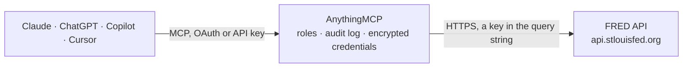

<!-- Generated by scripts/export-github-catalog.mjs in the anythingmcp-website repository. Do not edit by hand. -->

# FRED MCP connector

Economic data from FRED, the Federal Reserve Bank of St. The AnythingMCP connector gives Claude, ChatGPT, Microsoft Copilot, Cursor and Gemini 21 MCP tools for FRED, all read-only.

**Category:** [Finance](../finance.md) · **Tools:** 21 · **Setup guide:** [anythingmcp.com](https://anythingmcp.com/guides/fred-to-mcp) · [Deutsch](https://anythingmcp.com/de/guides/fred-to-mcp) · [Italiano](https://anythingmcp.com/it/guides/fred-to-mcp) · [Español](https://anythingmcp.com/es/guides/fred-to-mcp) · [日本語](https://anythingmcp.com/ja/guides/fred-to-mcp) · [Русский](https://anythingmcp.com/ru/guides/fred-to-mcp) · [中文](https://anythingmcp.com/zh/guides/fred-to-mcp)

## Start without code

No installation and no terminal: AnythingMCP Cloud runs the FRED connector for you, operated by helpcode.ai in Frankfurt, Germany.

1. **Click the button above** and create an account or sign in. The FRED connector opens, ready to install.
2. **Paste the API key or token from your FRED account.** Every click is in the [step-by-step guide](https://anythingmcp.com/guides/fred-to-mcp).
3. **Click Install.** AnythingMCP shows the address of your MCP server.
4. **Add that address to your assistant:** [Claude](https://anythingmcp.com/guides/connect-fred-to-claude) · [ChatGPT](https://anythingmcp.com/guides/connect-fred-to-chatgpt) · [Microsoft Copilot](https://anythingmcp.com/guides/connect-fred-to-copilot) · [Cursor](https://anythingmcp.com/guides/connect-fred-to-cursor) · [Gemini CLI](https://anythingmcp.com/guides/connect-fred-to-gemini) · [Meta Muse](https://anythingmcp.com/guides/connect-fred-to-muse).
5. **Ask your first question**, for example: *What's the latest CPIAUCSL value and its observation date for US CPI-All Urban Consumers?*

Prefer help with the setup? [Talk to us](https://anythingmcp.com/contact).

## How it works

- **The AI client** speaks MCP (Streamable HTTP) to AnythingMCP and only sees tool names, descriptions and results. It never gets the FRED credentials.
- **AnythingMCP** checks the client's role, builds the call from the tool definition, adds the credentials (a key in the query string), calls FRED, logs the call and returns the result.
- **FRED** sees an ordinary API client with the rights of the account the credentials belong to.

## Tools

| Tool | What it does | Access |
|---|---|---|
| [`fred_search_series`](#fred_search_series) | Search FRED economic data series by words or by series id: GDP, inflation, unemployment, interest rates, exchange rates, house prices and about 800,000 more… | read |
| [`fred_get_series`](#fred_get_series) | Get the metadata of one FRED series: title, frequency, units, seasonal adjustment, first and last observation date, last update, popularity and the notes… | read |
| [`fred_get_observations`](#fred_get_observations) | Get the data values of a FRED series (date and value), newest first by default. | read |
| [`fred_get_series_categories`](#fred_get_series_categories) | List the FRED categories a series belongs to (id, name, parent_id), to find related series with fred_list_category_series. | read |
| [`fred_get_series_release`](#fred_get_series_release) | Get the statistical release a FRED series is published in (id, name, press release flag, link), e.g. Employment Situation for UNRATE. | read |
| [`fred_get_series_tags`](#fred_get_series_tags) | List the tags of a FRED series (name, group such as geo, freq, src, seas, notes, popularity, series count). | read |
| [`fred_list_vintage_dates`](#fred_list_vintage_dates) | List the vintage dates of a FRED series: the dates on which its data was published or revised (ALFRED). | read |
| [`fred_list_series_updates`](#fred_list_series_updates) | List FRED series updated recently, latest first: what changed today or within a time window. | read |
| [`fred_get_category`](#fred_get_category) | Get one FRED category (id, name, parent_id). | read |
| [`fred_list_category_children`](#fred_list_category_children) | List the subcategories of a FRED category (id, name, parent_id), to browse the topic tree from the root (0) down to the series. | read |
| [`fred_list_category_series`](#fred_list_category_series) | List the series in a FRED category (id, title, frequency, units, seasonal adjustment, date range, popularity), optionally filtered by frequency, units,… | read |
| [`fred_list_releases`](#fred_list_releases) | List the statistical releases in FRED (id, name, press release flag, link), e.g. Employment Situation, Consumer Price Index, H.15 Selected Interest Rates. | read |
| [`fred_list_release_dates`](#fred_list_release_dates) | Release calendar across all FRED releases: which release came out, or is scheduled, on which date. | read |
| [`fred_get_release`](#fred_get_release) | Get one FRED release (id, name, press release flag, link to the publisher's page). | read |
| [`fred_get_release_dates`](#fred_get_release_dates) | Publication dates of one FRED release, all history by default. | read |
| [`fred_list_release_series`](#fred_list_release_series) | List the series published in one FRED release (id, title, frequency, units, seasonal adjustment, date range, popularity), optionally filtered by frequency,… | read |
| [`fred_list_sources`](#fred_list_sources) | List the data sources in FRED (id, name, link), e.g. Bureau of Labor Statistics, Bureau of Economic Analysis, Board of Governors of the Federal Reserve System. | read |
| [`fred_get_source`](#fred_get_source) | Get one FRED data source (id, name, link to the agency or publisher), e.g. 22 for the Bureau of Labor Statistics. | read |
| [`fred_list_source_releases`](#fred_list_source_releases) | List the releases of one FRED data source (id, name, press release flag, link). | read |
| [`fred_search_tags`](#fred_search_tags) | Search or list FRED tags (name, group, notes, popularity, number of series). | read |
| [`fred_list_tag_series`](#fred_list_tag_series) | List the FRED series that have all the given tags, e.g. gdp;germany or cpi;monthly;sa, with id, title, frequency, units, seasonal adjustment, date range and… | read |

## Tool reference

Every parameter as the AI client sees it in `tools/list`. Source: [`packages/backend/src/adapters/intl/fred.json`](../../../packages/backend/src/adapters/intl/fred.json).

### `fred_search_series`

Search FRED economic data series by words or by series id: GDP, inflation, unemployment, interest rates, exchange rates, house prices and about 800,000 more US and international series. Returns id, title, frequency, units, seasonal adjustment, date range and popularity; use the id with fred_get_observations.

**Access:** read · **Call:** `GET /series/search`

| Parameter | Type | Required | Description |
|---|---|---|---|
| `search_text` | string | yes | Words to search for, e.g. "consumer price index", "10-year treasury", "unemployment rate germany". |
| `search_type` | `full_text` \| `series_id` | no | full_text (default) searches titles, units, notes and tags; series_id matches ids and accepts * wildcards, e.g. DGS*. |
| `order_by` | `search_rank` \| `series_id` \| `title` \| `units` \| `frequency` \| `seasonal_adjustment` \| `realtime_start` \| `realtime_end` \| `last_updated` \| `observation_start` \| `observation_end` \| `popularity` \| `group_popularity` | no | Sort field; search_rank (default) is relevance, popularity puts the most used series first. |
| `sort_order` | `asc` \| `desc` | no | Sort direction. |
| `filter_variable` | `frequency` \| `units` \| `seasonal_adjustment` | no | Attribute to filter on, together with filter_value. |
| `filter_value` | string | no | Value of filter_variable, e.g. Monthly (frequency), Percent (units), Seasonally Adjusted (seasonal_adjustment). |
| `tag_names` | string | no | Semicolon-separated tags the series must all have, e.g. usa;nsa. Tag names come from fred_search_tags. |
| `exclude_tag_names` | string | no | Semicolon-separated tags the series must not have, e.g. discontinued. |
| `limit` | integer | no | Results per page, 1 to 1000. |
| `offset` | integer | no | How many results to skip, for paging. |

### `fred_get_series`

Get the metadata of one FRED series: title, frequency, units, seasonal adjustment, first and last observation date, last update, popularity and the notes that define it and name its source.

**Access:** read · **Call:** `GET /series`

| Parameter | Type | Required | Description |
|---|---|---|---|
| `series_id` | string | yes | FRED series id, e.g. GDP, UNRATE, CPIAUCSL, DGS10, FEDFUNDS. Find ids with fred_search_series. |
| `realtime_start` | string | no | Start of the real-time period, YYYY-MM-DD (ALFRED vintages). Leave empty for today. |
| `realtime_end` | string | no | End of the real-time period, YYYY-MM-DD. Leave empty for today. |

### `fred_get_observations`

Get the data values of a FRED series (date and value), newest first by default. Narrow the period with observation_start and observation_end, transform values with units (change, percent change, year-over-year), and aggregate to a lower frequency (e.g. daily to monthly) with frequency and aggregation_method. A value of "." means no data for that date.

**Access:** read · **Call:** `GET /series/observations`

| Parameter | Type | Required | Description |
|---|---|---|---|
| `series_id` | string | yes | FRED series id, e.g. GDP, UNRATE, CPIAUCSL, DGS10, FEDFUNDS. Find ids with fred_search_series. |
| `observation_start` | string | no | First observation date, YYYY-MM-DD. |
| `observation_end` | string | no | Last observation date, YYYY-MM-DD. |
| `units` | `lin` \| `chg` \| `ch1` \| `pch` \| `pc1` \| `pca` \| `cch` \| `cca` \| `log` | no | Value transformation: lin levels (default), chg change, ch1 change from a year ago, pch percent change, pc1 percent change from a year ago, pca compounded annual rate of change, cch continuously compounded rate of change, cca continuously compounded annual rate of change, log natural log. |
| `frequency` | `d` \| `w` \| `bw` \| `m` \| `q` \| `sa` \| `a` \| `wef` \| `weth` \| `wew` \| `wetu` \| `wem` \| `wesu` \| `wesa` \| `bwew` \| `bwem` | no | Aggregate to a lower frequency: d daily, w weekly, bw biweekly, m monthly, q quarterly, sa semiannual, a annual (wef, weth, wew, wetu, wem, wesu, wesa: weekly ending Friday to Saturday; bwew, bwem: biweekly ending Wednesday or Monday). Must not be higher than the series' own frequency. |
| `aggregation_method` | `avg` \| `sum` \| `eop` | no | How frequency aggregates: avg average (default), sum, eop end of period. Only used with frequency. |
| `sort_order` | `asc` \| `desc` | no | desc (default here) returns the latest observations first; asc the oldest first. |
| `limit` | integer | no | Observations to return, 1 to 100000 (default here 1000). With sort_order desc and limit 1 you get the latest value. |
| `offset` | integer | no | How many results to skip, for paging. |
| `realtime_start` | string | no | Start of the real-time period, YYYY-MM-DD. To see the series as it was published on a past date (a vintage from fred_list_vintage_dates), set realtime_start and realtime_end to that same date. |
| `realtime_end` | string | no | End of the real-time period, YYYY-MM-DD. Leave empty for today. |

### `fred_get_series_categories`

List the FRED categories a series belongs to (id, name, parent_id), to find related series with fred_list_category_series.

**Access:** read · **Call:** `GET /series/categories`

| Parameter | Type | Required | Description |
|---|---|---|---|
| `series_id` | string | yes | FRED series id, e.g. GDP, UNRATE, CPIAUCSL, DGS10, FEDFUNDS. Find ids with fred_search_series. |

### `fred_get_series_release`

Get the statistical release a FRED series is published in (id, name, press release flag, link), e.g. Employment Situation for UNRATE. Use the release id with fred_get_release_dates for the publication calendar.

**Access:** read · **Call:** `GET /series/release`

| Parameter | Type | Required | Description |
|---|---|---|---|
| `series_id` | string | yes | FRED series id, e.g. GDP, UNRATE, CPIAUCSL, DGS10, FEDFUNDS. Find ids with fred_search_series. |

### `fred_get_series_tags`

List the tags of a FRED series (name, group such as geo, freq, src, seas, notes, popularity, series count). Tags combine in fred_list_tag_series to find similar series.

**Access:** read · **Call:** `GET /series/tags`

| Parameter | Type | Required | Description |
|---|---|---|---|
| `series_id` | string | yes | FRED series id, e.g. GDP, UNRATE, CPIAUCSL, DGS10, FEDFUNDS. Find ids with fred_search_series. |
| `order_by` | `series_count` \| `popularity` \| `created` \| `name` \| `group_id` | no | Sort field, default series_count. |
| `sort_order` | `asc` \| `desc` | no | Sort direction. |

### `fred_list_vintage_dates`

List the vintage dates of a FRED series: the dates on which its data was published or revised (ALFRED). Pass one of them as realtime_start and realtime_end to fred_get_observations to see the data as first published.

**Access:** read · **Call:** `GET /series/vintagedates`

| Parameter | Type | Required | Description |
|---|---|---|---|
| `series_id` | string | yes | FRED series id, e.g. GDP, UNRATE, CPIAUCSL, DGS10, FEDFUNDS. Find ids with fred_search_series. |
| `realtime_start` | string | no | Earliest vintage date, YYYY-MM-DD (default 1776-07-04, all). |
| `realtime_end` | string | no | Latest vintage date, YYYY-MM-DD (default 9999-12-31, all). |
| `sort_order` | `asc` \| `desc` | no | Sort direction. |
| `limit` | integer | no | Results per page, 1 to 10000. |
| `offset` | integer | no | How many results to skip, for paging. |

### `fred_list_series_updates`

List FRED series updated recently, latest first: what changed today or within a time window. Filter to macro (national) or regional series.

**Access:** read · **Call:** `GET /series/updates`

| Parameter | Type | Required | Description |
|---|---|---|---|
| `filter_value` | `all` \| `macro` \| `regional` | no | all (default), macro for national series, regional for state, county and metro series. |
| `start_time` | string | no | Start of the update window, YYYYMMDDHhmm in US Central time, e.g. 202610270800. Needs end_time. |
| `end_time` | string | no | End of the update window, YYYYMMDDHhmm. Needs start_time. |
| `limit` | integer | no | Results per page, 1 to 1000. |
| `offset` | integer | no | How many results to skip, for paging. |

### `fred_get_category`

Get one FRED category (id, name, parent_id). Category 0 is the root; its children are the top-level topics such as Money, Banking and Finance or Production and Business Activity.

**Access:** read · **Call:** `GET /category`

| Parameter | Type | Required | Description |
|---|---|---|---|
| `category_id` | integer | no | FRED category id; 0 is the root category. Browse with fred_list_category_children. |

### `fred_list_category_children`

List the subcategories of a FRED category (id, name, parent_id), to browse the topic tree from the root (0) down to the series.

**Access:** read · **Call:** `GET /category/children`

| Parameter | Type | Required | Description |
|---|---|---|---|
| `category_id` | integer | no | FRED category id; 0 is the root category. Browse with fred_list_category_children. |

### `fred_list_category_series`

List the series in a FRED category (id, title, frequency, units, seasonal adjustment, date range, popularity), optionally filtered by frequency, units, seasonal adjustment or tags.

**Access:** read · **Call:** `GET /category/series`

| Parameter | Type | Required | Description |
|---|---|---|---|
| `category_id` | integer | yes | FRED category id; 0 is the root category. Browse with fred_list_category_children. |
| `order_by` | `series_id` \| `title` \| `units` \| `frequency` \| `seasonal_adjustment` \| `realtime_start` \| `realtime_end` \| `last_updated` \| `observation_start` \| `observation_end` \| `popularity` \| `group_popularity` | no | Sort field. popularity puts the most used series first. |
| `sort_order` | `asc` \| `desc` | no | Sort direction. |
| `filter_variable` | `frequency` \| `units` \| `seasonal_adjustment` | no | Attribute to filter on, together with filter_value. |
| `filter_value` | string | no | Value of filter_variable, e.g. Monthly (frequency), Percent (units), Seasonally Adjusted (seasonal_adjustment). |
| `tag_names` | string | no | Semicolon-separated tags the series must all have, e.g. usa;nsa. Tag names come from fred_search_tags. |
| `exclude_tag_names` | string | no | Semicolon-separated tags the series must not have, e.g. discontinued. |
| `limit` | integer | no | Results per page, 1 to 1000. |
| `offset` | integer | no | How many results to skip, for paging. |

### `fred_list_releases`

List the statistical releases in FRED (id, name, press release flag, link), e.g. Employment Situation, Consumer Price Index, H.15 Selected Interest Rates.

**Access:** read · **Call:** `GET /releases`

| Parameter | Type | Required | Description |
|---|---|---|---|
| `order_by` | `release_id` \| `name` \| `press_release` \| `realtime_start` \| `realtime_end` | no | Sort field, default release_id. |
| `sort_order` | `asc` \| `desc` | no | Sort direction. |
| `limit` | integer | no | Results per page, 1 to 1000. |
| `offset` | integer | no | How many results to skip, for paging. |

### `fred_list_release_dates`

Release calendar across all FRED releases: which release came out, or is scheduled, on which date. By default from the first day of the current year; set realtime_start and realtime_end for a window and include_release_dates_with_no_data true for upcoming dates.

**Access:** read · **Call:** `GET /releases/dates`

| Parameter | Type | Required | Description |
|---|---|---|---|
| `realtime_start` | string | no | First date of the window, YYYY-MM-DD (default: 1 January of the current year). |
| `realtime_end` | string | no | Last date of the window, YYYY-MM-DD (default: 9999-12-31). |
| `include_release_dates_with_no_data` | boolean | no | true also lists scheduled dates without data yet, i.e. the upcoming calendar. |
| `order_by` | `release_date` \| `release_id` \| `release_name` | no | Sort field, default release_date. |
| `sort_order` | `asc` \| `desc` | no | Sort direction. |
| `limit` | integer | no | Results per page, 1 to 1000. |
| `offset` | integer | no | How many results to skip, for paging. |

### `fred_get_release`

Get one FRED release (id, name, press release flag, link to the publisher's page).

**Access:** read · **Call:** `GET /release`

| Parameter | Type | Required | Description |
|---|---|---|---|
| `release_id` | integer | yes | FRED release id, e.g. 53 (Gross Domestic Product), 10 (Consumer Price Index), 50 (Employment Situation). Find ids with fred_list_releases or fred_get_series_release. |

### `fred_get_release_dates`

Publication dates of one FRED release, all history by default. Use sort_order desc for the latest, and include_release_dates_with_no_data true to see the next scheduled dates.

**Access:** read · **Call:** `GET /release/dates`

| Parameter | Type | Required | Description |
|---|---|---|---|
| `release_id` | integer | yes | FRED release id, e.g. 53 (Gross Domestic Product), 10 (Consumer Price Index), 50 (Employment Situation). Find ids with fred_list_releases or fred_get_series_release. |
| `include_release_dates_with_no_data` | boolean | no | true also lists scheduled future dates. |
| `sort_order` | `asc` \| `desc` | no | Sort direction. |
| `limit` | integer | no | Results per page, 1 to 10000. |
| `offset` | integer | no | How many results to skip, for paging. |

### `fred_list_release_series`

List the series published in one FRED release (id, title, frequency, units, seasonal adjustment, date range, popularity), optionally filtered by frequency, units, seasonal adjustment or tags.

**Access:** read · **Call:** `GET /release/series`

| Parameter | Type | Required | Description |
|---|---|---|---|
| `release_id` | integer | yes | FRED release id, e.g. 53 (Gross Domestic Product), 10 (Consumer Price Index), 50 (Employment Situation). Find ids with fred_list_releases or fred_get_series_release. |
| `order_by` | `series_id` \| `title` \| `units` \| `frequency` \| `seasonal_adjustment` \| `realtime_start` \| `realtime_end` \| `last_updated` \| `observation_start` \| `observation_end` \| `popularity` \| `group_popularity` | no | Sort field. popularity puts the most used series first. |
| `sort_order` | `asc` \| `desc` | no | Sort direction. |
| `filter_variable` | `frequency` \| `units` \| `seasonal_adjustment` | no | Attribute to filter on, together with filter_value. |
| `filter_value` | string | no | Value of filter_variable, e.g. Monthly (frequency), Percent (units), Seasonally Adjusted (seasonal_adjustment). |
| `tag_names` | string | no | Semicolon-separated tags the series must all have, e.g. usa;nsa. Tag names come from fred_search_tags. |
| `exclude_tag_names` | string | no | Semicolon-separated tags the series must not have, e.g. discontinued. |
| `limit` | integer | no | Results per page, 1 to 1000. |
| `offset` | integer | no | How many results to skip, for paging. |

### `fred_list_sources`

List the data sources in FRED (id, name, link), e.g. Bureau of Labor Statistics, Bureau of Economic Analysis, Board of Governors of the Federal Reserve System.

**Access:** read · **Call:** `GET /sources`

| Parameter | Type | Required | Description |
|---|---|---|---|
| `order_by` | `source_id` \| `name` \| `realtime_start` \| `realtime_end` | no | Sort field, default source_id. |
| `sort_order` | `asc` \| `desc` | no | Sort direction. |
| `limit` | integer | no | Results per page, 1 to 1000. |
| `offset` | integer | no | How many results to skip, for paging. |

### `fred_get_source`

Get one FRED data source (id, name, link to the agency or publisher), e.g. 22 for the Bureau of Labor Statistics.

**Access:** read · **Call:** `GET /source`

| Parameter | Type | Required | Description |
|---|---|---|---|
| `source_id` | integer | yes | FRED source id, e.g. 1 (Board of Governors), 18 (BEA), 22 (BLS). Find ids with fred_list_sources. |

### `fred_list_source_releases`

List the releases of one FRED data source (id, name, press release flag, link).

**Access:** read · **Call:** `GET /source/releases`

| Parameter | Type | Required | Description |
|---|---|---|---|
| `source_id` | integer | yes | FRED source id, e.g. 1 (Board of Governors), 18 (BEA), 22 (BLS). Find ids with fred_list_sources. |

### `fred_search_tags`

Search or list FRED tags (name, group, notes, popularity, number of series). Tags describe series by geography (geo), frequency (freq), source (src), seasonal adjustment (seas), release (rls) and topic (gen); combine them in fred_list_tag_series.

**Access:** read · **Call:** `GET /tags`

| Parameter | Type | Required | Description |
|---|---|---|---|
| `search_text` | string | no | Words to find in tag names and notes, e.g. inflation, germany. |
| `tag_names` | string | no | Semicolon-separated tag names to return exactly, e.g. monthly;usa. |
| `tag_group_id` | `freq` \| `gen` \| `geo` \| `geot` \| `rls` \| `seas` \| `src` \| `cc` | no | Only tags of one group: freq frequency, gen general or concept, geo geography, geot geography type, rls release, seas seasonal adjustment, src source, cc citation and copyright. |
| `order_by` | `series_count` \| `popularity` \| `created` \| `name` \| `group_id` | no | Sort field, default series_count. |
| `sort_order` | `asc` \| `desc` | no | Sort direction. |
| `limit` | integer | no | Results per page, 1 to 1000. |
| `offset` | integer | no | How many results to skip, for paging. |

### `fred_list_tag_series`

List the FRED series that have all the given tags, e.g. gdp;germany or cpi;monthly;sa, with id, title, frequency, units, seasonal adjustment, date range and popularity.

**Access:** read · **Call:** `GET /tags/series`

| Parameter | Type | Required | Description |
|---|---|---|---|
| `tag_names` | string | yes | Semicolon-separated tags the series must all have, e.g. gdp;germany. Tag names come from fred_search_tags or fred_get_series_tags. |
| `exclude_tag_names` | string | no | Semicolon-separated tags the series must not have, e.g. discontinued. |
| `order_by` | `series_id` \| `title` \| `units` \| `frequency` \| `seasonal_adjustment` \| `realtime_start` \| `realtime_end` \| `last_updated` \| `observation_start` \| `observation_end` \| `popularity` \| `group_popularity` | no | Sort field. popularity puts the most used series first. |
| `sort_order` | `asc` \| `desc` | no | Sort direction. |
| `limit` | integer | no | Results per page, 1 to 1000. |
| `offset` | integer | no | How many results to skip, for paging. |

## Run it yourself

AnythingMCP is open source (AGPL-3.0). [Run it with Docker](../../../README.md#run-it-yourself), open **Connectors → Store**, pick **FRED** and enter `FRED_API_KEY`, then add your MCP server URL to the AI client.

[← Finance connectors](../finance.md) · [All categories](../README.md)
