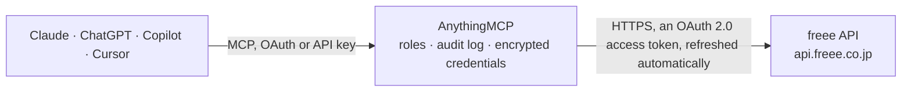

<!-- Generated by scripts/export-github-catalog.mjs in the anythingmcp-website repository. Do not edit by hand. -->

# freee MCP connector

freee Accounting (freee会計) and freee Invoice (freee請求書), the Japanese cloud accounting suite: deals, partners, account items, tax codes, items, sections, memo tags, bank and card lines, manual … The AnythingMCP connector gives Claude, ChatGPT, Microsoft Copilot, Cursor and Gemini 48 MCP tools for freee: 33 read and 15 can change data.

**Category:** [Accounting](../accounting.md) · **Tools:** 48 · **Setup guide:** [anythingmcp.com](https://anythingmcp.com/guides/freee-to-mcp) · [Deutsch](https://anythingmcp.com/de/guides/freee-to-mcp) · [Italiano](https://anythingmcp.com/it/guides/freee-to-mcp) · [Español](https://anythingmcp.com/es/guides/freee-to-mcp) · [日本語](https://anythingmcp.com/ja/guides/freee-to-mcp) · [Русский](https://anythingmcp.com/ru/guides/freee-to-mcp) · [中文](https://anythingmcp.com/zh/guides/freee-to-mcp)

## Start without code

No installation and no terminal: AnythingMCP Cloud runs the freee connector for you, operated by helpcode.ai in Frankfurt, Germany.

1. **Click the button above** and create an account or sign in. The freee connector opens, ready to install.
2. **Sign in with your freee account** when AnythingMCP asks. The first time, an admin creates a small app in the freee developer console. Every click is in the [step-by-step guide](https://anythingmcp.com/guides/freee-to-mcp).
3. **Click Install.** AnythingMCP shows the address of your MCP server.
4. **Add that address to your assistant:** [Claude](https://anythingmcp.com/guides/connect-freee-to-claude) · [ChatGPT](https://anythingmcp.com/guides/connect-freee-to-chatgpt) · [Microsoft Copilot](https://anythingmcp.com/guides/connect-freee-to-copilot) · [Cursor](https://anythingmcp.com/guides/connect-freee-to-cursor) · [Gemini CLI](https://anythingmcp.com/guides/connect-freee-to-gemini) · [Meta Muse](https://anythingmcp.com/guides/connect-freee-to-muse).
5. **Ask your first question**, for example: *請求書番号INV-2026-0415の請求書の支払いステータスと合計金額を教えて*

Prefer help with the setup? [Talk to us](https://anythingmcp.com/contact).

## How it works

- **The AI client** speaks MCP (Streamable HTTP) to AnythingMCP and only sees tool names, descriptions and results. It never gets the freee credentials.
- **AnythingMCP** checks the client's role, builds the call from the tool definition, adds the credentials (an OAuth 2.0 access token, refreshed automatically), calls freee, logs the call and returns the result.
- **freee** sees an ordinary API client with the rights of the account the credentials belong to.

## Tools

| Tool | What it does | Access |
|---|---|---|
| [`freee_get_me`](#freee_get_me) | Who the connector acts as: the freee user (id, email, display name) and every company (事業所) the user belongs to, with company id, name and role. | read |
| [`freee_list_companies`](#freee_list_companies) | List the companies (事業所) the signed-in user can open: id, display name, name kana, company number and role. | read |
| [`freee_get_company`](#freee_get_company) | Read one company: name, address, fiscal years (fiscal_years with start and end dates), tax settings and plan. | read |
| [`freee_list_users`](#freee_list_users) | List the users of a company with their id, email, display name and role. | read |
| [`freee_list_deals`](#freee_list_deals) | List deals (取引: income or expense) with their lines, amounts, due amount, partner and payments. | read |
| [`freee_get_deal`](#freee_get_deal) | Read one deal (取引) with its lines (details), payments, renews (+更新) and attached receipts. | read |
| [`freee_create_deal`](#freee_create_deal) | Register a deal (取引): an income or expense with its lines and, optionally, the payment. | write |
| [`freee_update_deal`](#freee_update_deal) | Update a deal (取引). | write |
| [`freee_create_deal_payment`](#freee_create_deal_payment) | Record a payment (支払行) on an existing deal, e.g. when an invoice was paid into the bank account. | write |
| [`freee_delete_deal`](#freee_delete_deal) | Delete a deal (取引) with its lines and payments for good. | write |
| [`freee_list_partners`](#freee_list_partners) | List partners (取引先) with id, code, name, long name, kana, contact, invoice registration number (インボイス登録番号) and bank account. | read |
| [`freee_get_partner`](#freee_get_partner) | Read one partner (取引先) with address, contact, invoice settings, payment terms and bank account. | read |
| [`freee_create_partner`](#freee_create_partner) | Create a partner (取引先). | write |
| [`freee_update_partner`](#freee_update_partner) | Update a partner (取引先). | write |
| [`freee_list_account_items`](#freee_list_account_items) | List account items (勘定科目) with id, name, code, category, default tax code and shortcut. | read |
| [`freee_get_account_item`](#freee_get_account_item) | Read one account item (勘定科目) with its category, default tax code, group and searchable settings. | read |
| [`freee_list_items`](#freee_list_items) | List items (品目) with id, name, code and shortcuts; the item_id goes into deal and journal lines. | read |
| [`freee_create_item`](#freee_create_item) | Create an item (品目). | write |
| [`freee_list_sections`](#freee_list_sections) | List sections (部門) with id, name, long name, code and parent section. | read |
| [`freee_create_section`](#freee_create_section) | Create a section (部門). | write |
| [`freee_list_tags`](#freee_list_tags) | List memo tags (メモタグ) with id, name and shortcuts; the ids go into tag_ids of deal and journal lines. | read |
| [`freee_create_tag`](#freee_create_tag) | Create a memo tag (メモタグ). | write |
| [`freee_list_taxes`](#freee_list_taxes) | List the tax codes (税区分) of the company: code, name, display category (tax_10, tax_r8 ...) and whether each is in use. | read |
| [`freee_list_walletables`](#freee_list_walletables) | List walletables (口座): bank accounts, credit cards and other wallets (cash, e-money), with id, type and name; optionally balances, last sync time and sync… | read |
| [`freee_list_wallet_txns`](#freee_list_wallet_txns) | List wallet transactions (口座明細): bank and card statement lines with date, amount, due amount, balance, description and status (unprocessed, settled, ignored). | read |
| [`freee_get_wallet_txn`](#freee_get_wallet_txn) | Read one wallet transaction (口座明細): date, amount, due amount, balance, description, walletable and status. | read |
| [`freee_list_transfers`](#freee_list_transfers) | List transfers (取引（振替）) between the company own walletables, e.g. bank to cash, with date, amount and both walletables. | read |
| [`freee_list_manual_journals`](#freee_list_manual_journals) | List manual journals (振替伝票) with their debit and credit lines. | read |
| [`freee_get_manual_journal`](#freee_get_manual_journal) | Read one manual journal (振替伝票) with its debit and credit lines, partners, sections and tags. | read |
| [`freee_create_manual_journal`](#freee_create_manual_journal) | Post a manual journal (振替伝票): debit and credit lines whose totals must match, up to 100 lines. | write |
| [`freee_delete_manual_journal`](#freee_delete_manual_journal) | Delete a manual journal (振替伝票) for good. | write |
| [`freee_request_journals`](#freee_request_journals) | Ask freee to prepare the journal book (仕訳帳) of a period as a file: CSV (freee generic, Yayoi) or PDF. | read |
| [`freee_get_journals_status`](#freee_get_journals_status) | Check a journal book request from freee_request_journals: status enqueued, working, uploaded or failed. | read |
| [`freee_download_journals`](#freee_download_journals) | Download the prepared journal book file (CSV or PDF) once freee_get_journals_status says uploaded. | read |
| [`freee_get_trial_balance`](#freee_get_trial_balance) | Read a trial balance report (試算表): balance sheet (trial_bs), profit and loss (trial_pl) or manufacturing cost (trial_cr), for one period or compared with… | read |
| [`freee_get_trial_pl_sections`](#freee_get_trial_pl_sections) | Read the profit and loss (損益計算書) compared side by side for 1 to 5 sections (部門比較). | read |
| [`freee_list_general_ledgers`](#freee_list_general_ledgers) | Read the general ledger (総勘定元帳, beta) for a period: per account item, every entry with date, counter account, partner, description, debit, credit and… | read |
| [`freee_list_receipts`](#freee_list_receipts) | List files in the file box (ファイルボックス, receipts and invoices uploaded as evidence) uploaded in a date range: id, status, description, issue date, amount when… | read |
| [`freee_get_receipt`](#freee_get_receipt) | Read one file box entry (証憑ファイル) with its metadata and the deals it is linked to. | read |
| [`freee_list_invoices`](#freee_list_invoices) | List invoices (請求書) of freee請求書 (freee Invoice): id, number, subject, partner, billing and payment dates, total, payment, sending and deal status. | read |
| [`freee_get_invoice`](#freee_get_invoice) | Read one invoice (請求書) of freee請求書 with its lines, tax breakdown, partner details and statuses. | read |
| [`freee_list_invoice_templates`](#freee_list_invoice_templates) | List the invoice layouts (帳票テンプレート) usable for new invoices, with their id and name. | read |
| [`freee_create_invoice`](#freee_create_invoice) | Create an invoice (請求書) in freee請求書. | write |
| [`freee_cancel_invoice`](#freee_cancel_invoice) | Cancel (取消) an invoice of freee請求書. | write |
| [`freee_uncancel_invoice`](#freee_uncancel_invoice) | Restore an invoice that was canceled in freee請求書 (取消された請求書の復元), back to its previous status. | write |
| [`freee_list_quotations`](#freee_list_quotations) | List quotations (見積書) of freee請求書: id, number, subject, partner, quotation and expiry dates, total, sending and cancel status. | read |
| [`freee_get_quotation`](#freee_get_quotation) | Read one quotation (見積書) of freee請求書 with its lines and totals. | read |
| [`freee_create_quotation`](#freee_create_quotation) | Create a quotation (見積書) in freee請求書, created unsent. | write |

## Tool reference

Every parameter as the AI client sees it in `tools/list`. Source: [`packages/backend/src/adapters/jp/freee.json`](../../../packages/backend/src/adapters/jp/freee.json).

### `freee_get_me`

Who the connector acts as: the freee user (id, email, display name) and every company (事業所) the user belongs to, with company id, name and role. The first call: it gives the company_id every other tool needs.

**Access:** read · **Call:** `GET /api/1/users/me`

No parameters.

### `freee_list_companies`

List the companies (事業所) the signed-in user can open: id, display name, name kana, company number and role.

**Access:** read · **Call:** `GET /api/1/companies`

No parameters.

### `freee_get_company`

Read one company: name, address, fiscal years (fiscal_years with start and end dates), tax settings and plan. Optional flags also return the master lists in the same call (account items, tax codes, items, partners, sections, tags, walletables); prefer the dedicated list tools for big lists.

**Access:** read · **Call:** `GET /api/1/companies/{company_id}`

| Parameter | Type | Required | Description |
|---|---|---|---|
| `company_id` | integer | yes | Company (事業所) ID from freee_get_me or freee_list_companies. |
| `details` | boolean | no | true adds all master lists below at once (large). |
| `account_items` | boolean | no | true adds the account items (勘定科目). |
| `taxes` | boolean | no | true adds the tax codes (税区分). |
| `items` | boolean | no | true adds the items (品目). |
| `partners` | boolean | no | true adds the partners (取引先). |
| `sections` | boolean | no | true adds the sections (部門). |
| `tags` | boolean | no | true adds the memo tags (メモタグ). |
| `walletables` | boolean | no | true adds the walletables (口座). |

### `freee_list_users`

List the users of a company with their id, email, display name and role. Useful to see who may approve or whose name appears on a record.

**Access:** read · **Call:** `GET /api/1/users`

| Parameter | Type | Required | Description |
|---|---|---|---|
| `company_id` | integer | yes | Company (事業所) ID from freee_get_me or freee_list_companies. |
| `limit` | integer | no | Records per call (default 50, at most 3000). |

### `freee_list_deals`

List deals (取引: income or expense) with their lines, amounts, due amount, partner and payments. Filter by type, settlement status, partner, account item and dates. Up to 100 per call; meta.total_count gives the number of matches.

**Access:** read · **Call:** `GET /api/1/deals`

| Parameter | Type | Required | Description |
|---|---|---|---|
| `company_id` | integer | yes | Company (事業所) ID from freee_get_me or freee_list_companies. |
| `type` | `income` \| `expense` | no | income (収入) or expense (支出). |
| `status` | `unsettled` \| `settled` | no | unsettled (未決済) or settled (完了). |
| `partner_id` | integer | no | Partner id from freee_list_partners. |
| `partner_code` | string | no | Partner code (only when partner codes are enabled); not together with partner_id. |
| `account_item_id` | integer | no | Account item id from freee_list_account_items. |
| `start_issue_date` | string | no | Issue date from, yyyy-mm-dd (JST). |
| `end_issue_date` | string | no | Issue date to, yyyy-mm-dd (JST). |
| `start_due_date` | string | no | Due date from, yyyy-mm-dd (JST). |
| `end_due_date` | string | no | Due date to, yyyy-mm-dd (JST). |
| `start_renew_date` | string | no | +更新 (renew) date from, yyyy-mm-dd (JST). |
| `end_renew_date` | string | no | +更新 (renew) date to, yyyy-mm-dd (JST). |
| `min_due_amount` | integer | no | Only deals with at least this unpaid amount (JPY). |
| `accruals` | `without` \| `with` | no | with also returns the receivable and payable lines (債権債務行); default without. |
| `offset` | integer | no | Records to skip, for paging (default 0). |
| `limit` | integer | no | Records per call (default 20, at most 100). |

### `freee_get_deal`

Read one deal (取引) with its lines (details), payments, renews (+更新) and attached receipts.

**Access:** read · **Call:** `GET /api/1/deals/{id}`

| Parameter | Type | Required | Description |
|---|---|---|---|
| `company_id` | integer | yes | Company (事業所) ID from freee_get_me or freee_list_companies. |
| `id` | integer | yes | Deal id. |
| `accruals` | `without` \| `with` | no | with also returns the receivable and payable lines. |

### `freee_create_deal`

Register a deal (取引): an income or expense with its lines and, optionally, the payment. Returns the deal with its id. Use freee_list_taxes for tax codes and freee_list_account_items for account items.

**Access:** write · **Call:** `POST /api/1/deals`

| Parameter | Type | Required | Description |
|---|---|---|---|
| `company_id` | integer | yes | Company (事業所) ID from freee_get_me or freee_list_companies. |
| `type` | `income` \| `expense` | yes | income (収入) or expense (支出). |
| `issue_date` | string | yes | Issue date (発生日), yyyy-mm-dd (JST). |
| `due_date` | string | no | Due date (支払期日), yyyy-mm-dd (JST). |
| `partner_id` | integer | no | Partner id; or partner_code. |
| `partner_code` | string | no | Partner code, when partner codes are enabled; not together with partner_id. |
| `ref_number` | string | no | Reference number (管理番号). |
| `details` | object[] | yes | Deal lines (up to 100). Each needs tax_code (from freee_list_taxes), account_item_id (from freee_list_account_items) and amount in JPY including tax; optional item_id, section_id, tag_ids, description, vat. Example: [{"tax_code": 136, "account_item_id": 101, "amount": 11000, "description": "Consulting"}]. |
| `payments` | object[] | no | Optional payments that settle the deal right away: [{"date": "2026-10-31", "from_walletable_type": "bank_account", "from_walletable_id": 1, "amount": 11000}]. Without payments the deal stays unsettled (未決済). |
| `receipt_ids` | integer[] | no | Receipt (ファイルボックス) ids to attach, from freee_list_receipts. |

### `freee_update_deal`

Update a deal (取引). Send the whole set of lines: lines without their id are added and existing lines missing from details are deleted, so read the deal with freee_get_deal first and keep the line ids. Payments change through freee_create_deal_payment.

**Access:** write · **Call:** `PUT /api/1/deals/{id}`

| Parameter | Type | Required | Description |
|---|---|---|---|
| `company_id` | integer | yes | Company (事業所) ID from freee_get_me or freee_list_companies. |
| `id` | integer | yes | Deal id. |
| `type` | `income` \| `expense` | yes | income or expense. |
| `issue_date` | string | yes | Issue date, yyyy-mm-dd (JST). |
| `due_date` | string | no | Due date, yyyy-mm-dd (JST). |
| `partner_id` | integer | no | Partner id. |
| `partner_code` | string | no | Partner code; not together with partner_id. |
| `ref_number` | string | no | Reference number (管理番号). |
| `details` | object[] | yes | Deal lines (up to 100). Each needs tax_code (from freee_list_taxes), account_item_id (from freee_list_account_items) and amount in JPY including tax; optional item_id, section_id, tag_ids, description, vat. Example: [{"tax_code": 136, "account_item_id": 101, "amount": 11000, "description": "Consulting"}]. |
| `receipt_ids` | integer[] | no | Receipt ids; when given they replace the attached files. |

### `freee_create_deal_payment`

Record a payment (支払行) on an existing deal, e.g. when an invoice was paid into the bank account. A deal is settled when its payments reach the amount.

**Access:** write · **Call:** `POST /api/1/deals/{id}/payments`

| Parameter | Type | Required | Description |
|---|---|---|---|
| `company_id` | integer | yes | Company (事業所) ID from freee_get_me or freee_list_companies. |
| `id` | integer | yes | Deal id. |
| `date` | string | yes | Payment date, yyyy-mm-dd (JST). |
| `from_walletable_type` | `bank_account` \| `credit_card` \| `wallet` \| `private_account_item` | yes | bank_account, credit_card, wallet or private_account_item. |
| `from_walletable_id` | integer | yes | Walletable id from freee_list_walletables. |
| `amount` | integer | yes | Amount in JPY. |

### `freee_delete_deal`

Delete a deal (取引) with its lines and payments for good. Installed switched off.

**Access:** write · **Call:** `DELETE /api/1/deals/{id}`

| Parameter | Type | Required | Description |
|---|---|---|---|
| `company_id` | integer | yes | Company (事業所) ID from freee_get_me or freee_list_companies. |
| `id` | integer | yes | Deal id. |

### `freee_list_partners`

List partners (取引先) with id, code, name, long name, kana, contact, invoice registration number (インボイス登録番号) and bank account. Search by keyword (name, code, kana, shortcuts).

**Access:** read · **Call:** `GET /api/1/partners`

| Parameter | Type | Required | Description |
|---|---|---|---|
| `company_id` | integer | yes | Company (事業所) ID from freee_get_me or freee_list_companies. |
| `keyword` | string | no | Partial match on code, name, long name, kana or shortcuts; separate several words with spaces for AND. |
| `start_update_date` | string | no | Updated from, yyyy-mm-dd (JST). |
| `end_update_date` | string | no | Updated to, yyyy-mm-dd (JST). |
| `offset` | integer | no | Records to skip, for paging (default 0). |
| `limit` | integer | no | Records per call (default 50, at most 3000). |

### `freee_get_partner`

Read one partner (取引先) with address, contact, invoice settings, payment terms and bank account.

**Access:** read · **Call:** `GET /api/1/partners/{id}`

| Parameter | Type | Required | Description |
|---|---|---|---|
| `company_id` | integer | yes | Company (事業所) ID from freee_get_me or freee_list_companies. |
| `id` | integer | yes | Partner id. |

### `freee_create_partner`

Create a partner (取引先). The name must be unique in the company; code is required when partner codes are enabled.

**Access:** write · **Call:** `POST /api/1/partners`

| Parameter | Type | Required | Description |
|---|---|---|---|
| `company_id` | integer | yes | Company (事業所) ID from freee_get_me or freee_list_companies. |
| `code` | string | no | Partner code; required when partner codes are enabled, otherwise leave out. |
| `name` | string | yes | Partner name (取引先名), unique in the company, up to 255 characters. |
| `long_name` | string | no | Official name (正式名称) printed on invoices. |
| `name_kana` | string | no | Name in full-width katakana (カナ名称). |
| `shortcut1` | string | no | Search shortcut 1. |
| `shortcut2` | string | no | Search shortcut 2. |
| `org_code` | `1` \| `2` | no | 1 corporation (法人), 2 individual (個人). |
| `country_code` | `JP` \| `ZZ` | no | JP (domestic, default) or ZZ (abroad). |
| `default_title` | string | no | Honorific on invoices: 御中, 様 or (空白). |
| `phone` | string | no | Phone number. |
| `contact_name` | string | no | Contact person name. |
| `email` | string | no | Contact email. |
| `qualified_invoice_issuer` | boolean | no | true when the partner is a registered qualified invoice issuer (適格請求書発行事業者). |
| `invoice_registration_number` | string | no | Invoice registration number: T followed by 13 digits. |
| `address_attributes` | object | no | Address: {"zipcode": "100-0001", "prefecture_code": 12, "street_name1": "千代田区千代田1-1", "street_name2": "ビル5F"}. prefecture_code 0 is Hokkaido, 12 Tokyo, 26 Osaka, -1 none. |
| `partner_bank_account_attributes` | object | no | The partner's receiving bank account: bank_code (4 digits), branch_code (3 digits), account_type (ordinary, checking, earmarked, savings, other), account_number, account_name (holder in kana), long_account_name. |

### `freee_update_partner`

Update a partner (取引先). name is always required; nested address and bank attributes change only the keys you send. available false hides the partner from input lists without deleting it.

**Access:** write · **Call:** `PUT /api/1/partners/{id}`

| Parameter | Type | Required | Description |
|---|---|---|---|
| `company_id` | integer | yes | Company (事業所) ID from freee_get_me or freee_list_companies. |
| `id` | integer | yes | Partner id. |
| `available` | boolean | no | false hides the partner from input suggestions (it is not deleted). |
| `name` | string | yes | Partner name (取引先名), unique in the company, up to 255 characters. |
| `long_name` | string | no | Official name (正式名称) printed on invoices. |
| `name_kana` | string | no | Name in full-width katakana (カナ名称). |
| `shortcut1` | string | no | Search shortcut 1. |
| `shortcut2` | string | no | Search shortcut 2. |
| `org_code` | `1` \| `2` | no | 1 corporation (法人), 2 individual (個人). |
| `country_code` | `JP` \| `ZZ` | no | JP (domestic, default) or ZZ (abroad). |
| `default_title` | string | no | Honorific on invoices: 御中, 様 or (空白). |
| `phone` | string | no | Phone number. |
| `contact_name` | string | no | Contact person name. |
| `email` | string | no | Contact email. |
| `qualified_invoice_issuer` | boolean | no | true when the partner is a registered qualified invoice issuer (適格請求書発行事業者). |
| `invoice_registration_number` | string | no | Invoice registration number: T followed by 13 digits. |
| `address_attributes` | object | no | Address: {"zipcode": "100-0001", "prefecture_code": 12, "street_name1": "千代田区千代田1-1", "street_name2": "ビル5F"}. prefecture_code 0 is Hokkaido, 12 Tokyo, 26 Osaka, -1 none. |
| `partner_bank_account_attributes` | object | no | The partner's receiving bank account: bank_code (4 digits), branch_code (3 digits), account_type (ordinary, checking, earmarked, savings, other), account_number, account_name (holder in kana), long_account_name. |

### `freee_list_account_items`

List account items (勘定科目) with id, name, code, category, default tax code and shortcut. Needed for deal and journal lines.

**Access:** read · **Call:** `GET /api/1/account_items`

| Parameter | Type | Required | Description |
|---|---|---|---|
| `company_id` | integer | yes | Company (事業所) ID from freee_get_me or freee_list_companies. |
| `keyword` | string | no | Partial match on code, name or shortcuts. |
| `base_date` | string | no | Base date for the default tax code rate, yyyy-mm-dd (JST). |
| `start_update_date` | string | no | Updated from, yyyy-mm-dd (JST). |
| `end_update_date` | string | no | Updated to, yyyy-mm-dd (JST). |

### `freee_get_account_item`

Read one account item (勘定科目) with its category, default tax code, group and searchable settings.

**Access:** read · **Call:** `GET /api/1/account_items/{id}`

| Parameter | Type | Required | Description |
|---|---|---|---|
| `company_id` | integer | yes | Company (事業所) ID from freee_get_me or freee_list_companies. |
| `id` | integer | yes | Account item id. |

### `freee_list_items`

List items (品目) with id, name, code and shortcuts; the item_id goes into deal and journal lines.

**Access:** read · **Call:** `GET /api/1/items`

| Parameter | Type | Required | Description |
|---|---|---|---|
| `company_id` | integer | yes | Company (事業所) ID from freee_get_me or freee_list_companies. |
| `start_update_date` | string | no | Updated from, yyyy-mm-dd (JST). |
| `end_update_date` | string | no | Updated to, yyyy-mm-dd (JST). |
| `offset` | integer | no | Records to skip, for paging (default 0). |
| `limit` | integer | no | Records per call (default 50, at most 3000). |

### `freee_create_item`

Create an item (品目). The name must be unique in the company.

**Access:** write · **Call:** `POST /api/1/items`

| Parameter | Type | Required | Description |
|---|---|---|---|
| `company_id` | integer | yes | Company (事業所) ID from freee_get_me or freee_list_companies. |
| `name` | string | yes | Item name, up to 30 characters. |
| `code` | string | no | Item code, when item codes are enabled. |
| `shortcut1` | string | no | Search shortcut 1. |
| `shortcut2` | string | no | Search shortcut 2. |

### `freee_list_sections`

List sections (部門) with id, name, long name, code and parent section.

**Access:** read · **Call:** `GET /api/1/sections`

| Parameter | Type | Required | Description |
|---|---|---|---|
| `company_id` | integer | yes | Company (事業所) ID from freee_get_me or freee_list_companies. |
| `start_update_date` | string | no | Updated from, yyyy-mm-dd (JST). |
| `end_update_date` | string | no | Updated to, yyyy-mm-dd (JST). |

### `freee_create_section`

Create a section (部門). The name must be unique; parent_id works on plans with section hierarchy.

**Access:** write · **Call:** `POST /api/1/sections`

| Parameter | Type | Required | Description |
|---|---|---|---|
| `company_id` | integer | yes | Company (事業所) ID from freee_get_me or freee_list_companies. |
| `name` | string | yes | Section name, up to 30 characters. |
| `long_name` | string | no | Official name. |
| `code` | string | no | Section code, when section codes are enabled. |
| `parent_id` | integer | no | Parent section id. |
| `shortcut1` | string | no | Search shortcut 1. |
| `shortcut2` | string | no | Search shortcut 2. |

### `freee_list_tags`

List memo tags (メモタグ) with id, name and shortcuts; the ids go into tag_ids of deal and journal lines.

**Access:** read · **Call:** `GET /api/1/tags`

| Parameter | Type | Required | Description |
|---|---|---|---|
| `company_id` | integer | yes | Company (事業所) ID from freee_get_me or freee_list_companies. |
| `start_update_date` | string | no | Updated from, yyyy-mm-dd (JST). |
| `end_update_date` | string | no | Updated to, yyyy-mm-dd (JST). |
| `offset` | integer | no | Records to skip, for paging (default 0). |
| `limit` | integer | no | Records per call (default 50, at most 3000). |

### `freee_create_tag`

Create a memo tag (メモタグ). The name must be unique in the company.

**Access:** write · **Call:** `POST /api/1/tags`

| Parameter | Type | Required | Description |
|---|---|---|---|
| `company_id` | integer | yes | Company (事業所) ID from freee_get_me or freee_list_companies. |
| `name` | string | yes | Tag name, up to 30 characters. |
| `shortcut1` | string | no | Search shortcut 1. |
| `shortcut2` | string | no | Search shortcut 2. |

### `freee_list_taxes`

List the tax codes (税区分) of the company: code, name, display category (tax_10, tax_r8 ...) and whether each is in use. The code goes into deal and journal lines as tax_code.

**Access:** read · **Call:** `GET /api/1/taxes/companies/{company_id}`

| Parameter | Type | Required | Description |
|---|---|---|---|
| `company_id` | integer | yes | Company (事業所) ID from freee_get_me or freee_list_companies. |
| `display_category` | `tax_5` \| `tax_8` \| `tax_r8` \| `tax_10` \| `tax_5_e80` \| `tax_5_e70` \| `tax_5_e50` \| `tax_5_e30` \| `tax_8_e80` \| `tax_8_e70` \| `tax_8_e50` \| `tax_8_e30` \| `tax_r8_e80` \| `tax_r8_e70` \| `tax_r8_e50` \| `tax_r8_e30` \| `tax_10_e80` \| `tax_10_e70` \| `tax_10_e50` \| `tax_10_e30` | no | Only one display category, e.g. tax_10 (10%), tax_r8 (reduced 8%), tax_8. |
| `available` | boolean | no | true only codes in use, false only codes not in use. |

### `freee_list_walletables`

List walletables (口座): bank accounts, credit cards and other wallets (cash, e-money), with id, type and name; optionally balances, last sync time and sync status.

**Access:** read · **Call:** `GET /api/1/walletables`

| Parameter | Type | Required | Description |
|---|---|---|---|
| `company_id` | integer | yes | Company (事業所) ID from freee_get_me or freee_list_companies. |
| `type` | `bank_account` \| `credit_card` \| `wallet` | no | bank_account, credit_card or wallet. |
| `with_balance` | boolean | no | true adds walletable_balance (registered) and last_balance (synced), in JPY. |
| `with_last_synced_at` | boolean | no | true adds last_synced_at. |
| `with_sync_status` | boolean | no | true adds sync_status. |
| `start_update_date` | string | no | Updated from, yyyy-mm-dd (JST). |
| `end_update_date` | string | no | Updated to, yyyy-mm-dd (JST). |

### `freee_list_wallet_txns`

List wallet transactions (口座明細): bank and card statement lines with date, amount, due amount, balance, description and status (unprocessed, settled, ignored). Filter by walletable (type and id together), dates and entry side.

**Access:** read · **Call:** `GET /api/1/wallet_txns`

| Parameter | Type | Required | Description |
|---|---|---|---|
| `company_id` | integer | yes | Company (事業所) ID from freee_get_me or freee_list_companies. |
| `walletable_type` | `bank_account` \| `credit_card` \| `wallet` | no | bank_account, credit_card or wallet; give walletable_id too. |
| `walletable_id` | integer | no | Walletable id; give walletable_type too. |
| `start_date` | string | no | Date from, yyyy-mm-dd (JST). |
| `end_date` | string | no | Date to, yyyy-mm-dd (JST). |
| `entry_side` | `income` \| `expense` | no | income (入金) or expense (出金). |
| `sort_type` | `created_at_desc` | no | created_at_desc for newest created first; default is by date, descending. |
| `offset` | integer | no | Records to skip, for paging (default 0). |
| `limit` | integer | no | Records per call (default 20, at most 100). |

### `freee_get_wallet_txn`

Read one wallet transaction (口座明細): date, amount, due amount, balance, description, walletable and status.

**Access:** read · **Call:** `GET /api/1/wallet_txns/{id}`

| Parameter | Type | Required | Description |
|---|---|---|---|
| `company_id` | integer | yes | Company (事業所) ID from freee_get_me or freee_list_companies. |
| `id` | integer | yes | Wallet transaction id. |

### `freee_list_transfers`

List transfers (取引（振替）) between the company own walletables, e.g. bank to cash, with date, amount and both walletables.

**Access:** read · **Call:** `GET /api/1/transfers`

| Parameter | Type | Required | Description |
|---|---|---|---|
| `company_id` | integer | yes | Company (事業所) ID from freee_get_me or freee_list_companies. |
| `start_date` | string | no | Date from, yyyy-mm-dd (JST). |
| `end_date` | string | no | Date to, yyyy-mm-dd (JST). |
| `offset` | integer | no | Records to skip, for paging (default 0). |
| `limit` | integer | no | Records per call (default 20, at most 100). |

### `freee_list_manual_journals`

List manual journals (振替伝票) with their debit and credit lines. Filter by dates, account item, amount, partner, item, section, adjustment (決算整理仕訳) and reference number. Up to 500 per call.

**Access:** read · **Call:** `GET /api/1/manual_journals`

| Parameter | Type | Required | Description |
|---|---|---|---|
| `company_id` | integer | yes | Company (事業所) ID from freee_get_me or freee_list_companies. |
| `start_issue_date` | string | no | Issue date from, yyyy-mm-dd (JST). |
| `end_issue_date` | string | no | Issue date to, yyyy-mm-dd (JST). |
| `entry_side` | `credit` \| `debit` | no | credit (貸方) or debit (借方). |
| `account_item_id` | integer | no | Account item id. |
| `min_amount` | integer | no | Minimum amount in JPY incl. tax. |
| `max_amount` | integer | no | Maximum amount in JPY incl. tax. |
| `partner_id` | integer | no | Partner id (0 for lines without partner). |
| `partner_code` | string | no | Partner code. |
| `item_id` | integer | no | Item id (0 for none). |
| `section_id` | integer | no | Section id (0 for none). |
| `adjustment` | `only` \| `without` | no | only (決算整理仕訳 only) or without (daily journals only). |
| `txn_number` | string | no | Journal number (仕訳番号), when numbering is enabled. |
| `ref_number` | string | no | Reference number (管理番号), prefix match. |
| `offset` | integer | no | Records to skip, for paging (default 0). |
| `limit` | integer | no | Records per call (default 20, at most 500). |

### `freee_get_manual_journal`

Read one manual journal (振替伝票) with its debit and credit lines, partners, sections and tags.

**Access:** read · **Call:** `GET /api/1/manual_journals/{id}`

| Parameter | Type | Required | Description |
|---|---|---|---|
| `company_id` | integer | yes | Company (事業所) ID from freee_get_me or freee_list_companies. |
| `id` | integer | yes | Manual journal id. |

### `freee_create_manual_journal`

Post a manual journal (振替伝票): debit and credit lines whose totals must match, up to 100 lines. Use it for adjustments and entries that are not an income or expense deal.

**Access:** write · **Call:** `POST /api/1/manual_journals`

| Parameter | Type | Required | Description |
|---|---|---|---|
| `company_id` | integer | yes | Company (事業所) ID from freee_get_me or freee_list_companies. |
| `issue_date` | string | yes | Issue date, yyyy-mm-dd (JST). |
| `adjustment` | boolean | no | true for a closing adjustment (決算整理仕訳); default false. |
| `ref_number` | string | no | Reference number (管理番号), up to 20 characters. |
| `details` | object[] | yes | Lines: [{"entry_side": "debit", "account_item_id": 1, "tax_code": 0, "amount": 5000}, {"entry_side": "credit", "account_item_id": 2, "tax_code": 0, "amount": 5000}]. Debit and credit totals must be equal. |
| `receipt_ids` | integer[] | no | Receipt ids to attach. |

### `freee_delete_manual_journal`

Delete a manual journal (振替伝票) for good. Installed switched off.

**Access:** write · **Call:** `DELETE /api/1/manual_journals/{id}`

| Parameter | Type | Required | Description |
|---|---|---|---|
| `company_id` | integer | yes | Company (事業所) ID from freee_get_me or freee_list_companies. |
| `id` | integer | yes | Manual journal id. |

### `freee_request_journals`

Ask freee to prepare the journal book (仕訳帳) of a period as a file: CSV (freee generic, Yayoi) or PDF. Returns a request id; poll freee_get_journals_status until status is uploaded, then freee_download_journals. Read-only.

**Access:** read · **Call:** `GET /api/1/journals`

| Parameter | Type | Required | Description |
|---|---|---|---|
| `company_id` | integer | yes | Company (事業所) ID from freee_get_me or freee_list_companies. |
| `download_type` | `generic` \| `generic_v2` \| `csv` \| `pdf` | yes | generic_v2 (freee CSV, recommended), generic (old CSV), csv (Yayoi format) or pdf. |
| `encoding` | `sjis` \| `utf-8` | no | sjis (default) or utf-8, for generic and generic_v2. |
| `start_date` | string | no | Period start, yyyy-mm-dd (JST). Default: start of the current fiscal year. |
| `end_date` | string | no | Period end, yyyy-mm-dd (JST). Default: end of the current fiscal year. |
| `visible_tags` | `partner` \| `item` \| `tag` \| `section` \| `description` \| `wallet_txn_description` \| `segment_1_tag` \| `segment_2_tag` \| `segment_3_tag` \| `all`[] | no | Extra columns for generic, csv and pdf: partner, item, tag, section, description, wallet_txn_description, segment_1_tag, segment_2_tag, segment_3_tag, all. |

### `freee_get_journals_status`

Check a journal book request from freee_request_journals: status enqueued, working, uploaded or failed.

**Access:** read · **Call:** `GET /api/1/journals/reports/{id}/status`

| Parameter | Type | Required | Description |
|---|---|---|---|
| `company_id` | integer | yes | Company (事業所) ID from freee_get_me or freee_list_companies. |
| `id` | integer | yes | Request id from freee_request_journals. |

### `freee_download_journals`

Download the prepared journal book file (CSV or PDF) once freee_get_journals_status says uploaded. The file is returned as an attachment.

**Access:** read · **Call:** `GET /api/1/journals/reports/{id}/download`

| Parameter | Type | Required | Description |
|---|---|---|---|
| `company_id` | integer | yes | Company (事業所) ID from freee_get_me or freee_list_companies. |
| `id` | integer | yes | Request id from freee_request_journals. |

### `freee_get_trial_balance`

Read a trial balance report (試算表): balance sheet (trial_bs), profit and loss (trial_pl) or manufacturing cost (trial_cr), for one period or compared with one or two previous years. Each balance row has the account item, opening, debit, credit and closing amounts in JPY, and composition ratio; breakdown_display_type splits rows by partner, item, section or segment.

**Access:** read · **Call:** `GET /api/1/reports/{report}`

| Parameter | Type | Required | Description |
|---|---|---|---|
| `company_id` | integer | yes | Company (事業所) ID from freee_get_me or freee_list_companies. |
| `report` | `trial_bs` \| `trial_bs_two_years` \| `trial_bs_three_years` \| `trial_pl` \| `trial_pl_two_years` \| `trial_pl_three_years` \| `trial_cr` \| `trial_cr_two_years` \| `trial_cr_three_years` | yes | trial_bs (貸借対照表), trial_pl (損益計算書), trial_cr (製造原価報告書), or their _two_years / _three_years comparisons. |
| `breakdown_display_type` | `partner` \| `item` \| `section` \| `account_item` \| `segment_1_tag` \| `segment_2_tag` \| `segment_3_tag` | no | Split each account by partner, item, section, account_item or segment_1_tag ... segment_3_tag (only with account_item_display_type account_item). |
| `section_id` | integer | no | Only this section (0 for none). |
| `fiscal_year` | integer | no | Fiscal year: the calendar year in which the fiscal period starts (2026 for April 2026 to March 2027). Default: the current one. |
| `start_month` | integer | no | First fiscal month to include, 1-12. |
| `end_month` | integer | no | Last fiscal month to include, 1-12 (with a fiscal year starting in October, start_month 11 and end_month 3 is valid). |
| `start_date` | string | no | Instead of months: period start, yyyy-mm-dd (JST). |
| `end_date` | string | no | Instead of months: period end, yyyy-mm-dd (JST). |
| `account_item_display_type` | `account_item` \| `group` | no | account_item (per account, default) or group (as in the financial statements, 決算書表示). |
| `partner_id` | integer | no | Only this partner (0 for none). |
| `partner_code` | string | no | Only this partner code. |
| `item_id` | integer | no | Only this item (0 for none). |
| `adjustment` | `only` \| `without` | no | only: only closing adjustments; without: exclude them. Default: include. |
| `cost_allocation` | `only` \| `without` | no | P/L and cost reports only: only or without allocation journals (配賦仕訳); needs a corporate Standard plan or higher. |
| `approval_flow_status` | `without_in_progress` \| `all` | no | without_in_progress excludes journals awaiting approval; all includes them (only with journal approval enabled). |

### `freee_get_trial_pl_sections`

Read the profit and loss (損益計算書) compared side by side for 1 to 5 sections (部門比較).

**Access:** read · **Call:** `GET /api/1/reports/trial_pl_sections`

| Parameter | Type | Required | Description |
|---|---|---|---|
| `company_id` | integer | yes | Company (事業所) ID from freee_get_me or freee_list_companies. |
| `section_ids` | string | yes | 1 to 5 section ids, comma separated without spaces (0 for lines without section), e.g. 101,102. |
| `breakdown_display_type` | `partner` \| `item` \| `account_item` \| `segment_1_tag` \| `segment_2_tag` \| `segment_3_tag` | no | Split each account by partner, item, account_item or segment tags. |
| `fiscal_year` | integer | no | Fiscal year: the calendar year in which the fiscal period starts (2026 for April 2026 to March 2027). Default: the current one. |
| `start_month` | integer | no | First fiscal month to include, 1-12. |
| `end_month` | integer | no | Last fiscal month to include, 1-12 (with a fiscal year starting in October, start_month 11 and end_month 3 is valid). |
| `start_date` | string | no | Instead of months: period start, yyyy-mm-dd (JST). |
| `end_date` | string | no | Instead of months: period end, yyyy-mm-dd (JST). |
| `account_item_display_type` | `account_item` \| `group` | no | account_item (per account, default) or group (as in the financial statements, 決算書表示). |
| `partner_id` | integer | no | Only this partner (0 for none). |
| `partner_code` | string | no | Only this partner code. |
| `item_id` | integer | no | Only this item (0 for none). |
| `adjustment` | `only` \| `without` | no | only: only closing adjustments; without: exclude them. Default: include. |
| `cost_allocation` | `only` \| `without` | no | P/L and cost reports only: only or without allocation journals (配賦仕訳); needs a corporate Standard plan or higher. |
| `approval_flow_status` | `without_in_progress` \| `all` | no | without_in_progress excludes journals awaiting approval; all includes them (only with journal approval enabled). |

### `freee_list_general_ledgers`

Read the general ledger (総勘定元帳, beta) for a period: per account item, every entry with date, counter account, partner, description, debit, credit and running balance. Filter by account item name, partner, item, section or tag names; big ledgers can time out, so keep periods short.

**Access:** read · **Call:** `GET /api/1/reports/general_ledgers`

| Parameter | Type | Required | Description |
|---|---|---|---|
| `company_id` | integer | yes | Company (事業所) ID from freee_get_me or freee_list_companies. |
| `start_date` | string | yes | Period start, yyyy-mm-dd (JST). |
| `end_date` | string | yes | Period end, yyyy-mm-dd (JST). |
| `account_item_name` | string | no | Account item name, e.g. 売掛金. |
| `partner_name` | string | no | Partner name (未選択 for none). |
| `item_name` | string | no | Item name. |
| `section_name` | string | no | Section name. |
| `tag_name` | string | no | Memo tag name. |
| `adjustment` | `only` \| `without` | no | only or without closing adjustments. |
| `approval_flow_status` | `all` \| `without_in_progress` | no | without_in_progress (default) or all. |

### `freee_list_receipts`

List files in the file box (ファイルボックス, receipts and invoices uploaded as evidence) uploaded in a date range: id, status, description, issue date, amount when read by OCR, and whether a deal is linked.

**Access:** read · **Call:** `GET /api/1/receipts`

| Parameter | Type | Required | Description |
|---|---|---|---|
| `company_id` | integer | yes | Company (事業所) ID from freee_get_me or freee_list_companies. |
| `start_date` | string | yes | Uploaded from, yyyy-mm-dd (JST). |
| `end_date` | string | yes | Uploaded to, yyyy-mm-dd (JST). |
| `user_name` | string | no | Uploader display name or email, partial match. |
| `number` | integer | no | File number shown in the file box. |
| `category` | `all` \| `without_deal` \| `with_expense_application_line` \| `with_deal` \| `ignored` | no | all (default), without_deal (未登録), with_expense_application_line, with_deal (登録済み) or ignored. |
| `offset` | integer | no | Records to skip, for paging (default 0). |
| `limit` | integer | no | Records per call (default 50, at most 3000). |

### `freee_get_receipt`

Read one file box entry (証憑ファイル) with its metadata and the deals it is linked to.

**Access:** read · **Call:** `GET /api/1/receipts/{id}`

| Parameter | Type | Required | Description |
|---|---|---|---|
| `company_id` | integer | yes | Company (事業所) ID from freee_get_me or freee_list_companies. |
| `id` | integer | yes | Receipt id. |

### `freee_list_invoices`

List invoices (請求書) of freee請求書 (freee Invoice): id, number, subject, partner, billing and payment dates, total, payment, sending and deal status. Filter by number, subject, partners, statuses and dates; up to 100 per call, limit plus offset at most 10,000.

**Access:** read · **Call:** `GET /iv/invoices`

| Parameter | Type | Required | Description |
|---|---|---|---|
| `company_id` | integer | yes | Company (事業所) ID from freee_get_me or freee_list_companies. |
| `invoice_number` | string | no | Invoice number. |
| `subject` | string | no | Subject (件名). |
| `partner_ids` | string | no | Up to 3 partner ids, comma separated without spaces. |
| `payment_status` | `settled` \| `unsettled` \| `canceled` \| `unprocessed` \| `failed` | no | unsettled, settled, canceled, unprocessed or failed. |
| `deal_status` | `registered` \| `unregistered` | no | registered (取引登録済み) or unregistered. |
| `sending_status` | `sent` \| `unsent` | no | sent or unsent. |
| `cancel_status` | `canceled` \| `uncanceled` | no | canceled or uncanceled. |
| `start_billing_date` | string | no | Billing date from, yyyy-mm-dd (JST). |
| `end_billing_date` | string | no | Billing date to, yyyy-mm-dd (JST). |
| `start_payment_date` | string | no | Payment due date from, yyyy-mm-dd (JST). |
| `end_payment_date` | string | no | Payment due date to, yyyy-mm-dd (JST). |
| `offset` | integer | no | Records to skip, for paging (default 0). |
| `limit` | integer | no | Records per call (default 20, at most 100). |

### `freee_get_invoice`

Read one invoice (請求書) of freee請求書 with its lines, tax breakdown, partner details and statuses.

**Access:** read · **Call:** `GET /iv/invoices/{id}`

| Parameter | Type | Required | Description |
|---|---|---|---|
| `company_id` | integer | yes | Company (事業所) ID from freee_get_me or freee_list_companies. |
| `id` | integer | yes | Invoice id from freee_list_invoices. |

### `freee_list_invoice_templates`

List the invoice layouts (帳票テンプレート) usable for new invoices, with their id and name.

**Access:** read · **Call:** `GET /iv/invoices/templates`

| Parameter | Type | Required | Description |
|---|---|---|---|
| `company_id` | integer | yes | Company (事業所) ID from freee_get_me or freee_list_companies. |

### `freee_create_invoice`

Create an invoice (請求書) in freee請求書. It is created unsent: sending by email or post happens in freee. Returns the invoice with id, number and total. invoice_number is needed only when automatic numbering is off.

**Access:** write · **Call:** `POST /iv/invoices`

| Parameter | Type | Required | Description |
|---|---|---|---|
| `company_id` | integer | yes | Company (事業所) ID from freee_get_me or freee_list_companies. |
| `billing_date` | string | yes | Billing date (請求日), yyyy-mm-dd (JST). |
| `payment_date` | string | no | Payment due date (期日), yyyy-mm-dd (JST). |
| `payment_type` | `transfer` \| `direct_debit` \| `card` | no | transfer (振込, default), direct_debit (振替) or card. |
| `invoice_number` | string | no | Invoice number; only when automatic numbering is off (then required). |
| `invoice_note` | string | no | Remarks printed on the invoice (備考). |
| `template_id` | integer | no | Layout id from freee_list_invoice_templates; default layout when omitted. |
| `subject` | string | no | Subject (件名). |
| `partner_id` | integer | no | Partner id from freee_list_partners; or partner_code. |
| `partner_code` | string | no | Partner code; or partner_id. |
| `partner_title` | `御中` \| `様` \| `(空白)` | yes | Honorific after the partner name: 御中, 様 or (空白). |
| `partner_display_name` | string | no | Addressee shown on the document; default the partner name. |
| `partner_contact_name` | string | no | Contact person shown on the document. |
| `partner_contact_email_to` | string | no | Recipient email(s), comma separated; default the partner contact. |
| `tax_entry_method` | `in` \| `out` | yes | in: prices include tax (内税); out: prices exclude tax (外税). |
| `tax_fraction` | `omit` \| `round_up` \| `round` | yes | Rounding of consumption tax: omit (切り捨て), round_up or round. |
| `line_amount_fraction` | `omit` \| `round_up` \| `round` | no | Rounding of line amounts: omit, round_up or round. |
| `withholding_tax_entry_method` | `in` \| `out` | yes | Withholding tax computed on the price incl. tax (in) or excl. tax (out). |
| `memo` | string | no | Internal memo (社内メモ), not printed. |
| `lines` | object[] | yes | Lines: [{"type": "item", "description": "Consulting October", "quantity": 1, "unit": "式", "unit_price": "100000", "tax_rate": 10}]. type text lines carry only a description. |

### `freee_cancel_invoice`

Cancel (取消) an invoice of freee請求書. It stays visible as canceled and can be restored with freee_uncancel_invoice.

**Access:** write · **Call:** `PUT /iv/invoices/{id}/cancel`

| Parameter | Type | Required | Description |
|---|---|---|---|
| `company_id` | integer | yes | Company (事業所) ID from freee_get_me or freee_list_companies. |
| `id` | integer | yes | Invoice id. |

### `freee_uncancel_invoice`

Restore an invoice that was canceled in freee請求書 (取消された請求書の復元), back to its previous status.

**Access:** write · **Call:** `PUT /iv/invoices/{id}/uncancel`

| Parameter | Type | Required | Description |
|---|---|---|---|
| `company_id` | integer | yes | Company (事業所) ID from freee_get_me or freee_list_companies. |
| `id` | integer | yes | Invoice id. |

### `freee_list_quotations`

List quotations (見積書) of freee請求書: id, number, subject, partner, quotation and expiry dates, total, sending and cancel status. Up to 100 per call.

**Access:** read · **Call:** `GET /iv/quotations`

| Parameter | Type | Required | Description |
|---|---|---|---|
| `company_id` | integer | yes | Company (事業所) ID from freee_get_me or freee_list_companies. |
| `quotation_number` | string | no | Quotation number. |
| `subject` | string | no | Subject. |
| `partner_ids` | string | no | Up to 3 partner ids, comma separated. |
| `sending_status` | `sent` \| `unsent` | no | sent or unsent. |
| `cancel_status` | `canceled` \| `uncanceled` | no | canceled or uncanceled. |
| `start_quotation_date` | string | no | Quotation date from, yyyy-mm-dd (JST). |
| `end_quotation_date` | string | no | Quotation date to, yyyy-mm-dd (JST). |
| `start_expiration_date` | string | no | Expiry date from, yyyy-mm-dd (JST). |
| `end_expiration_date` | string | no | Expiry date to, yyyy-mm-dd (JST). |
| `offset` | integer | no | Records to skip, for paging (default 0). |
| `limit` | integer | no | Records per call (default 20, at most 100). |

### `freee_get_quotation`

Read one quotation (見積書) of freee請求書 with its lines and totals.

**Access:** read · **Call:** `GET /iv/quotations/{id}`

| Parameter | Type | Required | Description |
|---|---|---|---|
| `company_id` | integer | yes | Company (事業所) ID from freee_get_me or freee_list_companies. |
| `id` | integer | yes | Quotation id. |

### `freee_create_quotation`

Create a quotation (見積書) in freee請求書, created unsent. quotation_number is needed only when automatic numbering is off.

**Access:** write · **Call:** `POST /iv/quotations`

| Parameter | Type | Required | Description |
|---|---|---|---|
| `company_id` | integer | yes | Company (事業所) ID from freee_get_me or freee_list_companies. |
| `quotation_date` | string | yes | Quotation date (見積日), yyyy-mm-dd (JST). |
| `expiration_date` | string | no | Valid until (有効期限), yyyy-mm-dd (JST). |
| `quotation_number` | string | no | Quotation number; only when automatic numbering is off. |
| `delivery_deadline` | string | no | Delivery deadline (納品期限). |
| `delivery_location` | string | no | Delivery place (納品場所). |
| `quotation_note` | string | no | Remarks printed on the quotation (備考). |
| `subject` | string | no | Subject (件名). |
| `partner_id` | integer | no | Partner id from freee_list_partners; or partner_code. |
| `partner_code` | string | no | Partner code; or partner_id. |
| `partner_title` | `御中` \| `様` \| `(空白)` | yes | Honorific after the partner name: 御中, 様 or (空白). |
| `partner_display_name` | string | no | Addressee shown on the document; default the partner name. |
| `partner_contact_name` | string | no | Contact person shown on the document. |
| `partner_contact_email_to` | string | no | Recipient email(s), comma separated; default the partner contact. |
| `tax_entry_method` | `in` \| `out` | yes | in: prices include tax (内税); out: prices exclude tax (外税). |
| `tax_fraction` | `omit` \| `round_up` \| `round` | yes | Rounding of consumption tax: omit (切り捨て), round_up or round. |
| `line_amount_fraction` | `omit` \| `round_up` \| `round` | no | Rounding of line amounts: omit, round_up or round. |
| `withholding_tax_entry_method` | `in` \| `out` | yes | Withholding tax computed on the price incl. tax (in) or excl. tax (out). |
| `memo` | string | no | Internal memo (社内メモ), not printed. |
| `lines` | object[] | yes | Lines: [{"type": "item", "description": "Consulting October", "quantity": 1, "unit": "式", "unit_price": "100000", "tax_rate": 10}]. type text lines carry only a description. |
| `template_id` | integer | no | Layout id; default layout when omitted. |

## Run it yourself

AnythingMCP is open source (AGPL-3.0). [Run it with Docker](../../../README.md#run-it-yourself), open **Connectors → Store**, pick **freee** and enter `FREEE_CLIENT_ID`, `FREEE_CLIENT_SECRET`, then add your MCP server URL to the AI client.

[← Accounting connectors](../accounting.md) · [All categories](../README.md)
