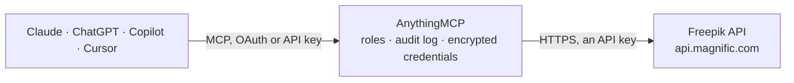

<!-- Generated by scripts/export-github-catalog.mjs in the anythingmcp-website repository. Do not edit by hand. -->

# Freepik MCP connector

Freepik stock content and AI images through the Freepik API, now run as the Magnific API: search and download photos, vectors and PSDs, search and download icons, search stock videos, and generate images with Mystic. The AnythingMCP connector gives Claude, ChatGPT, Microsoft Copilot, Cursor and Gemini 11 MCP tools for Freepik: 7 read and 4 can change data.

**Category:** [Publishing](../publishing.md) · **Tools:** 11 · **Setup guide:** [anythingmcp.com](https://anythingmcp.com/guides/freepik-to-mcp) · [Deutsch](https://anythingmcp.com/de/guides/freepik-to-mcp) · [Italiano](https://anythingmcp.com/it/guides/freepik-to-mcp) · [Español](https://anythingmcp.com/es/guides/freepik-to-mcp) · [日本語](https://anythingmcp.com/ja/guides/freepik-to-mcp) · [Русский](https://anythingmcp.com/ru/guides/freepik-to-mcp) · [中文](https://anythingmcp.com/zh/guides/freepik-to-mcp)

## Start without code

No installation and no terminal: AnythingMCP Cloud runs the Freepik connector for you, operated by helpcode.ai in Frankfurt, Germany.

1. **Click the button above** and create an account or sign in. The Freepik connector opens, ready to install.
2. **Paste the API key or token from your Freepik account.** Every click is in the [step-by-step guide](https://anythingmcp.com/guides/freepik-to-mcp).
3. **Click Install.** AnythingMCP shows the address of your MCP server.
4. **Add that address to your assistant:** [Claude](https://anythingmcp.com/guides/connect-freepik-to-claude) · [ChatGPT](https://anythingmcp.com/guides/connect-freepik-to-chatgpt) · [Microsoft Copilot](https://anythingmcp.com/guides/connect-freepik-to-copilot) · [Cursor](https://anythingmcp.com/guides/connect-freepik-to-cursor) · [Gemini CLI](https://anythingmcp.com/guides/connect-freepik-to-gemini) · [Meta Muse](https://anythingmcp.com/guides/connect-freepik-to-muse).
5. **Ask your first question**, for example: *Find the Freepik vector for "electric car infographic" and show the top premium match including licence PDF*

Prefer help with the setup? [Talk to us](https://anythingmcp.com/contact).

## How it works

- **The AI client** speaks MCP (Streamable HTTP) to AnythingMCP and only sees tool names, descriptions and results. It never gets the Freepik credentials.
- **AnythingMCP** checks the client's role, builds the call from the tool definition, adds the credentials (an API key), calls Freepik, logs the call and returns the result.
- **Freepik** sees an ordinary API client with the rights of the account the credentials belong to.

## Tools

| Tool | What it does | Access |
|---|---|---|
| [`freepik_search_resources`](#freepik_search_resources) | Search Freepik photos, vectors and PSD templates by keyword with filters for content type, licence, orientation, colour, period and AI-generated content. | read |
| [`freepik_get_resource`](#freepik_get_resource) | Get one photo, vector or PSD by id: title, licences with the licence PDF link, available download formats and sizes, preview, tags, author and related… | read |
| [`freepik_download_resource`](#freepik_download_resource) | Get a time-limited download URL and file name for a resource in its default format. | write |
| [`freepik_download_resource_format`](#freepik_download_resource_format) | Get a download URL for a resource in a specific format (psd, ai, eps, svg, png, jpg...). | write |
| [`freepik_search_icons`](#freepik_search_icons) | Search Freepik/Flaticon icons by keyword with filters for colour, shape (outline, fill, lineal-color, hand-drawn), period and free or premium SVG. | read |
| [`freepik_get_icon`](#freepik_get_icon) | Get one icon by id: name, tags, style, family, thumbnails, free or premium status and author. | read |
| [`freepik_download_icon`](#freepik_download_icon) | Get a download URL for an icon as SVG or PNG (or GIF, MP4, Lottie JSON for animated icons). | write |
| [`freepik_search_videos`](#freepik_search_videos) | Search Freepik stock videos by keyword. | read |
| [`freepik_get_video`](#freepik_get_video) | Get one stock video by id: title, duration, resolutions, frame rate, previews, licence and author, and the download options available for it. | read |
| [`freepik_generate_image_mystic`](#freepik_generate_image_mystic) | Start an AI image generation with Mystic from a text prompt. | write |
| [`freepik_get_mystic_task`](#freepik_get_mystic_task) | Get the status of a Mystic image generation: CREATED, IN_PROGRESS, COMPLETED or FAILED, and when completed the list of generated image URLs. | read |

## Tool reference

Every parameter as the AI client sees it in `tools/list`. Source: [`packages/backend/src/adapters/intl/freepik.json`](../../../packages/backend/src/adapters/intl/freepik.json).

### `freepik_search_resources`

Search Freepik photos, vectors and PSD templates by keyword with filters for content type, licence, orientation, colour, period and AI-generated content. Returns id, title, preview image, licence type, author and stats per result.

**Access:** read · **Call:** `GET /v1/resources`

| Parameter | Type | Required | Description |
|---|---|---|---|
| `term` | string | no | Search words, e.g. 'coffee shop flyer'. |
| `page` | integer | no | Page number, 1-100. |
| `limit` | integer | no | Results per page. |
| `order` | `relevance` \| `recent` | no | Sort by relevance (default) or newest first. |
| `language` | string | no | Language of the term and of the titles returned, e.g. en-US, es-ES, pt-BR, de-DE. Default en-US. |
| `photo` | `1` | no | 1 to include photos. Combine with vector or psd; omit all three for every type. |
| `vector` | `1` | no | 1 to include vectors. |
| `psd` | `1` | no | 1 to include PSD templates. |
| `freemium` | `1` | no | 1 to include free (attribution) resources. |
| `premium` | `1` | no | 1 to include premium resources. |
| `landscape` | `1` | no | 1 to include landscape orientation. |
| `portrait` | `1` | no | 1 to include portrait orientation. |
| `square` | `1` | no | 1 to include square images. |
| `panoramic` | `1` | no | 1 to include panoramic images. |
| `color` | `black` \| `blue` \| `gray` \| `green` \| `orange` \| `red` \| `white` \| `yellow` \| `purple` \| `cyan` \| `pink` | no | Predominant colour. |
| `period` | `last-month` \| `last-quarter` \| `last-semester` \| `last-year` | no | Only resources added in this period. |
| `exclude_ai_generated` | `1` | no | 1 to leave out AI-generated resources. |
| `only_ai_generated` | `1` | no | 1 for AI-generated resources only. |
| `vector_style` | `watercolor` \| `flat` \| `cartoon` \| `geometric` \| `gradient` \| `isometric` \| `3d` \| `hand-drawn` | no | Style of vectors. |
| `author` | integer | no | Only resources by this author id. |
| `ids` | string | no | Comma-separated resource ids. Cannot be combined with other filters. |

### `freepik_get_resource`

Get one photo, vector or PSD by id: title, licences with the licence PDF link, available download formats and sizes, preview, tags, author and related resources. Check the licence here before downloading.

**Access:** read · **Call:** `GET /v1/resources/{resource_id}`

| Parameter | Type | Required | Description |
|---|---|---|---|
| `resource_id` | integer | yes | Resource id from freepik_search_resources, or the number at the end of a freepik.com URL. |
| `language` | string | no | Language of the texts returned, e.g. es-ES. Default en-US. |

### `freepik_download_resource`

Get a time-limited download URL and file name for a resource in its default format. Each call counts as a download on the account and may cost credits; photos can be resized with image_size.

**Access:** write · **Call:** `GET /v1/resources/{resource_id}/download`

| Parameter | Type | Required | Description |
|---|---|---|---|
| `resource_id` | integer | yes | Resource id. |
| `image_size` | string | no | Photos only: small (1000px), medium (1500px), large (2000px), original, or a pixel width between 100 and 2000. |

### `freepik_download_resource_format`

Get a download URL for a resource in a specific format (psd, ai, eps, svg, png, jpg...). Use a format listed in the resource's available_formats. Counts as a download on the account.

**Access:** write · **Call:** `GET /v1/resources/{resource_id}/download/{format}`

| Parameter | Type | Required | Description |
|---|---|---|---|
| `resource_id` | integer | yes | Resource id. |
| `format` | `psd` \| `ai` \| `eps` \| `atn` \| `fonts` \| `resources` \| `png` \| `jpg` \| `3d-render` \| `svg` \| `mockup` | yes | File format to download. |

### `freepik_search_icons`

Search Freepik/Flaticon icons by keyword with filters for colour, shape (outline, fill, lineal-color, hand-drawn), period and free or premium SVG. Returns id, name, thumbnails, family, style and author.

**Access:** read · **Call:** `GET /v1/icons`

| Parameter | Type | Required | Description |
|---|---|---|---|
| `term` | string | no | Search words, e.g. 'shopping cart'. |
| `page` | integer | no | Page number, starting at 1. |
| `per_page` | integer | no | Results per page. |
| `order` | `relevance` \| `recent` | no | Sort order when no term is given. |
| `family_id` | integer | no | Only icons of this icon family (pack) id. |
| `thumbnail_size` | string | no | Thumbnail size in pixels, e.g. 64 or 256. Default 128. |
| `color` | `gradient` \| `solid-black` \| `multicolor` \| `azure` \| `black` \| `blue` \| `chartreuse` \| `cyan` \| `gray` \| `green` \| `orange` \| `red` \| `rose` \| `spring-green` \| `violet` \| `white` \| `yellow` | no | Icon colour. |
| `shape` | `outline` \| `fill` \| `lineal-color` \| `hand-drawn` | no | Icon shape. |
| `period` | `three-months` \| `six-months` \| `one-year` \| `all` | no | Only icons added in this period. |
| `free_svg` | `all` \| `free` \| `premium` | no | Free SVG, premium, or both. |
| `language` | string | no | Language of the term, e.g. es-ES. Default en-US. |

### `freepik_get_icon`

Get one icon by id: name, tags, style, family, thumbnails, free or premium status and author. Use it to check an icon before downloading it.

**Access:** read · **Call:** `GET /v1/icons/{icon_id}`

| Parameter | Type | Required | Description |
|---|---|---|---|
| `icon_id` | integer | yes | Icon id from freepik_search_icons. |
| `language` | string | no | Language of the texts returned, e.g. es-ES. |

### `freepik_download_icon`

Get a download URL for an icon as SVG or PNG (or GIF, MP4, Lottie JSON for animated icons). Counts as a download on the account. png_size applies to PNG only.

**Access:** write · **Call:** `GET /v1/icons/{icon_id}/download`

| Parameter | Type | Required | Description |
|---|---|---|---|
| `icon_id` | integer | yes | Icon id. |
| `format` | `svg` \| `png` \| `gif` \| `mp4` \| `aep` \| `json` \| `psd` \| `eps` | no | File format. Animated formats exist only for animated icons. |
| `png_size` | `512` \| `256` \| `128` \| `64` \| `32` \| `24` \| `16` | no | PNG size in pixels. |

### `freepik_search_videos`

Search Freepik stock videos by keyword. Returns id, title, duration, resolution, preview and thumbnail URLs, licence and author per result. A search term is required.

**Access:** read · **Call:** `GET /v1/videos`

| Parameter | Type | Required | Description |
|---|---|---|---|
| `term` | string | yes | Search words, e.g. 'city traffic night'. |
| `page` | integer | no | Page number, starting at 1. |
| `order` | `relevance` \| `recent` \| `random` | no | Sort order. |
| `category` | `footage` \| `motion_graphics` | no | Real footage or motion graphics. |
| `language` | string | no | Language of the term, e.g. es-ES. Default en-US. |

### `freepik_get_video`

Get one stock video by id: title, duration, resolutions, frame rate, previews, licence and author, and the download options available for it.

**Access:** read · **Call:** `GET /v1/videos/{video_id}`

| Parameter | Type | Required | Description |
|---|---|---|---|
| `video_id` | integer | yes | Video id from freepik_search_videos. |
| `language` | string | no | Language of the texts returned, e.g. es-ES. |

### `freepik_generate_image_mystic`

Start an AI image generation with Mystic from a text prompt. Spends AI credits. Returns a task_id at once; poll freepik_get_mystic_task until status is COMPLETED to get the image URLs.

**Access:** write · **Call:** `POST /v1/ai/mystic`

| Parameter | Type | Required | Description |
|---|---|---|---|
| `prompt` | string | yes | What the image should show, in plain words, e.g. 'a ceramic coffee mug on a wooden table, morning light'. |
| `resolution` | `1k` \| `2k` \| `4k` | no | Output resolution. Default 2k. |
| `aspect_ratio` | `square_1_1` \| `classic_4_3` \| `traditional_3_4` \| `widescreen_16_9` \| `social_story_9_16` \| `smartphone_horizontal_20_9` \| `smartphone_vertical_9_20` \| `standard_3_2` \| `portrait_2_3` \| `horizontal_2_1` \| `vertical_1_2` \| `social_5_4` | no | Aspect ratio. Default square_1_1. |
| `model` | `realism` \| `fluid` \| `zen` \| `flexible` \| `super_real` \| `editorial_portraits` | no | Mystic model. realism (default) for photographic results, fluid for prompt adherence, zen for clean simple scenes. |
| `creative_detailing` | integer | no | 0-100, detail per pixel. Default 33; high values look more artificial. |
| `fixed_generation` | boolean | no | true to get the same image again for the same settings. |
| `webhook_url` | string | no | Optional URL notified when the task changes status. |

### `freepik_get_mystic_task`

Get the status of a Mystic image generation: CREATED, IN_PROGRESS, COMPLETED or FAILED, and when completed the list of generated image URLs.

**Access:** read · **Call:** `GET /v1/ai/mystic/{task_id}`

| Parameter | Type | Required | Description |
|---|---|---|---|
| `task_id` | string | yes | task_id returned by freepik_generate_image_mystic. |

## Run it yourself

AnythingMCP is open source (AGPL-3.0). [Run it with Docker](../../../README.md#run-it-yourself), open **Connectors → Store**, pick **Freepik** and enter `FREEPIK_API_KEY`, then add your MCP server URL to the AI client.

[← Publishing connectors](../publishing.md) · [All categories](../README.md)
