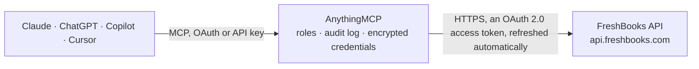

<!-- Generated by scripts/export-github-catalog.mjs in the anythingmcp-website repository. Do not edit by hand. -->

# FreshBooks MCP connector

Manage FreshBooks (invoices, clients, expenses, time entries, payments) from any AI agent. 9 tools, OAuth2 auth. The AnythingMCP connector gives Claude, ChatGPT, Microsoft Copilot, Cursor and Gemini 9 MCP tools for FreshBooks: 6 read and 3 can change data.

**Category:** [Accounting](../accounting.md) · **Tools:** 9 · **Setup guide:** [anythingmcp.com](https://anythingmcp.com/guides/freshbooks-to-mcp) · [Deutsch](https://anythingmcp.com/de/guides/freshbooks-to-mcp) · [Italiano](https://anythingmcp.com/it/guides/freshbooks-to-mcp) · [Español](https://anythingmcp.com/es/guides/freshbooks-to-mcp) · [日本語](https://anythingmcp.com/ja/guides/freshbooks-to-mcp) · [Русский](https://anythingmcp.com/ru/guides/freshbooks-to-mcp) · [中文](https://anythingmcp.com/zh/guides/freshbooks-to-mcp)

## Start without code

No installation and no terminal: AnythingMCP Cloud runs the FreshBooks connector for you, operated by helpcode.ai in Frankfurt, Germany.

1. **Click the button above** and create an account or sign in. The FreshBooks connector opens, ready to install.
2. **Sign in with your FreshBooks account** when AnythingMCP asks. The first time, an admin creates a small app in the FreshBooks developer console. Every click is in the [step-by-step guide](https://anythingmcp.com/guides/freshbooks-to-mcp).
3. **Click Install.** AnythingMCP shows the address of your MCP server.
4. **Add that address to your assistant:** [Claude](https://anythingmcp.com/guides/connect-freshbooks-to-claude) · [ChatGPT](https://anythingmcp.com/guides/connect-freshbooks-to-chatgpt) · [Microsoft Copilot](https://anythingmcp.com/guides/connect-freshbooks-to-copilot) · [Cursor](https://anythingmcp.com/guides/connect-freshbooks-to-cursor) · [Gemini CLI](https://anythingmcp.com/guides/connect-freshbooks-to-gemini) · [Meta Muse](https://anythingmcp.com/guides/connect-freshbooks-to-muse).
5. **Ask your first question**, for example: *Do we have a FreshBooks client for 'Solstice Interiors GmbH' with email billing@solstice-interiors.de?*

Prefer help with the setup? [Talk to us](https://anythingmcp.com/contact).

## How it works

- **The AI client** speaks MCP (Streamable HTTP) to AnythingMCP and only sees tool names, descriptions and results. It never gets the FreshBooks credentials.
- **AnythingMCP** checks the client's role, builds the call from the tool definition, adds the credentials (an OAuth 2.0 access token, refreshed automatically), calls FreshBooks, logs the call and returns the result.
- **FreshBooks** sees an ordinary API client with the rights of the account the credentials belong to.

## Tools

| Tool | What it does | Access |
|---|---|---|
| [`freshbooks_me`](#freshbooks_me) | Return the authenticated user with business memberships and their account IDs. | read |
| [`freshbooks_list_clients`](#freshbooks_list_clients) | List clients in an account. | read |
| [`freshbooks_create_client`](#freshbooks_create_client) | Create a client. | write |
| [`freshbooks_list_invoices`](#freshbooks_list_invoices) | List invoices. | read |
| [`freshbooks_get_invoice`](#freshbooks_get_invoice) | Get a single invoice with all lines + payments. | read |
| [`freshbooks_create_invoice`](#freshbooks_create_invoice) | Create an invoice. | write |
| [`freshbooks_list_expenses`](#freshbooks_list_expenses) | List expenses. | read |
| [`freshbooks_list_payments`](#freshbooks_list_payments) | List payments received against invoices. | read |
| [`freshbooks_record_payment`](#freshbooks_record_payment) | Record a payment against an invoice. | write |

## Tool reference

Every parameter as the AI client sees it in `tools/list`. Source: [`packages/backend/src/adapters/intl/freshbooks.json`](../../../packages/backend/src/adapters/intl/freshbooks.json).

### `freshbooks_me`

Return the authenticated user with business memberships and their account IDs.

**Access:** read · **Call:** `GET /auth/api/v1/users/me`

No parameters.

### `freshbooks_list_clients`

List clients in an account.

**Access:** read · **Call:** `GET /accounting/account/{FRESHBOOKS_ACCOUNT_ID}/users/clients`

| Parameter | Type | Required | Description |
|---|---|---|---|
| `page` | integer | no | 1-based. |
| `per_page` | integer | no | Max 100. |
| `search_email` | string | no | Filter by email substring. |

### `freshbooks_create_client`

Create a client.

**Access:** write · **Call:** `POST /accounting/account/{FRESHBOOKS_ACCOUNT_ID}/users/clients`

| Parameter | Type | Required | Description |
|---|---|---|---|
| `fname` | string | no | First name. |
| `lname` | string | no | Last name. |
| `organization` | string | no | Company name. |
| `email` | string | yes | Email. |
| `currency_code` | string | no | ISO 4217. |

### `freshbooks_list_invoices`

List invoices. Filter by client, status, date range. Status codes: 1=Draft, 2=Sent, 3=Viewed, 4=Paid, 5=AutoPaid, 6=Retry, 7=Failed, 8=Partial, 9=Disputed.

**Access:** read · **Call:** `GET /accounting/account/{FRESHBOOKS_ACCOUNT_ID}/invoices/invoices`

| Parameter | Type | Required | Description |
|---|---|---|---|
| `clientid` | integer | no | Filter by client ID. |
| `status` | integer | no | Status code. |
| `date_from` | string | no | YYYY-MM-DD. |
| `date_to` | string | no | YYYY-MM-DD. |
| `page` | integer | no | 1-based. |
| `per_page` | integer | no | Max 100. |

### `freshbooks_get_invoice`

Get a single invoice with all lines + payments.

**Access:** read · **Call:** `GET /accounting/account/{FRESHBOOKS_ACCOUNT_ID}/invoices/invoices/{invoice_id}`

| Parameter | Type | Required | Description |
|---|---|---|---|
| `invoice_id` | integer | yes | Invoice ID. |

### `freshbooks_create_invoice`

Create an invoice. `lines` is an array of line items {name, qty, unit_cost, type:0|1, description}.

**Access:** write · **Call:** `POST /accounting/account/{FRESHBOOKS_ACCOUNT_ID}/invoices/invoices`

| Parameter | Type | Required | Description |
|---|---|---|---|
| `customerid` | integer | yes | Client ID. |
| `create_date` | string | yes | YYYY-MM-DD. |
| `lines` | any[] | yes | Array of line items. |
| `notes` | string | no | Invoice notes. |
| `currency_code` | string | no | ISO 4217. |
| `terms` | string | no | Payment terms text. |

### `freshbooks_list_expenses`

List expenses.

**Access:** read · **Call:** `GET /accounting/account/{FRESHBOOKS_ACCOUNT_ID}/expenses/expenses`

| Parameter | Type | Required | Description |
|---|---|---|---|
| `date_from` | string | no | YYYY-MM-DD. |
| `date_to` | string | no | YYYY-MM-DD. |
| `categoryid` | integer | no | Filter by category. |
| `page` | integer | no | 1-based. |
| `per_page` | integer | no | Max 100. |

### `freshbooks_list_payments`

List payments received against invoices.

**Access:** read · **Call:** `GET /accounting/account/{FRESHBOOKS_ACCOUNT_ID}/payments/payments`

| Parameter | Type | Required | Description |
|---|---|---|---|
| `invoiceid` | integer | no | Filter by invoice. |
| `clientid` | integer | no | Filter by client. |
| `page` | integer | no | 1-based. |
| `per_page` | integer | no | Max 100. |

### `freshbooks_record_payment`

Record a payment against an invoice.

**Access:** write · **Call:** `POST /accounting/account/{FRESHBOOKS_ACCOUNT_ID}/payments/payments`

| Parameter | Type | Required | Description |
|---|---|---|---|
| `invoiceid` | integer | yes | Invoice ID. |
| `amount` | object | yes | {amount: '100.00', code: 'USD'}. |
| `date` | string | yes | YYYY-MM-DD. |
| `type` | string | yes | Bank Transfer, Cash, Check, Credit Card, ... |
| `note` | string | no | Free-text. |

## Run it yourself

AnythingMCP is open source (AGPL-3.0). [Run it with Docker](../../../README.md#run-it-yourself), open **Connectors → Store**, pick **FreshBooks** and enter `FRESHBOOKS_CLIENT_ID`, `FRESHBOOKS_CLIENT_SECRET`, `FRESHBOOKS_ACCOUNT_ID`, then add your MCP server URL to the AI client.

[← Accounting connectors](../accounting.md) · [All categories](../README.md)
