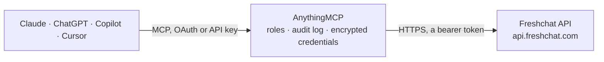

<!-- Generated by scripts/export-github-catalog.mjs in the anythingmcp-website repository. Do not edit by hand. -->

# Freshchat MCP connector

Manage Freshchat (live chat + messaging: users, conversations, messages, channels, agents) from any AI agent. 9 tools, Bearer token. The AnythingMCP connector gives Claude, ChatGPT, Microsoft Copilot, Cursor and Gemini 9 MCP tools for Freshchat: 6 read and 3 can change data.

**Category:** [Customer Support](../support.md) · **Tools:** 9 · **Setup guide:** [anythingmcp.com](https://anythingmcp.com/guides/freshchat-to-mcp) · [Deutsch](https://anythingmcp.com/de/guides/freshchat-to-mcp) · [Italiano](https://anythingmcp.com/it/guides/freshchat-to-mcp) · [Español](https://anythingmcp.com/es/guides/freshchat-to-mcp) · [日本語](https://anythingmcp.com/ja/guides/freshchat-to-mcp) · [Русский](https://anythingmcp.com/ru/guides/freshchat-to-mcp) · [中文](https://anythingmcp.com/zh/guides/freshchat-to-mcp)

## Start without code

No installation and no terminal: AnythingMCP Cloud runs the Freshchat connector for you, operated by helpcode.ai in Frankfurt, Germany.

1. **Click the button above** and create an account or sign in. The Freshchat connector opens, ready to install.
2. **Paste the API key or token from your Freshchat account.** Every click is in the [step-by-step guide](https://anythingmcp.com/guides/freshchat-to-mcp).
3. **Click Install.** AnythingMCP shows the address of your MCP server.
4. **Add that address to your assistant:** [Claude](https://anythingmcp.com/guides/connect-freshchat-to-claude) · [ChatGPT](https://anythingmcp.com/guides/connect-freshchat-to-chatgpt) · [Microsoft Copilot](https://anythingmcp.com/guides/connect-freshchat-to-copilot) · [Cursor](https://anythingmcp.com/guides/connect-freshchat-to-cursor) · [Gemini CLI](https://anythingmcp.com/guides/connect-freshchat-to-gemini) · [Meta Muse](https://anythingmcp.com/guides/connect-freshchat-to-muse).
5. **Ask your first question**, for example: *Get user record for customer with email mari.lahtinen@nordicsolar.fi*

Prefer help with the setup? [Talk to us](https://anythingmcp.com/contact).

## How it works

- **The AI client** speaks MCP (Streamable HTTP) to AnythingMCP and only sees tool names, descriptions and results. It never gets the Freshchat credentials.
- **AnythingMCP** checks the client's role, builds the call from the tool definition, adds the credentials (a bearer token), calls Freshchat, logs the call and returns the result.
- **Freshchat** sees an ordinary API client with the rights of the account the credentials belong to.

## Tools

| Tool | What it does | Access |
|---|---|---|
| [`freshchat_list_users`](#freshchat_list_users) | List users (end-customers). | read |
| [`freshchat_get_user`](#freshchat_get_user) | Get one user by ID with profile + properties + tags. | read |
| [`freshchat_create_user`](#freshchat_create_user) | Create an end-user. | write |
| [`freshchat_list_conversations`](#freshchat_list_conversations) | List conversations of a user. | read |
| [`freshchat_get_conversation`](#freshchat_get_conversation) | Get one conversation with status + assigned agent + recent messages. | read |
| [`freshchat_send_message`](#freshchat_send_message) | Post a message into a conversation. | write |
| [`freshchat_update_conversation`](#freshchat_update_conversation) | Update a conversation's status, assigned agent, group, or tags. | write |
| [`freshchat_list_agents`](#freshchat_list_agents) | List agents (staff). | read |
| [`freshchat_list_channels`](#freshchat_list_channels) | List channels (topics) — the conversation routing targets. | read |

## Tool reference

Every parameter as the AI client sees it in `tools/list`. Source: [`packages/backend/src/adapters/intl/freshchat.json`](../../../packages/backend/src/adapters/intl/freshchat.json).

### `freshchat_list_users`

List users (end-customers). Filter by email or reference_id.

**Access:** read · **Call:** `GET /users`

| Parameter | Type | Required | Description |
|---|---|---|---|
| `email` | string | no | Filter by email. |
| `reference_id` | string | no | External system reference ID. |
| `page` | integer | no | 1-based. |
| `items_per_page` | integer | no | Max 100. |

### `freshchat_get_user`

Get one user by ID with profile + properties + tags.

**Access:** read · **Call:** `GET /users/{user_id}`

| Parameter | Type | Required | Description |
|---|---|---|---|
| `user_id` | string | yes | User ID. |

### `freshchat_create_user`

Create an end-user.

**Access:** write · **Call:** `POST /users`

| Parameter | Type | Required | Description |
|---|---|---|---|
| `first_name` | string | no | First name. |
| `last_name` | string | no | Last name. |
| `email` | string | no | Email. |
| `phone` | string | no | Phone (E.164). |
| `reference_id` | string | no | External ID. |
| `properties` | any[] | no | Array of {name, value} custom properties. |

### `freshchat_list_conversations`

List conversations of a user.

**Access:** read · **Call:** `GET /users/{user_id}/conversations`

| Parameter | Type | Required | Description |
|---|---|---|---|
| `user_id` | string | yes | User ID. |
| `items_per_page` | integer | no | Max 100. |
| `page` | integer | no | 1-based. |

### `freshchat_get_conversation`

Get one conversation with status + assigned agent + recent messages.

**Access:** read · **Call:** `GET /conversations/{conversation_id}`

| Parameter | Type | Required | Description |
|---|---|---|---|
| `conversation_id` | string | yes | Conversation ID. |

### `freshchat_send_message`

Post a message into a conversation. `actor_type` = 'agent' for staff replies.

**Access:** write · **Call:** `POST /conversations/{conversation_id}/messages`

| Parameter | Type | Required | Description |
|---|---|---|---|
| `conversation_id` | string | yes | Conversation ID. |
| `message_parts` | any[] | yes | Array of {text:{content:'...'}}. |
| `actor_id` | string | yes | Agent or user ID sending. |
| `actor_type` | string | yes | 'agent' or 'user'. |
| `message_type` | string | no | normal, private, system. |

### `freshchat_update_conversation`

Update a conversation's status, assigned agent, group, or tags.

**Access:** write · **Call:** `PUT /conversations/{conversation_id}`

| Parameter | Type | Required | Description |
|---|---|---|---|
| `conversation_id` | string | yes | Conversation ID. |
| `status` | string | no | new, assigned, resolved, reopened. |
| `assigned_agent_id` | string | no | Agent to assign. |
| `assigned_group_id` | string | no | Group to assign. |
| `properties` | object | no | Custom properties. |

### `freshchat_list_agents`

List agents (staff).

**Access:** read · **Call:** `GET /agents`

| Parameter | Type | Required | Description |
|---|---|---|---|
| `email` | string | no | Email filter. |
| `page` | integer | no | 1-based. |
| `items_per_page` | integer | no | Max 100. |

### `freshchat_list_channels`

List channels (topics) — the conversation routing targets.

**Access:** read · **Call:** `GET /channels`

No parameters.

## Run it yourself

AnythingMCP is open source (AGPL-3.0). [Run it with Docker](../../../README.md#run-it-yourself), open **Connectors → Store**, pick **Freshchat** and enter `FRESHCHAT_API_TOKEN`, then add your MCP server URL to the AI client.

[← Customer Support connectors](../support.md) · [All categories](../README.md)
