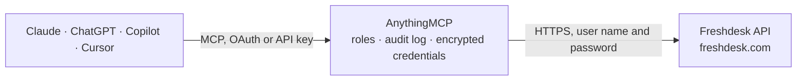

<!-- Generated by scripts/export-github-catalog.mjs in the anythingmcp-website repository. Do not edit by hand. -->

# Freshdesk MCP connector

Drive Freshdesk (customer support helpdesk) from any AI agent: tickets, contacts, companies, agents, conversations. 16 tools, API-key Basic-auth, per-domain base URL. The AnythingMCP connector gives Claude, ChatGPT, Microsoft Copilot, Cursor and Gemini 16 MCP tools for Freshdesk: 10 read and 6 can change data.

**Category:** [Customer Support](../support.md) · **Tools:** 16 · **Setup guide:** [anythingmcp.com](https://anythingmcp.com/guides/freshdesk-to-mcp) · [Deutsch](https://anythingmcp.com/de/guides/freshdesk-to-mcp) · [Italiano](https://anythingmcp.com/it/guides/freshdesk-to-mcp) · [Español](https://anythingmcp.com/es/guides/freshdesk-to-mcp) · [日本語](https://anythingmcp.com/ja/guides/freshdesk-to-mcp) · [Русский](https://anythingmcp.com/ru/guides/freshdesk-to-mcp) · [中文](https://anythingmcp.com/zh/guides/freshdesk-to-mcp)

## Start without code

No installation and no terminal: AnythingMCP Cloud runs the Freshdesk connector for you, operated by helpcode.ai in Frankfurt, Germany.

1. **Click the button above** and create an account or sign in. The Freshdesk connector opens, ready to install.
2. **Paste the API key or token from your Freshdesk account.** Every click is in the [step-by-step guide](https://anythingmcp.com/guides/freshdesk-to-mcp).
3. **Click Install.** AnythingMCP shows the address of your MCP server.
4. **Add that address to your assistant:** [Claude](https://anythingmcp.com/guides/connect-freshdesk-to-claude) · [ChatGPT](https://anythingmcp.com/guides/connect-freshdesk-to-chatgpt) · [Microsoft Copilot](https://anythingmcp.com/guides/connect-freshdesk-to-copilot) · [Cursor](https://anythingmcp.com/guides/connect-freshdesk-to-cursor) · [Gemini CLI](https://anythingmcp.com/guides/connect-freshdesk-to-gemini) · [Meta Muse](https://anythingmcp.com/guides/connect-freshdesk-to-muse).
5. **Ask your first question**, for example: *Find the Freshdesk ticket about invoice INV-2026-112 for Meridian Logistics GmbH created March 2026*

Prefer help with the setup? [Talk to us](https://anythingmcp.com/contact).

## How it works

- **The AI client** speaks MCP (Streamable HTTP) to AnythingMCP and only sees tool names, descriptions and results. It never gets the Freshdesk credentials.
- **AnythingMCP** checks the client's role, builds the call from the tool definition, adds the credentials (user name and password), calls Freshdesk, logs the call and returns the result.
- **Freshdesk** sees an ordinary API client with the rights of the account the credentials belong to.

## Tools

| Tool | What it does | Access |
|---|---|---|
| [`freshdesk_list_tickets`](#freshdesk_list_tickets) | List tickets. | read |
| [`freshdesk_search_tickets`](#freshdesk_search_tickets) | Search tickets with a query language. | read |
| [`freshdesk_get_ticket`](#freshdesk_get_ticket) | Fetch a single ticket. | read |
| [`freshdesk_create_ticket`](#freshdesk_create_ticket) | Create a ticket. | write |
| [`freshdesk_update_ticket`](#freshdesk_update_ticket) | Update a ticket. | write |
| [`freshdesk_delete_ticket`](#freshdesk_delete_ticket) | Move ticket to trash (recoverable from UI within retention window). | write |
| [`freshdesk_reply_to_ticket`](#freshdesk_reply_to_ticket) | Send a public reply to the requester on a ticket. | write |
| [`freshdesk_add_note_to_ticket`](#freshdesk_add_note_to_ticket) | Add an internal note (private=true) or a public note to a ticket. | write |
| [`freshdesk_list_ticket_conversations`](#freshdesk_list_ticket_conversations) | List all conversations (replies + notes) on a ticket, in chronological order. | read |
| [`freshdesk_list_contacts`](#freshdesk_list_contacts) | List contacts (requesters/end-users). | read |
| [`freshdesk_get_contact`](#freshdesk_get_contact) | Fetch a single contact. | read |
| [`freshdesk_create_contact`](#freshdesk_create_contact) | Create a contact. | write |
| [`freshdesk_list_companies`](#freshdesk_list_companies) | List companies (organizations of contacts). | read |
| [`freshdesk_list_agents`](#freshdesk_list_agents) | List agents (support staff). | read |
| [`freshdesk_list_groups`](#freshdesk_list_groups) | List agent groups (for group_id assignment). | read |
| [`freshdesk_list_ticket_fields`](#freshdesk_list_ticket_fields) | List ticket fields including custom ones with their names and types. | read |

## Tool reference

Every parameter as the AI client sees it in `tools/list`. Source: [`packages/backend/src/adapters/intl/freshdesk.json`](../../../packages/backend/src/adapters/intl/freshdesk.json).

### `freshdesk_list_tickets`

List tickets. Use filter for new_and_my_open / watching / spam / deleted, or use freshdesk_search_tickets for query-based.

**Access:** read · **Call:** `GET /tickets`

| Parameter | Type | Required | Description |
|---|---|---|---|
| `filter` | string | no | new_and_my_open, watching, spam, deleted. |
| `requester_id` | integer | no | Filter by requester. |
| `email` | string | no | Filter by requester email. |
| `company_id` | integer | no | Filter by company. |
| `updated_since` | string | no | ISO 8601 — tickets updated after. |
| `order_by` | string | no | created_at, updated_at, due_by, status, priority. |
| `order_type` | string | no | asc or desc. |
| `include` | string | no | Side-load: requester, stats, description, company. |
| `page` | integer | no | Page. |
| `per_page` | integer | no | Per page (max 100). |

### `freshdesk_search_tickets`

Search tickets with a query language. Example: "status:2 AND priority:4" (Freshdesk needs the double quotes). Supports field operators like status, priority, agent_id, group_id, tag, type, source, created_at, due_by, fr_due_by.

**Access:** read · **Call:** `GET /search/tickets`

| Parameter | Type | Required | Description |
|---|---|---|---|
| `query` | string | yes | Search query in Freshdesk syntax, wrapped in double quotes, e.g. "status:2 AND priority:4". Single quotes are rejected. |
| `page` | integer | no | Page (1-10 only — search is paginated to first 1000 results). |

### `freshdesk_get_ticket`

Fetch a single ticket. Use include for conversations / requester / company / stats.

**Access:** read · **Call:** `GET /tickets/{ticketId}`

| Parameter | Type | Required | Description |
|---|---|---|---|
| `ticketId` | integer | yes | Ticket ID. |
| `include` | string | no | Side-load: conversations, requester, company, stats. |

### `freshdesk_create_ticket`

Create a ticket. Required: subject + description + (email OR requester_id) + status + priority. Status/priority are integers (see instructions).

**Access:** write · **Call:** `POST /tickets`

| Parameter | Type | Required | Description |
|---|---|---|---|
| `subject` | string | yes | Ticket subject. |
| `description` | string | yes | HTML body. |
| `email` | string | no | Requester email (auto-creates contact if missing). |
| `requester_id` | integer | no | Existing contact ID (alternative to email). |
| `status` | integer | yes | 2=Open, 3=Pending, 4=Resolved, 5=Closed. |
| `priority` | integer | yes | 1=Low, 2=Medium, 3=High, 4=Urgent. |
| `source` | integer | no | Source code (see instructions). |
| `type` | string | no | Ticket type (e.g. 'Question', 'Incident'). |
| `responder_id` | integer | no | Assigned agent ID. |
| `group_id` | integer | no | Assigned group ID. |
| `tags` | any[] | no | Array of tag strings. |
| `cc_emails` | any[] | no | CC email addresses. |
| `custom_fields` | object | no | Custom fields keyed by field name. |

### `freshdesk_update_ticket`

Update a ticket. Common: change status (close=5), reassign (responder_id), update priority.

**Access:** write · **Call:** `PUT /tickets/{ticketId}`

| Parameter | Type | Required | Description |
|---|---|---|---|
| `ticketId` | integer | yes | Ticket ID. |
| `subject` | string | no | New subject. |
| `status` | integer | no | 2/3/4/5. |
| `priority` | integer | no | 1-4. |
| `responder_id` | integer | no | Reassign agent. |
| `group_id` | integer | no | Reassign group. |
| `tags` | any[] | no | Replace tag set. |
| `custom_fields` | object | no | Custom field updates. |

### `freshdesk_delete_ticket`

Move ticket to trash (recoverable from UI within retention window).

**Access:** write · **Call:** `DELETE /tickets/{ticketId}`

| Parameter | Type | Required | Description |
|---|---|---|---|
| `ticketId` | integer | yes | Ticket ID. |

### `freshdesk_reply_to_ticket`

Send a public reply to the requester on a ticket.

**Access:** write · **Call:** `POST /tickets/{ticketId}/reply`

| Parameter | Type | Required | Description |
|---|---|---|---|
| `ticketId` | integer | yes | Ticket ID. |
| `body` | string | yes | HTML reply body. |
| `from_email` | string | no | Override From email (must be a verified product email). |
| `user_id` | integer | no | Agent ID sending the reply. |
| `cc_emails` | any[] | no | CC list. |
| `bcc_emails` | any[] | no | BCC list. |

### `freshdesk_add_note_to_ticket`

Add an internal note (private=true) or a public note to a ticket. Notes don't email the requester (unlike replies).

**Access:** write · **Call:** `POST /tickets/{ticketId}/notes`

| Parameter | Type | Required | Description |
|---|---|---|---|
| `ticketId` | integer | yes | Ticket ID. |
| `body` | string | yes | HTML note body. |
| `private` | boolean | no | true (default) = internal only, false = public. |
| `user_id` | integer | no | Agent ID. |
| `notify_emails` | any[] | no | Agent emails to notify. |

### `freshdesk_list_ticket_conversations`

List all conversations (replies + notes) on a ticket, in chronological order.

**Access:** read · **Call:** `GET /tickets/{ticketId}/conversations`

| Parameter | Type | Required | Description |
|---|---|---|---|
| `ticketId` | integer | yes | Ticket ID. |
| `page` | integer | no | Page. |
| `per_page` | integer | no | Per page (max 30). |

### `freshdesk_list_contacts`

List contacts (requesters/end-users).

**Access:** read · **Call:** `GET /contacts`

| Parameter | Type | Required | Description |
|---|---|---|---|
| `email` | string | no | Filter by email. |
| `company_id` | integer | no | Filter by company. |
| `updated_since` | string | no | ISO 8601. |
| `page` | integer | no | Page. |
| `per_page` | integer | no | Per page. |

### `freshdesk_get_contact`

Fetch a single contact.

**Access:** read · **Call:** `GET /contacts/{contactId}`

| Parameter | Type | Required | Description |
|---|---|---|---|
| `contactId` | integer | yes | Contact ID. |

### `freshdesk_create_contact`

Create a contact. Required: name + (email OR phone OR mobile OR twitter_id OR unique_external_id).

**Access:** write · **Call:** `POST /contacts`

| Parameter | Type | Required | Description |
|---|---|---|---|
| `name` | string | yes | Full name. |
| `email` | string | no | Email. |
| `phone` | string | no | Phone. |
| `mobile` | string | no | Mobile phone. |
| `twitter_id` | string | no | Twitter handle. |
| `company_id` | integer | no | Linked company. |
| `job_title` | string | no | Title. |
| `address` | string | no | Free-text address. |
| `tags` | any[] | no | Tag strings. |
| `custom_fields` | object | no | Custom fields. |

### `freshdesk_list_companies`

List companies (organizations of contacts).

**Access:** read · **Call:** `GET /companies`

| Parameter | Type | Required | Description |
|---|---|---|---|
| `page` | integer | no | Page. |
| `per_page` | integer | no | Per page. |

### `freshdesk_list_agents`

List agents (support staff).

**Access:** read · **Call:** `GET /agents`

| Parameter | Type | Required | Description |
|---|---|---|---|
| `email` | string | no | Filter by email. |
| `mobile` | string | no | Filter by mobile. |
| `page` | integer | no | Page. |
| `per_page` | integer | no | Per page. |

### `freshdesk_list_groups`

List agent groups (for group_id assignment).

**Access:** read · **Call:** `GET /groups`

No parameters.

### `freshdesk_list_ticket_fields`

List ticket fields including custom ones with their names and types. Required to compose custom_fields objects.

**Access:** read · **Call:** `GET /ticket_fields`

No parameters.

## Run it yourself

AnythingMCP is open source (AGPL-3.0). [Run it with Docker](../../../README.md#run-it-yourself), open **Connectors → Store**, pick **Freshdesk** and enter `FRESHDESK_DOMAIN`, `FRESHDESK_API_KEY`, then add your MCP server URL to the AI client.

[← Customer Support connectors](../support.md) · [All categories](../README.md)
