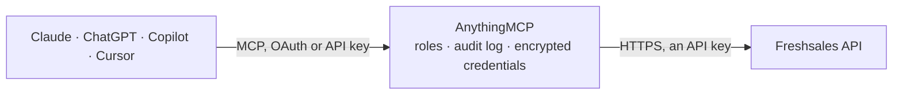

<!-- Generated by scripts/export-github-catalog.mjs in the anythingmcp-website repository. Do not edit by hand. -->

# Freshsales MCP connector

Freshsales (Freshworks CRM) from any AI agent: contacts, accounts, deals and pipelines, notes, tasks, appointments, sales activities, search and marketing lists. The AnythingMCP connector gives Claude, ChatGPT, Microsoft Copilot, Cursor and Gemini 40 MCP tools for Freshsales: 23 read and 17 can change data.

**Category:** [CRM](../crm.md) · **Tools:** 40 · **Setup guide:** [anythingmcp.com](https://anythingmcp.com/guides/freshsales-to-mcp) · [Deutsch](https://anythingmcp.com/de/guides/freshsales-to-mcp) · [Italiano](https://anythingmcp.com/it/guides/freshsales-to-mcp) · [Español](https://anythingmcp.com/es/guides/freshsales-to-mcp) · [日本語](https://anythingmcp.com/ja/guides/freshsales-to-mcp) · [Русский](https://anythingmcp.com/ru/guides/freshsales-to-mcp) · [中文](https://anythingmcp.com/zh/guides/freshsales-to-mcp)

## Start without code

No installation and no terminal: AnythingMCP Cloud runs the Freshsales connector for you, operated by helpcode.ai in Frankfurt, Germany.

1. **Click the button above** and create an account or sign in. The Freshsales connector opens, ready to install.
2. **Paste the API key or token from your Freshsales account.** Every click is in the [step-by-step guide](https://anythingmcp.com/guides/freshsales-to-mcp).
3. **Click Install.** AnythingMCP shows the address of your MCP server.
4. **Add that address to your assistant:** [Claude](https://anythingmcp.com/guides/connect-freshsales-to-claude) · [ChatGPT](https://anythingmcp.com/guides/connect-freshsales-to-chatgpt) · [Microsoft Copilot](https://anythingmcp.com/guides/connect-freshsales-to-copilot) · [Cursor](https://anythingmcp.com/guides/connect-freshsales-to-cursor) · [Gemini CLI](https://anythingmcp.com/guides/connect-freshsales-to-gemini) · [Meta Muse](https://anythingmcp.com/guides/connect-freshsales-to-muse).
5. **Ask your first question**, for example: *Find the contact with email lydia.nguyen@novaclinic.dk and show her account and owner*

Prefer help with the setup? [Talk to us](https://anythingmcp.com/contact).

## How it works

- **The AI client** speaks MCP (Streamable HTTP) to AnythingMCP and only sees tool names, descriptions and results. It never gets the Freshsales credentials.
- **AnythingMCP** checks the client's role, builds the call from the tool definition, adds the credentials (an API key), calls Freshsales, logs the call and returns the result.
- **Freshsales** sees an ordinary API client with the rights of the account the credentials belong to.

## Tools

| Tool | What it does | Access |
|---|---|---|
| [`freshsales_list_owners`](#freshsales_list_owners) | List the users of the Freshsales portal (id, name, email). | read |
| [`freshsales_list_selector`](#freshsales_list_selector) | List the values of a configuration picklist: territories, deal stages and pipelines, currencies, deal reasons and types, lead sources, industry and business… | read |
| [`freshsales_list_pipeline_stages`](#freshsales_list_pipeline_stages) | List the stages of one deal pipeline (id, name, position). | read |
| [`freshsales_list_fields`](#freshsales_list_fields) | List the fields of a module, including custom fields (internal name cf_..., label, type, choices). | read |
| [`freshsales_list_views`](#freshsales_list_views) | List the saved views (filters) of contacts, accounts or deals, with their ids. | read |
| [`freshsales_list_contacts`](#freshsales_list_contacts) | List the contacts of a view, 25 per page by default, with sorting. | read |
| [`freshsales_get_contact`](#freshsales_get_contact) | Get one contact with all fields, optionally embedding owner, accounts, deals, tasks, appointments, notes and sales activities. | read |
| [`freshsales_list_contact_activities`](#freshsales_list_contact_activities) | List the activity timeline of a contact: emails, calls, notes, field changes, web visits. | read |
| [`freshsales_create_contact`](#freshsales_create_contact) | Create a contact. | write |
| [`freshsales_update_contact`](#freshsales_update_contact) | Update a contact. | write |
| [`freshsales_upsert_contact`](#freshsales_upsert_contact) | Create or update a contact matched by a unique field (usually the email): updates the existing contact, or creates it when none matches. | write |
| [`freshsales_list_accounts`](#freshsales_list_accounts) | List the accounts (companies) of a view, 25 per page by default. | read |
| [`freshsales_get_account`](#freshsales_get_account) | Get one account with all fields, optionally embedding owner, contacts, deals, tasks, appointments and notes. | read |
| [`freshsales_create_account`](#freshsales_create_account) | Create an account (company). | write |
| [`freshsales_update_account`](#freshsales_update_account) | Update an account (company): name, address, owner, industry, custom fields. | write |
| [`freshsales_list_deals`](#freshsales_list_deals) | List the deals of a view, 25 per page by default. | read |
| [`freshsales_get_deal`](#freshsales_get_deal) | Get one deal with all fields, optionally embedding account, contacts, stage, pipeline, products, tasks and notes. | read |
| [`freshsales_create_deal`](#freshsales_create_deal) | Create a deal. | write |
| [`freshsales_update_deal`](#freshsales_update_deal) | Update a deal: amount, stage (deal_stage_id moves it through the pipeline, including won and lost stages), close date, owner, linked contacts. | write |
| [`freshsales_create_note`](#freshsales_create_note) | Add a note to a contact, account or deal. | write |
| [`freshsales_update_note`](#freshsales_update_note) | Change the text of an existing note on a contact, account or deal. | write |
| [`freshsales_list_tasks`](#freshsales_list_tasks) | List tasks by status: open, due today, due tomorrow, overdue or completed. | read |
| [`freshsales_get_task`](#freshsales_get_task) | Get one task with its owner, collaborators and linked record. | read |
| [`freshsales_create_task`](#freshsales_create_task) | Create a task on a contact, account or deal. | write |
| [`freshsales_update_task`](#freshsales_update_task) | Update a task: title, description, due date, owner, linked record or collaborators. | write |
| [`freshsales_complete_task`](#freshsales_complete_task) | Mark a task as done (status completed). | write |
| [`freshsales_list_appointments`](#freshsales_list_appointments) | List appointments (meetings), upcoming or past, with attendees and linked records. | read |
| [`freshsales_get_appointment`](#freshsales_get_appointment) | Get one appointment with its time, location, attendees and linked contact, account or deal. | read |
| [`freshsales_create_appointment`](#freshsales_create_appointment) | Schedule an appointment (meeting) with a contact, account or deal, with attendees. | write |
| [`freshsales_update_appointment`](#freshsales_update_appointment) | Reschedule or edit an appointment. | write |
| [`freshsales_list_sales_activities`](#freshsales_list_sales_activities) | List logged sales activities (calls, meetings, custom activity types), newest first. | read |
| [`freshsales_get_sales_activity`](#freshsales_get_sales_activity) | Get one logged sales activity with its type, outcome, times, notes and linked record. | read |
| [`freshsales_create_sales_activity`](#freshsales_create_sales_activity) | Log a sales activity (for example a call or visit) on a contact, account or deal. | write |
| [`freshsales_search`](#freshsales_search) | Full-text search by name or email across contacts, accounts, deals and users. | read |
| [`freshsales_lookup`](#freshsales_lookup) | Exact-match lookup on one field: find contacts by email, or contacts, accounts or deals by name or a custom field value. | read |
| [`freshsales_filtered_search`](#freshsales_filtered_search) | Filter contacts, accounts or deals by field rules (exact matches, ranges, lists), e.g. contacts whose email is in a list. | read |
| [`freshsales_list_marketing_lists`](#freshsales_list_marketing_lists) | List the marketing lists (static contact lists) with their ids. | read |
| [`freshsales_list_marketing_list_contacts`](#freshsales_list_marketing_list_contacts) | List the contacts of a marketing list, 25 per page by default. | read |
| [`freshsales_add_contacts_to_list`](#freshsales_add_contacts_to_list) | Add existing contacts to a marketing list by their contact ids. | write |
| [`freshsales_remove_contacts_from_list`](#freshsales_remove_contacts_from_list) | Remove contacts from a marketing list. | write |

## Tool reference

Every parameter as the AI client sees it in `tools/list`. Source: [`packages/backend/src/adapters/intl/freshsales.json`](../../../packages/backend/src/adapters/intl/freshsales.json).

### `freshsales_list_owners`

List the users of the Freshsales portal (id, name, email). Use the ids as owner_id on contacts, accounts, deals, tasks and activities.

**Access:** read · **Call:** `GET /selector/owners`

No parameters.

### `freshsales_list_selector`

List the values of a configuration picklist: territories, deal stages and pipelines, currencies, deal reasons and types, lead sources, industry and business types, campaigns, contact statuses, lifecycle stages, sales activity types and outcomes. Returns ids to use in create and update calls.

**Access:** read · **Call:** `GET /selector/{selector}`

| Parameter | Type | Required | Description |
|---|---|---|---|
| `selector` | `territories` \| `deal_stages` \| `deal_pipelines` \| `currencies` \| `deal_reasons` \| `deal_types` \| `deal_payment_statuses` \| `deal_products` \| `lead_sources` \| `industry_types` \| `business_types` \| `campaigns` \| `contact_statuses` \| `lifecycle_stages` \| `sales_activity_types` \| `sales_activity_outcomes` \| `sales_activity_entity_types` \| `designations` | yes | Picklist to read. |

### `freshsales_list_pipeline_stages`

List the stages of one deal pipeline (id, name, position). Use the ids as deal_stage_id.

**Access:** read · **Call:** `GET /selector/deal_pipelines/{pipeline_id}/deal_stages`

| Parameter | Type | Required | Description |
|---|---|---|---|
| `pipeline_id` | integer | yes | Pipeline id from freshsales_list_selector with selector deal_pipelines. |

### `freshsales_list_fields`

List the fields of a module, including custom fields (internal name cf_..., label, type, choices). Use it before writing custom_field values or lookup fields.

**Access:** read · **Call:** `GET /settings/{module}/fields`

| Parameter | Type | Required | Description |
|---|---|---|---|
| `module` | `contacts` \| `sales_accounts` \| `deals` \| `sales_activities` | yes | Module whose fields to list. |
| `include` | string | no | Pass field_group to also get the field groups. |

### `freshsales_list_views`

List the saved views (filters) of contacts, accounts or deals, with their ids. Every list call needs a view id, e.g. "All Contacts", "My Deals" or "Recently Modified".

**Access:** read · **Call:** `GET /{module}/filters`

| Parameter | Type | Required | Description |
|---|---|---|---|
| `module` | `contacts` \| `sales_accounts` \| `deals` | yes | Module whose views to list. |

### `freshsales_list_contacts`

List the contacts of a view, 25 per page by default, with sorting. Get the view id from freshsales_list_views (module contacts).

**Access:** read · **Call:** `GET /contacts/view/{view_id}`

| Parameter | Type | Required | Description |
|---|---|---|---|
| `view_id` | integer | yes | View (filter) id from freshsales_list_views, e.g. the id of "All Contacts". |
| `page` | integer | no | Page number, starting at 1. |
| `per_page` | integer | no | Records per page (default 25, at most 100). |
| `sort` | string | no | Field to sort by: created_at, updated_at, last_contacted, lead_score or open_deals_amount for contacts; created_at or updated_at for accounts; created_at, updated_at, expected_close or amount for deals. |
| `sort_type` | `asc` \| `desc` | no | Sort direction. |
| `include` | string | no | Comma-separated related records to embed, e.g. owner,sales_accounts,deals,tasks,appointments,notes,sales_activities,creater,updater,source,campaign,territory. |

### `freshsales_get_contact`

Get one contact with all fields, optionally embedding owner, accounts, deals, tasks, appointments, notes and sales activities.

**Access:** read · **Call:** `GET /contacts/{contact_id}`

| Parameter | Type | Required | Description |
|---|---|---|---|
| `contact_id` | integer | yes | Contact id. |
| `include` | string | no | Comma-separated related records to embed, e.g. owner,sales_accounts,deals,tasks,appointments,notes,sales_activities,creater,updater,source,campaign,territory. |

### `freshsales_list_contact_activities`

List the activity timeline of a contact: emails, calls, notes, field changes, web visits.

**Access:** read · **Call:** `GET /contacts/{contact_id}/activities`

| Parameter | Type | Required | Description |
|---|---|---|---|
| `contact_id` | integer | yes | Contact id. |
| `include` | string | no | Pass user to embed the user of each activity. |
| `limit` | integer | no | Maximum number of activities to return. |

### `freshsales_create_contact`

Create a contact. Give at least an email or a last name (mobile_number also works). Returns the new contact with its id.

**Access:** write · **Call:** `POST /contacts`

| Parameter | Type | Required | Description |
|---|---|---|---|
| `first_name` | string | no | First name. |
| `last_name` | string | no | Last name. |
| `job_title` | string | no | Job title. |
| `email` | string | no | Primary email address. |
| `work_number` | string | no | Work phone number. |
| `mobile_number` | string | no | Mobile phone number. |
| `address` | string | no | Street address. |
| `city` | string | no | City. |
| `state` | string | no | State or region. |
| `zipcode` | string | no | Postal code. |
| `country` | string | no | Country. |
| `time_zone` | string | no | Time zone name, e.g. Berlin or Eastern Time (US & Canada). |
| `linkedin` | string | no | LinkedIn profile URL. |
| `owner_id` | integer | no | Owner user id from freshsales_list_owners. |
| `territory_id` | integer | no | Territory id (selector territories). |
| `lead_source_id` | integer | no | Lead source id (selector lead_sources). |
| `campaign_id` | integer | no | Campaign id (selector campaigns). |
| `lifecycle_stage_id` | integer | no | Lifecycle stage id (selector lifecycle_stages). |
| `contact_status_id` | integer | no | Contact status id (selector contact_statuses), must belong to the lifecycle stage. |
| `sales_accounts` | object[] | no | Accounts to link: [{"id": 12, "is_primary": true}]. Account ids from freshsales_search or freshsales_list_accounts. |
| `custom_field` | object | no | Custom fields by internal name (cf_...), e.g. {"cf_region": "EMEA"}. Names from freshsales_list_fields. |

### `freshsales_update_contact`

Update a contact. Only the fields passed are changed; custom_field merges by internal name.

**Access:** write · **Call:** `PUT /contacts/{contact_id}`

| Parameter | Type | Required | Description |
|---|---|---|---|
| `contact_id` | integer | yes | Contact id. |
| `first_name` | string | no | First name. |
| `last_name` | string | no | Last name. |
| `job_title` | string | no | Job title. |
| `email` | string | no | Primary email address. |
| `work_number` | string | no | Work phone number. |
| `mobile_number` | string | no | Mobile phone number. |
| `address` | string | no | Street address. |
| `city` | string | no | City. |
| `state` | string | no | State or region. |
| `zipcode` | string | no | Postal code. |
| `country` | string | no | Country. |
| `time_zone` | string | no | Time zone name, e.g. Berlin or Eastern Time (US & Canada). |
| `linkedin` | string | no | LinkedIn profile URL. |
| `owner_id` | integer | no | Owner user id from freshsales_list_owners. |
| `territory_id` | integer | no | Territory id (selector territories). |
| `lead_source_id` | integer | no | Lead source id (selector lead_sources). |
| `campaign_id` | integer | no | Campaign id (selector campaigns). |
| `lifecycle_stage_id` | integer | no | Lifecycle stage id (selector lifecycle_stages). |
| `contact_status_id` | integer | no | Contact status id (selector contact_statuses), must belong to the lifecycle stage. |
| `sales_accounts` | object[] | no | Accounts to link: [{"id": 12, "is_primary": true}]. Account ids from freshsales_search or freshsales_list_accounts. |
| `custom_field` | object | no | Custom fields by internal name (cf_...), e.g. {"cf_region": "EMEA"}. Names from freshsales_list_fields. |

### `freshsales_upsert_contact`

Create or update a contact matched by a unique field (usually the email): updates the existing contact, or creates it when none matches.

**Access:** write · **Call:** `POST /contacts/upsert`

| Parameter | Type | Required | Description |
|---|---|---|---|
| `unique_identifier` | object | yes | Field that identifies the contact, e.g. {"emails": "jane@example.com"} or a unique custom field {"cf_external_id": "A-17"}. |
| `contact` | object | yes | Contact fields to set, e.g. {"first_name": "Jane", "job_title": "CFO", "custom_field": {"cf_region": "EMEA"}}. |

### `freshsales_list_accounts`

List the accounts (companies) of a view, 25 per page by default. Get the view id from freshsales_list_views (module sales_accounts).

**Access:** read · **Call:** `GET /sales_accounts/view/{view_id}`

| Parameter | Type | Required | Description |
|---|---|---|---|
| `view_id` | integer | yes | View (filter) id from freshsales_list_views, e.g. the id of "All Contacts". |
| `page` | integer | no | Page number, starting at 1. |
| `per_page` | integer | no | Records per page (default 25, at most 100). |
| `sort` | string | no | Field to sort by: created_at, updated_at, last_contacted, lead_score or open_deals_amount for contacts; created_at or updated_at for accounts; created_at, updated_at, expected_close or amount for deals. |
| `sort_type` | `asc` \| `desc` | no | Sort direction. |
| `include` | string | no | Comma-separated related records to embed, e.g. owner,contacts,deals,tasks,appointments,notes,creater,updater,territory,industry_type,business_type. |

### `freshsales_get_account`

Get one account with all fields, optionally embedding owner, contacts, deals, tasks, appointments and notes.

**Access:** read · **Call:** `GET /sales_accounts/{account_id}`

| Parameter | Type | Required | Description |
|---|---|---|---|
| `account_id` | integer | yes | Account id. |
| `include` | string | no | Comma-separated related records to embed, e.g. owner,contacts,deals,tasks,appointments,notes,creater,updater,territory,industry_type,business_type. |

### `freshsales_create_account`

Create an account (company). name is required and must be unique. Returns the new account with its id.

**Access:** write · **Call:** `POST /sales_accounts`

| Parameter | Type | Required | Description |
|---|---|---|---|
| `name` | string | yes | Account (company) name. Unique in Freshsales. |
| `website` | string | no | Website domain or URL. |
| `phone` | string | no | Phone number. |
| `address` | string | no | Street address. |
| `city` | string | no | City. |
| `state` | string | no | State or region. |
| `zipcode` | string | no | Postal code. |
| `country` | string | no | Country. |
| `number_of_employees` | integer | no | Number of employees. |
| `annual_revenue` | number | no | Annual revenue in the account currency. |
| `industry_type_id` | integer | no | Industry type id (selector industry_types). |
| `business_type_id` | integer | no | Business type id (selector business_types). |
| `owner_id` | integer | no | Owner user id from freshsales_list_owners. |
| `territory_id` | integer | no | Territory id (selector territories). |
| `parent_sales_account_id` | integer | no | Id of the parent account. |
| `linkedin` | string | no | LinkedIn company page URL. |
| `custom_field` | object | no | Custom fields by internal name (cf_...), e.g. {"cf_region": "EMEA"}. Names from freshsales_list_fields. |

### `freshsales_update_account`

Update an account (company): name, address, owner, industry, custom fields. Only the fields passed are changed.

**Access:** write · **Call:** `PUT /sales_accounts/{account_id}`

| Parameter | Type | Required | Description |
|---|---|---|---|
| `account_id` | integer | yes | Account id. |
| `name` | string | no | Account (company) name. Unique in Freshsales. |
| `website` | string | no | Website domain or URL. |
| `phone` | string | no | Phone number. |
| `address` | string | no | Street address. |
| `city` | string | no | City. |
| `state` | string | no | State or region. |
| `zipcode` | string | no | Postal code. |
| `country` | string | no | Country. |
| `number_of_employees` | integer | no | Number of employees. |
| `annual_revenue` | number | no | Annual revenue in the account currency. |
| `industry_type_id` | integer | no | Industry type id (selector industry_types). |
| `business_type_id` | integer | no | Business type id (selector business_types). |
| `owner_id` | integer | no | Owner user id from freshsales_list_owners. |
| `territory_id` | integer | no | Territory id (selector territories). |
| `parent_sales_account_id` | integer | no | Id of the parent account. |
| `linkedin` | string | no | LinkedIn company page URL. |
| `custom_field` | object | no | Custom fields by internal name (cf_...), e.g. {"cf_region": "EMEA"}. Names from freshsales_list_fields. |

### `freshsales_list_deals`

List the deals of a view, 25 per page by default. Get the view id from freshsales_list_views (module deals).

**Access:** read · **Call:** `GET /deals/view/{view_id}`

| Parameter | Type | Required | Description |
|---|---|---|---|
| `view_id` | integer | yes | View (filter) id from freshsales_list_views, e.g. the id of "All Contacts". |
| `page` | integer | no | Page number, starting at 1. |
| `per_page` | integer | no | Records per page (default 25, at most 100). |
| `sort` | string | no | Field to sort by: created_at, updated_at, last_contacted, lead_score or open_deals_amount for contacts; created_at or updated_at for accounts; created_at, updated_at, expected_close or amount for deals. |
| `sort_type` | `asc` \| `desc` | no | Sort direction. |
| `include` | string | no | Comma-separated related records to embed, e.g. owner,sales_account,contacts,deal_stage,deal_pipeline,deal_reason,deal_type,currency,tasks,appointments,notes,products. |

### `freshsales_get_deal`

Get one deal with all fields, optionally embedding account, contacts, stage, pipeline, products, tasks and notes.

**Access:** read · **Call:** `GET /deals/{deal_id}`

| Parameter | Type | Required | Description |
|---|---|---|---|
| `deal_id` | integer | yes | Deal id. |
| `include` | string | no | Comma-separated related records to embed, e.g. owner,sales_account,contacts,deal_stage,deal_pipeline,deal_reason,deal_type,currency,tasks,appointments,notes,products. |

### `freshsales_create_deal`

Create a deal. name and amount are required; link it to an account with sales_account_id and to contacts with contacts_added_list.

**Access:** write · **Call:** `POST /deals`

| Parameter | Type | Required | Description |
|---|---|---|---|
| `name` | string | yes | Deal name. |
| `amount` | number | yes | Deal value in the deal currency. |
| `currency_id` | integer | no | Currency id (selector currencies); default is the portal currency. |
| `sales_account_id` | integer | no | Account the deal belongs to. |
| `deal_pipeline_id` | integer | no | Pipeline id (selector deal_pipelines). |
| `deal_stage_id` | integer | no | Stage id from freshsales_list_pipeline_stages. |
| `deal_type_id` | integer | no | Deal type id (selector deal_types). |
| `deal_reason_id` | integer | no | Lost reason id (selector deal_reasons), for lost deals. |
| `expected_close` | string | no | Expected close date, YYYY-MM-DD. |
| `probability` | integer | no | Win probability in percent (0-100). |
| `owner_id` | integer | no | Owner user id from freshsales_list_owners. |
| `lead_source_id` | integer | no | Lead source id (selector lead_sources). |
| `campaign_id` | integer | no | Campaign id (selector campaigns). |
| `territory_id` | integer | no | Territory id (selector territories). |
| `contacts_added_list` | integer[] | no | Contact ids to link to the deal. |
| `custom_field` | object | no | Custom fields by internal name (cf_...), e.g. {"cf_region": "EMEA"}. Names from freshsales_list_fields. |

### `freshsales_update_deal`

Update a deal: amount, stage (deal_stage_id moves it through the pipeline, including won and lost stages), close date, owner, linked contacts. Only the fields passed are changed.

**Access:** write · **Call:** `PUT /deals/{deal_id}`

| Parameter | Type | Required | Description |
|---|---|---|---|
| `deal_id` | integer | yes | Deal id. |
| `name` | string | no | Deal name. |
| `amount` | number | no | Deal value in the deal currency. |
| `currency_id` | integer | no | Currency id (selector currencies); default is the portal currency. |
| `sales_account_id` | integer | no | Account the deal belongs to. |
| `deal_pipeline_id` | integer | no | Pipeline id (selector deal_pipelines). |
| `deal_stage_id` | integer | no | Stage id from freshsales_list_pipeline_stages. |
| `deal_type_id` | integer | no | Deal type id (selector deal_types). |
| `deal_reason_id` | integer | no | Lost reason id (selector deal_reasons), for lost deals. |
| `expected_close` | string | no | Expected close date, YYYY-MM-DD. |
| `probability` | integer | no | Win probability in percent (0-100). |
| `owner_id` | integer | no | Owner user id from freshsales_list_owners. |
| `lead_source_id` | integer | no | Lead source id (selector lead_sources). |
| `campaign_id` | integer | no | Campaign id (selector campaigns). |
| `territory_id` | integer | no | Territory id (selector territories). |
| `contacts_added_list` | integer[] | no | Contact ids to link to the deal. |
| `custom_field` | object | no | Custom fields by internal name (cf_...), e.g. {"cf_region": "EMEA"}. Names from freshsales_list_fields. |
| `contacts_removed_list` | integer[] | no | Contact ids to unlink from the deal. |

### `freshsales_create_note`

Add a note to a contact, account or deal. The note shows on the record timeline.

**Access:** write · **Call:** `POST /notes`

| Parameter | Type | Required | Description |
|---|---|---|---|
| `description` | string | yes | Note text. |
| `targetable_type` | `Contact` \| `SalesAccount` \| `Deal` | yes | Record the item belongs to. |
| `targetable_id` | integer | yes | Id of that contact, account or deal. |

### `freshsales_update_note`

Change the text of an existing note on a contact, account or deal.

**Access:** write · **Call:** `PUT /notes/{note_id}`

| Parameter | Type | Required | Description |
|---|---|---|---|
| `note_id` | integer | yes | Note id (from the notes embedded in freshsales_get_contact, freshsales_get_account or freshsales_get_deal with include=notes). |
| `description` | string | yes | Note text. |
| `targetable_type` | `Contact` \| `SalesAccount` \| `Deal` | no | Record the item belongs to. |
| `targetable_id` | integer | no | Id of that contact, account or deal. |

### `freshsales_list_tasks`

List tasks by status: open, due today, due tomorrow, overdue or completed. One filter per call.

**Access:** read · **Call:** `GET /tasks`

| Parameter | Type | Required | Description |
|---|---|---|---|
| `filter` | `open` \| `due_today` \| `due_tomorrow` \| `overdue` \| `completed` | yes | Which tasks to list. |
| `include` | string | no | Comma-separated: owner, targetable (the linked contact, account or deal), users (collaborators). |
| `page` | integer | no | Page number, starting at 1. |
| `per_page` | integer | no | Records per page (default 25, at most 100). |

### `freshsales_get_task`

Get one task with its owner, collaborators and linked record.

**Access:** read · **Call:** `GET /tasks/{task_id}`

| Parameter | Type | Required | Description |
|---|---|---|---|
| `task_id` | integer | yes | Task id. |
| `include` | string | no | Comma-separated: owner, targetable, users. |

### `freshsales_create_task`

Create a task on a contact, account or deal. title, due_date, owner_id, targetable_type and targetable_id are required.

**Access:** write · **Call:** `POST /tasks`

| Parameter | Type | Required | Description |
|---|---|---|---|
| `title` | string | yes | Task title. |
| `description` | string | no | Task description. |
| `due_date` | string | yes | Due date and time, ISO 8601, e.g. 2026-11-04T10:00:00Z. |
| `owner_id` | integer | yes | User the task is assigned to (freshsales_list_owners). |
| `targetable_type` | `Contact` \| `SalesAccount` \| `Deal` | yes | Record the item belongs to. |
| `targetable_id` | integer | yes | Id of that contact, account or deal. |
| `task_type_id` | integer | no | Task type id (selector sales_activity_types). |
| `outcome_id` | integer | no | Outcome id (selector sales_activity_outcomes). |
| `task_users_attributes` | object[] | no | Collaborators: [{"user_id": 5}]. |

### `freshsales_update_task`

Update a task: title, description, due date, owner, linked record or collaborators. Only the fields passed are changed.

**Access:** write · **Call:** `PUT /tasks/{task_id}`

| Parameter | Type | Required | Description |
|---|---|---|---|
| `task_id` | integer | yes | Task id. |
| `title` | string | no | Task title. |
| `description` | string | no | Task description. |
| `due_date` | string | no | Due date and time, ISO 8601, e.g. 2026-11-04T10:00:00Z. |
| `owner_id` | integer | no | User the task is assigned to (freshsales_list_owners). |
| `targetable_type` | `Contact` \| `SalesAccount` \| `Deal` | no | Record the item belongs to. |
| `targetable_id` | integer | no | Id of that contact, account or deal. |
| `task_type_id` | integer | no | Task type id (selector sales_activity_types). |
| `outcome_id` | integer | no | Outcome id (selector sales_activity_outcomes). |
| `task_users_attributes` | object[] | no | Collaborators: [{"user_id": 5}]. |

### `freshsales_complete_task`

Mark a task as done (status completed). Use freshsales_update_task to change other fields.

**Access:** write · **Call:** `PUT /tasks/{task_id}`

| Parameter | Type | Required | Description |
|---|---|---|---|
| `task_id` | integer | yes | Task id. |

### `freshsales_list_appointments`

List appointments (meetings), upcoming or past, with attendees and linked records. One filter per call.

**Access:** read · **Call:** `GET /appointments`

| Parameter | Type | Required | Description |
|---|---|---|---|
| `filter` | `open` \| `past` \| `upcoming` | yes | Which appointments: open (upcoming) or past. Older portals accept upcoming instead of open. |
| `include` | string | no | Comma-separated: creater, targetable, appointment_attendees. |
| `page` | integer | no | Page number, starting at 1. |
| `per_page` | integer | no | Records per page (default 25, at most 100). |

### `freshsales_get_appointment`

Get one appointment with its time, location, attendees and linked contact, account or deal.

**Access:** read · **Call:** `GET /appointments/{appointment_id}`

| Parameter | Type | Required | Description |
|---|---|---|---|
| `appointment_id` | integer | yes | Appointment id. |
| `include` | string | no | Comma-separated: creater, targetable, appointment_attendees. |

### `freshsales_create_appointment`

Schedule an appointment (meeting) with a contact, account or deal, with attendees. title, from_date and end_date are required.

**Access:** write · **Call:** `POST /appointments`

| Parameter | Type | Required | Description |
|---|---|---|---|
| `title` | string | yes | Appointment title. |
| `description` | string | no | Description. |
| `from_date` | string | yes | Start, ISO 8601 with offset, e.g. 2026-11-04T10:00:00+01:00 (a date for all-day appointments). |
| `end_date` | string | yes | End, ISO 8601 with offset (a date for all-day appointments). |
| `time_zone` | string | no | Time zone name, e.g. Berlin. |
| `is_allday` | boolean | no | True for an all-day appointment. |
| `location` | string | no | Location. |
| `targetable_type` | `Contact` \| `SalesAccount` \| `Deal` | no | Record the item belongs to. |
| `targetable_id` | integer | no | Id of that contact, account or deal. |
| `outcome_id` | integer | no | Outcome id (selector sales_activity_outcomes). |
| `appointment_attendees_attributes` | object[] | no | Attendees: [{"attendee_type": "FdMultitenant::User", "attendee_id": 5}, {"attendee_type": "Contact", "attendee_id": 42}]. |

### `freshsales_update_appointment`

Reschedule or edit an appointment. Only the fields passed are changed; attendees passed are added.

**Access:** write · **Call:** `PUT /appointments/{appointment_id}`

| Parameter | Type | Required | Description |
|---|---|---|---|
| `appointment_id` | integer | yes | Appointment id. |
| `title` | string | no | Appointment title. |
| `description` | string | no | Description. |
| `from_date` | string | no | Start, ISO 8601 with offset, e.g. 2026-11-04T10:00:00+01:00 (a date for all-day appointments). |
| `end_date` | string | no | End, ISO 8601 with offset (a date for all-day appointments). |
| `time_zone` | string | no | Time zone name, e.g. Berlin. |
| `is_allday` | boolean | no | True for an all-day appointment. |
| `location` | string | no | Location. |
| `targetable_type` | `Contact` \| `SalesAccount` \| `Deal` | no | Record the item belongs to. |
| `targetable_id` | integer | no | Id of that contact, account or deal. |
| `outcome_id` | integer | no | Outcome id (selector sales_activity_outcomes). |
| `appointment_attendees_attributes` | object[] | no | Attendees: [{"attendee_type": "FdMultitenant::User", "attendee_id": 5}, {"attendee_type": "Contact", "attendee_id": 42}]. |

### `freshsales_list_sales_activities`

List logged sales activities (calls, meetings, custom activity types), newest first.

**Access:** read · **Call:** `GET /sales_activities`

| Parameter | Type | Required | Description |
|---|---|---|---|
| `page` | integer | no | Page number, starting at 1. |
| `per_page` | integer | no | Records per page (default 25, at most 100). |

### `freshsales_get_sales_activity`

Get one logged sales activity with its type, outcome, times, notes and linked record.

**Access:** read · **Call:** `GET /sales_activities/{sales_activity_id}`

| Parameter | Type | Required | Description |
|---|---|---|---|
| `sales_activity_id` | integer | yes | Sales activity id. |

### `freshsales_create_sales_activity`

Log a sales activity (for example a call or visit) on a contact, account or deal. title, sales_activity_type_id, start_date, end_date, owner_id and the target are required.

**Access:** write · **Call:** `POST /sales_activities`

| Parameter | Type | Required | Description |
|---|---|---|---|
| `title` | string | yes | Activity title. |
| `notes` | string | no | Activity notes. |
| `sales_activity_type_id` | integer | yes | Activity type id (selector sales_activity_types). |
| `sales_activity_outcome_id` | integer | no | Outcome id (selector sales_activity_outcomes). |
| `start_date` | string | yes | Start, ISO 8601 with offset. |
| `end_date` | string | yes | End, ISO 8601 with offset. |
| `owner_id` | integer | yes | Owner user id. |
| `targetable_type` | `Contact` \| `SalesAccount` \| `Deal` | yes | Record the item belongs to. |
| `targetable_id` | integer | yes | Id of that contact, account or deal. |
| `custom_field` | object | no | Custom fields by internal name (cf_...), e.g. {"cf_region": "EMEA"}. Names from freshsales_list_fields. |

### `freshsales_search`

Full-text search by name or email across contacts, accounts, deals and users. Returns id, type and name of each match (10 by default, at most 100).

**Access:** read · **Call:** `GET /search`

| Parameter | Type | Required | Description |
|---|---|---|---|
| `q` | string | yes | Search text, e.g. a name, part of a name or an email. |
| `include` | string | yes | Comma-separated entities to search: contact, sales_account, deal, user. Use the singular forms. |
| `per_page` | integer | no | Number of results (default 10, at most 100). |

### `freshsales_lookup`

Exact-match lookup on one field: find contacts by email, or contacts, accounts or deals by name or a custom field value.

**Access:** read · **Call:** `GET /lookup`

| Parameter | Type | Required | Description |
|---|---|---|---|
| `q` | string | yes | Exact value to match, e.g. jane@example.com. |
| `f` | string | yes | Field to match: email or name, or the internal name of a text, number or dropdown custom field (cf_...). |
| `entities` | string | yes | Comma-separated: contact, sales_account, deal. The field must exist on every entity listed. |

### `freshsales_filtered_search`

Filter contacts, accounts or deals by field rules (exact matches, ranges, lists), e.g. contacts whose email is in a list. Returns full records.

**Access:** read · **Call:** `POST /filtered_search/{entity}`

| Parameter | Type | Required | Description |
|---|---|---|---|
| `entity` | `contact` \| `sales_account` \| `deal` | yes | Entity to filter. |
| `filter_rule` | object[] | yes | Rules combined with AND: [{"attribute": "contact_email.email", "operator": "is_in", "value": "jane@example.com"}]. Operators include is_in, is, is_not, contains, starts_with, is_after, is_before. |
| `page` | integer | no | Page number, starting at 1. |
| `per_page` | integer | no | Records per page (default 25, at most 100). |

### `freshsales_list_marketing_lists`

List the marketing lists (static contact lists) with their ids.

**Access:** read · **Call:** `GET /lists`

No parameters.

### `freshsales_list_marketing_list_contacts`

List the contacts of a marketing list, 25 per page by default.

**Access:** read · **Call:** `GET /contacts/lists/{list_id}`

| Parameter | Type | Required | Description |
|---|---|---|---|
| `list_id` | integer | yes | Marketing list id from freshsales_list_marketing_lists. |
| `page` | integer | no | Page number, starting at 1. |
| `per_page` | integer | no | Records per page (default 25, at most 100). |

### `freshsales_add_contacts_to_list`

Add existing contacts to a marketing list by their contact ids.

**Access:** write · **Call:** `PUT /lists/{list_id}/add_contacts`

| Parameter | Type | Required | Description |
|---|---|---|---|
| `list_id` | integer | yes | Marketing list id. |
| `ids` | integer[] | yes | Contact ids to add. |

### `freshsales_remove_contacts_from_list`

Remove contacts from a marketing list. The contacts themselves are kept.

**Access:** write · **Call:** `PUT /lists/{list_id}/remove_contacts`

| Parameter | Type | Required | Description |
|---|---|---|---|
| `list_id` | integer | yes | Marketing list id. |
| `ids` | integer[] | yes | Contact ids to remove from the list. |

## Run it yourself

AnythingMCP is open source (AGPL-3.0). [Run it with Docker](../../../README.md#run-it-yourself), open **Connectors → Store**, pick **Freshsales** and enter `FRESHSALES_BUNDLE_URL`, `FRESHSALES_API_KEY`, then add your MCP server URL to the AI client.

[← CRM connectors](../crm.md) · [All categories](../README.md)
