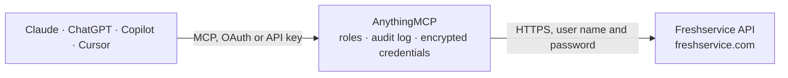

<!-- Generated by scripts/export-github-catalog.mjs in the anythingmcp-website repository. Do not edit by hand. -->

# Freshservice MCP connector

Manage Freshservice (ITSM: tickets, problems, changes, assets, agents, requesters, departments) from any AI agent. 10 tools, basic-auth with API key. The AnythingMCP connector gives Claude, ChatGPT, Microsoft Copilot, Cursor and Gemini 10 MCP tools for Freshservice: 6 read and 4 can change data.

**Category:** [Customer Support](../support.md) · **Tools:** 10 · **Setup guide:** [anythingmcp.com](https://anythingmcp.com/guides/freshservice-to-mcp) · [Deutsch](https://anythingmcp.com/de/guides/freshservice-to-mcp) · [Italiano](https://anythingmcp.com/it/guides/freshservice-to-mcp) · [Español](https://anythingmcp.com/es/guides/freshservice-to-mcp) · [日本語](https://anythingmcp.com/ja/guides/freshservice-to-mcp) · [Русский](https://anythingmcp.com/ru/guides/freshservice-to-mcp) · [中文](https://anythingmcp.com/zh/guides/freshservice-to-mcp)

## Start without code

No installation and no terminal: AnythingMCP Cloud runs the Freshservice connector for you, operated by helpcode.ai in Frankfurt, Germany.

1. **Click the button above** and create an account or sign in. The Freshservice connector opens, ready to install.
2. **Paste the API key or token from your Freshservice account.** Every click is in the [step-by-step guide](https://anythingmcp.com/guides/freshservice-to-mcp).
3. **Click Install.** AnythingMCP shows the address of your MCP server.
4. **Add that address to your assistant:** [Claude](https://anythingmcp.com/guides/connect-freshservice-to-claude) · [ChatGPT](https://anythingmcp.com/guides/connect-freshservice-to-chatgpt) · [Microsoft Copilot](https://anythingmcp.com/guides/connect-freshservice-to-copilot) · [Cursor](https://anythingmcp.com/guides/connect-freshservice-to-cursor) · [Gemini CLI](https://anythingmcp.com/guides/connect-freshservice-to-gemini) · [Meta Muse](https://anythingmcp.com/guides/connect-freshservice-to-muse).
5. **Ask your first question**, for example: *What's the status and assignee of ticket 14287 for requester emma.brunner@muellergmbh.de?*

Prefer help with the setup? [Talk to us](https://anythingmcp.com/contact).

## How it works

- **The AI client** speaks MCP (Streamable HTTP) to AnythingMCP and only sees tool names, descriptions and results. It never gets the Freshservice credentials.
- **AnythingMCP** checks the client's role, builds the call from the tool definition, adds the credentials (user name and password), calls Freshservice, logs the call and returns the result.
- **Freshservice** sees an ordinary API client with the rights of the account the credentials belong to.

## Tools

| Tool | What it does | Access |
|---|---|---|
| [`freshservice_list_tickets`](#freshservice_list_tickets) | List tickets. | read |
| [`freshservice_get_ticket`](#freshservice_get_ticket) | Get one ticket by ID with full description + custom fields. | read |
| [`freshservice_create_ticket`](#freshservice_create_ticket) | Create a new ticket. | write |
| [`freshservice_update_ticket`](#freshservice_update_ticket) | Update a ticket's status, priority, assignee, tags, custom fields, subject, or description. | write |
| [`freshservice_reply_to_ticket`](#freshservice_reply_to_ticket) | Add a public reply to a ticket — visible to the requester. | write |
| [`freshservice_add_note`](#freshservice_add_note) | Add an internal (private) note to a ticket — NOT visible to the requester. | write |
| [`freshservice_list_problems`](#freshservice_list_problems) | List problem records. | read |
| [`freshservice_list_changes`](#freshservice_list_changes) | List change requests. | read |
| [`freshservice_list_assets`](#freshservice_list_assets) | List CI assets in the Freshservice CMDB. | read |
| [`freshservice_list_agents`](#freshservice_list_agents) | List agents (your IT team members). | read |

## Tool reference

Every parameter as the AI client sees it in `tools/list`. Source: [`packages/backend/src/adapters/intl/freshservice.json`](../../../packages/backend/src/adapters/intl/freshservice.json).

### `freshservice_list_tickets`

List tickets. Filter by predefined views (`new_and_my_open`, `watching`, `spam`, `deleted`, `unresolved`, ...) or by requester_id/email. Returns each ticket's id, subject, status, priority, source, group_id, responder_id, requester_id, created_at.

**Access:** read · **Call:** `GET /tickets`

| Parameter | Type | Required | Description |
|---|---|---|---|
| `filter` | string | no | Predefined view name. |
| `requester_id` | integer | no | Filter to one requester. |
| `email` | string | no | Filter to one requester email. |
| `updated_since` | string | no | ISO 8601 — only tickets updated after this. |
| `include` | string | no | Comma-separated: 'stats', 'requester', 'requested_for', 'department'. |
| `page` | integer | no | 1-based. |
| `per_page` | integer | no | Max 100. |

### `freshservice_get_ticket`

Get one ticket by ID with full description + custom fields. Pass `include` to expand stats/requester/conversations.

**Access:** read · **Call:** `GET /tickets/{ticket_id}`

| Parameter | Type | Required | Description |
|---|---|---|---|
| `ticket_id` | integer | yes | Ticket ID. |
| `include` | string | no | Comma-separated: 'conversations', 'requester', 'requested_for', 'stats', 'problem', 'assets', 'change', 'related_tickets'. |

### `freshservice_create_ticket`

Create a new ticket. Required: `subject` + `description` + `email` (requester) + `priority` + `status` + `source`.

**Access:** write · **Call:** `POST /tickets`

| Parameter | Type | Required | Description |
|---|---|---|---|
| `subject` | string | yes | Ticket subject. |
| `description` | string | yes | HTML description. |
| `email` | string | yes | Requester email. |
| `priority` | integer | yes | 1=Low, 2=Medium, 3=High, 4=Urgent. |
| `status` | integer | yes | 2=Open, 3=Pending, 4=Resolved, 5=Closed. |
| `source` | integer | yes | 1=Email, 2=Portal, 3=Phone, 4=Chat, ... |
| `category` | string | no | Top-level category name. |
| `sub_category` | string | no | Second-level category. |
| `item_category` | string | no | Third-level category. |
| `group_id` | integer | no | Assign to a group. |
| `responder_id` | integer | no | Assign to an agent. |
| `department_id` | integer | no | Department. |
| `tags` | any[] | no | Array of tag strings. |
| `custom_fields` | object | no | Custom field map (key = field name). |

### `freshservice_update_ticket`

Update a ticket's status, priority, assignee, tags, custom fields, subject, or description.

**Access:** write · **Call:** `PUT /tickets/{ticket_id}`

| Parameter | Type | Required | Description |
|---|---|---|---|
| `ticket_id` | integer | yes | Ticket ID. |
| `subject` | string | no | New subject. |
| `description` | string | no | New HTML description. |
| `priority` | integer | no | 1-4. |
| `status` | integer | no | 2-5. |
| `group_id` | integer | no | Move to group. |
| `responder_id` | integer | no | Move to agent. |
| `tags` | any[] | no | Replace tags. |
| `custom_fields` | object | no | Merge custom fields. |

### `freshservice_reply_to_ticket`

Add a public reply to a ticket — visible to the requester.

**Access:** write · **Call:** `POST /tickets/{ticket_id}/reply`

| Parameter | Type | Required | Description |
|---|---|---|---|
| `ticket_id` | integer | yes | Ticket ID. |
| `body` | string | yes | HTML body of the reply. |
| `from_email` | string | no | Override sending email. |
| `user_id` | integer | no | Agent user_id. |

### `freshservice_add_note`

Add an internal (private) note to a ticket — NOT visible to the requester. Pass `private=true` (default) for internal, `false` for public.

**Access:** write · **Call:** `POST /tickets/{ticket_id}/notes`

| Parameter | Type | Required | Description |
|---|---|---|---|
| `ticket_id` | integer | yes | Ticket ID. |
| `body` | string | yes | HTML body. |
| `private` | boolean | no | Default true. |
| `user_id` | integer | no | Author agent user_id. |

### `freshservice_list_problems`

List problem records.

**Access:** read · **Call:** `GET /problems`

| Parameter | Type | Required | Description |
|---|---|---|---|
| `page` | integer | no | 1-based. |
| `per_page` | integer | no | Max 100. |

### `freshservice_list_changes`

List change requests.

**Access:** read · **Call:** `GET /changes`

| Parameter | Type | Required | Description |
|---|---|---|---|
| `page` | integer | no | 1-based. |
| `per_page` | integer | no | Max 100. |

### `freshservice_list_assets`

List CI assets in the Freshservice CMDB. Filter by include or asset_type_id.

**Access:** read · **Call:** `GET /assets`

| Parameter | Type | Required | Description |
|---|---|---|---|
| `include` | string | no | 'type_fields' to include CI-type custom fields. |
| `filter` | string | no | Query like "asset_type_id:7 AND impact:'high'". |
| `page` | integer | no | 1-based. |
| `per_page` | integer | no | Max 100. |

### `freshservice_list_agents`

List agents (your IT team members).

**Access:** read · **Call:** `GET /agents`

| Parameter | Type | Required | Description |
|---|---|---|---|
| `email` | string | no | Filter by email. |
| `state` | string | no | 'fulltime' or 'occasional'. |
| `page` | integer | no | 1-based. |
| `per_page` | integer | no | Max 100. |

## Run it yourself

AnythingMCP is open source (AGPL-3.0). [Run it with Docker](../../../README.md#run-it-yourself), open **Connectors → Store**, pick **Freshservice** and enter `FRESHSERVICE_SUBDOMAIN`, `FRESHSERVICE_API_KEY`, then add your MCP server URL to the AI client.

[← Customer Support connectors](../support.md) · [All categories](../README.md)
