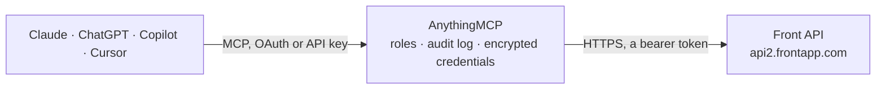

<!-- Generated by scripts/export-github-catalog.mjs in the anythingmcp-website repository. Do not edit by hand. -->

# Front MCP connector

Drive Front (collaborative inbox) from any AI agent: conversations, messages, contacts, tags, inboxes, teammates. 13 tools, API-key Bearer auth. The AnythingMCP connector gives Claude, ChatGPT, Microsoft Copilot, Cursor and Gemini 13 MCP tools for Front: 9 read and 4 can change data.

**Category:** [Customer Support](../support.md) · **Tools:** 13 · **Setup guide:** [anythingmcp.com](https://anythingmcp.com/guides/front-to-mcp) · [Deutsch](https://anythingmcp.com/de/guides/front-to-mcp) · [Italiano](https://anythingmcp.com/it/guides/front-to-mcp) · [Español](https://anythingmcp.com/es/guides/front-to-mcp) · [日本語](https://anythingmcp.com/ja/guides/front-to-mcp) · [Русский](https://anythingmcp.com/ru/guides/front-to-mcp) · [中文](https://anythingmcp.com/zh/guides/front-to-mcp)

## Start without code

No installation and no terminal: AnythingMCP Cloud runs the Front connector for you, operated by helpcode.ai in Frankfurt, Germany.

1. **Click the button above** and create an account or sign in. The Front connector opens, ready to install.
2. **Paste the API key or token from your Front account.** Every click is in the [step-by-step guide](https://anythingmcp.com/guides/front-to-mcp).
3. **Click Install.** AnythingMCP shows the address of your MCP server.
4. **Add that address to your assistant:** [Claude](https://anythingmcp.com/guides/connect-front-to-claude) · [ChatGPT](https://anythingmcp.com/guides/connect-front-to-chatgpt) · [Microsoft Copilot](https://anythingmcp.com/guides/connect-front-to-copilot) · [Cursor](https://anythingmcp.com/guides/connect-front-to-cursor) · [Gemini CLI](https://anythingmcp.com/guides/connect-front-to-gemini) · [Meta Muse](https://anythingmcp.com/guides/connect-front-to-muse).
5. **Ask your first question**, for example: *Show me the conversation thread about invoice INV-2026-118 from Nordic Solar Oy in the billing inbox.*

Prefer help with the setup? [Talk to us](https://anythingmcp.com/contact).

## How it works

- **The AI client** speaks MCP (Streamable HTTP) to AnythingMCP and only sees tool names, descriptions and results. It never gets the Front credentials.
- **AnythingMCP** checks the client's role, builds the call from the tool definition, adds the credentials (a bearer token), calls Front, logs the call and returns the result.
- **Front** sees an ordinary API client with the rights of the account the credentials belong to.

## Tools

| Tool | What it does | Access |
|---|---|---|
| [`front_me`](#front_me) | Return the API token's identity (id, name, email). | read |
| [`front_list_inboxes`](#front_list_inboxes) | List inboxes the token can access. | read |
| [`front_list_conversations`](#front_list_conversations) | List conversations with optional filtering. | read |
| [`front_get_conversation`](#front_get_conversation) | Fetch a single conversation including assignee, tags, recipient handles, links to messages/comments. | read |
| [`front_list_conversation_messages`](#front_list_conversation_messages) | List all messages in a conversation chronologically. | read |
| [`front_send_reply`](#front_send_reply) | Send a reply (new message) in an existing conversation. | write |
| [`front_add_comment`](#front_add_comment) | Add an internal comment (private note) to a conversation. | write |
| [`front_update_conversation`](#front_update_conversation) | Update conversation status, assignee, or tags. | write |
| [`front_list_contacts`](#front_list_contacts) | List contacts (external entities). | read |
| [`front_get_contact`](#front_get_contact) | Fetch a contact with all handles[] (email/phone/twitter/custom). | read |
| [`front_create_contact`](#front_create_contact) | Create a contact. | write |
| [`front_list_tags`](#front_list_tags) | List tags. | read |
| [`front_list_teammates`](#front_list_teammates) | List teammates (Front users). | read |

## Tool reference

Every parameter as the AI client sees it in `tools/list`. Source: [`packages/backend/src/adapters/intl/front.json`](../../../packages/backend/src/adapters/intl/front.json).

### `front_me`

Return the API token's identity (id, name, email).

**Access:** read · **Call:** `GET /me`

No parameters.

### `front_list_inboxes`

List inboxes the token can access. Each has id, name, type (private/shared), send_as.

**Access:** read · **Call:** `GET /inboxes`

| Parameter | Type | Required | Description |
|---|---|---|---|
| `limit` | integer | no | Per page (max 100). |
| `page_token` | string | no | Pagination cursor. |

### `front_list_conversations`

List conversations with optional filtering. Front's filter syntax: `q[statuses][]=open&q[statuses][]=archived&q[tag_ids][]=tag_xxx`.

**Access:** read · **Call:** `GET /conversations`

| Parameter | Type | Required | Description |
|---|---|---|---|
| `q_statuses` | any[] | no | Filter statuses: open, archived, spam, deleted. |
| `q_tag_ids` | any[] | no | Filter by tag IDs. |
| `q_inbox_id` | string | no | Filter by inbox ID. |
| `q_assignee_id` | string | no | Filter by assignee. |
| `q_after` | integer | no | Unix timestamp (seconds) — created after. |
| `q_before` | integer | no | Unix timestamp — created before. |
| `limit` | integer | no | Per page. |
| `page_token` | string | no | Cursor. |

### `front_get_conversation`

Fetch a single conversation including assignee, tags, recipient handles, links to messages/comments.

**Access:** read · **Call:** `GET /conversations/{conversationId}`

| Parameter | Type | Required | Description |
|---|---|---|---|
| `conversationId` | string | yes | Conversation ID (starts with 'cnv_'). |

### `front_list_conversation_messages`

List all messages in a conversation chronologically.

**Access:** read · **Call:** `GET /conversations/{conversationId}/messages`

| Parameter | Type | Required | Description |
|---|---|---|---|
| `conversationId` | string | yes | Conversation ID. |
| `limit` | integer | no | Per page. |
| `page_token` | string | no | Cursor. |

### `front_send_reply`

Send a reply (new message) in an existing conversation. Required: body. Sender is the API token's identity unless `author_id` overrides.

**Access:** write · **Call:** `POST /conversations/{conversationId}/messages`

| Parameter | Type | Required | Description |
|---|---|---|---|
| `conversationId` | string | yes | Conversation ID. |
| `body` | string | yes | Reply body (HTML for email, plain for SMS/chat). |
| `text` | string | no | Plain-text fallback (for HTML body). |
| `to` | any[] | no | Override recipients (defaults to conversation participants). |
| `cc` | any[] | no | CC list. |
| `bcc` | any[] | no | BCC list. |
| `subject` | string | no | Override subject (defaults to conversation subject). |
| `author_id` | string | no | Teammate ID — send AS this person (impersonation, requires admin scope). |
| `channel_id` | string | no | Channel to send through (if conversation has multiple). |
| `options` | object | no | {archive?:bool, tag_ids?:[]} — auto-archive on send, tag. |

### `front_add_comment`

Add an internal comment (private note) to a conversation. Only visible to teammates.

**Access:** write · **Call:** `POST /conversations/{conversationId}/comments`

| Parameter | Type | Required | Description |
|---|---|---|---|
| `conversationId` | string | yes | Conversation ID. |
| `body` | string | yes | Comment text (Markdown). |
| `author_id` | string | no | Teammate ID (defaults to token's user). |

### `front_update_conversation`

Update conversation status, assignee, or tags. PATCH semantics — only pass what to change.

**Access:** write · **Call:** `PATCH /conversations/{conversationId}`

| Parameter | Type | Required | Description |
|---|---|---|---|
| `conversationId` | string | yes | Conversation ID. |
| `status` | string | no | open, archived, spam, deleted. |
| `assignee_id` | string | no | Teammate ID to assign (or null to unassign). |
| `tag_ids` | any[] | no | Replace tag set. |
| `inbox_id` | string | no | Move to different inbox. |

### `front_list_contacts`

List contacts (external entities).

**Access:** read · **Call:** `GET /contacts`

| Parameter | Type | Required | Description |
|---|---|---|---|
| `limit` | integer | no | Per page. |
| `page_token` | string | no | Cursor. |
| `q_updated_after` | integer | no | Unix seconds. |

### `front_get_contact`

Fetch a contact with all handles[] (email/phone/twitter/custom).

**Access:** read · **Call:** `GET /contacts/{contactId}`

| Parameter | Type | Required | Description |
|---|---|---|---|
| `contactId` | string | yes | Contact ID (starts with 'cnt_') OR handle URL like 'alt:email:a@b.com'. |

### `front_create_contact`

Create a contact. Required: handles (at least one).

**Access:** write · **Call:** `POST /contacts`

| Parameter | Type | Required | Description |
|---|---|---|---|
| `name` | string | no | Contact name. |
| `description` | string | no | Notes. |
| `avatar_url` | string | no | Avatar URL. |
| `handles` | any[] | yes | [{handle:'a@b.com', source:'email'}] — source can be email, phone, twitter, custom, etc. |
| `links` | any[] | no | Array of URL strings (e.g. their CRM record). |
| `custom_fields` | object | no | Custom field name → value. |

### `front_list_tags`

List tags.

**Access:** read · **Call:** `GET /tags`

| Parameter | Type | Required | Description |
|---|---|---|---|
| `limit` | integer | no | Per page. |
| `page_token` | string | no | Cursor. |

### `front_list_teammates`

List teammates (Front users).

**Access:** read · **Call:** `GET /teammates`

| Parameter | Type | Required | Description |
|---|---|---|---|
| `limit` | integer | no | Per page. |
| `page_token` | string | no | Cursor. |

## Run it yourself

AnythingMCP is open source (AGPL-3.0). [Run it with Docker](../../../README.md#run-it-yourself), open **Connectors → Store**, pick **Front** and enter `FRONT_API_TOKEN`, then add your MCP server URL to the AI client.

[← Customer Support connectors](../support.md) · [All categories](../README.md)
