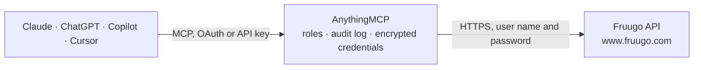

<!-- Generated by scripts/export-github-catalog.mjs in the anythingmcp-website repository. Do not edit by hand. -->

# Fruugo MCP connector

Sell on the Fruugo marketplace from an AI agent: download orders with lines, customer pricing, shipping address and shipments, and read the availability and stock of your SKUs. The AnythingMCP connector gives Claude, ChatGPT, Microsoft Copilot, Cursor and Gemini 4 MCP tools for Fruugo: 2 read and 2 can change data.

**Category:** [E-commerce](../e-commerce.md) · **Tools:** 4 · **Setup guide:** [anythingmcp.com](https://anythingmcp.com/guides/fruugo-to-mcp) · [Deutsch](https://anythingmcp.com/de/guides/fruugo-to-mcp) · [Italiano](https://anythingmcp.com/it/guides/fruugo-to-mcp) · [Español](https://anythingmcp.com/es/guides/fruugo-to-mcp) · [日本語](https://anythingmcp.com/ja/guides/fruugo-to-mcp) · [Русский](https://anythingmcp.com/ru/guides/fruugo-to-mcp) · [中文](https://anythingmcp.com/zh/guides/fruugo-to-mcp)

## Start without code

No installation and no terminal: AnythingMCP Cloud runs the Fruugo connector for you, operated by helpcode.ai in Frankfurt, Germany.

1. **Click the button above** and create an account or sign in. The Fruugo connector opens, ready to install.
2. **Paste the API key or token from your Fruugo account.** Every click is in the [step-by-step guide](https://anythingmcp.com/guides/fruugo-to-mcp).
3. **Click Install.** AnythingMCP shows the address of your MCP server.
4. **Add that address to your assistant:** [Claude](https://anythingmcp.com/guides/connect-fruugo-to-claude) · [ChatGPT](https://anythingmcp.com/guides/connect-fruugo-to-chatgpt) · [Microsoft Copilot](https://anythingmcp.com/guides/connect-fruugo-to-copilot) · [Cursor](https://anythingmcp.com/guides/connect-fruugo-to-cursor) · [Gemini CLI](https://anythingmcp.com/guides/connect-fruugo-to-gemini) · [Meta Muse](https://anythingmcp.com/guides/connect-fruugo-to-muse).
5. **Ask your first question**, for example: *Fetch order FRU-2026-00123 between 2026-10-12 and 2026-10-13*

Prefer help with the setup? [Talk to us](https://anythingmcp.com/contact).

## How it works

- **The AI client** speaks MCP (Streamable HTTP) to AnythingMCP and only sees tool names, descriptions and results. It never gets the Fruugo credentials.
- **AnythingMCP** checks the client's role, builds the call from the tool definition, adds the credentials (user name and password), calls Fruugo, logs the call and returns the result.
- **Fruugo** sees an ordinary API client with the rights of the account the credentials belong to.

## Tools

| Tool | What it does | Access |
|---|---|---|
| [`fruugo_download_orders`](#fruugo_download_orders) | Download the Fruugo orders released to you between from and to (at most 60 days apart): order and customer order id, dates, status PENDING, PROCESSED or… | read |
| [`fruugo_list_stock`](#fruugo_list_stock) | List your live SKUs on Fruugo with Fruugo SKU id, your product and SKU id, product title, availability (INSTOCK, OUTOFSTOCK, NOTAVAILABLE) and items in… | read |
| [`fruugo_confirm_order`](#fruugo_confirm_order) | Confirm a Fruugo order (all items, or one item with fruugoProductId,fruugoSkuId,quantity), optionally with an estimated shipping date and messages to the… | write |
| [`fruugo_ship_order`](#fruugo_ship_order) | Mark a Fruugo order shipped (all items, or one item with fruugoProductId,fruugoSkuId,quantity) with the tracking code and the courier's tracking URL or at… | write |

## Tool reference

Every parameter as the AI client sees it in `tools/list`. Source: [`packages/backend/src/adapters/gb/fruugo.json`](../../../packages/backend/src/adapters/gb/fruugo.json).

### `fruugo_download_orders`

Download the Fruugo orders released to you between from and to (at most 60 days apart): order and customer order id, dates, status PENDING, PROCESSED or EXCEPTION, customer language, shipping address and method, shipping cost, order lines with Fruugo and own product and SKU ids, prices, customer currency pricing, VAT and item counters, shipments and Fruugo tax ids. Order XML turned into JSON.

**Access:** read · **Call:** `GET /orders/download/v2`

| Parameter | Type | Required | Description |
|---|---|---|---|
| `from` | string | yes | Start, ISO 8601 date or date-time, e.g. 2026-10-01 or 2026-10-01T00:00:00Z. |
| `to` | string | no | End, ISO 8601; at most 60 days after from. Omit for up to now. |

### `fruugo_list_stock`

List your live SKUs on Fruugo with Fruugo SKU id, your product and SKU id, product title, availability (INSTOCK, OUTOFSTOCK, NOTAVAILABLE) and items in stock when your feed provides it. 1,000 SKUs per page (about 200 KB), page from 0.

**Access:** read · **Call:** `GET /stockstatus-api`

| Parameter | Type | Required | Description |
|---|---|---|---|
| `page` | integer | no | Page number from 0, 1,000 SKUs per page; the answer's skus element carries totalNumberOfSkus, numberOfPages and currentPage. |

### `fruugo_confirm_order`

Confirm a Fruugo order (all items, or one item with fruugoProductId,fruugoSkuId,quantity), optionally with an estimated shipping date and messages to the customer and to Fruugo. Returns the updated order XML. Installed switched off; acts on a real customer order: show the user the order and get a yes first.

**Access:** write · **Call:** `POST /orders/confirm`

| Parameter | Type | Required | Description |
|---|---|---|---|
| `order_id` | string | yes | orderId from fruugo_download_orders. |
| `item` | string | no | Only this item: fruugoProductId,fruugoSkuId,quantity. Omit to confirm every item. |
| `estimated_shipping_date` | string | no | Estimated shipping date, YYYY-MM-DD. |
| `message_to_customer` | string | no | Message passed to the customer. |
| `message_to_fruugo` | string | no | Message passed to Fruugo. |

### `fruugo_ship_order`

Mark a Fruugo order shipped (all items, or one item with fruugoProductId,fruugoSkuId,quantity) with the tracking code and the courier's tracking URL or at least the courier name, which Fruugo passes to the customer. Returns the updated order XML. Installed switched off; show the user the order and tracking and get a yes first.

**Access:** write · **Call:** `POST /orders/ship`

| Parameter | Type | Required | Description |
|---|---|---|---|
| `order_id` | string | yes | orderId from fruugo_download_orders. |
| `item` | string | no | Only this item: fruugoProductId,fruugoSkuId,quantity. Omit to ship every item. |
| `tracking_code` | string | no | Tracking code of the parcel. |
| `tracking_url` | string | no | Courier tracking URL, or at least the courier name. |
| `message_to_customer` | string | no | Message passed to the customer. |
| `message_to_fruugo` | string | no | Message passed to Fruugo. |

## Run it yourself

AnythingMCP is open source (AGPL-3.0). [Run it with Docker](../../../README.md#run-it-yourself), open **Connectors → Store**, pick **Fruugo** and enter `FRUUGO_USERNAME`, `FRUUGO_PASSWORD`, then add your MCP server URL to the AI client.

[← E-commerce connectors](../e-commerce.md) · [All categories](../README.md)
