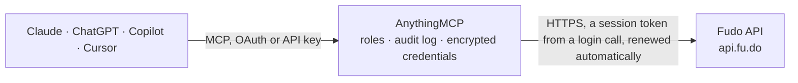

<!-- Generated by scripts/export-github-catalog.mjs in the anythingmcp-website repository. Do not edit by hand. -->

# Fudo MCP connector

Fudo restaurant point of sale: sales and tickets with items and payments, payments and payment methods, customers, products and menu categories, expenses with their purchased lines, expense payments … The AnythingMCP connector gives Claude, ChatGPT, Microsoft Copilot, Cursor and Gemini 34 MCP tools for Fudo: 24 read and 10 can change data.

**Category:** [Food & Drink](../food.md) · **Tools:** 34 · **Setup guide:** [anythingmcp.com](https://anythingmcp.com/guides/fudo-to-mcp) · [Deutsch](https://anythingmcp.com/de/guides/fudo-to-mcp) · [Italiano](https://anythingmcp.com/it/guides/fudo-to-mcp) · [Español](https://anythingmcp.com/es/guides/fudo-to-mcp) · [日本語](https://anythingmcp.com/ja/guides/fudo-to-mcp) · [Русский](https://anythingmcp.com/ru/guides/fudo-to-mcp) · [中文](https://anythingmcp.com/zh/guides/fudo-to-mcp)

## Start without code

No installation and no terminal: AnythingMCP Cloud runs the Fudo connector for you, operated by helpcode.ai in Frankfurt, Germany.

1. **Click the button above** and create an account or sign in. The Fudo connector opens, ready to install.
2. **Paste the API key or token from your Fudo account.** Every click is in the [step-by-step guide](https://anythingmcp.com/guides/fudo-to-mcp).
3. **Click Install.** AnythingMCP shows the address of your MCP server.
4. **Add that address to your assistant:** [Claude](https://anythingmcp.com/guides/connect-fudo-to-claude) · [ChatGPT](https://anythingmcp.com/guides/connect-fudo-to-chatgpt) · [Microsoft Copilot](https://anythingmcp.com/guides/connect-fudo-to-copilot) · [Cursor](https://anythingmcp.com/guides/connect-fudo-to-cursor) · [Gemini CLI](https://anythingmcp.com/guides/connect-fudo-to-gemini) · [Meta Muse](https://anythingmcp.com/guides/connect-fudo-to-muse).
5. **Ask your first question**, for example: *Fetch sale 1873 with its items and payments for reconciliation*

Prefer help with the setup? [Talk to us](https://anythingmcp.com/contact).

## How it works

- **The AI client** speaks MCP (Streamable HTTP) to AnythingMCP and only sees tool names, descriptions and results. It never gets the Fudo credentials.
- **AnythingMCP** checks the client's role, builds the call from the tool definition, adds the credentials (a session token from a login call, renewed automatically), calls Fudo, logs the call and returns the result.
- **Fudo** sees an ordinary API client with the rights of the account the credentials belong to.

## Tools

| Tool | What it does | Access |
|---|---|---|
| [`fudo_list_customers`](#fudo_list_customers) | List the restaurant's customers with name, phone, e-mail, address, sales count, first and last sale date and house account. | read |
| [`fudo_get_customer`](#fudo_get_customer) | Get one customer by id with contact data, fiscal address, discount percentage, house account flag, sales count and first and last sale dates. | read |
| [`fudo_list_products`](#fudo_list_products) | List products on the menu with name, code, price, cost, stock, stock control, active flag and position. | read |
| [`fudo_get_product`](#fudo_get_product) | Get one product by id with price, cost, stock, description and flags; embed category, modifiers, recipe proportions or menus with include. | read |
| [`fudo_list_product_categories`](#fudo_list_product_categories) | List product categories (menu sections) with name, position, parent category and kitchen. | read |
| [`fudo_get_product_category`](#fudo_get_product_category) | Get one product category by id with name and position; embed its products, kitchen, parent category or taxes with include. | read |
| [`fudo_list_sales`](#fudo_list_sales) | List sales (tickets) with total, type (eat-in, takeaway, delivery), state, people, customer name and created and closed times. | read |
| [`fudo_get_sale`](#fudo_get_sale) | Get one sale by id with total, type, state, people, comment and times; embed the items with products, payments, discounts, tips, customer and table with… | read |
| [`fudo_list_payments`](#fudo_list_payments) | List payments received with amount, payment method, paid and created times and canceled flag. | read |
| [`fudo_get_payment`](#fudo_get_payment) | Get one payment by id with amount, received amount, paid time, external reference and canceled flag; embed the payment method with include. | read |
| [`fudo_list_payment_methods`](#fudo_list_payment_methods) | List the payment methods configured in Fudo (cash, cards, transfers, online processors) with id, name and kind. | read |
| [`fudo_list_expenses`](#fudo_list_expenses) | List expenses (purchases and costs) with amount, date, due date, payment date, description, status (PAID or UNPAID) and receipt number. | read |
| [`fudo_get_expense`](#fudo_get_expense) | Get one expense by id with amount, dates, description, status and receipt number. | read |
| [`fudo_list_expense_categories`](#fudo_list_expense_categories) | List expense categories with id, name, active flag, financial category (ADMINISTRATIVE-EXPENSES, OPERATIONAL-EXPENSES, GOODS-PURCHASES) and parent category. | read |
| [`fudo_list_tables`](#fudo_list_tables) | List the dining tables with number, room and status. | read |
| [`fudo_get_table`](#fudo_get_table) | Get one table by id with number and room; embed its open sales with items and payments with include. | read |
| [`fudo_list_rooms`](#fudo_list_rooms) | List the rooms (dining areas such as salon or terrace) with id and name; embed their tables with include=tables. | read |
| [`fudo_list_kitchens`](#fudo_list_kitchens) | List the kitchens (preparation stations such as kitchen or bar) with id and name. | read |
| [`fudo_list_providers`](#fudo_list_providers) | List providers (suppliers) with name, e-mail, phone, address, fiscal number and house account balance. | read |
| [`fudo_get_provider`](#fudo_get_provider) | Get one provider (supplier) by id with name, e-mail, phone, address, fiscal number, comment, active flag and house account balance. | read |
| [`fudo_list_ingredients`](#fudo_list_ingredients) | List ingredients with cost, stock, minimum stock and stock control. | read |
| [`fudo_get_ingredient`](#fudo_get_ingredient) | Get one ingredient by id with cost, stock, minimum stock and stock control. | read |
| [`fudo_list_users`](#fudo_list_users) | List the Fudo users (staff such as waiters and cashiers) with name, e-mail and active flag; embed their role or cash registers with include. | read |
| [`fudo_list_roles`](#fudo_list_roles) | List user roles with name and permissions (e.g. list_expenses, create_expenses, view_products_cost). | read |
| [`fudo_create_customer`](#fudo_create_customer) | Create a customer in Fudo with name and optional contact data. | write |
| [`fudo_update_customer`](#fudo_update_customer) | Change a customer's contact data, discount, house account or active flag. | write |
| [`fudo_create_expense`](#fudo_create_expense) | Record an expense (purchase, bill or cost) with amount and date, and link it to a provider, category or payment method. | write |
| [`fudo_update_expense`](#fudo_update_expense) | Change an expense: amount, date, description, receipt number, due or payment date, cash-count flag, or cancel it with canceled=true. | write |
| [`fudo_create_expense_payment`](#fudo_create_expense_payment) | Pay an expense: record a payment of an amount with a payment method, so the expense turns PAID once fully paid. | write |
| [`fudo_create_expense_category`](#fudo_create_expense_category) | Create an expense category with a name, optional financial category and parent category. | write |
| [`fudo_create_provider`](#fudo_create_provider) | Create a provider (supplier) with a name and optional fiscal number, e-mail, phone, address and comment. | write |
| [`fudo_update_provider`](#fudo_update_provider) | Change a provider's name, fiscal number, e-mail, phone, address, comment or active flag. | write |
| [`fudo_update_product`](#fudo_update_product) | Change a product's price, cost, stock, minimum stock, name, code, description or active flag. | write |
| [`fudo_update_ingredient`](#fudo_update_ingredient) | Change an ingredient's stock, cost, minimum stock, name or stock control. | write |

## Tool reference

Every parameter as the AI client sees it in `tools/list`. Source: [`packages/backend/src/adapters/intl/fudo.json`](../../../packages/backend/src/adapters/intl/fudo.json).

### `fudo_list_customers`

List the restaurant's customers with name, phone, e-mail, address, sales count, first and last sale date and house account. Filter by activity, origin, sales count or a free-text search.

**Access:** read · **Call:** `GET /customers`

| Parameter | Type | Required | Description |
|---|---|---|---|
| `search` | string | no | Full-text search over the customer fields, e.g. maria gomez. |
| `active` | boolean | no | true for active customers, false for inactive ones. |
| `origin` | string | no | eq.ONLINE-MENU, eq.RESERVATION or is.null (created in the POS). |
| `sales_count` | string | no | Operator expression on the number of sales, e.g. gte.5 or and(gte.2,lte.10). |
| `last_sale_date` | string | no | Last sale time. Operator expression: gte.<time>, lte.<time> or and(gte.<time>,lte.<time>), times as 2026-10-01T00:00:00Z. |
| `first_sale_date` | string | no | First sale time. Operator expression: gte.<time>, lte.<time> or and(gte.<time>,lte.<time>), times as 2026-10-01T00:00:00Z. |
| `sort` | string | no | Comma-separated: id, name, salesCount; prefix - for descending, e.g. -salesCount,name. |
| `page_size` | integer | no | Items per page, up to 500 (default 250). The last page has fewer items than this. |
| `page_number` | integer | no | Page number, starting at 1. |

### `fudo_get_customer`

Get one customer by id with contact data, fiscal address, discount percentage, house account flag, sales count and first and last sale dates.

**Access:** read · **Call:** `GET /customers/{customer_id}`

| Parameter | Type | Required | Description |
|---|---|---|---|
| `customer_id` | string | yes | Numeric customer id from fudo_list_customers. |

### `fudo_list_products`

List products on the menu with name, code, price, cost, stock, stock control, active flag and position. Filter by name, category, active or ids; embed the category or modifiers with include.

**Access:** read · **Call:** `GET /products`

| Parameter | Type | Required | Description |
|---|---|---|---|
| `name` | string | no | Case-insensitive name match; % is the wildcard, e.g. %pizza%. |
| `product_category_id` | string | no | Only products of this category id. |
| `active` | boolean | no | true for active products, false for inactive ones. |
| `ids` | string | no | Comma-separated product ids, e.g. 12,15,20. |
| `include` | string | no | Comma-separated relations to embed, e.g. productCategory, productModifiersGroups.productModifiers, proportions.ingredient, unit, menuItems.menu. |
| `sort` | string | no | Comma-separated: id, name, position; prefix - for descending. |
| `page_size` | integer | no | Items per page, up to 500 (default 250). The last page has fewer items than this. |
| `page_number` | integer | no | Page number, starting at 1. |

### `fudo_get_product`

Get one product by id with price, cost, stock, description and flags; embed category, modifiers, recipe proportions or menus with include.

**Access:** read · **Call:** `GET /products/{product_id}`

| Parameter | Type | Required | Description |
|---|---|---|---|
| `product_id` | string | yes | Numeric product id. |
| `include` | string | no | Comma-separated relations to embed, e.g. productCategory, productModifiersGroups.productModifiers, proportions.ingredient, unit, menuItems.menu. |

### `fudo_list_product_categories`

List product categories (menu sections) with name, position, parent category and kitchen. Embed products, kitchen, parent category or taxes with include.

**Access:** read · **Call:** `GET /product-categories`

| Parameter | Type | Required | Description |
|---|---|---|---|
| `include` | string | no | Comma-separated: kitchen, products, parentCategory, taxes. |
| `sort` | string | no | Comma-separated: id, name, position; prefix - for descending. |
| `page_size` | integer | no | Items per page, up to 500 (default 250). The last page has fewer items than this. |
| `page_number` | integer | no | Page number, starting at 1. |

### `fudo_get_product_category`

Get one product category by id with name and position; embed its products, kitchen, parent category or taxes with include.

**Access:** read · **Call:** `GET /product-categories/{category_id}`

| Parameter | Type | Required | Description |
|---|---|---|---|
| `category_id` | string | yes | Numeric category id. |
| `include` | string | no | Comma-separated: kitchen, products, parentCategory, taxes. |

### `fudo_list_sales`

List sales (tickets) with total, type (eat-in, takeaway, delivery), state, people, customer name and created and closed times. Filter by period, state, type, table, waiter or payment method; embed items and payments with include.

**Access:** read · **Call:** `GET /sales`

| Parameter | Type | Required | Description |
|---|---|---|---|
| `created_at` | string | no | Creation time. Operator expression: gte.<time>, lte.<time> or and(gte.<time>,lte.<time>), times as 2026-10-01T00:00:00Z. |
| `closed_at` | string | no | Closing time range, only as and(gte.<time>,lt.<time>), e.g. and(gte.2026-10-01T00:00:00Z,lt.2026-10-02T00:00:00Z). |
| `sale_state` | string | no | in.(...) with any of PENDING, CANCELED, CLOSED, IN-COURSE, PAYMENT-PROCESS, DELIVERY-SENT, READY-TO-DELIVER, e.g. in.(CLOSED). |
| `sale_type` | string | no | Operator expression on the sale type, e.g. in.(EAT-IN,TAKEAWAY) or eq.DELIVERY. |
| `table_id` | string | no | Only sales of this table id. |
| `user_id` | string | no | Only sales of this user (waiter) id. |
| `payment_method_id` | string | no | eq.<id> or in.(<id>,<id>) on the payment method. |
| `include` | string | no | Comma-separated relations to embed, e.g. items.product, payments.paymentMethod, customer, discounts, tips, table.room, waiter, commercialDocuments, shippingCosts. |
| `sort` | string | no | Comma-separated: id, createdAt, closedAt; prefix - for descending, e.g. -createdAt. |
| `page_size` | integer | no | Items per page, up to 500 (default 250). The last page has fewer items than this. |
| `page_number` | integer | no | Page number, starting at 1. |

### `fudo_get_sale`

Get one sale by id with total, type, state, people, comment and times; embed the items with products, payments, discounts, tips, customer and table with include.

**Access:** read · **Call:** `GET /sales/{sale_id}`

| Parameter | Type | Required | Description |
|---|---|---|---|
| `sale_id` | string | yes | Numeric sale id. |
| `include` | string | no | Comma-separated relations to embed, e.g. items.product, payments.paymentMethod, customer, discounts, tips, table.room, waiter, commercialDocuments, shippingCosts. |

### `fudo_list_payments`

List payments received with amount, payment method, paid and created times and canceled flag. Filter by time, amount or canceled; embed the payment method with include. Use it for cash-up and revenue by method. Sale payments and expense payments come back together; separate them with expense_id.

**Access:** read · **Call:** `GET /payments`

| Parameter | Type | Required | Description |
|---|---|---|---|
| `created_at` | string | no | Creation time. Operator expression: gte.<time>, lte.<time> or and(gte.<time>,lte.<time>), times as 2026-10-01T00:00:00Z. |
| `paid_at` | string | no | Payment time. Operator expression: gte.<time>, lte.<time> or and(gte.<time>,lte.<time>), times as 2026-10-01T00:00:00Z. |
| `amount` | string | no | Operator expression on the amount, e.g. gte.1000. |
| `canceled` | string | no | eq.true for canceled payments only, neq.true to leave them out. |
| `expense_id` | string | no | is.null for sale payments only, isdistinct.null for expense (supplier) payments only. |
| `include` | string | no | paymentMethod to embed the method. |
| `sort` | string | no | id or -id. |
| `page_size` | integer | no | Items per page, up to 500 (default 250). The last page has fewer items than this. |
| `page_number` | integer | no | Page number, starting at 1. |

### `fudo_get_payment`

Get one payment by id with amount, received amount, paid time, external reference and canceled flag; embed the payment method with include.

**Access:** read · **Call:** `GET /payments/{payment_id}`

| Parameter | Type | Required | Description |
|---|---|---|---|
| `payment_id` | string | yes | Numeric payment id. |
| `include` | string | no | paymentMethod to embed the method. |

### `fudo_list_payment_methods`

List the payment methods configured in Fudo (cash, cards, transfers, online processors) with id, name and kind. Use the ids to filter sales and payments.

**Access:** read · **Call:** `GET /payment-methods`

| Parameter | Type | Required | Description |
|---|---|---|---|
| `sort` | string | no | id or -id. |
| `page_size` | integer | no | Items per page, up to 500 (default 250). The last page has fewer items than this. |
| `page_number` | integer | no | Page number, starting at 1. |

### `fudo_list_expenses`

List expenses (purchases and costs) with amount, date, due date, payment date, description, status (PAID or UNPAID) and receipt number. Filter by date, status, category, provider or payment method. Embed the purchased lines with include=expenseItems.ingredient.unit.

**Access:** read · **Call:** `GET /expenses`

| Parameter | Type | Required | Description |
|---|---|---|---|
| `date` | string | no | Expense date: gte.<date> or and(gte.<date>,lte.<date>), dates as 2026-10-01. |
| `due_date` | string | no | Due date: gte.<date> or and(gte.<date>,lte.<date>). |
| `status` | string | no | eq.PAID or eq.UNPAID. |
| `created_at` | string | no | Creation time: gte.<time> or and(gte.<time>,lte.<time>). |
| `expense_category_id` | string | no | eq.<id> or in.(<id>,<id>) on the expense category. |
| `provider_id` | string | no | Only expenses of this provider (supplier) id. |
| `payment_method_id` | string | no | eq.<id>, is.null (unpaid) or isdistinct.null (paid). |
| `canceled` | string | no | eq.true for canceled only, neq.true to leave them out. |
| `include` | string | no | Comma-separated relations to embed: expenseItems.ingredient.unit and expenseItems.product.unit (the purchased lines with ingredient or product and unit), provider, expenseCategory, paymentMethod, payments.paymentMethod, user, cashRegister, receiptType. |
| `sort` | string | no | Comma-separated: id, createdAt, date, dueDate; prefix - for descending. |
| `page_size` | integer | no | Items per page, up to 500 (default 250). The last page has fewer items than this. |
| `page_number` | integer | no | Page number, starting at 1. |

### `fudo_get_expense`

Get one expense by id with amount, dates, description, status and receipt number. Embed the purchased lines with include=expenseItems.ingredient.unit, and provider, category or payments.

**Access:** read · **Call:** `GET /expenses/{expense_id}`

| Parameter | Type | Required | Description |
|---|---|---|---|
| `expense_id` | string | yes | Numeric expense id. |
| `include` | string | no | Comma-separated relations to embed: expenseItems.ingredient.unit and expenseItems.product.unit (the purchased lines with ingredient or product and unit), provider, expenseCategory, paymentMethod, payments.paymentMethod, user, cashRegister, receiptType. |

### `fudo_list_expense_categories`

List expense categories with id, name, active flag, financial category (ADMINISTRATIVE-EXPENSES, OPERATIONAL-EXPENSES, GOODS-PURCHASES) and parent category. Use the ids to filter or create expenses.

**Access:** read · **Call:** `GET /expense-categories`

| Parameter | Type | Required | Description |
|---|---|---|---|
| `sort` | string | no | Comma-separated: id, name; prefix - for descending. |
| `page_size` | integer | no | Items per page, up to 500 (default 250). The last page has fewer items than this. |
| `page_number` | integer | no | Page number, starting at 1. |

### `fudo_list_tables`

List the dining tables with number, room and status. Embed the open sales on each table with include=activeSales to see which tables are occupied and their running totals.

**Access:** read · **Call:** `GET /tables`

| Parameter | Type | Required | Description |
|---|---|---|---|
| `include` | string | no | Comma-separated relations to embed, e.g. room, activeSales, activeSales.items.product, activeSales.payments, activeSales.customer. |
| `sort` | string | no | Comma-separated: id, number; prefix - for descending. |
| `page_size` | integer | no | Items per page, up to 500 (default 250). The last page has fewer items than this. |
| `page_number` | integer | no | Page number, starting at 1. |

### `fudo_get_table`

Get one table by id with number and room; embed its open sales with items and payments with include.

**Access:** read · **Call:** `GET /tables/{table_id}`

| Parameter | Type | Required | Description |
|---|---|---|---|
| `table_id` | string | yes | Numeric table id. |
| `include` | string | no | Comma-separated relations to embed, e.g. room, activeSales, activeSales.items.product, activeSales.payments, activeSales.customer. |

### `fudo_list_rooms`

List the rooms (dining areas such as salon or terrace) with id and name; embed their tables with include=tables.

**Access:** read · **Call:** `GET /rooms`

| Parameter | Type | Required | Description |
|---|---|---|---|
| `include` | string | no | tables to embed the tables of each room. |
| `sort` | string | no | Comma-separated: id, name; prefix - for descending. |
| `page_size` | integer | no | Items per page, up to 500 (default 250). The last page has fewer items than this. |
| `page_number` | integer | no | Page number, starting at 1. |

### `fudo_list_kitchens`

List the kitchens (preparation stations such as kitchen or bar) with id and name. Product categories are routed to a kitchen.

**Access:** read · **Call:** `GET /kitchens`

| Parameter | Type | Required | Description |
|---|---|---|---|
| `sort` | string | no | Comma-separated: id, name; prefix - for descending. |
| `page_size` | integer | no | Items per page, up to 500 (default 250). The last page has fewer items than this. |
| `page_number` | integer | no | Page number, starting at 1. |

### `fudo_list_providers`

List providers (suppliers) with name, e-mail, phone, address, fiscal number and house account balance. Filter by active or a free-text search.

**Access:** read · **Call:** `GET /providers`

| Parameter | Type | Required | Description |
|---|---|---|---|
| `active` | boolean | no | true for active providers, false for inactive ones. |
| `search` | string | no | Full-text search over the provider fields. |
| `sort` | string | no | Comma-separated: id, name; prefix - for descending. |
| `page_size` | integer | no | Items per page, up to 500 (default 250). The last page has fewer items than this. |
| `page_number` | integer | no | Page number, starting at 1. |

### `fudo_get_provider`

Get one provider (supplier) by id with name, e-mail, phone, address, fiscal number, comment, active flag and house account balance.

**Access:** read · **Call:** `GET /providers/{provider_id}`

| Parameter | Type | Required | Description |
|---|---|---|---|
| `provider_id` | string | yes | Numeric provider id. |

### `fudo_list_ingredients`

List ingredients with cost, stock, minimum stock and stock control. Filter by name, category or ids. Add include=unit to get the unit name (unit, kg, litre) in included. Use it for stock checks and before fudo_update_ingredient.

**Access:** read · **Call:** `GET /ingredients`

| Parameter | Type | Required | Description |
|---|---|---|---|
| `name` | string | no | Case-insensitive name match; % is the wildcard, e.g. %tomate%. |
| `ingredient_category_id` | string | no | Only ingredients of this category id. |
| `ids` | string | no | Comma-separated ingredient ids, e.g. 7,9,11. |
| `include` | string | no | Comma-separated: ingredientCategory, recipeCard, unit. |
| `sort` | string | no | Comma-separated: id, name; prefix - for descending. |
| `page_size` | integer | no | Items per page, up to 500 (default 250). The last page has fewer items than this. |
| `page_number` | integer | no | Page number, starting at 1. |

### `fudo_get_ingredient`

Get one ingredient by id with cost, stock, minimum stock and stock control. Add include=unit for the unit name. Read it right before fudo_update_ingredient to get the current stock.

**Access:** read · **Call:** `GET /ingredients/{ingredient_id}`

| Parameter | Type | Required | Description |
|---|---|---|---|
| `ingredient_id` | string | yes | Numeric ingredient id. |
| `include` | string | no | Comma-separated: unit, ingredientCategory, recipeCard. |

### `fudo_list_users`

List the Fudo users (staff such as waiters and cashiers) with name, e-mail and active flag; embed their role or cash registers with include. Use the ids to filter sales by waiter.

**Access:** read · **Call:** `GET /users`

| Parameter | Type | Required | Description |
|---|---|---|---|
| `include` | string | no | Comma-separated: role, deliveryCashRegister, tablesCashRegister, takeAwayCashRegister. |
| `sort` | string | no | Comma-separated: id, name; prefix - for descending. |
| `page_size` | integer | no | Items per page, up to 500 (default 250). The last page has fewer items than this. |
| `page_number` | integer | no | Page number, starting at 1. |

### `fudo_list_roles`

List user roles with name and permissions (e.g. list_expenses, create_expenses, view_products_cost). Use it to explain a 403: the API can only do what the API user's role allows.

**Access:** read · **Call:** `GET /roles`

| Parameter | Type | Required | Description |
|---|---|---|---|
| `sort` | string | no | Comma-separated: id, name; prefix - for descending. |
| `page_size` | integer | no | Items per page, up to 500 (default 250). The last page has fewer items than this. |
| `page_number` | integer | no | Page number, starting at 1. |

### `fudo_create_customer`

Create a customer in Fudo with name and optional contact data. Fudo requires a default payment method for the customer. Returns the new customer with its id.

**Access:** write · **Call:** `POST /customers`

| Parameter | Type | Required | Description |
|---|---|---|---|
| `name` | string | yes | Customer name. |
| `payment_method_id` | string | yes | Default payment method id, from fudo_list_payment_methods. |
| `email` | string | no | E-mail address. |
| `phone` | string | no | Phone number. |
| `address` | string | no | Address as text. |
| `vat_number` | string | no | Tax id (CUIT, RFC, NIF...). |
| `comment` | string | no | Internal note. |
| `discount_percentage` | number | no | Default discount in percent. |
| `house_account_enabled` | boolean | no | Allow the customer to buy on account. |

### `fudo_update_customer`

Change a customer's contact data, discount, house account or active flag. Only the fields given are sent; Fudo also requires the default payment method. Returns the updated customer.

**Access:** write · **Call:** `PATCH /customers/{customer_id}`

| Parameter | Type | Required | Description |
|---|---|---|---|
| `customer_id` | string | yes | Numeric customer id. |
| `payment_method_id` | string | yes | Default payment method id. |
| `name` | string | no | New name. |
| `email` | string | no | New e-mail. |
| `phone` | string | no | New phone. |
| `address` | string | no | New address. |
| `vat_number` | string | no | New tax id. |
| `comment` | string | no | New internal note. |
| `discount_percentage` | number | no | New default discount in percent. |
| `house_account_enabled` | boolean | no | Allow buying on account. |
| `active` | boolean | no | false to deactivate the customer. |

### `fudo_create_expense`

Record an expense (purchase, bill or cost) with amount and date, and link it to a provider, category or payment method. The Fudo API cannot add purchased lines (expense items) to an expense, so it does not change stock: to raise ingredient stock after a purchase, use fudo_update_ingredient. Returns the new expense id.

**Access:** write · **Call:** `POST /expenses`

| Parameter | Type | Required | Description |
|---|---|---|---|
| `amount` | number | yes | Total amount. |
| `date` | string | yes | Expense date, e.g. 2026-10-06. |
| `description` | string | no | What was bought or paid. |
| `due_date` | string | no | Due date, e.g. 2026-10-31. |
| `payment_date` | string | no | Payment date when already paid. |
| `receipt_number` | string | no | Invoice or receipt number. |
| `use_in_cash_count` | boolean | no | true when paid from the cash register, so it counts in the cash-up. |
| `relationships` | object | no | JSON:API links by id, e.g. {"provider": {"data": {"id": "7", "type": "Provider"}}, "expenseCategory": {"data": {"id": "3", "type": "ExpenseCategory"}}, "paymentMethod": {"data": {"id": "1", "type": "PaymentMethod"}}}. Also cashRegister, receiptType and commercialDocument. |

### `fudo_update_expense`

Change an expense: amount, date, description, receipt number, due or payment date, cash-count flag, or cancel it with canceled=true. Only the fields given are sent. Returns the updated expense.

**Access:** write · **Call:** `PATCH /expenses/{expense_id}`

| Parameter | Type | Required | Description |
|---|---|---|---|
| `expense_id` | string | yes | Numeric expense id. |
| `amount` | number | no | New total amount. |
| `date` | string | no | New expense date, e.g. 2026-10-06. |
| `description` | string | no | New description. |
| `receipt_number` | string | no | Invoice or receipt number. |
| `due_date` | string | no | Due date, e.g. 2026-10-31. |
| `payment_date` | string | no | Payment date. |
| `use_in_cash_count` | boolean | no | true when paid from the cash register. |
| `canceled` | boolean | no | true to cancel the expense. |
| `relationships` | object | no | JSON:API links by id, e.g. {"provider": {"data": {"id": "7", "type": "Provider"}}, "expenseCategory": {"data": {"id": "3", "type": "ExpenseCategory"}}, "paymentMethod": {"data": {"id": "1", "type": "PaymentMethod"}}}. Also cashRegister, receiptType and commercialDocument. |

### `fudo_create_expense_payment`

Pay an expense: record a payment of an amount with a payment method, so the expense turns PAID once fully paid. Returns the new payment id.

**Access:** write · **Call:** `POST /payments`

| Parameter | Type | Required | Description |
|---|---|---|---|
| `expense_id` | string | yes | Numeric expense id. |
| `payment_method_id` | string | yes | Payment method id from fudo_list_payment_methods (one with forExpenses). |
| `amount` | number | yes | Amount paid. |
| `paid_at` | string | no | Payment date, e.g. 2026-10-06. |

### `fudo_create_expense_category`

Create an expense category with a name, optional financial category and parent category. Returns the new category id.

**Access:** write · **Call:** `POST /expense-categories`

| Parameter | Type | Required | Description |
|---|---|---|---|
| `name` | string | yes | Category name, up to 90 characters. |
| `financial_category` | `ADMINISTRATIVE-EXPENSES` \| `GOODS-PURCHASES` \| `OPERATIONAL-EXPENSES` | no | Financial category; GOODS-PURCHASES for stock purchases. |
| `active` | boolean | no | false to create it inactive. |
| `relationships` | object | no | Parent category, e.g. {"parentCategory": {"data": {"id": "3", "type": "ExpenseCategory"}}}. |

### `fudo_create_provider`

Create a provider (supplier) with a name and optional fiscal number, e-mail, phone, address and comment. Check fudo_list_providers with search first to avoid duplicates. Returns the new provider id.

**Access:** write · **Call:** `POST /providers`

| Parameter | Type | Required | Description |
|---|---|---|---|
| `name` | string | yes | Provider name, up to 90 characters. |
| `fiscal_number` | string | no | Tax id (RUT, CUIT, RFC, NIF...). |
| `email` | string | no | E-mail address. |
| `phone` | string | no | Phone number. |
| `address` | string | no | Address as text. |
| `comment` | string | no | Internal note. |
| `active` | boolean | no | false to create it inactive. |

### `fudo_update_provider`

Change a provider's name, fiscal number, e-mail, phone, address, comment or active flag. Only the fields given are sent. Returns the updated provider.

**Access:** write · **Call:** `PATCH /providers/{provider_id}`

| Parameter | Type | Required | Description |
|---|---|---|---|
| `provider_id` | string | yes | Numeric provider id. |
| `name` | string | no | New name. |
| `fiscal_number` | string | no | Tax id. |
| `email` | string | no | E-mail address. |
| `phone` | string | no | Phone number. |
| `address` | string | no | Address as text. |
| `comment` | string | no | Internal note. |
| `active` | boolean | no | false to deactivate. |

### `fudo_update_product`

Change a product's price, cost, stock, minimum stock, name, code, description or active flag. Only the fields given are sent. stock is the new absolute level, not a delta. Returns the updated product.

**Access:** write · **Call:** `PATCH /products/{product_id}`

| Parameter | Type | Required | Description |
|---|---|---|---|
| `product_id` | string | yes | Numeric product id. |
| `price` | number | no | New sale price. |
| `cost` | number | no | New cost. |
| `stock` | number | no | New stock level. |
| `min_stock` | number | no | New minimum stock. |
| `stock_control` | boolean | no | Track stock for this product. |
| `name` | string | no | New name. |
| `code` | string | no | New product code. |
| `description` | string | no | New description. |
| `active` | boolean | no | false to take the product off sale. |

### `fudo_update_ingredient`

Change an ingredient's stock, cost, minimum stock, name or stock control. stock is the new absolute level, not a delta: after a purchase, read the current stock with fudo_get_ingredient and send current + purchased quantity, in the ingredient's unit. Only the fields given are sent. Returns the updated ingredient.

**Access:** write · **Call:** `PATCH /ingredients/{ingredient_id}`

| Parameter | Type | Required | Description |
|---|---|---|---|
| `ingredient_id` | string | yes | Numeric ingredient id. |
| `stock` | number | no | New stock level in the ingredient's unit (absolute, not a delta). |
| `cost` | number | no | New unit cost. |
| `min_stock` | number | no | New minimum stock. |
| `stock_control` | boolean | no | Track stock for this ingredient. |
| `name` | string | no | New name. |

## Run it yourself

AnythingMCP is open source (AGPL-3.0). [Run it with Docker](../../../README.md#run-it-yourself), open **Connectors → Store**, pick **Fudo** and enter `FUDO_API_KEY`, `FUDO_API_SECRET`, then add your MCP server URL to the AI client.

[← Food & Drink connectors](../food.md) · [All categories](../README.md)
