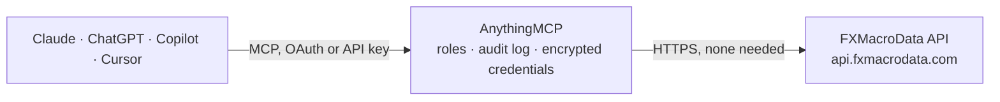

<!-- Generated by scripts/export-github-catalog.mjs in the anythingmcp-website repository. Do not edit by hand. -->

# FXMacroData MCP connector

Official macroeconomic releases, central-bank policy rates, release calendars and FX rates for 22 currencies via the FXMacroData API. 5 read-only tools; the data catalogue, the USD calendar and … The AnythingMCP connector gives Claude, ChatGPT, Microsoft Copilot, Cursor and Gemini 5 MCP tools for FXMacroData, all read-only.

**Category:** [Finance](../finance.md) · **Tools:** 5 · **Setup guide:** [anythingmcp.com](https://anythingmcp.com/guides/fxmacrodata-to-mcp) · [Deutsch](https://anythingmcp.com/de/guides/fxmacrodata-to-mcp) · [Italiano](https://anythingmcp.com/it/guides/fxmacrodata-to-mcp) · [Español](https://anythingmcp.com/es/guides/fxmacrodata-to-mcp) · [日本語](https://anythingmcp.com/ja/guides/fxmacrodata-to-mcp) · [Русский](https://anythingmcp.com/ru/guides/fxmacrodata-to-mcp) · [中文](https://anythingmcp.com/zh/guides/fxmacrodata-to-mcp)

## Start without code

No installation and no terminal: AnythingMCP Cloud runs the FXMacroData connector for you, operated by helpcode.ai in Frankfurt, Germany.

1. **Click the button above** and create an account or sign in. The FXMacroData connector opens, ready to install.
2. **Nothing to enter:** this connector needs no credentials. Every click is in the [step-by-step guide](https://anythingmcp.com/guides/fxmacrodata-to-mcp).
3. **Click Install.** AnythingMCP shows the address of your MCP server.
4. **Add that address to your assistant:** [Claude](https://anythingmcp.com/guides/connect-fxmacrodata-to-claude) · [ChatGPT](https://anythingmcp.com/guides/connect-fxmacrodata-to-chatgpt) · [Microsoft Copilot](https://anythingmcp.com/guides/connect-fxmacrodata-to-copilot) · [Cursor](https://anythingmcp.com/guides/connect-fxmacrodata-to-cursor) · [Gemini CLI](https://anythingmcp.com/guides/connect-fxmacrodata-to-gemini) · [Meta Muse](https://anythingmcp.com/guides/connect-fxmacrodata-to-muse).
5. **Ask your first question**, for example: *What's the latest US non-farm payrolls release (value, previous and reference period) in the last 90 days?*

Prefer help with the setup? [Talk to us](https://anythingmcp.com/contact).

## How it works

- **The AI client** speaks MCP (Streamable HTTP) to AnythingMCP and only sees tool names, descriptions and results. It never gets the FXMacroData credentials.
- **AnythingMCP** checks the client's role, builds the call from the tool definition, adds the credentials (none needed), calls FXMacroData, logs the call and returns the result.
- **FXMacroData** sees an ordinary API client with the rights of the account the credentials belong to.

## Tools

| Tool | What it does | Access |
|---|---|---|
| [`fxmacrodata_data_catalogue`](#fxmacrodata_data_catalogue) | List every indicator FXMacroData publishes for one currency: slug, name, unit, frequency, official source and coverage (earliest/latest available date,… | read |
| [`fxmacrodata_latest_announcements`](#fxmacrodata_latest_announcements) | The most recent official release of every indicator for one currency (policy rate, CPI, GDP, unemployment, payrolls, bond yields...), each with val, the… | read |
| [`fxmacrodata_indicator_history`](#fxmacrodata_indicator_history) | Release history of one indicator for one currency, with val, the reference period in `date` and the release time in `announcement_datetime`. | read |
| [`fxmacrodata_release_calendar`](#fxmacrodata_release_calendar) | Scheduled releases for one currency: indicator (`release`), name, importance and the scheduled time in `announcement_datetime` (Unix seconds, UTC) and… | read |
| [`fxmacrodata_fx_rates`](#fxmacrodata_fx_rates) | Daily FX rates for a currency pair where both legs are supported currencies, e.g. base 'eur' and quote 'usd' for EUR/USD. | read |

## Tool reference

Every parameter as the AI client sees it in `tools/list`. Source: [`packages/backend/src/adapters/intl/fxmacrodata.json`](../../../packages/backend/src/adapters/intl/fxmacrodata.json).

### `fxmacrodata_data_catalogue`

List every indicator FXMacroData publishes for one currency: slug, name, unit, frequency, official source and coverage (earliest/latest available date, freshness). Call this first to find the indicator slugs used by the other tools. Works without an API key for every currency.

**Access:** read · **Call:** `GET /data_catalogue/{currency}`

| Parameter | Type | Required | Description |
|---|---|---|---|
| `currency` | `aud` \| `brl` \| `cad` \| `chf` \| `cnh` \| `cny` \| `dkk` \| `eur` \| `gbp` \| `huf` \| `ils` \| `jpy` \| `krw` \| `myr` \| `ngn` \| `nok` \| `nzd` \| `pen` \| `sek` \| `thb` \| `twd` \| `usd` | yes | Lowercase ISO currency code, e.g. 'usd', 'eur', 'jpy'. |

### `fxmacrodata_latest_announcements`

The most recent official release of every indicator for one currency (policy rate, CPI, GDP, unemployment, payrolls, bond yields...), each with val, the previous value, the reference period in `date` and the release time in `announcement_datetime`. USD works without an API key on a 15-minute delay (see freemium_delay in the response); other currencies need FXMACRODATA_API_KEY.

**Access:** read · **Call:** `GET /announcements/{currency}/latest`

| Parameter | Type | Required | Description |
|---|---|---|---|
| `currency` | `aud` \| `brl` \| `cad` \| `chf` \| `cnh` \| `cny` \| `dkk` \| `eur` \| `gbp` \| `huf` \| `ils` \| `jpy` \| `krw` \| `myr` \| `ngn` \| `nok` \| `nzd` \| `pen` \| `sek` \| `thb` \| `twd` \| `usd` | yes | Lowercase ISO currency code, e.g. 'usd', 'eur', 'gbp'. |

### `fxmacrodata_indicator_history`

Release history of one indicator for one currency, with val, the reference period in `date` and the release time in `announcement_datetime`. Get the indicator slug from fxmacrodata_data_catalogue. Paginated: up to 100 rows per call; call again with offset = pagination.next_offset while pagination.has_more is true. Without an API key only USD works, limited to the most recent 90 days (see freemium_window and freemium_delay in the response).

**Access:** read · **Call:** `GET /announcements/{currency}/{indicator}`

| Parameter | Type | Required | Description |
|---|---|---|---|
| `currency` | `aud` \| `brl` \| `cad` \| `chf` \| `cnh` \| `cny` \| `dkk` \| `eur` \| `gbp` \| `huf` \| `ils` \| `jpy` \| `krw` \| `myr` \| `ngn` \| `nok` \| `nzd` \| `pen` \| `sek` \| `thb` \| `twd` \| `usd` | yes | Lowercase ISO currency code, e.g. 'usd', 'aud'. |
| `indicator` | string | yes | Indicator slug from fxmacrodata_data_catalogue, e.g. 'inflation', 'policy_rate', 'unemployment', 'non_farm_payrolls'. |
| `start_date` | string | no | Earliest reference date, YYYY-MM-DD. |
| `end_date` | string | no | Latest reference date, YYYY-MM-DD. Must not be before start_date. |
| `limit` | integer | no | Rows per page, 1-100. The API returns 20 when omitted. |
| `offset` | integer | no | Rows to skip. To read a whole range, call again with offset = pagination.next_offset while pagination.has_more is true. |

### `fxmacrodata_release_calendar`

Scheduled releases for one currency: indicator (`release`), name, importance and the scheduled time in `announcement_datetime` (Unix seconds, UTC) and `announcement_datetime_utc`. If a row carries `date`, that is the reference period, not the release day: time releases by announcement_datetime. USD works without an API key; other currencies need FXMACRODATA_API_KEY.

**Access:** read · **Call:** `GET /calendar/{currency}`

| Parameter | Type | Required | Description |
|---|---|---|---|
| `currency` | `aud` \| `brl` \| `cad` \| `chf` \| `cnh` \| `cny` \| `dkk` \| `eur` \| `gbp` \| `huf` \| `ils` \| `jpy` \| `krw` \| `myr` \| `ngn` \| `nok` \| `nzd` \| `pen` \| `sek` \| `thb` \| `twd` \| `usd` | yes | Lowercase ISO currency code, e.g. 'usd', 'eur'. |
| `indicator` | string | no | Optional indicator slug to keep only that release, e.g. 'policy_rate'. |
| `start_date` | string | no | Earliest release date to include, YYYY-MM-DD. |
| `end_date` | string | no | Latest release date to include, YYYY-MM-DD. Must not be before start_date. |

### `fxmacrodata_fx_rates`

Daily FX rates for a currency pair where both legs are supported currencies, e.g. base 'eur' and quote 'usd' for EUR/USD. Always needs FXMACRODATA_API_KEY; without one the API answers 401 api_key_required. Paginated: up to 100 rows per call; call again with offset = pagination.next_offset while pagination.has_more is true.

**Access:** read · **Call:** `GET /forex/{base}/{quote}`

| Parameter | Type | Required | Description |
|---|---|---|---|
| `base` | `aud` \| `brl` \| `cad` \| `chf` \| `cnh` \| `cny` \| `dkk` \| `eur` \| `gbp` \| `huf` \| `ils` \| `jpy` \| `krw` \| `myr` \| `ngn` \| `nok` \| `nzd` \| `pen` \| `sek` \| `thb` \| `twd` \| `usd` | yes | Base currency, lowercase, e.g. 'eur'. |
| `quote` | `aud` \| `brl` \| `cad` \| `chf` \| `cnh` \| `cny` \| `dkk` \| `eur` \| `gbp` \| `huf` \| `ils` \| `jpy` \| `krw` \| `myr` \| `ngn` \| `nok` \| `nzd` \| `pen` \| `sek` \| `thb` \| `twd` \| `usd` | yes | Quote currency, lowercase, e.g. 'usd'. |
| `start_date` | string | no | First date, YYYY-MM-DD. |
| `end_date` | string | no | Last date, YYYY-MM-DD. Must not be before start_date. |
| `limit` | integer | no | Rows per page, 1-100. The API returns 20 when omitted. |
| `offset` | integer | no | Rows to skip. To read a whole range, call again with offset = pagination.next_offset while pagination.has_more is true. |

## Run it yourself

AnythingMCP is open source (AGPL-3.0). [Run it with Docker](../../../README.md#run-it-yourself), open **Connectors → Store**, pick **FXMacroData**, then add your MCP server URL to the AI client.

[← Finance connectors](../finance.md) · [All categories](../README.md)
