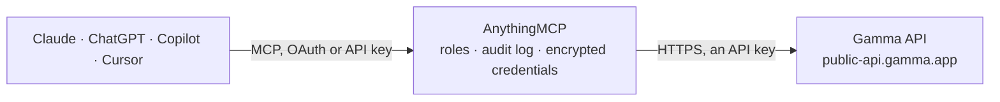

<!-- Generated by scripts/export-github-catalog.mjs in the anythingmcp-website repository. Do not edit by hand. -->

# Gamma MCP connector

Let your AI create Gamma presentations, documents, webpages and social posts from text or from a template, follow the generation until it is ready, export to PDF, PPTX or PNG, and find themes, … The AnythingMCP connector gives Claude, ChatGPT, Microsoft Copilot, Cursor and Gemini 11 MCP tools for Gamma: 7 read and 4 can change data.

**Category:** [Productivity](../productivity.md) · **Tools:** 11 · **Setup guide:** [anythingmcp.com](https://anythingmcp.com/guides/gamma-to-mcp) · [Deutsch](https://anythingmcp.com/de/guides/gamma-to-mcp) · [Italiano](https://anythingmcp.com/it/guides/gamma-to-mcp) · [Español](https://anythingmcp.com/es/guides/gamma-to-mcp) · [日本語](https://anythingmcp.com/ja/guides/gamma-to-mcp) · [Русский](https://anythingmcp.com/ru/guides/gamma-to-mcp) · [中文](https://anythingmcp.com/zh/guides/gamma-to-mcp)

## Start without code

No installation and no terminal: AnythingMCP Cloud runs the Gamma connector for you, operated by helpcode.ai in Frankfurt, Germany.

1. **Click the button above** and create an account or sign in. The Gamma connector opens, ready to install.
2. **Paste the API key or token from your Gamma account.** Every click is in the [step-by-step guide](https://anythingmcp.com/guides/gamma-to-mcp).
3. **Click Install.** AnythingMCP shows the address of your MCP server.
4. **Add that address to your assistant:** [Claude](https://anythingmcp.com/guides/connect-gamma-to-claude) · [ChatGPT](https://anythingmcp.com/guides/connect-gamma-to-chatgpt) · [Microsoft Copilot](https://anythingmcp.com/guides/connect-gamma-to-copilot) · [Cursor](https://anythingmcp.com/guides/connect-gamma-to-cursor) · [Gemini CLI](https://anythingmcp.com/guides/connect-gamma-to-gemini) · [Meta Muse](https://anythingmcp.com/guides/connect-gamma-to-muse).
5. **Ask your first question**, for example: *Find the Gamma I made titled Q4 social calendar draft 2026 and show its creation date and theme.*

Prefer help with the setup? [Talk to us](https://anythingmcp.com/contact).

## How it works

- **The AI client** speaks MCP (Streamable HTTP) to AnythingMCP and only sees tool names, descriptions and results. It never gets the Gamma credentials.
- **AnythingMCP** checks the client's role, builds the call from the tool definition, adds the credentials (an API key), calls Gamma, logs the call and returns the result.
- **Gamma** sees an ordinary API client with the rights of the account the credentials belong to.

## Tools

| Tool | What it does | Access |
|---|---|---|
| [`gamma_generate`](#gamma_generate) | Start generating one Gamma presentation, document, webpage or social post from text. | write |
| [`gamma_generate_multi_page`](#gamma_generate_multi_page) | Start generating one Gamma file with several pages (up to 50) under one URL, for example a proposal site or microsite, optionally published as a Gamma site. | write |
| [`gamma_generate_from_template`](#gamma_generate_from_template) | Start a new gamma from an existing one-page template gamma: Gamma keeps the template's structure and rewrites it for the prompt. | write |
| [`gamma_get_generation`](#gamma_get_generation) | Check a generation started with gamma_generate, gamma_generate_multi_page or gamma_generate_from_template. | read |
| [`gamma_list_themes`](#gamma_list_themes) | List the themes available to the workspace, both Gamma's standard themes and the workspace's custom ones, with color and tone keywords. | read |
| [`gamma_list_folders`](#gamma_list_folders) | List the workspace's Gamma folders with their id and name. | read |
| [`gamma_search_templates`](#gamma_search_templates) | Search templates: the workspace's own template gammas (usable as gammaId in gamma_generate_from_template) and Gamma's official explore templates (for… | read |
| [`gamma_search_gammas`](#gamma_search_gammas) | Search the gammas the key's user can open by words in their title and text, or list them by creator and last-updated date. | read |
| [`gamma_get_gamma`](#gamma_get_gamma) | Get one gamma's details: title, type (regular or template), url, description, author, created and updated time, themeId and whether it is archived. | read |
| [`gamma_export_gamma`](#gamma_export_gamma) | Start exporting an existing gamma to PDF, PPTX or PNG (a .zip with one PNG per card). | write |
| [`gamma_get_export`](#gamma_get_export) | Check an export started with gamma_export_gamma. | read |

## Tool reference

Every parameter as the AI client sees it in `tools/list`. Source: [`packages/backend/src/adapters/intl/gamma.json`](../../../packages/backend/src/adapters/intl/gamma.json).

### `gamma_generate`

Start generating one Gamma presentation, document, webpage or social post from text. Spends the workspace's Gamma credits (1 to 3 per card plus 2 to 125 per AI image), so confirm topic, format, card count and image source with the user first. Returns generationId at once; poll gamma_get_generation until status is completed to get gammaUrl, exportUrl and the credits used.

**Access:** write · **Call:** `POST /v1.0/generations`

| Parameter | Type | Required | Description |
|---|---|---|---|
| `inputText` | string | yes | The content to build from: a topic, an outline or the full text (up to 400,000 characters). Image URLs inside the text are placed in the gamma. With cardSplit inputTextBreaks, separate cards with \n---\n. |
| `textMode` | `generate` \| `condense` \| `preserve` | no | generate rewrites and expands a short brief; condense summarizes long text; preserve keeps the given text and only structures it. |
| `format` | `presentation` \| `document` \| `webpage` \| `social` | no | What to create. Gamma's default is presentation. |
| `numCards` | integer | no | Number of cards (slides or sections), 1 to 75 on paid plans; Gamma's default is 10. Only used with cardSplit auto. More cards cost more credits. |
| `cardSplit` | `auto` \| `inputTextBreaks` | no | auto (default) splits into numCards cards; inputTextBreaks makes one card per \n---\n break in inputText and ignores numCards. |
| `title` | string | no | Title of the gamma (up to 500 characters). Generated from the content when left out. |
| `additionalInstructions` | string | no | Extra guidance on content, layout or style, up to 5,000 characters, e.g. "Use bullet points and end with a summary card". |
| `themeId` | string | no | Theme id from gamma_list_themes. The workspace default theme is used when left out. |
| `folderId` | string | no | Folder id from gamma_list_folders to save the gamma in. The key's user must be a member of the folder. |
| `exportAs` | `pdf` \| `pptx` \| `png` | no | Also export the result as a file: pdf, pptx, or png (a .zip with one PNG per card). The link appears as exportUrl in gamma_get_generation. |
| `textOptions` | object | no | Text settings. |
| `imageOptions` | object | no | Image settings. AI images cost the most credits. |
| `cardOptions` | object | no | Card shape and header or footer. |
| `sharingOptions` | object | no | Who can open the result. |

### `gamma_generate_multi_page`

Start generating one Gamma file with several pages (up to 50) under one URL, for example a proposal site or microsite, optionally published as a Gamma site. Each page needs its own inputText and can set its own format, card count and options. Spends Gamma credits for every page, so confirm the pages and image source with the user first. Returns generationId; poll gamma_get_generation, whose pages list each page's URL.

**Access:** write · **Call:** `POST /v1.0/generations`

| Parameter | Type | Required | Description |
|---|---|---|---|
| `pages` | object[] | yes | The pages, in order. The first is the file's main page. |
| `publish` | boolean | no | Publish the file as a Gamma site once every page has succeeded. Confirm with the user: a published site is public. |
| `title` | string | no | Title of the file. Generated when left out. |
| `themeId` | string | no | Theme id from gamma_list_themes, applied to every page. |
| `folderId` | string | no | Folder id from gamma_list_folders. |
| `exportAs` | `pdf` \| `pptx` \| `png` | no | Export every page as pdf, pptx or png (.zip); links appear per page in gamma_get_generation. |
| `cardOptions` | object | no | dimensions and headerFooter for the whole file, as on gamma_generate. |
| `sharingOptions` | object | no | workspaceAccess, externalAccess and emailOptions, as on gamma_generate. |

### `gamma_generate_from_template`

Start a new gamma from an existing one-page template gamma: Gamma keeps the template's structure and rewrites it for the prompt. Find workspace templates with gamma_search_templates (explore templates are not accepted). Spends Gamma credits, slightly more per card than gamma_generate, so confirm with the user first. Returns generationId; poll gamma_get_generation.

**Access:** write · **Call:** `POST /v1.0/generations/from-template`

| Parameter | Type | Required | Description |
|---|---|---|---|
| `gammaId` | string | yes | File id of the template gamma (from gamma_search_templates workspaceTemplates[].id). The file must have exactly one page. |
| `prompt` | string | yes | What to make from the template: new topic, audience, content or instructions (up to 400,000 characters). |
| `title` | string | no | Title of the new gamma. Generated when left out. |
| `themeId` | string | no | Theme id from gamma_list_themes, to replace the template's theme. |
| `folderId` | string | no | Folder id from gamma_list_folders. |
| `exportAs` | `pdf` \| `pptx` \| `png` | no | Also export as pdf, pptx or png (.zip). |
| `imageOptions` | object | no | AI image settings for new images. |
| `sharingOptions` | object | no | workspaceAccess, externalAccess and emailOptions, as on gamma_generate. |

### `gamma_get_generation`

Check a generation started with gamma_generate, gamma_generate_multi_page or gamma_generate_from_template. Returns status (pending, completed or failed) and, once completed, gammaUrl, gammaId, exportUrl when an export was asked for, per-page results and credits (deducted, remaining). Poll every 5 to 10 seconds while pending. Free and read-only.

**Access:** read · **Call:** `GET /v1.0/generations/{generationId}`

| Parameter | Type | Required | Description |
|---|---|---|---|
| `generationId` | string | yes | The generationId returned when the generation was started. |

### `gamma_list_themes`

List the themes available to the workspace, both Gamma's standard themes and the workspace's custom ones, with color and tone keywords. Use query to find a theme by name and pass its id as themeId when generating. Free and read-only. Paginate with after = nextCursor while hasMore is true.

**Access:** read · **Call:** `GET /v1.0/themes`

| Parameter | Type | Required | Description |
|---|---|---|---|
| `query` | string | no | Filter themes by name, e.g. "Prism" or "dark". |
| `type` | `standard` \| `custom` | no | standard for Gamma's built-in themes, custom for the workspace's own. Keep the same value on every page. |
| `limit` | integer | no | Themes per page, 1 to 50. Default 20. |
| `after` | string | no | nextCursor from the previous page. |

### `gamma_list_folders`

List the workspace's Gamma folders with their id and name. Pass a folder's id as folderId when generating to save the result there. Free and read-only. Paginate with after = nextCursor while hasMore is true.

**Access:** read · **Call:** `GET /v1.0/folders`

| Parameter | Type | Required | Description |
|---|---|---|---|
| `query` | string | no | Filter folders by name. |
| `limit` | integer | no | Folders per page, 1 to 50. Default 20. |
| `after` | string | no | nextCursor from the previous page. |

### `gamma_search_templates`

Search templates: the workspace's own template gammas (usable as gammaId in gamma_generate_from_template) and Gamma's official explore templates (for inspiration only, not accepted as gammaId). Without q both lists are browsed, newest first. Free and read-only.

**Access:** read · **Call:** `GET /v1.0/templates/search`

| Parameter | Type | Required | Description |
|---|---|---|---|
| `q` | string | no | What the template is about, e.g. "quarterly business review". |
| `limit` | integer | no | Results per list, 1 to 25. Default 10. |

### `gamma_search_gammas`

Search the gammas the key's user can open by words in their title and text, or list them by creator and last-updated date. Returns id, title, url, a text snippet, creator and updatedTime per hit. Free and read-only. Needs q or at least one filter.

**Access:** read · **Call:** `GET /v1.0/gammas/search`

| Parameter | Type | Required | Description |
|---|---|---|---|
| `q` | string | no | Words to find in titles and text. Optional when createdBy, updatedAfter or updatedBefore is set. |
| `createdBy` | string | no | Only gammas created by this user: me, an email address or a user id. |
| `updatedAfter` | string | no | Only gammas last updated at or after this ISO 8601 time, e.g. 2026-10-01T00:00:00Z. |
| `updatedBefore` | string | no | Only gammas last updated at or before this ISO 8601 time. |
| `includeArchived` | boolean | no | Also return archived gammas. Default false. |
| `limit` | integer | no | Hits to return, 1 to 25. Default 10. |

### `gamma_get_gamma`

Get one gamma's details: title, type (regular or template), url, description, author, created and updated time, themeId and whether it is archived. Accepts the file id or the id in a gamma.app/docs/... URL. Free and read-only; it does not return the slide content.

**Access:** read · **Call:** `GET /v1.0/gammas/{gammaId}`

| Parameter | Type | Required | Description |
|---|---|---|---|
| `gammaId` | string | yes | The gamma's file id, or the doc id from a gamma.app/docs/<id> URL. |

### `gamma_export_gamma`

Start exporting an existing gamma to PDF, PPTX or PNG (a .zip with one PNG per card). The gamma itself is not changed. Confirm the gamma and format with the user first. Returns exportId at once; poll gamma_get_export until status is completed to get exportUrl. Needs view access to the gamma.

**Access:** write · **Call:** `POST /v1.0/gammas/{gammaId}/export`

| Parameter | Type | Required | Description |
|---|---|---|---|
| `gammaId` | string | yes | The gamma's file id, or the doc id from a gamma.app/docs/<id> URL. |
| `exportAs` | `pdf` \| `pptx` \| `png` | yes | pdf, pptx, or png (a .zip with one PNG per card). |

### `gamma_get_export`

Check an export started with gamma_export_gamma. Returns status (pending, completed or failed), exportAs, gammaId and, once completed, exportUrl, a download link that works for anyone for about a week. On failure error.reason says whether to retry (render_timeout, export_failed) or change the gamma (deck_too_large, no_content). Free and read-only.

**Access:** read · **Call:** `GET /v1.0/exports/{exportId}`

| Parameter | Type | Required | Description |
|---|---|---|---|
| `exportId` | string | yes | The exportId returned by gamma_export_gamma. |

## Run it yourself

AnythingMCP is open source (AGPL-3.0). [Run it with Docker](../../../README.md#run-it-yourself), open **Connectors → Store**, pick **Gamma** and enter `GAMMA_API_KEY`, then add your MCP server URL to the AI client.

[← Productivity connectors](../productivity.md) · [All categories](../README.md)
