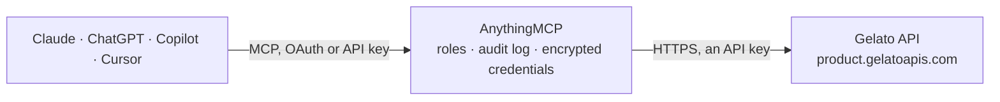

<!-- Generated by scripts/export-github-catalog.mjs in the anythingmcp-website repository. Do not edit by hand. -->

# Gelato MCP connector

Gelato print-on-demand: browse the product catalog, check prices, stock and shipping methods, quote, draft and track orders (including Etsy and Shopify orders), and manage products in connected stores. The AnythingMCP connector gives Claude, ChatGPT, Microsoft Copilot, Cursor and Gemini 19 MCP tools for Gelato: 14 read and 5 can change data.

**Category:** [E-commerce](../e-commerce.md) · **Tools:** 19 · **Setup guide:** [anythingmcp.com](https://anythingmcp.com/guides/gelato-to-mcp) · [Deutsch](https://anythingmcp.com/de/guides/gelato-to-mcp) · [Italiano](https://anythingmcp.com/it/guides/gelato-to-mcp) · [Español](https://anythingmcp.com/es/guides/gelato-to-mcp) · [日本語](https://anythingmcp.com/ja/guides/gelato-to-mcp) · [Русский](https://anythingmcp.com/ru/guides/gelato-to-mcp) · [中文](https://anythingmcp.com/zh/guides/gelato-to-mcp)

## Start without code

No installation and no terminal: AnythingMCP Cloud runs the Gelato connector for you, operated by helpcode.ai in Frankfurt, Germany.

1. **Click the button above** and create an account or sign in. The Gelato connector opens, ready to install.
2. **Paste the API key or token from your Gelato account.** Every click is in the [step-by-step guide](https://anythingmcp.com/guides/gelato-to-mcp).
3. **Click Install.** AnythingMCP shows the address of your MCP server.
4. **Add that address to your assistant:** [Claude](https://anythingmcp.com/guides/connect-gelato-to-claude) · [ChatGPT](https://anythingmcp.com/guides/connect-gelato-to-chatgpt) · [Microsoft Copilot](https://anythingmcp.com/guides/connect-gelato-to-copilot) · [Cursor](https://anythingmcp.com/guides/connect-gelato-to-cursor) · [Gemini CLI](https://anythingmcp.com/guides/connect-gelato-to-gemini) · [Meta Muse](https://anythingmcp.com/guides/connect-gelato-to-muse).
5. **Ask your first question**, for example: *Find Gelato order for our reference ORD-2026-0456 and show its fulfillment status and tracking codes*

Prefer help with the setup? [Talk to us](https://anythingmcp.com/contact).

## How it works

- **The AI client** speaks MCP (Streamable HTTP) to AnythingMCP and only sees tool names, descriptions and results. It never gets the Gelato credentials.
- **AnythingMCP** checks the client's role, builds the call from the tool definition, adds the credentials (an API key), calls Gelato, logs the call and returns the result.
- **Gelato** sees an ordinary API client with the rights of the account the credentials belong to.

## Tools

| Tool | What it does | Access |
|---|---|---|
| [`gelato_list_catalogs`](#gelato_list_catalogs) | List the Gelato product catalogs (posters, t-shirts, mugs, cards, canvas...) with their catalogUid and title. | read |
| [`gelato_get_catalog`](#gelato_get_catalog) | Get one catalog with its product attributes and every allowed value (size, paper, colour, orientation...). | read |
| [`gelato_search_products`](#gelato_search_products) | List the products of a catalog, optionally filtered by attribute values, with productUid, attributes, weight, dimensions and supported countries. | read |
| [`gelato_get_product`](#gelato_get_product) | Get one Gelato product by productUid: attributes, weight, supported and unsupported countries, whether it is stockable or printable, and the valid page… | read |
| [`gelato_get_product_prices`](#gelato_get_product_prices) | Get the production price of a product for every quantity tier, optionally for one destination country and currency. | read |
| [`gelato_get_cover_dimensions`](#gelato_get_cover_dimensions) | Get the cover dimensions in mm of a multi-page product such as a photo book or brochure for a given page count, to size the cover artwork. | read |
| [`gelato_check_stock`](#gelato_check_stock) | Check stock of up to 250 products per stock region (US-CA, EU, UK, OC, AS, SA...). | read |
| [`gelato_list_shipment_methods`](#gelato_list_shipment_methods) | List Gelato shipment methods with their shipmentMethodUid, type (normal, express, pallet), whether they are tracked, suit business or private addresses, and… | read |
| [`gelato_quote_order`](#gelato_quote_order) | Price an order before placing it: for the given products and recipient, returns one or more quotes (one per fulfilment facility) with product prices and… | read |
| [`gelato_create_draft_order`](#gelato_create_draft_order) | Create a draft order. | write |
| [`gelato_create_order`](#gelato_create_order) | Place an order that goes straight to production: Gelato charges the account (wallet or card) and prints and ships it. | write |
| [`gelato_get_order`](#gelato_get_order) | Get one order: type, fulfillment and financial status, channel (api, ui, shopify, etsy), store id, items with files and previews, shipment with tracking… | read |
| [`gelato_search_orders`](#gelato_search_orders) | Search orders, including those imported from connected Etsy and Shopify stores. | read |
| [`gelato_confirm_draft_order`](#gelato_confirm_draft_order) | Turn a draft order into a real order, which sends it to production and charges the account. | write |
| [`gelato_cancel_order`](#gelato_cancel_order) | Cancel an order to stop production and shipment. | write |
| [`gelato_list_store_products`](#gelato_list_store_products) | List the products of a Gelato-connected e-commerce store (Shopify, Etsy...) with title, status (created, publishing, publishing_error, active), preview… | read |
| [`gelato_get_store_product`](#gelato_get_store_product) | Get one product of a connected store: title, description, status, publishing error code, preview URLs, variants with productUid and connection status, and… | read |
| [`gelato_get_template`](#gelato_get_template) | Get a product template made in the Gelato dashboard: title, description, and its variants with productUid, variant options and the named image placeholders… | read |
| [`gelato_create_product_from_template`](#gelato_create_product_from_template) | Create a product in a connected store from a dashboard template, with your own title, description, tags and images per placeholder. | write |

## Tool reference

Every parameter as the AI client sees it in `tools/list`. Source: [`packages/backend/src/adapters/intl/gelato.json`](../../../packages/backend/src/adapters/intl/gelato.json).

### `gelato_list_catalogs`

List the Gelato product catalogs (posters, t-shirts, mugs, cards, canvas...) with their catalogUid and title. Start here to find the catalog to browse.

**Access:** read · **Call:** `GET /v3/catalogs`

No parameters.

### `gelato_get_catalog`

Get one catalog with its product attributes and every allowed value (size, paper, colour, orientation...). The attribute and value UIDs are the filters of gelato_search_products.

**Access:** read · **Call:** `GET /v3/catalogs/{catalog_uid}`

| Parameter | Type | Required | Description |
|---|---|---|---|
| `catalog_uid` | string | yes | Catalog UID from gelato_list_catalogs, e.g. posters. |

### `gelato_search_products`

List the products of a catalog, optionally filtered by attribute values, with productUid, attributes, weight, dimensions and supported countries. Also returns how many products match each attribute value. Use the productUid to price, quote and order.

**Access:** read · **Call:** `POST /v3/catalogs/{catalog_uid}/products:search`

| Parameter | Type | Required | Description |
|---|---|---|---|
| `catalog_uid` | string | yes | Catalog UID from gelato_list_catalogs. |
| `attribute_filters` | object | no | Map of attribute UID to a list of accepted value UIDs, both from gelato_get_catalog, e.g. {"Orientation": ["hor", "ver"], "CoatingType": ["none"]}. |
| `limit` | integer | no | Products per page, at most 100. |
| `offset` | integer | no | Products to skip, for paging. Default 0. |

### `gelato_get_product`

Get one Gelato product by productUid: attributes, weight, supported and unsupported countries, whether it is stockable or printable, and the valid page counts of multi-page products.

**Access:** read · **Call:** `GET /v3/products/{product_uid}`

| Parameter | Type | Required | Description |
|---|---|---|---|
| `product_uid` | string | yes | Product UID, e.g. cards_pf_bb_pt_110-lb-cover-uncoated_cl_4-0_hor. |

### `gelato_get_product_prices`

Get the production price of a product for every quantity tier, optionally for one destination country and currency. Shipping is not included; use gelato_quote_order for a full quote.

**Access:** read · **Call:** `GET /v3/products/{product_uid}/prices`

| Parameter | Type | Required | Description |
|---|---|---|---|
| `product_uid` | string | yes | Product UID. |
| `country` | string | no | ISO 3166-1 alpha-2 destination country, e.g. US. |
| `currency` | string | no | ISO 4217 currency, e.g. EUR. |
| `page_count` | integer | no | Total page count. Required for multi-page products. |

### `gelato_get_cover_dimensions`

Get the cover dimensions in mm of a multi-page product such as a photo book or brochure for a given page count, to size the cover artwork.

**Access:** read · **Call:** `GET /v3/products/{product_uid}/cover-dimensions`

| Parameter | Type | Required | Description |
|---|---|---|---|
| `product_uid` | string | yes | Product UID of a multi-page product. |
| `page_count` | integer | yes | Total page count including covers. |

### `gelato_check_stock`

Check stock of up to 250 products per stock region (US-CA, EU, UK, OC, AS, SA...). Each product gets in-stock, out-of-stock-replenishable (with a replenishment date), out-of-stock, non-stockable (printed on demand, e.g. posters and mugs) or not-supported.

**Access:** read · **Call:** `POST /v3/stock/region-availability`

| Parameter | Type | Required | Description |
|---|---|---|---|
| `product_uids` | string[] | yes | Product UIDs to check, 1 to 250. |

### `gelato_list_shipment_methods`

List Gelato shipment methods with their shipmentMethodUid, type (normal, express, pallet), whether they are tracked, suit business or private addresses, and the countries they deliver to. Filter by destination country.

**Access:** read · **Call:** `GET https://shipment.gelatoapis.com/v1/shipment-methods`

| Parameter | Type | Required | Description |
|---|---|---|---|
| `country` | string | no | ISO 3166-1 alpha-2 destination country, e.g. DE. |

### `gelato_quote_order`

Price an order before placing it: for the given products and recipient, returns one or more quotes (one per fulfilment facility) with product prices and every available shipment method with price, delivery-day range and dates. Creates nothing.

**Access:** read · **Call:** `POST https://order.gelatoapis.com/v4/orders:quote`

| Parameter | Type | Required | Description |
|---|---|---|---|
| `order_reference_id` | string | yes | Your own order id (for example the Etsy or Shopify order number). |
| `customer_reference_id` | string | yes | Your own customer id. |
| `currency` | string | yes | ISO 4217 currency the order is charged in, e.g. USD, EUR, GBP. |
| `recipient` | object | yes | Recipient address. |
| `products` | object[] | yes | Products to quote. |
| `allow_multiple_quotes` | boolean | no | true (default) allows one quote per facility; false returns a single quote with aggregated delivery days. |

### `gelato_create_draft_order`

Create a draft order. A draft is not produced or charged: it can be reviewed and edited in the Gelato dashboard and turned into a real order there or with gelato_confirm_draft_order. Returns the order with its Gelato id.

**Access:** write · **Call:** `POST https://order.gelatoapis.com/v4/orders`

| Parameter | Type | Required | Description |
|---|---|---|---|
| `order_reference_id` | string | yes | Your own order id (for example the Etsy or Shopify order number). |
| `customer_reference_id` | string | yes | Your own customer id. |
| `currency` | string | yes | ISO 4217 currency the order is charged in, e.g. USD, EUR, GBP. |
| `items` | object[] | yes | Line items. |
| `shipping_address` | object | yes | Recipient address. Addresses in China, Japan, South Korea and Russia must be written in the local language. |
| `shipment_method_uid` | string | no | Preferred shipping: normal, standard, express, or a shipmentMethodUid from gelato_quote_order. Several values separated by commas pick the cheapest match; omitted, the cheapest method is used. |
| `return_address` | object | no | Overrides fields of the sender address printed on the parcel. |
| `metadata` | object[] | no | Up to 20 key/value pairs stored on the order (each max 100 characters). |

### `gelato_create_order`

Place an order that goes straight to production: Gelato charges the account (wallet or card) and prints and ships it. Returns the order with its Gelato id, statuses and receipts. Orders from a connected Etsy or Shopify store arrive on their own and do not need this.

**Access:** write · **Call:** `POST https://order.gelatoapis.com/v4/orders`

| Parameter | Type | Required | Description |
|---|---|---|---|
| `order_reference_id` | string | yes | Your own order id (for example the Etsy or Shopify order number). |
| `customer_reference_id` | string | yes | Your own customer id. |
| `currency` | string | yes | ISO 4217 currency the order is charged in, e.g. USD, EUR, GBP. |
| `items` | object[] | yes | Line items. |
| `shipping_address` | object | yes | Recipient address. Addresses in China, Japan, South Korea and Russia must be written in the local language. |
| `shipment_method_uid` | string | no | Preferred shipping: normal, standard, express, or a shipmentMethodUid from gelato_quote_order. Several values separated by commas pick the cheapest match; omitted, the cheapest method is used. |
| `return_address` | object | no | Overrides fields of the sender address printed on the parcel. |
| `metadata` | object[] | no | Up to 20 key/value pairs stored on the order (each max 100 characters). |

### `gelato_get_order`

Get one order: type, fulfillment and financial status, channel (api, ui, shopify, etsy), store id, items with files and previews, shipment with tracking codes and URLs, addresses, receipts with prices and VAT, and connected order ids of split orders.

**Access:** read · **Call:** `GET https://order.gelatoapis.com/v4/orders/{order_id}`

| Parameter | Type | Required | Description |
|---|---|---|---|
| `order_id` | string | yes | Gelato order id (a UUID), from gelato_search_orders or the create response. |

### `gelato_search_orders`

Search orders, including those imported from connected Etsy and Shopify stores. Filter by type, statuses, channel, country, currency, store, date range, your reference ids or a text that matches recipient name or order reference. Returns a summary per order; use gelato_get_order for details.

**Access:** read · **Call:** `POST https://order.gelatoapis.com/v4/orders:search`

| Parameter | Type | Required | Description |
|---|---|---|---|
| `order_types` | `order` \| `draft`[] | no | order, draft or both. |
| `fulfillment_statuses` | string[] | no | e.g. created, passed, in_production, printed, shipped, delivered, draft, failed, canceled, pending_approval, not_connected, on_hold. |
| `financial_statuses` | string[] | no | draft, pending, invoiced, to_be_invoiced, paid, canceled, partially_refunded, refunded, refused. |
| `channels` | string[] | no | ui, api, shopify, etsy. |
| `countries` | string[] | no | Shipping countries, ISO 3166-1 alpha-2. |
| `currencies` | string[] | no | Order currencies, ISO 4217. |
| `store_ids` | string[] | no | Gelato e-commerce store ids. |
| `ids` | string[] | no | Gelato order ids. |
| `order_reference_id` | string | no | One of your own order ids. |
| `order_reference_ids` | string[] | no | Several of your own order ids. |
| `search` | string | no | Text matched against recipient first name, last name and order reference id. |
| `start_date` | string | no | Orders ordered or created on or after this ISO 8601 date-time, e.g. 2026-09-01T00:00:00+00:00. |
| `end_date` | string | no | Orders ordered or created on or before this ISO 8601 date-time. |
| `limit` | integer | no | Orders per page, default 50, max 100. |
| `offset` | integer | no | Orders to skip, for paging. |

### `gelato_confirm_draft_order`

Turn a draft order into a real order, which sends it to production and charges the account. Optionally replaces the print files of some items in the same call; items left out of a non-empty items list are removed from the order.

**Access:** write · **Call:** `PATCH https://order.gelatoapis.com/v4/orders/{order_id}`

| Parameter | Type | Required | Description |
|---|---|---|---|
| `order_id` | string | yes | Gelato order id (a UUID), from gelato_search_orders or the create response. |
| `items` | object[] | no | Optional. Items to keep or change. Pass {"id": "<item id>"} alone to keep an item as is, or with files to replace its print files. Items not listed are removed; omit the list to keep all items unchanged. |

### `gelato_cancel_order`

Cancel an order to stop production and shipment. Only possible before it is printed: an order with an item in printed or shipped status answers 409.

**Access:** write · **Call:** `POST https://order.gelatoapis.com/v4/orders/{order_id}:cancel`

| Parameter | Type | Required | Description |
|---|---|---|---|
| `order_id` | string | yes | Gelato order id (a UUID), from gelato_search_orders or the create response. |

### `gelato_list_store_products`

List the products of a Gelato-connected e-commerce store (Shopify, Etsy...) with title, status (created, publishing, publishing_error, active), preview images, external ids and variants with their productUid and connection status.

**Access:** read · **Call:** `GET https://ecommerce.gelatoapis.com/v1/stores/{store_id}/products`

| Parameter | Type | Required | Description |
|---|---|---|---|
| `store_id` | string | yes | Gelato store id: the storeId of an order from that store, or the id in the store page URL of the Gelato dashboard. |
| `order_by` | `createdAt` \| `updatedAt` | no | Sort field, default createdAt. |
| `order` | `asc` \| `desc` | no | Sort direction, default desc. |
| `limit` | integer | no | Products per page, default and max 100. |
| `offset` | integer | no | Products to skip, for paging. |

### `gelato_get_store_product`

Get one product of a connected store: title, description, status, publishing error code, preview URLs, variants with productUid and connection status, and variant options.

**Access:** read · **Call:** `GET https://ecommerce.gelatoapis.com/v1/stores/{store_id}/products/{product_id}`

| Parameter | Type | Required | Description |
|---|---|---|---|
| `store_id` | string | yes | Gelato store id. |
| `product_id` | string | yes | Store product id from gelato_list_store_products. |

### `gelato_get_template`

Get a product template made in the Gelato dashboard: title, description, and its variants with productUid, variant options and the named image placeholders (print area and size in mm) that gelato_create_product_from_template fills.

**Access:** read · **Call:** `GET https://ecommerce.gelatoapis.com/v1/templates/{template_id}`

| Parameter | Type | Required | Description |
|---|---|---|---|
| `template_id` | string | yes | Template id, copied from the Templates page of the Gelato dashboard. |

### `gelato_create_product_from_template`

Create a product in a connected store from a dashboard template, with your own title, description, tags and images per placeholder. Gelato then creates the variants and mockups and publishes the listing to the store (Shopify, Etsy...) in the background; check progress with gelato_get_store_product.

**Access:** write · **Call:** `POST https://ecommerce.gelatoapis.com/v1/stores/{store_id}/products:create-from-template`

| Parameter | Type | Required | Description |
|---|---|---|---|
| `store_id` | string | yes | Gelato store id. |
| `template_id` | string | yes | Template id from the Gelato dashboard. |
| `title` | string | yes | Product title. |
| `description` | string | yes | Product description (HTML allowed). |
| `is_visible_in_the_online_store` | boolean | no | Show the product in the online store. Default false. |
| `sales_channels` | `web` \| `global`[] | no | Shopify only: web (default) or global to also publish to Point of Sale. |
| `tags` | string[] | no | Up to 13 tags (Etsy: max 20 characters each). |
| `product_type` | string | no | Product type shown in the store. |
| `vendor` | string | no | Vendor shown in the store. |
| `variants` | object[] | no | Variants to create, from gelato_get_template. Omit to create all template variants; a subset creates only those. |

## Run it yourself

AnythingMCP is open source (AGPL-3.0). [Run it with Docker](../../../README.md#run-it-yourself), open **Connectors → Store**, pick **Gelato** and enter `GELATO_API_KEY`, then add your MCP server URL to the AI client.

[← E-commerce connectors](../e-commerce.md) · [All categories](../README.md)
