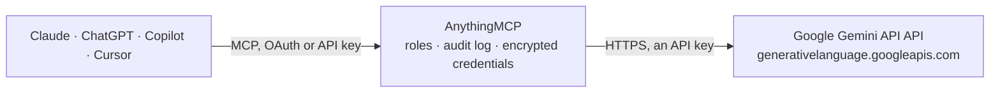

<!-- Generated by scripts/export-github-catalog.mjs in the anythingmcp-website repository. Do not edit by hand. -->

# Google Gemini API MCP connector

Let your AI use Google Gemini with your own API key: ask Gemini models questions, analyse images and PDFs from a link, count tokens, create embeddings, and generate or edit pictures with Nano Banana … The AnythingMCP connector gives Claude, ChatGPT, Microsoft Copilot, Cursor and Gemini 13 MCP tools for Google Gemini API: 10 read and 3 can change data.

**Category:** [Public Data](../data.md) · **Tools:** 13 · **Setup guide:** [anythingmcp.com](https://anythingmcp.com/guides/gemini-to-mcp) · [Deutsch](https://anythingmcp.com/de/guides/gemini-to-mcp) · [Italiano](https://anythingmcp.com/it/guides/gemini-to-mcp) · [Español](https://anythingmcp.com/es/guides/gemini-to-mcp) · [日本語](https://anythingmcp.com/ja/guides/gemini-to-mcp) · [Русский](https://anythingmcp.com/ru/guides/gemini-to-mcp) · [中文](https://anythingmcp.com/zh/guides/gemini-to-mcp)

## Start without code

No installation and no terminal: AnythingMCP Cloud runs the Google Gemini API connector for you, operated by helpcode.ai in Frankfurt, Germany.

1. **Click the button above** and create an account or sign in. The Google Gemini API connector opens, ready to install.
2. **Paste the API key or token from your Google Gemini API account.** Every click is in the [step-by-step guide](https://anythingmcp.com/guides/gemini-to-mcp).
3. **Click Install.** AnythingMCP shows the address of your MCP server.
4. **Add that address to your assistant:** [Claude](https://anythingmcp.com/guides/connect-gemini-to-claude) · [ChatGPT](https://anythingmcp.com/guides/connect-gemini-to-chatgpt) · [Microsoft Copilot](https://anythingmcp.com/guides/connect-gemini-to-copilot) · [Cursor](https://anythingmcp.com/guides/connect-gemini-to-cursor) · [Gemini CLI](https://anythingmcp.com/guides/connect-gemini-to-gemini) · [Meta Muse](https://anythingmcp.com/guides/connect-gemini-to-muse).
5. **Ask your first question**, for example: *Do we have the customer invoice PDF for Kaarina Energia Oy invoice INV-2026-117 uploaded to Gemini Files?*

Prefer help with the setup? [Talk to us](https://anythingmcp.com/contact).

## How it works

- **The AI client** speaks MCP (Streamable HTTP) to AnythingMCP and only sees tool names, descriptions and results. It never gets the Google Gemini API credentials.
- **AnythingMCP** checks the client's role, builds the call from the tool definition, adds the credentials (an API key), calls Google Gemini API, logs the call and returns the result.
- **Google Gemini API** sees an ordinary API client with the rights of the account the credentials belong to.

## Tools

| Tool | What it does | Access |
|---|---|---|
| [`gemini_list_models`](#gemini_list_models) | List the Gemini models this API key can use, with their input and output token limits, whether they think, and the methods they support (generateContent,… | read |
| [`gemini_get_model`](#gemini_get_model) | Read one Gemini model: display name, description, version, input and output token limits, default temperature, top-p and top-k, whether it thinks and the… | read |
| [`gemini_generate_text`](#gemini_generate_text) | Ask a Gemini model one question and get its text answer (generateContent). | read |
| [`gemini_generate_content`](#gemini_generate_content) | Full generateContent call for conversations and mixed input. | read |
| [`gemini_analyze_file_url`](#gemini_analyze_file_url) | Ask a Gemini model about a file on the web: an image, a PDF, a text or CSV file or a short video, given by its public HTTPS link (up to 15 MB; Gemini… | read |
| [`gemini_count_tokens`](#gemini_count_tokens) | Count how many input tokens a text is for a Gemini model, to estimate cost or check it fits the context window before a long call. | read |
| [`gemini_embed_text`](#gemini_embed_text) | Turn one text into an embedding vector (embedContent) for semantic search, clustering or similarity. | read |
| [`gemini_batch_embed_texts`](#gemini_batch_embed_texts) | Embed up to 20 texts in one call (batchEmbedContents); the vectors come back in the order given. | read |
| [`gemini_generate_image`](#gemini_generate_image) | Create a picture from a text description with a Gemini image model (Nano Banana) and return it as an image the user can see. | write |
| [`gemini_edit_image`](#gemini_edit_image) | Change an existing picture with a Gemini image model: describe the edit ("replace the sky with a sunset", "remove the person on the left", "turn this sketch… | write |
| [`gemini_list_files`](#gemini_list_files) | List the files stored in the project's Gemini Files API (uploaded for prompts, or generated), newest first, with name, display name, MIME type, size, state… | read |
| [`gemini_get_file`](#gemini_get_file) | Read one file of the Gemini Files API: display name, MIME type, size, state (PROCESSING, ACTIVE or FAILED), uri to use in gemini_generate_content or… | read |
| [`gemini_delete_file`](#gemini_delete_file) | Delete a file from the Gemini Files API before it expires. | write |

## Tool reference

Every parameter as the AI client sees it in `tools/list`. Source: [`packages/backend/src/adapters/intl/gemini.json`](../../../packages/backend/src/adapters/intl/gemini.json).

### `gemini_list_models`

List the Gemini models this API key can use, with their input and output token limits, whether they think, and the methods they support (generateContent, countTokens, embedContent). Pass nextPageToken back as page_token for more. Free: no tokens are billed.

**Access:** read · **Call:** `GET /models`

| Parameter | Type | Required | Description |
|---|---|---|---|
| `page_size` | integer | no | Models per page, up to 1000. Default 50. |
| `page_token` | string | no | nextPageToken from the previous page. |

### `gemini_get_model`

Read one Gemini model: display name, description, version, input and output token limits, default temperature, top-p and top-k, whether it thinks and the methods it supports. Free.

**Access:** read · **Call:** `GET /models/{model}`

| Parameter | Type | Required | Description |
|---|---|---|---|
| `model` | string | yes | Model code without the models/ prefix, e.g. gemini-3.1-flash-lite. |

### `gemini_generate_text`

Ask a Gemini model one question and get its text answer (generateContent). Billed per token to the user's key; the default gemini-3.1-flash-lite is the cheapest stable model. For a conversation, images or documents use gemini_generate_content or gemini_analyze_file_url. Returns text, finishReason (STOP is normal, MAX_TOKENS means the answer was cut: raise max_output_tokens) and token usage. Read-only: it changes nothing in the account.

**Access:** read · **Call:** `POST /models/{model}:generateContent`

| Parameter | Type | Required | Description |
|---|---|---|---|
| `prompt` | string | yes | The question or task, as the user would write it. |
| `model` | string | no | Model code without the models/ prefix. Default gemini-3.1-flash-lite (fast and cheap). Other codes: gemini_list_models. |
| `system_instruction` | string | no | How the model should behave (role, tone, language, format). Text only. |
| `max_output_tokens` | integer | no | Upper limit for the answer in tokens, thinking included. Model default when left out. |
| `temperature` | number | no | Randomness from 0 to 2. Leave out for the model default (1.0 on Gemini 3 models, which Google recommends keeping). |
| `response_mime_type` | `text/plain` \| `application/json` | no | application/json for a JSON answer, usually with response_json_schema. |
| `response_json_schema` | object | no | JSON Schema the answer must follow (structured output); set response_mime_type to application/json too. |

### `gemini_generate_content`

Full generateContent call for conversations and mixed input. contents is the list of turns: [{"role": "user", "parts": [{"text": "..."}]}, {"role": "model", "parts": [{"text": "..."}]}, {"role": "user", "parts": [...]}]. A part is {"text": ...}, or {"fileData": {"fileUri": "https://...", "mimeType": "image/png"}} for a public HTTPS file up to 15 MB (images, PDF, text, video) or a Files API uri. tools may carry [{"googleSearch": {}}] for answers grounded in Google Search (on the paid tier 5,000 search requests a month are free, then $14 per 1,000). Billed per token to the user's key. Read-only: it changes nothing in the account.

**Access:** read · **Call:** `POST /models/{model}:generateContent`

| Parameter | Type | Required | Description |
|---|---|---|---|
| `contents` | any[] | yes | Conversation turns, each {"role": "user" or "model", "parts": [...]}, oldest first, ending with a user turn. |
| `model` | string | no | Model code without the models/ prefix. Default gemini-3.1-flash-lite (fast and cheap). Other codes: gemini_list_models. |
| `system_instruction` | object | no | System instruction as content, e.g. {"parts": [{"text": "Answer in German."}]}. |
| `generation_config` | object | no | generationConfig fields as the API names them: maxOutputTokens, temperature, topP, topK, stopSequences, candidateCount, responseMimeType, responseJsonSchema, thinkingConfig ({"thinkingLevel": "LOW"} on Gemini 3 models), mediaResolution. |
| `safety_settings` | any[] | no | Optional safety thresholds, e.g. [{"category": "HARM_CATEGORY_HARASSMENT", "threshold": "BLOCK_ONLY_HIGH"}]. |
| `tools` | any[] | no | Built-in tools, e.g. [{"googleSearch": {}}] or [{"urlContext": {}}]. Leave out for a plain answer. |

### `gemini_analyze_file_url`

Ask a Gemini model about a file on the web: an image, a PDF, a text or CSV file or a short video, given by its public HTTPS link (up to 15 MB; Gemini fetches it, so the link must work without a login). Describe or read a picture, summarise a PDF, extract data. Billed per token to the user's key, images and pages included. Read-only: it changes nothing in the account.

**Access:** read · **Call:** `POST /models/{model}:generateContent`

| Parameter | Type | Required | Description |
|---|---|---|---|
| `prompt` | string | yes | What to do with the file, e.g. "Extract the invoice number and total as JSON". |
| `file_url` | string | yes | Public https:// link to the file (or a Files API uri). |
| `mime_type` | string | yes | Type of the file: image/png, image/jpeg, image/webp, application/pdf, text/plain, text/csv, text/html, video/mp4 and so on. |
| `model` | string | no | Model code without the models/ prefix. Default gemini-3.1-flash-lite (fast and cheap, reads images and PDFs). Other codes: gemini_list_models. |
| `system_instruction` | string | no | How the model should behave. Text only. |
| `max_output_tokens` | integer | no | Upper limit for the answer in tokens. Model default when left out. |
| `response_mime_type` | `text/plain` \| `application/json` | no | application/json for a JSON answer. |

### `gemini_count_tokens`

Count how many input tokens a text is for a Gemini model, to estimate cost or check it fits the context window before a long call. Free: countTokens is not billed.

**Access:** read · **Call:** `POST /models/{model}:countTokens`

| Parameter | Type | Required | Description |
|---|---|---|---|
| `text` | string | yes | The text to count. |
| `model` | string | no | Model code without the models/ prefix. Default gemini-3.1-flash-lite (tokenizers differ little between Gemini models). Other codes: gemini_list_models. |

### `gemini_embed_text`

Turn one text into an embedding vector (embedContent) for semantic search, clustering or similarity. Default gemini-embedding-001 with 768 dimensions, which keeps the answer small; 1536 or 3072 for the full vector. Billed per input token to the user's key. For several texts at once use gemini_batch_embed_texts. Read-only.

**Access:** read · **Call:** `POST /models/{model}:embedContent`

| Parameter | Type | Required | Description |
|---|---|---|---|
| `text` | string | yes | The text to embed. |
| `model` | string | no | Model code without the models/ prefix. Default gemini-embedding-001 (stable text embedding model). Other codes: gemini_list_models. |
| `task_type` | `RETRIEVAL_QUERY` \| `RETRIEVAL_DOCUMENT` \| `SEMANTIC_SIMILARITY` \| `CLASSIFICATION` \| `CLUSTERING` \| `QUESTION_ANSWERING` \| `FACT_VERIFICATION` \| `CODE_RETRIEVAL_QUERY` | no | What the vector is for, which improves quality on gemini-embedding-001: RETRIEVAL_QUERY for a search query, RETRIEVAL_DOCUMENT for a text to be found, SEMANTIC_SIMILARITY, CLASSIFICATION, CLUSTERING and so on. Not supported by gemini-embedding-2. |
| `output_dimensionality` | integer | no | Vector length. Default 768; 1536 and 3072 are also recommended. |
| `title` | string | no | Title of the document, only with task_type RETRIEVAL_DOCUMENT. |

### `gemini_batch_embed_texts`

Embed up to 20 texts in one call (batchEmbedContents); the vectors come back in the order given. Each request is {"model": "models/gemini-embedding-001", "content": {"parts": [{"text": "..."}]}, "taskType": "RETRIEVAL_DOCUMENT", "outputDimensionality": 768}, and its model must be the same as the model parameter. Keep outputDimensionality at 768 or lower so the answer stays readable. Billed per input token to the user's key. Read-only.

**Access:** read · **Call:** `POST /models/{model}:batchEmbedContents`

| Parameter | Type | Required | Description |
|---|---|---|---|
| `requests` | any[] | yes | Up to 20 embed requests in the form shown above. |
| `model` | string | no | Model code without the models/ prefix. Default gemini-embedding-001 (must match the model in every request). Other codes: gemini_list_models. |

### `gemini_generate_image`

Create a picture from a text description with a Gemini image model (Nano Banana) and return it as an image the user can see. COSTS MONEY: about $0.034 per picture with the default gemini-3.1-flash-lite-image (1K only), more for 2K and 4K on other models, billed to the user's key; image models have no free tier, so the key's project needs billing. Confirm with the user before calling, and before calling it again. Every image carries an invisible SynthID watermark.

**Access:** write · **Call:** `POST /models/{model}:generateContent`

| Parameter | Type | Required | Description |
|---|---|---|---|
| `prompt` | string | yes | A full description of the picture: subject, setting, style, lighting, any text to show. Sentences work better than keywords. |
| `model` | string | no | Image model. Default gemini-3.1-flash-lite-image (fastest and cheapest, 1K only); gemini-nano-banana-2.1 or gemini-3.1-flash-image for 2K and 4K and better text; gemini-3-pro-image for professional assets (about $0.13 per image). |
| `aspect_ratio` | `1:1` \| `2:3` \| `3:2` \| `3:4` \| `4:3` \| `4:5` \| `5:4` \| `9:16` \| `16:9` \| `21:9` \| `1:4` \| `4:1` \| `1:8` \| `8:1` | no | Width to height. Default 1:1. 1:4, 4:1, 1:8 and 8:1 only on some models. |
| `image_size` | `512` \| `1K` \| `2K` \| `4K` | no | Resolution. Model default (1K) when left out. gemini-3.1-flash-lite-image only supports 1K; 512 only on gemini-3.1-flash-image. Larger pictures cost more and may exceed the 4 MB limit for returning an image. |

### `gemini_edit_image`

Change an existing picture with a Gemini image model: describe the edit ("replace the sky with a sunset", "remove the person on the left", "turn this sketch into a photo") and give the picture as a public HTTPS link (up to 15 MB). Returns the new picture as an image. COSTS MONEY: about $0.034 per picture with the default gemini-3.1-flash-lite-image, billed to the user's key (no free tier). Confirm with the user before calling.

**Access:** write · **Call:** `POST /models/{model}:generateContent`

| Parameter | Type | Required | Description |
|---|---|---|---|
| `prompt` | string | yes | The change to make, in full sentences. Say what must stay the same. |
| `image_url` | string | yes | Public https:// link to the picture to edit (or a Files API uri). |
| `image_mime_type` | `image/png` \| `image/jpeg` \| `image/webp` | yes | Type of that picture. |
| `model` | string | no | Image model. Default gemini-3.1-flash-lite-image; gemini-nano-banana-2.1 keeps people and objects more consistent across edits. |
| `image_config` | object | no | Optional output settings, e.g. {"aspectRatio": "16:9", "imageSize": "2K"}. Without it the picture keeps the proportions of the input. |

### `gemini_list_files`

List the files stored in the project's Gemini Files API (uploaded for prompts, or generated), newest first, with name, display name, MIME type, size, state and expiry (files are deleted automatically after 48 hours). Pass nextPageToken back as page_token for more.

**Access:** read · **Call:** `GET /files`

| Parameter | Type | Required | Description |
|---|---|---|---|
| `page_size` | integer | no | Files per page, up to 100. Default 20. |
| `page_token` | string | no | nextPageToken from the previous page. |

### `gemini_get_file`

Read one file of the Gemini Files API: display name, MIME type, size, state (PROCESSING, ACTIVE or FAILED), uri to use in gemini_generate_content or gemini_analyze_file_url, and expiry.

**Access:** read · **Call:** `GET /files/{file_id}`

| Parameter | Type | Required | Description |
|---|---|---|---|
| `file_id` | string | yes | The id after files/ in the file name, e.g. abc-123 for files/abc-123. |

### `gemini_delete_file`

Delete a file from the Gemini Files API before it expires. It cannot be restored and prompts that use its uri stop working. Confirm with the user first. Installed switched off.

**Access:** write · **Call:** `DELETE /files/{file_id}`

| Parameter | Type | Required | Description |
|---|---|---|---|
| `file_id` | string | yes | The id after files/ in the file name. |

## Run it yourself

AnythingMCP is open source (AGPL-3.0). [Run it with Docker](../../../README.md#run-it-yourself), open **Connectors → Store**, pick **Google Gemini API** and enter `GEMINI_API_KEY`, then add your MCP server URL to the AI client.

[← Public Data connectors](../data.md) · [All categories](../README.md)
