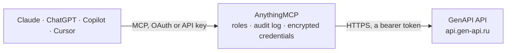

<!-- Generated by scripts/export-github-catalog.mjs in the anythingmcp-website repository. Do not edit by hand. -->

# GenAPI MCP connector

Let your AI create images, videos, music and text with GenAPI's 330 models (Nano Banana, GPT Image, Flux, Kling, Veo, Sora, Suno, GPT, Claude, DeepSeek) from one ruble balance: prices before each … The AnythingMCP connector gives Claude, ChatGPT, Microsoft Copilot, Cursor and Gemini 6 MCP tools for GenAPI: 3 read and 3 can change data.

**Category:** [Public Data](../data.md) · **Tools:** 6 · **Setup guide:** [anythingmcp.com](https://anythingmcp.com/guides/genapi-to-mcp) · [Deutsch](https://anythingmcp.com/de/guides/genapi-to-mcp) · [Italiano](https://anythingmcp.com/it/guides/genapi-to-mcp) · [Español](https://anythingmcp.com/es/guides/genapi-to-mcp) · [日本語](https://anythingmcp.com/ja/guides/genapi-to-mcp) · [Русский](https://anythingmcp.com/ru/guides/genapi-to-mcp) · [中文](https://anythingmcp.com/zh/guides/genapi-to-mcp)

## Start without code

No installation and no terminal: AnythingMCP Cloud runs the GenAPI connector for you, operated by helpcode.ai in Frankfurt, Germany.

1. **Click the button above** and create an account or sign in. The GenAPI connector opens, ready to install.
2. **Paste the API key or token from your GenAPI account.** Every click is in the [step-by-step guide](https://anythingmcp.com/guides/genapi-to-mcp).
3. **Click Install.** AnythingMCP shows the address of your MCP server.
4. **Add that address to your assistant:** [Claude](https://anythingmcp.com/guides/connect-genapi-to-claude) · [ChatGPT](https://anythingmcp.com/guides/connect-genapi-to-chatgpt) · [Microsoft Copilot](https://anythingmcp.com/guides/connect-genapi-to-copilot) · [Cursor](https://anythingmcp.com/guides/connect-genapi-to-cursor) · [Gemini CLI](https://anythingmcp.com/guides/connect-genapi-to-gemini) · [Meta Muse](https://anythingmcp.com/guides/connect-genapi-to-muse).
5. **Ask your first question**, for example: *What's the status and final cost of GenAPI request r-2026-07-14-81 for client Vesta Solar?*

Prefer help with the setup? [Talk to us](https://anythingmcp.com/contact).

## How it works

- **The AI client** speaks MCP (Streamable HTTP) to AnythingMCP and only sees tool names, descriptions and results. It never gets the GenAPI credentials.
- **AnythingMCP** checks the client's role, builds the call from the tool definition, adds the credentials (a bearer token), calls GenAPI, logs the call and returns the result.
- **GenAPI** sees an ordinary API client with the rights of the account the credentials belong to.

## Tools

| Tool | What it does | Access |
|---|---|---|
| [`genapi_get_account`](#genapi_get_account) | Read the GenAPI account the key belongs to: name, email and balance (in rubles). | read |
| [`genapi_list_models`](#genapi_list_models) | List every model (network) GenAPI runs, about 330: slug (the id the generation tools take), name, cost in rubles per request, cost_input_tokens and… | read |
| [`genapi_get_request`](#genapi_get_request) | Get the status and result of a GenAPI request: status (processing, success or error), response_type (image, video, audio, string, messages, file, 3d), cost… | read |
| [`genapi_generate`](#genapi_generate) | Start a generation with any GenAPI model: images, video, music, speech, 3D, upscaling, background removal or text. | write |
| [`genapi_generate_image`](#genapi_generate_image) | Generate or edit images with Google Nano Banana on GenAPI (default nano-banana-2-1, about 10 rubles per image at 1K; check genapi_list_models). | write |
| [`genapi_chat`](#genapi_chat) | Ask a language model hosted by GenAPI (GPT, Claude, DeepSeek, Gemini, Grok and others) and wait for the answer. | write |

## Tool reference

Every parameter as the AI client sees it in `tools/list`. Source: [`packages/backend/src/adapters/intl/genapi.json`](../../../packages/backend/src/adapters/intl/genapi.json).

### `genapi_get_account`

Read the GenAPI account the key belongs to: name, email and balance (in rubles). Free. Checks the key. Read-only.

**Access:** read · **Call:** `GET /user`

No parameters.

### `genapi_list_models`

List every model (network) GenAPI runs, about 330: slug (the id the generation tools take), name, cost in rubles per request, cost_input_tokens and cost_output_tokens in rubles per 1,000 tokens for language models (cost is then empty), and is_payment_upfront (true: charged when the request starts; false: after the result). Free. Read-only.

**Access:** read · **Call:** `GET /networks`

No parameters.

### `genapi_get_request`

Get the status and result of a GenAPI request: status (processing, success or error), response_type (image, video, audio, string, messages, file, 3d), cost (rubles charged), progress, result (URLs of generated files, or text) and full_response (for language models the answer is in full_response[0].choices[0].message.content). Poll every 5 to 10 seconds while status is processing; videos take minutes. File links last 24 hours. Free. Read-only.

**Access:** read · **Call:** `GET /request/get/{request_id}`

| Parameter | Type | Required | Description |
|---|---|---|---|
| `request_id` | integer,string | yes | The request_id returned when the generation was started. |

### `genapi_generate`

Start a generation with any GenAPI model: images, video, music, speech, 3D, upscaling, background removal or text. COSTS MONEY, billed in rubles to the user's GenAPI balance. Look up the model's price with genapi_list_models, tell the user which model will run and what it costs, and wait for a yes before calling. model is the slug from genapi_list_models (e.g. flux-2, kling-video-v3, veo-3.1, suno, sora-2) and input the model's documented fields (its page at gen-api.ru/model/<slug>/api); unknown fields are refused with 422. Returns request_id and status processing; poll genapi_get_request.

**Access:** write · **Call:** `POST /networks/{model}`

| Parameter | Type | Required | Description |
|---|---|---|---|
| `model` | string | yes | Model slug from genapi_list_models. |
| `input` | object | yes | The model's input fields, e.g. {"prompt":"...","aspect_ratio":"16:9"}. Media go in as public URLs. |
| `callback_url` | string | no | Optional HTTPS URL GenAPI posts the result to when done. Leave out and poll genapi_get_request instead. |

### `genapi_generate_image`

Generate or edit images with Google Nano Banana on GenAPI (default nano-banana-2-1, about 10 rubles per image at 1K; check genapi_list_models). COSTS MONEY, billed in rubles to the user's GenAPI balance. Look up the model's price with genapi_list_models, tell the user which model will run and what it costs, and wait for a yes before calling. Pass image_urls to edit or combine existing images. Returns request_id; poll genapi_get_request, the image URLs are in result.

**Access:** write · **Call:** `POST /networks/{model}`

| Parameter | Type | Required | Description |
|---|---|---|---|
| `model` | `nano-banana-2-1` \| `nano-banana-2` \| `nano-banana-pro` \| `nano-banana` \| `nano-banana-lite` | no | Nano Banana version. Default nano-banana-2-1. |
| `prompt` | string | yes | What the image shows, or how to change the given images. |
| `image_urls` | string[] | no | Optional public image URLs (png, jpg, webp) to edit or use as reference. |
| `aspect_ratio` | `21:9` \| `16:9` \| `3:2` \| `4:3` \| `5:4` \| `1:1` \| `4:5` \| `3:4` \| `2:3` \| `9:16` | no | Aspect ratio. GenAPI's default is 16:9. |
| `resolution` | `1K` \| `2K` \| `4K` | no | 1K (default), 2K or 4K; higher costs more. |
| `num_images` | integer | no | Number of images, each billed. Default 1. |
| `output_format` | `png` \| `jpeg` \| `webp` | no | File format. Default png. |
| `callback_url` | string | no | Optional HTTPS URL GenAPI posts the result to when done. Leave out and poll genapi_get_request instead. |

### `genapi_chat`

Ask a language model hosted by GenAPI (GPT, Claude, DeepSeek, Gemini, Grok and others) and wait for the answer. COSTS MONEY, billed in rubles to the user's GenAPI balance. Look up the model's price with genapi_list_models, tell the user which model will run and what it costs, and wait for a yes before calling. Language models are billed per 1,000 input and output tokens (cost_input_tokens and cost_output_tokens in genapi_list_models). The answer text is in full_response[0].choices[0].message.content; if it comes back as processing, poll genapi_get_request.

**Access:** write · **Call:** `POST /networks/{model}`

| Parameter | Type | Required | Description |
|---|---|---|---|
| `model` | string | yes | Language model slug from genapi_list_models, e.g. gpt-5-5, claude-sonnet-5-5, deepseek-chat. |
| `messages` | object[] | yes | Chat messages in OpenAI format: [{"role":"user","content":"..."}]. |
| `max_tokens` | integer | no | Upper limit for the answer length in tokens; keeps the cost bounded. |
| `temperature` | number | no | Sampling temperature. |
| `is_sync` | boolean | no | Wait for the answer in the same call. Default true. |

## Run it yourself

AnythingMCP is open source (AGPL-3.0). [Run it with Docker](../../../README.md#run-it-yourself), open **Connectors → Store**, pick **GenAPI** and enter `GENAPI_API_KEY`, then add your MCP server URL to the AI client.

[← Public Data connectors](../data.md) · [All categories](../README.md)
