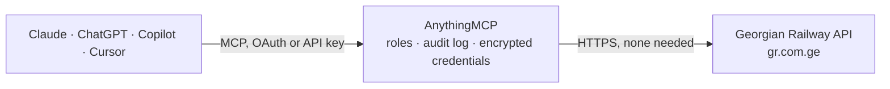

<!-- Generated by scripts/export-github-catalog.mjs in the anythingmcp-website repository. Do not edit by hand. -->

# Georgian Railway MCP connector

Search Georgian Railway (საქართველოს რკინიგზა) passenger trains: find stations, look up services between any two stations on a given date, and read live seat availability and fares in GEL. The AnythingMCP connector gives Claude, ChatGPT, Microsoft Copilot, Cursor and Gemini 3 MCP tools for Georgian Railway, all read-only.

**Category:** [Transport](../transport.md) · **Tools:** 3 · **Setup guide:** [anythingmcp.com](https://anythingmcp.com/guides/georgian-railway-to-mcp) · [Deutsch](https://anythingmcp.com/de/guides/georgian-railway-to-mcp) · [Italiano](https://anythingmcp.com/it/guides/georgian-railway-to-mcp) · [Español](https://anythingmcp.com/es/guides/georgian-railway-to-mcp) · [日本語](https://anythingmcp.com/ja/guides/georgian-railway-to-mcp) · [Русский](https://anythingmcp.com/ru/guides/georgian-railway-to-mcp) · [中文](https://anythingmcp.com/zh/guides/georgian-railway-to-mcp)

## Start without code

No installation and no terminal: AnythingMCP Cloud runs the Georgian Railway connector for you, operated by helpcode.ai in Frankfurt, Germany.

1. **Click the button above** and create an account or sign in. The Georgian Railway connector opens, ready to install.
2. **Nothing to enter:** this connector needs no credentials. Every click is in the [step-by-step guide](https://anythingmcp.com/guides/georgian-railway-to-mcp).
3. **Click Install.** AnythingMCP shows the address of your MCP server.
4. **Add that address to your assistant:** [Claude](https://anythingmcp.com/guides/connect-georgian-railway-to-claude) · [ChatGPT](https://anythingmcp.com/guides/connect-georgian-railway-to-chatgpt) · [Microsoft Copilot](https://anythingmcp.com/guides/connect-georgian-railway-to-copilot) · [Cursor](https://anythingmcp.com/guides/connect-georgian-railway-to-cursor) · [Gemini CLI](https://anythingmcp.com/guides/connect-georgian-railway-to-gemini) · [Meta Muse](https://anythingmcp.com/guides/connect-georgian-railway-to-muse).
5. **Ask your first question**, for example: *Any evening trains Tbilisi to Batumi on 2026-12-24? I need departures after 18:00.*

Prefer help with the setup? [Talk to us](https://anythingmcp.com/contact).

## How it works

- **The AI client** speaks MCP (Streamable HTTP) to AnythingMCP and only sees tool names, descriptions and results. It never gets the Georgian Railway credentials.
- **AnythingMCP** checks the client's role, builds the call from the tool definition, adds the credentials (none needed), calls Georgian Railway, logs the call and returns the result.
- **Georgian Railway** sees an ordinary API client with the rights of the account the credentials belong to.

## Tools

| Tool | What it does | Access |
|---|---|---|
| [`gr_search_stations`](#gr_search_stations) | Find Georgian Railway stations by name and return their station_code, which every other tool needs. | read |
| [`gr_search_trains`](#gr_search_trains) | Search Georgian Railway services between two stations on a date, returning departure and arrival times, the train number, and per-class seat availability… | read |
| [`gr_get_notifications`](#gr_get_notifications) | Read the current service notices Georgian Railway publishes on its site: timetable changes, engineering works, cancellations and seasonal services. | read |

## Tool reference

Every parameter as the AI client sees it in `tools/list`. Source: [`packages/backend/src/adapters/intl/georgian-railway.json`](../../../packages/backend/src/adapters/intl/georgian-railway.json).

### `gr_search_stations`

Find Georgian Railway stations by name and return their station_code, which every other tool needs. Searches Georgian, English and Russian names at once, so 'Tbilisi', 'თბილისი' and 'Тбилиси' all work. Call this first to turn a place name into a code.

**Access:** read · **Call:** `GET /api/stations`

| Parameter | Type | Required | Description |
|---|---|---|---|
| `search` | string | yes | Station name or fragment, in Georgian, English or Russian (e.g. 'Batumi', 'თბილისი'). |
| `limit` | number | no | Maximum number of stations to return. Defaults to 20; the full list is 515 entries. |
| `page` | number | no | 1-based page number, for paging through a large result set. |

### `gr_search_trains`

Search Georgian Railway services between two stations on a date, returning departure and arrival times, the train number, and per-class seat availability with fares in GEL. Pass station codes from gr_search_stations, not names. Add returnDateFrom for a round trip.

**Access:** read · **Call:** `POST /api/ticket-search`

| Parameter | Type | Required | Description |
|---|---|---|---|
| `startStationCode` | string | yes | Departure station code, e.g. '57151' for Batumi. Get it from gr_search_stations. |
| `endStationCode` | string | yes | Arrival station code, e.g. '56014' for Tbilisi. Get it from gr_search_stations. |
| `departureDateFrom` | string | yes | Outbound date as YYYY-MM-DD (e.g. '2026-08-25'). Relative dates are not supported. |
| `returnDateFrom` | string | no | Optional return date as YYYY-MM-DD. When set, return services are appended to the result. |
| `standard_passengers` | number | no | Number of adult passengers. Affects which fares and seat counts are returned. |
| `child_passengers` | number | no | Number of child passengers. |
| `disabled_passengers` | number | no | Number of passengers travelling with a disability concession. |
| `routeType` | number | no | Route type filter. 0 means all route types and is the right default. |

### `gr_get_notifications`

Read the current service notices Georgian Railway publishes on its site: timetable changes, engineering works, cancellations and seasonal services. Worth checking alongside a journey search when a trip is close or a train looks unexpectedly unavailable.

**Access:** read · **Call:** `GET /api/info-content`

No parameters.

## Run it yourself

AnythingMCP is open source (AGPL-3.0). [Run it with Docker](../../../README.md#run-it-yourself), open **Connectors → Store**, pick **Georgian Railway**, then add your MCP server URL to the AI client.

[← Transport connectors](../transport.md) · [All categories](../README.md)
