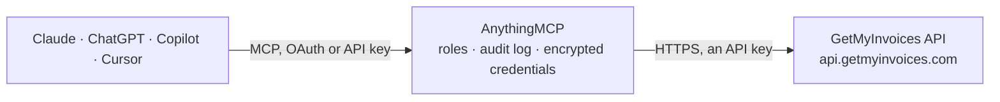

<!-- Generated by scripts/export-github-catalog.mjs in the anythingmcp-website repository. Do not edit by hand. -->

# GetMyInvoices MCP connector

Retrieve invoices, documents, attachments and suppliers from GetMyInvoices, the German invoice & document management platform by fino data services GmbH (Kassel). The AnythingMCP connector gives Claude, ChatGPT, Microsoft Copilot, Cursor and Gemini 6 MCP tools for GetMyInvoices, all read-only.

**Category:** [Finance](../finance.md) · **Tools:** 6 · **Setup guide:** [anythingmcp.com](https://anythingmcp.com/guides/getmyinvoices-to-mcp) · [Deutsch](https://anythingmcp.com/de/guides/getmyinvoices-to-mcp) · [Italiano](https://anythingmcp.com/it/guides/getmyinvoices-to-mcp) · [Español](https://anythingmcp.com/es/guides/getmyinvoices-to-mcp) · [日本語](https://anythingmcp.com/ja/guides/getmyinvoices-to-mcp) · [Русский](https://anythingmcp.com/ru/guides/getmyinvoices-to-mcp) · [中文](https://anythingmcp.com/zh/guides/getmyinvoices-to-mcp)

## Start without code

No installation and no terminal: AnythingMCP Cloud runs the GetMyInvoices connector for you, operated by helpcode.ai in Frankfurt, Germany.

1. **Click the button above** and create an account or sign in. The GetMyInvoices connector opens, ready to install.
2. **Paste the API key or token from your GetMyInvoices account.** Every click is in the [step-by-step guide](https://anythingmcp.com/guides/getmyinvoices-to-mcp).
3. **Click Install.** AnythingMCP shows the address of your MCP server.
4. **Add that address to your assistant:** [Claude](https://anythingmcp.com/guides/connect-getmyinvoices-to-claude) · [ChatGPT](https://anythingmcp.com/guides/connect-getmyinvoices-to-chatgpt) · [Microsoft Copilot](https://anythingmcp.com/guides/connect-getmyinvoices-to-copilot) · [Cursor](https://anythingmcp.com/guides/connect-getmyinvoices-to-cursor) · [Gemini CLI](https://anythingmcp.com/guides/connect-getmyinvoices-to-gemini) · [Meta Muse](https://anythingmcp.com/guides/connect-getmyinvoices-to-muse).
5. **Ask your first question**, for example: *Show me invoice INV-2026-089 from supplier NordWerk GmbH, I need date, gross amount and payment status.*

Prefer help with the setup? [Talk to us](https://anythingmcp.com/contact).

## How it works

- **The AI client** speaks MCP (Streamable HTTP) to AnythingMCP and only sees tool names, descriptions and results. It never gets the GetMyInvoices credentials.
- **AnythingMCP** checks the client's role, builds the call from the tool definition, adds the credentials (an API key), calls GetMyInvoices, logs the call and returns the result.
- **GetMyInvoices** sees an ordinary API client with the rights of the account the credentials belong to.

## Tools

| Tool | What it does | Access |
|---|---|---|
| [`getmyinvoices_list_documents`](#getmyinvoices_list_documents) | List documents (invoices, receipts, credit notes, etc.) from GetMyInvoices with filters for type, date range, payment status and incremental sync. | read |
| [`getmyinvoices_get_document`](#getmyinvoices_get_document) | Get a single GetMyInvoices document by its documentUid, including metadata, parsed line items, OCR text and optionally the base64 file content. | read |
| [`getmyinvoices_list_document_attachments`](#getmyinvoices_list_document_attachments) | List all attachments linked to a specific GetMyInvoices document, returning each attachment's uid, filename and metadata. | read |
| [`getmyinvoices_get_document_attachment`](#getmyinvoices_get_document_attachment) | Get a single attachment of a GetMyInvoices document by document and attachment uid, including its file content and metadata. | read |
| [`getmyinvoices_list_companies`](#getmyinvoices_list_companies) | List companies (suppliers and online portals) configured in GetMyInvoices, filterable by status and type. | read |
| [`getmyinvoices_get_company`](#getmyinvoices_get_company) | Get a single company (supplier/portal) from GetMyInvoices by its companyUid, returning full details and linked portal records. | read |

## Tool reference

Every parameter as the AI client sees it in `tools/list`. Source: [`packages/backend/src/adapters/de/getmyinvoices.json`](../../../packages/backend/src/adapters/de/getmyinvoices.json).

### `getmyinvoices_list_documents`

List documents (invoices, receipts, credit notes, etc.) from GetMyInvoices with filters for type, date range, payment status and incremental sync. Returns paginated metadata records.

**Access:** read · **Call:** `GET /documents`

| Parameter | Type | Required | Description |
|---|---|---|---|
| `pageNumber` | number | no | Page number, 1-based (default 1) |
| `perPage` | number | no | Results per page (default 500) |
| `searchQuery` | string | no | Free-text search across documents, like the web UI |
| `documentTypeFilter` | string | no | Document type, e.g. INCOMING_INVOICE, SALES_INVOICE, RECEIPT, CREDIT_NOTE, PAYROLL |
| `companyFilter` | number | no | Filter by company/supplier: 0=any, -1=unassigned, or a specific companyUid |
| `startDateFilter` | string | no | Earliest document date, YYYY-MM-DD |
| `endDateFilter` | string | no | Latest document date, YYYY-MM-DD |
| `updatedOrNewSinceFilter` | string | no | Return only documents created or modified since this timestamp — use for incremental sync. MUST be a full date-time in 'YYYY-MM-DD HH:MM:SS' format, e.g. '2026-01-01 00:00:00' (a plain date is rejected with HTTP 422) |
| `paymentStatusFilter` | string | no | Payment status filter: paid, not_paid, unknown or all |
| `loadLineItems` | boolean | no | Include parsed line items in each record |

### `getmyinvoices_get_document`

Get a single GetMyInvoices document by its documentUid, including metadata, parsed line items, OCR text and optionally the base64 file content.

**Access:** read · **Call:** `GET /documents/{documentUid}`

| Parameter | Type | Required | Description |
|---|---|---|---|
| `documentUid` | string | yes | The document unique id |
| `loadLineItems` | boolean | no | Include parsed line items |
| `includeDocument` | boolean | no | Include the file content (base64) in the response; set false for metadata only |
| `readableText` | boolean | no | Include the OCR/readable text content |

### `getmyinvoices_list_document_attachments`

List all attachments linked to a specific GetMyInvoices document, returning each attachment's uid, filename and metadata.

**Access:** read · **Call:** `GET /documents/{documentUid}/attachments`

| Parameter | Type | Required | Description |
|---|---|---|---|
| `documentUid` | string | yes | The parent document unique id |

### `getmyinvoices_get_document_attachment`

Get a single attachment of a GetMyInvoices document by document and attachment uid, including its file content and metadata.

**Access:** read · **Call:** `GET /documents/{documentUid}/attachments/{attachmentUid}`

| Parameter | Type | Required | Description |
|---|---|---|---|
| `documentUid` | string | yes | The parent document unique id |
| `attachmentUid` | string | yes | The attachment unique id |

### `getmyinvoices_list_companies`

List companies (suppliers and online portals) configured in GetMyInvoices, filterable by status and type. Returns companyUid, name, type and tags.

**Access:** read · **Call:** `GET /companies`

| Parameter | Type | Required | Description |
|---|---|---|---|
| `statusFilter` | number | no | Status: 0=any, 1=active, -1=inactive, -2=pending |
| `companyTypeFilter` | string | no | Company type: 0 for any, or ONLINE_PORTAL / CUSTOM_COMPANY |
| `returnPortalRecords` | number | no | 0 to hide portal records, 1 to include them |

### `getmyinvoices_get_company`

Get a single company (supplier/portal) from GetMyInvoices by its companyUid, returning full details and linked portal records.

**Access:** read · **Call:** `GET /companies/{companyUid}`

| Parameter | Type | Required | Description |
|---|---|---|---|
| `companyUid` | string | yes | The company unique id |

## Run it yourself

AnythingMCP is open source (AGPL-3.0). [Run it with Docker](../../../README.md#run-it-yourself), open **Connectors → Store**, pick **GetMyInvoices** and enter `GETMYINVOICES_API_KEY`, then add your MCP server URL to the AI client.

[← Finance connectors](../finance.md) · [All categories](../README.md)
