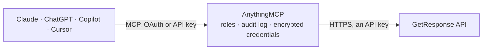

<!-- Generated by scripts/export-github-catalog.mjs in the anythingmcp-website repository. Do not edit by hand. -->

# GetResponse MCP connector

GetResponse email marketing: contact lists (campaigns), contacts with tags and custom fields, segments and ad-hoc contact search, newsletters (drafts, sending, statistics), autoresponders and their … The AnythingMCP connector gives Claude, ChatGPT, Microsoft Copilot, Cursor and Gemini 42 MCP tools for GetResponse: 31 read and 11 can change data.

**Category:** [Marketing Automation](../marketing-automation.md) · **Tools:** 42 · **Setup guide:** [anythingmcp.com](https://anythingmcp.com/guides/getresponse-to-mcp) · [Deutsch](https://anythingmcp.com/de/guides/getresponse-to-mcp) · [Italiano](https://anythingmcp.com/it/guides/getresponse-to-mcp) · [Español](https://anythingmcp.com/es/guides/getresponse-to-mcp) · [日本語](https://anythingmcp.com/ja/guides/getresponse-to-mcp) · [Русский](https://anythingmcp.com/ru/guides/getresponse-to-mcp) · [中文](https://anythingmcp.com/zh/guides/getresponse-to-mcp)

## Start without code

No installation and no terminal: AnythingMCP Cloud runs the GetResponse connector for you, operated by helpcode.ai in Frankfurt, Germany.

1. **Click the button above** and create an account or sign in. The GetResponse connector opens, ready to install.
2. **Paste the API key or token from your GetResponse account.** Every click is in the [step-by-step guide](https://anythingmcp.com/guides/getresponse-to-mcp).
3. **Click Install.** AnythingMCP shows the address of your MCP server.
4. **Add that address to your assistant:** [Claude](https://anythingmcp.com/guides/connect-getresponse-to-claude) · [ChatGPT](https://anythingmcp.com/guides/connect-getresponse-to-chatgpt) · [Microsoft Copilot](https://anythingmcp.com/guides/connect-getresponse-to-copilot) · [Cursor](https://anythingmcp.com/guides/connect-getresponse-to-cursor) · [Gemini CLI](https://anythingmcp.com/guides/connect-getresponse-to-gemini) · [Meta Muse](https://anythingmcp.com/guides/connect-getresponse-to-muse).
5. **Ask your first question**, for example: *Do we have a contact for invoice AP-2026-089 sent to accounts@skargard.fi?*

Prefer help with the setup? [Talk to us](https://anythingmcp.com/contact).

## How it works

- **The AI client** speaks MCP (Streamable HTTP) to AnythingMCP and only sees tool names, descriptions and results. It never gets the GetResponse credentials.
- **AnythingMCP** checks the client's role, builds the call from the tool definition, adds the credentials (an API key), calls GetResponse, logs the call and returns the result.
- **GetResponse** sees an ordinary API client with the rights of the account the credentials belong to.

## Tools

| Tool | What it does | Access |
|---|---|---|
| [`getresponse_get_account`](#getresponse_get_account) | The GetResponse account the API key belongs to: login, name, email, company, country, time zone and language. | read |
| [`getresponse_get_sending_limits`](#getresponse_get_sending_limits) | The account's email sending limits: how many messages it may still send in the current period and the period's limits. | read |
| [`getresponse_list_timezones`](#getresponse_list_timezones) | Time zones GetResponse knows, with the numeric timeZoneId that a scheduled newsletter (send_on_timezone_id) needs. | read |
| [`getresponse_list_campaigns`](#getresponse_list_campaigns) | List the campaigns, which GetResponse also calls contact lists: id, name, whether it is the default list, language and creation date. | read |
| [`getresponse_get_campaign`](#getresponse_get_campaign) | One campaign (contact list) with its settings: opt-in types, confirmation message, postal address, subscription notifications and profile. | read |
| [`getresponse_list_campaign_contacts`](#getresponse_list_campaign_contacts) | Contacts of one campaign (contact list), with email, name, origin and subscription date. | read |
| [`getresponse_get_campaigns_summary`](#getresponse_get_campaigns_summary) | Statistics summary per campaign (contact list): total subscribers, number of autoresponders, newsletters and landing pages, keyed by campaign id. | read |
| [`getresponse_get_campaign_list_size`](#getresponse_get_campaign_list_size) | How many subscribers one or more campaigns had over time: the list size per period, keyed by date. | read |
| [`getresponse_get_campaign_subscriptions`](#getresponse_get_campaign_subscriptions) | New subscriptions to one or more campaigns per period and their origin (api, import, webform, landing page, ...), keyed by date. | read |
| [`getresponse_get_campaign_removals`](#getresponse_get_campaign_removals) | Contacts removed from one or more campaigns per period and why (unsubscribed, bounced, complaint, removed by user or API), keyed by date. | read |
| [`getresponse_create_campaign`](#getresponse_create_campaign) | Create a campaign (contact list), up to 1000 per account. | write |
| [`getresponse_list_contacts`](#getresponse_list_contacts) | Search the contacts of the whole account: by email or name (partial match unless exact_match), campaign, origin, creation or change date. | read |
| [`getresponse_get_contact`](#getresponse_get_contact) | One contact with its campaign, tags, custom field values, scoring, engagement score and autoresponder day of cycle. | read |
| [`getresponse_list_contact_activities`](#getresponse_list_contact_activities) | What a contact did: sends, opens and clicks of newsletters and autoresponders, with dates. | read |
| [`getresponse_create_contact`](#getresponse_create_contact) | Add a contact to a campaign (contact list). | write |
| [`getresponse_update_contact`](#getresponse_update_contact) | Change a contact. | write |
| [`getresponse_upsert_contact_tags`](#getresponse_upsert_contact_tags) | Add tags to a contact without removing the ones it already has. | write |
| [`getresponse_upsert_contact_custom_fields`](#getresponse_upsert_contact_custom_fields) | Set custom field values on a contact; fields you do not pass keep their values. | write |
| [`getresponse_delete_contact`](#getresponse_delete_contact) | Delete a contact. | write |
| [`getresponse_list_tags`](#getresponse_list_tags) | List the account's tags with id, name and color. | read |
| [`getresponse_get_tag`](#getresponse_get_tag) | One tag by id: its name, color and creation date. | read |
| [`getresponse_create_tag`](#getresponse_create_tag) | Create a tag. | write |
| [`getresponse_list_custom_fields`](#getresponse_list_custom_fields) | List the custom field definitions (contact attributes): id, name, type, format, whether hidden and the allowed values. | read |
| [`getresponse_get_custom_field`](#getresponse_get_custom_field) | One custom field definition by id: name, type, format, whether hidden and the allowed values. | read |
| [`getresponse_create_custom_field`](#getresponse_create_custom_field) | Create a custom field for contacts. | write |
| [`getresponse_list_segments`](#getresponse_list_segments) | List saved segments (search-contacts, called custom filters in the panel): id, name and creation date. | read |
| [`getresponse_get_segment`](#getresponse_get_segment) | The conditions of one saved segment: subscriber types, sections, lists and conditions. | read |
| [`getresponse_list_segment_contacts`](#getresponse_list_segment_contacts) | Contacts that currently match a saved segment, with email, name and list. | read |
| [`getresponse_search_contacts`](#getresponse_search_contacts) | Find contacts with ad-hoc segment conditions (tags, custom fields, email, opens, clicks, subscription date, ...) without saving a segment. | read |
| [`getresponse_list_from_fields`](#getresponse_list_from_fields) | List the sender ('From') addresses: id, email, name, whether active and default. | read |
| [`getresponse_get_from_field`](#getresponse_get_from_field) | One sender ('From') address by id: email, sender name, whether it is active and the default. | read |
| [`getresponse_list_newsletters`](#getresponse_list_newsletters) | List newsletters (one-off mailings): name, subject, type (draft, broadcast, splittest, automation), campaign and send date. | read |
| [`getresponse_get_newsletter`](#getresponse_get_newsletter) | One newsletter with its subject, sender, send settings (lists, segments, exclusions, time), flags and content (HTML and plain text). | read |
| [`getresponse_get_newsletter_statistics`](#getresponse_get_newsletter_statistics) | Results of one newsletter: sent, delivered, opened, clicked, bounced, complaints, unsubscribed, per period or in total. | read |
| [`getresponse_get_newsletters_statistics`](#getresponse_get_newsletters_statistics) | Combined results of several newsletters, chosen by newsletter ids or by campaign ids: sent, opened, clicked, bounced, unsubscribed, per period or in total. | read |
| [`getresponse_create_newsletter`](#getresponse_create_newsletter) | Create a newsletter. | write |
| [`getresponse_send_newsletter_draft`](#getresponse_send_newsletter_draft) | Send a draft newsletter to the selected lists, segments or contacts, at once or at send_on_date. | write |
| [`getresponse_cancel_newsletter`](#getresponse_cancel_newsletter) | Stop a scheduled or sending newsletter; it turns back into a draft. | write |
| [`getresponse_list_autoresponders`](#getresponse_list_autoresponders) | List autoresponders (messages sent on a day of the contact's cycle): name, subject, campaign, status, day of cycle and delivery figures. | read |
| [`getresponse_get_autoresponder`](#getresponse_get_autoresponder) | One autoresponder with its trigger (day of cycle), send settings, sender, flags and content. | read |
| [`getresponse_get_autoresponder_statistics`](#getresponse_get_autoresponder_statistics) | Results of one autoresponder: sent, delivered, opened, clicked, bounced, unsubscribed, per period or in total. | read |
| [`getresponse_get_autoresponders_statistics`](#getresponse_get_autoresponders_statistics) | Combined results of several autoresponders, chosen by autoresponder ids or campaign ids, per period or in total. | read |

## Tool reference

Every parameter as the AI client sees it in `tools/list`. Source: [`packages/backend/src/adapters/intl/getresponse.json`](../../../packages/backend/src/adapters/intl/getresponse.json).

### `getresponse_get_account`

The GetResponse account the API key belongs to: login, name, email, company, country, time zone and language. Needs no ids; use it to check the key.

**Access:** read · **Call:** `GET /accounts`

| Parameter | Type | Required | Description |
|---|---|---|---|
| `fields` | string | no | Comma-separated list of fields to return (the id is always returned), e.g. name,email,createdOn. Leave empty for all fields. |

### `getresponse_get_sending_limits`

The account's email sending limits: how many messages it may still send in the current period and the period's limits.

**Access:** read · **Call:** `GET /accounts/sending-limits`

| Parameter | Type | Required | Description |
|---|---|---|---|
| `fields` | string | no | Comma-separated list of fields to return (the id is always returned), e.g. name,email,createdOn. Leave empty for all fields. |

### `getresponse_list_timezones`

Time zones GetResponse knows, with the numeric timeZoneId that a scheduled newsletter (send_on_timezone_id) needs.

**Access:** read · **Call:** `GET /accounts/timezones`

| Parameter | Type | Required | Description |
|---|---|---|---|
| `fields` | string | no | Comma-separated list of fields to return (the id is always returned), e.g. name,email,createdOn. Leave empty for all fields. |

### `getresponse_list_campaigns`

List the campaigns, which GetResponse also calls contact lists: id, name, whether it is the default list, language and creation date. Paged; filter by name.

**Access:** read · **Call:** `GET /campaigns`

| Parameter | Type | Required | Description |
|---|---|---|---|
| `name` | string | no | Only campaigns whose name contains this text. |
| `is_default` | boolean | no | true: only the default campaign; false: all the others. |
| `sort_name` | `ASC` \| `DESC` | no | Sort by name. |
| `sort_created_on` | `ASC` \| `DESC` | no | Sort by creation date. |
| `fields` | string | no | Comma-separated list of fields to return (the id is always returned), e.g. name,email,createdOn. Leave empty for all fields. |
| `page` | integer | no | Page number, starting at 1. |
| `per_page` | integer | no | Results per page, 1-1000 (default 100). |

### `getresponse_get_campaign`

One campaign (contact list) with its settings: opt-in types, confirmation message, postal address, subscription notifications and profile.

**Access:** read · **Call:** `GET /campaigns/{campaign_id}`

| Parameter | Type | Required | Description |
|---|---|---|---|
| `campaign_id` | string | yes | Campaign id from getresponse_list_campaigns, e.g. V. |
| `fields` | string | no | Comma-separated list of fields to return (the id is always returned), e.g. name,email,createdOn. Leave empty for all fields. |

### `getresponse_list_campaign_contacts`

Contacts of one campaign (contact list), with email, name, origin and subscription date. Paged; filter by email, name or creation date.

**Access:** read · **Call:** `GET /campaigns/{campaign_id}/contacts`

| Parameter | Type | Required | Description |
|---|---|---|---|
| `campaign_id` | string | yes | Campaign id from getresponse_list_campaigns. |
| `email` | string | no | Only contacts whose email contains this text. |
| `name` | string | no | Only contacts whose name contains this text. |
| `created_from` | string | no | Only contacts created on or after this date (YYYY-MM-DD or ISO 8601). |
| `created_to` | string | no | Only contacts created on or before this date (YYYY-MM-DD or ISO 8601). |
| `sort_email` | `ASC` \| `DESC` | no | Sort by email. |
| `sort_name` | `ASC` \| `DESC` | no | Sort by name. |
| `sort_created_on` | `ASC` \| `DESC` | no | Sort by subscription date. |
| `fields` | string | no | Comma-separated list of fields to return (the id is always returned), e.g. name,email,createdOn. Leave empty for all fields. |
| `page` | integer | no | Page number, starting at 1. |
| `per_page` | integer | no | Results per page, 1-1000 (default 100). |

### `getresponse_get_campaigns_summary`

Statistics summary per campaign (contact list): total subscribers, number of autoresponders, newsletters and landing pages, keyed by campaign id.

**Access:** read · **Call:** `GET /campaigns/statistics/summary`

| Parameter | Type | Required | Description |
|---|---|---|---|
| `campaign_ids` | string | yes | One or more campaign ids, comma-separated (e.g. V,O). Required by the API. |

### `getresponse_get_campaign_list_size`

How many subscribers one or more campaigns had over time: the list size per period, keyed by date. Moves between lists are not counted.

**Access:** read · **Call:** `GET /campaigns/statistics/list-size`

| Parameter | Type | Required | Description |
|---|---|---|---|
| `campaign_ids` | string | yes | One or more campaign ids, comma-separated (e.g. V,O). |
| `group_by` | `total` \| `hour` \| `day` \| `month` | no | Group the figures by hour, day, month or total (one sum). |
| `created_from` | string | no | Only changes on or after this date (YYYY-MM-DD or ISO 8601). |
| `created_to` | string | no | Only changes on or before this date (YYYY-MM-DD or ISO 8601). |

### `getresponse_get_campaign_subscriptions`

New subscriptions to one or more campaigns per period and their origin (api, import, webform, landing page, ...), keyed by date.

**Access:** read · **Call:** `GET /campaigns/statistics/subscriptions`

| Parameter | Type | Required | Description |
|---|---|---|---|
| `campaign_ids` | string | yes | One or more campaign ids, comma-separated (e.g. V,O). |
| `group_by` | `total` \| `hour` \| `day` \| `month` | no | Group the figures by hour, day, month or total (one sum). |
| `created_from` | string | no | Only changes on or after this date (YYYY-MM-DD or ISO 8601). |
| `created_to` | string | no | Only changes on or before this date (YYYY-MM-DD or ISO 8601). |

### `getresponse_get_campaign_removals`

Contacts removed from one or more campaigns per period and why (unsubscribed, bounced, complaint, removed by user or API), keyed by date.

**Access:** read · **Call:** `GET /campaigns/statistics/removals`

| Parameter | Type | Required | Description |
|---|---|---|---|
| `campaign_ids` | string | yes | One or more campaign ids, comma-separated (e.g. V,O). |
| `group_by` | `total` \| `hour` \| `day` \| `month` | no | Group the figures by hour, day, month or total (one sum). |
| `created_from` | string | no | Only changes on or after this date (YYYY-MM-DD or ISO 8601). |
| `created_to` | string | no | Only changes on or before this date (YYYY-MM-DD or ISO 8601). |

### `getresponse_create_campaign`

Create a campaign (contact list), up to 1000 per account. The name must be unique, 3-64 characters, without emojis, /, \\, @, [ or ].

**Access:** write · **Call:** `POST /campaigns`

| Parameter | Type | Required | Description |
|---|---|---|---|
| `name` | string | yes | List name, e.g. Webinar signups. |
| `language_code` | string | no | ISO 639-1 language code of the list, e.g. EN, DE. |
| `is_default` | `true` \| `false` | no | true to make it the default list. |
| `optin_types` | object | no | Opt-in per channel, single or double (confirmation email): {"api": "double", "email": "single", "import": "single", "webform": "double"}. Leave out for the account defaults. |

### `getresponse_list_contacts`

Search the contacts of the whole account: by email or name (partial match unless exact_match), campaign, origin, creation or change date. Paged, 100 per page by default.

**Access:** read · **Call:** `GET /contacts`

| Parameter | Type | Required | Description |
|---|---|---|---|
| `email` | string | no | Only contacts whose email contains this text (set exact_match for an exact email). |
| `name` | string | no | Only contacts whose name contains this text. |
| `campaign_id` | string | no | Only contacts of this campaign (contact list). |
| `origin` | `import` \| `email` \| `www` \| `panel` \| `leads` \| `sale` \| `api` \| `survey` \| `iphone` \| `copy` \| `landing_page` \| `webinar` \| `website_builder_elegant` \| `chat` \| `course` \| `premium_newsletter` | no | Only contacts that subscribed this way. |
| `created_from` | string | no | Only contacts created on or after this date (YYYY-MM-DD or ISO 8601). |
| `created_to` | string | no | Only contacts created on or before this date (YYYY-MM-DD or ISO 8601). |
| `changed_from` | string | no | Only contacts changed on or after this date (YYYY-MM-DD or ISO 8601). |
| `changed_to` | string | no | Only contacts changed on or before this date (YYYY-MM-DD or ISO 8601). |
| `exact_match` | `exactMatch` | no | exactMatch: email and name must match exactly instead of partially. |
| `sort_email` | `ASC` \| `DESC` | no | Sort by email. |
| `sort_name` | `ASC` \| `DESC` | no | Sort by name. |
| `sort_created_on` | `ASC` \| `DESC` | no | Sort by subscription date. |
| `sort_changed_on` | `ASC` \| `DESC` | no | Sort by change date. |
| `fields` | string | no | Comma-separated list of fields to return (the id is always returned), e.g. name,email,createdOn. Leave empty for all fields. |
| `page` | integer | no | Page number, starting at 1. |
| `per_page` | integer | no | Results per page, 1-1000 (default 100). |

### `getresponse_get_contact`

One contact with its campaign, tags, custom field values, scoring, engagement score and autoresponder day of cycle.

**Access:** read · **Call:** `GET /contacts/{contact_id}`

| Parameter | Type | Required | Description |
|---|---|---|---|
| `contact_id` | string | yes | Contact id from getresponse_list_contacts, e.g. pV3r. |
| `fields` | string | no | Comma-separated list of fields to return (the id is always returned), e.g. name,email,createdOn. Leave empty for all fields. |

### `getresponse_list_contact_activities`

What a contact did: sends, opens and clicks of newsletters and autoresponders, with dates. Only the last 14 days unless created_from is set.

**Access:** read · **Call:** `GET /contacts/{contact_id}/activities`

| Parameter | Type | Required | Description |
|---|---|---|---|
| `contact_id` | string | yes | Contact id from getresponse_list_contacts. |
| `created_from` | string | no | Only activities on or after this date (YYYY-MM-DD or ISO 8601). |
| `created_to` | string | no | Only activities on or before this date (YYYY-MM-DD or ISO 8601). |
| `fields` | string | no | Comma-separated list of fields to return (the id is always returned), e.g. name,email,createdOn. Leave empty for all fields. |
| `page` | integer | no | Page number, starting at 1. |
| `per_page` | integer | no | Results per page, 1-1000 (default 100). |

### `getresponse_create_contact`

Add a contact to a campaign (contact list). GetResponse queues it and answers 202 with an empty body; the contact appears after a short while (look it up with getresponse_list_contacts). With double opt-in on the list's API channel the contact first gets a confirmation email.

**Access:** write · **Call:** `POST /contacts`

| Parameter | Type | Required | Description |
|---|---|---|---|
| `email` | string | yes | Email address of the new contact. |
| `campaign_id` | string | yes | Campaign (contact list) id from getresponse_list_campaigns. |
| `name` | string | no | Contact name. |
| `day_of_cycle` | integer | no | Autoresponder day to start the contact at (0 = first day). Leave empty to keep the contact out of the autoresponder cycle. |
| `scoring` | number | no | Contact score. |
| `ip_address` | string | no | IP address the contact subscribed from (IPv4 or IPv6). |
| `open_tracking_consent` | boolean | no | Whether the contact agreed that email opens may be tracked. |
| `tags` | object[] | no | Tags as objects with a tagId from getresponse_list_tags, e.g. [{"tagId": "m7E2"}]. |
| `custom_field_values` | object[] | no | Custom field values: [{"customFieldId": "kL6Nh", "value": ["18-35"]}]. value is always a list of strings; ids come from getresponse_list_custom_fields. |

### `getresponse_update_contact`

Change a contact. Only the fields you pass change, but tags and custom_field_values REPLACE the contact's current ones (use getresponse_upsert_contact_tags / getresponse_upsert_contact_custom_fields to add). A new campaign moves the contact to that list with its history.

**Access:** write · **Call:** `POST /contacts/{contact_id}`

| Parameter | Type | Required | Description |
|---|---|---|---|
| `contact_id` | string | yes | Contact id from getresponse_list_contacts. |
| `name` | string | no | New name. |
| `email` | string | no | New email address. |
| `campaign` | object | no | Move the contact to another campaign: {"campaignId": "V"}. |
| `day_of_cycle` | integer | no | Autoresponder day of cycle. |
| `scoring` | number | no | Contact score. |
| `note` | string | no | Free-text note on the contact. |
| `open_tracking_consent` | boolean | no | Whether the contact agreed that email opens may be tracked. |
| `tags` | object[] | no | Tags as objects with a tagId from getresponse_list_tags, e.g. [{"tagId": "m7E2"}]. |
| `custom_field_values` | object[] | no | Custom field values: [{"customFieldId": "kL6Nh", "value": ["18-35"]}]. value is always a list of strings; ids come from getresponse_list_custom_fields. |

### `getresponse_upsert_contact_tags`

Add tags to a contact without removing the ones it already has.

**Access:** write · **Call:** `POST /contacts/{contact_id}/tags`

| Parameter | Type | Required | Description |
|---|---|---|---|
| `contact_id` | string | yes | Contact id. |
| `tags` | object[] | yes | Tags as objects with a tagId from getresponse_list_tags, e.g. [{"tagId": "m7E2"}]. |

### `getresponse_upsert_contact_custom_fields`

Set custom field values on a contact; fields you do not pass keep their values.

**Access:** write · **Call:** `POST /contacts/{contact_id}/custom-fields`

| Parameter | Type | Required | Description |
|---|---|---|---|
| `contact_id` | string | yes | Contact id. |
| `custom_field_values` | object[] | yes | Custom field values: [{"customFieldId": "kL6Nh", "value": ["18-35"]}]. value is always a list of strings; ids come from getresponse_list_custom_fields. |

### `getresponse_delete_contact`

Delete a contact. Passing message_id records it as an unsubscribe from that message instead of a plain removal. Cannot be undone. Installed switched off.

**Access:** write · **Call:** `DELETE /contacts/{contact_id}`

| Parameter | Type | Required | Description |
|---|---|---|---|
| `contact_id` | string | yes | Contact id. |
| `message_id` | string | no | Id of the newsletter or autoresponder the contact unsubscribed from (optional). |
| `ip_address` | string | no | IP address the contact unsubscribed from; only used together with message_id. |

### `getresponse_list_tags`

List the account's tags with id, name and color. Paged; filter by name or creation date.

**Access:** read · **Call:** `GET /tags`

| Parameter | Type | Required | Description |
|---|---|---|---|
| `name` | string | no | Only tags whose name contains this text. |
| `created_from` | string | no | Only tags created on or after this date (YYYY-MM-DD or ISO 8601). |
| `created_to` | string | no | Only tags created on or before this date (YYYY-MM-DD or ISO 8601). |
| `sort_name` | `ASC` \| `DESC` | no | Sort by name. |
| `sort_created_at` | `ASC` \| `DESC` | no | Sort by creation date. |
| `fields` | string | no | Comma-separated list of fields to return (the id is always returned), e.g. name,email,createdOn. Leave empty for all fields. |
| `page` | integer | no | Page number, starting at 1. |
| `per_page` | integer | no | Results per page, 1-1000 (default 100). |

### `getresponse_get_tag`

One tag by id: its name, color and creation date. Use it to resolve a tagId seen on a contact.

**Access:** read · **Call:** `GET /tags/{tag_id}`

| Parameter | Type | Required | Description |
|---|---|---|---|
| `tag_id` | string | yes | Tag id from getresponse_list_tags. |
| `fields` | string | no | Comma-separated list of fields to return (the id is always returned), e.g. name,email,createdOn. Leave empty for all fields. |

### `getresponse_create_tag`

Create a tag. Names are 1-255 characters: letters, digits, spaces, underscores, dots and hyphens.

**Access:** write · **Call:** `POST /tags`

| Parameter | Type | Required | Description |
|---|---|---|---|
| `name` | string | yes | Tag name, e.g. webinar_2026. |

### `getresponse_list_custom_fields`

List the custom field definitions (contact attributes): id, name, type, format, whether hidden and the allowed values. Paged.

**Access:** read · **Call:** `GET /custom-fields`

| Parameter | Type | Required | Description |
|---|---|---|---|
| `name` | string | no | Only custom fields whose name contains this text. |
| `sort_name` | `ASC` \| `DESC` | no | Sort by name. |
| `fields` | string | no | Comma-separated list of fields to return (the id is always returned), e.g. name,email,createdOn. Leave empty for all fields. |
| `page` | integer | no | Page number, starting at 1. |
| `per_page` | integer | no | Results per page, 1-1000 (default 100). |

### `getresponse_get_custom_field`

One custom field definition by id: name, type, format, whether hidden and the allowed values.

**Access:** read · **Call:** `GET /custom-fields/{custom_field_id}`

| Parameter | Type | Required | Description |
|---|---|---|---|
| `custom_field_id` | string | yes | Custom field id from getresponse_list_custom_fields. |
| `fields` | string | no | Comma-separated list of fields to return (the id is always returned), e.g. name,email,createdOn. Leave empty for all fields. |

### `getresponse_create_custom_field`

Create a custom field for contacts. The name must be unique, lowercase letters, digits and underscores only.

**Access:** write · **Call:** `POST /custom-fields`

| Parameter | Type | Required | Description |
|---|---|---|---|
| `name` | string | yes | Field name, e.g. office_phone_number. |
| `type` | `string` \| `number` \| `date` \| `datetime` \| `country` \| `currency` \| `phone` \| `gender` \| `ip` \| `url` | yes | Data type. |
| `format` | `text` \| `textarea` \| `radio` \| `checkbox` \| `single_select` \| `multi_select` | yes | Input format. |
| `hidden` | `true` \| `false` | yes | true: hidden from contacts on forms; false: visible. |
| `values` | string[] | yes | Allowed values for radio, checkbox and select formats; [] for free input. |

### `getresponse_list_segments`

List saved segments (search-contacts, called custom filters in the panel): id, name and creation date. Paged.

**Access:** read · **Call:** `GET /search-contacts`

| Parameter | Type | Required | Description |
|---|---|---|---|
| `name` | string | no | Only segments whose name contains this text. |
| `created_from` | string | no | Only segments created on or after this date (YYYY-MM-DD or ISO 8601). |
| `created_to` | string | no | Only segments created on or before this date (YYYY-MM-DD or ISO 8601). |
| `sort_name` | `ASC` \| `DESC` | no | Sort by name. |
| `sort_created_on` | `ASC` \| `DESC` | no | Sort by creation date. |
| `fields` | string | no | Comma-separated list of fields to return (the id is always returned), e.g. name,email,createdOn. Leave empty for all fields. |
| `page` | integer | no | Page number, starting at 1. |
| `per_page` | integer | no | Results per page, 1-1000 (default 100). |

### `getresponse_get_segment`

The conditions of one saved segment: subscriber types, sections, lists and conditions.

**Access:** read · **Call:** `GET /search-contacts/{segment_id}`

| Parameter | Type | Required | Description |
|---|---|---|---|
| `segment_id` | string | yes | Segment (search-contact) id from getresponse_list_segments. |
| `fields` | string | no | Comma-separated list of fields to return (the id is always returned), e.g. name,email,createdOn. Leave empty for all fields. |

### `getresponse_list_segment_contacts`

Contacts that currently match a saved segment, with email, name and list. Paged.

**Access:** read · **Call:** `GET /search-contacts/{segment_id}/contacts`

| Parameter | Type | Required | Description |
|---|---|---|---|
| `segment_id` | string | yes | Segment id from getresponse_list_segments. |
| `sort_name` | `ASC` \| `DESC` | no | Sort by name. |
| `sort_email` | `ASC` \| `DESC` | no | Sort by email. |
| `sort_created_on` | `ASC` \| `DESC` | no | Sort by subscription date. |
| `fields` | string | no | Comma-separated list of fields to return (the id is always returned), e.g. name,email,createdOn. Leave empty for all fields. |
| `page` | integer | no | Page number, starting at 1. |
| `per_page` | integer | no | Results per page, 1-1000 (default 100). |

### `getresponse_search_contacts`

Find contacts with ad-hoc segment conditions (tags, custom fields, email, opens, clicks, subscription date, ...) without saving a segment. Read-only although it is a POST. See the instructions for the body shape.

**Access:** read · **Call:** `POST /search-contacts/contacts`

| Parameter | Type | Required | Description |
|---|---|---|---|
| `subscribers_type` | `subscribed` \| `undelivered` \| `removed` \| `unconfirmed`[] | yes | Which contacts to search, e.g. ["subscribed"]. |
| `section_logic_operator` | `or` \| `and` | yes | Match any section (or) or all sections (and). |
| `section` | object[] | yes | Sections, each {campaignIdsList: [...], logicOperator: and\|or, subscriberCycle: [receiving_autoresponder, not_receiving_autoresponder], subscriptionDate: all_time\|last_7_days\|..., conditions: [...]}. |
| `sort_name` | `ASC` \| `DESC` | no | Sort by name. |
| `sort_email` | `ASC` \| `DESC` | no | Sort by email. |
| `sort_created_on` | `ASC` \| `DESC` | no | Sort by subscription date. |
| `fields` | string | no | Comma-separated list of fields to return (the id is always returned), e.g. name,email,createdOn. Leave empty for all fields. |
| `page` | integer | no | Page number, starting at 1. |
| `per_page` | integer | no | Results per page, 1-1000 (default 100). |

### `getresponse_list_from_fields`

List the sender ('From') addresses: id, email, name, whether active and default. The id is needed to create a newsletter.

**Access:** read · **Call:** `GET /from-fields`

| Parameter | Type | Required | Description |
|---|---|---|---|
| `email` | string | no | Only addresses containing this text. |
| `name` | string | no | Only sender names containing this text. |
| `is_default` | boolean | no | true: only the default sender. |
| `is_active` | boolean | no | true: only confirmed, active senders. |
| `sort_created_on` | `ASC` \| `DESC` | no | Sort by creation date. |
| `fields` | string | no | Comma-separated list of fields to return (the id is always returned), e.g. name,email,createdOn. Leave empty for all fields. |
| `page` | integer | no | Page number, starting at 1. |
| `per_page` | integer | no | Results per page, 1-1000 (default 100). |

### `getresponse_get_from_field`

One sender ('From') address by id: email, sender name, whether it is active and the default.

**Access:** read · **Call:** `GET /from-fields/{from_field_id}`

| Parameter | Type | Required | Description |
|---|---|---|---|
| `from_field_id` | string | yes | 'From' address id from getresponse_list_from_fields. |
| `fields` | string | no | Comma-separated list of fields to return (the id is always returned), e.g. name,email,createdOn. Leave empty for all fields. |

### `getresponse_list_newsletters`

List newsletters (one-off mailings): name, subject, type (draft, broadcast, splittest, automation), campaign and send date. Paged; filter by subject, status, type, campaign or dates.

**Access:** read · **Call:** `GET /newsletters`

| Parameter | Type | Required | Description |
|---|---|---|---|
| `subject` | string | no | Only newsletters whose subject contains this text. |
| `name` | string | no | Only newsletters whose name contains this text. |
| `status` | `enabled` \| `disabled` | no | enabled or disabled. |
| `type` | `draft` \| `broadcast` \| `splittest` \| `automation` | no | Newsletter type. |
| `campaign_id` | string | no | Only newsletters of this campaign. |
| `created_from` | string | no | Only newsletters created on or after this date (YYYY-MM-DD or ISO 8601). |
| `created_to` | string | no | Only newsletters created on or before this date (YYYY-MM-DD or ISO 8601). |
| `send_from` | string | no | Only newsletters sent on or after this date (YYYY-MM-DD or ISO 8601). |
| `send_to` | string | no | Only newsletters sent on or before this date (YYYY-MM-DD or ISO 8601). |
| `sort_created_on` | `ASC` \| `DESC` | no | Sort by creation date. |
| `sort_send_on` | `ASC` \| `DESC` | no | Sort by send date. |
| `fields` | string | no | Comma-separated list of fields to return (the id is always returned), e.g. name,email,createdOn. Leave empty for all fields. |
| `page` | integer | no | Page number, starting at 1. |
| `per_page` | integer | no | Results per page, 1-1000 (default 100). |

### `getresponse_get_newsletter`

One newsletter with its subject, sender, send settings (lists, segments, exclusions, time), flags and content (HTML and plain text). Use fields to leave out content.

**Access:** read · **Call:** `GET /newsletters/{newsletter_id}`

| Parameter | Type | Required | Description |
|---|---|---|---|
| `newsletter_id` | string | yes | Newsletter id from getresponse_list_newsletters. |
| `fields` | string | no | Comma-separated list of fields to return (the id is always returned), e.g. name,email,createdOn. Leave empty for all fields. |

### `getresponse_get_newsletter_statistics`

Results of one newsletter: sent, delivered, opened, clicked, bounced, complaints, unsubscribed, per period or in total.

**Access:** read · **Call:** `GET /newsletters/{newsletter_id}/statistics`

| Parameter | Type | Required | Description |
|---|---|---|---|
| `newsletter_id` | string | yes | Newsletter id. |
| `group_by` | `total` \| `hour` \| `day` \| `month` | no | Group the figures by hour, day, month or total (one sum). |
| `created_from` | string | no | Only activity on or after this date (YYYY-MM-DD or ISO 8601). |
| `created_to` | string | no | Only activity on or before this date (YYYY-MM-DD or ISO 8601). |
| `fields` | string | no | Comma-separated list of fields to return (the id is always returned), e.g. name,email,createdOn. Leave empty for all fields. |
| `page` | integer | no | Page number, starting at 1. |
| `per_page` | integer | no | Results per page, 1-1000 (default 100). |

### `getresponse_get_newsletters_statistics`

Combined results of several newsletters, chosen by newsletter ids or by campaign ids: sent, opened, clicked, bounced, unsubscribed, per period or in total.

**Access:** read · **Call:** `GET /newsletters/statistics`

| Parameter | Type | Required | Description |
|---|---|---|---|
| `newsletter_ids` | string | no | Newsletter ids, comma-separated. |
| `campaign_ids` | string | no | Campaign ids, comma-separated: all newsletters of these lists. |
| `group_by` | `total` \| `hour` \| `day` \| `month` | no | Group the figures by hour, day, month or total (one sum). |
| `created_from` | string | no | Only activity on or after this date (YYYY-MM-DD or ISO 8601). |
| `created_to` | string | no | Only activity on or before this date (YYYY-MM-DD or ISO 8601). |
| `fields` | string | no | Comma-separated list of fields to return (the id is always returned), e.g. name,email,createdOn. Leave empty for all fields. |
| `page` | integer | no | Page number, starting at 1. |
| `per_page` | integer | no | Results per page, 1-1000 (default 100). |

### `getresponse_create_newsletter`

Create a newsletter. type draft saves it without sending (send it later with getresponse_send_newsletter_draft); type broadcast queues it for sending to the selected lists, segments or contacts at once or at send_on_date. Limited to 256 calls a day. Confirm recipients and content with the user before a broadcast.

**Access:** write · **Call:** `POST /newsletters`

| Parameter | Type | Required | Description |
|---|---|---|---|
| `type` | `draft` \| `broadcast` | yes | draft: save only. broadcast: send (now or at send_on_date). |
| `subject` | string | yes | Email subject line. |
| `name` | string | no | Internal newsletter name (defaults to the subject). |
| `campaign_id` | string | yes | Campaign the newsletter belongs to. |
| `from_field_id` | string | yes | Sender ('From' address) id from getresponse_list_from_fields. |
| `reply_to` | object | no | Reply-to address, optional: {"fromFieldId": "V"} with an id from getresponse_list_from_fields. |
| `html` | string | yes | HTML content of the email. |
| `plain` | string | no | Plain-text version of the email (optional). |
| `flags` | `clicktrack` \| `google_analytics`[] | no | Tracking flags: clicktrack, google_analytics. |
| `track_opens` | `true` \| `false` | no | Track opens: true or false. |
| `send_settings` | object | yes | Who gets it and when, in GetResponse's own keys: selectedCampaigns, selectedSegments, selectedContacts, excludedCampaigns, excludedSegments, selectedSuppressions (arrays of ids), timeTravel and perfectTiming ("true"/"false"), sendOn {date: "2026-11-14T07:00:00", timeZone: {timeZoneId: 282}}. Without sendOn it is sent at once. Example: {"selectedCampaigns": ["V"], "excludedSegments": ["R"]}. |

### `getresponse_send_newsletter_draft`

Send a draft newsletter to the selected lists, segments or contacts, at once or at send_on_date. This emails real people: confirm the draft and the recipients with the user first.

**Access:** write · **Call:** `POST /newsletters/send-draft`

| Parameter | Type | Required | Description |
|---|---|---|---|
| `newsletter_id` | string | yes | Id of the draft newsletter (type draft in getresponse_list_newsletters). |
| `send_settings` | object | yes | Who gets it and when, in GetResponse's own keys: selectedCampaigns, selectedSegments, selectedContacts, excludedCampaigns, excludedSegments, selectedSuppressions (arrays of ids), timeTravel and perfectTiming ("true"/"false"), sendOn {date: "2026-11-14T07:00:00", timeZone: {timeZoneId: 282}}. Without sendOn it is sent at once. Example: {"selectedCampaigns": ["V"], "excludedSegments": ["R"]}. |

### `getresponse_cancel_newsletter`

Stop a scheduled or sending newsletter; it turns back into a draft. Messages already delivered stay delivered.

**Access:** write · **Call:** `POST /newsletters/{newsletter_id}/cancel`

| Parameter | Type | Required | Description |
|---|---|---|---|
| `newsletter_id` | string | yes | Newsletter id. |

### `getresponse_list_autoresponders`

List autoresponders (messages sent on a day of the contact's cycle): name, subject, campaign, status, day of cycle and delivery figures. Paged; the HTML content is left out (see getresponse_get_autoresponder).

**Access:** read · **Call:** `GET /autoresponders`

| Parameter | Type | Required | Description |
|---|---|---|---|
| `subject` | string | no | Only autoresponders whose subject contains this text. |
| `name` | string | no | Only autoresponders whose name contains this text. |
| `status` | `enabled` \| `disabled` | no | enabled or disabled. |
| `campaign_id` | string | no | Only autoresponders of this campaign. |
| `created_from` | string | no | Only autoresponders created on or after this date (YYYY-MM-DD or ISO 8601). |
| `created_to` | string | no | Only autoresponders created on or before this date (YYYY-MM-DD or ISO 8601). |
| `sort_name` | `ASC` \| `DESC` | no | Sort by name. |
| `sort_subject` | `ASC` \| `DESC` | no | Sort by subject. |
| `sort_day_of_cycle` | `ASC` \| `DESC` | no | Sort by cycle day. |
| `sort_delivered` | `ASC` \| `DESC` | no | Sort by delivered count. |
| `sort_open_rate` | `ASC` \| `DESC` | no | Sort by open rate. |
| `sort_click_rate` | `ASC` \| `DESC` | no | Sort by click rate. |
| `sort_created_on` | `ASC` \| `DESC` | no | Sort by creation date. |
| `fields` | string | no | Comma-separated list of fields to return (the id is always returned), e.g. name,email,createdOn. Leave empty for all fields. |
| `page` | integer | no | Page number, starting at 1. |
| `per_page` | integer | no | Results per page, 1-1000 (default 100). |

### `getresponse_get_autoresponder`

One autoresponder with its trigger (day of cycle), send settings, sender, flags and content.

**Access:** read · **Call:** `GET /autoresponders/{autoresponder_id}`

| Parameter | Type | Required | Description |
|---|---|---|---|
| `autoresponder_id` | string | yes | Autoresponder id from getresponse_list_autoresponders. |
| `fields` | string | no | Comma-separated list of fields to return (the id is always returned), e.g. name,email,createdOn. Leave empty for all fields. |

### `getresponse_get_autoresponder_statistics`

Results of one autoresponder: sent, delivered, opened, clicked, bounced, unsubscribed, per period or in total.

**Access:** read · **Call:** `GET /autoresponders/{autoresponder_id}/statistics`

| Parameter | Type | Required | Description |
|---|---|---|---|
| `autoresponder_id` | string | yes | Autoresponder id. |
| `group_by` | `total` \| `hour` \| `day` \| `month` | no | Group the figures by hour, day, month or total (one sum). |
| `created_from` | string | no | Only activity on or after this date (YYYY-MM-DD or ISO 8601). |
| `created_to` | string | no | Only activity on or before this date (YYYY-MM-DD or ISO 8601). |
| `fields` | string | no | Comma-separated list of fields to return (the id is always returned), e.g. name,email,createdOn. Leave empty for all fields. |
| `page` | integer | no | Page number, starting at 1. |
| `per_page` | integer | no | Results per page, 1-1000 (default 100). |

### `getresponse_get_autoresponders_statistics`

Combined results of several autoresponders, chosen by autoresponder ids or campaign ids, per period or in total.

**Access:** read · **Call:** `GET /autoresponders/statistics`

| Parameter | Type | Required | Description |
|---|---|---|---|
| `autoresponder_ids` | string | no | Autoresponder ids, comma-separated. |
| `campaign_ids` | string | no | Campaign ids, comma-separated: all autoresponders of these lists. |
| `group_by` | `total` \| `hour` \| `day` \| `month` | no | Group the figures by hour, day, month or total (one sum). |
| `created_from` | string | no | Only activity on or after this date (YYYY-MM-DD or ISO 8601). |
| `created_to` | string | no | Only activity on or before this date (YYYY-MM-DD or ISO 8601). |
| `fields` | string | no | Comma-separated list of fields to return (the id is always returned), e.g. name,email,createdOn. Leave empty for all fields. |
| `page` | integer | no | Page number, starting at 1. |
| `per_page` | integer | no | Results per page, 1-1000 (default 100). |

## Run it yourself

AnythingMCP is open source (AGPL-3.0). [Run it with Docker](../../../README.md#run-it-yourself), open **Connectors → Store**, pick **GetResponse** and enter `GETRESPONSE_API_URL`, `GETRESPONSE_API_KEY`, then add your MCP server URL to the AI client.

[← Marketing Automation connectors](../marketing-automation.md) · [All categories](../README.md)
