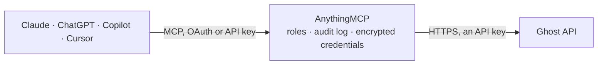

<!-- Generated by scripts/export-github-catalog.mjs in the anythingmcp-website repository. Do not edit by hand. -->

# Ghost MCP connector

Drive Ghost (open-source publishing platform) from any AI agent: posts, pages, tags, members, newsletters. 12 tools, Admin API JWT auth. The AnythingMCP connector gives Claude, ChatGPT, Microsoft Copilot, Cursor and Gemini 12 MCP tools for Ghost: 7 read and 5 can change data.

**Category:** [Publishing](../publishing.md) · **Tools:** 12 · **Setup guide:** [anythingmcp.com](https://anythingmcp.com/guides/ghost-to-mcp) · [Deutsch](https://anythingmcp.com/de/guides/ghost-to-mcp) · [Italiano](https://anythingmcp.com/it/guides/ghost-to-mcp) · [Español](https://anythingmcp.com/es/guides/ghost-to-mcp) · [日本語](https://anythingmcp.com/ja/guides/ghost-to-mcp) · [Русский](https://anythingmcp.com/ru/guides/ghost-to-mcp) · [中文](https://anythingmcp.com/zh/guides/ghost-to-mcp)

## Start without code

No installation and no terminal: AnythingMCP Cloud runs the Ghost connector for you, operated by helpcode.ai in Frankfurt, Germany.

1. **Click the button above** and create an account or sign in. The Ghost connector opens, ready to install.
2. **Paste the API key or token from your Ghost account.** Every click is in the [step-by-step guide](https://anythingmcp.com/guides/ghost-to-mcp).
3. **Click Install.** AnythingMCP shows the address of your MCP server.
4. **Add that address to your assistant:** [Claude](https://anythingmcp.com/guides/connect-ghost-to-claude) · [ChatGPT](https://anythingmcp.com/guides/connect-ghost-to-chatgpt) · [Microsoft Copilot](https://anythingmcp.com/guides/connect-ghost-to-copilot) · [Cursor](https://anythingmcp.com/guides/connect-ghost-to-cursor) · [Gemini CLI](https://anythingmcp.com/guides/connect-ghost-to-gemini) · [Meta Muse](https://anythingmcp.com/guides/connect-ghost-to-muse).
5. **Ask your first question**, for example: *What's status and published date of post with slug autumn-sale-2026?*

Prefer help with the setup? [Talk to us](https://anythingmcp.com/contact).

## How it works

- **The AI client** speaks MCP (Streamable HTTP) to AnythingMCP and only sees tool names, descriptions and results. It never gets the Ghost credentials.
- **AnythingMCP** checks the client's role, builds the call from the tool definition, adds the credentials (an API key), calls Ghost, logs the call and returns the result.
- **Ghost** sees an ordinary API client with the rights of the account the credentials belong to.

## Tools

| Tool | What it does | Access |
|---|---|---|
| [`ghost_list_posts`](#ghost_list_posts) | List posts. | read |
| [`ghost_get_post`](#ghost_get_post) | Fetch a post by ID (or by slug with /slug/{slug}/). | read |
| [`ghost_create_post`](#ghost_create_post) | Create a post. | write |
| [`ghost_update_post`](#ghost_update_post) | Update a post. | write |
| [`ghost_delete_post`](#ghost_delete_post) | Delete a post permanently. | write |
| [`ghost_list_pages`](#ghost_list_pages) | List static pages (separate from posts). | read |
| [`ghost_list_tags`](#ghost_list_tags) | List tags with member/post counts. | read |
| [`ghost_list_members`](#ghost_list_members) | List members (subscribers, both free and paid). | read |
| [`ghost_create_member`](#ghost_create_member) | Create a member (subscribe email). | write |
| [`ghost_update_member`](#ghost_update_member) | Update a member. | write |
| [`ghost_list_newsletters`](#ghost_list_newsletters) | List newsletters on the site (Ghost supports multiple newsletters per site since v5). | read |
| [`ghost_site`](#ghost_site) | Return site info (title, description, version, url). | read |

## Tool reference

Every parameter as the AI client sees it in `tools/list`. Source: [`packages/backend/src/adapters/intl/ghost.json`](../../../packages/backend/src/adapters/intl/ghost.json).

### `ghost_list_posts`

List posts. Each post has id, uuid, title, slug, html, status, published_at, authors, tags, featured.

**Access:** read · **Call:** `GET /posts/`

| Parameter | Type | Required | Description |
|---|---|---|---|
| `filter` | string | no | NQL filter, e.g. 'status:published+tag:ai' or 'published_at:>=2025-01-01'. |
| `page` | integer | no | Page. |
| `limit` | integer | no | Per page (max 100). |
| `order` | string | no | field directives: 'published_at desc'. |
| `include` | string | no | Side-load: authors, tags, count.posts. |
| `fields` | string | no | Sparse fieldset, comma-separated. |
| `formats` | string | no | html, mobiledoc, lexical, plaintext (comma-separated). |

### `ghost_get_post`

Fetch a post by ID (or by slug with /slug/{slug}/).

**Access:** read · **Call:** `GET /posts/{postId}/`

| Parameter | Type | Required | Description |
|---|---|---|---|
| `postId` | string | yes | Post ID. |
| `formats` | string | no | html, mobiledoc, lexical, plaintext. |
| `include` | string | no | Side-load related. |

### `ghost_create_post`

Create a post. Pass html for content. Set status='published' to publish immediately, 'scheduled' + published_at for future, 'draft' for draft.

**Access:** write · **Call:** `POST /posts/`

| Parameter | Type | Required | Description |
|---|---|---|---|
| `posts` | any[] | yes | Wrap your post in {posts:[{title, html, status?, slug?, custom_excerpt?, feature_image?, featured?, tags?:[{name}], authors?:[{email}], visibility?:'public'\|'members'\|'paid', published_at?, email_recipient_filter?:'all'\|'none'\|'paid'\|...}]}. Ghost requires this wrapper array. |
| `source` | string | no | If 'html', the engine accepts html field in posts[]. |

### `ghost_update_post`

Update a post. MUST include updated_at field matching the current value (Ghost's optimistic concurrency check) — fetch with ghost_get_post first.

**Access:** write · **Call:** `PUT /posts/{postId}/`

| Parameter | Type | Required | Description |
|---|---|---|---|
| `postId` | string | yes | Post ID. |
| `posts` | any[] | yes | [{updated_at: <current>, title?, html?, status?, ...}]. updated_at is required. |
| `source` | string | no | html. |

### `ghost_delete_post`

Delete a post permanently.

**Access:** write · **Call:** `DELETE /posts/{postId}/`

| Parameter | Type | Required | Description |
|---|---|---|---|
| `postId` | string | yes | Post ID. |

### `ghost_list_pages`

List static pages (separate from posts). Pages have similar shape to posts.

**Access:** read · **Call:** `GET /pages/`

| Parameter | Type | Required | Description |
|---|---|---|---|
| `filter` | string | no | NQL filter. |
| `page` | integer | no | Page. |
| `limit` | integer | no | Per page. |
| `include` | string | no | Side-load. |
| `formats` | string | no | html, mobiledoc, lexical. |

### `ghost_list_tags`

List tags with member/post counts.

**Access:** read · **Call:** `GET /tags/`

| Parameter | Type | Required | Description |
|---|---|---|---|
| `filter` | string | no | NQL filter. |
| `page` | integer | no | Page. |
| `limit` | integer | no | Per page. |

### `ghost_list_members`

List members (subscribers, both free and paid).

**Access:** read · **Call:** `GET /members/`

| Parameter | Type | Required | Description |
|---|---|---|---|
| `filter` | string | no | NQL: 'status:paid', 'created_at:>=2025-01-01'. |
| `search` | string | no | Substring search across name and email. |
| `page` | integer | no | Page. |
| `limit` | integer | no | Per page. |
| `order` | string | no | Sort, e.g. 'created_at desc'. |

### `ghost_create_member`

Create a member (subscribe email).

**Access:** write · **Call:** `POST /members/`

| Parameter | Type | Required | Description |
|---|---|---|---|
| `members` | any[] | yes | [{email, name?, note?, labels?:[{name}], subscribed?:true, send_email_series?:false}]. |

### `ghost_update_member`

Update a member.

**Access:** write · **Call:** `PUT /members/{memberId}/`

| Parameter | Type | Required | Description |
|---|---|---|---|
| `memberId` | string | yes | Member ID. |
| `members` | any[] | yes | [{name?, note?, labels?, subscribed?, newsletters?:[{id}]}]. |

### `ghost_list_newsletters`

List newsletters on the site (Ghost supports multiple newsletters per site since v5).

**Access:** read · **Call:** `GET /newsletters/`

| Parameter | Type | Required | Description |
|---|---|---|---|
| `filter` | string | no | NQL filter, e.g. 'status:active'. |
| `limit` | integer | no | Per page. |

### `ghost_site`

Return site info (title, description, version, url). Health check.

**Access:** read · **Call:** `GET /site/`

No parameters.

## Run it yourself

AnythingMCP is open source (AGPL-3.0). [Run it with Docker](../../../README.md#run-it-yourself), open **Connectors → Store**, pick **Ghost** and enter `GHOST_ADMIN_API_URL`, `GHOST_ADMIN_JWT`, then add your MCP server URL to the AI client.

[← Publishing connectors](../publishing.md) · [All categories](../README.md)
