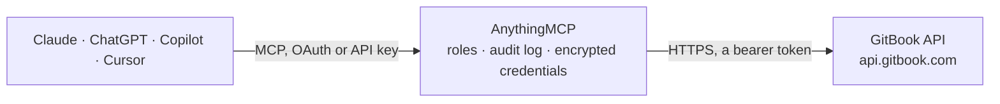

<!-- Generated by scripts/export-github-catalog.mjs in the anythingmcp-website repository. Do not edit by hand. -->

# GitBook MCP connector

Drive GitBook (docs platform) from any AI agent: spaces, pages, content, search, collections. 9 tools, Bearer auth. The AnythingMCP connector gives Claude, ChatGPT, Microsoft Copilot, Cursor and Gemini 9 MCP tools for GitBook: 8 read and 1 can change data.

**Category:** [Knowledge Base](../knowledge.md) · **Tools:** 9 · **Setup guide:** [anythingmcp.com](https://anythingmcp.com/guides/gitbook-to-mcp) · [Deutsch](https://anythingmcp.com/de/guides/gitbook-to-mcp) · [Italiano](https://anythingmcp.com/it/guides/gitbook-to-mcp) · [Español](https://anythingmcp.com/es/guides/gitbook-to-mcp) · [日本語](https://anythingmcp.com/ja/guides/gitbook-to-mcp) · [Русский](https://anythingmcp.com/ru/guides/gitbook-to-mcp) · [中文](https://anythingmcp.com/zh/guides/gitbook-to-mcp)

## Start without code

No installation and no terminal: AnythingMCP Cloud runs the GitBook connector for you, operated by helpcode.ai in Frankfurt, Germany.

1. **Click the button above** and create an account or sign in. The GitBook connector opens, ready to install.
2. **Paste the API key or token from your GitBook account.** Every click is in the [step-by-step guide](https://anythingmcp.com/guides/gitbook-to-mcp).
3. **Click Install.** AnythingMCP shows the address of your MCP server.
4. **Add that address to your assistant:** [Claude](https://anythingmcp.com/guides/connect-gitbook-to-claude) · [ChatGPT](https://anythingmcp.com/guides/connect-gitbook-to-chatgpt) · [Microsoft Copilot](https://anythingmcp.com/guides/connect-gitbook-to-copilot) · [Cursor](https://anythingmcp.com/guides/connect-gitbook-to-cursor) · [Gemini CLI](https://anythingmcp.com/guides/connect-gitbook-to-gemini) · [Meta Muse](https://anythingmcp.com/guides/connect-gitbook-to-muse).
5. **Ask your first question**, for example: *Locate the GitBook page for invoice AP-2026-119 for customer Nordic Solar Oy in our 'Customer Invoices' space*

Prefer help with the setup? [Talk to us](https://anythingmcp.com/contact).

## How it works

- **The AI client** speaks MCP (Streamable HTTP) to AnythingMCP and only sees tool names, descriptions and results. It never gets the GitBook credentials.
- **AnythingMCP** checks the client's role, builds the call from the tool definition, adds the credentials (a bearer token), calls GitBook, logs the call and returns the result.
- **GitBook** sees an ordinary API client with the rights of the account the credentials belong to.

## Tools

| Tool | What it does | Access |
|---|---|---|
| [`gitbook_get_me`](#gitbook_get_me) | Return the user the token belongs to: id, displayName, email, photoURL. | read |
| [`gitbook_list_organizations`](#gitbook_list_organizations) | List organizations the user is a member of. | read |
| [`gitbook_list_spaces`](#gitbook_list_spaces) | List spaces in an organization. | read |
| [`gitbook_get_space`](#gitbook_get_space) | Fetch a single space with full metadata. | read |
| [`gitbook_get_space_content`](#gitbook_get_space_content) | Get the table of contents / page tree for a space (latest revision). | read |
| [`gitbook_get_page`](#gitbook_get_page) | Fetch a page's content (the JSON AST). | read |
| [`gitbook_search_content`](#gitbook_search_content) | Full-text search across spaces. | read |
| [`gitbook_list_collections`](#gitbook_list_collections) | List collections in an organization. | read |
| [`gitbook_import_markdown_to_page`](#gitbook_import_markdown_to_page) | Import Markdown content into a page (replaces the page's content). | write |

## Tool reference

Every parameter as the AI client sees it in `tools/list`. Source: [`packages/backend/src/adapters/intl/gitbook.json`](../../../packages/backend/src/adapters/intl/gitbook.json).

### `gitbook_get_me`

Return the user the token belongs to: id, displayName, email, photoURL.

**Access:** read · **Call:** `GET /user`

No parameters.

### `gitbook_list_organizations`

List organizations the user is a member of.

**Access:** read · **Call:** `GET /orgs`

| Parameter | Type | Required | Description |
|---|---|---|---|
| `limit` | integer | no | Per page. |
| `page` | string | no | Page cursor. |

### `gitbook_list_spaces`

List spaces in an organization. Each space has id, title, visibility (public/private), urls.

**Access:** read · **Call:** `GET /orgs/{organizationId}/spaces`

| Parameter | Type | Required | Description |
|---|---|---|---|
| `organizationId` | string | yes | Organization ID. |
| `limit` | integer | no | Per page. |
| `page` | string | no | Cursor. |

### `gitbook_get_space`

Fetch a single space with full metadata.

**Access:** read · **Call:** `GET /spaces/{spaceId}`

| Parameter | Type | Required | Description |
|---|---|---|---|
| `spaceId` | string | yes | Space ID. |

### `gitbook_get_space_content`

Get the table of contents / page tree for a space (latest revision).

**Access:** read · **Call:** `GET /spaces/{spaceId}/content`

| Parameter | Type | Required | Description |
|---|---|---|---|
| `spaceId` | string | yes | Space ID. |

### `gitbook_get_page`

Fetch a page's content (the JSON AST). Use format=document (default) or format=markdown for source.

**Access:** read · **Call:** `GET /spaces/{spaceId}/content/page/{pageId}`

| Parameter | Type | Required | Description |
|---|---|---|---|
| `spaceId` | string | yes | Space ID. |
| `pageId` | string | yes | Page ID. |
| `format` | string | no | document (default JSON AST) or markdown. |

### `gitbook_search_content`

Full-text search across spaces. Returns pages with snippets.

**Access:** read · **Call:** `GET /search`

| Parameter | Type | Required | Description |
|---|---|---|---|
| `query` | string | yes | Search query. |
| `limit` | integer | no | Per page. |
| `page` | string | no | Cursor. |

### `gitbook_list_collections`

List collections in an organization.

**Access:** read · **Call:** `GET /orgs/{organizationId}/collections`

| Parameter | Type | Required | Description |
|---|---|---|---|
| `organizationId` | string | yes | Organization ID. |

### `gitbook_import_markdown_to_page`

Import Markdown content into a page (replaces the page's content). The agent can write a page in plain Markdown and push it.

**Access:** write · **Call:** `PUT /spaces/{spaceId}/content/page/{pageId}/import`

| Parameter | Type | Required | Description |
|---|---|---|---|
| `spaceId` | string | yes | Space ID. |
| `pageId` | string | yes | Page ID. |
| `content` | string | yes | Markdown source. |

## Run it yourself

AnythingMCP is open source (AGPL-3.0). [Run it with Docker](../../../README.md#run-it-yourself), open **Connectors → Store**, pick **GitBook** and enter `GITBOOK_API_TOKEN`, then add your MCP server URL to the AI client.

[← Knowledge Base connectors](../knowledge.md) · [All categories](../README.md)
