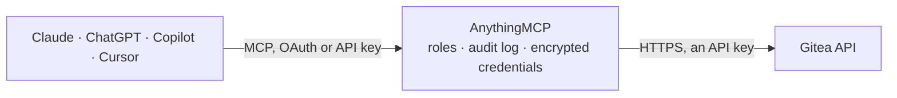

<!-- Generated by scripts/export-github-catalog.mjs in the anythingmcp-website repository. Do not edit by hand. -->

# Gitea MCP connector

Let your AI read your Gitea: find repositories, triage issues and pull requests with their comments, files, diffs and reviews, check releases and organizations, and read branches, commits and files. … The AnythingMCP connector gives Claude, ChatGPT, Microsoft Copilot, Cursor and Gemini 30 MCP tools for Gitea, all read-only.

**Category:** [Infrastructure](../infrastructure.md) · **Tools:** 30 · **Setup guide:** [anythingmcp.com](https://anythingmcp.com/guides/gitea-to-mcp) · [Deutsch](https://anythingmcp.com/de/guides/gitea-to-mcp) · [Italiano](https://anythingmcp.com/it/guides/gitea-to-mcp) · [Español](https://anythingmcp.com/es/guides/gitea-to-mcp) · [日本語](https://anythingmcp.com/ja/guides/gitea-to-mcp) · [Русский](https://anythingmcp.com/ru/guides/gitea-to-mcp) · [中文](https://anythingmcp.com/zh/guides/gitea-to-mcp)

## Start without code

No installation and no terminal: AnythingMCP Cloud runs the Gitea connector for you, operated by helpcode.ai in Frankfurt, Germany.

1. **Click the button above** and create an account or sign in. The Gitea connector opens, ready to install.
2. **Paste the API key or token from your Gitea account.** Every click is in the [step-by-step guide](https://anythingmcp.com/guides/gitea-to-mcp).
3. **Click Install.** AnythingMCP shows the address of your MCP server.
4. **Add that address to your assistant:** [Claude](https://anythingmcp.com/guides/connect-gitea-to-claude) · [ChatGPT](https://anythingmcp.com/guides/connect-gitea-to-chatgpt) · [Microsoft Copilot](https://anythingmcp.com/guides/connect-gitea-to-copilot) · [Cursor](https://anythingmcp.com/guides/connect-gitea-to-cursor) · [Gemini CLI](https://anythingmcp.com/guides/connect-gitea-to-gemini) · [Meta Muse](https://anythingmcp.com/guides/connect-gitea-to-muse).
5. **Ask your first question**, for example: *What's the status, assignees and last comment on issue #48 in repo infra/deploy?*

Prefer help with the setup? [Talk to us](https://anythingmcp.com/contact).

## How it works

- **The AI client** speaks MCP (Streamable HTTP) to AnythingMCP and only sees tool names, descriptions and results. It never gets the Gitea credentials.
- **AnythingMCP** checks the client's role, builds the call from the tool definition, adds the credentials (an API key), calls Gitea, logs the call and returns the result.
- **Gitea** sees an ordinary API client with the rights of the account the credentials belong to.

## Tools

| Tool | What it does | Access |
|---|---|---|
| [`gitea_get_current_user`](#gitea_get_current_user) | Get the Gitea user the token belongs to: id, login, full_name, email, is_admin and html_url. | read |
| [`gitea_search_repositories`](#gitea_search_repositories) | Search the repositories the token can see on the whole instance by keyword, topic, type or archived state: full_name, description, default_branch,… | read |
| [`gitea_list_my_repositories`](#gitea_list_my_repositories) | List the repositories owned by the token's user, with full_name, description, default_branch, private, archived, stars_count, open_issues_count, updated_at… | read |
| [`gitea_list_organization_repositories`](#gitea_list_organization_repositories) | List the repositories of an organization that the token's user can see: full_name, description, default_branch, private, archived, stars_count,… | read |
| [`gitea_list_user_repositories`](#gitea_list_user_repositories) | List the repositories owned by a given user that the token's user can see: full_name, description, default_branch, private, archived, stars_count,… | read |
| [`gitea_get_repository`](#gitea_get_repository) | Get one repository: description, default_branch, private, archived, fork, empty, size, stars_count, forks_count, open_issues_count, open_pr_counter,… | read |
| [`gitea_list_issues`](#gitea_list_issues) | List a repository's issues with filters: number, title, state, labels, assignees, milestone, comments count, created_at, updated_at and html_url. | read |
| [`gitea_search_issues`](#gitea_search_issues) | Search issues and pull requests across every repository the token's user can see, or narrow to the ones assigned to, created by, mentioning or awaiting… | read |
| [`gitea_get_issue`](#gitea_get_issue) | Get one issue by its number: title, body (Markdown), state, labels, assignees, milestone, due_date, comments count, created_at, closed_at and html_url. | read |
| [`gitea_list_issue_comments`](#gitea_list_issue_comments) | List the comments on an issue, oldest first: id, body (Markdown), user, created_at, updated_at and html_url. | read |
| [`gitea_list_labels`](#gitea_list_labels) | List a repository's labels: id, name, color and description. | read |
| [`gitea_list_milestones`](#gitea_list_milestones) | List a repository's milestones: id, title, state, description, due_on, open_issues and closed_issues. | read |
| [`gitea_list_pull_requests`](#gitea_list_pull_requests) | List a repository's pull requests: number, title, state, merged, mergeable, head and base branches, user, labels, created_at, updated_at and html_url. | read |
| [`gitea_get_pull_request`](#gitea_get_pull_request) | Get one pull request by its number: title, body (Markdown), state, merged, mergeable, head and base (branch, sha, repository), additions, deletions,… | read |
| [`gitea_get_pull_request_files`](#gitea_get_pull_request_files) | List the files a pull request changes: filename, previous_filename, status (added, modified, deleted, renamed), additions, deletions and changes. | read |
| [`gitea_get_pull_request_diff`](#gitea_get_pull_request_diff) | Read the unified diff of a pull request as plain text, for reviewing the actual changes. | read |
| [`gitea_list_pull_request_commits`](#gitea_list_pull_request_commits) | List the commits of a pull request: sha, message, author, date and html_url. | read |
| [`gitea_list_pull_request_reviews`](#gitea_list_pull_request_reviews) | List the reviews of a pull request: id, reviewer, state (APPROVED, REQUEST_CHANGES, COMMENT, PENDING), body, comments_count and submitted_at. | read |
| [`gitea_list_releases`](#gitea_list_releases) | List a repository's releases, newest first: tag_name, name, body (release notes in Markdown), draft, prerelease, published_at, the attached files (assets)… | read |
| [`gitea_get_latest_release`](#gitea_get_latest_release) | Get the most recent release that is neither a draft nor a pre-release: tag_name, name, body (release notes), published_at, assets and html_url. | read |
| [`gitea_get_release_by_tag`](#gitea_get_release_by_tag) | Get one release by its tag name: name, body (release notes), draft, prerelease, published_at, assets and html_url. | read |
| [`gitea_list_my_organizations`](#gitea_list_my_organizations) | List the organizations the token's user belongs to: name, full_name, description, visibility and website. | read |
| [`gitea_get_organization`](#gitea_get_organization) | Get one organization: name, full_name, description, website, location, visibility and avatar_url. | read |
| [`gitea_list_organization_members`](#gitea_list_organization_members) | List the members of an organization that the token's user may see: login, full_name and html_url. | read |
| [`gitea_list_organization_teams`](#gitea_list_organization_teams) | List the teams of an organization: id, name, description, permission, and whether the team covers all repositories. | read |
| [`gitea_list_branches`](#gitea_list_branches) | List a repository's branches: name, the latest commit (id, message, timestamp), protected and who may push. | read |
| [`gitea_list_commits`](#gitea_list_commits) | List the commits of a repository, newest first: sha, message, author, date and html_url. | read |
| [`gitea_get_commit`](#gitea_get_commit) | Get one commit by branch, tag or sha: message, author, committer, date, parents, html_url and, with files, the changed files and stats. | read |
| [`gitea_get_tree`](#gitea_get_tree) | List the files and folders of a repository at a branch, tag or commit: path, type (blob for a file, tree for a folder), mode and size. | read |
| [`gitea_get_file_content`](#gitea_get_file_content) | Read a file of a repository as text, at a branch, tag or commit (the default branch when ref is left out). | read |

## Tool reference

Every parameter as the AI client sees it in `tools/list`. Source: [`packages/backend/src/adapters/intl/gitea.json`](../../../packages/backend/src/adapters/intl/gitea.json).

### `gitea_get_current_user`

Get the Gitea user the token belongs to: id, login, full_name, email, is_admin and html_url. A quick check that the token and the instance address work.

**Access:** read · **Call:** `GET /user`

No parameters.

### `gitea_search_repositories`

Search the repositories the token can see on the whole instance by keyword, topic, type or archived state: full_name, description, default_branch, stars_count, forks_count, open_issues_count, private, archived, updated_at and html_url. The list is under `data`. For one owner's repositories use gitea_list_organization_repositories or gitea_list_user_repositories.

**Access:** read · **Call:** `GET /repos/search`

| Parameter | Type | Required | Description |
|---|---|---|---|
| `q` | string | no | Keyword matched against repository names (and descriptions when includeDesc is true). |
| `topic` | boolean | no | Match the keyword against repository topics only. |
| `includeDesc` | boolean | no | Also search the keyword in repository descriptions. |
| `is_private` | boolean | no | true for private repositories only, false for public ones only. Leave out for both. |
| `archived` | boolean | no | true for archived repositories only, false to leave them out. Leave out for both. |
| `mode` | `fork` \| `source` \| `mirror` \| `collaborative` | no | Kind of repository: fork, source, mirror or collaborative. |
| `sort` | `alpha` \| `created` \| `updated` \| `size` \| `git_size` \| `lfs_size` \| `stars` \| `forks` \| `id` | no | alpha, created, updated, size, git_size, lfs_size, stars, forks or id (default alpha). |
| `order` | `asc` \| `desc` | no | asc or desc (default asc). Ignored without sort. |
| `page` | integer | no | Page number, from 1. When _pagination is in the answer there is a next page: call again with page set to _pagination.nextCursor. It is missing on the last page. |
| `limit` | integer | no | Results per page. The server default is usually 30 and its maximum usually 50 (the administrator sets both), so ask for further pages instead of a bigger limit. |

### `gitea_list_my_repositories`

List the repositories owned by the token's user, with full_name, description, default_branch, private, archived, stars_count, open_issues_count, updated_at and html_url. Repositories of an organization are not included: use gitea_list_organization_repositories for those.

**Access:** read · **Call:** `GET /user/repos`

| Parameter | Type | Required | Description |
|---|---|---|---|
| `page` | integer | no | Page number, from 1. When _pagination is in the answer there is a next page: call again with page set to _pagination.nextCursor. It is missing on the last page. |
| `limit` | integer | no | Results per page. The server default is usually 30 and its maximum usually 50 (the administrator sets both), so ask for further pages instead of a bigger limit. |

### `gitea_list_organization_repositories`

List the repositories of an organization that the token's user can see: full_name, description, default_branch, private, archived, stars_count, open_issues_count, updated_at and html_url.

**Access:** read · **Call:** `GET /orgs/{org}/repos`

| Parameter | Type | Required | Description |
|---|---|---|---|
| `org` | string | yes | Organization name, as in https://host/ORG. |
| `page` | integer | no | Page number, from 1. When _pagination is in the answer there is a next page: call again with page set to _pagination.nextCursor. It is missing on the last page. |
| `limit` | integer | no | Results per page. The server default is usually 30 and its maximum usually 50 (the administrator sets both), so ask for further pages instead of a bigger limit. |

### `gitea_list_user_repositories`

List the repositories owned by a given user that the token's user can see: full_name, description, default_branch, private, archived, stars_count, open_issues_count, updated_at and html_url.

**Access:** read · **Call:** `GET /users/{username}/repos`

| Parameter | Type | Required | Description |
|---|---|---|---|
| `username` | string | yes | Username of the user, as in https://host/USERNAME. |
| `page` | integer | no | Page number, from 1. When _pagination is in the answer there is a next page: call again with page set to _pagination.nextCursor. It is missing on the last page. |
| `limit` | integer | no | Results per page. The server default is usually 30 and its maximum usually 50 (the administrator sets both), so ask for further pages instead of a bigger limit. |

### `gitea_get_repository`

Get one repository: description, default_branch, private, archived, fork, empty, size, stars_count, forks_count, open_issues_count, open_pr_counter, release_counter, the token user's permissions, clone_url and html_url. Use it to learn the default branch before reading files or commits.

**Access:** read · **Call:** `GET /repos/{owner}/{repo}`

| Parameter | Type | Required | Description |
|---|---|---|---|
| `owner` | string | yes | Owner of the repository: a user or organization name, the first part of the repository address (https://host/OWNER/repo). |
| `repo` | string | yes | Repository name, the second part of the repository address (https://host/owner/REPO). |

### `gitea_list_issues`

List a repository's issues with filters: number, title, state, labels, assignees, milestone, comments count, created_at, updated_at and html_url. Gitea treats pull requests as issues too, so type defaults to issues here; set it to pulls to list pull requests with the same filters (gitea_list_pull_requests has the pull request specific ones).

**Access:** read · **Call:** `GET /repos/{owner}/{repo}/issues`

| Parameter | Type | Required | Description |
|---|---|---|---|
| `owner` | string | yes | Owner of the repository: a user or organization name, the first part of the repository address (https://host/OWNER/repo). |
| `repo` | string | yes | Repository name, the second part of the repository address (https://host/owner/REPO). |
| `state` | `open` \| `closed` \| `all` | no | open, closed or all (default open). |
| `type` | `issues` \| `pulls` | no | issues (default here) or pulls. |
| `labels` | string | no | Comma-separated label names. Issues with any of them match. |
| `milestones` | string | no | Comma-separated milestone names or ids. Issues in any of them match. |
| `q` | string | no | Text searched in titles and descriptions. |
| `created_by` | string | no | Only items created by this username. |
| `assigned_by` | string | no | Only items assigned to this username. |
| `mentioned_by` | string | no | Only items that mention this username. |
| `since` | string | no | Only items updated after this time, RFC 3339 (e.g. 2026-10-01T00:00:00Z). |
| `before` | string | no | Only items updated before this time, RFC 3339. |
| `page` | integer | no | Page number, from 1. When _pagination is in the answer there is a next page: call again with page set to _pagination.nextCursor. It is missing on the last page. |
| `limit` | integer | no | Results per page. The server default is usually 30 and its maximum usually 50 (the administrator sets both), so ask for further pages instead of a bigger limit. |

### `gitea_search_issues`

Search issues and pull requests across every repository the token's user can see, or narrow to the ones assigned to, created by, mentioning or awaiting review from the token's user (assigned, created, mentioned, review_requested, reviewed). Each result names its repository. Use it for questions like what is assigned to me or which pull requests wait for my review.

**Access:** read · **Call:** `GET /repos/issues/search`

| Parameter | Type | Required | Description |
|---|---|---|---|
| `q` | string | no | Text searched in titles and descriptions. |
| `state` | `open` \| `closed` \| `all` | no | open (default), closed or all. |
| `type` | `issues` \| `pulls` | no | issues or pulls. Leave out for both. |
| `assigned` | boolean | no | Only items assigned to the token's user. |
| `created` | boolean | no | Only items created by the token's user. |
| `mentioned` | boolean | no | Only items that mention the token's user. |
| `review_requested` | boolean | no | Only pull requests where the token user's review was requested. |
| `reviewed` | boolean | no | Only pull requests the token's user has reviewed. |
| `labels` | string | no | Comma-separated label names. Items with any of them match. |
| `milestones` | string | no | Comma-separated milestone names. Items in any of them match. |
| `owner` | string | no | Only repositories of this owner (user or organization). |
| `created_by` | string | no | Only items created by this username. |
| `since` | string | no | Only items updated after this time, RFC 3339 (e.g. 2026-10-01T00:00:00Z). |
| `before` | string | no | Only items updated before this time, RFC 3339. |
| `page` | integer | no | Page number, from 1. When _pagination is in the answer there is a next page: call again with page set to _pagination.nextCursor. It is missing on the last page. |
| `limit` | integer | no | Results per page. The server default is usually 30 and its maximum usually 50 (the administrator sets both), so ask for further pages instead of a bigger limit. |

### `gitea_get_issue`

Get one issue by its number: title, body (Markdown), state, labels, assignees, milestone, due_date, comments count, created_at, closed_at and html_url. For a pull request number it also carries the pull_request block; use gitea_get_pull_request for branches, merge state and changed lines.

**Access:** read · **Call:** `GET /repos/{owner}/{repo}/issues/{index}`

| Parameter | Type | Required | Description |
|---|---|---|---|
| `owner` | string | yes | Owner of the repository: a user or organization name, the first part of the repository address (https://host/OWNER/repo). |
| `repo` | string | yes | Repository name, the second part of the repository address (https://host/owner/REPO). |
| `index` | integer | yes | The issue's number inside the repository (the 42 in #42), not a global id. |

### `gitea_list_issue_comments`

List the comments on an issue, oldest first: id, body (Markdown), user, created_at, updated_at and html_url. It also reads the conversation comments of a pull request given its number; inline review comments are under gitea_list_pull_request_reviews. All comments come back in one answer.

**Access:** read · **Call:** `GET /repos/{owner}/{repo}/issues/{index}/comments`

| Parameter | Type | Required | Description |
|---|---|---|---|
| `owner` | string | yes | Owner of the repository: a user or organization name, the first part of the repository address (https://host/OWNER/repo). |
| `repo` | string | yes | Repository name, the second part of the repository address (https://host/owner/REPO). |
| `index` | integer | yes | The issue's number inside the repository (the 42 in #42), not a global id. |
| `since` | string | no | Only comments updated after this time, RFC 3339. |
| `before` | string | no | Only comments updated before this time, RFC 3339. |

### `gitea_list_labels`

List a repository's labels: id, name, color and description. Use it to find the exact label names for the labels filter of gitea_list_issues.

**Access:** read · **Call:** `GET /repos/{owner}/{repo}/labels`

| Parameter | Type | Required | Description |
|---|---|---|---|
| `owner` | string | yes | Owner of the repository: a user or organization name, the first part of the repository address (https://host/OWNER/repo). |
| `repo` | string | yes | Repository name, the second part of the repository address (https://host/owner/REPO). |
| `page` | integer | no | Page number, from 1. When _pagination is in the answer there is a next page: call again with page set to _pagination.nextCursor. It is missing on the last page. |
| `limit` | integer | no | Results per page. The server default is usually 30 and its maximum usually 50 (the administrator sets both), so ask for further pages instead of a bigger limit. |

### `gitea_list_milestones`

List a repository's milestones: id, title, state, description, due_on, open_issues and closed_issues. Only open milestones come back unless state says otherwise.

**Access:** read · **Call:** `GET /repos/{owner}/{repo}/milestones`

| Parameter | Type | Required | Description |
|---|---|---|---|
| `owner` | string | yes | Owner of the repository: a user or organization name, the first part of the repository address (https://host/OWNER/repo). |
| `repo` | string | yes | Repository name, the second part of the repository address (https://host/owner/REPO). |
| `state` | `open` \| `closed` \| `all` | no | open (default), closed or all. |
| `name` | string | no | Only the milestone with this name. |
| `page` | integer | no | Page number, from 1. When _pagination is in the answer there is a next page: call again with page set to _pagination.nextCursor. It is missing on the last page. |
| `limit` | integer | no | Results per page. The server default is usually 30 and its maximum usually 50 (the administrator sets both), so ask for further pages instead of a bigger limit. |

### `gitea_list_pull_requests`

List a repository's pull requests: number, title, state, merged, mergeable, head and base branches, user, labels, created_at, updated_at and html_url. Open ones by default.

**Access:** read · **Call:** `GET /repos/{owner}/{repo}/pulls`

| Parameter | Type | Required | Description |
|---|---|---|---|
| `owner` | string | yes | Owner of the repository: a user or organization name, the first part of the repository address (https://host/OWNER/repo). |
| `repo` | string | yes | Repository name, the second part of the repository address (https://host/owner/REPO). |
| `state` | `open` \| `closed` \| `all` | no | open (default), closed or all. |
| `base_branch` | string | no | Only pull requests that target this branch. |
| `poster` | string | no | Only pull requests opened by this username. |
| `milestone` | integer | no | Only pull requests in the milestone with this id (from gitea_list_milestones). |
| `sort` | `oldest` \| `recentupdate` \| `recentclose` \| `leastupdate` \| `mostcomment` \| `leastcomment` \| `priority` | no | oldest, recentupdate, recentclose, leastupdate, mostcomment, leastcomment or priority. |
| `page` | integer | no | Page number, from 1. When _pagination is in the answer there is a next page: call again with page set to _pagination.nextCursor. It is missing on the last page. |
| `limit` | integer | no | Results per page. The server default is usually 30 and its maximum usually 50 (the administrator sets both), so ask for further pages instead of a bigger limit. |

### `gitea_get_pull_request`

Get one pull request by its number: title, body (Markdown), state, merged, mergeable, head and base (branch, sha, repository), additions, deletions, changed_files, requested_reviewers, labels, assignees and html_url. Check mergeable before saying a pull request can be merged.

**Access:** read · **Call:** `GET /repos/{owner}/{repo}/pulls/{index}`

| Parameter | Type | Required | Description |
|---|---|---|---|
| `owner` | string | yes | Owner of the repository: a user or organization name, the first part of the repository address (https://host/OWNER/repo). |
| `repo` | string | yes | Repository name, the second part of the repository address (https://host/owner/REPO). |
| `index` | integer | yes | The pull request's number inside the repository (the 17 in #17). Pull requests and issues share one number sequence per repository. |

### `gitea_get_pull_request_files`

List the files a pull request changes: filename, previous_filename, status (added, modified, deleted, renamed), additions, deletions and changes. No diff text: read that with gitea_get_pull_request_diff.

**Access:** read · **Call:** `GET /repos/{owner}/{repo}/pulls/{index}/files`

| Parameter | Type | Required | Description |
|---|---|---|---|
| `owner` | string | yes | Owner of the repository: a user or organization name, the first part of the repository address (https://host/OWNER/repo). |
| `repo` | string | yes | Repository name, the second part of the repository address (https://host/owner/REPO). |
| `index` | integer | yes | The pull request's number inside the repository (the 17 in #17). Pull requests and issues share one number sequence per repository. |
| `whitespace` | `ignore-all` \| `ignore-change` \| `ignore-eol` \| `show-all` | no | How whitespace counts: ignore-all, ignore-change, ignore-eol or show-all. |
| `page` | integer | no | Page number, from 1. When _pagination is in the answer there is a next page: call again with page set to _pagination.nextCursor. It is missing on the last page. |
| `limit` | integer | no | Results per page. The server default is usually 30 and its maximum usually 50 (the administrator sets both), so ask for further pages instead of a bigger limit. |

### `gitea_get_pull_request_diff`

Read the unified diff of a pull request as plain text, for reviewing the actual changes. Diffs over 200 KB are cut; for a large pull request list the files with gitea_get_pull_request_files first and open the pull request's html_url for the rest.

**Access:** read · **Call:** `GET /repos/{owner}/{repo}/pulls/{index}.diff`

| Parameter | Type | Required | Description |
|---|---|---|---|
| `owner` | string | yes | Owner of the repository: a user or organization name, the first part of the repository address (https://host/OWNER/repo). |
| `repo` | string | yes | Repository name, the second part of the repository address (https://host/owner/REPO). |
| `index` | integer | yes | The pull request's number inside the repository (the 17 in #17). Pull requests and issues share one number sequence per repository. |

### `gitea_list_pull_request_commits`

List the commits of a pull request: sha, message, author, date and html_url. The affected files and signature checks of each commit are left out by default to keep the answer small.

**Access:** read · **Call:** `GET /repos/{owner}/{repo}/pulls/{index}/commits`

| Parameter | Type | Required | Description |
|---|---|---|---|
| `owner` | string | yes | Owner of the repository: a user or organization name, the first part of the repository address (https://host/OWNER/repo). |
| `repo` | string | yes | Repository name, the second part of the repository address (https://host/owner/REPO). |
| `index` | integer | yes | The pull request's number inside the repository (the 17 in #17). Pull requests and issues share one number sequence per repository. |
| `files` | boolean | no | Include the list of affected files for every commit (default false). |
| `verification` | boolean | no | Include the signature verification for every commit (default false). |
| `page` | integer | no | Page number, from 1. When _pagination is in the answer there is a next page: call again with page set to _pagination.nextCursor. It is missing on the last page. |
| `limit` | integer | no | Results per page. The server default is usually 30 and its maximum usually 50 (the administrator sets both), so ask for further pages instead of a bigger limit. |

### `gitea_list_pull_request_reviews`

List the reviews of a pull request: id, reviewer, state (APPROVED, REQUEST_CHANGES, COMMENT, PENDING), body, comments_count and submitted_at. Use it to see who approved or asked for changes.

**Access:** read · **Call:** `GET /repos/{owner}/{repo}/pulls/{index}/reviews`

| Parameter | Type | Required | Description |
|---|---|---|---|
| `owner` | string | yes | Owner of the repository: a user or organization name, the first part of the repository address (https://host/OWNER/repo). |
| `repo` | string | yes | Repository name, the second part of the repository address (https://host/owner/REPO). |
| `index` | integer | yes | The pull request's number inside the repository (the 17 in #17). Pull requests and issues share one number sequence per repository. |
| `page` | integer | no | Page number, from 1. When _pagination is in the answer there is a next page: call again with page set to _pagination.nextCursor. It is missing on the last page. |
| `limit` | integer | no | Results per page. The server default is usually 30 and its maximum usually 50 (the administrator sets both), so ask for further pages instead of a bigger limit. |

### `gitea_list_releases`

List a repository's releases, newest first: tag_name, name, body (release notes in Markdown), draft, prerelease, published_at, the attached files (assets) and html_url. Drafts only show for users with write access to the repository.

**Access:** read · **Call:** `GET /repos/{owner}/{repo}/releases`

| Parameter | Type | Required | Description |
|---|---|---|---|
| `owner` | string | yes | Owner of the repository: a user or organization name, the first part of the repository address (https://host/OWNER/repo). |
| `repo` | string | yes | Repository name, the second part of the repository address (https://host/owner/REPO). |
| `draft` | boolean | no | true for drafts only, false to leave them out. Leave out for both. |
| `prerelease` | boolean | no | true for pre-releases only, false to leave them out. Leave out for both. |
| `tag_filter` | string | no | Only releases whose tag matches, with * as a wildcard (v1*, *beta, *rc*). Servers that do not support it ignore it. |
| `page` | integer | no | Page number, from 1. When _pagination is in the answer there is a next page: call again with page set to _pagination.nextCursor. It is missing on the last page. |
| `limit` | integer | no | Results per page. The server default is usually 30 and its maximum usually 50 (the administrator sets both), so ask for further pages instead of a bigger limit. |

### `gitea_get_latest_release`

Get the most recent release that is neither a draft nor a pre-release: tag_name, name, body (release notes), published_at, assets and html_url. Answers what the current version of a project is.

**Access:** read · **Call:** `GET /repos/{owner}/{repo}/releases/latest`

| Parameter | Type | Required | Description |
|---|---|---|---|
| `owner` | string | yes | Owner of the repository: a user or organization name, the first part of the repository address (https://host/OWNER/repo). |
| `repo` | string | yes | Repository name, the second part of the repository address (https://host/owner/REPO). |

### `gitea_get_release_by_tag`

Get one release by its tag name: name, body (release notes), draft, prerelease, published_at, assets and html_url.

**Access:** read · **Call:** `GET /repos/{owner}/{repo}/releases/tags/{tag}`

| Parameter | Type | Required | Description |
|---|---|---|---|
| `owner` | string | yes | Owner of the repository: a user or organization name, the first part of the repository address (https://host/OWNER/repo). |
| `repo` | string | yes | Repository name, the second part of the repository address (https://host/owner/REPO). |
| `tag` | string | yes | Tag name of the release, as listed by gitea_list_releases. |

### `gitea_list_my_organizations`

List the organizations the token's user belongs to: name, full_name, description, visibility and website.

**Access:** read · **Call:** `GET /user/orgs`

| Parameter | Type | Required | Description |
|---|---|---|---|
| `page` | integer | no | Page number, from 1. When _pagination is in the answer there is a next page: call again with page set to _pagination.nextCursor. It is missing on the last page. |
| `limit` | integer | no | Results per page. The server default is usually 30 and its maximum usually 50 (the administrator sets both), so ask for further pages instead of a bigger limit. |

### `gitea_get_organization`

Get one organization: name, full_name, description, website, location, visibility and avatar_url.

**Access:** read · **Call:** `GET /orgs/{org}`

| Parameter | Type | Required | Description |
|---|---|---|---|
| `org` | string | yes | Organization name, as in https://host/ORG. |

### `gitea_list_organization_members`

List the members of an organization that the token's user may see: login, full_name and html_url.

**Access:** read · **Call:** `GET /orgs/{org}/members`

| Parameter | Type | Required | Description |
|---|---|---|---|
| `org` | string | yes | Organization name, as in https://host/ORG. |
| `page` | integer | no | Page number, from 1. When _pagination is in the answer there is a next page: call again with page set to _pagination.nextCursor. It is missing on the last page. |
| `limit` | integer | no | Results per page. The server default is usually 30 and its maximum usually 50 (the administrator sets both), so ask for further pages instead of a bigger limit. |

### `gitea_list_organization_teams`

List the teams of an organization: id, name, description, permission, and whether the team covers all repositories.

**Access:** read · **Call:** `GET /orgs/{org}/teams`

| Parameter | Type | Required | Description |
|---|---|---|---|
| `org` | string | yes | Organization name, as in https://host/ORG. |
| `page` | integer | no | Page number, from 1. When _pagination is in the answer there is a next page: call again with page set to _pagination.nextCursor. It is missing on the last page. |
| `limit` | integer | no | Results per page. The server default is usually 30 and its maximum usually 50 (the administrator sets both), so ask for further pages instead of a bigger limit. |

### `gitea_list_branches`

List a repository's branches: name, the latest commit (id, message, timestamp), protected and who may push. Filter by a part of the name with q.

**Access:** read · **Call:** `GET /repos/{owner}/{repo}/branches`

| Parameter | Type | Required | Description |
|---|---|---|---|
| `owner` | string | yes | Owner of the repository: a user or organization name, the first part of the repository address (https://host/OWNER/repo). |
| `repo` | string | yes | Repository name, the second part of the repository address (https://host/owner/REPO). |
| `q` | string | no | Part of the branch name to filter by. |
| `page` | integer | no | Page number, from 1. When _pagination is in the answer there is a next page: call again with page set to _pagination.nextCursor. It is missing on the last page. |
| `limit` | integer | no | Results per page. The server default is usually 30 and its maximum usually 50 (the administrator sets both), so ask for further pages instead of a bigger limit. |

### `gitea_list_commits`

List the commits of a repository, newest first: sha, message, author, date and html_url. Start from a branch, tag or sha with sha, or only the commits that touched a file or folder with path. Per-commit stats, affected files and signature checks are left out by default to keep the answer small.

**Access:** read · **Call:** `GET /repos/{owner}/{repo}/commits`

| Parameter | Type | Required | Description |
|---|---|---|---|
| `owner` | string | yes | Owner of the repository: a user or organization name, the first part of the repository address (https://host/OWNER/repo). |
| `repo` | string | yes | Repository name, the second part of the repository address (https://host/owner/REPO). |
| `sha` | string | no | Branch, tag or commit SHA to start from. Leave out for the default branch. |
| `path` | string | no | Only commits that changed this file or folder. |
| `since` | string | no | Only commits after this time, ISO 8601. |
| `until` | string | no | Only commits before this time, ISO 8601. |
| `stat` | boolean | no | Include diff stats for every commit (default false). |
| `files` | boolean | no | Include the list of affected files for every commit (default false). |
| `verification` | boolean | no | Include the signature verification for every commit (default false). |
| `page` | integer | no | Page number, from 1. When _pagination is in the answer there is a next page: call again with page set to _pagination.nextCursor. It is missing on the last page. |
| `limit` | integer | no | Results per page. The server default is usually 30 and its maximum usually 50 (the administrator sets both), so ask for further pages instead of a bigger limit. |

### `gitea_get_commit`

Get one commit by branch, tag or sha: message, author, committer, date, parents, html_url and, with files, the changed files and stats.

**Access:** read · **Call:** `GET /repos/{owner}/{repo}/git/commits/{sha}`

| Parameter | Type | Required | Description |
|---|---|---|---|
| `owner` | string | yes | Owner of the repository: a user or organization name, the first part of the repository address (https://host/OWNER/repo). |
| `repo` | string | yes | Repository name, the second part of the repository address (https://host/owner/REPO). |
| `sha` | string | yes | Commit SHA, branch or tag name. |
| `files` | boolean | no | Include the changed files with their stats (default true on the server; set false for a small answer). |
| `stat` | boolean | no | Include the total diff stats. |
| `verification` | boolean | no | Include the signature verification. |

### `gitea_get_tree`

List the files and folders of a repository at a branch, tag or commit: path, type (blob for a file, tree for a folder), mode and size. The branch name of the default branch gives the top level of the repository. Set recursive for every path at once; when `truncated` is true in the answer, fetch the next page.

**Access:** read · **Call:** `GET /repos/{owner}/{repo}/git/trees/{sha}`

| Parameter | Type | Required | Description |
|---|---|---|---|
| `owner` | string | yes | Owner of the repository: a user or organization name, the first part of the repository address (https://host/OWNER/repo). |
| `repo` | string | yes | Repository name, the second part of the repository address (https://host/owner/REPO). |
| `sha` | string | yes | Branch name, tag name or commit SHA, e.g. the default_branch from gitea_get_repository. |
| `recursive` | boolean | no | List every file below the top level, not only the top level itself. |
| `page` | integer | no | Page of the tree, from 1. |
| `per_page` | integer | no | Entries per page. |

### `gitea_get_file_content`

Read a file of a repository as text, at a branch, tag or commit (the default branch when ref is left out). Files over 200 KB are cut. Binary files come back garbled: check size and type with gitea_get_tree first. Find paths with gitea_get_tree.

**Access:** read · **Call:** `GET /repos/{owner}/{repo}/raw/{filepath}`

| Parameter | Type | Required | Description |
|---|---|---|---|
| `owner` | string | yes | Owner of the repository: a user or organization name, the first part of the repository address (https://host/OWNER/repo). |
| `repo` | string | yes | Repository name, the second part of the repository address (https://host/owner/REPO). |
| `filepath` | string | yes | Path of the file inside the repository, slashes included, e.g. src/main.go. A name with # or ? in it is not supported. |
| `ref` | string | no | Branch, tag or commit SHA. Leave out for the default branch; give it explicitly when a top-level folder has the same name as a branch. |

## Run it yourself

AnythingMCP is open source (AGPL-3.0). [Run it with Docker](../../../README.md#run-it-yourself), open **Connectors → Store**, pick **Gitea** and enter `GITEA_URL`, `GITEA_TOKEN`, then add your MCP server URL to the AI client.

[← Infrastructure connectors](../infrastructure.md) · [All categories](../README.md)
