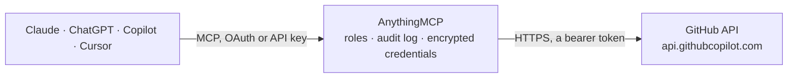

<!-- Generated by scripts/export-github-catalog.mjs in the anythingmcp-website repository. Do not edit by hand. -->

# GitHub MCP connector

Work with GitHub from Claude, ChatGPT or Copilot through GitHub's official MCP server: read code and commits, search repositories, triage issues, and open and review pull requests. The AnythingMCP connector gives Claude, ChatGPT, Microsoft Copilot, Cursor and Gemini 46 MCP tools for GitHub: 28 read and 18 can change data.

**Category:** [Infrastructure](../infrastructure.md) · **Tools:** 46 · **Setup guide:** [anythingmcp.com](https://anythingmcp.com/guides/github-to-mcp) · [Deutsch](https://anythingmcp.com/de/guides/github-to-mcp) · [Italiano](https://anythingmcp.com/it/guides/github-to-mcp) · [Español](https://anythingmcp.com/es/guides/github-to-mcp) · [日本語](https://anythingmcp.com/ja/guides/github-to-mcp) · [Русский](https://anythingmcp.com/ru/guides/github-to-mcp) · [中文](https://anythingmcp.com/zh/guides/github-to-mcp)

## Start without code

No installation and no terminal: AnythingMCP Cloud runs the GitHub connector for you, operated by helpcode.ai in Frankfurt, Germany.

1. **Click the button above** and create an account or sign in. The GitHub connector opens, ready to install.
2. **Paste the API key or token from your GitHub account.** Every click is in the [step-by-step guide](https://anythingmcp.com/guides/github-to-mcp).
3. **Click Install.** AnythingMCP shows the address of your MCP server.
4. **Add that address to your assistant:** [Claude](https://anythingmcp.com/guides/connect-github-to-claude) · [ChatGPT](https://anythingmcp.com/guides/connect-github-to-chatgpt) · [Microsoft Copilot](https://anythingmcp.com/guides/connect-github-to-copilot) · [Cursor](https://anythingmcp.com/guides/connect-github-to-cursor) · [Gemini CLI](https://anythingmcp.com/guides/connect-github-to-gemini) · [Meta Muse](https://anythingmcp.com/guides/connect-github-to-muse).
5. **Ask your first question**, for example: *What's the current status and assignee of issue #214 in AuroraTechLtd/payments-platform about invoice PDF generation since 2026-09-20?*

Prefer help with the setup? [Talk to us](https://anythingmcp.com/contact).

## How it works

- **The AI client** speaks MCP (Streamable HTTP) to AnythingMCP and only sees tool names, descriptions and results. It never gets the GitHub credentials.
- **AnythingMCP** checks the client's role, builds the call from the tool definition, adds the credentials (a bearer token), calls GitHub, logs the call and returns the result.
- **GitHub** sees an ordinary API client with the rights of the account the credentials belong to.

## Tools

| Tool | What it does | Access |
|---|---|---|
| [`github_add_comment_to_pending_review`](#github_add_comment_to_pending_review) | Add review comment to the requester's latest pending pull request review. | write |
| [`github_add_issue_comment`](#github_add_issue_comment) | Add a comment and/or reaction to a specific issue or issue comment in a GitHub repository. | write |
| [`github_add_reply_to_pull_request_comment`](#github_add_reply_to_pull_request_comment) | Add a reply and/or reaction to an existing pull request comment. | write |
| [`github_create_branch`](#github_create_branch) | Create a new branch in a GitHub repository, starting from from_branch or, when it is omitted, from the repository's default branch. | write |
| [`github_create_or_update_file`](#github_create_or_update_file) | Create or update a single file in a GitHub repository. | write |
| [`github_create_pull_request`](#github_create_pull_request) | Create a new pull request in a GitHub repository from the head branch into the base branch, optionally as a draft and with reviewers requested. | write |
| [`github_create_repository`](#github_create_repository) | Create a new GitHub repository in your account or specified organization | write |
| [`github_delete_file`](#github_delete_file) | Delete a file from a GitHub repository by committing its removal to the given branch with a commit message. | write |
| [`github_fork_repository`](#github_fork_repository) | Fork a GitHub repository to your account or specified organization | write |
| [`github_get_commit`](#github_get_commit) | Get details for a commit from a GitHub repository: message, author and, depending on detail, the stats or the full patch of the changed files. | read |
| [`github_get_file_contents`](#github_get_file_contents) | Get the contents of a file or directory from a GitHub repository | read |
| [`github_get_label`](#github_get_label) | Get a specific label from a repository by its name, with its color and description. | read |
| [`github_get_latest_release`](#github_get_latest_release) | Get the latest release in a GitHub repository, with its tag, name, release notes and assets. | read |
| [`github_get_me`](#github_get_me) | Get details of the authenticated GitHub user. | read |
| [`github_get_release_by_tag`](#github_get_release_by_tag) | Get a specific release by its tag name in a GitHub repository | read |
| [`github_get_tag`](#github_get_tag) | Get details about a specific git tag in a GitHub repository, including the object the tag points to. | read |
| [`github_get_team_members`](#github_get_team_members) | Get member usernames of a specific team in an organization. | read |
| [`github_get_teams`](#github_get_teams) | Get details of the teams the user is a member of. | read |
| [`github_issue_read`](#github_issue_read) | Get information about a specific issue in a GitHub repository. | read |
| [`github_issue_write`](#github_issue_write) | Create a new or update an existing issue in a GitHub repository. | write |
| [`github_list_branches`](#github_list_branches) | List branches in a GitHub repository with the commit each one points to; paginated with page and perPage. | read |
| [`github_list_commits`](#github_list_commits) | Get list of commits of a branch in a GitHub repository. | read |
| [`github_list_issue_fields`](#github_list_issue_fields) | List issue fields for a repository or organization. | read |
| [`github_list_issue_types`](#github_list_issue_types) | List supported issue types for a repository or its owner organization. | read |
| [`github_list_issues`](#github_list_issues) | List issues in a GitHub repository. | read |
| [`github_list_pull_requests`](#github_list_pull_requests) | List pull requests in a GitHub repository. | read |
| [`github_list_releases`](#github_list_releases) | List releases in a GitHub repository with their tags, names and release notes; paginated with page and perPage. | read |
| [`github_list_repository_collaborators`](#github_list_repository_collaborators) | List collaborators of a GitHub repository. | read |
| [`github_list_tags`](#github_list_tags) | List git tags in a GitHub repository with the commit each tag points to; paginated with page and perPage. | read |
| [`github_merge_pull_request`](#github_merge_pull_request) | Merge a pull request in a GitHub repository with the merge, squash or rebase method, optionally only while its head is still expectedHeadSha. | write |
| [`github_pull_request_read`](#github_pull_request_read) | Get information on a specific pull request in GitHub repository. | read |
| [`github_pull_request_review_write`](#github_pull_request_review_write) | Create and/or submit, delete review of a pull request. | write |
| [`github_push_files`](#github_push_files) | Push multiple files to a GitHub repository in a single commit | write |
| [`github_request_copilot_review`](#github_request_copilot_review) | Request a GitHub Copilot code review for a pull request. | write |
| [`github_run_secret_scanning`](#github_run_secret_scanning) | Scan files, content, or recent changes for secrets such as API keys, passwords, tokens, and credentials. | read |
| [`github_search_code`](#github_search_code) | Fast and precise code search across ALL GitHub repositories using GitHub's native search engine. | read |
| [`github_search_commits`](#github_search_commits) | Search for commits across GitHub repositories using GitHub's commit search syntax. | read |
| [`github_search_issues`](#github_search_issues) | Search issues using natural-language semantic matching. | read |
| [`github_search_pull_requests`](#github_search_pull_requests) | Search for pull requests in GitHub repositories using issues search syntax already scoped to is:pr | read |
| [`github_search_repositories`](#github_search_repositories) | Find GitHub repositories by name, description, readme, topics, or other metadata. | read |
| [`github_search_users`](#github_search_users) | Find GitHub users by username, real name, or other profile information. | read |
| [`github_sub_issue_write`](#github_sub_issue_write) | Add a sub-issue to a parent issue in a GitHub repository, remove it, or change its position among the parent's sub-issues. | write |
| [`github_ui_get`](#github_ui_get) | Fetch UI data for MCP Apps (labels, assignees, milestones, issue types, branches, issue fields, reviewers). | read |
| [`github_update_issue_comment`](#github_update_issue_comment) | Update the body of an existing issue or pull request conversation comment. | write |
| [`github_update_pull_request`](#github_update_pull_request) | Update an existing pull request in a GitHub repository: title, body, state, base branch, draft status or requested reviewers. | write |
| [`github_update_pull_request_branch`](#github_update_pull_request_branch) | Update the branch of a pull request with the latest changes from the base branch. | write |

## Tool reference

Every parameter as the AI client sees it in `tools/list`. Source: [`packages/backend/src/adapters/intl/github.json`](../../../packages/backend/src/adapters/intl/github.json).

### `github_add_comment_to_pending_review`

Add review comment to the requester's latest pending pull request review. A pending review needs to already exist to call this (check with the user if not sure).

**Access:** write · **Call:** `add_comment_to_pending_review /mcp`

| Parameter | Type | Required | Description |
|---|---|---|---|
| `body` | string | yes | The text of the review comment |
| `line` | number | no | The line of the blob in the pull request diff that the comment applies to. For multi-line comments, the last line of the range |
| `owner` | string | yes | Repository owner |
| `path` | string | yes | The relative path to the file that necessitates a comment |
| `pullNumber` | number | yes | Pull request number |
| `repo` | string | yes | Repository name |
| `side` | `LEFT` \| `RIGHT` | no | The side of the diff to comment on. LEFT indicates the previous state, RIGHT indicates the new state |
| `startLine` | number | no | For multi-line comments, the first line of the range that the comment applies to |
| `startSide` | `LEFT` \| `RIGHT` | no | For multi-line comments, the starting side of the diff that the comment applies to. LEFT indicates the previous state, RIGHT indicates the new state |
| `subjectType` | `FILE` \| `LINE` | yes | The level at which the comment is targeted |

### `github_add_issue_comment`

Add a comment and/or reaction to a specific issue or issue comment in a GitHub repository. Use this tool with pull requests as well (in this case pass pull request number as issue_number), but only if user is not asking specifically to add or react to review comments. At least one of body or reaction is required.

**Access:** write · **Call:** `add_issue_comment /mcp`

| Parameter | Type | Required | Description |
|---|---|---|---|
| `body` | string | no | Comment content. Required unless reaction is provided. |
| `comment_id` | integer | no | The numeric ID of the issue or pull request comment to react to. Use this for reactions to comments; omit it to react to the issue or pull request itself. Cannot be combined with body. |
| `issue_number` | number | yes | Issue or pull request number to comment on or react to. |
| `owner` | string | yes | Repository owner |
| `reaction` | `+1` \| `-1` \| `laugh` \| `confused` \| `heart` \| `hooray` \| `rocket` \| `eyes` | no | Emoji reaction to add. Required unless body is provided. |
| `repo` | string | yes | Repository name |

### `github_add_reply_to_pull_request_comment`

Add a reply and/or reaction to an existing pull request comment. This can create a new comment linked as a reply to the specified comment, add an emoji reaction to the specified comment, or do both. At least one of body or reaction is required.

**Access:** write · **Call:** `add_reply_to_pull_request_comment /mcp`

| Parameter | Type | Required | Description |
|---|---|---|---|
| `body` | string | no | The text of the reply. Required unless reaction is provided. |
| `commentId` | number | yes | The numeric ID of the pull request review comment to reply or react to. Use the number from a #discussion_r... anchor, not the GraphQL thread node ID (PRRT_...). |
| `owner` | string | yes | Repository owner |
| `pullNumber` | number | no | Pull request number. Required when body is provided. |
| `reaction` | `+1` \| `-1` \| `laugh` \| `confused` \| `heart` \| `hooray` \| `rocket` \| `eyes` | no | Emoji reaction to add. Required unless body is provided. |
| `repo` | string | yes | Repository name |

### `github_create_branch`

Create a new branch in a GitHub repository, starting from from_branch or, when it is omitted, from the repository's default branch.

**Access:** write · **Call:** `create_branch /mcp`

| Parameter | Type | Required | Description |
|---|---|---|---|
| `branch` | string | yes | Name for new branch |
| `from_branch` | string | no | Source branch (defaults to repo default) |
| `owner` | string | yes | Repository owner |
| `repo` | string | yes | Repository name |

### `github_create_or_update_file`

Create or update a single file in a GitHub repository. If updating, you should provide the SHA of the file you want to update. Use this tool to create or update a file in a GitHub repository remotely; do not use it for local file operations. To obtain the current blob SHA before updating, call the get_file_contents tool with the same owner, repo, and path, and set its ref parameter to this tool's branch value. The first text result reports the blob SHA for the requested path. SHA MUST be provided for existing file updates.

**Access:** write · **Call:** `create_or_update_file /mcp`

| Parameter | Type | Required | Description |
|---|---|---|---|
| `allow_symlink_write` | boolean | no | Set true to update a symbolic link itself; content must be its new target path. |
| `branch` | string | yes | Branch to create/update the file in |
| `content` | string | yes | Content of the file, exactly as it should appear once written. Do not base64-encode it; this server does that before calling the REST API. |
| `message` | string | yes | Commit message |
| `owner` | string | yes | Repository owner (username or organization) |
| `path` | string | yes | Path where to create/update the file |
| `repo` | string | yes | Repository name |
| `sha` | string | no | The blob SHA of the file being replaced. Required if the file already exists. Retrieve it with get_file_contents using the same owner, repo, and path, with ref set to this tool's branch value. |

### `github_create_pull_request`

Create a new pull request in a GitHub repository from the head branch into the base branch, optionally as a draft and with reviewers requested.

**Access:** write · **Call:** `create_pull_request /mcp`

| Parameter | Type | Required | Description |
|---|---|---|---|
| `base` | string | yes | Branch to merge into |
| `body` | string | no | PR description |
| `draft` | boolean | no | Create as draft PR |
| `head` | string | yes | Branch containing changes |
| `maintainer_can_modify` | boolean | no | Allow maintainer edits |
| `owner` | string | yes | Repository owner |
| `repo` | string | yes | Repository name |
| `reviewers` | string[] | no | GitHub usernames or ORG/team-slug team reviewers to request reviews from |
| `title` | string | yes | PR title |

### `github_create_repository`

Create a new GitHub repository in your account or specified organization

**Access:** write · **Call:** `create_repository /mcp`

| Parameter | Type | Required | Description |
|---|---|---|---|
| `autoInit` | boolean | no | Initialize with README |
| `description` | string | no | Repository description |
| `name` | string | yes | Repository name |
| `organization` | string | no | Organization to create the repository in (omit to create in your personal account) |
| `private` | boolean | no | Whether the repository should be private. Defaults to true (private) when omitted. |

### `github_delete_file`

Delete a file from a GitHub repository by committing its removal to the given branch with a commit message.

**Access:** write · **Call:** `delete_file /mcp`

| Parameter | Type | Required | Description |
|---|---|---|---|
| `branch` | string | yes | Branch to delete the file from |
| `message` | string | yes | Commit message |
| `owner` | string | yes | Repository owner (username or organization) |
| `path` | string | yes | Path to the file to delete |
| `repo` | string | yes | Repository name |

### `github_fork_repository`

Fork a GitHub repository to your account or specified organization

**Access:** write · **Call:** `fork_repository /mcp`

| Parameter | Type | Required | Description |
|---|---|---|---|
| `organization` | string | no | Organization to fork to |
| `owner` | string | yes | Repository owner |
| `repo` | string | yes | Repository name |

### `github_get_commit`

Get details for a commit from a GitHub repository: message, author and, depending on detail, the stats or the full patch of the changed files.

**Access:** read · **Call:** `get_commit /mcp`

| Parameter | Type | Required | Description |
|---|---|---|---|
| `detail` | `none` \| `stats` \| `full_patch` | no | Level of detail to include for changed files. "none" omits stats and files entirely. "stats" (default) includes per-file metadata: filename, status, and lines-of-code counts (additions, deletions, changes), with no patch content. "full_patch" additionally includes the unified diff content for each file and can be very large. |
| `owner` | string | yes | Repository owner |
| `page` | number | no | Page number for pagination (min 1) |
| `perPage` | number | no | Results per page for pagination (min 1, max 100) |
| `repo` | string | yes | Repository name |
| `sha` | string | yes | Commit SHA, branch name, or tag name |

### `github_get_file_contents`

Get the contents of a file or directory from a GitHub repository

**Access:** read · **Call:** `get_file_contents /mcp`

| Parameter | Type | Required | Description |
|---|---|---|---|
| `fields` | `type` \| `name` \| `path` \| `size` \| `sha` \| `url` \| `git_url` \| `html_url` \| `download_url`[] | no | Subset of fields to return for each entry when the path is a directory. If omitted, all fields are returned. Ignored when the path is a single file. Use this to reduce response size when listing directories and you only need specific fields, e.g. just 'name' and 'type'. |
| `owner` | string | yes | Repository owner (username or organization) |
| `path` | string | no | Path to file/directory |
| `ref` | string | no | Accepts optional git refs such as `refs/tags/{tag}`, `refs/heads/{branch}` or `refs/pull/{pr_number}/head` |
| `repo` | string | yes | Repository name |
| `sha` | string | no | Accepts optional commit SHA. If specified, it will be used instead of ref |

### `github_get_label`

Get a specific label from a repository by its name, with its color and description.

**Access:** read · **Call:** `get_label /mcp`

| Parameter | Type | Required | Description |
|---|---|---|---|
| `name` | string | yes | Label name. |
| `owner` | string | yes | Repository owner (username or organization name) |
| `repo` | string | yes | Repository name |

### `github_get_latest_release`

Get the latest release in a GitHub repository, with its tag, name, release notes and assets.

**Access:** read · **Call:** `get_latest_release /mcp`

| Parameter | Type | Required | Description |
|---|---|---|---|
| `owner` | string | yes | Repository owner |
| `repo` | string | yes | Repository name |

### `github_get_me`

Get details of the authenticated GitHub user. Use this when a request is about the user's own profile for GitHub. Or when information is missing to build other tool calls.

**Access:** read · **Call:** `get_me /mcp`

No parameters.

### `github_get_release_by_tag`

Get a specific release by its tag name in a GitHub repository

**Access:** read · **Call:** `get_release_by_tag /mcp`

| Parameter | Type | Required | Description |
|---|---|---|---|
| `owner` | string | yes | Repository owner |
| `repo` | string | yes | Repository name |
| `tag` | string | yes | Tag name (e.g., 'v1.0.0') |

### `github_get_tag`

Get details about a specific git tag in a GitHub repository, including the object the tag points to.

**Access:** read · **Call:** `get_tag /mcp`

| Parameter | Type | Required | Description |
|---|---|---|---|
| `owner` | string | yes | Repository owner |
| `repo` | string | yes | Repository name |
| `tag` | string | yes | Tag name |

### `github_get_team_members`

Get member usernames of a specific team in an organization. Limited to organizations accessible with current credentials

**Access:** read · **Call:** `get_team_members /mcp`

| Parameter | Type | Required | Description |
|---|---|---|---|
| `org` | string | yes | Organization login (owner) that contains the team. |
| `team_slug` | string | yes | Team slug |

### `github_get_teams`

Get details of the teams the user is a member of. Limited to organizations accessible with current credentials

**Access:** read · **Call:** `get_teams /mcp`

| Parameter | Type | Required | Description |
|---|---|---|---|
| `user` | string | no | Username to get teams for. If not provided, uses the authenticated user. |

### `github_issue_read`

Get information about a specific issue in a GitHub repository.

**Access:** read · **Call:** `issue_read /mcp`

| Parameter | Type | Required | Description |
|---|---|---|---|
| `issue_number` | number | yes | The number of the issue |
| `method` | `get` \| `get_comments` \| `get_sub_issues` \| `get_parent` \| `get_labels` | yes | The read operation to perform on a single issue. Options are: 1. get - Get issue details. Also returns best-effort hierarchy flags (`has_parent`, `has_children`); `parent` and `sub_issues_summary` are optional relationship summaries, and `closed_by_pull_requests` summarizes the pull requests configured to close the issue as `total_count` plus up to 5 `references`. 2. get_comments - Get issue comments. 3. get_sub_issues - Get sub-issues (children) of the issue. 4. get_parent - Get the parent issue, if this issue is a sub-issue of another. 5. get_labels - Get labels assigned to the issue. |
| `owner` | string | yes | The owner of the repository |
| `page` | number | no | Page number for pagination (min 1) |
| `perPage` | number | no | Results per page for pagination (min 1, max 100) |
| `repo` | string | yes | The name of the repository |

### `github_issue_write`

Create a new or update an existing issue in a GitHub repository.

**Access:** write · **Call:** `issue_write /mcp`

| Parameter | Type | Required | Description |
|---|---|---|---|
| `assignees` | string[] | no | Usernames to assign to this issue |
| `body` | string | no | Issue body content |
| `duplicate_of` | number | no | Issue number that this issue is a duplicate of. Required when state_reason is 'duplicate'. |
| `issue_fields` | object[] | no | Issue field values to set or clear. Each item requires 'field_name' and exactly one of 'value', 'field_option_name', or 'delete: true'. |
| `issue_number` | number | no | Issue number to update |
| `labels` | string[] | no | Labels to apply to this issue |
| `method` | `create` \| `update` | yes | Write operation to perform on a single issue. Options are: - 'create' - creates a new issue. - 'update' - updates an existing issue. |
| `milestone` | number | no | Milestone number |
| `owner` | string | yes | Repository owner |
| `parent_issue_number` | number | no | Issue number of the parent issue. Only used when method is 'create' and cannot be combined with issue_fields. The new issue is created and attached to this parent in the same operation. |
| `parent_owner` | string | no | Repository owner of the parent issue. Must be provided with parent_repo. Omit both to use owner and repo. Only used when method is 'create' and parent_issue_number is provided. |
| `parent_repo` | string | no | Repository name of the parent issue. Must be provided with parent_owner. Omit both to use owner and repo. Only used when method is 'create' and parent_issue_number is provided. |
| `repo` | string | yes | Repository name |
| `state` | `open` \| `closed` | no | New state |
| `state_reason` | `completed` \| `not_planned` \| `duplicate` | no | Reason for the state change. Ignored unless state is changed. |
| `title` | string | no | Issue title |
| `type` | any | no | Type of this issue. For updates, pass null to remove the current type. Only use if issue types are enabled for this repository. Use list_issue_types to get valid type values for this repository or its owner organization. If the repository doesn't support issue types, omit this parameter. |

### `github_list_branches`

List branches in a GitHub repository with the commit each one points to; paginated with page and perPage.

**Access:** read · **Call:** `list_branches /mcp`

| Parameter | Type | Required | Description |
|---|---|---|---|
| `owner` | string | yes | Repository owner |
| `page` | number | no | Page number for pagination (min 1) |
| `perPage` | number | no | Results per page for pagination (min 1, max 100) |
| `repo` | string | yes | Repository name |

### `github_list_commits`

Get list of commits of a branch in a GitHub repository. Returns at least 30 results per page by default, but can return more if specified using the perPage parameter (up to 100).

**Access:** read · **Call:** `list_commits /mcp`

| Parameter | Type | Required | Description |
|---|---|---|---|
| `author` | string | no | Author username or email address to filter commits by |
| `fields` | `sha` \| `html_url` \| `commit` \| `author` \| `committer`[] | no | Subset of fields to return for each commit. If omitted, all fields are returned. Use this to reduce response size when you only need specific fields, e.g. just 'sha' and 'html_url'. |
| `owner` | string | yes | Repository owner |
| `page` | number | no | Page number for pagination (min 1) |
| `path` | string | no | Only commits containing this file path will be returned |
| `perPage` | number | no | Results per page for pagination (min 1, max 100) |
| `repo` | string | yes | Repository name |
| `sha` | string | no | Commit SHA, branch or tag name to list commits of. If not provided, uses the default branch of the repository. If a commit SHA is provided, will list commits up to that SHA. |
| `since` | string | no | Only commits after this date will be returned (ISO 8601 format: YYYY-MM-DDTHH:MM:SSZ or YYYY-MM-DD) |
| `until` | string | no | Only commits before this date will be returned (ISO 8601 format: YYYY-MM-DDTHH:MM:SSZ or YYYY-MM-DD) |

### `github_list_issue_fields`

List issue fields for a repository or organization. Returns field definitions including name, type (text, number, date, single_select), and for single_select fields the list of valid option names. When repo is omitted, returns org-level fields directly.

**Access:** read · **Call:** `list_issue_fields /mcp`

| Parameter | Type | Required | Description |
|---|---|---|---|
| `owner` | string | yes | The account owner of the repository or organization. The name is not case sensitive. |
| `repo` | string | no | The name of the repository. When provided, returns fields for this specific repository (inherited from its organization). When omitted, returns org-level fields directly. |

### `github_list_issue_types`

List supported issue types for a repository or its owner organization. When repo is omitted, returns org-level issue types directly.

**Access:** read · **Call:** `list_issue_types /mcp`

| Parameter | Type | Required | Description |
|---|---|---|---|
| `owner` | string | yes | The account owner of the repository or organization. |
| `repo` | string | no | The name of the repository. When provided, returns issue types for this specific repository. When omitted, returns org-level issue types directly. |

### `github_list_issues`

List issues in a GitHub repository. For pagination, use the 'endCursor' from the previous response's 'pageInfo' in the 'after' parameter.

**Access:** read · **Call:** `list_issues /mcp`

| Parameter | Type | Required | Description |
|---|---|---|---|
| `after` | string | no | Cursor for pagination. Use the cursor from the previous response. |
| `direction` | `ASC` \| `DESC` | no | Order direction. If provided, the 'orderBy' also needs to be provided. |
| `field_filters` | object[] | no | Filter by custom issue field values. Each entry takes a field_name and a value; the server looks up the field and coerces the value to its type (single-select option name, text, number, or YYYY-MM-DD date). |
| `fields` | `number` \| `title` \| `body` \| `state` \| `user` \| `labels` \| `assignees` \| `comments` \| `created_at` \| `updated_at` \| `field_values`[] | no | Subset of fields to return for each issue. If omitted, all fields are returned. Use this to reduce response size when you only need specific fields; omitting 'body' and 'field_values' in particular drops the largest per-result data. |
| `labels` | string[] | no | Filter by labels |
| `orderBy` | `CREATED_AT` \| `UPDATED_AT` \| `COMMENTS` | no | Order issues by field. If provided, the 'direction' also needs to be provided. |
| `owner` | string | yes | Repository owner |
| `perPage` | number | no | Results per page for pagination (min 1, max 100) |
| `repo` | string | yes | Repository name |
| `since` | string | no | Filter by date (ISO 8601 timestamp) |
| `state` | `OPEN` \| `CLOSED` | no | Filter by state, by default both open and closed issues are returned when not provided |

### `github_list_pull_requests`

List pull requests in a GitHub repository. If the user specifies an author, then DO NOT use this tool and use the search_pull_requests tool instead.

**Access:** read · **Call:** `list_pull_requests /mcp`

| Parameter | Type | Required | Description |
|---|---|---|---|
| `base` | string | no | Filter by base branch |
| `direction` | `asc` \| `desc` | no | Sort direction |
| `fields` | `number` \| `title` \| `body` \| `state` \| `draft` \| `merged` \| `mergeable_state` \| `html_url` \| `user` \| `labels` \| `assignees` \| `requested_reviewers` \| `merged_by` \| `head` \| `base` \| `additions` \| `deletions` \| `changed_files` \| `commits` \| `comments` \| `created_at` \| `updated_at` \| `closed_at` \| `merged_at` \| `milestone`[] | no | Subset of fields to return for each pull request. If omitted, all fields are returned. Use this to reduce response size when you only need specific fields; omitting 'body' in particular drops the largest per-result data. |
| `head` | string | no | Filter by head user/org and branch |
| `owner` | string | yes | Repository owner |
| `page` | number | no | Page number for pagination (min 1) |
| `perPage` | number | no | Results per page for pagination (min 1, max 100) |
| `repo` | string | yes | Repository name |
| `sort` | `created` \| `updated` \| `popularity` \| `long-running` | no | Sort by |
| `state` | `open` \| `closed` \| `all` | no | Filter by state |

### `github_list_releases`

List releases in a GitHub repository with their tags, names and release notes; paginated with page and perPage.

**Access:** read · **Call:** `list_releases /mcp`

| Parameter | Type | Required | Description |
|---|---|---|---|
| `fields` | `id` \| `tag_name` \| `name` \| `body` \| `html_url` \| `published_at` \| `prerelease` \| `draft` \| `author`[] | no | Subset of fields to return for each release. If omitted, all fields are returned. Use this to reduce response size when you only need specific fields; omitting 'body' in particular drops the largest per-release data. |
| `owner` | string | yes | Repository owner |
| `page` | number | no | Page number for pagination (min 1) |
| `perPage` | number | no | Results per page for pagination (min 1, max 100) |
| `repo` | string | yes | Repository name |

### `github_list_repository_collaborators`

List collaborators of a GitHub repository. Results are paginated; the response includes `nextPage`, `prevPage`, `firstPage`, and `lastPage` fields. To get the next page, use the `nextPage` value as the `page` parameter.

**Access:** read · **Call:** `list_repository_collaborators /mcp`

| Parameter | Type | Required | Description |
|---|---|---|---|
| `affiliation` | `outside` \| `direct` \| `all` | no | Filter by affiliation. Can be one of: 'outside' (outside collaborators), 'direct' (all with permissions regardless of org membership), 'all' (all collaborators). Default: 'all' |
| `owner` | string | yes | Repository owner |
| `page` | number | no | Page number for pagination (default 1, min 1) |
| `perPage` | number | no | Results per page for pagination (default 30, min 1, max 100) |
| `repo` | string | yes | Repository name |

### `github_list_tags`

List git tags in a GitHub repository with the commit each tag points to; paginated with page and perPage.

**Access:** read · **Call:** `list_tags /mcp`

| Parameter | Type | Required | Description |
|---|---|---|---|
| `owner` | string | yes | Repository owner |
| `page` | number | no | Page number for pagination (min 1) |
| `perPage` | number | no | Results per page for pagination (min 1, max 100) |
| `repo` | string | yes | Repository name |

### `github_merge_pull_request`

Merge a pull request in a GitHub repository with the merge, squash or rebase method, optionally only while its head is still expectedHeadSha.

**Access:** write · **Call:** `merge_pull_request /mcp`

| Parameter | Type | Required | Description |
|---|---|---|---|
| `commit_message` | string | no | Extra detail for merge commit |
| `commit_title` | string | no | Title for merge commit |
| `expectedHeadSha` | string | no | The expected SHA of the pull request's HEAD ref |
| `merge_method` | `merge` \| `squash` \| `rebase` | no | Merge method |
| `owner` | string | yes | Repository owner |
| `pullNumber` | number | yes | Pull request number |
| `repo` | string | yes | Repository name |

### `github_pull_request_read`

Get information on a specific pull request in GitHub repository.

**Access:** read · **Call:** `pull_request_read /mcp`

| Parameter | Type | Required | Description |
|---|---|---|---|
| `after` | string | no | Cursor for pagination, used only by the get_review_comments method. Pass the endCursor from the previous page's PageInfo to fetch the next page. |
| `method` | `get` \| `get_diff` \| `get_status` \| `get_files` \| `get_commits` \| `get_review_comments` \| `get_reviews` \| `get_comments` \| `get_check_runs` | yes | Action to specify what pull request data needs to be retrieved from GitHub. Possible options: 1. get - Get details of a specific pull request. 2. get_diff - Get the diff of a pull request. 3. get_status - Get combined commit status of a head commit in a pull request. 4. get_files - Get the list of files changed in a pull request. Use with pagination parameters to control the number of results returned. 5. get_commits - Get the list of commits on a pull request. Use with pagination parameters to control the number of results returned. 6. get_review_comments - Get review threads on a pull request. Each thread contains logically grouped review comments made on the same code location during pull request reviews. Returns thread metadata and comments with nullable current and original line-range coordinates (line, start_line, original_line, original_start_line). Current coordinates are omitted when unavailable, such as for outdated comments. Use cursor-based pagination (perPage, after) to control results. 7. get_reviews - Get the reviews on a pull request. When asked for review comments, use get_review_comments method. Use with pagination parameters to control the number of results returned. 8. get_comments - Get comments on a pull request. Use this if user doesn't specifically want review comments. Use with pagination parameters to control the number of results returned. 9. get_check_runs - Get check runs for the head commit of a pull request. Check runs are the individual CI/CD jobs and checks that run on the PR. |
| `owner` | string | yes | Repository owner |
| `page` | number | no | Page number for pagination (min 1) |
| `perPage` | number | no | Results per page for pagination (min 1, max 100) |
| `pullNumber` | number | yes | Pull request number |
| `repo` | string | yes | Repository name |

### `github_pull_request_review_write`

Create and/or submit, delete review of a pull request. Available methods: - create: Create a new review of a pull request. If "event" parameter is provided, the review is submitted. If "event" is omitted, a pending review is created. - submit_pending: Submit an existing pending review of a pull request. This requires that a pending review exists for the current user on the specified pull request. The "body" and "event" parameters are used when submitting the review. - delete_pending: Delete an existing pending review of a pull request. This requires that a pending review exists for the current user on the specified pull request. - resolve_thread: Resolve a review thread. Requires only "threadId" parameter with the thread's node ID (e.g., PRRT_kwDOxxx). The owner, repo, and pullNumber parameters are not used for this method. Resolving an already-resolved thread is a no-op. - unresolve_thread: Unresolve a previously resolved review thread. Requires only "threadId" parameter. The owner, repo, and pullNumber parameters are not used for this method. Unresolving an already-unresolved thread is a no-op.

**Access:** write · **Call:** `pull_request_review_write /mcp`

| Parameter | Type | Required | Description |
|---|---|---|---|
| `body` | string | no | Review comment text |
| `commitID` | string | no | SHA of commit to review |
| `event` | `APPROVE` \| `REQUEST_CHANGES` \| `COMMENT` | no | Review action to perform. |
| `method` | `create` \| `submit_pending` \| `delete_pending` \| `resolve_thread` \| `unresolve_thread` | yes | The write operation to perform on pull request review. |
| `owner` | string | yes | Repository owner |
| `pullNumber` | number | yes | Pull request number |
| `repo` | string | yes | Repository name |
| `threadId` | string | no | The node ID of the review thread (e.g., PRRT_kwDOxxx). Required for resolve_thread and unresolve_thread methods. Get thread IDs from pull_request_read with method get_review_comments. |

### `github_push_files`

Push multiple files to a GitHub repository in a single commit

**Access:** write · **Call:** `push_files /mcp`

| Parameter | Type | Required | Description |
|---|---|---|---|
| `branch` | string | yes | Branch to push to |
| `files` | object[] | yes | Array of file objects to push, each object with path (string) and content (string) |
| `message` | string | yes | Commit message |
| `owner` | string | yes | Repository owner |
| `repo` | string | yes | Repository name |

### `github_request_copilot_review`

Request a GitHub Copilot code review for a pull request. Use this for automated feedback on pull requests, usually before requesting a human reviewer.

**Access:** write · **Call:** `request_copilot_review /mcp`

| Parameter | Type | Required | Description |
|---|---|---|---|
| `owner` | string | yes | Repository owner |
| `pullNumber` | number | yes | Pull request number |
| `repo` | string | yes | Repository name |

### `github_run_secret_scanning`

Scan files, content, or recent changes for secrets such as API keys, passwords, tokens, and credentials. This tool is intended for targeted scans of specific files, snippets, or diffs provided directly as content. The files parameter accepts either a single string or an array of strings containing raw file contents or diff hunks, and returns detected secrets with their locations and related secret scanning metadata. Content must not be empty. For full repository scanning, other mechanisms are available. Caveats: - Only files within the codebase should be scanned. Files outside of the codebase should not be sent. - Files listed in .gitignore should be skipped.

**Access:** read · **Call:** `run_secret_scanning /mcp`

| Parameter | Type | Required | Description |
|---|---|---|---|
| `files` | any | yes | A single string or an array of strings containing file contents, snippets, or diff hunks to scan for secrets. These must be raw contents, not repository file paths. |
| `owner` | string | yes | Repository owner |
| `repo` | string | yes | Repository name |

### `github_search_code`

Fast and precise code search across ALL GitHub repositories using GitHub's native search engine. Best for finding exact symbols, functions, classes, or specific code patterns.

**Access:** read · **Call:** `search_code /mcp`

| Parameter | Type | Required | Description |
|---|---|---|---|
| `fields` | `name` \| `path` \| `sha` \| `repository` \| `text_matches`[] | no | Subset of fields to return for each code search result. If omitted, all fields are returned. Use this to reduce response size when you only need specific fields; omitting 'repository' and 'text_matches' in particular drops the largest per-result data. |
| `order` | `asc` \| `desc` | no | Sort order for results |
| `page` | number | no | Page number for pagination (min 1) |
| `perPage` | number | no | Results per page for pagination (min 1, max 100) |
| `query` | string | yes | Search query (GitHub code search REST). Implicit AND between terms; supports `OR`, `NOT`, and `"quoted phrase"` for exact match. Qualifiers: `repo:owner/repo`, `org:`, `user:`, `language:`, `path:dir` (prefix match), `filename:exact.ext`, `extension:`, `in:file`, `in:path`, `size:`, `is:archived`, `is:fork`. Max 256 chars. Examples: `WithContext language:go org:github`; `"package main" repo:o/r`; `func extension:go path:cmd repo:o/r`; `NOT FIXME language:go repo:o/r`. |
| `sort` | string | no | Sort field ('indexed' only) |

### `github_search_commits`

Search for commits across GitHub repositories using GitHub's commit search syntax. Useful for finding specific changes, authors, or messages across one or many repositories. Searches the default branch only.

**Access:** read · **Call:** `search_commits /mcp`

| Parameter | Type | Required | Description |
|---|---|---|---|
| `order` | `asc` \| `desc` | no | Sort order |
| `page` | number | no | Page number for pagination (min 1) |
| `perPage` | number | no | Results per page for pagination (min 1, max 100) |
| `query` | string | yes | Commit search query (GitHub commit search REST). Searches commit messages on the default branch only. Scope the search with `repo:owner/repo`, `org:`, or `user:` (queries without a scope qualifier match across all of GitHub and are usually not what you want). Other qualifiers: `author:`, `committer:`, `author-name:`, `committer-name:`, `author-email:`, `committer-email:`, `author-date:`, `committer-date:` (supports `>`, `<`, `>=`, `<=`, and `YYYY-MM-DD..YYYY-MM-DD` ranges), `merge:true\|false`, `hash:`, `tree:`, `parent:`, `is:public`. Examples: `repo:owner/repo fix panic`; `org:github author:defunkt committer-date:>=2024-01-01`; `"refactor cache" repo:o/r`; `hash:abc1234 repo:o/r`. |
| `sort` | `author-date` \| `committer-date` | no | Sort by author or committer date (defaults to best match) |

### `github_search_issues`

Search issues using natural-language semantic matching. Best for conceptual or paraphrased queries (e.g. "login fails after password reset"). Already scoped to is:issue.

**Access:** read · **Call:** `search_issues /mcp`

| Parameter | Type | Required | Description |
|---|---|---|---|
| `fields` | `number` \| `title` \| `body` \| `state` \| `state_reason` \| `draft` \| `locked` \| `html_url` \| `user` \| `author_association` \| `labels` \| `assignee` \| `assignees` \| `milestone` \| `comments` \| `reactions` \| `created_at` \| `updated_at` \| `closed_at` \| `closed_by` \| `type` \| `repository_url` \| `pull_request` \| `field_values`[] | no | Subset of fields to return for each issue result. If omitted, all fields are returned. Use this to reduce response size when you only need specific fields; omitting 'body', 'reactions', and 'labels' in particular drops the largest per-result data. |
| `order` | `asc` \| `desc` | no | Sort order |
| `owner` | string | no | Optional repository owner. If provided with repo, only issues for this repository are listed. |
| `page` | number | no | Page number for pagination (min 1) |
| `perPage` | number | no | Results per page for pagination (min 1, max 100) |
| `query` | string | yes | The search query, as natural language. When the user gives alternative wordings, include them as plain words rather than joining them with OR. |
| `repo` | string | no | Optional repository name. If provided with owner, only issues for this repository are listed. |
| `sort` | `comments` \| `reactions` \| `reactions-+1` \| `reactions--1` \| `reactions-smile` \| `reactions-thinking_face` \| `reactions-heart` \| `reactions-tada` \| `interactions` \| `created` \| `updated` | no | Sort field by number of matches of categories, defaults to best match |

### `github_search_pull_requests`

Search for pull requests in GitHub repositories using issues search syntax already scoped to is:pr

**Access:** read · **Call:** `search_pull_requests /mcp`

| Parameter | Type | Required | Description |
|---|---|---|---|
| `fields` | `number` \| `title` \| `body` \| `state` \| `state_reason` \| `draft` \| `locked` \| `html_url` \| `user` \| `author_association` \| `labels` \| `assignee` \| `assignees` \| `milestone` \| `comments` \| `reactions` \| `created_at` \| `updated_at` \| `closed_at` \| `closed_by` \| `pull_request` \| `repository_url`[] | no | Subset of fields to return for each pull request result. If omitted, all fields are returned. Use this to reduce response size when you only need specific fields; omitting 'body', 'reactions', and 'labels' in particular drops the largest per-result data. |
| `order` | `asc` \| `desc` | no | Sort order |
| `owner` | string | no | Optional repository owner. If provided with repo, only pull requests for this repository are listed. |
| `page` | number | no | Page number for pagination (min 1) |
| `perPage` | number | no | Results per page for pagination (min 1, max 100) |
| `query` | string | yes | Search query using GitHub pull request search syntax |
| `repo` | string | no | Optional repository name. If provided with owner, only pull requests for this repository are listed. |
| `sort` | `comments` \| `reactions` \| `reactions-+1` \| `reactions--1` \| `reactions-smile` \| `reactions-thinking_face` \| `reactions-heart` \| `reactions-tada` \| `interactions` \| `created` \| `updated` | no | Sort field by number of matches of categories, defaults to best match |

### `github_search_repositories`

Find GitHub repositories by name, description, readme, topics, or other metadata. Perfect for discovering projects, finding examples, or locating specific repositories across GitHub.

**Access:** read · **Call:** `search_repositories /mcp`

| Parameter | Type | Required | Description |
|---|---|---|---|
| `minimal_output` | boolean | no | Return minimal repository information (default: true). When false, returns full GitHub API repository objects. |
| `order` | `asc` \| `desc` | no | Sort order |
| `page` | number | no | Page number for pagination (min 1) |
| `perPage` | number | no | Results per page for pagination (min 1, max 100) |
| `query` | string | yes | Repository search query. Examples: 'machine learning in:name stars:>1000 language:python', 'topic:react', 'user:facebook'. Supports advanced search syntax for precise filtering. |
| `sort` | `stars` \| `forks` \| `help-wanted-issues` \| `updated` | no | Sort repositories by field, defaults to best match |

### `github_search_users`

Find GitHub users by username, real name, or other profile information. Useful for locating developers, contributors, or team members.

**Access:** read · **Call:** `search_users /mcp`

| Parameter | Type | Required | Description |
|---|---|---|---|
| `order` | `asc` \| `desc` | no | Sort order |
| `page` | number | no | Page number for pagination (min 1) |
| `perPage` | number | no | Results per page for pagination (min 1, max 100) |
| `query` | string | yes | User search query. Examples: 'john smith', 'location:seattle', 'followers:>100'. Search is automatically scoped to type:user. |
| `sort` | `followers` \| `repositories` \| `joined` | no | Sort users by number of followers or repositories, or when the person joined GitHub. |

### `github_sub_issue_write`

Add a sub-issue to a parent issue in a GitHub repository, remove it, or change its position among the parent's sub-issues.

**Access:** write · **Call:** `sub_issue_write /mcp`

| Parameter | Type | Required | Description |
|---|---|---|---|
| `after_id` | number | no | The ID of the sub-issue to be prioritized after (either after_id OR before_id should be specified) |
| `before_id` | number | no | The ID of the sub-issue to be prioritized before (either after_id OR before_id should be specified) |
| `issue_number` | number | yes | The number of the parent issue |
| `method` | string | yes | The action to perform on a single sub-issue Options are: - 'add' - add a sub-issue to a parent issue in a GitHub repository. - 'remove' - remove a sub-issue from a parent issue in a GitHub repository. - 'reprioritize' - change the order of sub-issues within a parent issue in a GitHub repository. Use either 'after_id' or 'before_id' to specify the new position. Writes issue hierarchy. To move a sub-issue to a new parent, use `add` with `replace_parent=true`; there is no writable parent field. |
| `owner` | string | yes | Repository owner |
| `replace_parent` | boolean | no | When true, replaces the sub-issue's current parent issue. Use with 'add' method only. |
| `repo` | string | yes | Repository name |
| `sub_issue_id` | number | yes | The ID of the sub-issue to add. ID is not the same as issue number |

### `github_ui_get`

Fetch UI data for MCP Apps (labels, assignees, milestones, issue types, branches, issue fields, reviewers).

**Access:** read · **Call:** `ui_get /mcp`

| Parameter | Type | Required | Description |
|---|---|---|---|
| `method` | `labels` \| `assignees` \| `milestones` \| `issue_types` \| `branches` \| `issue_fields` \| `reviewers` | yes | The type of data to fetch |
| `owner` | string | yes | Repository owner (required for all methods) |
| `repo` | string | no | Repository name (required for labels, assignees, milestones, branches, issue fields, reviewers) |

### `github_update_issue_comment`

Update the body of an existing issue or pull request conversation comment. This tool cannot update pull request review comments.

**Access:** write · **Call:** `update_issue_comment /mcp`

| Parameter | Type | Required | Description |
|---|---|---|---|
| `body` | string | yes | New comment content |
| `comment_id` | integer | yes | The numeric ID of the issue or pull request conversation comment to update. Do not use a pull request review comment ID. |
| `owner` | string | yes | Repository owner |
| `repo` | string | yes | Repository name |

### `github_update_pull_request`

Update an existing pull request in a GitHub repository: title, body, state, base branch, draft status or requested reviewers.

**Access:** write · **Call:** `update_pull_request /mcp`

| Parameter | Type | Required | Description |
|---|---|---|---|
| `base` | string | no | New base branch name |
| `body` | string | no | New description |
| `draft` | boolean | no | Mark pull request as draft (true) or ready for review (false) |
| `maintainer_can_modify` | boolean | no | Allow maintainer edits |
| `owner` | string | yes | Repository owner |
| `pullNumber` | number | yes | Pull request number to update |
| `repo` | string | yes | Repository name |
| `reviewers` | string[] | no | GitHub usernames or ORG/team-slug team reviewers to request reviews from |
| `state` | `open` \| `closed` | no | New state |
| `title` | string | no | New title |

### `github_update_pull_request_branch`

Update the branch of a pull request with the latest changes from the base branch.

**Access:** write · **Call:** `update_pull_request_branch /mcp`

| Parameter | Type | Required | Description |
|---|---|---|---|
| `expectedHeadSha` | string | no | The expected SHA of the pull request's HEAD ref |
| `owner` | string | yes | Repository owner |
| `pullNumber` | number | yes | Pull request number |
| `repo` | string | yes | Repository name |

## Run it yourself

AnythingMCP is open source (AGPL-3.0). [Run it with Docker](../../../README.md#run-it-yourself), open **Connectors → Store**, pick **GitHub** and enter `GITHUB_PAT`, then add your MCP server URL to the AI client.

[← Infrastructure connectors](../infrastructure.md) · [All categories](../README.md)
