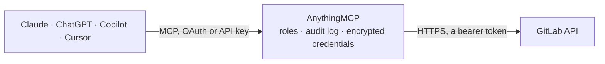

<!-- Generated by scripts/export-github-catalog.mjs in the anythingmcp-website repository. Do not edit by hand. -->

# GitLab MCP connector

Let your AI work in GitLab: find projects, triage and update issues, review merge requests with their diffs and comments, check pipelines and read failing job logs, and read branches, commits and files. The AnythingMCP connector gives Claude, ChatGPT, Microsoft Copilot, Cursor and Gemini 39 MCP tools for GitLab: 30 read and 9 can change data.

**Category:** [Infrastructure](../infrastructure.md) · **Tools:** 39 · **Setup guide:** [anythingmcp.com](https://anythingmcp.com/guides/gitlab-to-mcp) · [Deutsch](https://anythingmcp.com/de/guides/gitlab-to-mcp) · [Italiano](https://anythingmcp.com/it/guides/gitlab-to-mcp) · [Español](https://anythingmcp.com/es/guides/gitlab-to-mcp) · [日本語](https://anythingmcp.com/ja/guides/gitlab-to-mcp) · [Русский](https://anythingmcp.com/ru/guides/gitlab-to-mcp) · [中文](https://anythingmcp.com/zh/guides/gitlab-to-mcp)

## Start without code

No installation and no terminal: AnythingMCP Cloud runs the GitLab connector for you, operated by helpcode.ai in Frankfurt, Germany.

1. **Click the button above** and create an account or sign in. The GitLab connector opens, ready to install.
2. **Paste the API key or token from your GitLab account.** Every click is in the [step-by-step guide](https://anythingmcp.com/guides/gitlab-to-mcp).
3. **Click Install.** AnythingMCP shows the address of your MCP server.
4. **Add that address to your assistant:** [Claude](https://anythingmcp.com/guides/connect-gitlab-to-claude) · [ChatGPT](https://anythingmcp.com/guides/connect-gitlab-to-chatgpt) · [Microsoft Copilot](https://anythingmcp.com/guides/connect-gitlab-to-copilot) · [Cursor](https://anythingmcp.com/guides/connect-gitlab-to-cursor) · [Gemini CLI](https://anythingmcp.com/guides/connect-gitlab-to-gemini) · [Meta Muse](https://anythingmcp.com/guides/connect-gitlab-to-muse).
5. **Ask your first question**, for example: *What's the status, assignee and due date of invoice issue #24 in finance/invoices?*

Prefer help with the setup? [Talk to us](https://anythingmcp.com/contact).

## How it works

- **The AI client** speaks MCP (Streamable HTTP) to AnythingMCP and only sees tool names, descriptions and results. It never gets the GitLab credentials.
- **AnythingMCP** checks the client's role, builds the call from the tool definition, adds the credentials (a bearer token), calls GitLab, logs the call and returns the result.
- **GitLab** sees an ordinary API client with the rights of the account the credentials belong to.

## Tools

| Tool | What it does | Access |
|---|---|---|
| [`gitlab_get_current_user`](#gitlab_get_current_user) | Get the GitLab user the token belongs to: id, username, name, state, web_url and, for admins, is_admin. | read |
| [`gitlab_list_projects`](#gitlab_list_projects) | List projects the token can see, newest activity first by default: id, path_with_namespace, default_branch, web_url, visibility and last_activity_at. | read |
| [`gitlab_get_project`](#gitlab_get_project) | Get one project by id or path: default_branch, visibility, description, web_url, open_issues_count, permissions of the token's user, and with… | read |
| [`gitlab_list_project_members`](#gitlab_list_project_members) | List the members of a project, including those inherited from its groups: user id, username, name and access_level (10 Guest, 15 Planner, 20 Reporter, 30… | read |
| [`gitlab_list_labels`](#gitlab_list_labels) | List a project's labels (including group labels): name, color, description and open issue and merge request counts. | read |
| [`gitlab_list_issues`](#gitlab_list_issues) | List a project's issues with filters: iid, title, state, labels, assignees, author, milestone, due_date, web_url. | read |
| [`gitlab_list_my_issues`](#gitlab_list_my_issues) | List issues across all projects: by default the ones assigned to the token's user, or the ones they created, or every issue they can see. | read |
| [`gitlab_get_issue`](#gitlab_get_issue) | Get one issue by its iid: title, description (Markdown), state, labels, assignees, author, milestone, due_date, time stats, related merge request count and… | read |
| [`gitlab_create_issue`](#gitlab_create_issue) | Create an issue in a project. | write |
| [`gitlab_update_issue`](#gitlab_update_issue) | Change an issue: title, description, labels (replace, add or remove), assignees, milestone, due date, or close or reopen it with state_event. | write |
| [`gitlab_delete_issue`](#gitlab_delete_issue) | Delete an issue for good. | write |
| [`gitlab_list_issue_notes`](#gitlab_list_issue_notes) | List the comments on an issue, newest first by default, including system notes (label and status changes, flagged system: true): id, body, author,… | read |
| [`gitlab_add_issue_note`](#gitlab_add_issue_note) | Post a comment on an issue, as the token's user. | write |
| [`gitlab_list_merge_requests`](#gitlab_list_merge_requests) | List a project's merge requests with filters: iid, title, state, draft, source and target branch, author, reviewers, labels, merge_status… | read |
| [`gitlab_list_my_merge_requests`](#gitlab_list_my_merge_requests) | List merge requests across all projects: by default the ones created by the token's user, or assigned to them, or waiting for their review (reviews_for_me),… | read |
| [`gitlab_get_merge_request`](#gitlab_get_merge_request) | Get one merge request by iid: title, description, state, draft, source and target branch, sha, detailed_merge_status (mergeable, conflict, ci_must_pass,… | read |
| [`gitlab_get_merge_request_diffs`](#gitlab_get_merge_request_diffs) | Get the changed files of a merge request, page by page: old_path, new_path, new_file, renamed_file, deleted_file and the diff text of each. | read |
| [`gitlab_list_merge_request_commits`](#gitlab_list_merge_request_commits) | List the commits of a merge request: id (SHA), short_id, title, message, author_name and created_at. | read |
| [`gitlab_list_merge_request_notes`](#gitlab_list_merge_request_notes) | List the comments on a merge request, including review comments on lines (with a position) and system notes: id, body, author, created_at, resolvable, resolved. | read |
| [`gitlab_add_merge_request_note`](#gitlab_add_merge_request_note) | Post a general comment on a merge request, as the token's user. | write |
| [`gitlab_create_merge_request`](#gitlab_create_merge_request) | Open a merge request from a source branch into a target branch. | write |
| [`gitlab_update_merge_request`](#gitlab_update_merge_request) | Change a merge request: title (add or remove the Draft: prefix), description, target branch, labels, assignees, reviewers, or close or reopen it with… | write |
| [`gitlab_list_pipelines`](#gitlab_list_pipelines) | List a project's CI/CD pipelines, newest first: id, iid, status, ref, sha, source, created_at, updated_at and web_url. | read |
| [`gitlab_get_pipeline`](#gitlab_get_pipeline) | Get one pipeline: status, ref, sha, source, duration, queued_duration, coverage, user, started_at, finished_at and web_url. | read |
| [`gitlab_list_pipeline_jobs`](#gitlab_list_pipeline_jobs) | List the jobs of a pipeline: id, name, stage, status, failure_reason, duration, runner, allow_failure and web_url. | read |
| [`gitlab_get_job`](#gitlab_get_job) | Get one CI/CD job: name, stage, status, failure_reason, duration, started_at, finished_at, the commit, the pipeline, artifacts and web_url. | read |
| [`gitlab_get_job_log`](#gitlab_get_job_log) | Read the log (trace) of a CI/CD job as plain text, with ANSI color codes. | read |
| [`gitlab_list_branches`](#gitlab_list_branches) | List a project's branches: name, merged, protected, default, the last commit (id, title, author, date) and web_url. | read |
| [`gitlab_get_branch`](#gitlab_get_branch) | Get one branch: its last commit, whether it is merged, protected or the default, and whether the user can push to it. | read |
| [`gitlab_create_branch`](#gitlab_create_branch) | Create a branch from a branch, tag or commit. | write |
| [`gitlab_delete_branch`](#gitlab_delete_branch) | Delete a branch. | write |
| [`gitlab_list_commits`](#gitlab_list_commits) | List commits of a branch, tag or the default branch, newest first: id (SHA), short_id, title, author_name, authored_date and web_url. | read |
| [`gitlab_get_commit`](#gitlab_get_commit) | Get one commit by SHA, branch or tag name: message, author, committer, parent_ids, stats (additions, deletions), the last pipeline and web_url. | read |
| [`gitlab_get_commit_diff`](#gitlab_get_commit_diff) | Get the changes of one commit, page by page: old_path, new_path, new_file, renamed_file, deleted_file and the diff text per file. | read |
| [`gitlab_list_repository_tree`](#gitlab_list_repository_tree) | List files and folders in a repository folder: id (blob or tree SHA), name, type (blob = file, tree = folder), path and mode. | read |
| [`gitlab_get_file_info`](#gitlab_get_file_info) | Get a file's metadata without its content: file_name, file_path, size, encoding, content_sha256, blob_id, commit_id and last_commit_id on the given ref. | read |
| [`gitlab_get_file_content`](#gitlab_get_file_content) | Read a file from the repository as text, at a branch, tag or commit (the default branch by default). | read |
| [`gitlab_search`](#gitlab_search) | Search the whole instance (only what the token's user can see): projects, groups, issues, work_items, merge_requests, milestones, users or snippet_titles. | read |
| [`gitlab_search_project`](#gitlab_search_project) | Search inside one project: code (blobs, with file name, path, line number and the matching lines), commits, issues, merge_requests, milestones, notes,… | read |

## Tool reference

Every parameter as the AI client sees it in `tools/list`. Source: [`packages/backend/src/adapters/intl/gitlab.json`](../../../packages/backend/src/adapters/intl/gitlab.json).

### `gitlab_get_current_user`

Get the GitLab user the token belongs to: id, username, name, state, web_url and, for admins, is_admin. A quick check that the token and the instance address work.

**Access:** read · **Call:** `GET /user`

No parameters.

### `gitlab_list_projects`

List projects the token can see, newest activity first by default: id, path_with_namespace, default_branch, web_url, visibility and last_activity_at. On GitLab.com always keep membership true (or set owned or search), or the list covers every public project. Pages with page and per_page.

**Access:** read · **Call:** `GET /projects`

| Parameter | Type | Required | Description |
|---|---|---|---|
| `membership` | boolean | no | Only projects the user is a member of (default true). Set false on a self-managed instance to list every project the user can see. |
| `owned` | boolean | no | Only projects the user owns. |
| `starred` | boolean | no | Only projects the user starred. |
| `search` | string | no | Text matched against project names and paths. |
| `search_namespaces` | boolean | no | Also match the search text against the group path, so "acme/web" finds projects in group acme. |
| `archived` | boolean | no | true for archived projects only, false to leave them out. |
| `visibility` | `private` \| `internal` \| `public` | no | private, internal or public. |
| `order_by` | `id` \| `name` \| `path` \| `created_at` \| `updated_at` \| `last_activity_at` \| `star_count` | no | id, name, path, created_at, updated_at, last_activity_at or star_count (default created_at). |
| `sort` | `asc` \| `desc` | no | asc or desc (default desc). |
| `simple` | boolean | no | Return only the basic fields of each project (default true), which keeps the answer small. |
| `per_page` | integer | no | Results per page, 1 to 100 (default 20). |
| `page` | integer | no | Page number, from 1. The x-next-page header (in _headers) is empty on the last page. |

### `gitlab_get_project`

Get one project by id or path: default_branch, visibility, description, web_url, open_issues_count, permissions of the token's user, and with statistics=true repository and storage sizes.

**Access:** read · **Call:** `GET /projects/{project_id}`

| Parameter | Type | Required | Description |
|---|---|---|---|
| `project_id` | string | yes | Project id (e.g. "278964") or full path (e.g. "gitlab-org/gitlab"); the path is URL-encoded for you. |
| `statistics` | boolean | no | Include repository, wiki and storage statistics (needs at least Reporter access). |

### `gitlab_list_project_members`

List the members of a project, including those inherited from its groups: user id, username, name and access_level (10 Guest, 15 Planner, 20 Reporter, 30 Developer, 40 Maintainer, 50 Owner). Use the ids for assignee_ids and reviewer_ids.

**Access:** read · **Call:** `GET /projects/{project_id}/members/all`

| Parameter | Type | Required | Description |
|---|---|---|---|
| `project_id` | string | yes | Project id (e.g. "278964") or full path (e.g. "gitlab-org/gitlab"); the path is URL-encoded for you. |
| `query` | string | no | Filter by name or username. |
| `per_page` | integer | no | Results per page, 1 to 100 (default 20). |
| `page` | integer | no | Page number, from 1. The x-next-page header (in _headers) is empty on the last page. |

### `gitlab_list_labels`

List a project's labels (including group labels): name, color, description and open issue and merge request counts.

**Access:** read · **Call:** `GET /projects/{project_id}/labels`

| Parameter | Type | Required | Description |
|---|---|---|---|
| `project_id` | string | yes | Project id (e.g. "278964") or full path (e.g. "gitlab-org/gitlab"); the path is URL-encoded for you. |
| `search` | string | no | Filter labels by name. |
| `with_counts` | boolean | no | Include issue and merge request counts. |
| `per_page` | integer | no | Results per page, 1 to 100 (default 20). |
| `page` | integer | no | Page number, from 1. The x-next-page header (in _headers) is empty on the last page. |

### `gitlab_list_issues`

List a project's issues with filters: iid, title, state, labels, assignees, author, milestone, due_date, web_url. Pages with page and per_page; x-next-page in _headers is empty on the last page.

**Access:** read · **Call:** `GET /projects/{project_id}/issues`

| Parameter | Type | Required | Description |
|---|---|---|---|
| `project_id` | string | yes | Project id (e.g. "278964") or full path (e.g. "gitlab-org/gitlab"); the path is URL-encoded for you. |
| `state` | `opened` \| `closed` \| `all` | no | opened, closed or all (default all). |
| `labels` | string | no | Comma-separated label names; all must match. None or Any filter for no label or any label. |
| `milestone` | string | no | Milestone title. None for issues without one, Any for issues with one. |
| `assignee_username` | string | no | Only issues assigned to this username. |
| `author_username` | string | no | Only issues created by this username. |
| `search` | string | no | Text searched in title and description. |
| `created_after` | string | no | Only issues created on or after this time, ISO 8601 (e.g. 2026-10-01T00:00:00Z). |
| `updated_after` | string | no | Only issues updated on or after this time, ISO 8601. |
| `order_by` | `created_at` \| `updated_at` \| `priority` \| `due_date` \| `relative_position` \| `label_priority` \| `milestone_due` \| `popularity` \| `weight` \| `title` | no | created_at, updated_at, priority, due_date, relative_position, label_priority, milestone_due, popularity, weight or title (default created_at). |
| `sort` | `asc` \| `desc` | no | asc or desc (default desc). |
| `per_page` | integer | no | Results per page, 1 to 100 (default 20). |
| `page` | integer | no | Page number, from 1. The x-next-page header (in _headers) is empty on the last page. |

### `gitlab_list_my_issues`

List issues across all projects: by default the ones assigned to the token's user, or the ones they created, or every issue they can see. Same fields and filters as gitlab_list_issues; each issue carries its project_id.

**Access:** read · **Call:** `GET /issues`

| Parameter | Type | Required | Description |
|---|---|---|---|
| `scope` | `assigned_to_me` \| `created_by_me` \| `all` | no | assigned_to_me (default), created_by_me or all. |
| `state` | `opened` \| `closed` \| `all` | no | opened, closed or all (default all). |
| `labels` | string | no | Comma-separated label names; all must match. None or Any filter for no label or any label. |
| `milestone` | string | no | Milestone title. None for issues without one, Any for issues with one. |
| `assignee_username` | string | no | Only issues assigned to this username. |
| `author_username` | string | no | Only issues created by this username. |
| `search` | string | no | Text searched in title and description. |
| `created_after` | string | no | Only issues created on or after this time, ISO 8601 (e.g. 2026-10-01T00:00:00Z). |
| `updated_after` | string | no | Only issues updated on or after this time, ISO 8601. |
| `order_by` | `created_at` \| `updated_at` \| `priority` \| `due_date` \| `relative_position` \| `label_priority` \| `milestone_due` \| `popularity` \| `weight` \| `title` | no | created_at, updated_at, priority, due_date, relative_position, label_priority, milestone_due, popularity, weight or title (default created_at). |
| `sort` | `asc` \| `desc` | no | asc or desc (default desc). |
| `per_page` | integer | no | Results per page, 1 to 100 (default 20). |
| `page` | integer | no | Page number, from 1. The x-next-page header (in _headers) is empty on the last page. |

### `gitlab_get_issue`

Get one issue by its iid: title, description (Markdown), state, labels, assignees, author, milestone, due_date, time stats, related merge request count and web_url.

**Access:** read · **Call:** `GET /projects/{project_id}/issues/{issue_iid}`

| Parameter | Type | Required | Description |
|---|---|---|---|
| `project_id` | string | yes | Project id (e.g. "278964") or full path (e.g. "gitlab-org/gitlab"); the path is URL-encoded for you. |
| `issue_iid` | integer | yes | The issue's number inside the project (iid, the #42 in the UI), not its global id. |

### `gitlab_create_issue`

Create an issue in a project. Returns the new issue with its iid and web_url. Show the user the title and description and wait for confirmation first; never retry a create that succeeded.

**Access:** write · **Call:** `POST /projects/{project_id}/issues`

| Parameter | Type | Required | Description |
|---|---|---|---|
| `project_id` | string | yes | Project id (e.g. "278964") or full path (e.g. "gitlab-org/gitlab"); the path is URL-encoded for you. |
| `title` | string | yes | Issue title. |
| `assignee_id` | integer | no | One user id to assign; works on every tier (assignee_ids needs Premium for more than one). |
| `description` | string | no | Body in Markdown, up to 1,048,576 characters. |
| `labels` | string | no | Comma-separated label names; labels that do not exist yet are created. |
| `assignee_ids` | integer[] | no | User ids to assign (from gitlab_list_project_members). More than one needs Premium; [0] removes all assignees on update. |
| `milestone_id` | integer | no | Global id of a milestone. |
| `due_date` | string | no | Due date, YYYY-MM-DD. |
| `confidential` | boolean | no | Make the issue confidential. |

### `gitlab_update_issue`

Change an issue: title, description, labels (replace, add or remove), assignees, milestone, due date, or close or reopen it with state_event. Only the fields given change. Confirm with the user before changing someone else's issue.

**Access:** write · **Call:** `PUT /projects/{project_id}/issues/{issue_iid}`

| Parameter | Type | Required | Description |
|---|---|---|---|
| `project_id` | string | yes | Project id (e.g. "278964") or full path (e.g. "gitlab-org/gitlab"); the path is URL-encoded for you. |
| `issue_iid` | integer | yes | The issue's number inside the project (iid, the #42 in the UI), not its global id. |
| `title` | string | no | New title. |
| `state_event` | `close` \| `reopen` | no | close or reopen. |
| `add_labels` | string | no | Comma-separated labels to add. |
| `remove_labels` | string | no | Comma-separated labels to remove. |
| `description` | string | no | Body in Markdown, up to 1,048,576 characters. |
| `labels` | string | no | Comma-separated label names; labels that do not exist yet are created. |
| `assignee_ids` | integer[] | no | User ids to assign (from gitlab_list_project_members). More than one needs Premium; [0] removes all assignees on update. |
| `milestone_id` | integer | no | Global id of a milestone. |
| `due_date` | string | no | Due date, YYYY-MM-DD. |
| `confidential` | boolean | no | Make the issue confidential. |

### `gitlab_delete_issue`

Delete an issue for good. Only project owners and administrators may; closing it with gitlab_update_issue is usually what is wanted. Switched off at install.

**Access:** write · **Call:** `DELETE /projects/{project_id}/issues/{issue_iid}`

| Parameter | Type | Required | Description |
|---|---|---|---|
| `project_id` | string | yes | Project id (e.g. "278964") or full path (e.g. "gitlab-org/gitlab"); the path is URL-encoded for you. |
| `issue_iid` | integer | yes | The issue's number inside the project (iid, the #42 in the UI), not its global id. |

### `gitlab_list_issue_notes`

List the comments on an issue, newest first by default, including system notes (label and status changes, flagged system: true): id, body, author, created_at, internal.

**Access:** read · **Call:** `GET /projects/{project_id}/issues/{issue_iid}/notes`

| Parameter | Type | Required | Description |
|---|---|---|---|
| `project_id` | string | yes | Project id (e.g. "278964") or full path (e.g. "gitlab-org/gitlab"); the path is URL-encoded for you. |
| `issue_iid` | integer | yes | The issue's number inside the project (iid, the #42 in the UI), not its global id. |
| `sort` | `asc` \| `desc` | no | asc or desc by created_at (default desc). |
| `order_by` | `created_at` \| `updated_at` | no | created_at or updated_at (default created_at). |
| `per_page` | integer | no | Results per page, 1 to 100 (default 20). |
| `page` | integer | no | Page number, from 1. The x-next-page header (in _headers) is empty on the last page. |

### `gitlab_add_issue_note`

Post a comment on an issue, as the token's user. Markdown and quick actions (/label, /assign, /close) in the body are applied. Show the user the text and wait for confirmation first.

**Access:** write · **Call:** `POST /projects/{project_id}/issues/{issue_iid}/notes`

| Parameter | Type | Required | Description |
|---|---|---|---|
| `project_id` | string | yes | Project id (e.g. "278964") or full path (e.g. "gitlab-org/gitlab"); the path is URL-encoded for you. |
| `issue_iid` | integer | yes | The issue's number inside the project (iid, the #42 in the UI), not its global id. |
| `body` | string | yes | Comment text in Markdown. |
| `internal` | boolean | no | Make it an internal note, visible only to project members with at least Planner or Reporter access. |

### `gitlab_list_merge_requests`

List a project's merge requests with filters: iid, title, state, draft, source and target branch, author, reviewers, labels, merge_status (detailed_merge_status) and web_url.

**Access:** read · **Call:** `GET /projects/{project_id}/merge_requests`

| Parameter | Type | Required | Description |
|---|---|---|---|
| `project_id` | string | yes | Project id (e.g. "278964") or full path (e.g. "gitlab-org/gitlab"); the path is URL-encoded for you. |
| `state` | `opened` \| `closed` \| `locked` \| `merged` \| `all` | no | opened, closed, locked, merged or all (default all). |
| `labels` | string | no | Comma-separated label names; all must match. None or Any filter for no label or any label. |
| `source_branch` | string | no | Only merge requests from this branch. |
| `target_branch` | string | no | Only merge requests into this branch. |
| `author_username` | string | no | Only merge requests created by this username. |
| `reviewer_username` | string | no | Only merge requests with this reviewer. |
| `draft` | boolean | no | true for drafts only, false to leave drafts out. |
| `search` | string | no | Text searched in title and description. |
| `updated_after` | string | no | Only merge requests updated on or after this time, ISO 8601. |
| `order_by` | `created_at` \| `updated_at` \| `merged_at` \| `title` \| `label_priority` | no | created_at, updated_at, merged_at, title or label_priority (default created_at). |
| `sort` | `asc` \| `desc` | no | asc or desc (default desc). |
| `per_page` | integer | no | Results per page, 1 to 100 (default 20). |
| `page` | integer | no | Page number, from 1. The x-next-page header (in _headers) is empty on the last page. |

### `gitlab_list_my_merge_requests`

List merge requests across all projects: by default the ones created by the token's user, or assigned to them, or waiting for their review (reviews_for_me), or all they can see. Each carries its project_id.

**Access:** read · **Call:** `GET /merge_requests`

| Parameter | Type | Required | Description |
|---|---|---|---|
| `scope` | `created_by_me` \| `assigned_to_me` \| `reviews_for_me` \| `all` | no | created_by_me (default), assigned_to_me, reviews_for_me or all. |
| `state` | `opened` \| `closed` \| `locked` \| `merged` \| `all` | no | opened, closed, locked, merged or all (default all). |
| `labels` | string | no | Comma-separated label names; all must match. None or Any filter for no label or any label. |
| `source_branch` | string | no | Only merge requests from this branch. |
| `target_branch` | string | no | Only merge requests into this branch. |
| `author_username` | string | no | Only merge requests created by this username. |
| `reviewer_username` | string | no | Only merge requests with this reviewer. |
| `draft` | boolean | no | true for drafts only, false to leave drafts out. |
| `search` | string | no | Text searched in title and description. |
| `updated_after` | string | no | Only merge requests updated on or after this time, ISO 8601. |
| `order_by` | `created_at` \| `updated_at` \| `merged_at` \| `title` \| `label_priority` | no | created_at, updated_at, merged_at, title or label_priority (default created_at). |
| `sort` | `asc` \| `desc` | no | asc or desc (default desc). |
| `per_page` | integer | no | Results per page, 1 to 100 (default 20). |
| `page` | integer | no | Page number, from 1. The x-next-page header (in _headers) is empty on the last page. |

### `gitlab_get_merge_request`

Get one merge request by iid: title, description, state, draft, source and target branch, sha, detailed_merge_status (mergeable, conflict, ci_must_pass, not_approved...), has_conflicts, the head pipeline, changes_count, author, assignees, reviewers and web_url.

**Access:** read · **Call:** `GET /projects/{project_id}/merge_requests/{merge_request_iid}`

| Parameter | Type | Required | Description |
|---|---|---|---|
| `project_id` | string | yes | Project id (e.g. "278964") or full path (e.g. "gitlab-org/gitlab"); the path is URL-encoded for you. |
| `merge_request_iid` | integer | yes | The merge request's number inside the project (iid, the !17 in the UI), not its global id. |

### `gitlab_get_merge_request_diffs`

Get the changed files of a merge request, page by page: old_path, new_path, new_file, renamed_file, deleted_file and the diff text of each. Large diffs come back empty with too_large or collapsed set; read such a file with gitlab_get_file_content on the source branch instead.

**Access:** read · **Call:** `GET /projects/{project_id}/merge_requests/{merge_request_iid}/diffs`

| Parameter | Type | Required | Description |
|---|---|---|---|
| `project_id` | string | yes | Project id (e.g. "278964") or full path (e.g. "gitlab-org/gitlab"); the path is URL-encoded for you. |
| `merge_request_iid` | integer | yes | The merge request's number inside the project (iid, the !17 in the UI), not its global id. |
| `unidiff` | boolean | no | Return the diffs in unified diff format (GitLab 16.5 and later). |
| `per_page` | integer | no | Results per page, 1 to 100 (default 20). |
| `page` | integer | no | Page number, from 1. The x-next-page header (in _headers) is empty on the last page. |

### `gitlab_list_merge_request_commits`

List the commits of a merge request: id (SHA), short_id, title, message, author_name and created_at.

**Access:** read · **Call:** `GET /projects/{project_id}/merge_requests/{merge_request_iid}/commits`

| Parameter | Type | Required | Description |
|---|---|---|---|
| `project_id` | string | yes | Project id (e.g. "278964") or full path (e.g. "gitlab-org/gitlab"); the path is URL-encoded for you. |
| `merge_request_iid` | integer | yes | The merge request's number inside the project (iid, the !17 in the UI), not its global id. |
| `per_page` | integer | no | Results per page, 1 to 100 (default 20). |
| `page` | integer | no | Page number, from 1. The x-next-page header (in _headers) is empty on the last page. |

### `gitlab_list_merge_request_notes`

List the comments on a merge request, including review comments on lines (with a position) and system notes: id, body, author, created_at, resolvable, resolved.

**Access:** read · **Call:** `GET /projects/{project_id}/merge_requests/{merge_request_iid}/notes`

| Parameter | Type | Required | Description |
|---|---|---|---|
| `project_id` | string | yes | Project id (e.g. "278964") or full path (e.g. "gitlab-org/gitlab"); the path is URL-encoded for you. |
| `merge_request_iid` | integer | yes | The merge request's number inside the project (iid, the !17 in the UI), not its global id. |
| `sort` | `asc` \| `desc` | no | asc or desc by created_at (default desc). |
| `order_by` | `created_at` \| `updated_at` | no | created_at or updated_at (default created_at). |
| `per_page` | integer | no | Results per page, 1 to 100 (default 20). |
| `page` | integer | no | Page number, from 1. The x-next-page header (in _headers) is empty on the last page. |

### `gitlab_add_merge_request_note`

Post a general comment on a merge request, as the token's user. Quick actions in the body (/approve, /merge, /label) are applied, so only include them when the user asked. Show the user the text and wait for confirmation first.

**Access:** write · **Call:** `POST /projects/{project_id}/merge_requests/{merge_request_iid}/notes`

| Parameter | Type | Required | Description |
|---|---|---|---|
| `project_id` | string | yes | Project id (e.g. "278964") or full path (e.g. "gitlab-org/gitlab"); the path is URL-encoded for you. |
| `merge_request_iid` | integer | yes | The merge request's number inside the project (iid, the !17 in the UI), not its global id. |
| `body` | string | yes | Comment text in Markdown. |
| `internal` | boolean | no | Make it an internal note, visible only to project members. |

### `gitlab_create_merge_request`

Open a merge request from a source branch into a target branch. Start the title with "Draft:" to open it as a draft. Returns the merge request with its iid and web_url. Confirm with the user first; never retry a create that succeeded (a second one for the same branches answers 409).

**Access:** write · **Call:** `POST /projects/{project_id}/merge_requests`

| Parameter | Type | Required | Description |
|---|---|---|---|
| `project_id` | string | yes | Project id (e.g. "278964") or full path (e.g. "gitlab-org/gitlab"); the path is URL-encoded for you. |
| `source_branch` | string | yes | Branch with the changes. |
| `target_branch` | string | yes | Branch to merge into, usually the default branch. |
| `title` | string | yes | Title; prefix with Draft: for a draft. |
| `description` | string | no | Description in Markdown. |
| `labels` | string | no | Comma-separated label names. |
| `assignee_ids` | integer[] | no | User ids to assign. |
| `reviewer_ids` | integer[] | no | User ids to ask for a review. |
| `remove_source_branch` | boolean | no | Delete the source branch when the merge request is merged. |
| `squash` | boolean | no | Squash the commits into one on merge. |

### `gitlab_update_merge_request`

Change a merge request: title (add or remove the Draft: prefix), description, target branch, labels, assignees, reviewers, or close or reopen it with state_event. It does not merge. Only the fields given change; confirm with the user first.

**Access:** write · **Call:** `PUT /projects/{project_id}/merge_requests/{merge_request_iid}`

| Parameter | Type | Required | Description |
|---|---|---|---|
| `project_id` | string | yes | Project id (e.g. "278964") or full path (e.g. "gitlab-org/gitlab"); the path is URL-encoded for you. |
| `merge_request_iid` | integer | yes | The merge request's number inside the project (iid, the !17 in the UI), not its global id. |
| `title` | string | no | New title. |
| `target_branch` | string | no | New target branch. |
| `state_event` | `close` \| `reopen` | no | close or reopen. |
| `add_labels` | string | no | Comma-separated labels to add. |
| `remove_labels` | string | no | Comma-separated labels to remove. |
| `description` | string | no | Description in Markdown. |
| `labels` | string | no | Comma-separated label names. |
| `assignee_ids` | integer[] | no | User ids to assign. |
| `reviewer_ids` | integer[] | no | User ids to ask for a review. |
| `remove_source_branch` | boolean | no | Delete the source branch when the merge request is merged. |
| `squash` | boolean | no | Squash the commits into one on merge. |

### `gitlab_list_pipelines`

List a project's CI/CD pipelines, newest first: id, iid, status, ref, sha, source, created_at, updated_at and web_url.

**Access:** read · **Call:** `GET /projects/{project_id}/pipelines`

| Parameter | Type | Required | Description |
|---|---|---|---|
| `project_id` | string | yes | Project id (e.g. "278964") or full path (e.g. "gitlab-org/gitlab"); the path is URL-encoded for you. |
| `status` | `created` \| `waiting_for_resource` \| `preparing` \| `waiting_for_callback` \| `pending` \| `running` \| `success` \| `failed` \| `canceling` \| `canceled` \| `skipped` \| `manual` \| `scheduled` | no | Only pipelines with this status. |
| `scope` | `running` \| `pending` \| `finished` \| `branches` \| `tags` | no | running, pending, finished, branches or tags (branches and tags return only the latest pipeline per ref). |
| `ref` | string | no | Only pipelines for this branch or tag. |
| `sha` | string | no | Only pipelines for this commit SHA. |
| `source` | string | no | Only pipelines triggered this way, e.g. push, web, merge_request_event, schedule, api, trigger. |
| `updated_after` | string | no | Only pipelines updated on or after this time, ISO 8601. |
| `order_by` | `id` \| `status` \| `ref` \| `updated_at` \| `user_id` | no | id, status, ref, updated_at or user_id (default id). |
| `sort` | `asc` \| `desc` | no | asc or desc (default desc). |
| `per_page` | integer | no | Results per page, 1 to 100 (default 20). |
| `page` | integer | no | Page number, from 1. The x-next-page header (in _headers) is empty on the last page. |

### `gitlab_get_pipeline`

Get one pipeline: status, ref, sha, source, duration, queued_duration, coverage, user, started_at, finished_at and web_url.

**Access:** read · **Call:** `GET /projects/{project_id}/pipelines/{pipeline_id}`

| Parameter | Type | Required | Description |
|---|---|---|---|
| `project_id` | string | yes | Project id (e.g. "278964") or full path (e.g. "gitlab-org/gitlab"); the path is URL-encoded for you. |
| `pipeline_id` | integer | yes | Pipeline id (the global id, not the iid). |

### `gitlab_list_pipeline_jobs`

List the jobs of a pipeline: id, name, stage, status, failure_reason, duration, runner, allow_failure and web_url. Filter with scope, e.g. ["failed"] to find what broke, then read its log with gitlab_get_job_log.

**Access:** read · **Call:** `GET /projects/{project_id}/pipelines/{pipeline_id}/jobs`

| Parameter | Type | Required | Description |
|---|---|---|---|
| `project_id` | string | yes | Project id (e.g. "278964") or full path (e.g. "gitlab-org/gitlab"); the path is URL-encoded for you. |
| `pipeline_id` | integer | yes | Pipeline id. |
| `scope` | `created` \| `pending` \| `running` \| `failed` \| `success` \| `canceled` \| `skipped` \| `waiting_for_resource` \| `manual`[] | no | Job statuses to include: created, pending, running, failed, success, canceled, skipped, waiting_for_resource or manual. |
| `include_retried` | boolean | no | Also list jobs that were retried. |
| `per_page` | integer | no | Results per page, 1 to 100 (default 20). |
| `page` | integer | no | Page number, from 1. The x-next-page header (in _headers) is empty on the last page. |

### `gitlab_get_job`

Get one CI/CD job: name, stage, status, failure_reason, duration, started_at, finished_at, the commit, the pipeline, artifacts and web_url.

**Access:** read · **Call:** `GET /projects/{project_id}/jobs/{job_id}`

| Parameter | Type | Required | Description |
|---|---|---|---|
| `project_id` | string | yes | Project id (e.g. "278964") or full path (e.g. "gitlab-org/gitlab"); the path is URL-encoded for you. |
| `job_id` | integer | yes | Job id. |

### `gitlab_get_job_log`

Read the log (trace) of a CI/CD job as plain text, with ANSI color codes. Logs over 200 KB are cut and marked _truncated, keeping the beginning; the error is usually near the end, so open the job's web_url for very long logs.

**Access:** read · **Call:** `GET /projects/{project_id}/jobs/{job_id}/trace`

| Parameter | Type | Required | Description |
|---|---|---|---|
| `project_id` | string | yes | Project id (e.g. "278964") or full path (e.g. "gitlab-org/gitlab"); the path is URL-encoded for you. |
| `job_id` | integer | yes | Job id, from gitlab_list_pipeline_jobs. |

### `gitlab_list_branches`

List a project's branches: name, merged, protected, default, the last commit (id, title, author, date) and web_url.

**Access:** read · **Call:** `GET /projects/{project_id}/repository/branches`

| Parameter | Type | Required | Description |
|---|---|---|---|
| `project_id` | string | yes | Project id (e.g. "278964") or full path (e.g. "gitlab-org/gitlab"); the path is URL-encoded for you. |
| `search` | string | no | Only branches whose name contains this text; ^text and text$ anchor it. |
| `regex` | string | no | Only branches whose name matches this RE2 regular expression. |
| `per_page` | integer | no | Results per page, 1 to 100 (default 20). |
| `page` | integer | no | Page number, from 1. The x-next-page header (in _headers) is empty on the last page. |

### `gitlab_get_branch`

Get one branch: its last commit, whether it is merged, protected or the default, and whether the user can push to it.

**Access:** read · **Call:** `GET /projects/{project_id}/repository/branches/{branch}`

| Parameter | Type | Required | Description |
|---|---|---|---|
| `project_id` | string | yes | Project id (e.g. "278964") or full path (e.g. "gitlab-org/gitlab"); the path is URL-encoded for you. |
| `branch` | string | yes | Branch name, e.g. feature/login (URL-encoded for you). |

### `gitlab_create_branch`

Create a branch from a branch, tag or commit. Needs Developer access and the write scope (api). Confirm with the user first.

**Access:** write · **Call:** `POST /projects/{project_id}/repository/branches`

| Parameter | Type | Required | Description |
|---|---|---|---|
| `project_id` | string | yes | Project id (e.g. "278964") or full path (e.g. "gitlab-org/gitlab"); the path is URL-encoded for you. |
| `branch` | string | yes | Name of the new branch. |
| `ref` | string | yes | Branch, tag or commit SHA to start from. |

### `gitlab_delete_branch`

Delete a branch. Protected and default branches cannot be deleted. Switched off at install.

**Access:** write · **Call:** `DELETE /projects/{project_id}/repository/branches/{branch}`

| Parameter | Type | Required | Description |
|---|---|---|---|
| `project_id` | string | yes | Project id (e.g. "278964") or full path (e.g. "gitlab-org/gitlab"); the path is URL-encoded for you. |
| `branch` | string | yes | Branch name. |

### `gitlab_list_commits`

List commits of a branch, tag or the default branch, newest first: id (SHA), short_id, title, author_name, authored_date and web_url. Filter by path, author and date.

**Access:** read · **Call:** `GET /projects/{project_id}/repository/commits`

| Parameter | Type | Required | Description |
|---|---|---|---|
| `project_id` | string | yes | Project id (e.g. "278964") or full path (e.g. "gitlab-org/gitlab"); the path is URL-encoded for you. |
| `ref_name` | string | no | Branch, tag or SHA range (a..b); default branch when left out. |
| `path` | string | no | Only commits that touch this file or folder path. |
| `author` | string | no | Only commits by this author name or email. |
| `since` | string | no | Only commits after this time, ISO 8601. |
| `until` | string | no | Only commits before this time, ISO 8601. |
| `with_stats` | boolean | no | Include additions and deletions per commit. |
| `first_parent` | boolean | no | Follow only the first parent of merge commits. |
| `per_page` | integer | no | Results per page, 1 to 100 (default 20). |
| `page` | integer | no | Page number, from 1. The x-next-page header (in _headers) is empty on the last page. |

### `gitlab_get_commit`

Get one commit by SHA, branch or tag name: message, author, committer, parent_ids, stats (additions, deletions), the last pipeline and web_url.

**Access:** read · **Call:** `GET /projects/{project_id}/repository/commits/{sha}`

| Parameter | Type | Required | Description |
|---|---|---|---|
| `project_id` | string | yes | Project id (e.g. "278964") or full path (e.g. "gitlab-org/gitlab"); the path is URL-encoded for you. |
| `sha` | string | yes | Commit SHA, or a branch or tag name for its head commit. |

### `gitlab_get_commit_diff`

Get the changes of one commit, page by page: old_path, new_path, new_file, renamed_file, deleted_file and the diff text per file.

**Access:** read · **Call:** `GET /projects/{project_id}/repository/commits/{sha}/diff`

| Parameter | Type | Required | Description |
|---|---|---|---|
| `project_id` | string | yes | Project id (e.g. "278964") or full path (e.g. "gitlab-org/gitlab"); the path is URL-encoded for you. |
| `sha` | string | yes | Commit SHA. |
| `unidiff` | boolean | no | Return the diffs in unified diff format (GitLab 16.5 and later). |
| `per_page` | integer | no | Results per page, 1 to 100 (default 20). |
| `page` | integer | no | Page number, from 1. The x-next-page header (in _headers) is empty on the last page. |

### `gitlab_list_repository_tree`

List files and folders in a repository folder: id (blob or tree SHA), name, type (blob = file, tree = folder), path and mode. recursive=true walks all subfolders; page through big trees.

**Access:** read · **Call:** `GET /projects/{project_id}/repository/tree`

| Parameter | Type | Required | Description |
|---|---|---|---|
| `project_id` | string | yes | Project id (e.g. "278964") or full path (e.g. "gitlab-org/gitlab"); the path is URL-encoded for you. |
| `path` | string | no | Folder path inside the repository, e.g. src/app; the root when left out. |
| `ref` | string | no | Branch, tag or commit SHA. Defaults to the project's default branch where the API allows it. |
| `recursive` | boolean | no | Include everything below the folder, not just its direct children. |
| `per_page` | integer | no | Results per page, 1 to 100 (default 20). |
| `page` | integer | no | Page number, from 1. The x-next-page header (in _headers) is empty on the last page. |

### `gitlab_get_file_info`

Get a file's metadata without its content: file_name, file_path, size, encoding, content_sha256, blob_id, commit_id and last_commit_id on the given ref.

**Access:** read · **Call:** `GET /projects/{project_id}/repository/files/{file_path}`

| Parameter | Type | Required | Description |
|---|---|---|---|
| `project_id` | string | yes | Project id (e.g. "278964") or full path (e.g. "gitlab-org/gitlab"); the path is URL-encoded for you. |
| `file_path` | string | yes | File path inside the repository, e.g. src/app/main.ts (URL-encoded for you, slashes included). |
| `ref` | string | no | Branch, tag or commit SHA; HEAD (default) is the default branch. |

### `gitlab_get_file_content`

Read a file from the repository as text, at a branch, tag or commit (the default branch by default). Files over 200 KB are cut and marked _truncated. Binary files come back garbled; use gitlab_get_file_info for those.

**Access:** read · **Call:** `GET /projects/{project_id}/repository/files/{file_path}/raw`

| Parameter | Type | Required | Description |
|---|---|---|---|
| `project_id` | string | yes | Project id (e.g. "278964") or full path (e.g. "gitlab-org/gitlab"); the path is URL-encoded for you. |
| `file_path` | string | yes | File path inside the repository, e.g. src/app/main.ts (URL-encoded for you, slashes included). |
| `ref` | string | no | Branch, tag or commit SHA; HEAD (default) is the default branch. |
| `lfs` | boolean | no | For a Git LFS file, return the stored file instead of the pointer. |

### `gitlab_search`

Search the whole instance (only what the token's user can see): projects, groups, issues, work_items, merge_requests, milestones, users or snippet_titles. Code (blobs), commits, comments and wiki search across the instance need advanced search (Premium); search inside one project with gitlab_search_project, which covers them on every tier.

**Access:** read · **Call:** `GET /search`

| Parameter | Type | Required | Description |
|---|---|---|---|
| `scope` | `projects` \| `groups` \| `issues` \| `work_items` \| `merge_requests` \| `milestones` \| `users` \| `snippet_titles` \| `blobs` \| `commits` \| `wiki_blobs` \| `notes` | yes | What to search. |
| `search` | string | yes | Search text. |
| `state` | `opened` \| `closed` \| `merged` \| `all` | no | For issues and merge requests: opened, closed, merged (merge requests) or all. |
| `order_by` | `created_at` \| `title` | no | created_at (or title on GitLab 19.5 and later), for issues, merge requests and milestones. |
| `sort` | `asc` \| `desc` | no | asc or desc (default desc). |
| `per_page` | integer | no | Results per page, 1 to 100 (default 20). |
| `page` | integer | no | Page number, from 1. The x-next-page header (in _headers) is empty on the last page. |

### `gitlab_search_project`

Search inside one project: code (blobs, with file name, path, line number and the matching lines), commits, issues, merge_requests, milestones, notes, wiki_blobs or users. Code search works on every tier within a project; filename:, path: and extension: filters can be added to the text.

**Access:** read · **Call:** `GET /projects/{project_id}/search`

| Parameter | Type | Required | Description |
|---|---|---|---|
| `project_id` | string | yes | Project id (e.g. "278964") or full path (e.g. "gitlab-org/gitlab"); the path is URL-encoded for you. |
| `scope` | `blobs` \| `commits` \| `issues` \| `work_items` \| `merge_requests` \| `milestones` \| `notes` \| `wiki_blobs` \| `users` | yes | What to search. |
| `search` | string | yes | Search text, e.g. "parseConfig filename:*.ts". |
| `ref` | string | no | For blobs and commits: the branch or tag to search (default branch otherwise). |
| `state` | `opened` \| `closed` \| `merged` \| `all` | no | For issues and merge requests: opened, closed, merged or all. |
| `per_page` | integer | no | Results per page, 1 to 100 (default 20). |
| `page` | integer | no | Page number, from 1. The x-next-page header (in _headers) is empty on the last page. |

## Run it yourself

AnythingMCP is open source (AGPL-3.0). [Run it with Docker](../../../README.md#run-it-yourself), open **Connectors → Store**, pick **GitLab** and enter `GITLAB_URL`, `GITLAB_TOKEN`, then add your MCP server URL to the AI client.

[← Infrastructure connectors](../infrastructure.md) · [All categories](../README.md)
