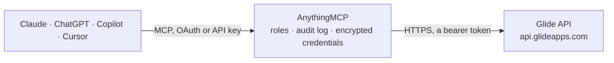

<!-- Generated by scripts/export-github-catalog.mjs in the anythingmcp-website repository. Do not edit by hand. -->

# Glide MCP connector

Let your AI work with Glide Big Tables: list the tables of your Glide team and read their rows; with your confirmation add rows and update a row. The AnythingMCP connector gives Claude, ChatGPT, Microsoft Copilot, Cursor and Gemini 6 MCP tools for Glide: 3 read and 3 can change data.

**Category:** [Databases](../database.md) · **Tools:** 6 · **Setup guide:** [anythingmcp.com](https://anythingmcp.com/guides/glide-to-mcp) · [Deutsch](https://anythingmcp.com/de/guides/glide-to-mcp) · [Italiano](https://anythingmcp.com/it/guides/glide-to-mcp) · [Español](https://anythingmcp.com/es/guides/glide-to-mcp) · [日本語](https://anythingmcp.com/ja/guides/glide-to-mcp) · [Русский](https://anythingmcp.com/ru/guides/glide-to-mcp) · [中文](https://anythingmcp.com/zh/guides/glide-to-mcp)

## Start without code

No installation and no terminal: AnythingMCP Cloud runs the Glide connector for you, operated by helpcode.ai in Frankfurt, Germany.

1. **Click the button above** and create an account or sign in. The Glide connector opens, ready to install.
2. **Paste the API key or token from your Glide account.** Every click is in the [step-by-step guide](https://anythingmcp.com/guides/glide-to-mcp).
3. **Click Install.** AnythingMCP shows the address of your MCP server.
4. **Add that address to your assistant:** [Claude](https://anythingmcp.com/guides/connect-glide-to-claude) · [ChatGPT](https://anythingmcp.com/guides/connect-glide-to-chatgpt) · [Microsoft Copilot](https://anythingmcp.com/guides/connect-glide-to-copilot) · [Cursor](https://anythingmcp.com/guides/connect-glide-to-cursor) · [Gemini CLI](https://anythingmcp.com/guides/connect-glide-to-gemini) · [Meta Muse](https://anythingmcp.com/guides/connect-glide-to-muse).
5. **Ask your first question**, for example: *Find invoice INV-2026-041 for customer SolTech Oy in our Invoices table: status, due date and gross amount.*

Prefer help with the setup? [Talk to us](https://anythingmcp.com/contact).

## How it works

- **The AI client** speaks MCP (Streamable HTTP) to AnythingMCP and only sees tool names, descriptions and results. It never gets the Glide credentials.
- **AnythingMCP** checks the client's role, builds the call from the tool definition, adds the credentials (a bearer token), calls Glide, logs the call and returns the result.
- **Glide** sees an ordinary API client with the rights of the account the credentials belong to.

## Tools

| Tool | What it does | Access |
|---|---|---|
| [`glide_list_tables`](#glide_list_tables) | List the Big Tables of the Glide team with id and name. | read |
| [`glide_get_rows`](#glide_get_rows) | Read rows of a Big Table. | read |
| [`glide_get_row`](#glide_get_row) | Read one row of a Big Table by its row id, keyed by column id. | read |
| [`glide_add_rows`](#glide_add_rows) | Add one or more rows to a Big Table. | write |
| [`glide_update_row`](#glide_update_row) | Change columns of one row in a Big Table; columns left out keep their value. | write |
| [`glide_delete_row`](#glide_delete_row) | Delete one row from a Big Table for good. | write |

## Tool reference

Every parameter as the AI client sees it in `tools/list`. Source: [`packages/backend/src/adapters/intl/glide.json`](../../../packages/backend/src/adapters/intl/glide.json).

### `glide_list_tables`

List the Big Tables of the Glide team with id and name. Call this first: the other tools need the table id. Only Big Tables are reachable through the API, not Glide Tables, Google Sheets or other sources.

**Access:** read · **Call:** `GET /tables`

No parameters.

### `glide_get_rows`

Read rows of a Big Table. Each row is an object keyed by column id (not the column's display name), e.g. {"fullName": "Alex Bard", "totalAmount": 34.5}. Glide may return fewer rows than limit; when continuation is present, call again with it to get the next rows. Rows can hold personal data: show only what the user needs.

**Access:** read · **Call:** `GET /tables/{tableId}/rows`

| Parameter | Type | Required | Description |
|---|---|---|---|
| `tableId` | string | yes | Big Table id from glide_list_tables, e.g. 2a1bad8b-cf7c-44437-b8c1-e3782df6. |
| `limit` | integer | no | At most this many rows (default 50 here). |
| `continuation` | string | no | Token from the previous answer's continuation, for the next rows. |

### `glide_get_row`

Read one row of a Big Table by its row id, keyed by column id.

**Access:** read · **Call:** `GET /tables/{tableId}/rows/{rowId}`

| Parameter | Type | Required | Description |
|---|---|---|---|
| `tableId` | string | yes | Big Table id from glide_list_tables, e.g. 2a1bad8b-cf7c-44437-b8c1-e3782df6. |
| `rowId` | string | yes | Row id, e.g. zcJWnyI8Tbam21V34K8MNA, as returned by glide_add_rows or shown in the Data Editor. |

### `glide_add_rows`

Add one or more rows to a Big Table. Confirm with the user first: show the table and every row, and wait for their yes. Rows are keyed by column id (see glide_get_rows or Show API in the Data Editor). The app's users see new rows at once. Returns the new row ids in the same order.

**Access:** write · **Call:** `POST /tables/{tableId}/rows`

| Parameter | Type | Required | Description |
|---|---|---|---|
| `tableId` | string | yes | Big Table id from glide_list_tables, e.g. 2a1bad8b-cf7c-44437-b8c1-e3782df6. |
| `rows` | object[] | yes | Rows to add, each keyed by column id, e.g. [{"fullName": "Jane Smith", "invoiceDate": "2026-10-15T09:00:00Z", "totalAmount": 120}]. |
| `onSchemaError` | `abort` \| `dropColumns` \| `updateSchema` | no | What to do when a value does not fit the table: abort (default, nothing is written), dropColumns (skip those values) or updateSchema (add or widen columns). Use updateSchema only when the user wants new columns. |

### `glide_update_row`

Change columns of one row in a Big Table; columns left out keep their value. Confirm with the user first: show the row and the exact changes, and wait for their yes.

**Access:** write · **Call:** `PATCH /tables/{tableId}/rows/{rowId}`

| Parameter | Type | Required | Description |
|---|---|---|---|
| `tableId` | string | yes | Big Table id from glide_list_tables, e.g. 2a1bad8b-cf7c-44437-b8c1-e3782df6. |
| `rowId` | string | yes | Row id, e.g. zcJWnyI8Tbam21V34K8MNA, as returned by glide_add_rows or shown in the Data Editor. |
| `values` | object | yes | Columns to change, keyed by column id, e.g. {"amountPaid": 34.5}. |
| `onSchemaError` | `abort` \| `dropColumns` \| `updateSchema` | no | What to do when a value does not fit the table: abort (default, nothing is written), dropColumns (skip those values) or updateSchema (add or widen columns). Use updateSchema only when the user wants new columns. |

### `glide_delete_row`

Delete one row from a Big Table for good. Installed switched off. Only when the user asks to delete that exact row: show it, confirm with the user first, and wait for their yes.

**Access:** write · **Call:** `DELETE /tables/{tableId}/rows/{rowId}`

| Parameter | Type | Required | Description |
|---|---|---|---|
| `tableId` | string | yes | Big Table id from glide_list_tables, e.g. 2a1bad8b-cf7c-44437-b8c1-e3782df6. |
| `rowId` | string | yes | Row id, e.g. zcJWnyI8Tbam21V34K8MNA, as returned by glide_add_rows or shown in the Data Editor. |

## Run it yourself

AnythingMCP is open source (AGPL-3.0). [Run it with Docker](../../../README.md#run-it-yourself), open **Connectors → Store**, pick **Glide** and enter `GLIDE_API_TOKEN`, then add your MCP server URL to the AI client.

[← Databases connectors](../database.md) · [All categories](../README.md)
