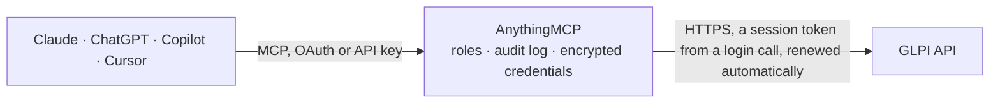

<!-- Generated by scripts/export-github-catalog.mjs in the anythingmcp-website repository. Do not edit by hand. -->

# GLPI MCP connector

GLPI open-source ITSM and asset management: tickets, computers, monitors, software, users and entities, plus GLPI's search engine. The AnythingMCP connector gives Claude, ChatGPT, Microsoft Copilot, Cursor and Gemini 10 MCP tools for GLPI, all read-only.

**Category:** [IT Service Management](../itsm.md) · **Tools:** 10 · **Setup guide:** [anythingmcp.com](https://anythingmcp.com/guides/glpi-to-mcp) · [Deutsch](https://anythingmcp.com/de/guides/glpi-to-mcp) · [Italiano](https://anythingmcp.com/it/guides/glpi-to-mcp) · [Español](https://anythingmcp.com/es/guides/glpi-to-mcp) · [日本語](https://anythingmcp.com/ja/guides/glpi-to-mcp) · [Русский](https://anythingmcp.com/ru/guides/glpi-to-mcp) · [中文](https://anythingmcp.com/zh/guides/glpi-to-mcp)

## Start without code

No installation and no terminal: AnythingMCP Cloud runs the GLPI connector for you, operated by helpcode.ai in Frankfurt, Germany.

1. **Click the button above** and create an account or sign in. The GLPI connector opens, ready to install.
2. **Paste the API key or token from your GLPI account.** Every click is in the [step-by-step guide](https://anythingmcp.com/guides/glpi-to-mcp).
3. **Click Install.** AnythingMCP shows the address of your MCP server.
4. **Add that address to your assistant:** [Claude](https://anythingmcp.com/guides/connect-glpi-to-claude) · [ChatGPT](https://anythingmcp.com/guides/connect-glpi-to-chatgpt) · [Microsoft Copilot](https://anythingmcp.com/guides/connect-glpi-to-copilot) · [Cursor](https://anythingmcp.com/guides/connect-glpi-to-cursor) · [Gemini CLI](https://anythingmcp.com/guides/connect-glpi-to-gemini) · [Meta Muse](https://anythingmcp.com/guides/connect-glpi-to-muse).
5. **Ask your first question**, for example: *What's the full record for ticket #4721 about VPN access for Martinez Telecom employee?*

Prefer help with the setup? [Talk to us](https://anythingmcp.com/contact).

## How it works

- **The AI client** speaks MCP (Streamable HTTP) to AnythingMCP and only sees tool names, descriptions and results. It never gets the GLPI credentials.
- **AnythingMCP** checks the client's role, builds the call from the tool definition, adds the credentials (a session token from a login call, renewed automatically), calls GLPI, logs the call and returns the result.
- **GLPI** sees an ordinary API client with the rights of the account the credentials belong to.

## Tools

| Tool | What it does | Access |
|---|---|---|
| [`glpi_get_active_entities`](#glpi_get_active_entities) | Read the entities the logged-in user is currently scoped to. | read |
| [`glpi_list_tickets`](#glpi_list_tickets) | List tickets in the active entity with their status, priority, category, requester and dates. | read |
| [`glpi_get_ticket`](#glpi_get_ticket) | Read one ticket in full, with its description, status, urgency, impact, priority, requester, assignee and SLA dates. | read |
| [`glpi_get_ticket_followups`](#glpi_get_ticket_followups) | Read the follow-ups (the conversation) on one ticket, in order, with author, date and whether each is private. | read |
| [`glpi_search`](#glpi_search) | Run a GLPI search with criteria. | read |
| [`glpi_list_search_options`](#glpi_list_search_options) | Read the searchable field map for one item type: which field number means status, requester, serial number and so on. | read |
| [`glpi_list_computers`](#glpi_list_computers) | List computers from the asset inventory with their name, serial number, model, operating system and assigned user. | read |
| [`glpi_get_computer`](#glpi_get_computer) | Read one computer in full: hardware, OS, network interfaces, contracts, location and the user it is assigned to. | read |
| [`glpi_list_users`](#glpi_list_users) | List GLPI users with their login, name, e-mail, entity and active flag, to resolve who a ticket or an asset belongs to. | read |
| [`glpi_list_software`](#glpi_list_software) | List software items from the inventory with their publisher, category and the number of installations, for licence questions. | read |

## Tool reference

Every parameter as the AI client sees it in `tools/list`. Source: [`packages/backend/src/adapters/intl/glpi.json`](../../../packages/backend/src/adapters/intl/glpi.json).

### `glpi_get_active_entities`

Read the entities the logged-in user is currently scoped to. No parameters — the quickest proof that the App-Token, username and password all line up.

**Access:** read · **Call:** `GET /getActiveEntities`

No parameters.

### `glpi_list_tickets`

List tickets in the active entity with their status, priority, category, requester and dates. Use `range` to page: 0-49, then 50-99.

**Access:** read · **Call:** `GET /Ticket`

| Parameter | Type | Required | Description |
|---|---|---|---|
| `range` | string | no | Row range as start-end, e.g. `0-49`. GLPI has no page number. |
| `sort` | string | no | Name of the ticket field (column) to sort by, e.g. date_mod, date or id. Not a search-option number; that is only for glpi_search. |
| `order` | string | no | `ASC` or `DESC`. |
| `expand_dropdowns` | boolean | no | When true, resolve dropdown ids to their labels. |

### `glpi_get_ticket`

Read one ticket in full, with its description, status, urgency, impact, priority, requester, assignee and SLA dates.

**Access:** read · **Call:** `GET /Ticket/{id}`

| Parameter | Type | Required | Description |
|---|---|---|---|
| `id` | number | yes | Numeric ticket id. |
| `expand_dropdowns` | boolean | no | When true, resolve dropdown ids to their labels. |

### `glpi_get_ticket_followups`

Read the follow-ups (the conversation) on one ticket, in order, with author, date and whether each is private.

**Access:** read · **Call:** `GET /Ticket/{id}/ITILFollowup`

| Parameter | Type | Required | Description |
|---|---|---|---|
| `id` | number | yes | Numeric ticket id. |
| `range` | string | no | Row range as start-end, e.g. `0-49`. |

### `glpi_search`

Run a GLPI search with criteria. Far more expressive than the list endpoints, but the field numbers are itemtype-specific — get them from glpi_list_search_options first.

**Access:** read · **Call:** `GET /search/{itemtype}`

| Parameter | Type | Required | Description |
|---|---|---|---|
| `itemtype` | string | yes | Item type to search, e.g. Ticket, Computer, User, Software. |
| `field0` | number | yes | Search-option field number for the first criterion. |
| `searchtype0` | string | yes | Match type: contains, equals, notequals, lessthan, morethan, under. |
| `value0` | string | yes | Value to match for the first criterion. |
| `range` | string | no | Row range as start-end, e.g. `0-49`. |
| `forcedisplay` | number[] | no | Search-option field numbers to include in the output, as an array, e.g. [2, 12, 15]. One number per entry; do not pass a comma-separated string. |

### `glpi_list_search_options`

Read the searchable field map for one item type: which field number means status, requester, serial number and so on. Needed before any glpi_search call.

**Access:** read · **Call:** `GET /listSearchOptions/{itemtype}`

| Parameter | Type | Required | Description |
|---|---|---|---|
| `itemtype` | string | yes | Item type, e.g. Ticket, Computer, User. |

### `glpi_list_computers`

List computers from the asset inventory with their name, serial number, model, operating system and assigned user.

**Access:** read · **Call:** `GET /Computer`

| Parameter | Type | Required | Description |
|---|---|---|---|
| `range` | string | no | Row range as start-end, e.g. `0-49`. |
| `expand_dropdowns` | boolean | no | When true, resolve dropdown ids to their labels. |

### `glpi_get_computer`

Read one computer in full: hardware, OS, network interfaces, contracts, location and the user it is assigned to.

**Access:** read · **Call:** `GET /Computer/{id}`

| Parameter | Type | Required | Description |
|---|---|---|---|
| `id` | number | yes | Numeric computer id. |
| `expand_dropdowns` | boolean | no | When true, resolve dropdown ids to their labels. |

### `glpi_list_users`

List GLPI users with their login, name, e-mail, entity and active flag, to resolve who a ticket or an asset belongs to.

**Access:** read · **Call:** `GET /User`

| Parameter | Type | Required | Description |
|---|---|---|---|
| `range` | string | no | Row range as start-end, e.g. `0-49`. |
| `expand_dropdowns` | boolean | no | When true, resolve dropdown ids to their labels. |

### `glpi_list_software`

List software items from the inventory with their publisher, category and the number of installations, for licence questions.

**Access:** read · **Call:** `GET /Software`

| Parameter | Type | Required | Description |
|---|---|---|---|
| `range` | string | no | Row range as start-end, e.g. `0-49`. |
| `expand_dropdowns` | boolean | no | When true, resolve dropdown ids to their labels. |

## Run it yourself

AnythingMCP is open source (AGPL-3.0). [Run it with Docker](../../../README.md#run-it-yourself), open **Connectors → Store**, pick **GLPI** and enter `GLPI_URL`, `GLPI_APP_TOKEN`, `GLPI_USER_TOKEN`, then add your MCP server URL to the AI client.

[← IT Service Management connectors](../itsm.md) · [All categories](../README.md)
