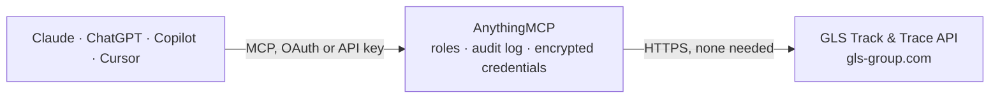

<!-- Generated by scripts/export-github-catalog.mjs in the anythingmcp-website repository. Do not edit by hand. -->

# GLS Track & Trace MCP connector

Track GLS (General Logistics Systems) parcels across Europe using the free public Track & Trace REST API. The AnythingMCP connector gives Claude, ChatGPT, Microsoft Copilot, Cursor and Gemini 2 MCP tools for GLS Track & Trace, all read-only.

**Category:** [Logistics](../logistics.md) · **Tools:** 2 · **Setup guide:** [anythingmcp.com](https://anythingmcp.com/guides/gls-tracking-to-mcp) · [Deutsch](https://anythingmcp.com/de/guides/gls-tracking-to-mcp) · [Italiano](https://anythingmcp.com/it/guides/gls-tracking-to-mcp) · [Español](https://anythingmcp.com/es/guides/gls-tracking-to-mcp) · [日本語](https://anythingmcp.com/ja/guides/gls-tracking-to-mcp) · [Русский](https://anythingmcp.com/ru/guides/gls-tracking-to-mcp) · [中文](https://anythingmcp.com/zh/guides/gls-tracking-to-mcp)

## Start without code

No installation and no terminal: AnythingMCP Cloud runs the GLS Track & Trace connector for you, operated by helpcode.ai in Frankfurt, Germany.

1. **Click the button above** and create an account or sign in. The GLS Track & Trace connector opens, ready to install.
2. **Nothing to enter:** this connector needs no credentials. Every click is in the [step-by-step guide](https://anythingmcp.com/guides/gls-tracking-to-mcp).
3. **Click Install.** AnythingMCP shows the address of your MCP server.
4. **Add that address to your assistant:** [Claude](https://anythingmcp.com/guides/connect-gls-tracking-to-claude) · [ChatGPT](https://anythingmcp.com/guides/connect-gls-tracking-to-chatgpt) · [Microsoft Copilot](https://anythingmcp.com/guides/connect-gls-tracking-to-copilot) · [Cursor](https://anythingmcp.com/guides/connect-gls-tracking-to-cursor) · [Gemini CLI](https://anythingmcp.com/guides/connect-gls-tracking-to-gemini) · [Meta Muse](https://anythingmcp.com/guides/connect-gls-tracking-to-muse).
5. **Ask your first question**, for example: *Track parcel 123456789012 for a delivery to Berlin, use country DE and language en.*

Prefer help with the setup? [Talk to us](https://anythingmcp.com/contact).

## How it works

- **The AI client** speaks MCP (Streamable HTTP) to AnythingMCP and only sees tool names, descriptions and results. It never gets the GLS Track & Trace credentials.
- **AnythingMCP** checks the client's role, builds the call from the tool definition, adds the credentials (none needed), calls GLS Track & Trace, logs the call and returns the result.
- **GLS Track & Trace** sees an ordinary API client with the rights of the account the credentials belong to.

## Tools

| Tool | What it does | Access |
|---|---|---|
| [`gls_track_by_parcel_number`](#gls_track_by_parcel_number) | Track a GLS parcel by its TrackID (parcel number). | read |
| [`gls_track_by_reference`](#gls_track_by_reference) | Find GLS parcels by customer reference (the shipper's order/reference number). | read |

## Tool reference

Every parameter as the AI client sees it in `tools/list`. Source: [`packages/backend/src/adapters/de/gls-tracking.json`](../../../packages/backend/src/adapters/de/gls-tracking.json).

### `gls_track_by_parcel_number`

Track a GLS parcel by its TrackID (parcel number). Returns the parcel status, sender, receiver, service product, weight, and a chronological list of tracking events with location, timestamp and description.

**Access:** read · **Call:** `GET /{country}/{language}/rstt001`

| Parameter | Type | Required | Description |
|---|---|---|---|
| `trackId` | string | yes | The GLS TrackID / parcel number (typically 10-12 digits). |
| `country` | string | no | Country scope (ISO 2-letter). Defaults to 'EU' for cross-border. Common: 'DE', 'AT', 'CH', 'FR', 'NL', 'BE'. |
| `language` | string | no | Language for descriptions: 'de', 'en', 'fr', 'it', 'es', 'nl', 'pl', 'cz'. Defaults to 'en'. |

### `gls_track_by_reference`

Find GLS parcels by customer reference (the shipper's order/reference number). Returns an array of matching parcels — multiple parcels can share the same reference.

**Access:** read · **Call:** `GET /{country}/{language}/rstt001`

| Parameter | Type | Required | Description |
|---|---|---|---|
| `reference` | string | yes | The customer/order reference set at shipment creation time. |
| `country` | string | no | Country scope (ISO 2-letter). Defaults to 'EU'. |
| `language` | string | no | Language for descriptions. Defaults to 'en'. |

## Run it yourself

AnythingMCP is open source (AGPL-3.0). [Run it with Docker](../../../README.md#run-it-yourself), open **Connectors → Store**, pick **GLS Track & Trace**, then add your MCP server URL to the AI client.

[← Logistics connectors](../logistics.md) · [All categories](../README.md)
