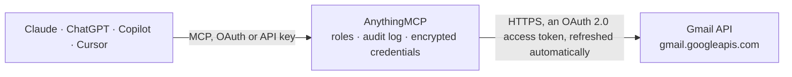

<!-- Generated by scripts/export-github-catalog.mjs in the anythingmcp-website repository. Do not edit by hand. -->

# Gmail MCP connector

Let your AI work in Gmail: search the mailbox with Gmail's own search syntax, read messages and conversations as plain text, see labels and unread counts, mark mail as read, archive, star or label … The AnythingMCP connector gives Claude, ChatGPT, Microsoft Copilot, Cursor and Gemini 16 MCP tools for Gmail: 10 read and 6 can change data.

**Category:** [Email](../email.md) · **Tools:** 16 · **Setup guide:** [anythingmcp.com](https://anythingmcp.com/guides/gmail-to-mcp) · [Deutsch](https://anythingmcp.com/de/guides/gmail-to-mcp) · [Italiano](https://anythingmcp.com/it/guides/gmail-to-mcp) · [Español](https://anythingmcp.com/es/guides/gmail-to-mcp) · [日本語](https://anythingmcp.com/ja/guides/gmail-to-mcp) · [Русский](https://anythingmcp.com/ru/guides/gmail-to-mcp) · [中文](https://anythingmcp.com/zh/guides/gmail-to-mcp)

## Start without code

No installation and no terminal: AnythingMCP Cloud runs the Gmail connector for you, operated by helpcode.ai in Frankfurt, Germany.

1. **Click the button above** and create an account or sign in. The Gmail connector opens, ready to install.
2. **Sign in with your Gmail account** when AnythingMCP asks. The first time, an admin creates a small app in the Google Cloud console. Every click is in the [step-by-step guide](https://anythingmcp.com/guides/gmail-to-mcp).
3. **Click Install.** AnythingMCP shows the address of your MCP server.
4. **Add that address to your assistant:** [Claude](https://anythingmcp.com/guides/connect-gmail-to-claude) · [ChatGPT](https://anythingmcp.com/guides/connect-gmail-to-chatgpt) · [Microsoft Copilot](https://anythingmcp.com/guides/connect-gmail-to-copilot) · [Cursor](https://anythingmcp.com/guides/connect-gmail-to-cursor) · [Gemini CLI](https://anythingmcp.com/guides/connect-gmail-to-gemini) · [Meta Muse](https://anythingmcp.com/guides/connect-gmail-to-muse).
5. **Ask your first question**, for example: *Find the invoice email from Nordal Oy with subject 'Invoice 2026-1079' and show its content.*

Prefer help with the setup? [Talk to us](https://anythingmcp.com/contact).

## How it works

- **The AI client** speaks MCP (Streamable HTTP) to AnythingMCP and only sees tool names, descriptions and results. It never gets the Gmail credentials.
- **AnythingMCP** checks the client's role, builds the call from the tool definition, adds the credentials (an OAuth 2.0 access token, refreshed automatically), calls Gmail, logs the call and returns the result.
- **Gmail** sees an ordinary API client with the rights of the account the credentials belong to.

## Tools

| Tool | What it does | Access |
|---|---|---|
| [`gmail_get_profile`](#gmail_get_profile) | Return the Gmail account the connector works with: its email address, the total number of messages and threads in the mailbox, and the current history id. | read |
| [`gmail_list_messages`](#gmail_list_messages) | Search or list messages in the mailbox with Gmail search syntax and optional label filters. | read |
| [`gmail_get_message`](#gmail_get_message) | Get one message by id, decoded: sender, recipients, subject, date, Message-ID and References, labels and the body as plain text (HTML-only mail converted to… | read |
| [`gmail_get_attachment`](#gmail_get_attachment) | Download one attachment of a message by its attachmentId, from the attachments list of gmail_get_message, gmail_get_thread or gmail_get_draft. | read |
| [`gmail_list_threads`](#gmail_list_threads) | Search or list conversations (threads) with Gmail search syntax and optional label filters. | read |
| [`gmail_get_thread`](#gmail_get_thread) | Get one conversation by thread id with all its messages in order, each decoded like gmail_get_message: sender, recipients, subject, date, Message-ID, labels… | read |
| [`gmail_list_labels`](#gmail_list_labels) | List all labels of the mailbox, system labels (INBOX, UNREAD, STARRED, SENT, SPAM, TRASH, categories) and the user's own, with id, name and type. | read |
| [`gmail_get_label`](#gmail_get_label) | Get one label by id with its message and thread counts, total and unread, plus its visibility settings and colour. | read |
| [`gmail_modify_message_labels`](#gmail_modify_message_labels) | Add and remove labels on one message: mark it read (remove UNREAD) or unread (add UNREAD), archive it (remove INBOX), star it (add STARRED) or file it under… | write |
| [`gmail_modify_thread_labels`](#gmail_modify_thread_labels) | Add and remove labels on every message of a conversation at once, e.g. archive a whole thread (remove INBOX) or mark it read (remove UNREAD). | write |
| [`gmail_list_drafts`](#gmail_list_drafts) | List the drafts in the mailbox, optionally filtered with Gmail search syntax. | read |
| [`gmail_get_draft`](#gmail_get_draft) | Get one draft by draft id with its message decoded: recipients, subject and the body as plain text, to check it before it is sent with gmail_send_draft. | read |
| [`gmail_create_draft`](#gmail_create_draft) | Save a new email as a draft in the mailbox without sending it, so the user can review it in Gmail; send it later with gmail_send_draft. | write |
| [`gmail_send_draft`](#gmail_send_draft) | Send an existing draft to its recipients exactly as it is written. | write |
| [`gmail_send_message`](#gmail_send_message) | Write and send a new email from the signed-in Gmail account right away. | write |
| [`gmail_reply`](#gmail_reply) | Send a reply inside an existing conversation. | write |

## Tool reference

Every parameter as the AI client sees it in `tools/list`. Source: [`packages/backend/src/adapters/intl/gmail.json`](../../../packages/backend/src/adapters/intl/gmail.json).

### `gmail_get_profile`

Return the Gmail account the connector works with: its email address, the total number of messages and threads in the mailbox, and the current history id.

**Access:** read · **Call:** `GET /profile`

No parameters.

### `gmail_list_messages`

Search or list messages in the mailbox with Gmail search syntax and optional label filters. Returns message ids and thread ids (no content), nextPageToken while more results exist, and an estimated total; read a message with gmail_get_message.

**Access:** read · **Call:** `GET /messages`

| Parameter | Type | Required | Description |
|---|---|---|---|
| `q` | string | no | Gmail search query, same syntax as the Gmail search box, e.g. "from:ana@example.com is:unread newer_than:7d" or "subject:invoice has:attachment". |
| `label_ids` | string[] | no | Only messages that carry all of these label ids, e.g. ["INBOX", "UNREAD"]. User label ids come from gmail_list_labels. |
| `max_results` | integer | no | Maximum number of messages per page, 1 to 500 (default 100). |
| `page_token` | string | no | nextPageToken from the previous response, to fetch the next page with the same other arguments. |
| `include_spam_trash` | boolean | no | true to include messages in Spam and Trash (default false). |

### `gmail_get_message`

Get one message by id, decoded: sender, recipients, subject, date, Message-ID and References, labels and the body as plain text (HTML-only mail converted to text), plus a list of attachments. Use format "metadata" for headers only.

**Access:** read · **Call:** `GET /messages/{message_id}`

| Parameter | Type | Required | Description |
|---|---|---|---|
| `message_id` | string | yes | Message id from gmail_list_messages or gmail_get_thread. |
| `format` | `full` \| `metadata` \| `minimal` \| `raw` | no | How much of the message to return: "full" (default) headers plus the decoded plain-text body and attachment list; "metadata" headers, labels and snippet only; "minimal" ids and labels only; "raw" the whole RFC 822 message as one undecoded base64url string. |
| `metadata_headers` | string[] | no | With format "metadata": only these headers, e.g. ["From", "To", "Subject", "Date"]. |

### `gmail_get_attachment`

Download one attachment of a message by its attachmentId, from the attachments list of gmail_get_message, gmail_get_thread or gmail_get_draft. Returns size (bytes) and data: the file content as one base64url string, for handing on to a tool that stores or reads files. Check size in the attachments list first: the whole file comes back as text, so prefer attachments of a few megabytes at most.

**Access:** read · **Call:** `GET /messages/{message_id}/attachments/{attachment_id}`

| Parameter | Type | Required | Description |
|---|---|---|---|
| `message_id` | string | yes | Id of the message that carries the attachment. |
| `attachment_id` | string | yes | attachmentId from the message's attachments list. |

### `gmail_list_threads`

Search or list conversations (threads) with Gmail search syntax and optional label filters. Returns thread ids with a snippet and history id, nextPageToken while more results exist, and an estimated total; read a thread's messages with gmail_get_thread.

**Access:** read · **Call:** `GET /threads`

| Parameter | Type | Required | Description |
|---|---|---|---|
| `q` | string | no | Gmail search query, same syntax as the Gmail search box, e.g. "from:ana@example.com is:unread newer_than:7d" or "subject:invoice has:attachment". |
| `label_ids` | string[] | no | Only threads that carry all of these label ids, e.g. ["INBOX", "UNREAD"]. User label ids come from gmail_list_labels. |
| `max_results` | integer | no | Maximum number of threads per page, 1 to 500 (default 100). |
| `page_token` | string | no | nextPageToken from the previous response, to fetch the next page with the same other arguments. |
| `include_spam_trash` | boolean | no | true to include threads in Spam and Trash (default false). |

### `gmail_get_thread`

Get one conversation by thread id with all its messages in order, each decoded like gmail_get_message: sender, recipients, subject, date, Message-ID, labels and the body as plain text. The last message's threadId, messageId and references are what gmail_reply needs.

**Access:** read · **Call:** `GET /threads/{thread_id}`

| Parameter | Type | Required | Description |
|---|---|---|---|
| `thread_id` | string | yes | Thread id from gmail_list_threads or the threadId of a message. |
| `format` | `full` \| `metadata` \| `minimal` | no | How much of the messages to return: "full" (default) headers plus the decoded plain-text bodies; "metadata" headers, labels and snippet only; "minimal" ids and labels only. |
| `metadata_headers` | string[] | no | With format "metadata": only these headers, e.g. ["From", "To", "Subject", "Date"]. |

### `gmail_list_labels`

List all labels of the mailbox, system labels (INBOX, UNREAD, STARRED, SENT, SPAM, TRASH, categories) and the user's own, with id, name and type. Label ids are what the search filters and the label tools take.

**Access:** read · **Call:** `GET /labels`

No parameters.

### `gmail_get_label`

Get one label by id with its message and thread counts, total and unread, plus its visibility settings and colour.

**Access:** read · **Call:** `GET /labels/{label_id}`

| Parameter | Type | Required | Description |
|---|---|---|---|
| `label_id` | string | yes | Label id, e.g. INBOX, UNREAD or Label_12 from gmail_list_labels. |

### `gmail_modify_message_labels`

Add and remove labels on one message: mark it read (remove UNREAD) or unread (add UNREAD), archive it (remove INBOX), star it (add STARRED) or file it under a user label. Returns the message's id, thread id and resulting labels.

**Access:** write · **Call:** `POST /messages/{message_id}/modify`

| Parameter | Type | Required | Description |
|---|---|---|---|
| `message_id` | string | yes | Message id. |
| `add_label_ids` | string[] | no | Label ids to add, e.g. ["STARRED"] or ["Label_12"]. Up to 100. |
| `remove_label_ids` | string[] | no | Label ids to remove, e.g. ["UNREAD"] to mark as read or ["INBOX"] to archive. Up to 100. |

### `gmail_modify_thread_labels`

Add and remove labels on every message of a conversation at once, e.g. archive a whole thread (remove INBOX) or mark it read (remove UNREAD). Returns the thread with its messages' ids and labels.

**Access:** write · **Call:** `POST /threads/{thread_id}/modify`

| Parameter | Type | Required | Description |
|---|---|---|---|
| `thread_id` | string | yes | Thread id. |
| `add_label_ids` | string[] | no | Label ids to add to all messages of the thread. Up to 100. |
| `remove_label_ids` | string[] | no | Label ids to remove from all messages of the thread. Up to 100. |

### `gmail_list_drafts`

List the drafts in the mailbox, optionally filtered with Gmail search syntax. Returns each draft's id with its message id and thread id, and nextPageToken while more exist; read one with gmail_get_draft.

**Access:** read · **Call:** `GET /drafts`

| Parameter | Type | Required | Description |
|---|---|---|---|
| `q` | string | no | Gmail search query applied to the drafts, e.g. "to:ana@example.com" or "subject:offer". |
| `max_results` | integer | no | Maximum number of drafts per page, 1 to 500 (default 100). |
| `page_token` | string | no | nextPageToken from the previous response. |
| `include_spam_trash` | boolean | no | true to include drafts in Spam and Trash (default false). |

### `gmail_get_draft`

Get one draft by draft id with its message decoded: recipients, subject and the body as plain text, to check it before it is sent with gmail_send_draft.

**Access:** read · **Call:** `GET /drafts/{draft_id}`

| Parameter | Type | Required | Description |
|---|---|---|---|
| `draft_id` | string | yes | Draft id (it starts with r-) from gmail_list_drafts; not a message id. |
| `format` | `full` \| `metadata` \| `minimal` \| `raw` | no | How much of the draft to return: "full" (default) headers plus the decoded plain-text body; "metadata" headers, labels and snippet only; "minimal" ids and labels only; "raw" the whole RFC 822 message as one undecoded base64url string. |

### `gmail_create_draft`

Save a new email as a draft in the mailbox without sending it, so the user can review it in Gmail; send it later with gmail_send_draft. Also for reply drafts: pass thread_id, in_reply_to and references from the message being answered. Returns the draft id and its message id and thread id.

**Access:** write · **Call:** `POST /drafts`

| Parameter | Type | Required | Description |
|---|---|---|---|
| `to` | string[] | no | Recipients, each "name@example.com" or "Ana Müller <ana@example.com>". |
| `cc` | string[] | no | Cc recipients, same format as to. |
| `bcc` | string[] | no | Bcc recipients, same format as to; the other recipients do not see them. |
| `subject` | string | no | Subject line, one line. For a reply draft, "Re: " followed by the original subject. |
| `body` | string | yes | The message text, plain text with line breaks. |
| `html_body` | string | no | Optional HTML version of the same message; mail clients that show HTML display it instead of body. Always send body as well. |
| `thread_id` | string | no | For a reply draft: the threadId of the conversation. |
| `in_reply_to` | string | no | For a reply draft: the messageId (Message-ID header, e.g. <abc@mail.gmail.com>) of the message being answered, from gmail_get_message. |
| `references` | string | no | For a reply draft: the references of the message being answered, from gmail_get_message, when it has any. in_reply_to is appended automatically. |

### `gmail_send_draft`

Send an existing draft to its recipients exactly as it is written. Gmail removes the draft and returns the sent message with its id, thread id and the SENT label.

**Access:** write · **Call:** `POST /drafts/send`

| Parameter | Type | Required | Description |
|---|---|---|---|
| `draft_id` | string | yes | Draft id from gmail_list_drafts. |

### `gmail_send_message`

Write and send a new email from the signed-in Gmail account right away. Subject and names may use any language; body is plain text, html_body an optional HTML version. Returns the sent message's id, thread id and labels. Sending cannot be undone: use gmail_create_draft when the user wants to check first, gmail_reply to answer a conversation.

**Access:** write · **Call:** `POST /messages/send`

| Parameter | Type | Required | Description |
|---|---|---|---|
| `to` | string[] | yes | Recipients, each "name@example.com" or "Ana Müller <ana@example.com>". |
| `cc` | string[] | no | Cc recipients, same format as to. |
| `bcc` | string[] | no | Bcc recipients, same format as to; the other recipients do not see them. |
| `subject` | string | yes | Subject line, one line. |
| `body` | string | yes | The message text, plain text with line breaks. |
| `html_body` | string | no | Optional HTML version of the same message; mail clients that show HTML display it instead of body. Always send body as well. |

### `gmail_reply`

Send a reply inside an existing conversation. Read the message being answered with gmail_get_message first and pass its threadId as thread_id, messageId as in_reply_to, references (if any) as references, subject as subject ("Re: " is added when missing) and replyTo or from as to. Sends at once and returns the sent message's id and thread id.

**Access:** write · **Call:** `POST /messages/send`

| Parameter | Type | Required | Description |
|---|---|---|---|
| `thread_id` | string | yes | threadId of the message being answered. |
| `in_reply_to` | string | yes | messageId (Message-ID header, e.g. <abc@mail.gmail.com>) of the message being answered, from gmail_get_message. |
| `references` | string | no | references of the message being answered, from gmail_get_message, when it has any. in_reply_to is appended automatically. |
| `to` | string[] | yes | Recipients of the reply: the original replyTo, or else from. For reply-all, put the other original recipients in cc. |
| `cc` | string[] | no | Cc recipients, same format as to. |
| `bcc` | string[] | no | Bcc recipients, same format as to; the other recipients do not see them. |
| `subject` | string | yes | Subject of the message being answered; "Re: " is added when it does not start with it. |
| `body` | string | yes | The reply text, plain text with line breaks. The original message is not quoted automatically. |
| `html_body` | string | no | Optional HTML version of the same message; mail clients that show HTML display it instead of body. Always send body as well. |

## Run it yourself

AnythingMCP is open source (AGPL-3.0). [Run it with Docker](../../../README.md#run-it-yourself), open **Connectors → Store**, pick **Gmail** and enter `GOOGLE_CLIENT_ID`, `GOOGLE_CLIENT_SECRET`, then add your MCP server URL to the AI client.

[← Email connectors](../email.md) · [All categories](../README.md)
