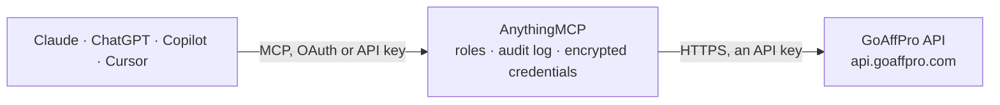

<!-- Generated by scripts/export-github-catalog.mjs in the anythingmcp-website repository. Do not edit by hand. -->

# GoAffPro MCP connector

Run your GoAffPro affiliate program from your AI: find affiliates and their codes, see the orders, rewards and traffic they bring, what you owe and have paid them, and approve affiliates and … The AnythingMCP connector gives Claude, ChatGPT, Microsoft Copilot, Cursor and Gemini 24 MCP tools for GoAffPro: 14 read and 10 can change data.

**Category:** [Marketing Automation](../marketing-automation.md) · **Tools:** 24 · **Setup guide:** [anythingmcp.com](https://anythingmcp.com/guides/goaffpro-to-mcp) · [Deutsch](https://anythingmcp.com/de/guides/goaffpro-to-mcp) · [Italiano](https://anythingmcp.com/it/guides/goaffpro-to-mcp) · [Español](https://anythingmcp.com/es/guides/goaffpro-to-mcp) · [日本語](https://anythingmcp.com/ja/guides/goaffpro-to-mcp) · [Русский](https://anythingmcp.com/ru/guides/goaffpro-to-mcp) · [中文](https://anythingmcp.com/zh/guides/goaffpro-to-mcp)

## Start without code

No installation and no terminal: AnythingMCP Cloud runs the GoAffPro connector for you, operated by helpcode.ai in Frankfurt, Germany.

1. **Click the button above** and create an account or sign in. The GoAffPro connector opens, ready to install.
2. **Paste the API key or token from your GoAffPro account.** Every click is in the [step-by-step guide](https://anythingmcp.com/guides/goaffpro-to-mcp).
3. **Click Install.** AnythingMCP shows the address of your MCP server.
4. **Add that address to your assistant:** [Claude](https://anythingmcp.com/guides/connect-goaffpro-to-claude) · [ChatGPT](https://anythingmcp.com/guides/connect-goaffpro-to-chatgpt) · [Microsoft Copilot](https://anythingmcp.com/guides/connect-goaffpro-to-copilot) · [Cursor](https://anythingmcp.com/guides/connect-goaffpro-to-cursor) · [Gemini CLI](https://anythingmcp.com/guides/connect-goaffpro-to-gemini) · [Meta Muse](https://anythingmcp.com/guides/connect-goaffpro-to-muse).
5. **Ask your first question**, for example: *Show affiliate record for referral code GREEN10 or email lena@greenleaf.de*

Prefer help with the setup? [Talk to us](https://anythingmcp.com/contact).

## How it works

- **The AI client** speaks MCP (Streamable HTTP) to AnythingMCP and only sees tool names, descriptions and results. It never gets the GoAffPro credentials.
- **AnythingMCP** checks the client's role, builds the call from the tool definition, adds the credentials (an API key), calls GoAffPro, logs the call and returns the result.
- **GoAffPro** sees an ordinary API client with the rights of the account the credentials belong to.

## Tools

| Tool | What it does | Access |
|---|---|---|
| [`goaffpro_list_affiliates`](#goaffpro_list_affiliates) | List the store's affiliates with the fields you ask for (default id, name, e-mail, referral code, coupon, status, created). | read |
| [`goaffpro_search_affiliates`](#goaffpro_search_affiliates) | Find affiliates by part of their name, e-mail or referral code (starts with, contains or ends with a keyword). | read |
| [`goaffpro_get_affiliate_commissions`](#goaffpro_get_affiliate_commissions) | Get the commission structure that applies to one affiliate: standard rate, special product or collection rates and royalties. | read |
| [`goaffpro_list_affiliate_coupons`](#goaffpro_list_affiliate_coupons) | List the coupon codes assigned to one affiliate with discount type and value. | read |
| [`goaffpro_list_affiliate_referral_codes`](#goaffpro_list_affiliate_referral_codes) | List the referral codes of one affiliate (the codes in their tracking links). | read |
| [`goaffpro_list_orders`](#goaffpro_list_orders) | List the orders credited to affiliates with total, subtotal (the commission base), commission, affiliate and approval status. | read |
| [`goaffpro_list_rewards`](#goaffpro_list_rewards) | List rewards credited to affiliates outside of order commissions: sign-up, recruitment and target bonuses and upline sale commissions, with amount and status. | read |
| [`goaffpro_list_payouts`](#goaffpro_list_payouts) | List the payouts already made to affiliates (payment history) with amount, method, notes and date. | read |
| [`goaffpro_list_pending_payouts`](#goaffpro_list_pending_payouts) | Show how much is owed to each affiliate right now (approved commissions and rewards not yet paid), optionally only up to a date. | read |
| [`goaffpro_list_payout_requests`](#goaffpro_list_payout_requests) | List the payout requests affiliates sent from their dashboard, with amount, note, invoice and status (in_progress, paid, rejected). | read |
| [`goaffpro_list_transactions`](#goaffpro_list_transactions) | List the affiliate ledger: every credit and debit from orders, rewards and payouts with amount, currency, paid flag and running balance. | read |
| [`goaffpro_list_traffic`](#goaffpro_list_traffic) | List visits that affiliates sent to the store, with affiliate, referring page, landing page and time, to see which affiliates drive traffic. | read |
| [`goaffpro_list_coupons`](#goaffpro_list_coupons) | List the coupon codes assigned in the affiliate app with discount type and value, affiliate and type (referral or personal). | read |
| [`goaffpro_list_groups`](#goaffpro_list_groups) | List the affiliate groups (tiers) with their names and commission structures. | read |
| [`goaffpro_create_affiliate`](#goaffpro_create_affiliate) | Create an affiliate account, approved or pending, optionally with a referral code, a coupon, contact data and a parent affiliate for multi-level programs. | write |
| [`goaffpro_update_affiliate`](#goaffpro_update_affiliate) | Change an affiliate: approve or reject (status), personal commission rate, coupon, referral code, contact data or notes. | write |
| [`goaffpro_delete_affiliate`](#goaffpro_delete_affiliate) | Delete an affiliate account. | write |
| [`goaffpro_add_affiliate_coupon`](#goaffpro_add_affiliate_coupon) | Assign a coupon code to an affiliate. | write |
| [`goaffpro_add_order`](#goaffpro_add_order) | Credit an order to an affiliate by hand, e.g. a sale the tracking missed, by affiliate id or referral code. | write |
| [`goaffpro_update_order`](#goaffpro_update_order) | Change an affiliate order: approve or reject it, correct the commission or subtotal, or add a merchant adjustment. | write |
| [`goaffpro_delete_order`](#goaffpro_delete_order) | Delete an order and its commission from the affiliate's account. | write |
| [`goaffpro_give_reward`](#goaffpro_give_reward) | Credit a reward to an affiliate: a sign-up, recruitment or target bonus, or an upline sale commission for an order. | write |
| [`goaffpro_record_payout`](#goaffpro_record_payout) | Record that an affiliate was paid (money sent outside GoAffPro, e.g. by bank transfer or PayPal), which lowers what the store owes them. | write |
| [`goaffpro_update_payout_request`](#goaffpro_update_payout_request) | Set the status of an affiliate's payout request to in_progress, paid or rejected. | write |

## Tool reference

Every parameter as the AI client sees it in `tools/list`. Source: [`packages/backend/src/adapters/intl/goaffpro.json`](../../../packages/backend/src/adapters/intl/goaffpro.json).

### `goaffpro_list_affiliates`

List the store's affiliates with the fields you ask for (default id, name, e-mail, referral code, coupon, status, created). Filter by ids, e-mails, referral codes, coupon codes, status (pending, approved, invited, rejected) or creation and update dates. Paged with limit and offset. Read-only.

**Access:** read · **Call:** `GET /affiliates`

| Parameter | Type | Required | Description |
|---|---|---|---|
| `fields` | string | yes | Comma-separated fields to return (GoAffPro requires the list). Default id,name,email,ref_code,coupon,status,created_at; others include first_name, last_name, phone, country, website, instagram, group_id, ref_codes, coupons, payment_method, commission. |
| `id` | string | no | Comma-separated affiliate ids. |
| `email` | string | no | Comma-separated e-mail addresses. |
| `ref_code` | string | no | Comma-separated referral codes. |
| `coupon` | string | no | Comma-separated coupon codes. |
| `status` | string | no | Comma-separated statuses: pending, approved, invited, rejected. |
| `created_at_min` | string | no | Only affiliates created at or after this. Date and time; GoAffPro's documentation writes it like Sun Jul 26 2026 12:10:07 GMT+0200. |
| `created_at_max` | string | no | Only affiliates created at or before this. Date and time; GoAffPro's documentation writes it like Sun Jul 26 2026 12:10:07 GMT+0200. |
| `updated_at_min` | string | no | Only affiliates updated at or after this. Date and time; GoAffPro's documentation writes it like Sun Jul 26 2026 12:10:07 GMT+0200. |
| `limit` | integer | no | Maximum number of results, e.g. 100. |
| `offset` | integer | no | Number of affiliates to skip, for the next page. |

### `goaffpro_search_affiliates`

Find affiliates by part of their name, e-mail or referral code (starts with, contains or ends with a keyword). Read-only.

**Access:** read · **Call:** `GET /affiliates/search`

| Parameter | Type | Required | Description |
|---|---|---|---|
| `keyword` | string | yes | Text to look for, e.g. anna or anna@. |
| `in` | string | yes | Comma-separated columns to search, e.g. name,email,ref_code. |
| `operator` | `starts_with` \| `contains` \| `ends_with` | no | How the keyword matches. |
| `fields` | string | yes | Comma-separated fields to return (GoAffPro requires the list). Default id,name,email,ref_code,coupon,status,created_at; see goaffpro_list_affiliates for others. |
| `sort_column` | `name` \| `ref_code` \| `id` | no | Sort by this column. |
| `sort_direction` | `asc` \| `desc` | no | Sort direction. |
| `limit` | integer | no | Maximum number of results. |

### `goaffpro_get_affiliate_commissions`

Get the commission structure that applies to one affiliate: standard rate, special product or collection rates and royalties. Read-only.

**Access:** read · **Call:** `GET /affiliates/{id}/commissions`

| Parameter | Type | Required | Description |
|---|---|---|---|
| `id` | integer | yes | The affiliate id. |

### `goaffpro_list_affiliate_coupons`

List the coupon codes assigned to one affiliate with discount type and value. Read-only.

**Access:** read · **Call:** `GET /affiliates/{id}/coupons`

| Parameter | Type | Required | Description |
|---|---|---|---|
| `id` | integer | yes | The affiliate id. |

### `goaffpro_list_affiliate_referral_codes`

List the referral codes of one affiliate (the codes in their tracking links). Read-only.

**Access:** read · **Call:** `GET /affiliates/{id}/referral_codes`

| Parameter | Type | Required | Description |
|---|---|---|---|
| `id` | integer | yes | The affiliate id. |

### `goaffpro_list_orders`

List the orders credited to affiliates with total, subtotal (the commission base), commission, affiliate and approval status. Filter by order ids or numbers, affiliate ids, customer e-mail, status (new, approved, rejected), creation date, new customers or subscription orders. Page with since_id. Read-only.

**Access:** read · **Call:** `GET /orders`

| Parameter | Type | Required | Description |
|---|---|---|---|
| `fields` | string | yes | Comma-separated fields to return (GoAffPro requires the list). Default id,number,total,subtotal,commission,affiliate_id,status,created_at; others include customer_email, customer_name, is_new_customer, conversion_source, sub_id, data (the raw order). |
| `id` | string | no | Comma-separated order ids. |
| `number` | string | no | Comma-separated order numbers as the shop shows them. |
| `affiliate_id` | string | no | Comma-separated affiliate ids. |
| `customer_email` | string | no | Customer e-mail address. |
| `status` | string | no | Comma-separated statuses: new, approved, rejected. |
| `created_at_min` | string | no | Only orders created at or after this. Date and time; GoAffPro's documentation writes it like Sun Jul 26 2026 12:10:07 GMT+0200. |
| `created_at_max` | string | no | Only orders created at or before this. Date and time; GoAffPro's documentation writes it like Sun Jul 26 2026 12:10:07 GMT+0200. |
| `is_new_customer` | `0` \| `1` | no | 1 for orders of new customers, 0 for returning ones. |
| `is_subscription` | `0` \| `1` | no | 1 for subscription orders, 0 for others. |
| `since_id` | string | no | Only orders after this order id, to fetch the next page. |
| `limit` | integer | no | Maximum number of results, e.g. 100. |

### `goaffpro_list_rewards`

List rewards credited to affiliates outside of order commissions: sign-up, recruitment and target bonuses and upline sale commissions, with amount and status. Read-only.

**Access:** read · **Call:** `GET /rewards`

| Parameter | Type | Required | Description |
|---|---|---|---|
| `fields` | string | yes | Comma-separated fields to return (GoAffPro requires the list). Default id,affiliate_id,type,amount,status,order_id,metadata,created_at; these are the reward fields GoAffPro documents. |
| `affiliate_id` | string | no | Comma-separated affiliate ids. |
| `type` | string | no | Comma-separated reward types: signup_bonus, sale_commission, recruitment_bonus, target_bonus. |
| `status` | string | no | Comma-separated statuses: approved, rejected. |
| `order_id` | string | no | Comma-separated order ids. |
| `created_at_min` | string | no | Only rewards created at or after this. Date and time; GoAffPro's documentation writes it like Sun Jul 26 2026 12:10:07 GMT+0200. |
| `created_at_max` | string | no | Only rewards created at or before this. Date and time; GoAffPro's documentation writes it like Sun Jul 26 2026 12:10:07 GMT+0200. |
| `since_id` | string | no | Only rewards after this reward id, to fetch the next page. |
| `limit` | integer | no | Maximum number of results, e.g. 100. |

### `goaffpro_list_payouts`

List the payouts already made to affiliates (payment history) with amount, method, notes and date. Read-only.

**Access:** read · **Call:** `GET /payments`

| Parameter | Type | Required | Description |
|---|---|---|---|
| `fields` | string | yes | Comma-separated fields to return (GoAffPro requires the list). Default id,affiliate_id,amount,currency,payment_method,admin_note,affiliate_message,created_at; add payment_details for the payout account data (personal data). |
| `affiliate_id` | string | no | Comma-separated affiliate ids. |
| `created_at_min` | string | no | Only payouts created at or after this date. |
| `created_at_max` | string | no | Only payouts created at or before this date. |
| `limit` | integer | no | Maximum number of results, e.g. 100. |
| `offset` | integer | no | Number of payouts to skip, for the next page. |

### `goaffpro_list_pending_payouts`

Show how much is owed to each affiliate right now (approved commissions and rewards not yet paid), optionally only up to a date. Read-only.

**Access:** read · **Call:** `GET /payments/pending`

| Parameter | Type | Required | Description |
|---|---|---|---|
| `affiliate_id` | string | no | Comma-separated affiliate ids. |
| `upto` | string | no | Count only amounts earned up to this date, YYYY-MM-DD. |

### `goaffpro_list_payout_requests`

List the payout requests affiliates sent from their dashboard, with amount, note, invoice and status (in_progress, paid, rejected). Read-only.

**Access:** read · **Call:** `GET /payments/requests`

| Parameter | Type | Required | Description |
|---|---|---|---|
| `affiliate_id` | string | no | Comma-separated affiliate ids. |
| `status` | `in_progress` \| `paid` \| `rejected` | no | Only requests with this status. |
| `since_id` | string | no | Only requests after this request id. |
| `limit` | integer | no | Maximum number of results, e.g. 100. |

### `goaffpro_list_transactions`

List the affiliate ledger: every credit and debit from orders, rewards and payouts with amount, currency, paid flag and running balance. Filter by affiliate, type or paid state. Paged with limit and offset; the answer carries count. Read-only.

**Access:** read · **Call:** `GET /transactions`

| Parameter | Type | Required | Description |
|---|---|---|---|
| `affiliate_id` | string | no | Only this affiliate's transactions. |
| `type` | string | no | Comma-separated entity types: ORDERS, REWARDS, PAYOUTS. |
| `is_paid` | boolean | no | true for paid, false for unpaid transactions. |
| `payout_id` | integer | no | Only the transactions settled by this payout. |
| `limit` | integer | no | Maximum number of results, e.g. 100. |
| `offset` | integer | no | Number of transactions to skip. |

### `goaffpro_list_traffic`

List visits that affiliates sent to the store, with affiliate, referring page, landing page and time, to see which affiliates drive traffic. Read-only.

**Access:** read · **Call:** `GET /traffic`

| Parameter | Type | Required | Description |
|---|---|---|---|
| `fields` | string | yes | Comma-separated fields to return (GoAffPro requires the list). Default id,affiliate_id,referring_page,landing_page,created_at; ip_address and user_agent are also available but are visitors' personal data. |
| `affiliate_id` | string | no | Comma-separated affiliate ids. |
| `created_at_min` | string | no | Only visits at or after this, YYYY-MM-DDThh:mm:ss. |
| `created_at_max` | string | no | Only visits at or before this, YYYY-MM-DDThh:mm:ss. |
| `since_id` | string | no | Only visits after this visit id, for the next page. |
| `limit` | integer | no | Maximum number of visits, up to 1000. |

### `goaffpro_list_coupons`

List the coupon codes assigned in the affiliate app with discount type and value, affiliate and type (referral or personal). Filter by affiliate or code. Read-only.

**Access:** read · **Call:** `GET /coupons`

| Parameter | Type | Required | Description |
|---|---|---|---|
| `affiliate_id` | integer | no | Only this affiliate's coupons. |
| `code` | string | no | Only this coupon code. |
| `type` | `referral` \| `personal` | no | referral for codes customers use, personal for the affiliate's own discount. |
| `limit` | integer | no | Maximum number of results, e.g. 100. |
| `offset` | integer | no | Number of coupons to skip. |

### `goaffpro_list_groups`

List the affiliate groups (tiers) with their names and commission structures. Read-only.

**Access:** read · **Call:** `GET /groups`

| Parameter | Type | Required | Description |
|---|---|---|---|
| `fields` | string | yes | Comma-separated fields to return. |

### `goaffpro_create_affiliate`

Create an affiliate account, approved or pending, optionally with a referral code, a coupon, contact data and a parent affiliate for multi-level programs. GoAffPro may e-mail the new affiliate depending on the store's settings. Changes the live affiliate program: describe the change and get the user's confirmation before calling.

**Access:** write · **Call:** `POST /affiliates`

| Parameter | Type | Required | Description |
|---|---|---|---|
| `email` | string | yes | The affiliate's e-mail address (their login). |
| `status` | `approved` \| `pending` \| `rejected` | no | Approval status of the new account. |
| `coupon` | object | no | Optional coupon to create for the affiliate. |
| `parent_email` | string | no | E-mail of the parent affiliate, for multi-level programs. |
| `password` | string | no | Optional initial password; leave out to let the affiliate set one. |
| `name` | string | no | Full name. |
| `first_name` | string | no | First name. |
| `last_name` | string | no | Last name. |
| `company_name` | string | no | Company name. |
| `ref_code` | string | no | Referral code used in the affiliate's links. |
| `phone` | string | no | Phone number. |
| `address_1` | string | no | Street address. |
| `address_2` | string | no | Second address line. |
| `city` | string | no | City. |
| `state` | string | no | State or region. |
| `zip` | string | no | Postal code. |
| `country` | string | no | Country (two-letter code). |
| `website` | string | no | Website URL. |
| `instagram` | string | no | Instagram handle or URL. |
| `facebook` | string | no | Facebook URL. |
| `twitter` | string | no | X / Twitter handle or URL. |
| `tax_identification_number` | string | no | Tax identification number. |
| `admin_note` | string | no | Private note visible only to the store admins. |
| `personal_message` | string | no | Message shown to the affiliate in their dashboard. |

### `goaffpro_update_affiliate`

Change an affiliate: approve or reject (status), personal commission rate, coupon, referral code, contact data or notes. Only the fields given are sent. Changes the live affiliate program: describe the change and get the user's confirmation before calling.

**Access:** write · **Call:** `PATCH /affiliates/{id}`

| Parameter | Type | Required | Description |
|---|---|---|---|
| `id` | integer | yes | The affiliate id. |
| `status` | `approved` \| `pending` \| `rejected` | no | Approval status. |
| `commission` | object | no | Personal commission that overrides the program's rate. |
| `coupon` | object | no | Coupon to set for the affiliate. |
| `name` | string | no | Full name. |
| `first_name` | string | no | First name. |
| `last_name` | string | no | Last name. |
| `company_name` | string | no | Company name. |
| `ref_code` | string | no | Referral code used in the affiliate's links. |
| `phone` | string | no | Phone number. |
| `address_1` | string | no | Street address. |
| `address_2` | string | no | Second address line. |
| `city` | string | no | City. |
| `state` | string | no | State or region. |
| `zip` | string | no | Postal code. |
| `country` | string | no | Country (two-letter code). |
| `website` | string | no | Website URL. |
| `instagram` | string | no | Instagram handle or URL. |
| `facebook` | string | no | Facebook URL. |
| `twitter` | string | no | X / Twitter handle or URL. |
| `tax_identification_number` | string | no | Tax identification number. |
| `admin_note` | string | no | Private note visible only to the store admins. |
| `personal_message` | string | no | Message shown to the affiliate in their dashboard. |

### `goaffpro_delete_affiliate`

Delete an affiliate account. Installed switched off; turn it on deliberately. Rejecting with goaffpro_update_affiliate keeps the history. Changes the live affiliate program: describe the change and get the user's confirmation before calling.

**Access:** write · **Call:** `DELETE /affiliates/{id}`

| Parameter | Type | Required | Description |
|---|---|---|---|
| `id` | integer | yes | The affiliate id. |

### `goaffpro_add_affiliate_coupon`

Assign a coupon code to an affiliate. With only coupon_code, GoAffPro also creates the discount in the store according to the store's automatic coupon settings; with a discount type and value it records an existing store code for the affiliate. Changes the live affiliate program: describe the change and get the user's confirmation before calling.

**Access:** write · **Call:** `POST /affiliates/{id}/coupons`

| Parameter | Type | Required | Description |
|---|---|---|---|
| `id` | integer | yes | The affiliate id. |
| `coupon_code` | string | yes | The coupon code, e.g. ANNA10. |
| `discount_type` | `percentage` \| `fixed_amount` \| `free_shipping` | no | Discount type of an existing code. |
| `discount_value` | number | no | Discount value of an existing code. |

### `goaffpro_add_order`

Credit an order to an affiliate by hand, e.g. a sale the tracking missed, by affiliate id or referral code. GoAffPro computes the commission from the store's rules. Changes the live affiliate program: describe the change and get the user's confirmation before calling.

**Access:** write · **Call:** `POST /orders`

| Parameter | Type | Required | Description |
|---|---|---|---|
| `number` | string | yes | Order number as the shop shows it. |
| `total` | number | yes | Order total. |
| `affiliate_id` | string | no | Affiliate who gets the order. Give this or ref_code. |
| `ref_code` | string | no | Referral code of the affiliate. Give this or affiliate_id. |

### `goaffpro_update_order`

Change an affiliate order: approve or reject it, correct the commission or subtotal, or add a merchant adjustment. Only the fields given are sent. Changes the live affiliate program: describe the change and get the user's confirmation before calling.

**Access:** write · **Call:** `PATCH /orders/{id}`

| Parameter | Type | Required | Description |
|---|---|---|---|
| `id` | string | yes | The order id (from goaffpro_list_orders). |
| `status` | `pending` \| `approved` \| `rejected` | no | Approval status. |
| `commission` | number | no | New commission for the affiliate. |
| `subtotal` | number | no | New commission base. |
| `merchant_adjustment` | number | no | Adjustment amount applied by the merchant. |
| `customer_email` | string | no | Customer e-mail. |
| `customer_name` | string | no | Customer name. |

### `goaffpro_delete_order`

Delete an order and its commission from the affiliate's account. Installed switched off; turn it on deliberately. Rejecting with goaffpro_update_order keeps the record. Changes the live affiliate program: describe the change and get the user's confirmation before calling.

**Access:** write · **Call:** `DELETE /orders/{id}`

| Parameter | Type | Required | Description |
|---|---|---|---|
| `id` | string | yes | The order id. |

### `goaffpro_give_reward`

Credit a reward to an affiliate: a sign-up, recruitment or target bonus, or an upline sale commission for an order. The amount adds to what the store owes the affiliate. Changes the live affiliate program: describe the change and get the user's confirmation before calling.

**Access:** write · **Call:** `POST /rewards`

| Parameter | Type | Required | Description |
|---|---|---|---|
| `affiliate_id` | integer | yes | The affiliate who gets the reward. |
| `amount` | number | yes | Reward amount in the store currency. |
| `type` | `signup_bonus` \| `sale_commission` \| `recruitment_bonus` \| `target_bonus` | yes | Kind of reward. |
| `status` | `approved` \| `pending` \| `rejected` | no | Status of the reward. |
| `order_id` | string | no | Order id; required for sale_commission. |
| `level` | string | no | Upline level, only for sale_commission. |
| `metadata` | string | no | A note stored with the reward, e.g. the reason. |

### `goaffpro_record_payout`

Record that an affiliate was paid (money sent outside GoAffPro, e.g. by bank transfer or PayPal), which lowers what the store owes them. Does not move money itself. Changes the live affiliate program: describe the change and get the user's confirmation before calling.

**Access:** write · **Call:** `POST /payments`

| Parameter | Type | Required | Description |
|---|---|---|---|
| `affiliate_id` | string | yes | The affiliate who was paid. |
| `amount` | number | yes | Amount paid. |
| `payment_method` | string | no | How it was paid, e.g. paypal or bank. Leave out to use the affiliate's own setting. |
| `created_at` | string | no | Date the payout was sent; now when left out. |
| `affiliate_message` | string | no | Message for the affiliate. |
| `admin_note` | string | no | Private note for the admins. |

### `goaffpro_update_payout_request`

Set the status of an affiliate's payout request to in_progress, paid or rejected. Changes the live affiliate program: describe the change and get the user's confirmation before calling.

**Access:** write · **Call:** `PATCH /payments/requests/{id}`

| Parameter | Type | Required | Description |
|---|---|---|---|
| `id` | string | yes | The payout request id from goaffpro_list_payout_requests. |
| `status` | `in_progress` \| `paid` \| `rejected` | yes | New status. |

## Run it yourself

AnythingMCP is open source (AGPL-3.0). [Run it with Docker](../../../README.md#run-it-yourself), open **Connectors → Store**, pick **GoAffPro** and enter `GOAFFPRO_ACCESS_TOKEN`, then add your MCP server URL to the AI client.

[← Marketing Automation connectors](../marketing-automation.md) · [All categories](../README.md)
