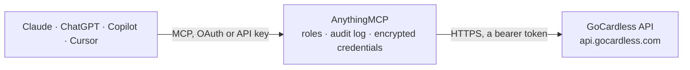

<!-- Generated by scripts/export-github-catalog.mjs in the anythingmcp-website repository. Do not edit by hand. -->

# GoCardless MCP connector

Manage GoCardless (direct-debit payment processing: customers, mandates, payments, subscriptions, payouts, refunds) from any AI agent. 10 tools, Bearer token. The AnythingMCP connector gives Claude, ChatGPT, Microsoft Copilot, Cursor and Gemini 10 MCP tools for GoCardless: 6 read and 4 can change data.

**Category:** [Payments](../payments.md) · **Tools:** 10 · **Setup guide:** [anythingmcp.com](https://anythingmcp.com/guides/gocardless-to-mcp) · [Deutsch](https://anythingmcp.com/de/guides/gocardless-to-mcp) · [Italiano](https://anythingmcp.com/it/guides/gocardless-to-mcp) · [Español](https://anythingmcp.com/es/guides/gocardless-to-mcp) · [日本語](https://anythingmcp.com/ja/guides/gocardless-to-mcp) · [Русский](https://anythingmcp.com/ru/guides/gocardless-to-mcp) · [中文](https://anythingmcp.com/zh/guides/gocardless-to-mcp)

## Start without code

No installation and no terminal: AnythingMCP Cloud runs the GoCardless connector for you, operated by helpcode.ai in Frankfurt, Germany.

1. **Click the button above** and create an account or sign in. The GoCardless connector opens, ready to install.
2. **Paste the API key or token from your GoCardless account.** Every click is in the [step-by-step guide](https://anythingmcp.com/guides/gocardless-to-mcp).
3. **Click Install.** AnythingMCP shows the address of your MCP server.
4. **Add that address to your assistant:** [Claude](https://anythingmcp.com/guides/connect-gocardless-to-claude) · [ChatGPT](https://anythingmcp.com/guides/connect-gocardless-to-chatgpt) · [Microsoft Copilot](https://anythingmcp.com/guides/connect-gocardless-to-copilot) · [Cursor](https://anythingmcp.com/guides/connect-gocardless-to-cursor) · [Gemini CLI](https://anythingmcp.com/guides/connect-gocardless-to-gemini) · [Meta Muse](https://anythingmcp.com/guides/connect-gocardless-to-muse).
5. **Ask your first question**, for example: *Show me the GoCardless customer record for Vantaa Logistics Oy, contact janet.korpela@vantaa.fi*

Prefer help with the setup? [Talk to us](https://anythingmcp.com/contact).

## How it works

- **The AI client** speaks MCP (Streamable HTTP) to AnythingMCP and only sees tool names, descriptions and results. It never gets the GoCardless credentials.
- **AnythingMCP** checks the client's role, builds the call from the tool definition, adds the credentials (a bearer token), calls GoCardless, logs the call and returns the result.
- **GoCardless** sees an ordinary API client with the rights of the account the credentials belong to.

## Tools

| Tool | What it does | Access |
|---|---|---|
| [`gocardless_list_customers`](#gocardless_list_customers) | List customers. | read |
| [`gocardless_create_customer`](#gocardless_create_customer) | Create a customer. | write |
| [`gocardless_list_mandates`](#gocardless_list_mandates) | List mandates (the recurring authorisation to debit a customer's bank). | read |
| [`gocardless_get_mandate`](#gocardless_get_mandate) | Get one mandate. | read |
| [`gocardless_list_payments`](#gocardless_list_payments) | List payments. | read |
| [`gocardless_create_payment`](#gocardless_create_payment) | Create a one-off payment against a mandate. | write |
| [`gocardless_list_subscriptions`](#gocardless_list_subscriptions) | List subscriptions (recurring payment schedules). | read |
| [`gocardless_create_subscription`](#gocardless_create_subscription) | Create a subscription. | write |
| [`gocardless_list_payouts`](#gocardless_list_payouts) | List payouts (settlement to your bank account). | read |
| [`gocardless_create_refund`](#gocardless_create_refund) | Refund a payment (full or partial). | write |

## Tool reference

Every parameter as the AI client sees it in `tools/list`. Source: [`packages/backend/src/adapters/intl/gocardless.json`](../../../packages/backend/src/adapters/intl/gocardless.json).

### `gocardless_list_customers`

List customers.

**Access:** read · **Call:** `GET /customers`

| Parameter | Type | Required | Description |
|---|---|---|---|
| `limit` | integer | no | Max 500. |
| `after` | string | no | Cursor — next page. |
| `before` | string | no | Cursor — prev page. |
| `created_at_gt` | string | no | ISO 8601 — created after. |
| `created_at_lt` | string | no | ISO 8601. |

### `gocardless_create_customer`

Create a customer.

**Access:** write · **Call:** `POST /customers`

| Parameter | Type | Required | Description |
|---|---|---|---|
| `email` | string | no | Customer email. |
| `given_name` | string | no | Given/first name. |
| `family_name` | string | no | Family/last name. |
| `company_name` | string | no | Company (instead of names). |
| `address_line1` | string | no | Address line 1. |
| `city` | string | no | City. |
| `postal_code` | string | no | Postcode. |
| `country_code` | string | yes | ISO 3166-1 alpha-2. |
| `language` | string | no | ISO 639-1. |

### `gocardless_list_mandates`

List mandates (the recurring authorisation to debit a customer's bank).

**Access:** read · **Call:** `GET /mandates`

| Parameter | Type | Required | Description |
|---|---|---|---|
| `customer` | string | no | Filter by customer ID. |
| `status` | string | no | pending_customer_approval, pending_submission, submitted, active, failed, cancelled, expired, consumed. |
| `limit` | integer | no | Max 500. |
| `after` | string | no | Cursor. |

### `gocardless_get_mandate`

Get one mandate.

**Access:** read · **Call:** `GET /mandates/{mandate_id}`

| Parameter | Type | Required | Description |
|---|---|---|---|
| `mandate_id` | string | yes | Mandate ID (e.g. MD0000…). |

### `gocardless_list_payments`

List payments.

**Access:** read · **Call:** `GET /payments`

| Parameter | Type | Required | Description |
|---|---|---|---|
| `customer` | string | no | Filter by customer. |
| `mandate` | string | no | Filter by mandate. |
| `subscription` | string | no | Filter by subscription. |
| `status` | string | no | pending_customer_approval, pending_submission, submitted, confirmed, paid_out, cancelled, customer_approval_denied, failed, charged_back. |
| `limit` | integer | no | Max 500. |
| `after` | string | no | Cursor. |

### `gocardless_create_payment`

Create a one-off payment against a mandate.

**Access:** write · **Call:** `POST /payments`

| Parameter | Type | Required | Description |
|---|---|---|---|
| `amount` | integer | yes | Amount in minor units (cents/pence). |
| `currency` | string | yes | ISO 4217 (GBP, EUR, USD, AUD, NZD, SEK, DKK, CAD). |
| `mandate_id` | string | yes | Mandate ID to debit. |
| `description` | string | no | Description shown on statement. |
| `reference` | string | no | Reference for your records. |
| `charge_date` | string | no | YYYY-MM-DD when to collect. |

### `gocardless_list_subscriptions`

List subscriptions (recurring payment schedules).

**Access:** read · **Call:** `GET /subscriptions`

| Parameter | Type | Required | Description |
|---|---|---|---|
| `customer` | string | no | Filter by customer. |
| `status` | string | no | active, paused, cancelled, finished. |
| `limit` | integer | no | Max 500. |
| `after` | string | no | Cursor. |

### `gocardless_create_subscription`

Create a subscription. `interval_unit` is weekly/monthly/yearly.

**Access:** write · **Call:** `POST /subscriptions`

| Parameter | Type | Required | Description |
|---|---|---|---|
| `amount` | integer | yes | Amount in minor units. |
| `currency` | string | yes | ISO 4217. |
| `name` | string | no | Subscription name. |
| `interval_unit` | string | yes | weekly, monthly, yearly. |
| `interval` | integer | no | Default 1. |
| `day_of_month` | integer | no | 1-28 or -1=last day. Monthly only. |
| `mandate_id` | string | yes | Mandate to charge. |
| `start_date` | string | no | YYYY-MM-DD. |
| `count` | integer | no | Total number of payments (omit for indefinite). |

### `gocardless_list_payouts`

List payouts (settlement to your bank account).

**Access:** read · **Call:** `GET /payouts`

| Parameter | Type | Required | Description |
|---|---|---|---|
| `status` | string | no | pending, paid, bounced. |
| `limit` | integer | no | Max 500. |
| `after` | string | no | Cursor. |

### `gocardless_create_refund`

Refund a payment (full or partial).

**Access:** write · **Call:** `POST /refunds`

| Parameter | Type | Required | Description |
|---|---|---|---|
| `amount` | integer | yes | Refund amount in minor units. |
| `payment_id` | string | yes | Payment ID to refund. |
| `total_amount_confirmation` | integer | yes | Total amount of the original payment — defensive guard. |
| `reference` | string | no | Reference for your records. |

## Run it yourself

AnythingMCP is open source (AGPL-3.0). [Run it with Docker](../../../README.md#run-it-yourself), open **Connectors → Store**, pick **GoCardless** and enter `GOCARDLESS_ACCESS_TOKEN`, then add your MCP server URL to the AI client.

[← Payments connectors](../payments.md) · [All categories](../README.md)
