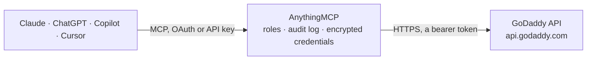

<!-- Generated by scripts/export-github-catalog.mjs in the anythingmcp-website repository. Do not edit by hand. -->

# GoDaddy MCP connector

Domains registered at GoDaddy through the GoDaddy Domains API: list domains and their status, expiry, lock and auto-renew, check availability and prices, get name suggestions, read and change DNS … The AnythingMCP connector gives Claude, ChatGPT, Microsoft Copilot, Cursor and Gemini 15 MCP tools for GoDaddy: 8 read and 7 can change data.

**Category:** [Infrastructure](../infrastructure.md) · **Tools:** 15 · **Setup guide:** [anythingmcp.com](https://anythingmcp.com/guides/godaddy-to-mcp) · [Deutsch](https://anythingmcp.com/de/guides/godaddy-to-mcp) · [Italiano](https://anythingmcp.com/it/guides/godaddy-to-mcp) · [Español](https://anythingmcp.com/es/guides/godaddy-to-mcp) · [日本語](https://anythingmcp.com/ja/guides/godaddy-to-mcp) · [Русский](https://anythingmcp.com/ru/guides/godaddy-to-mcp) · [中文](https://anythingmcp.com/zh/guides/godaddy-to-mcp)

## Start without code

No installation and no terminal: AnythingMCP Cloud runs the GoDaddy connector for you, operated by helpcode.ai in Frankfurt, Germany.

1. **Click the button above** and create an account or sign in. The GoDaddy connector opens, ready to install.
2. **Paste the API key or token from your GoDaddy account.** Every click is in the [step-by-step guide](https://anythingmcp.com/guides/godaddy-to-mcp).
3. **Click Install.** AnythingMCP shows the address of your MCP server.
4. **Add that address to your assistant:** [Claude](https://anythingmcp.com/guides/connect-godaddy-to-claude) · [ChatGPT](https://anythingmcp.com/guides/connect-godaddy-to-chatgpt) · [Microsoft Copilot](https://anythingmcp.com/guides/connect-godaddy-to-copilot) · [Cursor](https://anythingmcp.com/guides/connect-godaddy-to-cursor) · [Gemini CLI](https://anythingmcp.com/guides/connect-godaddy-to-gemini) · [Meta Muse](https://anythingmcp.com/guides/connect-godaddy-to-muse).
5. **Ask your first question**, for example: *What's the current status, expiry, auto-renew and lock for veridian-markets.com?*

Prefer help with the setup? [Talk to us](https://anythingmcp.com/contact).

## How it works

- **The AI client** speaks MCP (Streamable HTTP) to AnythingMCP and only sees tool names, descriptions and results. It never gets the GoDaddy credentials.
- **AnythingMCP** checks the client's role, builds the call from the tool definition, adds the credentials (a bearer token), calls GoDaddy, logs the call and returns the result.
- **GoDaddy** sees an ordinary API client with the rights of the account the credentials belong to.

## Tools

| Tool | What it does | Access |
|---|---|---|
| [`godaddy_list_domains`](#godaddy_list_domains) | List the domains of the GoDaddy account: domain, status, expires, renewAuto, locked, privacy, createdAt. | read |
| [`godaddy_get_domain`](#godaddy_get_domain) | Details of one domain in the account: status, expires, renewAuto, renewDeadline, locked, privacy, nameServers, transferProtected and the registrant, admin,… | read |
| [`godaddy_check_availability`](#godaddy_check_availability) | Check whether one domain can be registered and at what price. | read |
| [`godaddy_check_availability_bulk`](#godaddy_check_availability_bulk) | Check up to 500 domain names in one call. | read |
| [`godaddy_suggest_domains`](#godaddy_suggest_domains) | Suggest available domain names from a domain or keywords, e.g. when the wanted name is taken. | read |
| [`godaddy_list_tlds`](#godaddy_list_tlds) | List the top-level domains (extensions) GoDaddy sells, with name and type (GENERIC or COUNTRY_CODE). | read |
| [`godaddy_list_dns_records`](#godaddy_list_dns_records) | List every DNS record of a domain on GoDaddy's nameservers: type, name (@ for the domain itself), data, ttl, and priority, service, protocol, port, weight… | read |
| [`godaddy_get_dns_records`](#godaddy_get_dns_records) | List the DNS records of one type and name, e.g. type TXT and name _dmarc, or type A and name @. | read |
| [`godaddy_add_dns_records`](#godaddy_add_dns_records) | Add DNS records to a domain without touching the existing ones. | write |
| [`godaddy_replace_dns_records`](#godaddy_replace_dns_records) | Replace all DNS records of one type and name with the given list, e.g. set the A record of @ to a new IP or change a TXT value. | write |
| [`godaddy_delete_dns_records`](#godaddy_delete_dns_records) | Delete every DNS record of one type and name from a domain, e.g. all TXT records named _acme-challenge. | write |
| [`godaddy_update_domain`](#godaddy_update_domain) | Change settings of a domain: the transfer lock, auto-renew, or the nameservers. | write |
| [`godaddy_update_contacts`](#godaddy_update_contacts) | Replace the WHOIS contacts of a domain. | write |
| [`godaddy_resend_registrant_verification`](#godaddy_resend_registrant_verification) | Send the ICANN registrant email verification for a domain again, when the registrant did not receive or let expire the first one. | write |
| [`godaddy_renew_domain`](#godaddy_renew_domain) | Renew a domain for a number of years. | write |

## Tool reference

Every parameter as the AI client sees it in `tools/list`. Source: [`packages/backend/src/adapters/intl/godaddy.json`](../../../packages/backend/src/adapters/intl/godaddy.json).

### `godaddy_list_domains`

List the domains of the GoDaddy account: domain, status, expires, renewAuto, locked, privacy, createdAt. Optionally with contacts and nameservers. Sorted by domain name; page with marker.

**Access:** read · **Call:** `GET /v1/domains`

| Parameter | Type | Required | Description |
|---|---|---|---|
| `statuses` | string | no | Only domains with these statuses, comma-separated, e.g. ACTIVE,EXPIRED,PENDING_TRANSFER,CANCELLED. |
| `status_groups` | string | no | Only domains in these status groups, comma-separated: INACTIVE, PRE_REGISTRATION, REDEMPTION, RENEWABLE, VERIFICATION_ICANN, VISIBLE. |
| `includes` | string | no | Extra detail per domain, comma-separated: contacts, nameServers. |
| `modified_date` | string | no | Only domains changed since this ISO 8601 date-time, e.g. 2026-01-01T00:00:00Z. |
| `limit` | integer | no | Maximum number of domains to return (1-1000). |
| `marker` | string | no | Paging: the last domain name of the previous page; the list continues after it. |

### `godaddy_get_domain`

Details of one domain in the account: status, expires, renewAuto, renewDeadline, locked, privacy, nameServers, transferProtected and the registrant, admin, billing and tech contacts. The transfer authorization code is left out.

**Access:** read · **Call:** `GET /v1/domains/{domain}`

| Parameter | Type | Required | Description |
|---|---|---|---|
| `domain` | string | yes | Domain name, e.g. example.com. |

### `godaddy_check_availability`

Check whether one domain can be registered and at what price. Returns available, price and currency (price in micro units: 12990000 = 12.99), period in years and definitive (false when the answer came from a cache).

**Access:** read · **Call:** `GET /v1/domains/available`

| Parameter | Type | Required | Description |
|---|---|---|---|
| `domain` | string | yes | Full domain name including the extension, e.g. example.com. |
| `check_type` | `FAST` \| `FULL` | no | FAST (default) may answer from a cache; FULL asks the registry live and is slower. |
| `for_transfer` | boolean | no | true to check whether the domain can be transferred in instead of registered. |

### `godaddy_check_availability_bulk`

Check up to 500 domain names in one call. Returns a domains array with available, price (micro units), currency and period for each name, and errors for names that could not be checked. Reads only.

**Access:** read · **Call:** `POST /v1/domains/available`

| Parameter | Type | Required | Description |
|---|---|---|---|
| `domains` | string[] | yes | Full domain names including the extension, e.g. ["example.com", "example.net"]. |
| `check_type` | `FAST` \| `FULL` | no | FAST (default) may answer from a cache; FULL asks the registry live. |

### `godaddy_suggest_domains`

Suggest available domain names from a domain or keywords, e.g. when the wanted name is taken. Returns a list of domain names; check prices with godaddy_check_availability_bulk.

**Access:** read · **Call:** `GET /v1/domains/suggest`

| Parameter | Type | Required | Description |
|---|---|---|---|
| `query` | string | no | A domain name or keywords, e.g. sunrise bakery or sunrisebakery.com. |
| `tlds` | string | no | Only these extensions, comma-separated, e.g. com,net,de. |
| `sources` | string | no | Suggestion strategies, comma-separated: CC_TLD (country extensions), EXTENSION (other extensions), KEYWORD_SPIN (varied keywords), PREMIUM (premium names). |
| `country` | string | no | Two-letter country code as a regional hint, e.g. DE. |
| `city` | string | no | City name as a regional hint. |
| `length_min` | integer | no | Minimum length of the name before the extension. |
| `length_max` | integer | no | Maximum length of the name before the extension. |
| `limit` | integer | no | Maximum number of suggestions. |
| `wait_ms` | integer | no | How long GoDaddy may collect suggestions, in milliseconds (default 1000). |

### `godaddy_list_tlds`

List the top-level domains (extensions) GoDaddy sells, with name and type (GENERIC or COUNTRY_CODE).

**Access:** read · **Call:** `GET /v1/domains/tlds`

No parameters.

### `godaddy_list_dns_records`

List every DNS record of a domain on GoDaddy's nameservers: type, name (@ for the domain itself), data, ttl, and priority, service, protocol, port, weight where they apply.

**Access:** read · **Call:** `GET /v1/domains/{domain}/records`

| Parameter | Type | Required | Description |
|---|---|---|---|
| `domain` | string | yes | Domain name, e.g. example.com. |
| `offset` | integer | no | Number of records to skip, for paging. |
| `limit` | integer | no | Maximum number of records to return. |

### `godaddy_get_dns_records`

List the DNS records of one type and name, e.g. type TXT and name _dmarc, or type A and name @. Returns an empty list when there are none.

**Access:** read · **Call:** `GET /v1/domains/{domain}/records/{type}/{name}`

| Parameter | Type | Required | Description |
|---|---|---|---|
| `domain` | string | yes | Domain name, e.g. example.com. |
| `type` | `A` \| `AAAA` \| `CAA` \| `CNAME` \| `MX` \| `NS` \| `SOA` \| `SRV` \| `TXT` | yes | Record type. |
| `name` | string | yes | Record name relative to the domain: @ for the domain itself, www, _dmarc, mail, ... |
| `offset` | integer | no | Number of records to skip, for paging. |
| `limit` | integer | no | Maximum number of records to return. |

### `godaddy_add_dns_records`

Add DNS records to a domain without touching the existing ones. Each call adds the records again, so check with godaddy_get_dns_records first to avoid duplicates.

**Access:** write · **Call:** `PATCH /v1/domains/{domain}/records`

| Parameter | Type | Required | Description |
|---|---|---|---|
| `domain` | string | yes | Domain name, e.g. example.com. |
| `records` | object[] | yes | Records to add. |

### `godaddy_replace_dns_records`

Replace all DNS records of one type and name with the given list, e.g. set the A record of @ to a new IP or change a TXT value. Records of other types and names stay as they are.

**Access:** write · **Call:** `PUT /v1/domains/{domain}/records/{type}/{name}`

| Parameter | Type | Required | Description |
|---|---|---|---|
| `domain` | string | yes | Domain name, e.g. example.com. |
| `type` | `A` \| `AAAA` \| `CAA` \| `CNAME` \| `MX` \| `NS` \| `SRV` \| `TXT` | yes | Record type to replace. |
| `name` | string | yes | Record name to replace: @ for the domain itself, www, _dmarc, ... |
| `records` | object[] | yes | The new records for this type and name; every existing one is replaced. |

### `godaddy_delete_dns_records`

Delete every DNS record of one type and name from a domain, e.g. all TXT records named _acme-challenge. NS and SOA records cannot be deleted this way.

**Access:** write · **Call:** `DELETE /v1/domains/{domain}/records/{type}/{name}`

| Parameter | Type | Required | Description |
|---|---|---|---|
| `domain` | string | yes | Domain name, e.g. example.com. |
| `type` | `A` \| `AAAA` \| `CAA` \| `CNAME` \| `MX` \| `SRV` \| `TXT` | yes | Record type to delete. |
| `name` | string | yes | Record name to delete: @ for the domain itself, www, _acme-challenge, ... |

### `godaddy_update_domain`

Change settings of a domain: the transfer lock, auto-renew, or the nameservers. Only the fields you pass change. New nameservers move DNS away from GoDaddy.

**Access:** write · **Call:** `PATCH /v1/domains/{domain}`

| Parameter | Type | Required | Description |
|---|---|---|---|
| `domain` | string | yes | Domain name, e.g. example.com. |
| `locked` | boolean | no | true locks the domain against transfers to another registrar, false unlocks it. |
| `renew_auto` | boolean | no | true renews the domain automatically before it expires (charged to the account), false turns that off. |
| `name_servers` | string[] | no | New nameserver host names, at least two, e.g. ["ns1.example-dns.com", "ns2.example-dns.com"]. GoDaddy's own are ns*.domaincontrol.com. |

### `godaddy_update_contacts`

Replace the WHOIS contacts of a domain. The registrant is required; admin, billing and tech are optional. Send complete contacts (read them with godaddy_get_domain first). A new registrant can trigger a confirmation email and a 60-day transfer lock.

**Access:** write · **Call:** `PATCH /v1/domains/{domain}/contacts`

| Parameter | Type | Required | Description |
|---|---|---|---|
| `domain` | string | yes | Domain name, e.g. example.com. |
| `contact_registrant` | object | yes | Registrant (owner): nameFirst, nameLast, email, phone (+49.7611234567), organization, jobTitle, addressMailing {address1, address2, city, state, postalCode, country (two letters)}. |
| `contact_admin` | object | no | Administrative contact, same fields as the registrant. |
| `contact_billing` | object | no | Billing contact, same fields as the registrant. |
| `contact_tech` | object | no | Technical contact, same fields as the registrant. |

### `godaddy_resend_registrant_verification`

Send the ICANN registrant email verification for a domain again, when the registrant did not receive or let expire the first one.

**Access:** write · **Call:** `POST /v1/domains/{domain}/verifyRegistrantEmail`

| Parameter | Type | Required | Description |
|---|---|---|---|
| `domain` | string | yes | Domain name, e.g. example.com. |

### `godaddy_renew_domain`

Renew a domain for a number of years. This charges the account's payment method: confirm the domain, the years and the price with the user before calling. Do not retry on an unclear error; check expires with godaddy_get_domain instead.

**Access:** write · **Call:** `POST /v1/domains/{domain}/renew`

| Parameter | Type | Required | Description |
|---|---|---|---|
| `domain` | string | yes | Domain name, e.g. example.com. |
| `period` | integer | no | Years to add (1-10, within the extension's maximum). Default: the period of the original purchase. |

## Run it yourself

AnythingMCP is open source (AGPL-3.0). [Run it with Docker](../../../README.md#run-it-yourself), open **Connectors → Store**, pick **GoDaddy** and enter `GODADDY_PAT`, then add your MCP server URL to the AI client.

[← Infrastructure connectors](../infrastructure.md) · [All categories](../README.md)
