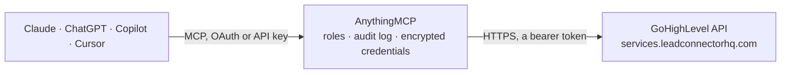

<!-- Generated by scripts/export-github-catalog.mjs in the anythingmcp-website repository. Do not edit by hand. -->

# GoHighLevel MCP connector

GoHighLevel (HighLevel, LeadConnector) CRM for one sub-account: contacts with tags, notes and tasks, conversations and sending SMS, email or WhatsApp, opportunities and pipelines, calendars and … The AnythingMCP connector gives Claude, ChatGPT, Microsoft Copilot, Cursor and Gemini 53 MCP tools for GoHighLevel: 34 read and 19 can change data.

**Category:** [CRM](../crm.md) · **Tools:** 53 · **Setup guide:** [anythingmcp.com](https://anythingmcp.com/guides/gohighlevel-to-mcp) · [Deutsch](https://anythingmcp.com/de/guides/gohighlevel-to-mcp) · [Italiano](https://anythingmcp.com/it/guides/gohighlevel-to-mcp) · [Español](https://anythingmcp.com/es/guides/gohighlevel-to-mcp) · [日本語](https://anythingmcp.com/ja/guides/gohighlevel-to-mcp) · [Русский](https://anythingmcp.com/ru/guides/gohighlevel-to-mcp) · [中文](https://anythingmcp.com/zh/guides/gohighlevel-to-mcp)

## Start without code

No installation and no terminal: AnythingMCP Cloud runs the GoHighLevel connector for you, operated by helpcode.ai in Frankfurt, Germany.

1. **Click the button above** and create an account or sign in. The GoHighLevel connector opens, ready to install.
2. **Paste the API key or token from your GoHighLevel account.** Every click is in the [step-by-step guide](https://anythingmcp.com/guides/gohighlevel-to-mcp).
3. **Click Install.** AnythingMCP shows the address of your MCP server.
4. **Add that address to your assistant:** [Claude](https://anythingmcp.com/guides/connect-gohighlevel-to-claude) · [ChatGPT](https://anythingmcp.com/guides/connect-gohighlevel-to-chatgpt) · [Microsoft Copilot](https://anythingmcp.com/guides/connect-gohighlevel-to-copilot) · [Cursor](https://anythingmcp.com/guides/connect-gohighlevel-to-cursor) · [Gemini CLI](https://anythingmcp.com/guides/connect-gohighlevel-to-gemini) · [Meta Muse](https://anythingmcp.com/guides/connect-gohighlevel-to-muse).
5. **Ask your first question**, for example: *Show me invoice INV-2026-117 for Green Valley GmbH: status, issue date, due date and amount due.*

Prefer help with the setup? [Talk to us](https://anythingmcp.com/contact).

## How it works

- **The AI client** speaks MCP (Streamable HTTP) to AnythingMCP and only sees tool names, descriptions and results. It never gets the GoHighLevel credentials.
- **AnythingMCP** checks the client's role, builds the call from the tool definition, adds the credentials (a bearer token), calls GoHighLevel, logs the call and returns the result.
- **GoHighLevel** sees an ordinary API client with the rights of the account the credentials belong to.

## Tools

| Tool | What it does | Access |
|---|---|---|
| [`gohighlevel_get_location`](#gohighlevel_get_location) | Details of the configured sub-account (location): name, address, phone, email, website, timezone, business info and settings. | read |
| [`gohighlevel_list_custom_fields`](#gohighlevel_list_custom_fields) | List the custom fields of the sub-account with id, name, fieldKey (contact.my_field), data type, picklist options and model (contact or opportunity). | read |
| [`gohighlevel_list_tags`](#gohighlevel_list_tags) | List the contact tags defined in the sub-account with id and name. | read |
| [`gohighlevel_search_contacts`](#gohighlevel_search_contacts) | Search contacts of the sub-account by free text (name, email, phone, company) and/or filters, sorted and paged. | read |
| [`gohighlevel_get_contact`](#gohighlevel_get_contact) | Get one contact by id with name, email, phone, address, tags, source, DND settings, custom field values, assigned user, followers and dates. | read |
| [`gohighlevel_create_contact`](#gohighlevel_create_contact) | Create a contact in the sub-account with name, email, phone, address, tags, source, custom fields and assigned user. | write |
| [`gohighlevel_upsert_contact`](#gohighlevel_upsert_contact) | Create a contact or update the existing one with the same email or phone (following the sub-account's duplicate settings). | write |
| [`gohighlevel_update_contact`](#gohighlevel_update_contact) | Update a contact by id: name, email, phone, address, tags (replaces the list), DND, custom fields, source or assigned user. | write |
| [`gohighlevel_add_contact_tags`](#gohighlevel_add_contact_tags) | Add tags to a contact without touching its other tags. | write |
| [`gohighlevel_remove_contact_tags`](#gohighlevel_remove_contact_tags) | Remove the given tags from a contact; its other tags stay. | write |
| [`gohighlevel_list_contact_notes`](#gohighlevel_list_contact_notes) | List the notes on a contact with id, body, user and date added. | read |
| [`gohighlevel_create_contact_note`](#gohighlevel_create_contact_note) | Add a note to a contact, e.g. a call summary. | write |
| [`gohighlevel_list_contact_tasks`](#gohighlevel_list_contact_tasks) | List the tasks of a contact with id, title, body, due date, completed flag and assigned user. | read |
| [`gohighlevel_create_contact_task`](#gohighlevel_create_contact_task) | Create a follow-up task on a contact with title, description, due date and assigned user. | write |
| [`gohighlevel_update_contact_task`](#gohighlevel_update_contact_task) | Update a contact task: title, description, due date, assignee, or mark it completed. | write |
| [`gohighlevel_list_contact_appointments`](#gohighlevel_list_contact_appointments) | List the calendar appointments of a contact with id, calendar, title, status, start and end time. | read |
| [`gohighlevel_add_contact_to_workflow`](#gohighlevel_add_contact_to_workflow) | Enroll a contact in a published workflow, now or from a given start time. | write |
| [`gohighlevel_remove_contact_from_workflow`](#gohighlevel_remove_contact_from_workflow) | Remove a contact from a workflow so its remaining steps do not run for that contact. | write |
| [`gohighlevel_list_workflows`](#gohighlevel_list_workflows) | List the workflows of the sub-account with id, name, status (draft or published) and dates. | read |
| [`gohighlevel_search_conversations`](#gohighlevel_search_conversations) | Search conversations (one thread per contact across SMS, email, WhatsApp, Facebook, Instagram, chat) by contact, text, assignee, status or last message type. | read |
| [`gohighlevel_get_conversation`](#gohighlevel_get_conversation) | Get one conversation by id: contact, channel, assigned user, unread count, starred flag and last message. | read |
| [`gohighlevel_list_messages`](#gohighlevel_list_messages) | List the messages of a conversation, newest first: direction (inbound or outbound), type, body, status, attachments and date. | read |
| [`gohighlevel_send_message`](#gohighlevel_send_message) | Send an SMS, email, WhatsApp, Instagram, Facebook or live chat message to a contact through the sub-account, now or scheduled. | write |
| [`gohighlevel_list_pipelines`](#gohighlevel_list_pipelines) | List the opportunity pipelines of the sub-account with their stages (id, name, position). | read |
| [`gohighlevel_search_opportunities`](#gohighlevel_search_opportunities) | Search opportunities (deals) by text, pipeline, stage, status, contact, assignee or date. | read |
| [`gohighlevel_get_opportunity`](#gohighlevel_get_opportunity) | Get one opportunity by id: name, pipeline and stage, status, monetary value, contact, assigned user, custom fields and dates. | read |
| [`gohighlevel_create_opportunity`](#gohighlevel_create_opportunity) | Create an opportunity (deal) for a contact in a pipeline stage with name, status, value, assignee and custom fields. | write |
| [`gohighlevel_update_opportunity`](#gohighlevel_update_opportunity) | Update an opportunity: move it to another stage or pipeline, rename, change value, status, assignee or custom fields. | write |
| [`gohighlevel_update_opportunity_status`](#gohighlevel_update_opportunity_status) | Set only the status of an opportunity: open, won, lost (optionally with a lost reason) or abandoned. | write |
| [`gohighlevel_list_calendars`](#gohighlevel_list_calendars) | List the calendars of the sub-account with id, name, type, team members, slot duration and widget settings. | read |
| [`gohighlevel_get_free_slots`](#gohighlevel_get_free_slots) | Free booking slots of a calendar between two dates (at most 31 days apart), grouped by day, in the requested time zone. | read |
| [`gohighlevel_list_calendar_events`](#gohighlevel_list_calendar_events) | List appointments and events between two times for a calendar, a user or a calendar group (one of the three is required), with contact, status, start and end. | read |
| [`gohighlevel_get_appointment`](#gohighlevel_get_appointment) | Get one appointment by id: calendar, contact, assigned user, title, status, address or meeting link, start and end time. | read |
| [`gohighlevel_create_appointment`](#gohighlevel_create_appointment) | Book an appointment for a contact in a calendar at a start time, with status, assigned user, location and notes. | write |
| [`gohighlevel_update_appointment`](#gohighlevel_update_appointment) | Update an appointment: reschedule, change status (confirmed, cancelled, showed, noshow), assignee, title, location or notes. | write |
| [`gohighlevel_list_users`](#gohighlevel_list_users) | List the users (team members) of the sub-account with id, name, email, phone, role and permissions. | read |
| [`gohighlevel_get_user`](#gohighlevel_get_user) | Get one user by id: name, email, phone, role, type, permissions and the sub-accounts it can access. | read |
| [`gohighlevel_list_forms`](#gohighlevel_list_forms) | List the forms of the sub-account with id and name; form ids filter gohighlevel_list_form_submissions. | read |
| [`gohighlevel_list_form_submissions`](#gohighlevel_list_form_submissions) | List form submissions with contact id, name, email, the submitted fields and date. | read |
| [`gohighlevel_list_surveys`](#gohighlevel_list_surveys) | List the surveys of the sub-account with id and name; survey ids filter gohighlevel_list_survey_submissions. | read |
| [`gohighlevel_list_survey_submissions`](#gohighlevel_list_survey_submissions) | List survey submissions with contact, answers and date. | read |
| [`gohighlevel_list_invoices`](#gohighlevel_list_invoices) | List invoices of the sub-account with number, name, contact, status (draft, sent, paid, void, partially_paid, ...), total, amount due, currency, issue and… | read |
| [`gohighlevel_get_invoice`](#gohighlevel_get_invoice) | Get one invoice by id: number, contact and business details, line items, discount, taxes, totals, amount paid and due, status, dates and payment link details. | read |
| [`gohighlevel_create_invoice`](#gohighlevel_create_invoice) | Create a draft invoice for a contact with line items, currency, issue and due date, business details, discount and terms. | write |
| [`gohighlevel_send_invoice`](#gohighlevel_send_invoice) | Send an invoice to the contact by email, SMS, both, or mark it as sent manually. | write |
| [`gohighlevel_list_orders`](#gohighlevel_list_orders) | List payment orders (funnel, store and payment link sales) with contact, amount, currency, status, payment status and date. | read |
| [`gohighlevel_get_order`](#gohighlevel_get_order) | Get one order by id: contact, line items with products and prices, amount, currency, status, payment status, source and fulfillment. | read |
| [`gohighlevel_list_transactions`](#gohighlevel_list_transactions) | List payment transactions (charges and refunds) with contact, amount, currency, status, payment provider, source (funnel, invoice, store) and date. | read |
| [`gohighlevel_get_transaction`](#gohighlevel_get_transaction) | Get one payment transaction by id: amount, currency, status, contact, provider charge id, source entity and refund state. | read |
| [`gohighlevel_list_subscriptions`](#gohighlevel_list_subscriptions) | List recurring payment subscriptions with contact, product, amount, interval, status and dates. | read |
| [`gohighlevel_list_social_accounts`](#gohighlevel_list_social_accounts) | List the social media accounts connected to the Social Planner (Facebook, Instagram, LinkedIn, Google Business, TikTok, X, ...) with their account ids for… | read |
| [`gohighlevel_list_social_posts`](#gohighlevel_list_social_posts) | List Social Planner posts in a date range: content, accounts, media, status (scheduled, published, draft, failed) and schedule date. | read |
| [`gohighlevel_create_social_post`](#gohighlevel_create_social_post) | Create a Social Planner post for one or more connected accounts: text, media, as draft or scheduled for a date. | write |

## Tool reference

Every parameter as the AI client sees it in `tools/list`. Source: [`packages/backend/src/adapters/intl/gohighlevel.json`](../../../packages/backend/src/adapters/intl/gohighlevel.json).

### `gohighlevel_get_location`

Details of the configured sub-account (location): name, address, phone, email, website, timezone, business info and settings. Needs no ids; checks the token.

**Access:** read · **Call:** `GET /locations/{{GOHIGHLEVEL_LOCATION_ID}}`

No parameters.

### `gohighlevel_list_custom_fields`

List the custom fields of the sub-account with id, name, fieldKey (contact.my_field), data type, picklist options and model (contact or opportunity). Ids are needed to set customFields.

**Access:** read · **Call:** `GET /locations/{{GOHIGHLEVEL_LOCATION_ID}}/customFields`

| Parameter | Type | Required | Description |
|---|---|---|---|
| `model` | `contact` \| `opportunity` \| `all` | no | contact, opportunity or all (default contact). |

### `gohighlevel_list_tags`

List the contact tags defined in the sub-account with id and name.

**Access:** read · **Call:** `GET /locations/{{GOHIGHLEVEL_LOCATION_ID}}/tags`

No parameters.

### `gohighlevel_search_contacts`

Search contacts of the sub-account by free text (name, email, phone, company) and/or filters, sorted and paged. Returns contacts with id, name, email, phone, tags, source, assignedTo and dates, plus total.

**Access:** read · **Call:** `POST /contacts/search`

| Parameter | Type | Required | Description |
|---|---|---|---|
| `query` | string | no | Free-text search over name, email, phone and company. |
| `filters` | object[] | no | Filters: [{"field": "tags", "operator": "contains", "value": ["vip"]}, {"field": "dateAdded", "operator": "range", "value": {"gte": "2026-10-01T00:00:00Z", "lte": "2026-10-31T23:59:59Z"}}]. Operators: eq, not_eq, contains, not_contains, exists, not_exists, range. Fields such as firstNameLowerCase, lastNameLowerCase, email, phone, tags, assignedTo, dnd, dateAdded, dateUpdated, source, customFields.<id>. Wrap alternatives in {"group": "OR", "filters": [...]}. |
| `sort` | object[] | no | Sort: [{"field": "dateAdded", "direction": "desc"}]. |
| `page` | integer | no | Page, starting at 1 (page x pageLimit up to 10,000). |
| `page_limit` | integer | no | Contacts per page, at most 500 (default 20). |
| `search_after` | string[] | no | For deep paging beyond 10,000: the searchAfter value of the last contact of the previous page. |

### `gohighlevel_get_contact`

Get one contact by id with name, email, phone, address, tags, source, DND settings, custom field values, assigned user, followers and dates.

**Access:** read · **Call:** `GET /contacts/{contact_id}`

| Parameter | Type | Required | Description |
|---|---|---|---|
| `contact_id` | string | yes | Contact id from gohighlevel_search_contacts. |

### `gohighlevel_create_contact`

Create a contact in the sub-account with name, email, phone, address, tags, source, custom fields and assigned user. Fails on a duplicate email or phone when the sub-account forbids duplicates; use gohighlevel_upsert_contact then.

**Access:** write · **Call:** `POST /contacts/`

| Parameter | Type | Required | Description |
|---|---|---|---|
| `firstName` | string | no | First name. |
| `lastName` | string | no | Last name. |
| `name` | string | no | Full name, if not split. |
| `email` | string | no | Email address. |
| `phone` | string | no | Phone number in E.164, e.g. +4915112345678. |
| `companyName` | string | no | Company name. |
| `address1` | string | no | Street and number. |
| `city` | string | no | City. |
| `state` | string | no | State or region. |
| `postalCode` | string | no | Postal code. |
| `country` | string | no | Two-letter country code, e.g. DE. |
| `website` | string | no | Website URL. |
| `timezone` | string | no | IANA time zone, e.g. Europe/Berlin. |
| `source` | string | no | Lead source, e.g. website form. |
| `tags` | string[] | no | Tags; on create and update they replace the contact's tags (use gohighlevel_add_contact_tags to add). |
| `customFields` | object[] | no | Custom field values: [{"id": "<field id>", "field_value": "..."}] with ids from gohighlevel_list_custom_fields. |
| `dnd` | boolean | no | Do not disturb on all channels. |
| `dndSettings` | object | no | Per channel DND: {"SMS": {"status": "active"}, "Email": {"status": "inactive"}}; channels Call, Email, SMS, WhatsApp, GMB, FB. |
| `assignedTo` | string | no | User id from gohighlevel_list_users. |

### `gohighlevel_upsert_contact`

Create a contact or update the existing one with the same email or phone (following the sub-account's duplicate settings). Returns the contact and whether it is new.

**Access:** write · **Call:** `POST /contacts/upsert`

| Parameter | Type | Required | Description |
|---|---|---|---|
| `firstName` | string | no | First name. |
| `lastName` | string | no | Last name. |
| `name` | string | no | Full name, if not split. |
| `email` | string | no | Email address. |
| `phone` | string | no | Phone number in E.164, e.g. +4915112345678. |
| `companyName` | string | no | Company name. |
| `address1` | string | no | Street and number. |
| `city` | string | no | City. |
| `state` | string | no | State or region. |
| `postalCode` | string | no | Postal code. |
| `country` | string | no | Two-letter country code, e.g. DE. |
| `website` | string | no | Website URL. |
| `timezone` | string | no | IANA time zone, e.g. Europe/Berlin. |
| `source` | string | no | Lead source, e.g. website form. |
| `tags` | string[] | no | Tags; on create and update they replace the contact's tags (use gohighlevel_add_contact_tags to add). |
| `customFields` | object[] | no | Custom field values: [{"id": "<field id>", "field_value": "..."}] with ids from gohighlevel_list_custom_fields. |
| `dnd` | boolean | no | Do not disturb on all channels. |
| `dndSettings` | object | no | Per channel DND: {"SMS": {"status": "active"}, "Email": {"status": "inactive"}}; channels Call, Email, SMS, WhatsApp, GMB, FB. |
| `assignedTo` | string | no | User id from gohighlevel_list_users. |

### `gohighlevel_update_contact`

Update a contact by id: name, email, phone, address, tags (replaces the list), DND, custom fields, source or assigned user. Only the fields passed change.

**Access:** write · **Call:** `PUT /contacts/{contact_id}`

| Parameter | Type | Required | Description |
|---|---|---|---|
| `contact_id` | string | yes | Contact id from gohighlevel_search_contacts. |
| `firstName` | string | no | First name. |
| `lastName` | string | no | Last name. |
| `name` | string | no | Full name, if not split. |
| `email` | string | no | Email address. |
| `phone` | string | no | Phone number in E.164, e.g. +4915112345678. |
| `address1` | string | no | Street and number. |
| `city` | string | no | City. |
| `state` | string | no | State or region. |
| `postalCode` | string | no | Postal code. |
| `country` | string | no | Two-letter country code, e.g. DE. |
| `website` | string | no | Website URL. |
| `timezone` | string | no | IANA time zone, e.g. Europe/Berlin. |
| `source` | string | no | Lead source, e.g. website form. |
| `tags` | string[] | no | Tags; on create and update they replace the contact's tags (use gohighlevel_add_contact_tags to add). |
| `customFields` | object[] | no | Custom field values: [{"id": "<field id>", "field_value": "..."}] with ids from gohighlevel_list_custom_fields. |
| `dnd` | boolean | no | Do not disturb on all channels. |
| `dndSettings` | object | no | Per channel DND: {"SMS": {"status": "active"}, "Email": {"status": "inactive"}}; channels Call, Email, SMS, WhatsApp, GMB, FB. |
| `assignedTo` | string | no | User id from gohighlevel_list_users. |

### `gohighlevel_add_contact_tags`

Add tags to a contact without touching its other tags. Tags can start workflows that trigger on Contact Tag.

**Access:** write · **Call:** `POST /contacts/{contact_id}/tags`

| Parameter | Type | Required | Description |
|---|---|---|---|
| `contact_id` | string | yes | Contact id from gohighlevel_search_contacts. |
| `tags` | string[] | yes | Tags to add. |

### `gohighlevel_remove_contact_tags`

Remove the given tags from a contact; its other tags stay. Removing a tag can end tag-based automations.

**Access:** write · **Call:** `DELETE /contacts/{contact_id}/tags`

| Parameter | Type | Required | Description |
|---|---|---|---|
| `contact_id` | string | yes | Contact id from gohighlevel_search_contacts. |
| `tags` | string[] | yes | Tags to remove. |

### `gohighlevel_list_contact_notes`

List the notes on a contact with id, body, user and date added.

**Access:** read · **Call:** `GET /contacts/{contact_id}/notes`

| Parameter | Type | Required | Description |
|---|---|---|---|
| `contact_id` | string | yes | Contact id from gohighlevel_search_contacts. |

### `gohighlevel_create_contact_note`

Add a note to a contact, e.g. a call summary. Optionally attribute it to a user.

**Access:** write · **Call:** `POST /contacts/{contact_id}/notes`

| Parameter | Type | Required | Description |
|---|---|---|---|
| `contact_id` | string | yes | Contact id from gohighlevel_search_contacts. |
| `body` | string | yes | Note text. |
| `userId` | string | no | User id from gohighlevel_list_users. |

### `gohighlevel_list_contact_tasks`

List the tasks of a contact with id, title, body, due date, completed flag and assigned user.

**Access:** read · **Call:** `GET /contacts/{contact_id}/tasks`

| Parameter | Type | Required | Description |
|---|---|---|---|
| `contact_id` | string | yes | Contact id from gohighlevel_search_contacts. |

### `gohighlevel_create_contact_task`

Create a follow-up task on a contact with title, description, due date and assigned user.

**Access:** write · **Call:** `POST /contacts/{contact_id}/tasks`

| Parameter | Type | Required | Description |
|---|---|---|---|
| `contact_id` | string | yes | Contact id from gohighlevel_search_contacts. |
| `title` | string | yes | Task title. |
| `body` | string | no | Task description. |
| `dueDate` | string | yes | Due date-time, ISO 8601, e.g. 2026-11-05T09:00:00Z. |
| `completed` | boolean | yes | Whether the task is done. |
| `assignedTo` | string | no | User id from gohighlevel_list_users. |

### `gohighlevel_update_contact_task`

Update a contact task: title, description, due date, assignee, or mark it completed.

**Access:** write · **Call:** `PUT /contacts/{contact_id}/tasks/{task_id}`

| Parameter | Type | Required | Description |
|---|---|---|---|
| `contact_id` | string | yes | Contact id from gohighlevel_search_contacts. |
| `task_id` | string | yes | Task id from gohighlevel_list_contact_tasks. |
| `title` | string | no | Task title. |
| `body` | string | no | Task description. |
| `dueDate` | string | no | Due date-time, ISO 8601, e.g. 2026-11-05T09:00:00Z. |
| `completed` | boolean | no | Whether the task is done. |
| `assignedTo` | string | no | User id from gohighlevel_list_users. |

### `gohighlevel_list_contact_appointments`

List the calendar appointments of a contact with id, calendar, title, status, start and end time.

**Access:** read · **Call:** `GET /contacts/{contact_id}/appointments`

| Parameter | Type | Required | Description |
|---|---|---|---|
| `contact_id` | string | yes | Contact id from gohighlevel_search_contacts. |

### `gohighlevel_add_contact_to_workflow`

Enroll a contact in a published workflow, now or from a given start time. The workflow then runs its actions (messages, waits, updates) for that contact.

**Access:** write · **Call:** `POST /contacts/{contact_id}/workflow/{workflow_id}`

| Parameter | Type | Required | Description |
|---|---|---|---|
| `contact_id` | string | yes | Contact id from gohighlevel_search_contacts. |
| `workflow_id` | string | yes | Workflow id from gohighlevel_list_workflows. |
| `eventStartTime` | string | no | Start time for date-based workflows, ISO 8601, e.g. 2026-11-01T10:00:00+01:00. |

### `gohighlevel_remove_contact_from_workflow`

Remove a contact from a workflow so its remaining steps do not run for that contact.

**Access:** write · **Call:** `DELETE /contacts/{contact_id}/workflow/{workflow_id}`

| Parameter | Type | Required | Description |
|---|---|---|---|
| `contact_id` | string | yes | Contact id from gohighlevel_search_contacts. |
| `workflow_id` | string | yes | Workflow id from gohighlevel_list_workflows. |

### `gohighlevel_list_workflows`

List the workflows of the sub-account with id, name, status (draft or published) and dates. Only published workflows accept contacts.

**Access:** read · **Call:** `GET /workflows/`

No parameters.

### `gohighlevel_search_conversations`

Search conversations (one thread per contact across SMS, email, WhatsApp, Facebook, Instagram, chat) by contact, text, assignee, status or last message type. Returns id, contact, last message and unread count.

**Access:** read · **Call:** `GET /conversations/search`

| Parameter | Type | Required | Description |
|---|---|---|---|
| `contact_id` | string | no | Contact id from gohighlevel_search_contacts. |
| `query` | string | no | Search text. |
| `assigned_to` | string | no | User ids, comma-separated, or unassigned. |
| `status` | `all` \| `read` \| `unread` \| `starred` \| `recents` | no | all, read, unread, starred or recents. |
| `last_message_type` | string | no | Only conversations whose last message is of this type, e.g. TYPE_SMS, TYPE_EMAIL, TYPE_WHATSAPP, TYPE_CALL. |
| `sort` | `asc` \| `desc` | no | asc or desc. |
| `sort_by` | `last_message_date` \| `last_manual_message_date` | no | last_message_date (default) or last_manual_message_date. |
| `limit` | integer | no | Conversations per page (default 20). |
| `start_after_date` | integer | no | Paging: the sort value (timestamp in ms) of the last conversation of the previous page. |

### `gohighlevel_get_conversation`

Get one conversation by id: contact, channel, assigned user, unread count, starred flag and last message.

**Access:** read · **Call:** `GET /conversations/{conversation_id}`

| Parameter | Type | Required | Description |
|---|---|---|---|
| `conversation_id` | string | yes | Conversation id from gohighlevel_search_conversations. |

### `gohighlevel_list_messages`

List the messages of a conversation, newest first: direction (inbound or outbound), type, body, status, attachments and date. Page with last_message_id.

**Access:** read · **Call:** `GET /conversations/{conversation_id}/messages`

| Parameter | Type | Required | Description |
|---|---|---|---|
| `conversation_id` | string | yes | Conversation id. |
| `limit` | integer | no | Messages per page (default 20, at most 100). |
| `last_message_id` | string | no | Paging: lastMessageId from the previous page. |
| `type` | string | no | Only these message types, comma-separated, e.g. TYPE_SMS,TYPE_EMAIL. |

### `gohighlevel_send_message`

Send an SMS, email, WhatsApp, Instagram, Facebook or live chat message to a contact through the sub-account, now or scheduled. Email needs subject and html or message; SMS uses message.

**Access:** write · **Call:** `POST /conversations/messages`

| Parameter | Type | Required | Description |
|---|---|---|---|
| `type` | `SMS` \| `Email` \| `WhatsApp` \| `IG` \| `FB` \| `Custom` \| `Live_Chat` \| `RCS` \| `TIKTOK` | yes | Channel. |
| `contactId` | string | yes | Contact id from gohighlevel_search_contacts. |
| `message` | string | no | Text of the message (SMS, WhatsApp, chat) or plain text of an email. |
| `html` | string | no | HTML body of an email. |
| `subject` | string | no | Email subject. |
| `emailFrom` | string | no | Sender address for email, e.g. "Anna <anna@example.com>"; default the sub-account's sender. |
| `emailTo` | string | no | Send the email to this address instead of the contact's main email. |
| `emailCc` | string[] | no | Cc addresses. |
| `emailBcc` | string[] | no | Bcc addresses. |
| `attachments` | string[] | no | Attachment URLs. |
| `fromNumber` | string | no | Sender phone number for SMS, E.164. |
| `toNumber` | string | no | Recipient number if different from the contact's phone, E.164. |
| `templateId` | string | no | Message template id. |
| `replyMessageId` | string | no | Message id this replies to (email threads). |
| `threadId` | string | no | Email thread id. |
| `scheduledTimestamp` | integer | no | Send later: UTC Unix timestamp in seconds. |

### `gohighlevel_list_pipelines`

List the opportunity pipelines of the sub-account with their stages (id, name, position). Pipeline and stage ids are needed to create or move opportunities.

**Access:** read · **Call:** `GET /opportunities/pipelines`

No parameters.

### `gohighlevel_search_opportunities`

Search opportunities (deals) by text, pipeline, stage, status, contact, assignee or date. Returns name, monetary value, status, stage, contact and dates with meta.total.

**Access:** read · **Call:** `GET /opportunities/search`

| Parameter | Type | Required | Description |
|---|---|---|---|
| `q` | string | no | Search text (name, contact email or phone). |
| `pipeline_id` | string | no | Pipeline id from gohighlevel_list_pipelines. |
| `pipeline_stage_id` | string | no | Stage id. |
| `contact_id` | string | no | Contact id from gohighlevel_search_contacts. |
| `status` | `open` \| `won` \| `lost` \| `abandoned` \| `all` | no | open, won, lost, abandoned or all. |
| `assigned_to` | string | no | User id from gohighlevel_list_users. |
| `date` | string | no | Created from this date, mm-dd-yyyy. |
| `endDate` | string | no | Created up to this date, mm-dd-yyyy. |
| `order` | string | no | Sort, e.g. added_asc or added_desc. |
| `limit` | integer | no | Results per page, at most 100 (default 20). |
| `page` | integer | no | Page, starting at 1. |
| `startAfter` | string | no | Cursor paging: meta.startAfter of the previous page. |
| `startAfterId` | string | no | Cursor paging: meta.startAfterId of the previous page. |

### `gohighlevel_get_opportunity`

Get one opportunity by id: name, pipeline and stage, status, monetary value, contact, assigned user, custom fields and dates.

**Access:** read · **Call:** `GET /opportunities/{opportunity_id}`

| Parameter | Type | Required | Description |
|---|---|---|---|
| `opportunity_id` | string | yes | Opportunity id from gohighlevel_search_opportunities. |

### `gohighlevel_create_opportunity`

Create an opportunity (deal) for a contact in a pipeline stage with name, status, value, assignee and custom fields.

**Access:** write · **Call:** `POST /opportunities/`

| Parameter | Type | Required | Description |
|---|---|---|---|
| `pipelineId` | string | yes | Pipeline id. |
| `pipelineStageId` | string | no | Stage id within the pipeline. |
| `name` | string | yes | Opportunity name. |
| `status` | `open` \| `won` \| `lost` \| `abandoned` | yes | open, won, lost or abandoned. |
| `monetaryValue` | number | no | Deal value in the sub-account currency. |
| `assignedTo` | string | no | User id from gohighlevel_list_users. |
| `customFields` | object[] | no | Custom field values: [{"id": "<field id>", "field_value": "..."}]. |
| `contactId` | string | yes | Contact id from gohighlevel_search_contacts. |

### `gohighlevel_update_opportunity`

Update an opportunity: move it to another stage or pipeline, rename, change value, status, assignee or custom fields. Only the fields passed change.

**Access:** write · **Call:** `PUT /opportunities/{opportunity_id}`

| Parameter | Type | Required | Description |
|---|---|---|---|
| `opportunity_id` | string | yes | Opportunity id from gohighlevel_search_opportunities. |
| `pipelineId` | string | no | Pipeline id. |
| `pipelineStageId` | string | no | Stage id within the pipeline. |
| `name` | string | no | Opportunity name. |
| `status` | `open` \| `won` \| `lost` \| `abandoned` | no | open, won, lost or abandoned. |
| `monetaryValue` | number | no | Deal value in the sub-account currency. |
| `assignedTo` | string | no | User id from gohighlevel_list_users. |
| `customFields` | object[] | no | Custom field values: [{"id": "<field id>", "field_value": "..."}]. |

### `gohighlevel_update_opportunity_status`

Set only the status of an opportunity: open, won, lost (optionally with a lost reason) or abandoned.

**Access:** write · **Call:** `PUT /opportunities/{opportunity_id}/status`

| Parameter | Type | Required | Description |
|---|---|---|---|
| `opportunity_id` | string | yes | Opportunity id from gohighlevel_search_opportunities. |
| `status` | `open` \| `won` \| `lost` \| `abandoned` | yes | New status. |
| `lostReasonId` | string | no | Lost reason id when status is lost. |

### `gohighlevel_list_calendars`

List the calendars of the sub-account with id, name, type, team members, slot duration and widget settings.

**Access:** read · **Call:** `GET /calendars/`

| Parameter | Type | Required | Description |
|---|---|---|---|
| `groupId` | string | no | Only calendars of this group. |
| `showDrafted` | boolean | no | Include draft calendars (default true). |

### `gohighlevel_get_free_slots`

Free booking slots of a calendar between two dates (at most 31 days apart), grouped by day, in the requested time zone. Use before gohighlevel_create_appointment.

**Access:** read · **Call:** `GET /calendars/{calendar_id}/free-slots`

| Parameter | Type | Required | Description |
|---|---|---|---|
| `calendar_id` | string | yes | Calendar id from gohighlevel_list_calendars. |
| `startDate` | integer | yes | Start as Unix time in milliseconds. |
| `endDate` | integer | yes | End as Unix time in milliseconds (at most 31 days after start). |
| `timezone` | string | no | IANA time zone for the slots, e.g. Europe/Berlin. |
| `userId` | string | no | Only slots of this team member. |

### `gohighlevel_list_calendar_events`

List appointments and events between two times for a calendar, a user or a calendar group (one of the three is required), with contact, status, start and end.

**Access:** read · **Call:** `GET /calendars/events`

| Parameter | Type | Required | Description |
|---|---|---|---|
| `startTime` | string | yes | Start as Unix time in milliseconds. |
| `endTime` | string | yes | End as Unix time in milliseconds. |
| `calendarId` | string | no | Calendar id. |
| `userId` | string | no | User id from gohighlevel_list_users. |
| `groupId` | string | no | Calendar group id. |

### `gohighlevel_get_appointment`

Get one appointment by id: calendar, contact, assigned user, title, status, address or meeting link, start and end time.

**Access:** read · **Call:** `GET /calendars/events/appointments/{appointment_id}`

| Parameter | Type | Required | Description |
|---|---|---|---|
| `appointment_id` | string | yes | Appointment (event) id. |

### `gohighlevel_create_appointment`

Book an appointment for a contact in a calendar at a start time, with status, assigned user, location and notes. Check gohighlevel_get_free_slots first.

**Access:** write · **Call:** `POST /calendars/events/appointments`

| Parameter | Type | Required | Description |
|---|---|---|---|
| `calendarId` | string | yes | Calendar id. |
| `contactId` | string | yes | Contact id from gohighlevel_search_contacts. |
| `title` | string | no | Title. |
| `startTime` | string | yes | Start, ISO 8601 with offset, e.g. 2026-11-05T10:00:00+01:00. |
| `endTime` | string | no | End, ISO 8601 with offset; default start plus the calendar slot duration. |
| `appointmentStatus` | `new` \| `confirmed` \| `cancelled` \| `showed` \| `noshow` \| `invalid` | no | new, confirmed, cancelled, showed, noshow or invalid. |
| `assignedUserId` | string | no | User id from gohighlevel_list_users. |
| `address` | string | no | Meeting address or link. |
| `meetingLocationType` | `custom` \| `zoom` \| `gmeet` \| `phone` \| `address` \| `ms_teams` \| `google` | no | custom, zoom, gmeet, phone, address, ms_teams or google. |
| `description` | string | no | Notes for the appointment. |
| `ignoreFreeSlotValidation` | boolean | no | Book even if the slot is not free (default false). |
| `toNotify` | boolean | no | Send the calendar notifications and run its workflows (default true). |

### `gohighlevel_update_appointment`

Update an appointment: reschedule, change status (confirmed, cancelled, showed, noshow), assignee, title, location or notes. Only the fields passed change.

**Access:** write · **Call:** `PUT /calendars/events/appointments/{appointment_id}`

| Parameter | Type | Required | Description |
|---|---|---|---|
| `appointment_id` | string | yes | Appointment (event) id. |
| `calendarId` | string | no | Move to this calendar. |
| `title` | string | no | Title. |
| `startTime` | string | no | Start, ISO 8601 with offset, e.g. 2026-11-05T10:00:00+01:00. |
| `endTime` | string | no | End, ISO 8601 with offset; default start plus the calendar slot duration. |
| `appointmentStatus` | `new` \| `confirmed` \| `cancelled` \| `showed` \| `noshow` \| `invalid` | no | new, confirmed, cancelled, showed, noshow or invalid. |
| `assignedUserId` | string | no | User id from gohighlevel_list_users. |
| `address` | string | no | Meeting address or link. |
| `meetingLocationType` | `custom` \| `zoom` \| `gmeet` \| `phone` \| `address` \| `ms_teams` \| `google` | no | custom, zoom, gmeet, phone, address, ms_teams or google. |
| `description` | string | no | Notes for the appointment. |
| `ignoreFreeSlotValidation` | boolean | no | Book even if the slot is not free (default false). |
| `toNotify` | boolean | no | Send the calendar notifications and run its workflows (default true). |

### `gohighlevel_list_users`

List the users (team members) of the sub-account with id, name, email, phone, role and permissions. User ids are used for assignedTo fields.

**Access:** read · **Call:** `GET /users/`

No parameters.

### `gohighlevel_get_user`

Get one user by id: name, email, phone, role, type, permissions and the sub-accounts it can access.

**Access:** read · **Call:** `GET /users/{user_id}`

| Parameter | Type | Required | Description |
|---|---|---|---|
| `user_id` | string | yes | User id from gohighlevel_list_users. |

### `gohighlevel_list_forms`

List the forms of the sub-account with id and name; form ids filter gohighlevel_list_form_submissions.

**Access:** read · **Call:** `GET /forms/`

| Parameter | Type | Required | Description |
|---|---|---|---|
| `skip` | integer | no | Forms to skip. |
| `limit` | integer | no | Forms per page. |
| `type` | string | no | Form type filter. |

### `gohighlevel_list_form_submissions`

List form submissions with contact id, name, email, the submitted fields and date. Filter by form, contact or date range (default the last month).

**Access:** read · **Call:** `GET /forms/submissions`

| Parameter | Type | Required | Description |
|---|---|---|---|
| `formId` | string | no | Form id from gohighlevel_list_forms. |
| `page` | integer | no | Page, starting at 1. |
| `limit` | integer | no | Results per page, at most 100 (default 20). |
| `q` | string | no | Search by contact id, name, email or phone. |
| `startAt` | string | no | From this date, YYYY-MM-DD (default one month ago). |
| `endAt` | string | no | Up to this date, YYYY-MM-DD (default today). |

### `gohighlevel_list_surveys`

List the surveys of the sub-account with id and name; survey ids filter gohighlevel_list_survey_submissions.

**Access:** read · **Call:** `GET /surveys/`

| Parameter | Type | Required | Description |
|---|---|---|---|
| `skip` | integer | no | Surveys to skip. |
| `limit` | integer | no | Surveys per page. |
| `type` | string | no | Survey type filter. |

### `gohighlevel_list_survey_submissions`

List survey submissions with contact, answers and date. Filter by survey, contact or date range (default the last month).

**Access:** read · **Call:** `GET /surveys/submissions`

| Parameter | Type | Required | Description |
|---|---|---|---|
| `surveyId` | string | no | Survey id from gohighlevel_list_surveys. |
| `page` | integer | no | Page, starting at 1. |
| `limit` | integer | no | Results per page, at most 100 (default 20). |
| `q` | string | no | Search by contact id, name, email or phone. |
| `startAt` | string | no | From this date, YYYY-MM-DD (default one month ago). |
| `endAt` | string | no | Up to this date, YYYY-MM-DD (default today). |

### `gohighlevel_list_invoices`

List invoices of the sub-account with number, name, contact, status (draft, sent, paid, void, partially_paid, ...), total, amount due, currency, issue and due date.

**Access:** read · **Call:** `GET /invoices/`

| Parameter | Type | Required | Description |
|---|---|---|---|
| `limit` | integer | no | Invoices per page. |
| `offset` | integer | no | Invoices to skip. |
| `status` | string | no | Only this status, e.g. sent, paid, draft, void. |
| `contactId` | string | no | Contact id from gohighlevel_search_contacts. |
| `search` | string | no | Search by invoice id, name, email or phone. |
| `startAt` | string | no | Issued from this date, YYYY-MM-DD. |
| `endAt` | string | no | Issued up to this date, YYYY-MM-DD. |
| `paymentMode` | `default` \| `live` \| `test` | no | live, test or default. |
| `sortOrder` | `ascend` \| `descend` | no | ascend or descend by issue date. |

### `gohighlevel_get_invoice`

Get one invoice by id: number, contact and business details, line items, discount, taxes, totals, amount paid and due, status, dates and payment link details.

**Access:** read · **Call:** `GET /invoices/{invoice_id}`

| Parameter | Type | Required | Description |
|---|---|---|---|
| `invoice_id` | string | yes | Invoice id from gohighlevel_list_invoices. |

### `gohighlevel_create_invoice`

Create a draft invoice for a contact with line items, currency, issue and due date, business details, discount and terms. Send it with gohighlevel_send_invoice.

**Access:** write · **Call:** `POST /invoices/`

| Parameter | Type | Required | Description |
|---|---|---|---|
| `name` | string | yes | Invoice name. |
| `title` | string | no | Title printed on the invoice, e.g. INVOICE. |
| `currency` | string | yes | Currency code, e.g. USD or EUR. |
| `items` | object[] | yes | Line items: [{"name": "Consulting", "description": "October", "currency": "EUR", "amount": 120, "qty": 5}] (amount per unit in currency units). |
| `contactDetails` | object | yes | Billed contact: {"id": "<contact id>", "name": "Anna Weber", "email": "anna@example.com", "phoneNo": "+49...", "companyName": "...", "address": {...}}. |
| `businessDetails` | object | yes | Your business on the invoice: {"name": "...", "address": {...}, "phoneNo": "...", "website": "...", "logoUrl": "..."}. |
| `issueDate` | string | yes | Issue date, YYYY-MM-DD. |
| `dueDate` | string | no | Due date, YYYY-MM-DD. |
| `discount` | object | yes | Discount: {"type": "percentage", "value": 10} or {"type": "fixed", "value": 50}; {"type": "percentage", "value": 0} for none. |
| `sentTo` | object | yes | Recipients: {"email": ["anna@example.com"], "phoneNo": ["+49..."]}. |
| `termsNotes` | string | no | Terms and notes printed on the invoice (HTML allowed). |
| `invoiceNumber` | string | no | Invoice number; default the next number from the sub-account settings. |
| `liveMode` | boolean | yes | true for live payments, false for test mode. |

### `gohighlevel_send_invoice`

Send an invoice to the contact by email, SMS, both, or mark it as sent manually. The contact receives a payment link; confirm with the user first.

**Access:** write · **Call:** `POST /invoices/{invoice_id}/send`

| Parameter | Type | Required | Description |
|---|---|---|---|
| `invoice_id` | string | yes | Invoice id from gohighlevel_list_invoices. |
| `userId` | string | yes | User id sending the invoice (from gohighlevel_list_users). |
| `action` | `sms_and_email` \| `send_manually` \| `email` \| `sms` | yes | sms_and_email, email, sms or send_manually. |
| `liveMode` | boolean | yes | true for live payments, false for test mode. |
| `sentFrom` | object | no | Sender: {"fromName": "...", "fromEmail": "..."}. |

### `gohighlevel_list_orders`

List payment orders (funnel, store and payment link sales) with contact, amount, currency, status, payment status and date. Filter by status, contact, date or search.

**Access:** read · **Call:** `GET /payments/orders`

| Parameter | Type | Required | Description |
|---|---|---|---|
| `status` | string | no | Order status, e.g. completed. |
| `paymentStatus` | `paid` \| `unpaid` \| `refunded` \| `partially_paid` | no | paid, unpaid, refunded or partially_paid. |
| `paymentMode` | `live` \| `test` | no | live or test. |
| `contactId` | string | no | Contact id from gohighlevel_search_contacts. |
| `search` | string | no | Search by order name. |
| `startAt` | string | no | From this date, YYYY-MM-DD. |
| `endAt` | string | no | Up to this date, YYYY-MM-DD. |
| `limit` | integer | no | Items per page (default 20). |
| `offset` | integer | no | Items to skip (default 0). |

### `gohighlevel_get_order`

Get one order by id: contact, line items with products and prices, amount, currency, status, payment status, source and fulfillment.

**Access:** read · **Call:** `GET /payments/orders/{order_id}`

| Parameter | Type | Required | Description |
|---|---|---|---|
| `order_id` | string | yes | Order id from gohighlevel_list_orders. |

### `gohighlevel_list_transactions`

List payment transactions (charges and refunds) with contact, amount, currency, status, payment provider, source (funnel, invoice, store) and date.

**Access:** read · **Call:** `GET /payments/transactions`

| Parameter | Type | Required | Description |
|---|---|---|---|
| `paymentMode` | `live` \| `test` | no | live or test. |
| `contactId` | string | no | Contact id from gohighlevel_search_contacts. |
| `subscriptionId` | string | no | Only transactions of this subscription. |
| `entityId` | string | no | Only transactions of this entity (e.g. invoice id). |
| `entitySourceType` | string | no | Source, e.g. funnel, invoice or store. |
| `search` | string | no | Search by name. |
| `startAt` | string | no | From this date, YYYY-MM-DD. |
| `endAt` | string | no | Up to this date, YYYY-MM-DD. |
| `limit` | integer | no | Items per page (default 20). |
| `offset` | integer | no | Items to skip (default 0). |

### `gohighlevel_get_transaction`

Get one payment transaction by id: amount, currency, status, contact, provider charge id, source entity and refund state.

**Access:** read · **Call:** `GET /payments/transactions/{transaction_id}`

| Parameter | Type | Required | Description |
|---|---|---|---|
| `transaction_id` | string | yes | Transaction id. |

### `gohighlevel_list_subscriptions`

List recurring payment subscriptions with contact, product, amount, interval, status and dates.

**Access:** read · **Call:** `GET /payments/subscriptions`

| Parameter | Type | Required | Description |
|---|---|---|---|
| `paymentMode` | `live` \| `test` | no | live or test. |
| `contactId` | string | no | Contact id from gohighlevel_search_contacts. |
| `entityId` | string | no | Only subscriptions of this entity. |
| `search` | string | no | Search by name. |
| `startAt` | string | no | From this date, YYYY-MM-DD. |
| `endAt` | string | no | Up to this date, YYYY-MM-DD. |
| `limit` | integer | no | Items per page (default 20). |
| `offset` | integer | no | Items to skip (default 0). |

### `gohighlevel_list_social_accounts`

List the social media accounts connected to the Social Planner (Facebook, Instagram, LinkedIn, Google Business, TikTok, X, ...) with their account ids for posting.

**Access:** read · **Call:** `GET /social-media-posting/{{GOHIGHLEVEL_LOCATION_ID}}/accounts`

No parameters.

### `gohighlevel_list_social_posts`

List Social Planner posts in a date range: content, accounts, media, status (scheduled, published, draft, failed) and schedule date.

**Access:** read · **Call:** `POST /social-media-posting/{{GOHIGHLEVEL_LOCATION_ID}}/posts/list`

| Parameter | Type | Required | Description |
|---|---|---|---|
| `fromDate` | string | yes | From this date-time, ISO 8601, e.g. 2026-10-01T00:00:00.000Z. |
| `toDate` | string | yes | Up to this date-time, ISO 8601. |
| `type` | `all` \| `recent` \| `scheduled` \| `draft` \| `failed` \| `in_review` \| `published` \| `in_progress` \| `deleted` | no | all (default), recent, scheduled, draft, failed, in_review, published, in_progress or deleted. |
| `accounts` | string | no | Only these account ids, comma-separated. |
| `skip` | string | no | Posts to skip, as a string. |
| `limit` | string | no | Posts per page, as a string. |
| `includeUsers` | string | no | "true" to include the creating users. |

### `gohighlevel_create_social_post`

Create a Social Planner post for one or more connected accounts: text, media, as draft or scheduled for a date. Publishes publicly at the scheduled time; confirm with the user.

**Access:** write · **Call:** `POST /social-media-posting/{{GOHIGHLEVEL_LOCATION_ID}}/posts`

| Parameter | Type | Required | Description |
|---|---|---|---|
| `accountIds` | string[] | yes | Account ids from gohighlevel_list_social_accounts. |
| `summary` | string | no | Post text (trimmed to each platform's limit). |
| `media` | object[] | no | Media: [{"url": "https://...", "type": "image/png"}]. |
| `type` | `post` \| `story` \| `reel` | yes | post, story or reel. |
| `status` | `draft` \| `scheduled` | no | draft or scheduled. |
| `scheduleDate` | string | no | When to publish, ISO 8601, e.g. 2026-11-05T09:00:00.000Z. |
| `userId` | string | yes | User id from gohighlevel_list_users. |
| `followUpComment` | string | no | First comment to add after publishing (not on TikTok and Google Business). |
| `tags` | string[] | no | Social Planner tag ids. |

## Run it yourself

AnythingMCP is open source (AGPL-3.0). [Run it with Docker](../../../README.md#run-it-yourself), open **Connectors → Store**, pick **GoHighLevel** and enter `GOHIGHLEVEL_API_TOKEN`, `GOHIGHLEVEL_LOCATION_ID`, then add your MCP server URL to the AI client.

[← CRM connectors](../crm.md) · [All categories](../README.md)
