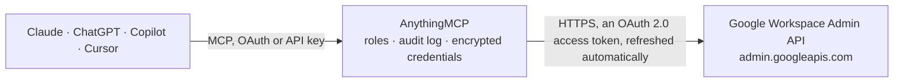

<!-- Generated by scripts/export-github-catalog.mjs in the anythingmcp-website repository. Do not edit by hand. -->

# Google Workspace Admin MCP connector

Google Workspace administration for AI agents: users (create, update, suspend, sign out), aliases, groups and members, organizational units, admin roles and assignments, ChromeOS and mobile devices, … The AnythingMCP connector gives Claude, ChatGPT, Microsoft Copilot, Cursor and Gemini 45 MCP tools for Google Workspace Admin: 26 read and 19 can change data.

**Category:** [Productivity](../productivity.md) · **Tools:** 45 · **Setup guide:** [anythingmcp.com](https://anythingmcp.com/guides/google-admin-to-mcp) · [Deutsch](https://anythingmcp.com/de/guides/google-admin-to-mcp) · [Italiano](https://anythingmcp.com/it/guides/google-admin-to-mcp) · [Español](https://anythingmcp.com/es/guides/google-admin-to-mcp) · [日本語](https://anythingmcp.com/ja/guides/google-admin-to-mcp) · [Русский](https://anythingmcp.com/ru/guides/google-admin-to-mcp) · [中文](https://anythingmcp.com/zh/guides/google-admin-to-mcp)

## Start without code

No installation and no terminal: AnythingMCP Cloud runs the Google Workspace Admin connector for you, operated by helpcode.ai in Frankfurt, Germany.

1. **Click the button above** and create an account or sign in. The Google Workspace Admin connector opens, ready to install.
2. **Sign in with your Google Workspace Admin account** when AnythingMCP asks. The first time, an admin creates a small app in the Google Cloud console. Every click is in the [step-by-step guide](https://anythingmcp.com/guides/google-admin-to-mcp).
3. **Click Install.** AnythingMCP shows the address of your MCP server.
4. **Add that address to your assistant:** [Claude](https://anythingmcp.com/guides/connect-google-admin-to-claude) · [ChatGPT](https://anythingmcp.com/guides/connect-google-admin-to-chatgpt) · [Microsoft Copilot](https://anythingmcp.com/guides/connect-google-admin-to-copilot) · [Cursor](https://anythingmcp.com/guides/connect-google-admin-to-cursor) · [Gemini CLI](https://anythingmcp.com/guides/connect-google-admin-to-gemini) · [Meta Muse](https://anythingmcp.com/guides/connect-google-admin-to-muse).
5. **Ask your first question**, for example: *What's the admin profile for invoices@novacorp.ltd — creation date, last login and aliases?*

Prefer help with the setup? [Talk to us](https://anythingmcp.com/contact).

## How it works

- **The AI client** speaks MCP (Streamable HTTP) to AnythingMCP and only sees tool names, descriptions and results. It never gets the Google Workspace Admin credentials.
- **AnythingMCP** checks the client's role, builds the call from the tool definition, adds the credentials (an OAuth 2.0 access token, refreshed automatically), calls Google Workspace Admin, logs the call and returns the result.
- **Google Workspace Admin** sees an ordinary API client with the rights of the account the credentials belong to.

## Tools

| Tool | What it does | Access |
|---|---|---|
| [`google_admin_get_customer`](#google_admin_get_customer) | Read the Google Workspace account itself: customer id (starts with C), primary domain, organization name and postal address, language, alternate email and… | read |
| [`google_admin_list_domains`](#google_admin_list_domains) | List the domains of the Workspace account: the primary domain and every secondary domain, each with verified, isPrimary, creationTime (epoch milliseconds)… | read |
| [`google_admin_get_domain`](#google_admin_get_domain) | Read one domain of the account: whether it is verified and primary, when it was added, and its domain aliases. | read |
| [`google_admin_list_domain_aliases`](#google_admin_list_domain_aliases) | List domain aliases (domains that mirror another domain, so every user also receives mail at user@alias-domain), with their parent domain and verification… | read |
| [`google_admin_list_users`](#google_admin_list_users) | List or search the users of the Workspace account (up to 500 per page): primaryEmail, name, id, orgUnitPath, isAdmin, suspended, archived, lastLoginTime,… | read |
| [`google_admin_get_user`](#google_admin_get_user) | Read one user's full admin view: name, primaryEmail, aliases, orgUnitPath, suspended and suspensionReason, isAdmin, isDelegatedAdmin, 2-Step Verification… | read |
| [`google_admin_create_user`](#google_admin_create_user) | Create a user account in Google Workspace. | write |
| [`google_admin_update_user`](#google_admin_update_user) | Change fields of an existing user; fields left out stay as they are. | write |
| [`google_admin_suspend_user`](#google_admin_suspend_user) | Suspend a user: they can no longer sign in and stop receiving mail, but the account, its data and licenses stay. | write |
| [`google_admin_unsuspend_user`](#google_admin_unsuspend_user) | Reactivate a suspended user so they can sign in again. | write |
| [`google_admin_sign_out_user`](#google_admin_sign_out_user) | Sign a user out of every web and device session and reset their sign-in cookies, e.g. after a lost laptop or a suspected compromise. | write |
| [`google_admin_undelete_user`](#google_admin_undelete_user) | Restore a user deleted in the last 20 days (super admin only). | write |
| [`google_admin_delete_user`](#google_admin_delete_user) | Delete a user account. | write |
| [`google_admin_list_user_aliases`](#google_admin_list_user_aliases) | List a user's email aliases (extra addresses that deliver to the same mailbox). | read |
| [`google_admin_add_user_alias`](#google_admin_add_user_alias) | Add an email alias to a user, e.g. "info@example.com". | write |
| [`google_admin_delete_user_alias`](#google_admin_delete_user_alias) | Remove an email alias from a user; mail to that address bounces afterwards. | write |
| [`google_admin_list_groups`](#google_admin_list_groups) | List or search the groups of the Workspace account (up to 200 per page): email, name, description, directMembersCount, aliases, id. | read |
| [`google_admin_list_user_groups`](#google_admin_list_user_groups) | List the groups one user (or one group) is a direct member of. | read |
| [`google_admin_get_group`](#google_admin_get_group) | Read one group: email, name, description, aliases, directMembersCount and whether an admin created it. | read |
| [`google_admin_create_group`](#google_admin_create_group) | Create a group (mailing list and access group) with an email on one of the account's domains. | write |
| [`google_admin_update_group`](#google_admin_update_group) | Change a group's email, name or description; fields left out stay as they are. | write |
| [`google_admin_delete_group`](#google_admin_delete_group) | Delete a group with its membership list and archive; access granted through it to Drive files, calendars or apps ends. | write |
| [`google_admin_list_group_members`](#google_admin_list_group_members) | List the members of a group (up to 200 per page): email, role (OWNER, MANAGER, MEMBER), type (USER, GROUP, CUSTOMER, EXTERNAL), status and id. | read |
| [`google_admin_get_group_member`](#google_admin_get_group_member) | Read one member of a group: role, type, status and delivery setting. | read |
| [`google_admin_has_group_member`](#google_admin_has_group_member) | Check whether a user is a member of a group, directly or through nested groups. | read |
| [`google_admin_add_group_member`](#google_admin_add_group_member) | Add a user, another group or an external address to a group. | write |
| [`google_admin_update_group_member`](#google_admin_update_group_member) | Change a group member's role (OWNER, MANAGER, MEMBER) or their mail delivery setting. | write |
| [`google_admin_remove_group_member`](#google_admin_remove_group_member) | Remove a member from a group; access granted through the group ends at once. | write |
| [`google_admin_list_org_units`](#google_admin_list_org_units) | List organizational units (the tree that settings and policies apply to): name, orgUnitPath, orgUnitId, parentOrgUnitPath, description. | read |
| [`google_admin_get_org_unit`](#google_admin_get_org_unit) | Read one organizational unit: name, path, id, parent and description. | read |
| [`google_admin_create_org_unit`](#google_admin_create_org_unit) | Create an organizational unit under a parent unit, e.g. "EMEA" under "/Sales". | write |
| [`google_admin_update_org_unit`](#google_admin_update_org_unit) | Rename an organizational unit, change its description or move it under another parent (its users and sub-units move with it). | write |
| [`google_admin_list_roles`](#google_admin_list_roles) | List the admin roles of the account, prebuilt (Super Admin, Groups Admin, User Management Admin, Help Desk Admin...) and custom: roleId, roleName,… | read |
| [`google_admin_get_role`](#google_admin_get_role) | Read one admin role with its full list of privileges (serviceId and privilegeName). | read |
| [`google_admin_list_role_assignments`](#google_admin_list_role_assignments) | List who holds which admin role: roleAssignmentId, roleId, assignedTo (a user or group id), assigneeType, scopeType (CUSTOMER = whole account, ORG_UNIT =… | read |
| [`google_admin_get_role_assignment`](#google_admin_get_role_assignment) | Read one admin role assignment by its id: role, assignee id and type, scope and org unit. | read |
| [`google_admin_assign_role`](#google_admin_assign_role) | Give a user or group an admin role, for the whole account or one organizational unit. | write |
| [`google_admin_delete_role_assignment`](#google_admin_delete_role_assignment) | Take an admin role away from a user or group by deleting the role assignment. | write |
| [`google_admin_list_chromeos_devices`](#google_admin_list_chromeos_devices) | List managed ChromeOS devices (Chromebooks, Chromeboxes, kiosks; up to 300 per page): deviceId, serialNumber, model, status (ACTIVE, DISABLED,… | read |
| [`google_admin_get_chromeos_device`](#google_admin_get_chromeos_device) | Read one ChromeOS device by its deviceId: hardware, OS and firmware versions, enrolment, last sync and user, network addresses, auto-update expiration; FULL… | read |
| [`google_admin_list_mobile_devices`](#google_admin_list_mobile_devices) | List mobile devices (Android and iOS phones and tablets) that sync with Google Workspace (up to 100 per page): resourceId, email, name, model, os, type,… | read |
| [`google_admin_get_mobile_device`](#google_admin_get_mobile_device) | Read one mobile device by its resourceId: owner, model, OS version, status, compromised status, encryption, first and last sync and the apps reported by… | read |
| [`google_admin_list_activities`](#google_admin_list_activities) | Audit log: who did what and when in one Google Workspace application, newest first (up to 1,000 per page). | read |
| [`google_admin_get_customer_usage`](#google_admin_get_customer_usage) | Account-wide usage statistics for one day: active users, licenses, Gmail volume, Drive storage, Meet minutes, 2SV adoption, etc. | read |
| [`google_admin_get_user_usage`](#google_admin_get_user_usage) | Per-user usage statistics for one day: last login, emails sent and received, Drive storage used, 2SV enrolment, Meet calls, etc. | read |

## Tool reference

Every parameter as the AI client sees it in `tools/list`. Source: [`packages/backend/src/adapters/intl/google-admin.json`](../../../packages/backend/src/adapters/intl/google-admin.json).

### `google_admin_get_customer`

Read the Google Workspace account itself: customer id (starts with C), primary domain, organization name and postal address, language, alternate email and creation time. Cheap; use it to check the connection.

**Access:** read · **Call:** `GET /admin/directory/v1/customers/my_customer`

No parameters.

### `google_admin_list_domains`

List the domains of the Workspace account: the primary domain and every secondary domain, each with verified, isPrimary, creationTime (epoch milliseconds) and its domain aliases.

**Access:** read · **Call:** `GET /admin/directory/v1/customer/my_customer/domains`

No parameters.

### `google_admin_get_domain`

Read one domain of the account: whether it is verified and primary, when it was added, and its domain aliases.

**Access:** read · **Call:** `GET /admin/directory/v1/customer/my_customer/domains/{domain_name}`

| Parameter | Type | Required | Description |
|---|---|---|---|
| `domain_name` | string | yes | The domain name, e.g. "example.com". |

### `google_admin_list_domain_aliases`

List domain aliases (domains that mirror another domain, so every user also receives mail at user@alias-domain), with their parent domain and verification state.

**Access:** read · **Call:** `GET /admin/directory/v1/customer/my_customer/domainaliases`

| Parameter | Type | Required | Description |
|---|---|---|---|
| `parent_domain_name` | string | no | Only aliases of this domain, e.g. "example.com". Leave empty for all. |

### `google_admin_list_users`

List or search the users of the Workspace account (up to 500 per page): primaryEmail, name, id, orgUnitPath, isAdmin, suspended, archived, lastLoginTime, creationTime, isEnrolledIn2Sv, aliases. Search with `query`, e.g. "isSuspended=true", "orgUnitPath='/Sales'", "name:'Jane'", "email:jane*", "isAdmin=true", "isEnrolledIn2Sv=false". Page with page_token = nextPageToken until it is missing.

**Access:** read · **Call:** `GET /admin/directory/v1/users`

| Parameter | Type | Required | Description |
|---|---|---|---|
| `query` | string | no | Search expression, e.g. "isSuspended=false orgUnitPath='/Sales'" (clauses separated by spaces are ANDed), "email:anna*", "name:'Anna Rossi'", "isAdmin=true", "isEnrolledIn2Sv=false", "lastLoginTime<2026-01-01". Leave empty for every user. |
| `order_by` | `email` \| `givenName` \| `familyName` | no | Sort by "email", "givenName" or "familyName". |
| `sort_order` | `ASCENDING` \| `DESCENDING` | no | "ASCENDING" or "DESCENDING"; only with order_by. |
| `max_results` | integer | no | Users per page, 1-500. Default 100. |
| `page_token` | string | no | nextPageToken from the previous response, to fetch the next page. Leave empty for the first page. |
| `projection` | `basic` \| `full` | no | "basic" (default) leaves out custom schema fields; "full" includes them. |
| `show_deleted` | boolean | no | true lists users deleted in the last 20 days instead (they can be restored with google_admin_undelete_user). |

### `google_admin_get_user`

Read one user's full admin view: name, primaryEmail, aliases, orgUnitPath, suspended and suspensionReason, isAdmin, isDelegatedAdmin, 2-Step Verification enrolment and enforcement, lastLoginTime, creationTime, recovery email and phone, phones, organizations (title, department), relations (manager) and external ids.

**Access:** read · **Call:** `GET /admin/directory/v1/users/{user_key}`

| Parameter | Type | Required | Description |
|---|---|---|---|
| `user_key` | string | yes | The user's primary email address, one of their alias addresses, or their immutable user `id` (from google_admin_list_users). |
| `projection` | `basic` \| `full` | no | "basic" (default) leaves out custom schema fields; "full" includes them. |

### `google_admin_create_user`

Create a user account in Google Workspace. Needs a primary email on one of the account's domains, a first and last name and an initial password (8-100 characters). A new account may need a few minutes before it can sign in and may use a Workspace license.

**Access:** write · **Call:** `POST /admin/directory/v1/users`

| Parameter | Type | Required | Description |
|---|---|---|---|
| `primary_email` | string | yes | The new address, e.g. "anna.rossi@example.com"; the domain must belong to the account (google_admin_list_domains). |
| `given_name` | string | yes | First name, up to 60 characters. |
| `family_name` | string | yes | Last name, up to 60 characters. |
| `password` | string | yes | Initial password in clear text, 8-100 ASCII characters. Share it with the person over a safe channel and keep change_password_at_next_login true. |
| `change_password_at_next_login` | boolean | no | true (recommended) makes the user pick their own password at first sign-in. |
| `org_unit_path` | string | no | Organizational unit with the leading slash, e.g. "/Sales". Default "/" (the top level). |
| `recovery_email` | string | no | Personal recovery email address. |
| `recovery_phone` | string | no | Recovery phone in E.164 format, e.g. "+393331234567". |

### `google_admin_update_user`

Change fields of an existing user; fields left out stay as they are. Renaming the primary email keeps the old address as an alias. Lists such as phones and organizations replace the whole list, so read the user first and send the complete list.

**Access:** write · **Call:** `PATCH /admin/directory/v1/users/{user_key}`

| Parameter | Type | Required | Description |
|---|---|---|---|
| `user_key` | string | yes | The user's primary email address, one of their alias addresses, or their immutable user `id` (from google_admin_list_users). |
| `name` | object | no | New name: {"givenName": "Anna", "familyName": "Rossi"}. |
| `primary_email` | string | no | New primary email address on one of the account's domains. |
| `org_unit_path` | string | no | Move the user to this organizational unit, with the leading slash, e.g. "/Sales/EMEA". |
| `password` | string | no | New password in clear text, 8-100 ASCII characters. |
| `change_password_at_next_login` | boolean | no | true forces a password change at the next sign-in. |
| `recovery_email` | string | no | Personal recovery email address. |
| `recovery_phone` | string | no | Recovery phone in E.164 format, e.g. "+393331234567". |
| `include_in_global_address_list` | boolean | no | false hides the user from the directory / global address list. |
| `organizations` | object[] | no | Job information, replaces the whole list: [{"title": "Sales Manager", "department": "Sales", "primary": true}]. |
| `phones` | object[] | no | Phone numbers, replaces the whole list: [{"value": "+39 02 1234567", "type": "work"}]. |
| `relations` | object[] | no | Relations, replaces the whole list, e.g. the manager: [{"value": "boss@example.com", "type": "manager"}]. |

### `google_admin_suspend_user`

Suspend a user: they can no longer sign in and stop receiving mail, but the account, its data and licenses stay. Undo with google_admin_unsuspend_user.

**Access:** write · **Call:** `PATCH /admin/directory/v1/users/{user_key}`

| Parameter | Type | Required | Description |
|---|---|---|---|
| `user_key` | string | yes | The user's primary email address, one of their alias addresses, or their immutable user `id` (from google_admin_list_users). |

### `google_admin_unsuspend_user`

Reactivate a suspended user so they can sign in again. A user suspended by Google for abuse (suspensionReason other than ADMIN) may stay suspended.

**Access:** write · **Call:** `PATCH /admin/directory/v1/users/{user_key}`

| Parameter | Type | Required | Description |
|---|---|---|---|
| `user_key` | string | yes | The user's primary email address, one of their alias addresses, or their immutable user `id` (from google_admin_list_users). |

### `google_admin_sign_out_user`

Sign a user out of every web and device session and reset their sign-in cookies, e.g. after a lost laptop or a suspected compromise. Their password is not changed; combine with update_user (password) when the account may be compromised.

**Access:** write · **Call:** `POST /admin/directory/v1/users/{user_key}/signOut`

| Parameter | Type | Required | Description |
|---|---|---|---|
| `user_key` | string | yes | The user's primary email address, one of their alias addresses, or their immutable user `id` (from google_admin_list_users). |

### `google_admin_undelete_user`

Restore a user deleted in the last 20 days (super admin only). Needs the user's immutable id, not the email: find it with google_admin_list_users and show_deleted true.

**Access:** write · **Call:** `POST /admin/directory/v1/users/{user_id}/undelete`

| Parameter | Type | Required | Description |
|---|---|---|---|
| `user_id` | string | yes | Immutable id of the deleted user (the `id` from google_admin_list_users with show_deleted true). |
| `org_unit_path` | string | no | Organizational unit to restore the user into, with the leading slash. Default "/". |

### `google_admin_delete_user`

Delete a user account. Their mail, Drive files and calendar go with it unless transferred first in the Admin console; it can be restored for 20 days with google_admin_undelete_user, after that it is gone. Switched off at install.

**Access:** write · **Call:** `DELETE /admin/directory/v1/users/{user_key}`

| Parameter | Type | Required | Description |
|---|---|---|---|
| `user_key` | string | yes | The user's primary email address, one of their alias addresses, or their immutable user `id` (from google_admin_list_users). |

### `google_admin_list_user_aliases`

List a user's email aliases (extra addresses that deliver to the same mailbox).

**Access:** read · **Call:** `GET /admin/directory/v1/users/{user_key}/aliases`

| Parameter | Type | Required | Description |
|---|---|---|---|
| `user_key` | string | yes | The user's primary email address, one of their alias addresses, or their immutable user `id` (from google_admin_list_users). |

### `google_admin_add_user_alias`

Add an email alias to a user, e.g. "info@example.com". The alias domain must belong to the account; a user can have up to 30 aliases.

**Access:** write · **Call:** `POST /admin/directory/v1/users/{user_key}/aliases`

| Parameter | Type | Required | Description |
|---|---|---|---|
| `user_key` | string | yes | The user's primary email address, one of their alias addresses, or their immutable user `id` (from google_admin_list_users). |
| `alias` | string | yes | The alias address to add, e.g. "sales@example.com". |

### `google_admin_delete_user_alias`

Remove an email alias from a user; mail to that address bounces afterwards. Switched off at install.

**Access:** write · **Call:** `DELETE /admin/directory/v1/users/{user_key}/aliases/{alias}`

| Parameter | Type | Required | Description |
|---|---|---|---|
| `user_key` | string | yes | The user's primary email address, one of their alias addresses, or their immutable user `id` (from google_admin_list_users). |
| `alias` | string | yes | The alias address to remove. |

### `google_admin_list_groups`

List or search the groups of the Workspace account (up to 200 per page): email, name, description, directMembersCount, aliases, id. Search with `query`, e.g. "email:sales*", "name:'Sales Team'", "memberKey=anna@example.com". Page with page_token.

**Access:** read · **Call:** `GET /admin/directory/v1/groups`

| Parameter | Type | Required | Description |
|---|---|---|---|
| `query` | string | no | Search expression, e.g. "email:sales*", "name:'Sales'" or "memberKey=anna@example.com" (groups that user belongs to). Leave empty for every group. |
| `order_by` | `email` | no | Sort by "email". |
| `sort_order` | `ASCENDING` \| `DESCENDING` | no | "ASCENDING" or "DESCENDING"; only with order_by. |
| `max_results` | integer | no | Groups per page, 1-200. Default 200. |
| `page_token` | string | no | nextPageToken from the previous response, to fetch the next page. Leave empty for the first page. |

### `google_admin_list_user_groups`

List the groups one user (or one group) is a direct member of.

**Access:** read · **Call:** `GET /admin/directory/v1/groups`

| Parameter | Type | Required | Description |
|---|---|---|---|
| `user_key` | string | yes | Email address or immutable id of the user, or of a group to see which groups contain it. |
| `max_results` | integer | no | Groups per page, 1-200. Default 200. |
| `page_token` | string | no | nextPageToken from the previous response, to fetch the next page. Leave empty for the first page. |

### `google_admin_get_group`

Read one group: email, name, description, aliases, directMembersCount and whether an admin created it. Its settings (who can post, join, view) are in the Groups Settings API, not here.

**Access:** read · **Call:** `GET /admin/directory/v1/groups/{group_key}`

| Parameter | Type | Required | Description |
|---|---|---|---|
| `group_key` | string | yes | The group's email address, one of its aliases, or its immutable group `id` (from google_admin_list_groups). |

### `google_admin_create_group`

Create a group (mailing list and access group) with an email on one of the account's domains. It starts without members; add them with google_admin_add_group_member.

**Access:** write · **Call:** `POST /admin/directory/v1/groups`

| Parameter | Type | Required | Description |
|---|---|---|---|
| `email` | string | yes | The group address, e.g. "sales@example.com". |
| `name` | string | no | Display name, e.g. "Sales Team". |
| `description` | string | no | What the group is for, up to 4,096 characters. |

### `google_admin_update_group`

Change a group's email, name or description; fields left out stay as they are. Changing the email keeps the old address as an alias.

**Access:** write · **Call:** `PATCH /admin/directory/v1/groups/{group_key}`

| Parameter | Type | Required | Description |
|---|---|---|---|
| `group_key` | string | yes | The group's email address, one of its aliases, or its immutable group `id` (from google_admin_list_groups). |
| `email` | string | no | New group address. |
| `name` | string | no | New display name. |
| `description` | string | no | New description. |

### `google_admin_delete_group`

Delete a group with its membership list and archive; access granted through it to Drive files, calendars or apps ends. It cannot be restored. Switched off at install.

**Access:** write · **Call:** `DELETE /admin/directory/v1/groups/{group_key}`

| Parameter | Type | Required | Description |
|---|---|---|---|
| `group_key` | string | yes | The group's email address, one of its aliases, or its immutable group `id` (from google_admin_list_groups). |

### `google_admin_list_group_members`

List the members of a group (up to 200 per page): email, role (OWNER, MANAGER, MEMBER), type (USER, GROUP, CUSTOMER, EXTERNAL), status and id. Page with page_token.

**Access:** read · **Call:** `GET /admin/directory/v1/groups/{group_key}/members`

| Parameter | Type | Required | Description |
|---|---|---|---|
| `group_key` | string | yes | The group's email address, one of its aliases, or its immutable group `id` (from google_admin_list_groups). |
| `roles` | string | no | Only members with these roles, comma-separated: "OWNER", "MANAGER", "MEMBER" or e.g. "OWNER,MANAGER". |
| `include_derived_membership` | boolean | no | true also lists members of nested groups (indirect members). |
| `max_results` | integer | no | Members per page, 1-200. Default 200. |
| `page_token` | string | no | nextPageToken from the previous response, to fetch the next page. Leave empty for the first page. |

### `google_admin_get_group_member`

Read one member of a group: role, type, status and delivery setting. 404 means the address is not a direct member.

**Access:** read · **Call:** `GET /admin/directory/v1/groups/{group_key}/members/{member_key}`

| Parameter | Type | Required | Description |
|---|---|---|---|
| `group_key` | string | yes | The group's email address, one of its aliases, or its immutable group `id` (from google_admin_list_groups). |
| `member_key` | string | yes | The member's email address or immutable id: a user, a group nested in the group, or a customer id for 'all users in the domain'. |

### `google_admin_has_group_member`

Check whether a user is a member of a group, directly or through nested groups. Returns {"isMember": true|false}. Works for users only, not for nested groups as member_key.

**Access:** read · **Call:** `GET /admin/directory/v1/groups/{group_key}/hasMember/{member_key}`

| Parameter | Type | Required | Description |
|---|---|---|---|
| `group_key` | string | yes | The group's email address, one of its aliases, or its immutable group `id` (from google_admin_list_groups). |
| `member_key` | string | yes | The user's email address or immutable id. |

### `google_admin_add_group_member`

Add a user, another group or an external address to a group. 409 "Member already exists" means it is already in.

**Access:** write · **Call:** `POST /admin/directory/v1/groups/{group_key}/members`

| Parameter | Type | Required | Description |
|---|---|---|---|
| `group_key` | string | yes | The group's email address, one of its aliases, or its immutable group `id` (from google_admin_list_groups). |
| `email` | string | yes | Address of the user, group or external person to add. |
| `role` | `MEMBER` \| `MANAGER` \| `OWNER` | no | "MEMBER" (default), "MANAGER" or "OWNER". |
| `delivery_settings` | `ALL_MAIL` \| `DAILY` \| `DIGEST` \| `DISABLED` \| `NONE` | no | Email delivery for this member: "ALL_MAIL" (every message), "DAILY" (digest), "DIGEST" (up to 25 messages bundled), "DISABLED" (none) or "NONE" (no subscription). |

### `google_admin_update_group_member`

Change a group member's role (OWNER, MANAGER, MEMBER) or their mail delivery setting.

**Access:** write · **Call:** `PATCH /admin/directory/v1/groups/{group_key}/members/{member_key}`

| Parameter | Type | Required | Description |
|---|---|---|---|
| `group_key` | string | yes | The group's email address, one of its aliases, or its immutable group `id` (from google_admin_list_groups). |
| `member_key` | string | yes | The member's email address or immutable id: a user, a group nested in the group, or a customer id for 'all users in the domain'. |
| `role` | `MEMBER` \| `MANAGER` \| `OWNER` | no | "MEMBER" (default), "MANAGER" or "OWNER". |
| `delivery_settings` | `ALL_MAIL` \| `DAILY` \| `DIGEST` \| `DISABLED` \| `NONE` | no | Email delivery for this member: "ALL_MAIL" (every message), "DAILY" (digest), "DIGEST" (up to 25 messages bundled), "DISABLED" (none) or "NONE" (no subscription). |

### `google_admin_remove_group_member`

Remove a member from a group; access granted through the group ends at once. Switched off at install.

**Access:** write · **Call:** `DELETE /admin/directory/v1/groups/{group_key}/members/{member_key}`

| Parameter | Type | Required | Description |
|---|---|---|---|
| `group_key` | string | yes | The group's email address, one of its aliases, or its immutable group `id` (from google_admin_list_groups). |
| `member_key` | string | yes | The member's email address or immutable id: a user, a group nested in the group, or a customer id for 'all users in the domain'. |

### `google_admin_list_org_units`

List organizational units (the tree that settings and policies apply to): name, orgUnitPath, orgUnitId, parentOrgUnitPath, description. Without org_unit_path it starts at the top; type "all" returns the whole tree.

**Access:** read · **Call:** `GET /admin/directory/v1/customer/my_customer/orgunits`

| Parameter | Type | Required | Description |
|---|---|---|---|
| `org_unit_path` | string | no | Start below this unit: path without the leading slash, e.g. "Sales", or "id:..." . Leave empty for the top level. |
| `type` | `all` \| `children` \| `allIncludingParent` | no | "children" (default, direct children), "all" (every unit below) or "allIncludingParent" (also the unit itself). |

### `google_admin_get_org_unit`

Read one organizational unit: name, path, id, parent and description.

**Access:** read · **Call:** `GET /admin/directory/v1/customer/my_customer/orgunits/{org_unit_path}`

| Parameter | Type | Required | Description |
|---|---|---|---|
| `org_unit_path` | string | yes | Organizational unit path without the leading slash (e.g. "Sales/EMEA"), or its id prefixed with "id:" (e.g. "id:03ph8a2z1k3xyz"). Get both from google_admin_list_org_units. |

### `google_admin_create_org_unit`

Create an organizational unit under a parent unit, e.g. "EMEA" under "/Sales". Move users into it with google_admin_update_user (org_unit_path).

**Access:** write · **Call:** `POST /admin/directory/v1/customer/my_customer/orgunits`

| Parameter | Type | Required | Description |
|---|---|---|---|
| `name` | string | yes | Name of the new unit, e.g. "EMEA". |
| `parent_org_unit_path` | string | yes | Full path of the parent with the leading slash, e.g. "/Sales", or "/" for the top level. |
| `description` | string | no | Description of the unit. |

### `google_admin_update_org_unit`

Rename an organizational unit, change its description or move it under another parent (its users and sub-units move with it).

**Access:** write · **Call:** `PATCH /admin/directory/v1/customer/my_customer/orgunits/{org_unit_path}`

| Parameter | Type | Required | Description |
|---|---|---|---|
| `org_unit_path` | string | yes | Organizational unit path without the leading slash (e.g. "Sales/EMEA"), or its id prefixed with "id:" (e.g. "id:03ph8a2z1k3xyz"). Get both from google_admin_list_org_units. |
| `name` | string | no | New name. |
| `description` | string | no | New description. |
| `parent_org_unit_path` | string | no | New parent path with the leading slash, to move the unit. |

### `google_admin_list_roles`

List the admin roles of the account, prebuilt (Super Admin, Groups Admin, User Management Admin, Help Desk Admin...) and custom: roleId, roleName, description, isSystemRole, isSuperAdminRole and rolePrivileges.

**Access:** read · **Call:** `GET /admin/directory/v1/customer/my_customer/roles`

| Parameter | Type | Required | Description |
|---|---|---|---|
| `max_results` | integer | no | Roles per page, 1-100. |
| `page_token` | string | no | nextPageToken from the previous response, to fetch the next page. Leave empty for the first page. |

### `google_admin_get_role`

Read one admin role with its full list of privileges (serviceId and privilegeName).

**Access:** read · **Call:** `GET /admin/directory/v1/customer/my_customer/roles/{role_id}`

| Parameter | Type | Required | Description |
|---|---|---|---|
| `role_id` | string | yes | The roleId from google_admin_list_roles. |

### `google_admin_list_role_assignments`

List who holds which admin role: roleAssignmentId, roleId, assignedTo (a user or group id), assigneeType, scopeType (CUSTOMER = whole account, ORG_UNIT = one unit) and orgUnitId. Filter by user or role; map ids to names with google_admin_get_user and google_admin_list_roles.

**Access:** read · **Call:** `GET /admin/directory/v1/customer/my_customer/roleassignments`

| Parameter | Type | Required | Description |
|---|---|---|---|
| `user_key` | string | no | Only assignments of this user or group (email or id). |
| `role_id` | string | no | Only assignments of this roleId. |
| `include_indirect_role_assignments` | boolean | no | true also lists roles the user holds through a group; needs user_key. |
| `max_results` | integer | no | Assignments per page, 1-200. |
| `page_token` | string | no | nextPageToken from the previous response, to fetch the next page. Leave empty for the first page. |

### `google_admin_get_role_assignment`

Read one admin role assignment by its id: role, assignee id and type, scope and org unit.

**Access:** read · **Call:** `GET /admin/directory/v1/customer/my_customer/roleassignments/{role_assignment_id}`

| Parameter | Type | Required | Description |
|---|---|---|---|
| `role_assignment_id` | string | yes | The roleAssignmentId from google_admin_list_role_assignments. |

### `google_admin_assign_role`

Give a user or group an admin role, for the whole account or one organizational unit. assigned_to is the user's or group's immutable id (from google_admin_get_user or google_admin_get_group), not the email. Only a super admin can assign the Super Admin role.

**Access:** write · **Call:** `POST /admin/directory/v1/customer/my_customer/roleassignments`

| Parameter | Type | Required | Description |
|---|---|---|---|
| `role_id` | string | yes | The roleId to assign, from google_admin_list_roles. |
| `assigned_to` | string | yes | Immutable id of the user or group that receives the role. |
| `scope_type` | `CUSTOMER` \| `ORG_UNIT` | yes | "CUSTOMER" (the whole account) or "ORG_UNIT" (only users in one organizational unit; then set org_unit_id). |
| `org_unit_id` | string | no | With scope_type ORG_UNIT: the orgUnitId (without the "id:" prefix) from google_admin_list_org_units. |

### `google_admin_delete_role_assignment`

Take an admin role away from a user or group by deleting the role assignment. Switched off at install.

**Access:** write · **Call:** `DELETE /admin/directory/v1/customer/my_customer/roleassignments/{role_assignment_id}`

| Parameter | Type | Required | Description |
|---|---|---|---|
| `role_assignment_id` | string | yes | The roleAssignmentId from google_admin_list_role_assignments. |

### `google_admin_list_chromeos_devices`

List managed ChromeOS devices (Chromebooks, Chromeboxes, kiosks; up to 300 per page): deviceId, serialNumber, model, status (ACTIVE, DISABLED, DEPROVISIONED...), osVersion, lastSync, annotatedUser, annotatedAssetId, orgUnitPath, autoUpdateExpiration. Search with `query`, e.g. "status:provisioned", "user:anna", "sync:2026-01-01..".

**Access:** read · **Call:** `GET /admin/directory/v1/customer/my_customer/devices/chromeos`

| Parameter | Type | Required | Description |
|---|---|---|---|
| `query` | string | no | Search string, e.g. "status:provisioned", "user:anna@example.com", "sn:5CD81" (serial), "sync:..2026-06-01" (not synced since), "os:15". Leave empty for every device. |
| `org_unit_path` | string | no | Only devices in this organizational unit: full path with the leading slash, e.g. "/Sales", or its id. |
| `include_child_org_units` | boolean | no | With org_unit_path: true also returns devices in its sub-units. |
| `order_by` | `annotatedLocation` \| `annotatedUser` \| `lastSync` \| `notes` \| `serialNumber` \| `status` | no | Sort by "annotatedLocation", "annotatedUser", "lastSync", "notes", "serialNumber" or "status". |
| `sort_order` | `ASCENDING` \| `DESCENDING` | no | "ASCENDING" or "DESCENDING"; only with order_by. |
| `projection` | `BASIC` \| `FULL` | no | "BASIC" (default) returns the main fields; "FULL" adds every field, e.g. recent users, CPU and disk reports for ChromeOS. |
| `max_results` | integer | no | Devices per page, 1-300. Default 100. |
| `page_token` | string | no | nextPageToken from the previous response, to fetch the next page. Leave empty for the first page. |

### `google_admin_get_chromeos_device`

Read one ChromeOS device by its deviceId: hardware, OS and firmware versions, enrolment, last sync and user, network addresses, auto-update expiration; FULL adds recent users and CPU, memory and disk reports.

**Access:** read · **Call:** `GET /admin/directory/v1/customer/my_customer/devices/chromeos/{device_id}`

| Parameter | Type | Required | Description |
|---|---|---|---|
| `device_id` | string | yes | The deviceId from google_admin_list_chromeos_devices. |
| `projection` | `BASIC` \| `FULL` | no | "BASIC" (default) returns the main fields; "FULL" adds every field, e.g. recent users, CPU and disk reports for ChromeOS. |

### `google_admin_list_mobile_devices`

List mobile devices (Android and iOS phones and tablets) that sync with Google Workspace (up to 100 per page): resourceId, email, name, model, os, type, status (APPROVED, BLOCKED, PENDING...), firstSync, lastSync. Search with `query`, e.g. "status:pending", "email:anna", "model:pixel".

**Access:** read · **Call:** `GET /admin/directory/v1/customer/my_customer/devices/mobile`

| Parameter | Type | Required | Description |
|---|---|---|---|
| `query` | string | no | Search string, e.g. "status:pending", "email:anna@example.com", "os:android", "model:iphone", "sync:..2026-06-01". Leave empty for every device. |
| `order_by` | `deviceId` \| `email` \| `lastSync` \| `model` \| `name` \| `os` \| `status` \| `type` | no | Sort by "deviceId", "email", "lastSync", "model", "name", "os", "status" or "type". |
| `sort_order` | `ASCENDING` \| `DESCENDING` | no | "ASCENDING" or "DESCENDING"; only with order_by. |
| `projection` | `BASIC` \| `FULL` | no | "BASIC" (default) returns the main fields; "FULL" adds every field, e.g. recent users, CPU and disk reports for ChromeOS. |
| `max_results` | integer | no | Devices per page, 1-100. Default 100. |
| `page_token` | string | no | nextPageToken from the previous response, to fetch the next page. Leave empty for the first page. |

### `google_admin_get_mobile_device`

Read one mobile device by its resourceId: owner, model, OS version, status, compromised status, encryption, first and last sync and the apps reported by managed Android devices.

**Access:** read · **Call:** `GET /admin/directory/v1/customer/my_customer/devices/mobile/{resource_id}`

| Parameter | Type | Required | Description |
|---|---|---|---|
| `resource_id` | string | yes | The resourceId from google_admin_list_mobile_devices (not the deviceId). |
| `projection` | `BASIC` \| `FULL` | no | "BASIC" (default) returns the main fields; "FULL" adds every field, e.g. recent users, CPU and disk reports for ChromeOS. |

### `google_admin_list_activities`

Audit log: who did what and when in one Google Workspace application, newest first (up to 1,000 per page). Each item has id.time (UTC), actor.email, ipAddress and events[] with name and parameters. Examples: application_name "login" (sign-ins, failures, suspicious logins), "admin" (Admin console changes), "drive" (file views, downloads, sharing), "token" (third-party app access), "groups", "mobile", "meet", "gmail", "calendar", "chrome", "saml", "user_accounts" (password and 2SV changes).

**Access:** read · **Call:** `GET /admin/reports/v1/activity/users/{user_key}/applications/{application_name}`

| Parameter | Type | Required | Description |
|---|---|---|---|
| `application_name` | `access_transparency` \| `admin` \| `calendar` \| `chat` \| `drive` \| `gcp` \| `gmail` \| `gplus` \| `groups` \| `groups_enterprise` \| `jamboard` \| `login` \| `meet` \| `mobile` \| `rules` \| `saml` \| `token` \| `user_accounts` \| `context_aware_access` \| `chrome` \| `data_studio` \| `keep` \| `vault` \| `gemini_in_workspace_apps` \| `classroom` \| `assignments` \| `cloud_search` \| `tasks` \| `data_migration` \| `meet_hardware` \| `directory_sync` \| `ldap` \| `profile` \| `access_evaluation` \| `admin_data_action` \| `contacts` \| `takeout` \| `graduation` \| `voice` \| `chrome_sync` \| `workspace_studio` \| `gemini_notebook` | yes | Which audit log to read. |
| `user_key` | string | yes | "all" (default) for every user, or one user's email or profile id. |
| `start_time` | string | no | Earliest event, RFC 3339 in UTC, e.g. "2026-10-01T00:00:00Z". Most logs keep about 6 months. |
| `end_time` | string | no | Latest event, RFC 3339, e.g. "2026-10-30T23:59:59Z". Default now. |
| `event_name` | string | no | Only this event, e.g. "login_failure", "login_success", "suspicious_login" (login); "download", "change_user_access" (drive); "authorize" (token); "CREATE_USER", "CHANGE_PASSWORD" (admin). |
| `filters` | string | no | Comma-separated conditions on event parameters, e.g. "doc_id==1AbC" or "login_type==google_password"; operators ==, <>, <, <=, >, >=. |
| `actor_ip_address` | string | no | Only events from this IP address (IPv4 or IPv6). |
| `org_unit_id` | string | no | Only users of this organizational unit, as "id:" plus the orgUnitId, e.g. "id:03ph8a2z1k3xyz". |
| `group_id_filter` | string | no | Only users in these groups, e.g. "id:03ab12cd,id:04ef56gh" (group ids from google_admin_get_group). |
| `max_results` | integer | no | Events per page, 1-1000. Default 1000. |
| `page_token` | string | no | nextPageToken from the previous response, to fetch the next page. Leave empty for the first page. |

### `google_admin_get_customer_usage`

Account-wide usage statistics for one day: active users, licenses, Gmail volume, Drive storage, Meet minutes, 2SV adoption, etc. Each parameter comes as name plus intValue, stringValue, boolValue or datetimeValue. Data arrives 1-3 days late: a recent date answers with a warning and no data, so step one day back.

**Access:** read · **Call:** `GET /admin/reports/v1/usage/dates/{date}`

| Parameter | Type | Required | Description |
|---|---|---|---|
| `date` | string | yes | Day of the report, YYYY-MM-DD in Pacific Time; usually 2-3 days ago or earlier. |
| `parameters` | string | no | Only these values, comma-separated as app:name, e.g. "accounts:num_users,accounts:num_30day_logins,gmail:num_emails_sent,drive:num_owned_items_created,meet:total_call_minutes". Leave empty for every value. |
| `page_token` | string | no | nextPageToken from the previous response, to fetch the next page. Leave empty for the first page. |

### `google_admin_get_user_usage`

Per-user usage statistics for one day: last login, emails sent and received, Drive storage used, 2SV enrolment, Meet calls, etc. user_key "all" lists every user (up to 1,000 per page). Data arrives 1-3 days late.

**Access:** read · **Call:** `GET /admin/reports/v1/usage/users/{user_key}/dates/{date}`

| Parameter | Type | Required | Description |
|---|---|---|---|
| `user_key` | string | yes | "all" (default) for every user, or one user's email or profile id. |
| `date` | string | yes | Day of the report, YYYY-MM-DD in Pacific Time; usually 2-3 days ago or earlier. |
| `parameters` | string | no | Only these values, comma-separated as app:name, e.g. "accounts:last_login_time,accounts:used_quota_in_mb,gmail:num_emails_sent,accounts:is_2sv_enrolled". Leave empty for every value. |
| `filters` | string | no | Only users matching these conditions, comma-separated, e.g. "accounts:last_login_time<2026-07-01T00:00:00.000Z" or "accounts:used_quota_in_mb>10000". |
| `org_unit_id` | string | no | Only users of this organizational unit, as "id:" plus the orgUnitId. |
| `max_results` | integer | no | Users per page, 1-1000. Default 1000. |
| `page_token` | string | no | nextPageToken from the previous response, to fetch the next page. Leave empty for the first page. |

## Run it yourself

AnythingMCP is open source (AGPL-3.0). [Run it with Docker](../../../README.md#run-it-yourself), open **Connectors → Store**, pick **Google Workspace Admin** and enter `GOOGLE_CLIENT_ID`, `GOOGLE_CLIENT_SECRET`, then add your MCP server URL to the AI client.

[← Productivity connectors](../productivity.md) · [All categories](../README.md)
