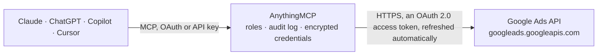

<!-- Generated by scripts/export-github-catalog.mjs in the anythingmcp-website repository. Do not edit by hand. -->

# Google Ads MCP connector

Google Ads for AI agents: campaign, ad group, ad and keyword performance, search terms, Quality Score, budget pacing and impression share, conversion actions, change history, recommendations, manager … The AnythingMCP connector gives Claude, ChatGPT, Microsoft Copilot, Cursor and Gemini 17 MCP tools for Google Ads, all read-only.

**Category:** [Advertising](../advertising.md) · **Tools:** 17 · **Setup guide:** [anythingmcp.com](https://anythingmcp.com/guides/google-ads-to-mcp) · [Deutsch](https://anythingmcp.com/de/guides/google-ads-to-mcp) · [Italiano](https://anythingmcp.com/it/guides/google-ads-to-mcp) · [Español](https://anythingmcp.com/es/guides/google-ads-to-mcp) · [日本語](https://anythingmcp.com/ja/guides/google-ads-to-mcp) · [Русский](https://anythingmcp.com/ru/guides/google-ads-to-mcp) · [中文](https://anythingmcp.com/zh/guides/google-ads-to-mcp)

## Start without code

No installation and no terminal: AnythingMCP Cloud runs the Google Ads connector for you, operated by helpcode.ai in Frankfurt, Germany.

1. **Click the button above** and create an account or sign in. The Google Ads connector opens, ready to install.
2. **Sign in with your Google Ads account** when AnythingMCP asks. The first time, an admin creates a small app in the Google Cloud console. Every click is in the [step-by-step guide](https://anythingmcp.com/guides/google-ads-to-mcp).
3. **Click Install.** AnythingMCP shows the address of your MCP server.
4. **Add that address to your assistant:** [Claude](https://anythingmcp.com/guides/connect-google-ads-to-claude) · [ChatGPT](https://anythingmcp.com/guides/connect-google-ads-to-chatgpt) · [Microsoft Copilot](https://anythingmcp.com/guides/connect-google-ads-to-copilot) · [Cursor](https://anythingmcp.com/guides/connect-google-ads-to-cursor) · [Gemini CLI](https://anythingmcp.com/guides/connect-google-ads-to-gemini) · [Meta Muse](https://anythingmcp.com/guides/connect-google-ads-to-muse).
5. **Ask your first question**, for example: *Show me total spend and top campaign for customer 3478123456 from 2026-09-01 to 2026-09-30*

Prefer help with the setup? [Talk to us](https://anythingmcp.com/contact).

## How it works

- **The AI client** speaks MCP (Streamable HTTP) to AnythingMCP and only sees tool names, descriptions and results. It never gets the Google Ads credentials.
- **AnythingMCP** checks the client's role, builds the call from the tool definition, adds the credentials (an OAuth 2.0 access token, refreshed automatically), calls Google Ads, logs the call and returns the result.
- **Google Ads** sees an ordinary API client with the rights of the account the credentials belong to.

## Tools

| Tool | What it does | Access |
|---|---|---|
| [`gads_playbook`](#gads_playbook) | START HERE for any Google Ads question: returns, with NO API call, a router from common questions (account health, wasted spend, search-term mining, Quality… | read |
| [`gads_list_accessible_customers`](#gads_list_accessible_customers) | List the Google Ads accounts the authorised Google user can access directly, as resource names ('customers/1234567890'). | read |
| [`gads_get_customer`](#gads_get_customer) | Read one Google Ads account's settings: name, currency, time zone (all dates in reports are in this zone), whether it is a manager (MCC) or test account,… | read |
| [`gads_list_client_accounts`](#gads_list_client_accounts) | List the accounts under a manager (MCC) account: id, name, depth in the hierarchy, whether each is itself a manager, currency, time zone and status. | read |
| [`gads_run_gaql`](#gads_run_gaql) | Run any read-only Google Ads Query Language (GAQL) query against one account: every resource, attribute, segment and metric of the Google Ads API. | read |
| [`gads_query_field_catalog`](#gads_query_field_catalog) | Look up Google Ads API field metadata (names, category RESOURCE/ATTRIBUTE/SEGMENT/METRIC, data type, enum values, whether selectable, filterable, sortable). | read |
| [`gads_account_daily_metrics`](#gads_account_daily_metrics) | Account-level totals per day for a date range: impressions, clicks, cost, conversions, conversion value. | read |
| [`gads_list_campaigns`](#gads_list_campaigns) | List the account's campaigns (removed ones excluded) with status, serving status, primary status and its reasons (why a campaign is limited or not serving),… | read |
| [`gads_campaign_performance`](#gads_campaign_performance) | Campaign performance totals for a date range, one row per campaign, sorted by cost: impressions, clicks, CTR, average CPC, cost, conversions, conversion… | read |
| [`gads_ad_group_performance`](#gads_ad_group_performance) | Ad group performance totals for a date range, one row per ad group with its campaign, sorted by cost. | read |
| [`gads_ad_performance`](#gads_ad_performance) | Ad performance for a date range with the ad itself: type, final URLs, responsive search ad headlines and descriptions, ad strength and policy approval status. | read |
| [`gads_keyword_performance`](#gads_keyword_performance) | Keyword performance for a date range with match type, status and Quality Score components (quality score 1-10, expected CTR, ad relevance, landing page… | read |
| [`gads_search_terms`](#gads_search_terms) | The search terms report: what people actually typed before your Search ads showed, with campaign, ad group, whether the term is already added or excluded,… | read |
| [`gads_budget_pacing`](#gads_budget_pacing) | Enabled campaigns with their daily budget, spend in the date range and Search impression share lost to budget and to rank. | read |
| [`gads_conversion_actions`](#gads_conversion_actions) | List the account's conversion actions (removed ones excluded): name, type, source, category, status, whether each is a primary goal, counting (one vs… | read |
| [`gads_change_history`](#gads_change_history) | Who changed what in the account and when: timestamp, user email, tool used (web UI, API, scripts, Editor), resource type and name, operation and the changed… | read |
| [`gads_recommendations`](#gads_recommendations) | Google's current optimisation recommendations for the account (budget, bidding, keywords, ads, assets...) with the campaign they apply to and the estimated… | read |

## Tool reference

Every parameter as the AI client sees it in `tools/list`. Source: [`packages/backend/src/adapters/intl/google-ads.json`](../../../packages/backend/src/adapters/intl/google-ads.json).

### `gads_playbook`

START HERE for any Google Ads question: returns, with NO API call, a router from common questions (account health, wasted spend, search-term mining, Quality Score, budget pacing, period comparison, conversion tracking audit, change history, Performance Max, MCC roll-ups) to the tools and ready-to-run GAQL queries to use.

**Access:** read · **Call:** `static /`

No parameters.

### `gads_list_accessible_customers`

List the Google Ads accounts the authorised Google user can access directly, as resource names ('customers/1234567890'). Call this first. Accounts reachable only through a manager (MCC) account are not listed here: use gads_list_client_accounts on the manager.

**Access:** read · **Call:** `GET /customers:listAccessibleCustomers`

No parameters.

### `gads_get_customer`

Read one Google Ads account's settings: name, currency, time zone (all dates in reports are in this zone), whether it is a manager (MCC) or test account, auto-tagging, status and optimization score. Cheap; use it to learn the currency before reporting money.

**Access:** read · **Call:** `POST /customers/{customer_id}/googleAds:search`

| Parameter | Type | Required | Description |
|---|---|---|---|
| `customer_id` | string | yes | The Google Ads account to read: 10 digits, no dashes ('123-456-7890' becomes '1234567890'). Get it from gads_list_accessible_customers or gads_list_client_accounts. |

### `gads_list_client_accounts`

List the accounts under a manager (MCC) account: id, name, depth in the hierarchy, whether each is itself a manager, currency, time zone and status. Pass the MANAGER's id as customer_id. Level 0 is the manager itself.

**Access:** read · **Call:** `POST /customers/{customer_id}/googleAds:search`

| Parameter | Type | Required | Description |
|---|---|---|---|
| `customer_id` | string | yes | The Google Ads account to read: 10 digits, no dashes ('123-456-7890' becomes '1234567890'). Get it from gads_list_accessible_customers or gads_list_client_accounts. |
| `max_level` | integer | no | How deep to go: 1 = direct children (default), higher values include sub-managers' clients. |
| `limit` | integer | no | Maximum rows, 1-10000. Default 1000. |

### `gads_run_gaql`

Run any read-only Google Ads Query Language (GAQL) query against one account: every resource, attribute, segment and metric of the Google Ads API. Use it when no dedicated tool fits, or to filter, segment or sort differently. Returns up to 10,000 rows per page; if nextPageToken is present, call again with page_token to get the next page. See gads_playbook for tested queries and gads_query_field_catalog to look up field names.

**Access:** read · **Call:** `POST /customers/{customer_id}/googleAds:search`

| Parameter | Type | Required | Description |
|---|---|---|---|
| `customer_id` | string | yes | The Google Ads account to read: 10 digits, no dashes ('123-456-7890' becomes '1234567890'). Get it from gads_list_accessible_customers or gads_list_client_accounts. |
| `query` | string | yes | A GAQL query, e.g. "SELECT campaign.name, metrics.clicks FROM campaign WHERE segments.date DURING LAST_30_DAYS ORDER BY metrics.clicks DESC LIMIT 20". No FROM-less queries, no OR (use IN), no joins; money fields are in micros. |
| `page_token` | string | no | nextPageToken from the previous response, to fetch the next page of the same query. |

### `gads_query_field_catalog`

Look up Google Ads API field metadata (names, category RESOURCE/ATTRIBUTE/SEGMENT/METRIC, data type, enum values, whether selectable, filterable, sortable). Use it before writing GAQL for an unfamiliar report, or to find valid enum values. No account needed.

**Access:** read · **Call:** `POST /googleAdsFields:search`

| Parameter | Type | Required | Description |
|---|---|---|---|
| `query` | string | yes | A field-catalog query (no FROM clause). Examples: "SELECT name, category, data_type, enum_values WHERE name LIKE 'campaign.%'"; "SELECT name, selectable_with WHERE name = 'search_term_view'" (which fields combine with a resource); "SELECT name WHERE category = 'METRIC' AND name LIKE 'metrics.search%'". |

### `gads_account_daily_metrics`

Account-level totals per day for a date range: impressions, clicks, cost, conversions, conversion value. Use it for trends, period comparisons and spotting the day something changed.

**Access:** read · **Call:** `POST /customers/{customer_id}/googleAds:search`

| Parameter | Type | Required | Description |
|---|---|---|---|
| `customer_id` | string | yes | The Google Ads account to read: 10 digits, no dashes ('123-456-7890' becomes '1234567890'). Get it from gads_list_accessible_customers or gads_list_client_accounts. |
| `start_date` | string | yes | First day, YYYY-MM-DD, in the account's time zone (see gads_get_customer). |
| `end_date` | string | yes | Last day, YYYY-MM-DD, inclusive, in the account's time zone. |

### `gads_list_campaigns`

List the account's campaigns (removed ones excluded) with status, serving status, primary status and its reasons (why a campaign is limited or not serving), channel, bidding strategy and daily budget. Structure only, no metrics.

**Access:** read · **Call:** `POST /customers/{customer_id}/googleAds:search`

| Parameter | Type | Required | Description |
|---|---|---|---|
| `customer_id` | string | yes | The Google Ads account to read: 10 digits, no dashes ('123-456-7890' becomes '1234567890'). Get it from gads_list_accessible_customers or gads_list_client_accounts. |
| `campaign_name` | string | no | Only campaigns whose name matches this GAQL LIKE pattern (case-sensitive, % = any characters, _ = one character). Default '%' = every campaign. Examples: 'Brand%', '%Search%'. Replace an apostrophe in a name with _ ('Men_s%'). For case-insensitive or regex matching use gads_run_gaql with REGEXP_MATCH. |
| `limit` | integer | no | Maximum rows, 1-10000. Default 500. |

### `gads_campaign_performance`

Campaign performance totals for a date range, one row per campaign, sorted by cost: impressions, clicks, CTR, average CPC, cost, conversions, conversion value, cost per conversion. Paused or idle campaigns can appear with zero metrics; they sort last.

**Access:** read · **Call:** `POST /customers/{customer_id}/googleAds:search`

| Parameter | Type | Required | Description |
|---|---|---|---|
| `customer_id` | string | yes | The Google Ads account to read: 10 digits, no dashes ('123-456-7890' becomes '1234567890'). Get it from gads_list_accessible_customers or gads_list_client_accounts. |
| `start_date` | string | yes | First day, YYYY-MM-DD, in the account's time zone (see gads_get_customer). |
| `end_date` | string | yes | Last day, YYYY-MM-DD, inclusive, in the account's time zone. |
| `campaign_name` | string | no | Only campaigns whose name matches this GAQL LIKE pattern (case-sensitive, % = any characters, _ = one character). Default '%' = every campaign. Examples: 'Brand%', '%Search%'. Replace an apostrophe in a name with _ ('Men_s%'). For case-insensitive or regex matching use gads_run_gaql with REGEXP_MATCH. |
| `limit` | integer | no | Maximum rows, 1-10000. Default 200. |

### `gads_ad_group_performance`

Ad group performance totals for a date range, one row per ad group with its campaign, sorted by cost.

**Access:** read · **Call:** `POST /customers/{customer_id}/googleAds:search`

| Parameter | Type | Required | Description |
|---|---|---|---|
| `customer_id` | string | yes | The Google Ads account to read: 10 digits, no dashes ('123-456-7890' becomes '1234567890'). Get it from gads_list_accessible_customers or gads_list_client_accounts. |
| `start_date` | string | yes | First day, YYYY-MM-DD, in the account's time zone (see gads_get_customer). |
| `end_date` | string | yes | Last day, YYYY-MM-DD, inclusive, in the account's time zone. |
| `campaign_name` | string | no | Only campaigns whose name matches this GAQL LIKE pattern (case-sensitive, % = any characters, _ = one character). Default '%' = every campaign. Examples: 'Brand%', '%Search%'. Replace an apostrophe in a name with _ ('Men_s%'). For case-insensitive or regex matching use gads_run_gaql with REGEXP_MATCH. |
| `limit` | integer | no | Maximum rows, 1-10000. Default 200. |

### `gads_ad_performance`

Ad performance for a date range with the ad itself: type, final URLs, responsive search ad headlines and descriptions, ad strength and policy approval status. Sorted by cost. Use it for creative reviews and disapproval checks.

**Access:** read · **Call:** `POST /customers/{customer_id}/googleAds:search`

| Parameter | Type | Required | Description |
|---|---|---|---|
| `customer_id` | string | yes | The Google Ads account to read: 10 digits, no dashes ('123-456-7890' becomes '1234567890'). Get it from gads_list_accessible_customers or gads_list_client_accounts. |
| `start_date` | string | yes | First day, YYYY-MM-DD, in the account's time zone (see gads_get_customer). |
| `end_date` | string | yes | Last day, YYYY-MM-DD, inclusive, in the account's time zone. |
| `campaign_name` | string | no | Only campaigns whose name matches this GAQL LIKE pattern (case-sensitive, % = any characters, _ = one character). Default '%' = every campaign. Examples: 'Brand%', '%Search%'. Replace an apostrophe in a name with _ ('Men_s%'). For case-insensitive or regex matching use gads_run_gaql with REGEXP_MATCH. |
| `limit` | integer | no | Maximum rows, 1-10000. Default 100. |

### `gads_keyword_performance`

Keyword performance for a date range with match type, status and Quality Score components (quality score 1-10, expected CTR, ad relevance, landing page experience). Positive keywords only, sorted by cost.

**Access:** read · **Call:** `POST /customers/{customer_id}/googleAds:search`

| Parameter | Type | Required | Description |
|---|---|---|---|
| `customer_id` | string | yes | The Google Ads account to read: 10 digits, no dashes ('123-456-7890' becomes '1234567890'). Get it from gads_list_accessible_customers or gads_list_client_accounts. |
| `start_date` | string | yes | First day, YYYY-MM-DD, in the account's time zone (see gads_get_customer). |
| `end_date` | string | yes | Last day, YYYY-MM-DD, inclusive, in the account's time zone. |
| `campaign_name` | string | no | Only campaigns whose name matches this GAQL LIKE pattern (case-sensitive, % = any characters, _ = one character). Default '%' = every campaign. Examples: 'Brand%', '%Search%'. Replace an apostrophe in a name with _ ('Men_s%'). For case-insensitive or regex matching use gads_run_gaql with REGEXP_MATCH. |
| `limit` | integer | no | Maximum rows, 1-10000. Default 200. |

### `gads_search_terms`

The search terms report: what people actually typed before your Search ads showed, with campaign, ad group, whether the term is already added or excluded, and its metrics. Sorted by cost. The main source for new keywords and negative keywords.

**Access:** read · **Call:** `POST /customers/{customer_id}/googleAds:search`

| Parameter | Type | Required | Description |
|---|---|---|---|
| `customer_id` | string | yes | The Google Ads account to read: 10 digits, no dashes ('123-456-7890' becomes '1234567890'). Get it from gads_list_accessible_customers or gads_list_client_accounts. |
| `start_date` | string | yes | First day, YYYY-MM-DD, in the account's time zone (see gads_get_customer). |
| `end_date` | string | yes | Last day, YYYY-MM-DD, inclusive, in the account's time zone. |
| `campaign_name` | string | no | Only campaigns whose name matches this GAQL LIKE pattern (case-sensitive, % = any characters, _ = one character). Default '%' = every campaign. Examples: 'Brand%', '%Search%'. Replace an apostrophe in a name with _ ('Men_s%'). For case-insensitive or regex matching use gads_run_gaql with REGEXP_MATCH. |
| `limit` | integer | no | Maximum rows, 1-10000. Default 500. |

### `gads_budget_pacing`

Enabled campaigns with their daily budget, spend in the date range and Search impression share lost to budget and to rank. Tells you whether a campaign is limited by budget (raise it or tighten targeting) or by rank (bids, Quality Score). Impression share fields are empty for non-Search campaigns.

**Access:** read · **Call:** `POST /customers/{customer_id}/googleAds:search`

| Parameter | Type | Required | Description |
|---|---|---|---|
| `customer_id` | string | yes | The Google Ads account to read: 10 digits, no dashes ('123-456-7890' becomes '1234567890'). Get it from gads_list_accessible_customers or gads_list_client_accounts. |
| `start_date` | string | yes | First day, YYYY-MM-DD, in the account's time zone (see gads_get_customer). |
| `end_date` | string | yes | Last day, YYYY-MM-DD, inclusive, in the account's time zone. |
| `limit` | integer | no | Maximum rows, 1-10000. Default 200. |

### `gads_conversion_actions`

List the account's conversion actions (removed ones excluded): name, type, source, category, status, whether each is a primary goal, counting (one vs every), click-through lookback window and default value. Use it to audit conversion tracking.

**Access:** read · **Call:** `POST /customers/{customer_id}/googleAds:search`

| Parameter | Type | Required | Description |
|---|---|---|---|
| `customer_id` | string | yes | The Google Ads account to read: 10 digits, no dashes ('123-456-7890' becomes '1234567890'). Get it from gads_list_accessible_customers or gads_list_client_accounts. |
| `limit` | integer | no | Maximum rows, 1-10000. Default 200. |

### `gads_change_history`

Who changed what in the account and when: timestamp, user email, tool used (web UI, API, scripts, Editor), resource type and name, operation and the changed fields. Only the last 30 days are available. Newest first.

**Access:** read · **Call:** `POST /customers/{customer_id}/googleAds:search`

| Parameter | Type | Required | Description |
|---|---|---|---|
| `customer_id` | string | yes | The Google Ads account to read: 10 digits, no dashes ('123-456-7890' becomes '1234567890'). Get it from gads_list_accessible_customers or gads_list_client_accounts. |
| `start_date` | string | yes | Start, 'YYYY-MM-DD' or 'YYYY-MM-DD HH:MM:SS', account time zone, at most 30 days ago. |
| `end_date` | string | yes | End, 'YYYY-MM-DD HH:MM:SS' (a bare date means midnight at the START of that day, so pass tomorrow's date or '… 23:59:59' to include today). |
| `limit` | integer | no | Maximum rows, 1-10000. Default 200. |

### `gads_recommendations`

Google's current optimisation recommendations for the account (budget, bidding, keywords, ads, assets...) with the campaign they apply to and the estimated impact (base vs potential metrics). Read-only: nothing is applied.

**Access:** read · **Call:** `POST /customers/{customer_id}/googleAds:search`

| Parameter | Type | Required | Description |
|---|---|---|---|
| `customer_id` | string | yes | The Google Ads account to read: 10 digits, no dashes ('123-456-7890' becomes '1234567890'). Get it from gads_list_accessible_customers or gads_list_client_accounts. |
| `limit` | integer | no | Maximum rows, 1-10000. Default 100. |

## Run it yourself

AnythingMCP is open source (AGPL-3.0). [Run it with Docker](../../../README.md#run-it-yourself), open **Connectors → Store**, pick **Google Ads** and enter `GOOGLE_CLIENT_ID`, `GOOGLE_CLIENT_SECRET`, then add your MCP server URL to the AI client.

[← Advertising connectors](../advertising.md) · [All categories](../README.md)
