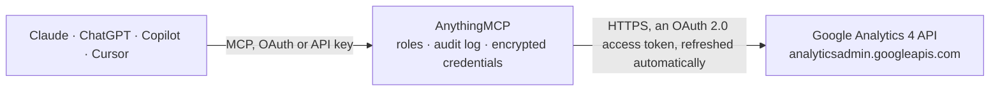

<!-- Generated by scripts/export-github-catalog.mjs in the anythingmcp-website repository. Do not edit by hand. -->

# Google Analytics 4 MCP connector

Query Google Analytics 4 (account/property metadata, custom dimensions/metrics, core reports, realtime reports, funnel reports) from any AI agent. 8 tools, OAuth2 user auth. The AnythingMCP connector gives Claude, ChatGPT, Microsoft Copilot, Cursor and Gemini 8 MCP tools for Google Analytics 4: 5 read and 3 can change data.

**Category:** [Analytics](../analytics.md) · **Tools:** 8 · **Setup guide:** [anythingmcp.com](https://anythingmcp.com/guides/google-analytics-4-to-mcp) · [Deutsch](https://anythingmcp.com/de/guides/google-analytics-4-to-mcp) · [Italiano](https://anythingmcp.com/it/guides/google-analytics-4-to-mcp) · [Español](https://anythingmcp.com/es/guides/google-analytics-4-to-mcp) · [日本語](https://anythingmcp.com/ja/guides/google-analytics-4-to-mcp) · [Русский](https://anythingmcp.com/ru/guides/google-analytics-4-to-mcp) · [中文](https://anythingmcp.com/zh/guides/google-analytics-4-to-mcp)

## Start without code

No installation and no terminal: AnythingMCP Cloud runs the Google Analytics 4 connector for you, operated by helpcode.ai in Frankfurt, Germany.

1. **Click the button above** and create an account or sign in. The Google Analytics 4 connector opens, ready to install.
2. **Sign in with your Google Analytics 4 account** when AnythingMCP asks. The first time, an admin creates a small app in the Google Cloud console. Every click is in the [step-by-step guide](https://anythingmcp.com/guides/google-analytics-4-to-mcp).
3. **Click Install.** AnythingMCP shows the address of your MCP server.
4. **Add that address to your assistant:** [Claude](https://anythingmcp.com/guides/connect-google-analytics-4-to-claude) · [ChatGPT](https://anythingmcp.com/guides/connect-google-analytics-4-to-chatgpt) · [Microsoft Copilot](https://anythingmcp.com/guides/connect-google-analytics-4-to-copilot) · [Cursor](https://anythingmcp.com/guides/connect-google-analytics-4-to-cursor) · [Gemini CLI](https://anythingmcp.com/guides/connect-google-analytics-4-to-gemini) · [Meta Muse](https://anythingmcp.com/guides/connect-google-analytics-4-to-muse).
5. **Ask your first question**, for example: *What are the time zone, currency and create date for GA4 property 876543210? I need them for the FY2026 books.*

Prefer help with the setup? [Talk to us](https://anythingmcp.com/contact).

## How it works

- **The AI client** speaks MCP (Streamable HTTP) to AnythingMCP and only sees tool names, descriptions and results. It never gets the Google Analytics 4 credentials.
- **AnythingMCP** checks the client's role, builds the call from the tool definition, adds the credentials (an OAuth 2.0 access token, refreshed automatically), calls Google Analytics 4, logs the call and returns the result.
- **Google Analytics 4** sees an ordinary API client with the rights of the account the credentials belong to.

## Tools

| Tool | What it does | Access |
|---|---|---|
| [`ga4_get_account_summaries`](#ga4_get_account_summaries) | List the user's GA4 accounts and their properties (account ID, account name, property IDs, display names). | read |
| [`ga4_get_property_details`](#ga4_get_property_details) | Get detailed info about one GA4 property: display name, create time, time zone, currency, parent account, industry category, service level, account. | read |
| [`ga4_list_google_ads_links`](#ga4_list_google_ads_links) | List Google Ads accounts linked to a GA4 property (useful to confirm conversion attribution wiring). | read |
| [`ga4_list_custom_dimensions`](#ga4_list_custom_dimensions) | List custom dimensions defined on a property — use these `parameterName` values in `dimensions` of ga4_run_report. | read |
| [`ga4_list_custom_metrics`](#ga4_list_custom_metrics) | List custom metrics defined on a property — use these `parameterName` values in `metrics` of ga4_run_report. | read |
| [`ga4_run_report`](#ga4_run_report) | Run a core analytics report. | write |
| [`ga4_run_realtime_report`](#ga4_run_realtime_report) | Run a realtime report (last 30 minutes of activity). | write |
| [`ga4_run_funnel_report`](#ga4_run_funnel_report) | Run a funnel report — measures conversion at each step of a user journey (e.g. landed → viewed product → added to cart → purchased). | write |

## Tool reference

Every parameter as the AI client sees it in `tools/list`. Source: [`packages/backend/src/adapters/intl/google-analytics-4.json`](../../../packages/backend/src/adapters/intl/google-analytics-4.json).

### `ga4_get_account_summaries`

List the user's GA4 accounts and their properties (account ID, account name, property IDs, display names). Always call this first — every other tool needs a property ID (the 9-12 digit numeric value, NOT the G-XXX measurement ID). Paginated via pageToken.

**Access:** read · **Call:** `GET https://analyticsadmin.googleapis.com/v1beta/accountSummaries`

| Parameter | Type | Required | Description |
|---|---|---|---|
| `pageSize` | integer | no | Max accounts per page (default 50, max 200). |
| `pageToken` | string | no | Cursor from previous response. |

### `ga4_get_property_details`

Get detailed info about one GA4 property: display name, create time, time zone, currency, parent account, industry category, service level, account.

**Access:** read · **Call:** `GET https://analyticsadmin.googleapis.com/v1beta/properties/{property_id}`

| Parameter | Type | Required | Description |
|---|---|---|---|
| `property_id` | string | yes | GA4 property ID (numeric, e.g. '123456789'). |

### `ga4_list_google_ads_links`

List Google Ads accounts linked to a GA4 property (useful to confirm conversion attribution wiring).

**Access:** read · **Call:** `GET https://analyticsadmin.googleapis.com/v1beta/properties/{property_id}/googleAdsLinks`

| Parameter | Type | Required | Description |
|---|---|---|---|
| `property_id` | string | yes | GA4 property ID. |
| `pageSize` | integer | no | Max per page. |
| `pageToken` | string | no | Pagination cursor. |

### `ga4_list_custom_dimensions`

List custom dimensions defined on a property — use these `parameterName` values in `dimensions` of ga4_run_report. Useful before authoring a report to discover what's available.

**Access:** read · **Call:** `GET https://analyticsadmin.googleapis.com/v1beta/properties/{property_id}/customDimensions`

| Parameter | Type | Required | Description |
|---|---|---|---|
| `property_id` | string | yes | GA4 property ID. |
| `pageSize` | integer | no | Max per page. |
| `pageToken` | string | no | Pagination cursor. |

### `ga4_list_custom_metrics`

List custom metrics defined on a property — use these `parameterName` values in `metrics` of ga4_run_report.

**Access:** read · **Call:** `GET https://analyticsadmin.googleapis.com/v1beta/properties/{property_id}/customMetrics`

| Parameter | Type | Required | Description |
|---|---|---|---|
| `property_id` | string | yes | GA4 property ID. |
| `pageSize` | integer | no | Max per page. |
| `pageToken` | string | no | Pagination cursor. |

### `ga4_run_report`

Run a core analytics report. The most common tool you'll use. Returns rows with one column per dimension + one per metric. Example bodies in instructions. Use dimensions/metrics names from https://ga.dev/api/data/v1/dimensions and https://ga.dev/api/data/v1/metrics, plus any custom ones from ga4_list_custom_dimensions/metrics.

**Access:** write · **Call:** `POST https://analyticsdata.googleapis.com/v1beta/properties/{property_id}:runReport`

| Parameter | Type | Required | Description |
|---|---|---|---|
| `property_id` | string | yes | GA4 property ID. |
| `dimensions` | any[] | yes | Array of {name: '<dimensionName>'} — e.g. [{name:'country'}, {name:'deviceCategory'}]. |
| `metrics` | any[] | yes | Array of {name: '<metricName>'} — e.g. [{name:'activeUsers'}, {name:'sessions'}]. |
| `dateRanges` | any[] | yes | Array of {startDate, endDate, name?} — dates as YYYY-MM-DD / 'today' / 'yesterday' / 'NdaysAgo'. |
| `dimensionFilter` | object | no | Filter expression. e.g. {filter:{fieldName:'country', stringFilter:{value:'Italy'}}}. |
| `metricFilter` | object | no | Filter expression on metrics. e.g. {filter:{fieldName:'sessions', numericFilter:{operation:'GREATER_THAN', value:{int64Value:100}}}}. |
| `orderBys` | any[] | no | Sort. e.g. [{metric:{metricName:'sessions'}, desc:true}]. |
| `limit` | string | no | Max rows (default 10000, max 250000). String because GA accepts int64. |
| `offset` | string | no | Pagination offset (string int64). |
| `keepEmptyRows` | boolean | no | Include zero-value rows. |
| `currencyCode` | string | no | ISO 4217 to override property default. |
| `returnPropertyQuota` | boolean | no | If true include `propertyQuota` block in response for cost diagnostics. |

### `ga4_run_realtime_report`

Run a realtime report (last 30 minutes of activity). Only a subset of dimensions/metrics work here — see https://ga.dev/api/data/v1/realtime-dimensions and https://ga.dev/api/data/v1/realtime-metrics. Use for 'how many users are on the site right now', 'which pages are hot in the last minute', etc.

**Access:** write · **Call:** `POST https://analyticsdata.googleapis.com/v1beta/properties/{property_id}:runRealtimeReport`

| Parameter | Type | Required | Description |
|---|---|---|---|
| `property_id` | string | yes | GA4 property ID. |
| `dimensions` | any[] | no | Realtime dimensions only — e.g. [{name:'country'}, {name:'unifiedScreenName'}]. |
| `metrics` | any[] | yes | Realtime metrics — e.g. [{name:'activeUsers'}]. |
| `dimensionFilter` | object | no | Optional dimension filter expression. |
| `metricFilter` | object | no | Optional metric filter. |
| `orderBys` | any[] | no | Sort. |
| `limit` | string | no | Max rows (default 10000). |
| `minuteRanges` | any[] | no | Restrict to specific minute windows (default last 30 min). [{startMinutesAgo:30, endMinutesAgo:0}]. |

### `ga4_run_funnel_report`

Run a funnel report — measures conversion at each step of a user journey (e.g. landed → viewed product → added to cart → purchased). Uses v1alpha endpoint. `funnel` defines the steps; each step is a filter on events/dimensions.

**Access:** write · **Call:** `POST https://analyticsdata.googleapis.com/v1alpha/properties/{property_id}:runFunnelReport`

| Parameter | Type | Required | Description |
|---|---|---|---|
| `property_id` | string | yes | GA4 property ID. |
| `dateRanges` | any[] | yes | Array of {startDate, endDate}. |
| `funnel` | object | yes | Funnel definition: {steps:[{name:'Landed', filterExpression:{...}}, {name:'Added to cart', filterExpression:{...}}], isOpenFunnel: false}. |
| `funnelBreakdown` | object | no | Optional breakdown by a dimension at each step: {breakdownDimension:{name:'deviceCategory'}, limit:5}. |
| `funnelNextAction` | object | no | Optional 'next action' analysis: shows what users did at each step. |
| `funnelVisualizationType` | string | no | STANDARD_FUNNEL or TRENDED_FUNNEL. |
| `segments` | any[] | no | Optional user/session segments to compare. |
| `limit` | string | no | Max rows. |
| `dimensionFilter` | object | no | Global filter applied across all steps. |
| `returnPropertyQuota` | boolean | no | Include quota info in response. |

## Run it yourself

AnythingMCP is open source (AGPL-3.0). [Run it with Docker](../../../README.md#run-it-yourself), open **Connectors → Store**, pick **Google Analytics 4** and enter `GOOGLE_CLIENT_ID`, `GOOGLE_CLIENT_SECRET`, then add your MCP server URL to the AI client.

[← Analytics connectors](../analytics.md) · [All categories](../README.md)
