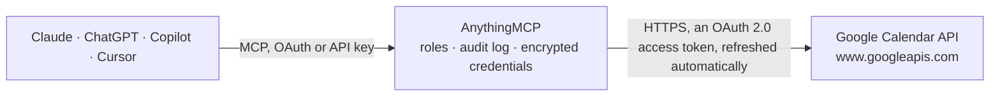

<!-- Generated by scripts/export-github-catalog.mjs in the anythingmcp-website repository. Do not edit by hand. -->

# Google Calendar MCP connector

Let your AI work with Google Calendar: see the calendars you have, list and search events in any time range, read event details and guests, create and reschedule meetings with guests and Google Meet … The AnythingMCP connector gives Claude, ChatGPT, Microsoft Copilot, Cursor and Gemini 11 MCP tools for Google Calendar: 6 read and 5 can change data.

**Category:** [Scheduling](../scheduling.md) · **Tools:** 11 · **Setup guide:** [anythingmcp.com](https://anythingmcp.com/guides/google-calendar-to-mcp) · [Deutsch](https://anythingmcp.com/de/guides/google-calendar-to-mcp) · [Italiano](https://anythingmcp.com/it/guides/google-calendar-to-mcp) · [Español](https://anythingmcp.com/es/guides/google-calendar-to-mcp) · [日本語](https://anythingmcp.com/ja/guides/google-calendar-to-mcp) · [Русский](https://anythingmcp.com/ru/guides/google-calendar-to-mcp) · [中文](https://anythingmcp.com/zh/guides/google-calendar-to-mcp)

## Start without code

No installation and no terminal: AnythingMCP Cloud runs the Google Calendar connector for you, operated by helpcode.ai in Frankfurt, Germany.

1. **Click the button above** and create an account or sign in. The Google Calendar connector opens, ready to install.
2. **Sign in with your Google Calendar account** when AnythingMCP asks. The first time, an admin creates a small app in the Google Cloud console. Every click is in the [step-by-step guide](https://anythingmcp.com/guides/google-calendar-to-mcp).
3. **Click Install.** AnythingMCP shows the address of your MCP server.
4. **Add that address to your assistant:** [Claude](https://anythingmcp.com/guides/connect-google-calendar-to-claude) · [ChatGPT](https://anythingmcp.com/guides/connect-google-calendar-to-chatgpt) · [Microsoft Copilot](https://anythingmcp.com/guides/connect-google-calendar-to-copilot) · [Cursor](https://anythingmcp.com/guides/connect-google-calendar-to-cursor) · [Gemini CLI](https://anythingmcp.com/guides/connect-google-calendar-to-gemini) · [Meta Muse](https://anythingmcp.com/guides/connect-google-calendar-to-muse).
5. **Ask your first question**, for example: *Show me the event details and attendee statuses for 'Q3 invoicing review' scheduled 2026-11-10T10:00+01:00*

Prefer help with the setup? [Talk to us](https://anythingmcp.com/contact).

## How it works

- **The AI client** speaks MCP (Streamable HTTP) to AnythingMCP and only sees tool names, descriptions and results. It never gets the Google Calendar credentials.
- **AnythingMCP** checks the client's role, builds the call from the tool definition, adds the credentials (an OAuth 2.0 access token, refreshed automatically), calls Google Calendar, logs the call and returns the result.
- **Google Calendar** sees an ordinary API client with the rights of the account the credentials belong to.

## Tools

| Tool | What it does | Access |
|---|---|---|
| [`gcal_list_calendars`](#gcal_list_calendars) | List the calendars in the signed-in user's calendar list (own, shared and subscribed) with id, summary, timeZone, accessRole and primary flag. | read |
| [`gcal_get_calendar`](#gcal_get_calendar) | Get one calendar's metadata: summary, description, location and time zone. | read |
| [`gcal_list_events`](#gcal_list_events) | List or search events of one calendar in a time window. | read |
| [`gcal_get_event`](#gcal_get_event) | Get one event with all details: start and end, attendees and their responseStatus, organizer, recurrence, reminders, hangoutLink and conferenceData,… | read |
| [`gcal_create_event`](#gcal_create_event) | Create an event: title, start and end (timed or all-day), location, description, guests, recurrence, reminders and optionally a Google Meet link… | write |
| [`gcal_update_event`](#gcal_update_event) | Change an event: only the fields given are changed (PATCH). | write |
| [`gcal_respond_to_event`](#gcal_respond_to_event) | Accept, decline or tentatively accept an invitation. | write |
| [`gcal_quick_add`](#gcal_quick_add) | Create an event from one line of natural language, the way Calendar's quick add does, e.g. "Lunch with Ana tomorrow 12:30-13:30 at Café Central". | write |
| [`gcal_delete_event`](#gcal_delete_event) | Delete an event (all occurrences when it is a recurring series; pass an occurrence id to cancel one occurrence). | write |
| [`gcal_query_free_busy`](#gcal_query_free_busy) | Check when calendars are busy in a time window, without event details: returns busy intervals per calendar. | read |
| [`gcal_list_colors`](#gcal_list_colors) | List the color palette: event colors (color_id "1" to "11") and calendar colors, each with background and foreground hex values. | read |

## Tool reference

Every parameter as the AI client sees it in `tools/list`. Source: [`packages/backend/src/adapters/intl/google-calendar.json`](../../../packages/backend/src/adapters/intl/google-calendar.json).

### `gcal_list_calendars`

List the calendars in the signed-in user's calendar list (own, shared and subscribed) with id, summary, timeZone, accessRole and primary flag. Use an id as calendar_id elsewhere; "primary" always works for the user's main calendar. Paginate with page_token = nextPageToken.

**Access:** read · **Call:** `GET /users/me/calendarList`

| Parameter | Type | Required | Description |
|---|---|---|---|
| `max_results` | integer | no | Calendars per page, 1 to 250 (default 100). |
| `page_token` | string | no | nextPageToken from the previous response. |
| `min_access_role` | `freeBusyReader` \| `reader` \| `writer` \| `owner` | no | Only calendars where the user has at least this role. |
| `show_hidden` | boolean | no | true to include calendars hidden from the list in the Calendar UI. |

### `gcal_get_calendar`

Get one calendar's metadata: summary, description, location and time zone. Use calendar_id "primary" for the signed-in user's main calendar and its time zone.

**Access:** read · **Call:** `GET /calendars/{calendar_id}`

| Parameter | Type | Required | Description |
|---|---|---|---|
| `calendar_id` | string | yes | Calendar id: "primary" for the signed-in user's main calendar, otherwise an `id` from gcal_list_calendars (often an email address or ...@group.calendar.google.com). |

### `gcal_list_events`

List or search events of one calendar in a time window. time_min and time_max are RFC 3339 with offset (2026-10-09T00:00:00+02:00); q searches summary, description, location, guests and organizer. Recurring events are expanded into single occurrences sorted by start time by default. Paginate with page_token = nextPageToken.

**Access:** read · **Call:** `GET /calendars/{calendar_id}/events`

| Parameter | Type | Required | Description |
|---|---|---|---|
| `calendar_id` | string | yes | Calendar id: "primary" for the signed-in user's main calendar, otherwise an `id` from gcal_list_calendars (often an email address or ...@group.calendar.google.com). |
| `time_min` | string | no | Lower bound (exclusive) on an event's end time, RFC 3339 with offset, e.g. 2026-10-09T00:00:00+02:00. |
| `time_max` | string | no | Upper bound (exclusive) on an event's start time, RFC 3339 with offset. |
| `q` | string | no | Free-text search over summary, description, location, guest names and emails, and organizer. |
| `single_events` | boolean | no | true (default) expands recurring events into their occurrences; false returns the series themselves. |
| `order_by` | `startTime` \| `updated` | no | "startTime" (default, needs single_events true) or "updated" (last modification). |
| `max_results` | integer | no | Events per page, 1 to 2500 (default 250). |
| `page_token` | string | no | nextPageToken from the previous response, with the same other arguments. |
| `time_zone` | string | no | IANA time zone for the times in the response, e.g. Europe/Berlin (default: the calendar's). |
| `show_deleted` | boolean | no | true to include cancelled events (status "cancelled"). |
| `updated_min` | string | no | Only events modified after this RFC 3339 time. |
| `event_types` | string[] | no | Only these event types, e.g. ["default", "outOfOffice", "focusTime", "workingLocation", "birthday"]. |

### `gcal_get_event`

Get one event with all details: start and end, attendees and their responseStatus, organizer, recurrence, reminders, hangoutLink and conferenceData, htmlLink and status.

**Access:** read · **Call:** `GET /calendars/{calendar_id}/events/{event_id}`

| Parameter | Type | Required | Description |
|---|---|---|---|
| `calendar_id` | string | yes | Calendar id: "primary" for the signed-in user's main calendar, otherwise an `id` from gcal_list_calendars (often an email address or ...@group.calendar.google.com). |
| `event_id` | string | yes | Event id from gcal_list_events or gcal_get_event. With single_events true, an occurrence of a recurring event has its own id (<series id>_<start>). |
| `time_zone` | string | no | IANA time zone for the times in the response, e.g. Europe/Berlin. |
| `max_attendees` | integer | no | Return at most this many attendees. |

### `gcal_create_event`

Create an event: title, start and end (timed or all-day), location, description, guests, recurrence, reminders and optionally a Google Meet link (conference_data). Guests are emailed only when send_updates is "all" or "externalOnly". Returns the event with id and htmlLink.

**Access:** write · **Call:** `POST /calendars/{calendar_id}/events`

| Parameter | Type | Required | Description |
|---|---|---|---|
| `calendar_id` | string | yes | Calendar id: "primary" for the signed-in user's main calendar, otherwise an `id` from gcal_list_calendars (often an email address or ...@group.calendar.google.com). |
| `summary` | string | no | Title of the event. |
| `description` | string | no | Description or agenda; may contain simple HTML. |
| `location` | string | no | Free-text location or address. |
| `start` | object | yes | Start of the event. Timed: {"dateTime": "2026-10-09T09:00:00+02:00"} (RFC 3339 with offset), optionally with "timeZone": "Europe/Berlin" (required for recurring events). All-day: {"date": "2026-10-09"}. |
| `end` | object | yes | End of the event. Timed: {"dateTime": "2026-10-09T09:00:00+02:00"} (RFC 3339 with offset), optionally with "timeZone": "Europe/Berlin" (required for recurring events). All-day: {"date": "2026-10-09"}, where the end date is exclusive (a one-day event on 9 Oct ends on 10 Oct). |
| `attendees` | object[] | no | Guests, each {"email": "ana@example.com"} with optional "optional": true, "displayName" and "responseStatus". On update this list replaces the current one: include everyone who should stay. |
| `recurrence` | string[] | no | RRULE, EXRULE, RDATE or EXDATE lines (RFC 5545), e.g. ["RRULE:FREQ=WEEKLY;BYDAY=MO;COUNT=10"]. Needs a timeZone in start and end. |
| `reminders` | object | no | Reminders, e.g. {"useDefault": false, "overrides": [{"method": "popup", "minutes": 10}]}. Omit to keep the calendar's default reminders. |
| `conference_data` | object | no | To add a Google Meet link: {"createRequest": {"requestId": "<any unique string>", "conferenceSolutionKey": {"type": "hangoutsMeet"}}}. The link comes back in hangoutLink and conferenceData.entryPoints. |
| `color_id` | string | no | Event color id "1" to "11" (see gcal_list_colors). |
| `visibility` | `default` \| `public` \| `private` \| `confidential` | no | default, public, private or confidential. |
| `transparency` | `opaque` \| `transparent` | no | "opaque" blocks time (busy, default), "transparent" shows the time as free. |
| `guests_can_modify` | boolean | no | true to let guests edit the event. |
| `send_updates` | `all` \| `externalOnly` \| `none` | no | Who gets an email about the change: "all" (every guest), "externalOnly" (guests outside Google Calendar only) or "none" (default: nobody is notified). |

### `gcal_update_event`

Change an event: only the fields given are changed (PATCH). attendees, recurrence and reminders replace the whole current value, so read the event first with gcal_get_event when adding a guest. Can add a Meet link with conference_data. Returns the updated event.

**Access:** write · **Call:** `PATCH /calendars/{calendar_id}/events/{event_id}`

| Parameter | Type | Required | Description |
|---|---|---|---|
| `calendar_id` | string | yes | Calendar id: "primary" for the signed-in user's main calendar, otherwise an `id` from gcal_list_calendars (often an email address or ...@group.calendar.google.com). |
| `event_id` | string | yes | Event id from gcal_list_events or gcal_get_event. With single_events true, an occurrence of a recurring event has its own id (<series id>_<start>). |
| `summary` | string | no | Title of the event. |
| `description` | string | no | Description or agenda; may contain simple HTML. |
| `location` | string | no | Free-text location or address. |
| `start` | object | no | Start of the event. Timed: {"dateTime": "2026-10-09T09:00:00+02:00"} (RFC 3339 with offset), optionally with "timeZone": "Europe/Berlin" (required for recurring events). All-day: {"date": "2026-10-09"}. |
| `end` | object | no | End of the event. Timed: {"dateTime": "2026-10-09T09:00:00+02:00"} (RFC 3339 with offset), optionally with "timeZone": "Europe/Berlin" (required for recurring events). All-day: {"date": "2026-10-09"}, where the end date is exclusive (a one-day event on 9 Oct ends on 10 Oct). |
| `attendees` | object[] | no | Guests, each {"email": "ana@example.com"} with optional "optional": true, "displayName" and "responseStatus". On update this list replaces the current one: include everyone who should stay. |
| `recurrence` | string[] | no | RRULE, EXRULE, RDATE or EXDATE lines (RFC 5545), e.g. ["RRULE:FREQ=WEEKLY;BYDAY=MO;COUNT=10"]. Needs a timeZone in start and end. |
| `reminders` | object | no | Reminders, e.g. {"useDefault": false, "overrides": [{"method": "popup", "minutes": 10}]}. Omit to keep the calendar's default reminders. |
| `conference_data` | object | no | To add a Google Meet link: {"createRequest": {"requestId": "<any unique string>", "conferenceSolutionKey": {"type": "hangoutsMeet"}}}. The link comes back in hangoutLink and conferenceData.entryPoints. |
| `color_id` | string | no | Event color id "1" to "11" (see gcal_list_colors). |
| `visibility` | `default` \| `public` \| `private` \| `confidential` | no | default, public, private or confidential. |
| `transparency` | `opaque` \| `transparent` | no | "opaque" blocks time (busy, default), "transparent" shows the time as free. |
| `guests_can_modify` | boolean | no | true to let guests edit the event. |
| `send_updates` | `all` \| `externalOnly` \| `none` | no | Who gets an email about the change: "all" (every guest), "externalOnly" (guests outside Google Calendar only) or "none" (default: nobody is notified). |

### `gcal_respond_to_event`

Accept, decline or tentatively accept an invitation. Read the event with gcal_get_event, take its full attendees list, set responseStatus ("accepted", "declined", "tentative") on the entry with "self": true and pass the whole list here; entries left out are removed when you are the organizer.

**Access:** write · **Call:** `PATCH /calendars/{calendar_id}/events/{event_id}`

| Parameter | Type | Required | Description |
|---|---|---|---|
| `calendar_id` | string | yes | Calendar id: "primary" for the signed-in user's main calendar, otherwise an `id` from gcal_list_calendars (often an email address or ...@group.calendar.google.com). |
| `event_id` | string | yes | Event id from gcal_list_events or gcal_get_event. With single_events true, an occurrence of a recurring event has its own id (<series id>_<start>). |
| `attendees` | object[] | yes | Guests, each {"email": "ana@example.com"} with optional "optional": true, "displayName" and "responseStatus". On update this list replaces the current one: include everyone who should stay. |
| `send_updates` | `all` \| `externalOnly` \| `none` | no | Who gets an email about the change: "all" (every guest), "externalOnly" (guests outside Google Calendar only) or "none" (default: nobody is notified). |

### `gcal_quick_add`

Create an event from one line of natural language, the way Calendar's quick add does, e.g. "Lunch with Ana tomorrow 12:30-13:30 at Café Central". Google parses date, time and title (English works best). Returns the created event; check its start and end.

**Access:** write · **Call:** `POST /calendars/{calendar_id}/events/quickAdd`

| Parameter | Type | Required | Description |
|---|---|---|---|
| `calendar_id` | string | yes | Calendar id: "primary" for the signed-in user's main calendar, otherwise an `id` from gcal_list_calendars (often an email address or ...@group.calendar.google.com). |
| `text` | string | yes | The event in one sentence, e.g. "Team sync Friday 10am-11am". |
| `send_updates` | `all` \| `externalOnly` \| `none` | no | Who gets an email about the change: "all" (every guest), "externalOnly" (guests outside Google Calendar only) or "none" (default: nobody is notified). |

### `gcal_delete_event`

Delete an event (all occurrences when it is a recurring series; pass an occurrence id to cancel one occurrence). Guests are told only when send_updates is "all" or "externalOnly". Installed switched off.

**Access:** write · **Call:** `DELETE /calendars/{calendar_id}/events/{event_id}`

| Parameter | Type | Required | Description |
|---|---|---|---|
| `calendar_id` | string | yes | Calendar id: "primary" for the signed-in user's main calendar, otherwise an `id` from gcal_list_calendars (often an email address or ...@group.calendar.google.com). |
| `event_id` | string | yes | Event id from gcal_list_events or gcal_get_event. With single_events true, an occurrence of a recurring event has its own id (<series id>_<start>). |
| `send_updates` | `all` \| `externalOnly` \| `none` | no | Who gets an email about the change: "all" (every guest), "externalOnly" (guests outside Google Calendar only) or "none" (default: nobody is notified). |

### `gcal_query_free_busy`

Check when calendars are busy in a time window, without event details: returns busy intervals per calendar. Works for the user's calendars and for colleagues whose free/busy is visible to the user (same Google Workspace organisation, or shared). Read-only.

**Access:** read · **Call:** `POST /freeBusy`

| Parameter | Type | Required | Description |
|---|---|---|---|
| `time_min` | string | yes | Start of the window, RFC 3339 with offset, e.g. 2026-10-09T08:00:00+02:00. |
| `time_max` | string | yes | End of the window, RFC 3339 with offset. |
| `items` | object[] | yes | Calendars to check, each {"id": "primary"} or {"id": "ana@example.com"}; up to 50. |
| `time_zone` | string | no | IANA time zone for the response, e.g. Europe/Berlin (default UTC). |

### `gcal_list_colors`

List the color palette: event colors (color_id "1" to "11") and calendar colors, each with background and foreground hex values. Use it to pick a color_id for gcal_create_event.

**Access:** read · **Call:** `GET /colors`

No parameters.

## Run it yourself

AnythingMCP is open source (AGPL-3.0). [Run it with Docker](../../../README.md#run-it-yourself), open **Connectors → Store**, pick **Google Calendar** and enter `GOOGLE_CLIENT_ID`, `GOOGLE_CLIENT_SECRET`, then add your MCP server URL to the AI client.

[← Scheduling connectors](../scheduling.md) · [All categories](../README.md)
