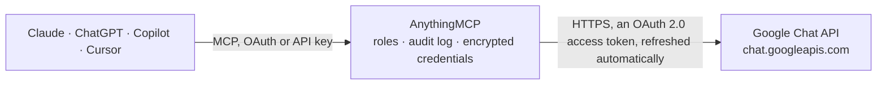

<!-- Generated by scripts/export-github-catalog.mjs in the anythingmcp-website repository. Do not edit by hand. -->

# Google Chat MCP connector

Let your AI work in Google Chat as you: find spaces, group chats and direct messages, read and search messages and threads, see members, reactions and attachments, follow what changed in a space, … The AnythingMCP connector gives Claude, ChatGPT, Microsoft Copilot, Cursor and Gemini 18 MCP tools for Google Chat: 12 read and 6 can change data.

[](https://cloud.anythingmcp.com/login?mode=register&redirect=%2Fconnectors%2Fstore%3Finstall%3Dgoogle-chat&utm_source=github&utm_medium=catalog&utm_campaign=google-chat)

**Category:** [Messaging](../messaging.md) · **Tools:** 18 · **Setup guide:** [anythingmcp.com](https://anythingmcp.com/guides/google-chat-to-mcp) · [Deutsch](https://anythingmcp.com/de/guides/google-chat-to-mcp) · [Italiano](https://anythingmcp.com/it/guides/google-chat-to-mcp) · [Español](https://anythingmcp.com/es/guides/google-chat-to-mcp) · [日本語](https://anythingmcp.com/ja/guides/google-chat-to-mcp) · [Русский](https://anythingmcp.com/ru/guides/google-chat-to-mcp) · [中文](https://anythingmcp.com/zh/guides/google-chat-to-mcp)

## Start without code

No installation and no terminal: AnythingMCP Cloud runs the Google Chat connector for you, operated by helpcode.ai in Frankfurt, Germany.

1. **Click the button above** and create an account or sign in. The Google Chat connector opens, ready to install.
2. **Sign in with your Google Chat account** when AnythingMCP asks. The first time, an admin creates a small app in the Google Cloud console. Every click is in the [step-by-step guide](https://anythingmcp.com/guides/google-chat-to-mcp).
3. **Click Install.** AnythingMCP shows the address of your MCP server.
4. **Add that address to your assistant:** [Claude](https://anythingmcp.com/guides/connect-google-chat-to-claude) · [ChatGPT](https://anythingmcp.com/guides/connect-google-chat-to-chatgpt) · [Microsoft Copilot](https://anythingmcp.com/guides/connect-google-chat-to-copilot) · [Cursor](https://anythingmcp.com/guides/connect-google-chat-to-cursor) · [Gemini CLI](https://anythingmcp.com/guides/connect-google-chat-to-gemini) · [Meta Muse](https://anythingmcp.com/guides/connect-google-chat-to-muse).
5. **Ask your first question**, for example: *Do I have a direct message thread with lisa.treasurer@verdetec-hr.de about invoice INV-2026-114?*

Prefer help with the setup? [Talk to us](https://anythingmcp.com/contact).

## How it works



- **The AI client** speaks MCP (Streamable HTTP) to AnythingMCP and only sees tool names, descriptions and results. It never gets the Google Chat credentials.
- **AnythingMCP** checks the client's role, builds the call from the tool definition, adds the credentials (an OAuth 2.0 access token, refreshed automatically), calls Google Chat, logs the call and returns the result.
- **Google Chat** sees an ordinary API client with the rights of the account the credentials belong to.

## Tools

| Tool | What it does | Access |
|---|---|---|
| [`google_chat_list_spaces`](#google_chat_list_spaces) | List the spaces, group chats and direct messages the user is a member of: name (spaces/...), displayName (empty for direct messages), spaceType (SPACE,… | read |
| [`google_chat_search_spaces`](#google_chat_search_spaces) | Search the named spaces the user has joined by display name, e.g. query display_name:"Marketing" AND space_type = "SPACE". | read |
| [`google_chat_get_space`](#google_chat_get_space) | Get one space: displayName, spaceType, description and guidelines (spaceDetails), threading state, history state, membershipCount, whether external users… | read |
| [`google_chat_find_direct_message`](#google_chat_find_direct_message) | Find the existing one-to-one direct message between the signed-in user and another person, to read or post there. | read |
| [`google_chat_list_members`](#google_chat_list_members) | List the members of a space: each membership's name, role (ROLE_MEMBER, ROLE_MANAGER), state (JOINED, INVITED), createTime and member (name users/{id}, type… | read |
| [`google_chat_list_messages`](#google_chat_list_messages) | List the messages of a space, oldest first by default: name, sender (users/{id}, type), createTime, lastUpdateTime, text, thread.name, threadReply,… | read |
| [`google_chat_get_message`](#google_chat_get_message) | Get one message: sender, createTime, lastUpdateTime, text, thread.name, attachments (name, contentName, contentType, attachmentDataRef.resourceName),… | read |
| [`google_chat_search_messages`](#google_chat_search_messages) | Search messages across every space and direct message the user belongs to, newest first. | read |
| [`google_chat_list_reactions`](#google_chat_list_reactions) | List the emoji reactions on a message: each reaction's name, emoji (unicode or customEmoji) and user. | read |
| [`google_chat_get_attachment`](#google_chat_get_attachment) | Get the metadata of a file attached to a message: contentName (file name), contentType, source (UPLOADED_CONTENT or DRIVE_FILE), thumbnailUri, downloadUri,… | read |
| [`google_chat_download_attachment`](#google_chat_download_attachment) | Download a file uploaded to a message (source UPLOADED_CONTENT), handed over as an attached file or image, up to 10 MB. | read |
| [`google_chat_list_space_events`](#google_chat_list_space_events) | List what happened in a space during the last 28 days: new, changed and deleted messages, reactions, memberships and space changes, each with eventType,… | read |
| [`google_chat_create_message`](#google_chat_create_message) | Post a text message to a space, group chat or direct message as the signed-in user. | write |
| [`google_chat_reply_in_thread`](#google_chat_reply_in_thread) | Reply in an existing thread of a space as the signed-in user. | write |
| [`google_chat_update_message`](#google_chat_update_message) | Replace the text of a message the signed-in user sent. | write |
| [`google_chat_add_reaction`](#google_chat_add_reaction) | Add an emoji reaction from the signed-in user to a message, e.g. 👍. | write |
| [`google_chat_delete_reaction`](#google_chat_delete_reaction) | Remove one of the signed-in user's reactions from a message. | write |
| [`google_chat_delete_message`](#google_chat_delete_message) | Delete a message the signed-in user sent (managers can delete others' messages in some spaces). | write |

## Tool reference

Every parameter as the AI client sees it in `tools/list`. Source: [`packages/backend/src/adapters/intl/google-chat.json`](../../../packages/backend/src/adapters/intl/google-chat.json).

### `google_chat_list_spaces`

List the spaces, group chats and direct messages the user is a member of: name (spaces/...), displayName (empty for direct messages), spaceType (SPACE, GROUP_CHAT, DIRECT_MESSAGE), spaceThreadingState, membershipCount, lastActiveTime and spaceUri. Paginate with page_token.

**Access:** read · **Call:** `GET /v1/spaces`

| Parameter | Type | Required | Description |
|---|---|---|---|
| `filter` | string | no | Optional filter by type, e.g. spaceType = "SPACE" or spaceType = "GROUP_CHAT" OR spaceType = "DIRECT_MESSAGE". |
| `page_size` | integer | no | Results per page (default 100, maximum 1000). |
| `page_token` | string | no | nextPageToken from the previous answer, to fetch the next page. Keep the other arguments the same. |

### `google_chat_search_spaces`

Search the named spaces the user has joined by display name, e.g. query display_name:"Marketing" AND space_type = "SPACE". space_type = "SPACE" and a display_name condition are both needed, otherwise the answer is empty. Paginate with page_token.

**Access:** read · **Call:** `GET /v1/spaces:search`

| Parameter | Type | Required | Description |
|---|---|---|---|
| `query` | string | yes | Search query, e.g. display_name:"Marketing" AND space_type = "SPACE", or (display_name:"Sales" OR display_name:"Support") AND space_type = "SPACE". Each word is prefix-matched in the space name, case-insensitively. |
| `order_by` | `create_time DESC` | no | Sort order: "create_time DESC" (only DESC is supported without admin access). |
| `page_size` | integer | no | Results per page (default 100, maximum 100). |
| `page_token` | string | no | nextPageToken from the previous answer, to fetch the next page. Keep the other arguments the same. |

### `google_chat_get_space`

Get one space: displayName, spaceType, description and guidelines (spaceDetails), threading state, history state, membershipCount, whether external users are allowed, createTime, lastActiveTime and spaceUri.

**Access:** read · **Call:** `GET /v1/spaces/{space_id}`

| Parameter | Type | Required | Description |
|---|---|---|---|
| `space_id` | string | yes | Space id without the "spaces/" prefix: the part after spaces/ in a space's name, e.g. AAAAMpdlehY for spaces/AAAAMpdlehY. |

### `google_chat_find_direct_message`

Find the existing one-to-one direct message between the signed-in user and another person, to read or post there. Answers 404 when the two have never had a direct message.

**Access:** read · **Call:** `GET /v1/spaces:findDirectMessage`

| Parameter | Type | Required | Description |
|---|---|---|---|
| `user` | string | yes | The other person as users/{email} or users/{id}, e.g. users/ana@example.com or users/123456789 (the id from a member or sender name). |

### `google_chat_list_members`

List the members of a space: each membership's name, role (ROLE_MEMBER, ROLE_MANAGER), state (JOINED, INVITED), createTime and member (name users/{id}, type HUMAN or BOT; displayName is only filled for some callers). Paginate with page_token.

**Access:** read · **Call:** `GET /v1/spaces/{space_id}/members`

| Parameter | Type | Required | Description |
|---|---|---|---|
| `space_id` | string | yes | Space id without the "spaces/" prefix: the part after spaces/ in a space's name, e.g. AAAAMpdlehY for spaces/AAAAMpdlehY. |
| `filter` | string | no | Optional filter, e.g. role = "ROLE_MANAGER", member.type = "HUMAN", or both with AND. |
| `show_invited` | boolean | no | true to include people invited but not yet joined. |
| `show_groups` | boolean | no | true to include Google Groups that are members. |
| `page_size` | integer | no | Results per page (default 100, maximum 1000). |
| `page_token` | string | no | nextPageToken from the previous answer, to fetch the next page. Keep the other arguments the same. |

### `google_chat_list_messages`

List the messages of a space, oldest first by default: name, sender (users/{id}, type), createTime, lastUpdateTime, text, thread.name, threadReply, attachment metadata, emojiReactionSummaries and annotations (mentions). Card content is left out. Paginate with page_token.

**Access:** read · **Call:** `GET /v1/spaces/{space_id}/messages`

| Parameter | Type | Required | Description |
|---|---|---|---|
| `space_id` | string | yes | Space id without the "spaces/" prefix: the part after spaces/ in a space's name, e.g. AAAAMpdlehY for spaces/AAAAMpdlehY. |
| `filter` | string | no | Optional filter by time and thread, e.g. create_time > "2026-10-01T00:00:00+02:00", or thread.name = spaces/AAAAMpdlehY/threads/FHT5Rc21TfA, joined with AND. |
| `order_by` | `create_time asc` \| `create_time desc` | no | "create_time desc" for newest first; default oldest first. |
| `show_deleted` | boolean | no | true to include deleted messages (their content is gone, deleteTime and deletionMetadata remain). |
| `page_size` | integer | no | Results per page (default 25, maximum 1000). |
| `page_token` | string | no | nextPageToken from the previous answer, to fetch the next page. Keep the other arguments the same. |

### `google_chat_get_message`

Get one message: sender, createTime, lastUpdateTime, text, thread.name, attachments (name, contentName, contentType, attachmentDataRef.resourceName), reactions summary, mentions and quoted message. Card content is left out.

**Access:** read · **Call:** `GET /v1/spaces/{space_id}/messages/{message_id}`

| Parameter | Type | Required | Description |
|---|---|---|---|
| `space_id` | string | yes | Space id without the "spaces/" prefix: the part after spaces/ in a space's name, e.g. AAAAMpdlehY for spaces/AAAAMpdlehY. |
| `message_id` | string | yes | Message id: the part after /messages/ in a message's name, e.g. ZJ7sqN6qlYk.ZJ7sqN6qlYk for spaces/AAAAMpdlehY/messages/ZJ7sqN6qlYk.ZJ7sqN6qlYk, or a client-assigned id such as client-weekly-report. |

### `google_chat_search_messages`

Search messages across every space and direct message the user belongs to, newest first. filter takes keywords plus conditions, e.g. budget sender.name = "users/ana@example.com" createTime >= "2026-10-01T00:00:00Z". Returns results[].message, each with its full name (which names the space). Messages from Chat apps, in muted spaces or private to the user are not searched; use google_chat_list_messages for those. Paginate with page_token.

**Access:** read · **Call:** `POST /v1/spaces/-/messages:search`

| Parameter | Type | Required | Description |
|---|---|---|---|
| `filter` | string | yes | Keywords and conditions joined by spaces (AND): createTime with < or >=, sender.name = "users/{email or id}", space.name = "spaces/{id}", space.display_name:"Sales", space.space_type = "SPACE", attachment:*, annotations.user_mentions.user.name:me, has_link(), is_unread(). Up to 1,000 characters. |
| `page_size` | integer | no | Results per page (default 25, maximum 100). |
| `page_token` | string | no | nextPageToken from the previous answer, to fetch the next page. Keep the other arguments the same. |

### `google_chat_list_reactions`

List the emoji reactions on a message: each reaction's name, emoji (unicode or customEmoji) and user. Paginate with page_token.

**Access:** read · **Call:** `GET /v1/spaces/{space_id}/messages/{message_id}/reactions`

| Parameter | Type | Required | Description |
|---|---|---|---|
| `space_id` | string | yes | Space id without the "spaces/" prefix: the part after spaces/ in a space's name, e.g. AAAAMpdlehY for spaces/AAAAMpdlehY. |
| `message_id` | string | yes | Message id: the part after /messages/ in a message's name, e.g. ZJ7sqN6qlYk.ZJ7sqN6qlYk for spaces/AAAAMpdlehY/messages/ZJ7sqN6qlYk.ZJ7sqN6qlYk, or a client-assigned id such as client-weekly-report. |
| `filter` | string | no | Optional filter, e.g. emoji.unicode = "👍" or user.name = "users/123456789". |
| `page_size` | integer | no | Results per page (default 25, maximum 200). |
| `page_token` | string | no | nextPageToken from the previous answer, to fetch the next page. Keep the other arguments the same. |

### `google_chat_get_attachment`

Get the metadata of a file attached to a message: contentName (file name), contentType, source (UPLOADED_CONTENT or DRIVE_FILE), thumbnailUri, downloadUri, attachmentDataRef.resourceName (for google_chat_download_attachment) or driveDataRef.driveFileId for Google Drive files.

**Access:** read · **Call:** `GET /v1/spaces/{space_id}/messages/{message_id}/attachments/{attachment_id}`

| Parameter | Type | Required | Description |
|---|---|---|---|
| `space_id` | string | yes | Space id without the "spaces/" prefix: the part after spaces/ in a space's name, e.g. AAAAMpdlehY for spaces/AAAAMpdlehY. |
| `message_id` | string | yes | Message id: the part after /messages/ in a message's name, e.g. ZJ7sqN6qlYk.ZJ7sqN6qlYk for spaces/AAAAMpdlehY/messages/ZJ7sqN6qlYk.ZJ7sqN6qlYk, or a client-assigned id such as client-weekly-report. |
| `attachment_id` | string | yes | Attachment id: the part after /attachments/ in attachment[].name of a message. |

### `google_chat_download_attachment`

Download a file uploaded to a message (source UPLOADED_CONTENT), handed over as an attached file or image, up to 10 MB. Files from Google Drive (DRIVE_FILE) cannot be downloaded here: use the Google Drive connector with driveDataRef.driveFileId.

**Access:** read · **Call:** `GET /v1/media/{resource_name}`

| Parameter | Type | Required | Description |
|---|---|---|---|
| `resource_name` | string | yes | attachmentDataRef.resourceName of the attachment, exactly as returned by google_chat_get_message or google_chat_get_attachment. |

### `google_chat_list_space_events`

List what happened in a space during the last 28 days: new, changed and deleted messages, reactions, memberships and space changes, each with eventType, eventTime and the changed resource. The filter must name at least one event type. Paginate with page_token.

**Access:** read · **Call:** `GET /v1/spaces/{space_id}/spaceEvents`

| Parameter | Type | Required | Description |
|---|---|---|---|
| `space_id` | string | yes | Space id without the "spaces/" prefix: the part after spaces/ in a space's name, e.g. AAAAMpdlehY for spaces/AAAAMpdlehY. |
| `filter` | string | yes | Event types joined with OR, optionally with start_time and end_time, e.g. event_types:"google.workspace.chat.message.v1.created" OR event_types:"google.workspace.chat.membership.v1.created", or start_time="2026-10-20T00:00:00Z" AND (event_types:"google.workspace.chat.message.v1.created"). |
| `page_size` | integer | no | Results per page (default 100, maximum 1000). |
| `page_token` | string | no | nextPageToken from the previous answer, to fetch the next page. Keep the other arguments the same. |

### `google_chat_create_message`

Post a text message to a space, group chat or direct message as the signed-in user. In a space with threads it starts a new thread; to answer in a thread use google_chat_reply_in_thread. Returns the new message with its name and thread.name.

**Access:** write · **Call:** `POST /v1/spaces/{space_id}/messages`

| Parameter | Type | Required | Description |
|---|---|---|---|
| `space_id` | string | yes | Space id without the "spaces/" prefix: the part after spaces/ in a space's name, e.g. AAAAMpdlehY for spaces/AAAAMpdlehY. |
| `text` | string | yes | Message text, up to 32,000 bytes. Formatting: *bold*, _italic_, ~strikethrough~, `code`, ```code block```, <https://example.com\|link text>; mention a person with <users/123456789> or everyone with <users/all>. |
| `request_id` | string | no | Optional unique id (e.g. a UUID) that makes the call safe to retry: the same request_id never posts twice. |
| `message_id` | string | no | Optional custom id for the message, starting with client- (lowercase letters, digits and hyphens, up to 63 characters), to address it later without storing its name. |

### `google_chat_reply_in_thread`

Reply in an existing thread of a space as the signed-in user. thread_name comes from thread.name of a message. If the thread is gone, the reply starts a new thread instead of failing. Returns the new message.

**Access:** write · **Call:** `POST /v1/spaces/{space_id}/messages`

| Parameter | Type | Required | Description |
|---|---|---|---|
| `space_id` | string | yes | Space id without the "spaces/" prefix: the part after spaces/ in a space's name, e.g. AAAAMpdlehY for spaces/AAAAMpdlehY. |
| `thread_name` | string | yes | The thread's full name from a message, e.g. spaces/AAAAMpdlehY/threads/FHT5Rc21TfA. |
| `text` | string | yes | Reply text, same formatting as google_chat_create_message. |
| `request_id` | string | no | Optional unique id (e.g. a UUID) that makes the call safe to retry. |

### `google_chat_update_message`

Replace the text of a message the signed-in user sent. People see it marked as edited. Returns the updated message.

**Access:** write · **Call:** `PATCH /v1/spaces/{space_id}/messages/{message_id}`

| Parameter | Type | Required | Description |
|---|---|---|---|
| `space_id` | string | yes | Space id without the "spaces/" prefix: the part after spaces/ in a space's name, e.g. AAAAMpdlehY for spaces/AAAAMpdlehY. |
| `message_id` | string | yes | Message id: the part after /messages/ in a message's name, e.g. ZJ7sqN6qlYk.ZJ7sqN6qlYk for spaces/AAAAMpdlehY/messages/ZJ7sqN6qlYk.ZJ7sqN6qlYk, or a client-assigned id such as client-weekly-report. |
| `text` | string | yes | The new full text of the message. |

### `google_chat_add_reaction`

Add an emoji reaction from the signed-in user to a message, e.g. 👍. Returns the reaction with its name.

**Access:** write · **Call:** `POST /v1/spaces/{space_id}/messages/{message_id}/reactions`

| Parameter | Type | Required | Description |
|---|---|---|---|
| `space_id` | string | yes | Space id without the "spaces/" prefix: the part after spaces/ in a space's name, e.g. AAAAMpdlehY for spaces/AAAAMpdlehY. |
| `message_id` | string | yes | Message id: the part after /messages/ in a message's name, e.g. ZJ7sqN6qlYk.ZJ7sqN6qlYk for spaces/AAAAMpdlehY/messages/ZJ7sqN6qlYk.ZJ7sqN6qlYk, or a client-assigned id such as client-weekly-report. |
| `emoji` | string | yes | A unicode emoji, e.g. 👍, ✅ or 🎉. |

### `google_chat_delete_reaction`

Remove one of the signed-in user's reactions from a message. reaction_id is the part after /reactions/ in the reaction's name from google_chat_list_reactions. Installed switched off.

**Access:** write · **Call:** `DELETE /v1/spaces/{space_id}/messages/{message_id}/reactions/{reaction_id}`

| Parameter | Type | Required | Description |
|---|---|---|---|
| `space_id` | string | yes | Space id without the "spaces/" prefix: the part after spaces/ in a space's name, e.g. AAAAMpdlehY for spaces/AAAAMpdlehY. |
| `message_id` | string | yes | Message id: the part after /messages/ in a message's name, e.g. ZJ7sqN6qlYk.ZJ7sqN6qlYk for spaces/AAAAMpdlehY/messages/ZJ7sqN6qlYk.ZJ7sqN6qlYk, or a client-assigned id such as client-weekly-report. |
| `reaction_id` | string | yes | Reaction id: the part after /reactions/ in a reaction's name. |

### `google_chat_delete_message`

Delete a message the signed-in user sent (managers can delete others' messages in some spaces). With force true, its thread replies are deleted too. It cannot be undone. Installed switched off.

**Access:** write · **Call:** `DELETE /v1/spaces/{space_id}/messages/{message_id}`

| Parameter | Type | Required | Description |
|---|---|---|---|
| `space_id` | string | yes | Space id without the "spaces/" prefix: the part after spaces/ in a space's name, e.g. AAAAMpdlehY for spaces/AAAAMpdlehY. |
| `message_id` | string | yes | Message id: the part after /messages/ in a message's name, e.g. ZJ7sqN6qlYk.ZJ7sqN6qlYk for spaces/AAAAMpdlehY/messages/ZJ7sqN6qlYk.ZJ7sqN6qlYk, or a client-assigned id such as client-weekly-report. |
| `force` | boolean | no | true to also delete the message's threaded replies; otherwise a message with replies is not deleted. |

## Run it yourself

AnythingMCP is open source (AGPL-3.0). [Run it with Docker](../../../README.md#run-it-yourself), open **Connectors → Store**, pick **Google Chat** and enter `GOOGLE_CLIENT_ID`, `GOOGLE_CLIENT_SECRET`, then add your MCP server URL to the AI client.

[← Messaging connectors](../messaging.md) · [All categories](../README.md)
