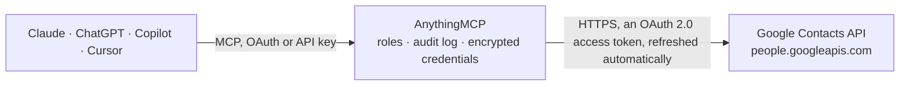

<!-- Generated by scripts/export-github-catalog.mjs in the anythingmcp-website repository. Do not edit by hand. -->

# Google Contacts MCP connector

Let your AI work with Google Contacts: search and read contacts with emails, phones, companies and addresses, create and update contacts, organise labels, and find people you emailed but never saved. The AnythingMCP connector gives Claude, ChatGPT, Microsoft Copilot, Cursor and Gemini 14 MCP tools for Google Contacts: 8 read and 6 can change data.

**Category:** [CRM](../crm.md) · **Tools:** 14 · **Setup guide:** [anythingmcp.com](https://anythingmcp.com/guides/google-contacts-to-mcp) · [Deutsch](https://anythingmcp.com/de/guides/google-contacts-to-mcp) · [Italiano](https://anythingmcp.com/it/guides/google-contacts-to-mcp) · [Español](https://anythingmcp.com/es/guides/google-contacts-to-mcp) · [日本語](https://anythingmcp.com/ja/guides/google-contacts-to-mcp) · [Русский](https://anythingmcp.com/ru/guides/google-contacts-to-mcp) · [中文](https://anythingmcp.com/zh/guides/google-contacts-to-mcp)

## Start without code

No installation and no terminal: AnythingMCP Cloud runs the Google Contacts connector for you, operated by helpcode.ai in Frankfurt, Germany.

1. **Click the button above** and create an account or sign in. The Google Contacts connector opens, ready to install.
2. **Sign in with your Google Contacts account** when AnythingMCP asks. The first time, an admin creates a small app in the Google Cloud console. Every click is in the [step-by-step guide](https://anythingmcp.com/guides/google-contacts-to-mcp).
3. **Click Install.** AnythingMCP shows the address of your MCP server.
4. **Add that address to your assistant:** [Claude](https://anythingmcp.com/guides/connect-google-contacts-to-claude) · [ChatGPT](https://anythingmcp.com/guides/connect-google-contacts-to-chatgpt) · [Microsoft Copilot](https://anythingmcp.com/guides/connect-google-contacts-to-copilot) · [Cursor](https://anythingmcp.com/guides/connect-google-contacts-to-cursor) · [Gemini CLI](https://anythingmcp.com/guides/connect-google-contacts-to-gemini) · [Meta Muse](https://anythingmcp.com/guides/connect-google-contacts-to-muse).
5. **Ask your first question**, for example: *Find the contact details for Nordstrand GmbH purchasing lead Anna Koller, email or phone I can call today*

Prefer help with the setup? [Talk to us](https://anythingmcp.com/contact).

## How it works

- **The AI client** speaks MCP (Streamable HTTP) to AnythingMCP and only sees tool names, descriptions and results. It never gets the Google Contacts credentials.
- **AnythingMCP** checks the client's role, builds the call from the tool definition, adds the credentials (an OAuth 2.0 access token, refreshed automatically), calls Google Contacts, logs the call and returns the result.
- **Google Contacts** sees an ordinary API client with the rights of the account the credentials belong to.

## Tools

| Tool | What it does | Access |
|---|---|---|
| [`google_contacts_list_contacts`](#google_contacts_list_contacts) | List the user's saved Google Contacts with the fields asked for (names, emails, phones and organizations by default): resourceName, etag and the fields,… | read |
| [`google_contacts_get_contact`](#google_contacts_get_contact) | Read one contact in full: names, emails, phones, organizations, addresses, birthday, notes, websites, relations, events, group memberships and custom… | read |
| [`google_contacts_search_contacts`](#google_contacts_search_contacts) | Search the user's saved contacts by the start of a name, nickname, email address, phone number or organization, e.g. "ana" or "acme". | read |
| [`google_contacts_warm_up_search`](#google_contacts_warm_up_search) | Refresh the cache behind contact search with the empty request Google asks for, so the next search sees recent changes. | read |
| [`google_contacts_create_contact`](#google_contacts_create_contact) | Create a contact in the user's Google Contacts (My Contacts). | write |
| [`google_contacts_update_contact`](#google_contacts_update_contact) | Change a contact. | write |
| [`google_contacts_delete_contact`](#google_contacts_delete_contact) | Delete a contact from the user's Google Contacts; it disappears from their phone and Gmail too. | write |
| [`google_contacts_list_contact_groups`](#google_contacts_list_contact_groups) | List the user's contact groups (labels) and the system groups: resourceName, name, formattedName, groupType (USER_CONTACT_GROUP or SYSTEM_CONTACT_GROUP) and… | read |
| [`google_contacts_get_contact_group`](#google_contacts_get_contact_group) | Read a contact group (label) with the resourceNames of its members (memberResourceNames), up to max_members. | read |
| [`google_contacts_create_contact_group`](#google_contacts_create_contact_group) | Create a contact group (label) with a name. | write |
| [`google_contacts_modify_group_members`](#google_contacts_modify_group_members) | Add contacts to a label or remove them from it (up to 1,000 together). | write |
| [`google_contacts_list_other_contacts`](#google_contacts_list_other_contacts) | List the user's "Other contacts": people Google saved automatically because the user emailed them, which are not in My Contacts. | read |
| [`google_contacts_search_other_contacts`](#google_contacts_search_other_contacts) | Search the user's "Other contacts" (people they emailed but never saved) by the start of a name, email address or phone number. | read |
| [`google_contacts_save_other_contact`](#google_contacts_save_other_contact) | Save an "Other contact" into My Contacts, copying its name, email addresses and phone numbers. | write |

## Tool reference

Every parameter as the AI client sees it in `tools/list`. Source: [`packages/backend/src/adapters/intl/google-contacts.json`](../../../packages/backend/src/adapters/intl/google-contacts.json).

### `google_contacts_list_contacts`

List the user's saved Google Contacts with the fields asked for (names, emails, phones and organizations by default): resourceName, etag and the fields, plus totalItems. Pages of page_size; call again with page_token = nextPageToken until it is missing. To find someone, google_contacts_search_contacts is faster.

**Access:** read · **Call:** `GET /people/me/connections`

| Parameter | Type | Required | Description |
|---|---|---|---|
| `person_fields` | string | no | Comma-separated person fields to return, e.g. names,emailAddresses,phoneNumbers,organizations,addresses,birthdays,biographies,urls,memberships,photos,relations,events,userDefined. Default: names,emailAddresses,phoneNumbers,organizations. |
| `page_size` | integer | no | Contacts per page (default 100, up to 1000). |
| `page_token` | string | no | nextPageToken of the previous page; keep the other arguments the same. |
| `sort_order` | `LAST_MODIFIED_ASCENDING` \| `LAST_MODIFIED_DESCENDING` \| `FIRST_NAME_ASCENDING` \| `LAST_NAME_ASCENDING` | no | Order of the list; Google's default is LAST_MODIFIED_ASCENDING. |

### `google_contacts_get_contact`

Read one contact in full: names, emails, phones, organizations, addresses, birthday, notes, websites, relations, events, group memberships and custom fields, plus the etag that google_contacts_update_contact needs.

**Access:** read · **Call:** `GET /people/{person_id}`

| Parameter | Type | Required | Description |
|---|---|---|---|
| `person_id` | string | yes | The contact's id: the part after people/ in its resourceName, e.g. c1234567890123456789 for people/c1234567890123456789. |
| `person_fields` | string | no | Comma-separated person fields to return, e.g. names,emailAddresses,phoneNumbers,organizations,addresses,birthdays,biographies,urls,memberships,photos,relations,events,userDefined. |

### `google_contacts_search_contacts`

Search the user's saved contacts by the start of a name, nickname, email address, phone number or organization, e.g. "ana" or "acme". Returns results[].person with resourceName, etag and the fields asked for. The search runs on a cache: if a contact you expect is missing, call google_contacts_warm_up_search once, wait a few seconds and search again.

**Access:** read · **Call:** `GET /people:searchContacts`

| Parameter | Type | Required | Description |
|---|---|---|---|
| `query` | string | yes | Text to look for; matches the beginning of words. |
| `read_mask` | string | no | Comma-separated person fields to return, e.g. names,emailAddresses,phoneNumbers,organizations,addresses,birthdays,biographies,urls,memberships,photos,relations,events,userDefined. Default: names,emailAddresses,phoneNumbers,organizations. |
| `page_size` | integer | no | Results to return (default 10, up to 30). |

### `google_contacts_warm_up_search`

Refresh the cache behind contact search with the empty request Google asks for, so the next search sees recent changes. Call it before the first search in a session or when a search misses a contact that exists, then wait a few seconds. Returns no useful data.

**Access:** read · **Call:** `GET /{search}`

| Parameter | Type | Required | Description |
|---|---|---|---|
| `search` | `people:searchContacts` \| `otherContacts:search` | no | people:searchContacts for saved contacts (default), otherContacts:search for other contacts. |

### `google_contacts_create_contact`

Create a contact in the user's Google Contacts (My Contacts). Give at least a name or an email address. Returns the new contact's resourceName and etag. Search first to avoid duplicates; Google does not check. Show the user the details and get a yes before calling, and never retry a call that succeeded.

**Access:** write · **Call:** `POST /people:createContact`

| Parameter | Type | Required | Description |
|---|---|---|---|
| `names` | object[] | no | Name, at most one: [{"givenName": "Ana", "familyName": "García"}] (also middleName, honorificPrefix, honorificSuffix). |
| `email_addresses` | object[] | no | [{"value": "ana@example.com", "type": "work"}]; type is home, work, other or any label. |
| `phone_numbers` | object[] | no | [{"value": "+49 761 1234567", "type": "mobile"}]; type is home, work, mobile, homeFax, workFax, main, other or any label. |
| `organizations` | object[] | no | [{"name": "Acme GmbH", "title": "Head of Sales", "department": "Sales"}]. |
| `addresses` | object[] | no | [{"streetAddress": "Hauptstr. 1", "postalCode": "79098", "city": "Freiburg", "country": "Germany", "type": "work"}]. |
| `urls` | object[] | no | [{"value": "https://example.com", "type": "work"}]. |
| `biographies` | object[] | no | Notes, at most one: [{"value": "Met at the trade fair", "contentType": "TEXT_PLAIN"}]. |
| `birthdays` | object[] | no | At most one: [{"date": {"year": 1985, "month": 4, "day": 12}}]; leave year out if unknown. |

### `google_contacts_update_contact`

Change a contact. update_person_fields lists the fields to change, and each listed field is replaced as a whole: to add a second phone number, send the existing numbers plus the new one; a listed field left out is cleared. Needs the etag from the latest google_contacts_get_contact (or the previous update's reply); a stale etag fails with 400 failedPrecondition, then read the contact again. Confirm the change with the user before calling.

**Access:** write · **Call:** `PATCH /people/{person_id}:updateContact`

| Parameter | Type | Required | Description |
|---|---|---|---|
| `person_id` | string | yes | The contact's id: the part after people/ in its resourceName, e.g. c1234567890123456789 for people/c1234567890123456789. |
| `etag` | string | yes | etag of the contact as last read. |
| `update_person_fields` | string | yes | Comma-separated fields to replace: names, emailAddresses, phoneNumbers, organizations, addresses, urls, biographies, birthdays. |
| `names` | object[] | no | Name, at most one: [{"givenName": "Ana", "familyName": "García"}] (also middleName, honorificPrefix, honorificSuffix). |
| `email_addresses` | object[] | no | [{"value": "ana@example.com", "type": "work"}]; type is home, work, other or any label. |
| `phone_numbers` | object[] | no | [{"value": "+49 761 1234567", "type": "mobile"}]; type is home, work, mobile, homeFax, workFax, main, other or any label. |
| `organizations` | object[] | no | [{"name": "Acme GmbH", "title": "Head of Sales", "department": "Sales"}]. |
| `addresses` | object[] | no | [{"streetAddress": "Hauptstr. 1", "postalCode": "79098", "city": "Freiburg", "country": "Germany", "type": "work"}]. |
| `urls` | object[] | no | [{"value": "https://example.com", "type": "work"}]. |
| `biographies` | object[] | no | Notes, at most one: [{"value": "Met at the trade fair", "contentType": "TEXT_PLAIN"}]. |
| `birthdays` | object[] | no | At most one: [{"date": {"year": 1985, "month": 4, "day": 12}}]; leave year out if unknown. |

### `google_contacts_delete_contact`

Delete a contact from the user's Google Contacts; it disappears from their phone and Gmail too. Always confirm with the user first, naming the contact. Installed switched off.

**Access:** write · **Call:** `DELETE /people/{person_id}:deleteContact`

| Parameter | Type | Required | Description |
|---|---|---|---|
| `person_id` | string | yes | The contact's id: the part after people/ in its resourceName, e.g. c1234567890123456789 for people/c1234567890123456789. |

### `google_contacts_list_contact_groups`

List the user's contact groups (labels) and the system groups: resourceName, name, formattedName, groupType (USER_CONTACT_GROUP or SYSTEM_CONTACT_GROUP) and memberCount.

**Access:** read · **Call:** `GET /contactGroups`

| Parameter | Type | Required | Description |
|---|---|---|---|
| `page_size` | integer | no | Groups per page (default 100, up to 1000). |
| `page_token` | string | no | nextPageToken of the previous page. |

### `google_contacts_get_contact_group`

Read a contact group (label) with the resourceNames of its members (memberResourceNames), up to max_members. Read a member with google_contacts_get_contact.

**Access:** read · **Call:** `GET /contactGroups/{group_id}`

| Parameter | Type | Required | Description |
|---|---|---|---|
| `group_id` | string | yes | The group's id: the part after contactGroups/ in its resourceName, e.g. myContacts, starred or 1a2b3c4d5e6f. |
| `max_members` | integer | no | How many member resourceNames to return (default 200). |

### `google_contacts_create_contact_group`

Create a contact group (label) with a name. Returns its resourceName; add contacts with google_contacts_modify_group_members. Confirm the change with the user before calling.

**Access:** write · **Call:** `POST /contactGroups`

| Parameter | Type | Required | Description |
|---|---|---|---|
| `name` | string | yes | Name of the new label; must be unique among the user's groups. |

### `google_contacts_modify_group_members`

Add contacts to a label or remove them from it (up to 1,000 together). Of the system groups only myContacts and starred accept new members. Returns notFoundResourceNames and canNotRemoveLastContactGroupResourceNames for contacts that could not be changed. Removing a contact from a label does not delete it. Confirm the change with the user before calling.

**Access:** write · **Call:** `POST /contactGroups/{group_id}/members:modify`

| Parameter | Type | Required | Description |
|---|---|---|---|
| `group_id` | string | yes | The group's id: the part after contactGroups/ in its resourceName, e.g. myContacts, starred or 1a2b3c4d5e6f. |
| `add` | string[] | no | resourceNames to add, e.g. ["people/c1234567890123456789"]. |
| `remove` | string[] | no | resourceNames to remove. |

### `google_contacts_list_other_contacts`

List the user's "Other contacts": people Google saved automatically because the user emailed them, which are not in My Contacts. Names, email addresses and phone numbers only. Pages of page_size; call again with page_token = nextPageToken until it is missing.

**Access:** read · **Call:** `GET /otherContacts`

| Parameter | Type | Required | Description |
|---|---|---|---|
| `read_mask` | string | no | Fields to return, from names, emailAddresses, phoneNumbers, photos, metadata (default names,emailAddresses,phoneNumbers). |
| `page_size` | integer | no | Contacts per page (default 100, up to 1000). |
| `page_token` | string | no | nextPageToken of the previous page; keep the other arguments the same. |

### `google_contacts_search_other_contacts`

Search the user's "Other contacts" (people they emailed but never saved) by the start of a name, email address or phone number. Returns results[].person. Runs on a cache: if someone you expect is missing, call google_contacts_warm_up_search with search otherContacts:search, wait a few seconds and search again.

**Access:** read · **Call:** `GET /otherContacts:search`

| Parameter | Type | Required | Description |
|---|---|---|---|
| `query` | string | yes | Text to look for; matches the beginning of words. |
| `read_mask` | string | no | Fields to return, from names, emailAddresses, phoneNumbers, metadata (default names,emailAddresses,phoneNumbers). |
| `page_size` | integer | no | Results to return (default 10, up to 30). |

### `google_contacts_save_other_contact`

Save an "Other contact" into My Contacts, copying its name, email addresses and phone numbers. Returns the new contact with its people/ resourceName. Confirm the change with the user before calling.

**Access:** write · **Call:** `POST /otherContacts/{other_contact_id}:copyOtherContactToMyContactsGroup`

| Parameter | Type | Required | Description |
|---|---|---|---|
| `other_contact_id` | string | yes | The part after otherContacts/ in the other contact's resourceName, e.g. c1234567890123456789. |

## Run it yourself

AnythingMCP is open source (AGPL-3.0). [Run it with Docker](../../../README.md#run-it-yourself), open **Connectors → Store**, pick **Google Contacts** and enter `GOOGLE_CLIENT_ID`, `GOOGLE_CLIENT_SECRET`, then add your MCP server URL to the AI client.

[← CRM connectors](../crm.md) · [All categories](../README.md)
