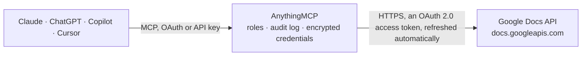

<!-- Generated by scripts/export-github-catalog.mjs in the anythingmcp-website repository. Do not edit by hand. -->

# Google Docs MCP connector

Let your AI work with Google Docs: read a document as plain text or as headings and paragraphs with positions, create new documents, append or insert text and replace text everywhere, for example to fill a template. The AnythingMCP connector gives Claude, ChatGPT, Microsoft Copilot, Cursor and Gemini 7 MCP tools for Google Docs: 2 read and 5 can change data.

**Category:** [Productivity](../productivity.md) · **Tools:** 7 · **Setup guide:** [anythingmcp.com](https://anythingmcp.com/guides/google-docs-to-mcp) · [Deutsch](https://anythingmcp.com/de/guides/google-docs-to-mcp) · [Italiano](https://anythingmcp.com/it/guides/google-docs-to-mcp) · [Español](https://anythingmcp.com/es/guides/google-docs-to-mcp) · [日本語](https://anythingmcp.com/ja/guides/google-docs-to-mcp) · [Русский](https://anythingmcp.com/ru/guides/google-docs-to-mcp) · [中文](https://anythingmcp.com/zh/guides/google-docs-to-mcp)

## Start without code

No installation and no terminal: AnythingMCP Cloud runs the Google Docs connector for you, operated by helpcode.ai in Frankfurt, Germany.

1. **Click the button above** and create an account or sign in. The Google Docs connector opens, ready to install.
2. **Sign in with your Google Docs account** when AnythingMCP asks. The first time, an admin creates a small app in the Google Cloud console. Every click is in the [step-by-step guide](https://anythingmcp.com/guides/google-docs-to-mcp).
3. **Click Install.** AnythingMCP shows the address of your MCP server.
4. **Add that address to your assistant:** [Claude](https://anythingmcp.com/guides/connect-google-docs-to-claude) · [ChatGPT](https://anythingmcp.com/guides/connect-google-docs-to-chatgpt) · [Microsoft Copilot](https://anythingmcp.com/guides/connect-google-docs-to-copilot) · [Cursor](https://anythingmcp.com/guides/connect-google-docs-to-cursor) · [Gemini CLI](https://anythingmcp.com/guides/connect-google-docs-to-gemini) · [Meta Muse](https://anythingmcp.com/guides/connect-google-docs-to-muse).
5. **Ask your first question**, for example: *Open invoice template 'INV-2026-07-NP' — what's the invoice header text and current revisionId?*

Prefer help with the setup? [Talk to us](https://anythingmcp.com/contact).

## How it works

- **The AI client** speaks MCP (Streamable HTTP) to AnythingMCP and only sees tool names, descriptions and results. It never gets the Google Docs credentials.
- **AnythingMCP** checks the client's role, builds the call from the tool definition, adds the credentials (an OAuth 2.0 access token, refreshed automatically), calls Google Docs, logs the call and returns the result.
- **Google Docs** sees an ordinary API client with the rights of the account the credentials belong to.

## Tools

| Tool | What it does | Access |
|---|---|---|
| [`gdocs_get_document_text`](#gdocs_get_document_text) | Read a Google Doc as plain text: documentId, title, revisionId, endIndex and text, the body's paragraphs and table cells in order (images, drawings and… | read |
| [`gdocs_get_document_structure`](#gdocs_get_document_structure) | Read a Google Doc as a list of blocks with their positions, for precise edits: each paragraph or table with startIndex, endIndex, type, paragraph style… | read |
| [`gdocs_create_document`](#gdocs_create_document) | Create a new, empty Google Doc with a title, in the root of the user's My Drive. | write |
| [`gdocs_append_text`](#gdocs_append_text) | Append text at the end of a document's body. | write |
| [`gdocs_insert_text`](#gdocs_insert_text) | Insert text at a position in the body. | write |
| [`gdocs_replace_all_text`](#gdocs_replace_all_text) | Replace every occurrence of a text in the document (all tabs, headers and footers included) with another text; an empty replace_with deletes the occurrences. | write |
| [`gdocs_batch_update`](#gdocs_batch_update) | Run Docs API batchUpdate requests for edits the other tools do not cover: deleting ranges (deleteContentRange), styling text or paragraphs (updateTextStyle,… | write |

## Tool reference

Every parameter as the AI client sees it in `tools/list`. Source: [`packages/backend/src/adapters/intl/google-docs.json`](../../../packages/backend/src/adapters/intl/google-docs.json).

### `gdocs_get_document_text`

Read a Google Doc as plain text: documentId, title, revisionId, endIndex and text, the body's paragraphs and table cells in order (images, drawings and formatting left out). Covers the document's first tab. Output over 200 KB is cut and marked _truncated.

**Access:** read · **Call:** `GET /documents/{document_id}`

| Parameter | Type | Required | Description |
|---|---|---|---|
| `document_id` | string | yes | Document id, the long string in its link: https://docs.google.com/document/d/<id>/edit. |

### `gdocs_get_document_structure`

Read a Google Doc as a list of blocks with their positions, for precise edits: each paragraph or table with startIndex, endIndex, type, paragraph style (TITLE, HEADING_1..6, NORMAL_TEXT), table size and text. Use the indexes with gdocs_insert_text or gdocs_batch_update. Output over 200 KB is cut.

**Access:** read · **Call:** `GET /documents/{document_id}`

| Parameter | Type | Required | Description |
|---|---|---|---|
| `document_id` | string | yes | Document id, the long string in its link: https://docs.google.com/document/d/<id>/edit. |

### `gdocs_create_document`

Create a new, empty Google Doc with a title, in the root of the user's My Drive. Returns documentId, title and revisionId; add content with gdocs_append_text. The link is https://docs.google.com/document/d/<documentId>/edit.

**Access:** write · **Call:** `POST /documents`

| Parameter | Type | Required | Description |
|---|---|---|---|
| `title` | string | yes | Title of the new document. |

### `gdocs_append_text`

Append text at the end of a document's body. Start text with "\n" to begin a new paragraph and use "\n" between paragraphs; the new text takes the style of the last paragraph. Returns documentId and writeControl.requiredRevisionId.

**Access:** write · **Call:** `POST /documents/{document_id}:batchUpdate`

| Parameter | Type | Required | Description |
|---|---|---|---|
| `document_id` | string | yes | Document id, the long string in its link: https://docs.google.com/document/d/<id>/edit. |
| `text` | string | yes | Text to add, with \n for line breaks between paragraphs. |

### `gdocs_insert_text`

Insert text at a position in the body. index counts UTF-16 code units from 1 (the very start of the body) and must fall inside a paragraph: take startIndex of a block from gdocs_get_document_structure to insert before it. Text after the index moves; indexes of later blocks shift.

**Access:** write · **Call:** `POST /documents/{document_id}:batchUpdate`

| Parameter | Type | Required | Description |
|---|---|---|---|
| `document_id` | string | yes | Document id, the long string in its link: https://docs.google.com/document/d/<id>/edit. |
| `index` | integer | yes | Position to insert at, at least 1; e.g. a paragraph's startIndex to insert before it, or its endIndex - 1 to insert before its line break. |
| `text` | string | yes | Text to insert, with \n for paragraph breaks. |

### `gdocs_replace_all_text`

Replace every occurrence of a text in the document (all tabs, headers and footers included) with another text; an empty replace_with deletes the occurrences. Returns replies[0].replaceAllText.occurrencesChanged. Good for filling templates such as [Customer name].

**Access:** write · **Call:** `POST /documents/{document_id}:batchUpdate`

| Parameter | Type | Required | Description |
|---|---|---|---|
| `document_id` | string | yes | Document id, the long string in its link: https://docs.google.com/document/d/<id>/edit. |
| `find` | string | yes | Text to search for (literal, not a pattern). |
| `replace_with` | string | yes | Replacement text; "" deletes every occurrence. |
| `match_case` | boolean | no | true for a case-sensitive match (default false). |

### `gdocs_batch_update`

Run Docs API batchUpdate requests for edits the other tools do not cover: deleting ranges (deleteContentRange), styling text or paragraphs (updateTextStyle, updateParagraphStyle), bullets, tables, page breaks, images. Requests run in order, atomically. Installed switched off.

**Access:** write · **Call:** `POST /documents/{document_id}:batchUpdate`

| Parameter | Type | Required | Description |
|---|---|---|---|
| `document_id` | string | yes | Document id, the long string in its link: https://docs.google.com/document/d/<id>/edit. |
| `requests` | object[] | yes | Docs API Request objects, e.g. [{"updateParagraphStyle": {"range": {"startIndex": 1, "endIndex": 20}, "paragraphStyle": {"namedStyleType": "HEADING_1"}, "fields": "namedStyleType"}}]. Order edits from the end of the document backwards so earlier indexes stay valid. |
| `write_control` | object | no | Optional {"requiredRevisionId": "<revisionId>"} to fail if the document changed since it was read. |

## Run it yourself

AnythingMCP is open source (AGPL-3.0). [Run it with Docker](../../../README.md#run-it-yourself), open **Connectors → Store**, pick **Google Docs** and enter `GOOGLE_CLIENT_ID`, `GOOGLE_CLIENT_SECRET`, then add your MCP server URL to the AI client.

[← Productivity connectors](../productivity.md) · [All categories](../README.md)
