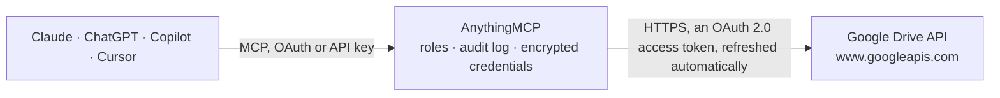

<!-- Generated by scripts/export-github-catalog.mjs in the anythingmcp-website repository. Do not edit by hand. -->

# Google Drive MCP connector

Let your AI work in Google Drive: search files and folders in My Drive and shared drives, read Google Docs, Sheets and Slides as text, see details, comments and who has access, create folders and … The AnythingMCP connector gives Claude, ChatGPT, Microsoft Copilot, Cursor and Gemini 13 MCP tools for Google Drive: 7 read and 6 can change data.

**Category:** [File Storage](../storage.md) · **Tools:** 13 · **Setup guide:** [anythingmcp.com](https://anythingmcp.com/guides/google-drive-to-mcp) · [Deutsch](https://anythingmcp.com/de/guides/google-drive-to-mcp) · [Italiano](https://anythingmcp.com/it/guides/google-drive-to-mcp) · [Español](https://anythingmcp.com/es/guides/google-drive-to-mcp) · [日本語](https://anythingmcp.com/ja/guides/google-drive-to-mcp) · [Русский](https://anythingmcp.com/ru/guides/google-drive-to-mcp) · [中文](https://anythingmcp.com/zh/guides/google-drive-to-mcp)

## Start without code

No installation and no terminal: AnythingMCP Cloud runs the Google Drive connector for you, operated by helpcode.ai in Frankfurt, Germany.

1. **Click the button above** and create an account or sign in. The Google Drive connector opens, ready to install.
2. **Sign in with your Google Drive account** when AnythingMCP asks. The first time, an admin creates a small app in the Google Cloud console. Every click is in the [step-by-step guide](https://anythingmcp.com/guides/google-drive-to-mcp).
3. **Click Install.** AnythingMCP shows the address of your MCP server.
4. **Add that address to your assistant:** [Claude](https://anythingmcp.com/guides/connect-google-drive-to-claude) · [ChatGPT](https://anythingmcp.com/guides/connect-google-drive-to-chatgpt) · [Microsoft Copilot](https://anythingmcp.com/guides/connect-google-drive-to-copilot) · [Cursor](https://anythingmcp.com/guides/connect-google-drive-to-cursor) · [Gemini CLI](https://anythingmcp.com/guides/connect-google-drive-to-gemini) · [Meta Muse](https://anythingmcp.com/guides/connect-google-drive-to-muse).
5. **Ask your first question**, for example: *Find the invoice PDF for Nordic Solar GmbH, invoice INV-2026-1287 in My Drive*

Prefer help with the setup? [Talk to us](https://anythingmcp.com/contact).

## How it works

- **The AI client** speaks MCP (Streamable HTTP) to AnythingMCP and only sees tool names, descriptions and results. It never gets the Google Drive credentials.
- **AnythingMCP** checks the client's role, builds the call from the tool definition, adds the credentials (an OAuth 2.0 access token, refreshed automatically), calls Google Drive, logs the call and returns the result.
- **Google Drive** sees an ordinary API client with the rights of the account the credentials belong to.

## Tools

| Tool | What it does | Access |
|---|---|---|
| [`gdrive_about`](#gdrive_about) | Who is signed in and how much storage is used: user name, email and permissionId, storage limit and usage in bytes (Drive, Gmail and Photos share it), and… | read |
| [`gdrive_search_files`](#gdrive_search_files) | Search or list files and folders in My Drive, files shared with the user and shared drives, with Drive's query language, e.g. "name contains 'invoice' and… | read |
| [`gdrive_get_file`](#gdrive_get_file) | Get one file's or folder's metadata: name, mimeType, parents, owners, last modifier, dates, size, webViewLink, what the user may do with it (capabilities)… | read |
| [`gdrive_export_file`](#gdrive_export_file) | Read the content of a Google Doc, Sheet or Slides file as text: Docs as text/plain, text/markdown or text/html, Sheets as text/csv or… | read |
| [`gdrive_create_folder`](#gdrive_create_folder) | Create a folder, at the root of My Drive or inside the given parent folder or shared drive. | write |
| [`gdrive_create_text_file`](#gdrive_create_text_file) | Create a file from text in one call: a plain file (.txt, .md, .csv, .html, .json), or a Google Doc converted from plain text, Markdown or HTML, or a Google… | write |
| [`gdrive_copy_file`](#gdrive_copy_file) | Copy a file (not a folder), optionally with a new name and into other folders. | write |
| [`gdrive_update_file`](#gdrive_update_file) | Rename, move, describe or star a file or folder. | write |
| [`gdrive_trash_file`](#gdrive_trash_file) | Move a file or folder to the trash (a folder takes its contents along). | write |
| [`gdrive_list_permissions`](#gdrive_list_permissions) | List who has access to a file or folder: each permission's id, type (user, group, domain, anyone), role (owner, organizer, fileOrganizer, writer, commenter,… | read |
| [`gdrive_share_file`](#gdrive_share_file) | Share a file or folder: give a person or group (type user/group + email_address), a whole domain (type domain + domain) or anyone with the link (type… | write |
| [`gdrive_list_comments`](#gdrive_list_comments) | List the comments on a file (Docs, Sheets, Slides, PDFs...): author, text, the quoted passage, created and modified time, resolved state and replies. | read |
| [`gdrive_list_shared_drives`](#gdrive_list_shared_drives) | List the shared drives the user is a member of, with id and name. | read |

## Tool reference

Every parameter as the AI client sees it in `tools/list`. Source: [`packages/backend/src/adapters/intl/google-drive.json`](../../../packages/backend/src/adapters/intl/google-drive.json).

### `gdrive_about`

Who is signed in and how much storage is used: user name, email and permissionId, storage limit and usage in bytes (Drive, Gmail and Photos share it), and the maximum upload size.

**Access:** read · **Call:** `GET /about`

No parameters.

### `gdrive_search_files`

Search or list files and folders in My Drive, files shared with the user and shared drives, with Drive's query language, e.g. "name contains 'invoice' and trashed = false" or "'<folderId>' in parents and trashed = false". Returns id, name, mimeType, parents, modifiedTime, size, owners and webViewLink; paginate with page_token = nextPageToken.

**Access:** read · **Call:** `GET /files`

| Parameter | Type | Required | Description |
|---|---|---|---|
| `q` | string | no | Drive query, e.g. "name contains 'budget' and mimeType = 'application/vnd.google-apps.spreadsheet' and trashed = false". Quote values with single quotes; escape a ' inside a value as \'. Omit to list everything (including the trash). |
| `page_size` | integer | no | Items per page, 1 to 1000 (default 100). |
| `page_token` | string | no | nextPageToken from the previous response, with the same other arguments. |
| `order_by` | string | no | Sort keys, comma-separated, each optionally followed by " desc": createdTime, folder, modifiedByMeTime, modifiedTime, name, quotaBytesUsed, recency, sharedWithMeTime, starred, viewedByMeTime. E.g. "modifiedTime desc". Not allowed together with a fullText search. |
| `corpora` | `user` \| `drive` \| `allDrives` | no | Where to search: "user" (default: My Drive and shared with me), "drive" (one shared drive, needs drive_id), "allDrives" (everything, may set incompleteSearch). |
| `drive_id` | string | no | Shared drive id from gdrive_list_shared_drives, with corpora "drive". |

### `gdrive_get_file`

Get one file's or folder's metadata: name, mimeType, parents, owners, last modifier, dates, size, webViewLink, what the user may do with it (capabilities) and, for Google Docs, Sheets and Slides, the available export formats. Does not return content: read Google files with gdrive_export_file.

**Access:** read · **Call:** `GET /files/{file_id}`

| Parameter | Type | Required | Description |
|---|---|---|---|
| `file_id` | string | yes | File or folder id: from gdrive_search_files, or from a link (https://docs.google.com/document/d/<id>/edit, https://drive.google.com/file/d/<id>/view, .../folders/<id>). |

### `gdrive_export_file`

Read the content of a Google Doc, Sheet or Slides file as text: Docs as text/plain, text/markdown or text/html, Sheets as text/csv or text/tab-separated-values (first sheet only), Slides as text/plain. Output over 200 KB is cut and marked _truncated. Uploaded files (PDF, Word, images) cannot be read here.

**Access:** read · **Call:** `GET /files/{file_id}/export`

| Parameter | Type | Required | Description |
|---|---|---|---|
| `file_id` | string | yes | File or folder id: from gdrive_search_files, or from a link (https://docs.google.com/document/d/<id>/edit, https://drive.google.com/file/d/<id>/view, .../folders/<id>). |
| `mime_type` | `text/plain` \| `text/markdown` \| `text/html` \| `text/csv` \| `text/tab-separated-values` | yes | Format to export to; must suit the file type. |

### `gdrive_create_folder`

Create a folder, at the root of My Drive or inside the given parent folder or shared drive. Returns the new folder's id, name, parents and webViewLink.

**Access:** write · **Call:** `POST /files`

| Parameter | Type | Required | Description |
|---|---|---|---|
| `name` | string | yes | Folder name. |
| `parent_ids` | string[] | no | Folder ids the new item goes into, normally one, e.g. ["1AbC..."]; a shared drive's id puts it at that drive's top level. Omit for the root of My Drive. |
| `description` | string | no | Optional folder description. |

### `gdrive_create_text_file`

Create a file from text in one call: a plain file (.txt, .md, .csv, .html, .json), or a Google Doc converted from plain text, Markdown or HTML, or a Google Sheet converted from CSV. Returns id, name, mimeType and webViewLink.

**Access:** write · **Call:** `POST https://www.googleapis.com/upload/drive/v3/files`

| Parameter | Type | Required | Description |
|---|---|---|---|
| `name` | string | yes | File name, e.g. "Meeting notes.md" or "Q3 figures". No double quotes or backslashes. |
| `content` | string | yes | The full text content (UTF-8), not empty. Must not contain the line "--amcp_7f3a9c2e5b1d4086", which separates the parts of the upload. |
| `content_type` | `text/plain` \| `text/markdown` \| `text/csv` \| `text/html` \| `application/json` | yes | Format of content. |
| `drive_mime_type` | `text/plain` \| `text/markdown` \| `text/csv` \| `text/html` \| `application/json` \| `application/vnd.google-apps.document` \| `application/vnd.google-apps.spreadsheet` | yes | What the file becomes in Drive: the same value as content_type to keep it as that file type, "application/vnd.google-apps.document" to convert plain text, Markdown or HTML into a Google Doc, "application/vnd.google-apps.spreadsheet" to convert CSV into a Google Sheet. |
| `folder_id` | string | no | Folder id to create the file in (default "root", the top of My Drive). |

### `gdrive_copy_file`

Copy a file (not a folder), optionally with a new name and into other folders. Google Docs, Sheets and Slides stay Google files. Returns the copy's id, name, parents and webViewLink.

**Access:** write · **Call:** `POST /files/{file_id}/copy`

| Parameter | Type | Required | Description |
|---|---|---|---|
| `file_id` | string | yes | File or folder id: from gdrive_search_files, or from a link (https://docs.google.com/document/d/<id>/edit, https://drive.google.com/file/d/<id>/view, .../folders/<id>). |
| `name` | string | no | Name of the copy (default: "Copy of <name>"). |
| `parent_ids` | string[] | no | Folder ids for the copy (default: the original's folder). |

### `gdrive_update_file`

Rename, move, describe or star a file or folder. To move, give add_parents (the target folder id) and remove_parents (the current parent ids from gdrive_get_file). Returns id, name, parents and webViewLink. Does not change content.

**Access:** write · **Call:** `PATCH /files/{file_id}`

| Parameter | Type | Required | Description |
|---|---|---|---|
| `file_id` | string | yes | File or folder id: from gdrive_search_files, or from a link (https://docs.google.com/document/d/<id>/edit, https://drive.google.com/file/d/<id>/view, .../folders/<id>). |
| `name` | string | no | New name. |
| `description` | string | no | New description. |
| `starred` | boolean | no | true to star, false to unstar. |
| `add_parents` | string | no | Comma-separated folder ids to add the item to (move target). |
| `remove_parents` | string | no | Comma-separated folder ids to take the item out of (current parents, when moving). |

### `gdrive_trash_file`

Move a file or folder to the trash (a folder takes its contents along). It stays restorable from Drive's trash for 30 days. Only the owner, or an organizer on a shared drive, can trash. Installed switched off.

**Access:** write · **Call:** `PATCH /files/{file_id}`

| Parameter | Type | Required | Description |
|---|---|---|---|
| `file_id` | string | yes | File or folder id: from gdrive_search_files, or from a link (https://docs.google.com/document/d/<id>/edit, https://drive.google.com/file/d/<id>/view, .../folders/<id>). |

### `gdrive_list_permissions`

List who has access to a file or folder: each permission's id, type (user, group, domain, anyone), role (owner, organizer, fileOrganizer, writer, commenter, reader), email address or domain, and expiry. Paginate with page_token.

**Access:** read · **Call:** `GET /files/{file_id}/permissions`

| Parameter | Type | Required | Description |
|---|---|---|---|
| `file_id` | string | yes | File or folder id: from gdrive_search_files, or from a link (https://docs.google.com/document/d/<id>/edit, https://drive.google.com/file/d/<id>/view, .../folders/<id>). |
| `page_size` | integer | no | Permissions per page, 1 to 100. |
| `page_token` | string | no | nextPageToken from the previous response. |

### `gdrive_share_file`

Share a file or folder: give a person or group (type user/group + email_address), a whole domain (type domain + domain) or anyone with the link (type anyone) a role: reader, commenter, writer (or fileOrganizer/organizer on shared drives). Google emails people unless send_notification_email is false. Installed switched off: sharing gives other people access to the user's files, so turn it on in the connector settings only if the AI should share files.

**Access:** write · **Call:** `POST /files/{file_id}/permissions`

| Parameter | Type | Required | Description |
|---|---|---|---|
| `file_id` | string | yes | File or folder id: from gdrive_search_files, or from a link (https://docs.google.com/document/d/<id>/edit, https://drive.google.com/file/d/<id>/view, .../folders/<id>). |
| `type` | `user` \| `group` \| `domain` \| `anyone` | yes | Who gets access. |
| `role` | `reader` \| `commenter` \| `writer` \| `fileOrganizer` \| `organizer` | yes | Access level. |
| `email_address` | string | no | Email of the person or group, for type user or group. |
| `domain` | string | no | Domain, e.g. example.com, for type domain. |
| `allow_file_discovery` | boolean | no | For type domain or anyone: true lets people find it by search; false (default) means link only. |
| `expiration_time` | string | no | RFC 3339 time when the access ends, e.g. 2026-12-31T23:00:00Z (users and groups, roles reader, commenter, writer). |
| `send_notification_email` | boolean | no | false to share silently (allowed only for type user or group). Default: Google sends an email. |
| `email_message` | string | no | Short personal message in the notification email. |

### `gdrive_list_comments`

List the comments on a file (Docs, Sheets, Slides, PDFs...): author, text, the quoted passage, created and modified time, resolved state and replies. Paginate with page_token = nextPageToken.

**Access:** read · **Call:** `GET /files/{file_id}/comments`

| Parameter | Type | Required | Description |
|---|---|---|---|
| `file_id` | string | yes | File or folder id: from gdrive_search_files, or from a link (https://docs.google.com/document/d/<id>/edit, https://drive.google.com/file/d/<id>/view, .../folders/<id>). |
| `page_size` | integer | no | Comments per page, 1 to 100 (default 20). |
| `page_token` | string | no | nextPageToken from the previous response. |
| `include_deleted` | boolean | no | true to include deleted comments and replies. |
| `start_modified_time` | string | no | Only comments modified after this RFC 3339 time. |

### `gdrive_list_shared_drives`

List the shared drives the user is a member of, with id and name. Use an id as drive_id in gdrive_search_files (corpora "drive") or as a parent folder id. Paginate with page_token = nextPageToken.

**Access:** read · **Call:** `GET /drives`

| Parameter | Type | Required | Description |
|---|---|---|---|
| `q` | string | no | Optional filter, e.g. "name contains 'Sales'". |
| `page_size` | integer | no | Shared drives per page, 1 to 100 (default 10). |
| `page_token` | string | no | nextPageToken from the previous response. |

## Run it yourself

AnythingMCP is open source (AGPL-3.0). [Run it with Docker](../../../README.md#run-it-yourself), open **Connectors → Store**, pick **Google Drive** and enter `GOOGLE_CLIENT_ID`, `GOOGLE_CLIENT_SECRET`, then add your MCP server URL to the AI client.

[← File Storage connectors](../storage.md) · [All categories](../README.md)
