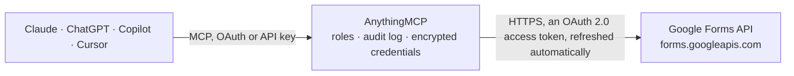

<!-- Generated by scripts/export-github-catalog.mjs in the anythingmcp-website repository. Do not edit by hand. -->

# Google Forms MCP connector

Let your AI build and read Google Forms: create forms and quizzes, add text, choice, scale, date and other questions, publish or close a form, and read the responses with their answers. The AnythingMCP connector gives Claude, ChatGPT, Microsoft Copilot, Cursor and Gemini 16 MCP tools for Google Forms: 5 read and 11 can change data.

**Category:** [Productivity](../productivity.md) · **Tools:** 16 · **Setup guide:** [anythingmcp.com](https://anythingmcp.com/guides/google-forms-to-mcp) · [Deutsch](https://anythingmcp.com/de/guides/google-forms-to-mcp) · [Italiano](https://anythingmcp.com/it/guides/google-forms-to-mcp) · [Español](https://anythingmcp.com/es/guides/google-forms-to-mcp) · [日本語](https://anythingmcp.com/ja/guides/google-forms-to-mcp) · [Русский](https://anythingmcp.com/ru/guides/google-forms-to-mcp) · [中文](https://anythingmcp.com/zh/guides/google-forms-to-mcp)

## Start without code

No installation and no terminal: AnythingMCP Cloud runs the Google Forms connector for you, operated by helpcode.ai in Frankfurt, Germany.

1. **Click the button above** and create an account or sign in. The Google Forms connector opens, ready to install.
2. **Sign in with your Google Forms account** when AnythingMCP asks. The first time, an admin creates a small app in the Google Cloud console. Every click is in the [step-by-step guide](https://anythingmcp.com/guides/google-forms-to-mcp).
3. **Click Install.** AnythingMCP shows the address of your MCP server.
4. **Add that address to your assistant:** [Claude](https://anythingmcp.com/guides/connect-google-forms-to-claude) · [ChatGPT](https://anythingmcp.com/guides/connect-google-forms-to-chatgpt) · [Microsoft Copilot](https://anythingmcp.com/guides/connect-google-forms-to-copilot) · [Cursor](https://anythingmcp.com/guides/connect-google-forms-to-cursor) · [Gemini CLI](https://anythingmcp.com/guides/connect-google-forms-to-gemini) · [Meta Muse](https://anythingmcp.com/guides/connect-google-forms-to-muse).
5. **Ask your first question**, for example: *Show me the edit info and whether "Q3 Customer NPS Survey" is published and its responder link, form id 1Aq7Zb*

Prefer help with the setup? [Talk to us](https://anythingmcp.com/contact).

## How it works

- **The AI client** speaks MCP (Streamable HTTP) to AnythingMCP and only sees tool names, descriptions and results. It never gets the Google Forms credentials.
- **AnythingMCP** checks the client's role, builds the call from the tool definition, adds the credentials (an OAuth 2.0 access token, refreshed automatically), calls Google Forms, logs the call and returns the result.
- **Google Forms** sees an ordinary API client with the rights of the account the credentials belong to.

## Tools

| Tool | What it does | Access |
|---|---|---|
| [`google_forms_get_form`](#google_forms_get_form) | Read a form: info (title, description), settings (quiz, email collection), publishSettings (published, accepting responses), responderUri (the link to fill… | read |
| [`google_forms_create_form`](#google_forms_create_form) | Create a new, empty Google Form with a title, owned by the user in the root of My Drive. | write |
| [`google_forms_add_text_question`](#google_forms_add_text_question) | Add a text question: short answer, or paragraph when paragraph is true. | write |
| [`google_forms_add_choice_question`](#google_forms_add_choice_question) | Add a multiple-choice (RADIO), checkbox (CHECKBOX) or drop-down (DROP_DOWN) question with its options. | write |
| [`google_forms_add_item`](#google_forms_add_item) | Add any other item as a Forms API Item: a linear scale, date, time or rating question, a grid, a section break (pageBreakItem), a title and description… | write |
| [`google_forms_update_form_info`](#google_forms_update_form_info) | Change the form's title or description (the text under the title). | write |
| [`google_forms_update_settings`](#google_forms_update_settings) | Turn the form into a quiz (or back) and choose whether respondents' emails are collected. | write |
| [`google_forms_set_publish_settings`](#google_forms_set_publish_settings) | Publish or unpublish a form and open or close it for responses. | write |
| [`google_forms_batch_update`](#google_forms_batch_update) | Run Forms API batchUpdate requests the other tools do not cover: change a question (updateItem with updateMask), move one (moveItem) or delete one… | write |
| [`google_forms_list_responses`](#google_forms_list_responses) | List a form's responses, newest submissions included: responseId, createTime, lastSubmittedTime, respondentEmail (when collected), totalScore (quizzes) and… | read |
| [`google_forms_get_response`](#google_forms_get_response) | Read one response by its responseId: times, respondentEmail, totalScore and answers keyed by questionId. | read |
| [`google_forms_list_watches`](#google_forms_list_watches) | List the push-notification watches this Google Cloud project has on a form: id, eventType (SCHEMA or RESPONSES), Pub/Sub topic, state, expireTime and errorType. | read |
| [`google_forms_create_watch`](#google_forms_create_watch) | Get a Pub/Sub message each time the form receives a response (RESPONSES) or its questions or settings change (SCHEMA). | write |
| [`google_forms_renew_watch`](#google_forms_renew_watch) | Extend a watch to 7 days from now. | write |
| [`google_forms_delete_watch`](#google_forms_delete_watch) | Delete a watch: its Pub/Sub topic stops receiving form notifications. | write |
| [`google_forms_check_authorization`](#google_forms_check_authorization) | Check that the Google authorization works and which scopes it carries, without reading any form: returns scope (space-separated) and expiresIn (seconds). | read |

## Tool reference

Every parameter as the AI client sees it in `tools/list`. Source: [`packages/backend/src/adapters/intl/google-forms.json`](../../../packages/backend/src/adapters/intl/google-forms.json).

### `google_forms_get_form`

Read a form: info (title, description), settings (quiz, email collection), publishSettings (published, accepting responses), responderUri (the link to fill it in), revisionId, linkedSheetId and every item with its itemId, title and question (questionId, type, options, required). Needed to read responses, whose answers are keyed by questionId. Output over 200 KB is cut.

**Access:** read · **Call:** `GET /forms/{form_id}`

| Parameter | Type | Required | Description |
|---|---|---|---|
| `form_id` | string | yes | Form id, the long string in the edit link: https://docs.google.com/forms/d/<id>/edit (not the /forms/d/e/... link respondents get). |

### `google_forms_create_form`

Create a new, empty Google Form with a title, owned by the user in the root of My Drive. Google accepts only the title here: add questions afterwards with google_forms_add_text_question, google_forms_add_choice_question or google_forms_add_item, set a description with google_forms_update_form_info, then publish it with google_forms_set_publish_settings (forms created through the API start unpublished). Returns formId and responderUri. Confirm the change with the user before calling.

**Access:** write · **Call:** `POST /forms`

| Parameter | Type | Required | Description |
|---|---|---|---|
| `title` | string | yes | Title shown to respondents. |
| `document_title` | string | no | Optional file name in Google Drive; the title when omitted. |

### `google_forms_add_text_question`

Add a text question: short answer, or paragraph when paragraph is true. Returns replies[0].createItem.itemId and questionId. Confirm the change with the user before calling.

**Access:** write · **Call:** `POST /forms/{form_id}:batchUpdate`

| Parameter | Type | Required | Description |
|---|---|---|---|
| `form_id` | string | yes | Form id, the long string in the edit link: https://docs.google.com/forms/d/<id>/edit (not the /forms/d/e/... link respondents get). |
| `index` | integer | yes | 0-based position of the new item. To add at the end, pass the number of items the form has now (0 for a new form); read it with google_forms_get_form. |
| `title` | string | yes | The question. |
| `description` | string | no | Optional help text under the question. |
| `required` | boolean | no | true if respondents must answer (default false). |
| `paragraph` | boolean | no | true for a long, multi-line answer (default false, short answer). |

### `google_forms_add_choice_question`

Add a multiple-choice (RADIO), checkbox (CHECKBOX) or drop-down (DROP_DOWN) question with its options. Returns replies[0].createItem.itemId and questionId. Confirm the change with the user before calling.

**Access:** write · **Call:** `POST /forms/{form_id}:batchUpdate`

| Parameter | Type | Required | Description |
|---|---|---|---|
| `form_id` | string | yes | Form id, the long string in the edit link: https://docs.google.com/forms/d/<id>/edit (not the /forms/d/e/... link respondents get). |
| `index` | integer | yes | 0-based position of the new item. To add at the end, pass the number of items the form has now (0 for a new form); read it with google_forms_get_form. |
| `title` | string | yes | The question. |
| `description` | string | no | Optional help text under the question. |
| `choice_type` | `RADIO` \| `CHECKBOX` \| `DROP_DOWN` | no | RADIO: pick one (default); CHECKBOX: pick several; DROP_DOWN: pick one from a list. |
| `options` | object[] | yes | The choices, each {"value": "Yes"}; add {"isOther": true} for an "Other:" field with free text (not for DROP_DOWN). Values must be unique. |
| `required` | boolean | no | true if respondents must answer (default false). |
| `shuffle` | boolean | no | true to show the options in random order (default false). |

### `google_forms_add_item`

Add any other item as a Forms API Item: a linear scale, date, time or rating question, a grid, a section break (pageBreakItem), a title and description block (textItem), an image or a YouTube video, or a quiz question with grading. Returns replies[0].createItem. Confirm the change with the user before calling.

**Access:** write · **Call:** `POST /forms/{form_id}:batchUpdate`

| Parameter | Type | Required | Description |
|---|---|---|---|
| `form_id` | string | yes | Form id, the long string in the edit link: https://docs.google.com/forms/d/<id>/edit (not the /forms/d/e/... link respondents get). |
| `index` | integer | yes | 0-based position of the new item. To add at the end, pass the number of items the form has now (0 for a new form); read it with google_forms_get_form. |
| `item` | object | yes | Forms API Item without itemId, e.g. {"title": "How satisfied are you?", "questionItem": {"question": {"required": true, "scaleQuestion": {"low": 1, "high": 5, "lowLabel": "Not at all", "highLabel": "Very"}}}}, {"title": "Date of visit", "questionItem": {"question": {"dateQuestion": {"includeYear": true}}}} or {"title": "Part 2", "pageBreakItem": {}}. A quiz question adds "grading": {"pointValue": 1, "correctAnswers": {"answers": [{"value": "Paris"}]}} to the question. |

### `google_forms_update_form_info`

Change the form's title or description (the text under the title). update_mask names what changes: "title", "description" or "title,description"; a field in the mask but left out is cleared. Confirm the change with the user before calling.

**Access:** write · **Call:** `POST /forms/{form_id}:batchUpdate`

| Parameter | Type | Required | Description |
|---|---|---|---|
| `form_id` | string | yes | Form id, the long string in the edit link: https://docs.google.com/forms/d/<id>/edit (not the /forms/d/e/... link respondents get). |
| `title` | string | no | New title. |
| `description` | string | no | New description. |
| `update_mask` | string | yes | Fields to change, comma-separated: title, description. |

### `google_forms_update_settings`

Turn the form into a quiz (or back) and choose whether respondents' emails are collected. update_mask names what changes: "quizSettings.isQuiz", "emailCollectionType" or both, comma-separated. Confirm the change with the user before calling.

**Access:** write · **Call:** `POST /forms/{form_id}:batchUpdate`

| Parameter | Type | Required | Description |
|---|---|---|---|
| `form_id` | string | yes | Form id, the long string in the edit link: https://docs.google.com/forms/d/<id>/edit (not the /forms/d/e/... link respondents get). |
| `is_quiz` | boolean | no | true to make the form a quiz with points and correct answers. |
| `email_collection_type` | `DO_NOT_COLLECT` \| `VERIFIED` \| `RESPONDER_INPUT` | no | DO_NOT_COLLECT; VERIFIED: respondents sign in with Google and their address is recorded; RESPONDER_INPUT: they type an address. |
| `update_mask` | string | yes | Fields to change, comma-separated: quizSettings.isQuiz, emailCollectionType. |

### `google_forms_set_publish_settings`

Publish or unpublish a form and open or close it for responses. Respondents can only fill in a published form that accepts responses; closing keeps the responses received so far. Not available on old forms without publishSettings. Confirm the change with the user before calling.

**Access:** write · **Call:** `POST /forms/{form_id}:setPublishSettings`

| Parameter | Type | Required | Description |
|---|---|---|---|
| `form_id` | string | yes | Form id, the long string in the edit link: https://docs.google.com/forms/d/<id>/edit (not the /forms/d/e/... link respondents get). |
| `is_published` | boolean | yes | true to publish the form. |
| `is_accepting_responses` | boolean | yes | true to accept responses; needs is_published true. |

### `google_forms_batch_update`

Run Forms API batchUpdate requests the other tools do not cover: change a question (updateItem with updateMask), move one (moveItem) or delete one (deleteItem), several edits at once. Requests run in order and atomically. Always confirm with the user first; a deleted question cannot be restored through the API. Installed switched off.

**Access:** write · **Call:** `POST /forms/{form_id}:batchUpdate`

| Parameter | Type | Required | Description |
|---|---|---|---|
| `form_id` | string | yes | Form id, the long string in the edit link: https://docs.google.com/forms/d/<id>/edit (not the /forms/d/e/... link respondents get). |
| `requests` | object[] | yes | Forms API Request objects, e.g. [{"deleteItem": {"location": {"index": 3}}}] or [{"moveItem": {"originalLocation": {"index": 4}, "newLocation": {"index": 0}}}]. |
| `write_control` | object | no | Optional {"requiredRevisionId": "<revisionId>"} to fail if the form changed since it was read. |
| `include_form_in_response` | boolean | no | true to get the updated form back. |

### `google_forms_list_responses`

List a form's responses, newest submissions included: responseId, createTime, lastSubmittedTime, respondentEmail (when collected), totalScore (quizzes) and answers keyed by questionId, each with textAnswers.answers[].value or fileUploadAnswers. Match questionIds to question titles with google_forms_get_form. Pages of page_size; call again with page_token = nextPageToken until it is missing. Output over 200 KB is cut.

**Access:** read · **Call:** `GET /forms/{form_id}/responses`

| Parameter | Type | Required | Description |
|---|---|---|---|
| `form_id` | string | yes | Form id, the long string in the edit link: https://docs.google.com/forms/d/<id>/edit (not the /forms/d/e/... link respondents get). |
| `submitted_since` | string | no | Only responses submitted at or after this time, RFC 3339 in UTC, e.g. 2026-10-01T00:00:00Z. |
| `page_size` | integer | no | Responses per page (default 100, up to 5000). |
| `page_token` | string | no | nextPageToken of the previous page; keep the other arguments the same. |

### `google_forms_get_response`

Read one response by its responseId: times, respondentEmail, totalScore and answers keyed by questionId.

**Access:** read · **Call:** `GET /forms/{form_id}/responses/{response_id}`

| Parameter | Type | Required | Description |
|---|---|---|---|
| `form_id` | string | yes | Form id, the long string in the edit link: https://docs.google.com/forms/d/<id>/edit (not the /forms/d/e/... link respondents get). |
| `response_id` | string | yes | responseId from google_forms_list_responses. |

### `google_forms_list_watches`

List the push-notification watches this Google Cloud project has on a form: id, eventType (SCHEMA or RESPONSES), Pub/Sub topic, state, expireTime and errorType.

**Access:** read · **Call:** `GET /forms/{form_id}/watches`

| Parameter | Type | Required | Description |
|---|---|---|---|
| `form_id` | string | yes | Form id, the long string in the edit link: https://docs.google.com/forms/d/<id>/edit (not the /forms/d/e/... link respondents get). |

### `google_forms_create_watch`

Get a Pub/Sub message each time the form receives a response (RESPONSES) or its questions or settings change (SCHEMA). The topic must exist in the same Google Cloud project as the OAuth client and allow forms-notifications@system.gserviceaccount.com to publish. One watch per event type per form; it expires after 7 days unless renewed with google_forms_renew_watch. Confirm the change with the user before calling.

**Access:** write · **Call:** `POST /forms/{form_id}/watches`

| Parameter | Type | Required | Description |
|---|---|---|---|
| `form_id` | string | yes | Form id, the long string in the edit link: https://docs.google.com/forms/d/<id>/edit (not the /forms/d/e/... link respondents get). |
| `topic_name` | string | yes | Full Pub/Sub topic name: projects/<project-id>/topics/<topic>. |
| `event_type` | `RESPONSES` \| `SCHEMA` | yes | RESPONSES: a response was submitted; SCHEMA: the form's content or settings changed. |
| `watch_id` | string | no | Optional id, 4 to 63 characters of a-z, 0-9 and -; generated when omitted. |

### `google_forms_renew_watch`

Extend a watch to 7 days from now. Returns the watch with its new expireTime. Confirm the change with the user before calling.

**Access:** write · **Call:** `POST /forms/{form_id}/watches/{watch_id}:renew`

| Parameter | Type | Required | Description |
|---|---|---|---|
| `form_id` | string | yes | Form id, the long string in the edit link: https://docs.google.com/forms/d/<id>/edit (not the /forms/d/e/... link respondents get). |
| `watch_id` | string | yes | Watch id from google_forms_list_watches. |

### `google_forms_delete_watch`

Delete a watch: its Pub/Sub topic stops receiving form notifications. Always confirm with the user first. Installed switched off.

**Access:** write · **Call:** `DELETE /forms/{form_id}/watches/{watch_id}`

| Parameter | Type | Required | Description |
|---|---|---|---|
| `form_id` | string | yes | Form id, the long string in the edit link: https://docs.google.com/forms/d/<id>/edit (not the /forms/d/e/... link respondents get). |
| `watch_id` | string | yes | Watch id from google_forms_list_watches. |

### `google_forms_check_authorization`

Check that the Google authorization works and which scopes it carries, without reading any form: returns scope (space-separated) and expiresIn (seconds). Use it when a call fails with 401 or 403, or to confirm the connection; the Forms API has no call that works without a form id.

**Access:** read · **Call:** `GET https://www.googleapis.com/oauth2/v3/tokeninfo`

No parameters.

## Run it yourself

AnythingMCP is open source (AGPL-3.0). [Run it with Docker](../../../README.md#run-it-yourself), open **Connectors → Store**, pick **Google Forms** and enter `GOOGLE_CLIENT_ID`, `GOOGLE_CLIENT_SECRET`, then add your MCP server URL to the AI client.

[← Productivity connectors](../productivity.md) · [All categories](../README.md)
