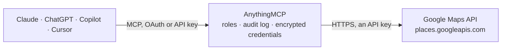

<!-- Generated by scripts/export-github-catalog.mjs in the anythingmcp-website repository. Do not edit by hand. -->

# Google Maps MCP connector

Let your AI search Google Maps with your own API key: find businesses and places by text or around a point, read their address, phone, website, opening hours, rating and reviews, get photos, … The AnythingMCP connector gives Claude, ChatGPT, Microsoft Copilot, Cursor and Gemini 9 MCP tools for Google Maps, all read-only.

**Category:** [Maps](../maps.md) · **Tools:** 9 · **Setup guide:** [anythingmcp.com](https://anythingmcp.com/guides/google-maps-to-mcp) · [Deutsch](https://anythingmcp.com/de/guides/google-maps-to-mcp) · [Italiano](https://anythingmcp.com/it/guides/google-maps-to-mcp) · [Español](https://anythingmcp.com/es/guides/google-maps-to-mcp) · [日本語](https://anythingmcp.com/ja/guides/google-maps-to-mcp) · [Русский](https://anythingmcp.com/ru/guides/google-maps-to-mcp) · [中文](https://anythingmcp.com/zh/guides/google-maps-to-mcp)

## Start without code

No installation and no terminal: AnythingMCP Cloud runs the Google Maps connector for you, operated by helpcode.ai in Frankfurt, Germany.

1. **Click the button above** and create an account or sign in. The Google Maps connector opens, ready to install.
2. **Paste the API key or token from your Google Maps account.** Every click is in the [step-by-step guide](https://anythingmcp.com/guides/google-maps-to-mcp).
3. **Click Install.** AnythingMCP shows the address of your MCP server.
4. **Add that address to your assistant:** [Claude](https://anythingmcp.com/guides/connect-google-maps-to-claude) · [ChatGPT](https://anythingmcp.com/guides/connect-google-maps-to-chatgpt) · [Microsoft Copilot](https://anythingmcp.com/guides/connect-google-maps-to-copilot) · [Cursor](https://anythingmcp.com/guides/connect-google-maps-to-cursor) · [Gemini CLI](https://anythingmcp.com/guides/connect-google-maps-to-gemini) · [Meta Muse](https://anythingmcp.com/guides/connect-google-maps-to-muse).
5. **Ask your first question**, for example: *What's the billing address, phone and website for Café Linde Heidelberg (for invoice INV-2026-078)?*

Prefer help with the setup? [Talk to us](https://anythingmcp.com/contact).

## How it works

- **The AI client** speaks MCP (Streamable HTTP) to AnythingMCP and only sees tool names, descriptions and results. It never gets the Google Maps credentials.
- **AnythingMCP** checks the client's role, builds the call from the tool definition, adds the credentials (an API key), calls Google Maps, logs the call and returns the result.
- **Google Maps** sees an ordinary API client with the rights of the account the credentials belong to.

## Tools

| Tool | What it does | Access |
|---|---|---|
| [`google_maps_search_text`](#google_maps_search_text) | Find places on Google Maps from a free-text query, as in the Maps search box: businesses, points of interest or an address ("pizza near Freiburg… | read |
| [`google_maps_search_nearby`](#google_maps_search_nearby) | Find places of given types within a circle around a point ("restaurants within 1 km of 47.995, 7.85"), ranked by popularity or distance. | read |
| [`google_maps_get_place`](#google_maps_get_place) | Read the details of one place by its place id (the id field of a search result, e.g. ChIJN1t_tDeuEmsRUsoyG83frY4). | read |
| [`google_maps_get_place_photo`](#google_maps_get_place_photo) | Get a short-lived link to one photo of a place. | read |
| [`google_maps_autocomplete`](#google_maps_autocomplete) | Suggest places and addresses for what the user has typed so far ("Münsterpl", "Starbucks Alexan"). | read |
| [`google_maps_geocode_address`](#google_maps_geocode_address) | Turn an address or place name into coordinates and a structured address (Geocoding API v4): "Kaiser-Joseph-Straße 167, Freiburg" gives results with… | read |
| [`google_maps_reverse_geocode`](#google_maps_reverse_geocode) | Turn coordinates into addresses (Geocoding API v4): returns results from the most precise (street address) to the broadest (country), each with… | read |
| [`google_maps_compute_routes`](#google_maps_compute_routes) | Compute a route between two places (Routes API): distance, duration, the legs between stops and warnings, by car, bicycle, on foot, two-wheeler or public… | read |
| [`google_maps_compute_route_matrix`](#google_maps_compute_route_matrix) | Distances and travel times between several origins and several destinations in one call (Routes API), e.g. which of 3 technicians is closest to 5 customers. | read |

## Tool reference

Every parameter as the AI client sees it in `tools/list`. Source: [`packages/backend/src/adapters/intl/google-maps.json`](../../../packages/backend/src/adapters/intl/google-maps.json).

### `google_maps_search_text`

Find places on Google Maps from a free-text query, as in the Maps search box: businesses, points of interest or an address ("pizza near Freiburg Hauptbahnhof", "dental clinic Al Yasmin Riyadh"). Include the area in the query or pass location_bias. The field_mask decides both the fields returned and the price: the default (name, address, location, type, status, Maps link) is billed as Text Search Pro; phone, website, rating and opening hours make it Enterprise, reviews Enterprise + Atmosphere (see the connector instructions). Up to 20 places per page; pass nextPageToken back as page_token for the next page (60 places at most). Read-only.

**Access:** read · **Call:** `POST /places:searchText`

| Parameter | Type | Required | Description |
|---|---|---|---|
| `text_query` | string | yes | What to search for, with the area, e.g. "coffee shops in Kreuzberg Berlin" or "Hotel Oberkirch Freiburg". |
| `field_mask` | string | no | Comma-separated fields to return, each prefixed with places. (plus nextPageToken for paging). Decides the SKU. Default: Pro fields. Add places.nationalPhoneNumber,places.websiteUri,places.rating,places.userRatingCount,places.regularOpeningHours for contact data (Enterprise), places.reviews for reviews (Enterprise + Atmosphere), places.photos for photo names. places.id alone is free. |
| `page_size` | integer | no | Places per page, 1 to 20. The price is per request, not per place. |
| `page_token` | string | no | nextPageToken from the previous call. Send the other parameters unchanged. |
| `language_code` | string | no | Language of names and addresses, e.g. en, de, ar, pt-BR. Default: the query's language or English. |
| `region_code` | string | no | Two-letter CLDR region code of the user, e.g. DE, SA. Affects address formatting and ranking. |
| `included_type` | string | no | Only one place type from Google's Table A, e.g. restaurant, dentist, hardware_store, lodging. |
| `strict_type_filtering` | boolean | no | true: return only places of included_type. |
| `open_now` | boolean | no | true: only places open right now. |
| `min_rating` | number | no | Minimum average rating, 0 to 5 in steps of 0.5. |
| `price_levels` | `PRICE_LEVEL_INEXPENSIVE` \| `PRICE_LEVEL_MODERATE` \| `PRICE_LEVEL_EXPENSIVE` \| `PRICE_LEVEL_VERY_EXPENSIVE`[] | no | Only places at these price levels. |
| `rank_preference` | `RELEVANCE` \| `DISTANCE` | no | RELEVANCE (default) or DISTANCE from the location bias. |
| `location_bias` | object | no | Prefer places in this area, others may still appear. Either {"circle": {"center": {"latitude": 47.995, "longitude": 7.85}, "radius": 5000}} (radius in meters, up to 50000) or {"rectangle": {"low": {"latitude": .., "longitude": ..}, "high": {"latitude": .., "longitude": ..}}}. Not together with location_restriction. |
| `location_restriction` | object | no | Return only places inside this rectangle: {"rectangle": {"low": {"latitude": 47.9, "longitude": 7.7}, "high": {"latitude": 48.1, "longitude": 7.95}}} (low = south-west corner, high = north-east). Not together with location_bias. |
| `include_pure_service_area_businesses` | boolean | no | true: also return businesses without a storefront that serve an area (plumbers, cleaners). |

### `google_maps_search_nearby`

Find places of given types within a circle around a point ("restaurants within 1 km of 47.995, 7.85"), ranked by popularity or distance. Needs coordinates: get them from google_maps_geocode_address or a place's location first. Up to 20 places, no paging. The field_mask decides the fields and the price; the default is billed as Nearby Search Pro (about $32 per 1,000, 5,000 free a month). Read-only.

**Access:** read · **Call:** `POST /places:searchNearby`

| Parameter | Type | Required | Description |
|---|---|---|---|
| `latitude` | number | yes | Latitude of the centre in degrees. |
| `longitude` | number | yes | Longitude of the centre in degrees. |
| `radius_meters` | number | no | Radius in meters, up to 50000. |
| `included_types` | string[] | no | Place types to include (Google's Table A), e.g. ["restaurant", "cafe"]. Leave out for any type. |
| `excluded_types` | string[] | no | Place types to leave out. |
| `included_primary_types` | string[] | no | Only places whose main type is one of these. |
| `excluded_primary_types` | string[] | no | Leave out places whose main type is one of these. |
| `max_result_count` | integer | no | Places to return, 1 to 20. |
| `rank_preference` | `POPULARITY` \| `DISTANCE` | no | POPULARITY (default) or DISTANCE from the centre. |
| `language_code` | string | no | Language of names and addresses, e.g. en, de. |
| `region_code` | string | no | Two-letter CLDR region code of the user, e.g. DE. |
| `field_mask` | string | no | Comma-separated fields, each prefixed with places. Decides the SKU (see google_maps_search_text). Default: Pro fields. |

### `google_maps_get_place`

Read the details of one place by its place id (the id field of a search result, e.g. ChIJN1t_tDeuEmsRUsoyG83frY4). The field_mask (no places. prefix here) decides the fields and the price: the default is Place Details Pro (about $17 per 1,000, 5,000 free); address fields alone are Essentials ($5), phone, website, rating and opening hours Enterprise ($20), reviews Enterprise + Atmosphere ($25), id alone is free. Pass the session_token of an autocomplete session to close it. Read-only.

**Access:** read · **Call:** `GET /places/{place_id}`

| Parameter | Type | Required | Description |
|---|---|---|---|
| `place_id` | string | yes | Place id, e.g. ChIJN1t_tDeuEmsRUsoyG83frY4 (without the places/ prefix). |
| `field_mask` | string | no | Comma-separated fields without prefix, e.g. id,displayName,formattedAddress,nationalPhoneNumber,websiteUri,rating,userRatingCount,regularOpeningHours,reviews,photos. Default: Pro fields. |
| `language_code` | string | no | Language of names, addresses and reviews, e.g. en, de. |
| `region_code` | string | no | Two-letter CLDR region code of the user, e.g. DE. |
| `session_token` | string | no | The session_token used by the google_maps_autocomplete calls that led to this place. |

### `google_maps_get_place_photo`

Get a short-lived link to one photo of a place. Ask for the field photos (or places.photos on a search) first: each entry has a name like places/ChIJ.../photos/AXCi2Q... and the authorAttributions to show with it. Returns photoUri, an image link that works without a key for a limited time. Billed as Place Details Photos (about $7 per 1,000, 1,000 free a month). Read-only.

**Access:** read · **Call:** `GET /{photo_name}/media`

| Parameter | Type | Required | Description |
|---|---|---|---|
| `photo_name` | string | yes | The photo's name exactly as returned in photos[].name, e.g. places/ChIJN1t_tDeuEmsRUsoyG83frY4/photos/AXCi2Q... |
| `max_width_px` | integer | no | Maximum width in pixels, 1 to 4800. |
| `max_height_px` | integer | no | Maximum height in pixels, 1 to 4800. |

### `google_maps_autocomplete`

Suggest places and addresses for what the user has typed so far ("Münsterpl", "Starbucks Alexan"). Returns placePrediction entries with placeId and text, and with include_query_predictions also search phrases. About $2.83 per 1,000 requests (10,000 free a month); give every call of one typing session the same session_token and end it with google_maps_get_place on the chosen placeId with that token, and the session's autocomplete requests are free. Read-only.

**Access:** read · **Call:** `POST /places:autocomplete`

| Parameter | Type | Required | Description |
|---|---|---|---|
| `input` | string | yes | The text typed so far. |
| `session_token` | string | no | A random URL-safe string (up to 36 characters, e.g. a UUID) shared by the calls of one session. |
| `language_code` | string | no | Language of the suggestions, e.g. en, de. Default en-US. |
| `region_code` | string | no | Two-letter CLDR region code for formatting and ranking, e.g. DE. |
| `included_region_codes` | string[] | no | Only suggestions in these regions (up to 15 two-letter codes), e.g. ["de", "ch"]. |
| `included_primary_types` | string[] | no | Only these primary types (up to 5), e.g. ["restaurant"], or ["(regions)"] or ["(cities)"] for areas. |
| `location_bias` | object | no | Prefer suggestions in this area: {"circle": {"center": {"latitude": .., "longitude": ..}, "radius": 5000}} or a rectangle {"rectangle": {"low": {..}, "high": {..}}}. |
| `location_restriction` | object | no | Only suggestions in this circle or rectangle, same shape as location_bias. Not together with location_bias. |
| `origin` | object | no | A point {"latitude": .., "longitude": ..}; each suggestion then carries distanceMeters from it. |
| `include_query_predictions` | boolean | no | true: also suggest search phrases, not only places. |

### `google_maps_geocode_address`

Turn an address or place name into coordinates and a structured address (Geocoding API v4): "Kaiser-Joseph-Straße 167, Freiburg" gives results with formattedAddress, location (latitude, longitude), placeId, types, granularity (ROOFTOP is exact) and addressComponents. Several results mean the address was ambiguous. Billed as Geocoding (about $5 per 1,000, 10,000 free a month). Read-only.

**Access:** read · **Call:** `GET https://geocode.googleapis.com/v4/geocode/address/{address}`

| Parameter | Type | Required | Description |
|---|---|---|---|
| `address` | string | yes | The address in one line, as precise as possible, with town and country. |
| `language_code` | string | no | Language of the returned address, e.g. en, de. |
| `region_code` | string | no | Two-letter region code that biases ambiguous addresses, e.g. DE. |
| `field_mask` | string | no | Optional comma-separated fields to return, e.g. results.formattedAddress,results.location,results.placeId. Leave out for all fields (same price). |

### `google_maps_reverse_geocode`

Turn coordinates into addresses (Geocoding API v4): returns results from the most precise (street address) to the broadest (country), each with formattedAddress, placeId, types and addressComponents. Filter with types or granularity. Billed as Geocoding (about $5 per 1,000, 10,000 free a month). Read-only.

**Access:** read · **Call:** `GET https://geocode.googleapis.com/v4/geocode/location`

| Parameter | Type | Required | Description |
|---|---|---|---|
| `latitude` | number | yes | Latitude in degrees. |
| `longitude` | number | yes | Longitude in degrees. |
| `language_code` | string | no | Language of the addresses, e.g. en, de. |
| `region_code` | string | no | Two-letter region code for address formatting, e.g. DE. |
| `types` | string[] | no | Only results of these types, e.g. ["street_address"], ["locality"], ["postal_code"]. |
| `granularity` | `ROOFTOP` \| `RANGE_INTERPOLATED` \| `GEOMETRIC_CENTER` \| `APPROXIMATE`[] | no | Only results of these precisions. |
| `field_mask` | string | no | Optional comma-separated fields, e.g. results.formattedAddress,results.placeId,results.types. Leave out for all fields. |

### `google_maps_compute_routes`

Compute a route between two places (Routes API): distance, duration, the legs between stops and warnings, by car, bicycle, on foot, two-wheeler or public transport. Origin, destination and stops are waypoints: {"address": "Freiburg Hauptbahnhof"}, {"placeId": "ChIJ..."} or {"location": {"latLng": {"latitude": 47.99, "longitude": 7.84}}}. Billed as Compute Routes Essentials (about $5 per 1,000, 10,000 free) unless routing_preference asks for live traffic (Pro, about $10) or travel_mode is TWO_WHEELER (Enterprise, about $15). Add routes.legs.steps.navigationInstruction to field_mask for turn-by-turn directions, routes.polyline.encodedPolyline for the line on a map. Read-only.

**Access:** read · **Call:** `POST https://routes.googleapis.com/directions/v2:computeRoutes`

| Parameter | Type | Required | Description |
|---|---|---|---|
| `origin` | object | yes | Start waypoint: {"address": "..."}, {"placeId": "..."} or {"location": {"latLng": {"latitude": .., "longitude": ..}}}. |
| `destination` | object | yes | End waypoint, same shape as origin. |
| `intermediates` | object[] | no | Stops on the way, in order, same shape as origin. Up to 10 for the Essentials price, 25 at most. |
| `travel_mode` | `DRIVE` \| `BICYCLE` \| `WALK` \| `TWO_WHEELER` \| `TRANSIT` | no | How to travel. Default DRIVE. |
| `routing_preference` | `TRAFFIC_UNAWARE` \| `TRAFFIC_AWARE` \| `TRAFFIC_AWARE_OPTIMAL` | no | Only for DRIVE and TWO_WHEELER. Leave out for TRAFFIC_UNAWARE (cheapest). TRAFFIC_AWARE and TRAFFIC_AWARE_OPTIMAL use live traffic and are billed as Pro. |
| `departure_time` | string | no | RFC 3339 departure time, e.g. 2026-10-14T07:30:00Z. Needed for traffic or transit at a future time; must not be in the past. |
| `arrival_time` | string | no | RFC 3339 arrival time. Only with TRANSIT, not together with departure_time. |
| `compute_alternative_routes` | boolean | no | true: also return up to two alternative routes (not with intermediates). |
| `route_modifiers` | object | no | {"avoidTolls": true, "avoidHighways": true, "avoidFerries": true} for DRIVE and TWO_WHEELER. |
| `language_code` | string | no | Language of instructions and localized values, e.g. en, de. |
| `region_code` | string | no | Two-letter region code, e.g. DE. |
| `units` | `METRIC` \| `IMPERIAL` | no | Units of the localized values. |
| `field_mask` | string | no | Comma-separated route fields to return (required by Google). Default: totals, legs and warnings without steps or polyline. |

### `google_maps_compute_route_matrix`

Distances and travel times between several origins and several destinations in one call (Routes API), e.g. which of 3 technicians is closest to 5 customers. Each entry of origins and destinations is {"waypoint": {"address": "..."}} (or placeId or location instead of address). Returns one element per origin and destination pair with originIndex, destinationIndex, distanceMeters, duration and condition (ROUTE_EXISTS or ROUTE_NOT_FOUND). Billed per element (origins x destinations): Essentials about $5 per 1,000 elements (10,000 free), Pro with live traffic. At most 625 elements per call (100 with TRANSIT or TRAFFIC_AWARE_OPTIMAL). Read-only.

**Access:** read · **Call:** `POST https://routes.googleapis.com/distanceMatrix/v2:computeRouteMatrix`

| Parameter | Type | Required | Description |
|---|---|---|---|
| `origins` | object[] | yes | Up to 50 origins, each {"waypoint": {"address": "Freiburg"}} or {"waypoint": {"placeId": "ChIJ..."}} or {"waypoint": {"location": {"latLng": {"latitude": .., "longitude": ..}}}}. |
| `destinations` | object[] | yes | Up to 50 destinations, same shape as origins. |
| `travel_mode` | `DRIVE` \| `BICYCLE` \| `WALK` \| `TWO_WHEELER` \| `TRANSIT` | no | How to travel. Default DRIVE. |
| `routing_preference` | `TRAFFIC_UNAWARE` \| `TRAFFIC_AWARE` \| `TRAFFIC_AWARE_OPTIMAL` | no | Only for DRIVE and TWO_WHEELER. Leave out for TRAFFIC_UNAWARE (cheapest); the others use live traffic and are billed as Pro. |
| `departure_time` | string | no | RFC 3339 departure time for traffic or transit, e.g. 2026-10-14T07:30:00Z. |
| `language_code` | string | no | Language of localized values, e.g. en, de. |
| `region_code` | string | no | Two-letter region code, e.g. DE. |
| `units` | `METRIC` \| `IMPERIAL` | no | Units of the localized values. |
| `field_mask` | string | no | Comma-separated element fields to return (required by Google). |

## Run it yourself

AnythingMCP is open source (AGPL-3.0). [Run it with Docker](../../../README.md#run-it-yourself), open **Connectors → Store**, pick **Google Maps** and enter `GOOGLE_MAPS_API_KEY`, then add your MCP server URL to the AI client.

[← Maps connectors](../maps.md) · [All categories](../README.md)
