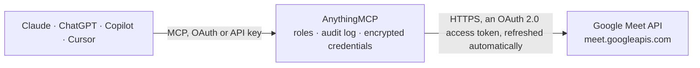

<!-- Generated by scripts/export-github-catalog.mjs in the anythingmcp-website repository. Do not edit by hand. -->

# Google Meet MCP connector

Let your AI work with Google Meet: create meeting links with access, moderation and automatic recording or transcript settings, add co-hosts, and after a meeting see who joined and for how long, find … The AnythingMCP connector gives Claude, ChatGPT, Microsoft Copilot, Cursor and Gemini 16 MCP tools for Google Meet: 11 read and 5 can change data.

**Category:** [Scheduling](../scheduling.md) · **Tools:** 16 · **Setup guide:** [anythingmcp.com](https://anythingmcp.com/guides/google-meet-to-mcp) · [Deutsch](https://anythingmcp.com/de/guides/google-meet-to-mcp) · [Italiano](https://anythingmcp.com/it/guides/google-meet-to-mcp) · [Español](https://anythingmcp.com/es/guides/google-meet-to-mcp) · [日本語](https://anythingmcp.com/ja/guides/google-meet-to-mcp) · [Русский](https://anythingmcp.com/ru/guides/google-meet-to-mcp) · [中文](https://anythingmcp.com/zh/guides/google-meet-to-mcp)

## Start without code

No installation and no terminal: AnythingMCP Cloud runs the Google Meet connector for you, operated by helpcode.ai in Frankfurt, Germany.

1. **Click the button above** and create an account or sign in. The Google Meet connector opens, ready to install.
2. **Sign in with your Google Meet account** when AnythingMCP asks. The first time, an admin creates a small app in the Google Cloud console. Every click is in the [step-by-step guide](https://anythingmcp.com/guides/google-meet-to-mcp).
3. **Click Install.** AnythingMCP shows the address of your MCP server.
4. **Add that address to your assistant:** [Claude](https://anythingmcp.com/guides/connect-google-meet-to-claude) · [ChatGPT](https://anythingmcp.com/guides/connect-google-meet-to-chatgpt) · [Microsoft Copilot](https://anythingmcp.com/guides/connect-google-meet-to-copilot) · [Cursor](https://anythingmcp.com/guides/connect-google-meet-to-cursor) · [Gemini CLI](https://anythingmcp.com/guides/connect-google-meet-to-gemini) · [Meta Muse](https://anythingmcp.com/guides/connect-google-meet-to-muse).
5. **Ask your first question**, for example: *What's the meeting link and access settings for our Q4-Sales-Review meet code q4-rv9-kht?*

Prefer help with the setup? [Talk to us](https://anythingmcp.com/contact).

## How it works

- **The AI client** speaks MCP (Streamable HTTP) to AnythingMCP and only sees tool names, descriptions and results. It never gets the Google Meet credentials.
- **AnythingMCP** checks the client's role, builds the call from the tool definition, adds the credentials (an OAuth 2.0 access token, refreshed automatically), calls Google Meet, logs the call and returns the result.
- **Google Meet** sees an ordinary API client with the rights of the account the credentials belong to.

## Tools

| Tool | What it does | Access |
|---|---|---|
| [`google_meet_create_space`](#google_meet_create_space) | Create a new Google Meet meeting space and return its name (spaces/<id>), meetingUri (the link to share), meetingCode and config. | write |
| [`google_meet_get_space`](#google_meet_get_space) | Get a meeting space: name, meetingUri, meetingCode, config (access type, moderation, automatic artifacts) and activeConference.conferenceRecord while a call… | read |
| [`google_meet_update_space`](#google_meet_update_space) | Change a meeting space's settings: access type, moderation and its restrictions, automatic recording, transcripts and smart notes, attendance report. | write |
| [`google_meet_end_active_conference`](#google_meet_end_active_conference) | End the call running in a meeting space now, for every participant. | write |
| [`google_meet_list_members`](#google_meet_list_members) | List the members of a meeting space: people configured to join without knocking, with their email and role (COHOST). | read |
| [`google_meet_add_member`](#google_meet_add_member) | Add a person to a meeting space by email so they join without knocking, optionally as co-host (role COHOST). | write |
| [`google_meet_remove_member`](#google_meet_remove_member) | Remove a member (and their co-host role) from a meeting space. | write |
| [`google_meet_list_conference_records`](#google_meet_list_conference_records) | List past and running calls (conference records) the signed-in user organised, newest first, with name, space, startTime and endTime (missing while the call… | read |
| [`google_meet_get_conference_record`](#google_meet_get_conference_record) | Get one conference record (one call held in a space): its space, startTime, endTime and expireTime, when Google deletes it. | read |
| [`google_meet_list_participants`](#google_meet_list_participants) | List who joined a call: each participant's name (the resource that transcript entries point to), displayName, kind (signed-in, anonymous or phone), user id,… | read |
| [`google_meet_get_participant`](#google_meet_get_participant) | Get one participant of a call by its resource name, for example the participant a transcript entry points to: displayName, user id, first join and last… | read |
| [`google_meet_list_participant_sessions`](#google_meet_list_participant_sessions) | List the join and leave sessions of one participant (each time they joined from a device), with startTime and endTime, to work out how long they stayed. | read |
| [`google_meet_list_recordings`](#google_meet_list_recordings) | List the recordings of a call with state (STARTED, ENDED, FILE_GENERATED), start and end time, and driveDestination: the Drive file id of the MP4 and… | read |
| [`google_meet_list_transcripts`](#google_meet_list_transcripts) | List the transcripts of a call: name (pass it to google_meet_read_transcript), state (FILE_GENERATED when complete), start and end time, and docsDestination… | read |
| [`google_meet_read_transcript`](#google_meet_read_transcript) | Read what was said in a call: transcript entries in spoken order, each with participant (speaker resource name), startTime, endTime, languageCode and text. | read |
| [`google_meet_list_smart_notes`](#google_meet_list_smart_notes) | List the Gemini smart notes ("Take notes for me") of a call: state (FILE_GENERATED when ready), start and end time and docsDestination with the Google Doc… | read |

## Tool reference

Every parameter as the AI client sees it in `tools/list`. Source: [`packages/backend/src/adapters/intl/google-meet.json`](../../../packages/backend/src/adapters/intl/google-meet.json).

### `google_meet_create_space`

Create a new Google Meet meeting space and return its name (spaces/<id>), meetingUri (the link to share), meetingCode and config. Optional config sets access, moderation and automatic recording, transcripts or smart notes. Confirm with the user before creating it.

**Access:** write · **Call:** `POST /spaces`

| Parameter | Type | Required | Description |
|---|---|---|---|
| `config` | object | no | SpaceConfig fields to set, e.g. {"accessType": "TRUSTED", "moderation": "ON", "moderationRestrictions": {"chatRestriction": "HOSTS_ONLY"}, "artifactConfig": {"recordingConfig": {"autoRecordingGeneration": "ON"}, "transcriptionConfig": {"autoTranscriptionGeneration": "ON"}, "smartNotesConfig": {"autoSmartNotesGeneration": "ON"}}, "attendanceReportGenerationType": "GENERATE_REPORT"}. accessType is OPEN, TRUSTED or RESTRICTED (RESTRICTED and changing the access type need a Google Workspace account: personal Gmail accounts get 403 FEATURE_UNAVAILABLE_TO_USER); entryPointAccess ALL or CREATOR_APP_ONLY. Send only the fields to set. |

### `google_meet_get_space`

Get a meeting space: name, meetingUri, meetingCode, config (access type, moderation, automatic artifacts) and activeConference.conferenceRecord while a call is running. Accepts the space id or the meeting code from a link (abc-mnop-xyz).

**Access:** read · **Call:** `GET /spaces/{space_id}`

| Parameter | Type | Required | Description |
|---|---|---|---|
| `space_id` | string | yes | Space id (after spaces/, e.g. jQCFfuBOdN5z) or the meeting code from the link, e.g. abc-mnop-xyz. |

### `google_meet_update_space`

Change a meeting space's settings: access type, moderation and its restrictions, automatic recording, transcripts and smart notes, attendance report. Only the fields given change. Works on spaces the connector created and, with the settings scope, on the user's own Calendar meetings. Confirm with the user before changing it.

**Access:** write · **Call:** `PATCH /spaces/{space_id}`

| Parameter | Type | Required | Description |
|---|---|---|---|
| `space_id` | string | yes | Meeting space id: the part after spaces/ in a space's `name` (e.g. jQCFfuBOdN5z). A meeting code is not accepted here: read the id with google_meet_get_space first. |
| `config` | object | yes | SpaceConfig fields to set, e.g. {"accessType": "TRUSTED", "moderation": "ON", "moderationRestrictions": {"chatRestriction": "HOSTS_ONLY"}, "artifactConfig": {"recordingConfig": {"autoRecordingGeneration": "ON"}, "transcriptionConfig": {"autoTranscriptionGeneration": "ON"}, "smartNotesConfig": {"autoSmartNotesGeneration": "ON"}}, "attendanceReportGenerationType": "GENERATE_REPORT"}. accessType is OPEN, TRUSTED or RESTRICTED (RESTRICTED and changing the access type need a Google Workspace account: personal Gmail accounts get 403 FEATURE_UNAVAILABLE_TO_USER); entryPointAccess ALL or CREATOR_APP_ONLY. Send only the fields to set. |
| `update_mask` | string | no | Optional comma-separated fields to change, e.g. config.accessType,config.artifactConfig.transcriptionConfig.autoTranscriptionGeneration. Without it every field given in config is changed and nothing else. |

### `google_meet_end_active_conference`

End the call running in a meeting space now, for every participant. Only for spaces this connector created; does nothing if no call is running. Installed switched off. Always confirm with the user first.

**Access:** write · **Call:** `POST /spaces/{space_id}:endActiveConference`

| Parameter | Type | Required | Description |
|---|---|---|---|
| `space_id` | string | yes | Meeting space id: the part after spaces/ in a space's `name` (e.g. jQCFfuBOdN5z). |

### `google_meet_list_members`

List the members of a meeting space: people configured to join without knocking, with their email and role (COHOST). Not the people who attended: for those use google_meet_list_participants.

**Access:** read · **Call:** `GET /spaces/{space_id}/members`

| Parameter | Type | Required | Description |
|---|---|---|---|
| `space_id` | string | yes | Meeting space id: the part after spaces/ in a space's `name` (e.g. jQCFfuBOdN5z). |
| `page_size` | integer | no | Members per page, 1 to 500 (default 250). |
| `page_token` | string | no | nextPageToken from the previous response, to get the next page. |

### `google_meet_add_member`

Add a person to a meeting space by email so they join without knocking, optionally as co-host (role COHOST). Only for spaces this connector created. Confirm the email and role with the user before adding.

**Access:** write · **Call:** `POST /spaces/{space_id}/members`

| Parameter | Type | Required | Description |
|---|---|---|---|
| `space_id` | string | yes | Meeting space id: the part after spaces/ in a space's `name` (e.g. jQCFfuBOdN5z). |
| `email` | string | yes | Email address of the person to add. |
| `role` | `COHOST` | no | COHOST to let them co-manage the call (they cannot change automatic artifacts or moderation). Leave out for a plain member. |

### `google_meet_remove_member`

Remove a member (and their co-host role) from a meeting space. Only for spaces this connector created. Installed switched off. Confirm with the user before removing.

**Access:** write · **Call:** `DELETE /{member_name}`

| Parameter | Type | Required | Description |
|---|---|---|---|
| `member_name` | string | yes | Member resource name from google_meet_list_members, e.g. spaces/jQCFfuBOdN5z/members/abc123. |

### `google_meet_list_conference_records`

List past and running calls (conference records) the signed-in user organised, newest first, with name, space, startTime and endTime (missing while the call runs). Records are deleted 30 days after the call. Filter by meeting code or time. Paginate with page_token = nextPageToken.

**Access:** read · **Call:** `GET /conferenceRecords`

| Parameter | Type | Required | Description |
|---|---|---|---|
| `filter` | string | no | Optional filter, e.g. space.meeting_code = "abc-mnop-xyz", space.name = "spaces/jQCFfuBOdN5z", start_time >= "2026-10-01T00:00:00Z" AND start_time <= "2026-10-02T00:00:00Z", or end_time IS NULL for running calls. |
| `page_size` | integer | no | Records per page, 1 to 100 (default 25). |
| `page_token` | string | no | nextPageToken from the previous response, to get the next page. |

### `google_meet_get_conference_record`

Get one conference record (one call held in a space): its space, startTime, endTime and expireTime, when Google deletes it.

**Access:** read · **Call:** `GET /{conference_record}`

| Parameter | Type | Required | Description |
|---|---|---|---|
| `conference_record` | string | yes | Conference record name exactly as returned in `name` by google_meet_list_conference_records, e.g. conferenceRecords/abc123-def. Not the meeting code. |

### `google_meet_list_participants`

List who joined a call: each participant's name (the resource that transcript entries point to), displayName, kind (signed-in, anonymous or phone), user id, earliestStartTime and latestEndTime. Paginate with page_token = nextPageToken.

**Access:** read · **Call:** `GET /{conference_record}/participants`

| Parameter | Type | Required | Description |
|---|---|---|---|
| `conference_record` | string | yes | Conference record name exactly as returned in `name` by google_meet_list_conference_records, e.g. conferenceRecords/abc123-def. Not the meeting code. |
| `filter` | string | no | Optional filter on earliest_start_time and latest_end_time, e.g. latest_end_time IS NULL for people still in the call. |
| `page_size` | integer | no | Participants per page, 1 to 250 (default 100). |
| `page_token` | string | no | nextPageToken from the previous response, to get the next page. |

### `google_meet_get_participant`

Get one participant of a call by its resource name, for example the participant a transcript entry points to: displayName, user id, first join and last leave time.

**Access:** read · **Call:** `GET /{participant}`

| Parameter | Type | Required | Description |
|---|---|---|---|
| `participant` | string | yes | Participant resource name, e.g. conferenceRecords/abc123-def/participants/456. |

### `google_meet_list_participant_sessions`

List the join and leave sessions of one participant (each time they joined from a device), with startTime and endTime, to work out how long they stayed. Paginate with page_token = nextPageToken.

**Access:** read · **Call:** `GET /{participant}/participantSessions`

| Parameter | Type | Required | Description |
|---|---|---|---|
| `participant` | string | yes | Participant resource name from google_meet_list_participants, e.g. conferenceRecords/abc123-def/participants/456. |
| `filter` | string | no | Optional filter on start_time and end_time, e.g. end_time IS NULL for sessions still running. |
| `page_size` | integer | no | Sessions per page, 1 to 250 (default 100). |
| `page_token` | string | no | nextPageToken from the previous response, to get the next page. |

### `google_meet_list_recordings`

List the recordings of a call with state (STARTED, ENDED, FILE_GENERATED), start and end time, and driveDestination: the Drive file id of the MP4 and exportUri, a link to play it in the browser.

**Access:** read · **Call:** `GET /{conference_record}/recordings`

| Parameter | Type | Required | Description |
|---|---|---|---|
| `conference_record` | string | yes | Conference record name exactly as returned in `name` by google_meet_list_conference_records, e.g. conferenceRecords/abc123-def. Not the meeting code. |
| `page_size` | integer | no | Recordings per page, 1 to 100 (default 10). |
| `page_token` | string | no | nextPageToken from the previous response, to get the next page. |

### `google_meet_list_transcripts`

List the transcripts of a call: name (pass it to google_meet_read_transcript), state (FILE_GENERATED when complete), start and end time, and docsDestination with the Google Doc id and link of the transcript document.

**Access:** read · **Call:** `GET /{conference_record}/transcripts`

| Parameter | Type | Required | Description |
|---|---|---|---|
| `conference_record` | string | yes | Conference record name exactly as returned in `name` by google_meet_list_conference_records, e.g. conferenceRecords/abc123-def. Not the meeting code. |
| `page_size` | integer | no | Transcripts per page, 1 to 100 (default 10). |
| `page_token` | string | no | nextPageToken from the previous response, to get the next page. |

### `google_meet_read_transcript`

Read what was said in a call: transcript entries in spoken order, each with participant (speaker resource name), startTime, endTime, languageCode and text. Up to 100 entries per call; keep calling with page_token = nextPageToken until it is missing. Entries are kept 30 days after the call.

**Access:** read · **Call:** `GET /{transcript}/entries`

| Parameter | Type | Required | Description |
|---|---|---|---|
| `transcript` | string | yes | Transcript resource name from google_meet_list_transcripts, e.g. conferenceRecords/abc123-def/transcripts/xyz. |
| `page_size` | integer | no | Entries per page, 1 to 100 (default 100). |
| `page_token` | string | no | nextPageToken from the previous response, to get the next page. |

### `google_meet_list_smart_notes`

List the Gemini smart notes ("Take notes for me") of a call: state (FILE_GENERATED when ready), start and end time and docsDestination with the Google Doc id and link. Read the document with the Google Docs connector.

**Access:** read · **Call:** `GET /{conference_record}/smartNotes`

| Parameter | Type | Required | Description |
|---|---|---|---|
| `conference_record` | string | yes | Conference record name exactly as returned in `name` by google_meet_list_conference_records, e.g. conferenceRecords/abc123-def. Not the meeting code. |
| `page_size` | integer | no | Smart notes per page, 1 to 100 (default 10). |
| `page_token` | string | no | nextPageToken from the previous response, to get the next page. |

## Run it yourself

AnythingMCP is open source (AGPL-3.0). [Run it with Docker](../../../README.md#run-it-yourself), open **Connectors → Store**, pick **Google Meet** and enter `GOOGLE_CLIENT_ID`, `GOOGLE_CLIENT_SECRET`, then add your MCP server URL to the AI client.

[← Scheduling connectors](../scheduling.md) · [All categories](../README.md)
