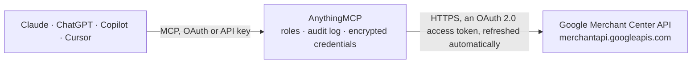

<!-- Generated by scripts/export-github-catalog.mjs in the anythingmcp-website repository. Do not edit by hand. -->

# Google Merchant Center MCP connector

Google Merchant Center for AI agents through the Merchant API v1: products and product inputs, feeds (data sources), product statuses and issues, performance and price reports in Merchant Center … The AnythingMCP connector gives Claude, ChatGPT, Microsoft Copilot, Cursor and Gemini 40 MCP tools for Google Merchant Center: 25 read and 15 can change data.

**Category:** [E-commerce](../e-commerce.md) · **Tools:** 40 · **Setup guide:** [anythingmcp.com](https://anythingmcp.com/guides/google-merchant-center-to-mcp) · [Deutsch](https://anythingmcp.com/de/guides/google-merchant-center-to-mcp) · [Italiano](https://anythingmcp.com/it/guides/google-merchant-center-to-mcp) · [Español](https://anythingmcp.com/es/guides/google-merchant-center-to-mcp) · [日本語](https://anythingmcp.com/ja/guides/google-merchant-center-to-mcp) · [Русский](https://anythingmcp.com/ru/guides/google-merchant-center-to-mcp) · [中文](https://anythingmcp.com/zh/guides/google-merchant-center-to-mcp)

## Start without code

No installation and no terminal: AnythingMCP Cloud runs the Google Merchant Center connector for you, operated by helpcode.ai in Frankfurt, Germany.

1. **Click the button above** and create an account or sign in. The Google Merchant Center connector opens, ready to install.
2. **Sign in with your Google Merchant Center account** when AnythingMCP asks. The first time, an admin creates a small app in the Google Cloud console. Every click is in the [step-by-step guide](https://anythingmcp.com/guides/google-merchant-center-to-mcp).
3. **Click Install.** AnythingMCP shows the address of your MCP server.
4. **Add that address to your assistant:** [Claude](https://anythingmcp.com/guides/connect-google-merchant-center-to-claude) · [ChatGPT](https://anythingmcp.com/guides/connect-google-merchant-center-to-chatgpt) · [Microsoft Copilot](https://anythingmcp.com/guides/connect-google-merchant-center-to-copilot) · [Cursor](https://anythingmcp.com/guides/connect-google-merchant-center-to-cursor) · [Gemini CLI](https://anythingmcp.com/guides/connect-google-merchant-center-to-gemini) · [Meta Muse](https://anythingmcp.com/guides/connect-google-merchant-center-to-muse).
5. **Ask your first question**, for example: *Find the processed product in feed label 'DE' with offerId PL-479 and show price, availability and title.*

Prefer help with the setup? [Talk to us](https://anythingmcp.com/contact).

## How it works

- **The AI client** speaks MCP (Streamable HTTP) to AnythingMCP and only sees tool names, descriptions and results. It never gets the Google Merchant Center credentials.
- **AnythingMCP** checks the client's role, builds the call from the tool definition, adds the credentials (an OAuth 2.0 access token, refreshed automatically), calls Google Merchant Center, logs the call and returns the result.
- **Google Merchant Center** sees an ordinary API client with the rights of the account the credentials belong to.

## Tools

| Tool | What it does | Access |
|---|---|---|
| [`google_merchant_center_get_account`](#google_merchant_center_get_account) | Read the configured Merchant Center account: accountId, accountName, time zone, language, adult content flag and whether it is a test account. | read |
| [`google_merchant_center_list_accounts`](#google_merchant_center_list_accounts) | List every Merchant Center account the signed-in Google user can open (up to 500 per page): standalone accounts, advanced accounts and their sub-accounts,… | read |
| [`google_merchant_center_list_subaccounts`](#google_merchant_center_list_subaccounts) | List the sub-accounts of the configured account when it is an advanced (multi-client) account, with accountId and accountName. | read |
| [`google_merchant_center_get_business_info`](#google_merchant_center_get_business_info) | Read the business details of the account: legal address, phone and its verification state, and customer service contact (URI, email, phone). | read |
| [`google_merchant_center_get_homepage`](#google_merchant_center_get_homepage) | Read the store's homepage URI and whether it is verified and claimed. | read |
| [`google_merchant_center_list_account_issues`](#google_merchant_center_list_account_issues) | List the account-level issues Merchant Center shows (policy violations, unclaimed website, missing shipping or tax, suspensions): title, severity (CRITICAL,… | read |
| [`google_merchant_center_list_programs`](#google_merchant_center_list_programs) | List the Merchant Center programs (free-listings, shopping-ads, local listings, checkout...) and, for each, whether it is ENABLED, ELIGIBLE or NOT_ELIGIBLE… | read |
| [`google_merchant_center_get_shipping_settings`](#google_merchant_center_get_shipping_settings) | Read the shipping settings of the account: shipping services per country with delivery times, rates and rate tables, warehouses and the etag needed to… | read |
| [`google_merchant_center_list_regions`](#google_merchant_center_list_regions) | List the regions defined in the account (groups of postal codes or geo targets) used for regional inventory, pricing and shipping: regionId, displayName and… | read |
| [`google_merchant_center_list_users`](#google_merchant_center_list_users) | List the people with access to the account: email, state (PENDING or VERIFIED) and access rights (STANDARD, ADMIN, PERFORMANCE_REPORTING, API_DEVELOPER,… | read |
| [`google_merchant_center_get_developer_registration`](#google_merchant_center_get_developer_registration) | Show which Google Cloud project numbers are registered with this Merchant Center account. | read |
| [`google_merchant_center_register_gcp_project`](#google_merchant_center_register_gcp_project) | One-time setup: register the Google Cloud project of this connector's OAuth client with the Merchant Center account, so the Merchant API accepts its calls. | write |
| [`google_merchant_center_list_products`](#google_merchant_center_list_products) | List the final, processed products of the account (merged from every data source, up to 1000 per page; default 25): name, offerId, contentLanguage,… | read |
| [`google_merchant_center_get_product`](#google_merchant_center_get_product) | Read one processed product with its attributes and productStatus: per destination and country whether it is approved, pending or disapproved, and every… | read |
| [`google_merchant_center_insert_product_input`](#google_merchant_center_insert_product_input) | Create a product, or replace the input of an existing one with the same contentLanguage, feedLabel and offerId, in an API data source. | write |
| [`google_merchant_center_update_product_input`](#google_merchant_center_update_product_input) | Change some attributes of a product input in its API data source (primary or supplemental), e.g. price or availability. | write |
| [`google_merchant_center_delete_product_input`](#google_merchant_center_delete_product_input) | Delete a product input from one API data source. | write |
| [`google_merchant_center_list_data_sources`](#google_merchant_center_list_data_sources) | List the data sources of the account (feeds): name with the numeric id, displayName, input (API, FILE, UI, AUTOFEED) and type (primaryProductDataSource,… | read |
| [`google_merchant_center_get_data_source`](#google_merchant_center_get_data_source) | Read one data source with its type settings and, for file feeds, the fetch schedule and file URL. | read |
| [`google_merchant_center_get_latest_file_upload`](#google_merchant_center_get_latest_file_upload) | Read the result of the latest file upload or fetch of a data source: processingState (SUCCEEDED, FAILED, IN_PROGRESS), uploadTime, itemsTotal, itemsCreated,… | read |
| [`google_merchant_center_create_data_source`](#google_merchant_center_create_data_source) | Create a data source. | write |
| [`google_merchant_center_update_data_source`](#google_merchant_center_update_data_source) | Change a data source's display name, countries or fetch schedule. | write |
| [`google_merchant_center_fetch_data_source`](#google_merchant_center_fetch_data_source) | Fetch a file data source from its URL now, outside its schedule. | write |
| [`google_merchant_center_list_aggregate_product_statuses`](#google_merchant_center_list_aggregate_product_statuses) | Count products by status per reporting context (SHOPPING_ADS, FREE_LISTINGS, ...) and country: approved, pending and disapproved counts and the most… | read |
| [`google_merchant_center_search_reports`](#google_merchant_center_search_reports) | Run a Merchant Center Query Language (MCQL) report: product performance (clicks, impressions, CTR, conversions), product status and issues per product,… | read |
| [`google_merchant_center_list_local_inventories`](#google_merchant_center_list_local_inventories) | List the in-store inventory of one product: per storeCode the price, sale price, availability, quantity and pickup settings. | read |
| [`google_merchant_center_insert_local_inventory`](#google_merchant_center_insert_local_inventory) | Set the in-store availability and price of a product at one store (creates or replaces that store entry). | write |
| [`google_merchant_center_delete_local_inventory`](#google_merchant_center_delete_local_inventory) | Remove the inventory entry of a product at one store; the product then no longer shows as available there. | write |
| [`google_merchant_center_list_regional_inventories`](#google_merchant_center_list_regional_inventories) | List the regional prices and availability of one product: per region id the price, sale price and availability. | read |
| [`google_merchant_center_insert_regional_inventory`](#google_merchant_center_insert_regional_inventory) | Set the price and availability of a product in one region (creates or replaces that region entry). | write |
| [`google_merchant_center_delete_regional_inventory`](#google_merchant_center_delete_regional_inventory) | Remove the regional price and availability of a product in one region. | write |
| [`google_merchant_center_list_promotions`](#google_merchant_center_list_promotions) | List the promotions of the account (up to 250 per page): promotionId, targetCountry, contentLanguage, redemptionChannel, attributes (long title, offer and… | read |
| [`google_merchant_center_get_promotion`](#google_merchant_center_get_promotion) | Read one promotion with its status per destination (pending, approved, rejected) and item-level issues. | read |
| [`google_merchant_center_insert_promotion`](#google_merchant_center_insert_promotion) | Create a promotion, or replace one with the same promotionId, country and language, in a promotion data source. | write |
| [`google_merchant_center_list_notification_subscriptions`](#google_merchant_center_list_notification_subscriptions) | List the push notification subscriptions of the account: event (PRODUCT_STATUS_CHANGE, ACCOUNT_SERVICE_CHANGE), callback URL and which accounts they cover. | read |
| [`google_merchant_center_get_notification_subscription`](#google_merchant_center_get_notification_subscription) | Read one notification subscription by its id: event type, callback URL and covered accounts. | read |
| [`google_merchant_center_create_notification_subscription`](#google_merchant_center_create_notification_subscription) | Subscribe an HTTPS callback URL to push notifications, e.g. when a product becomes disapproved. | write |
| [`google_merchant_center_update_notification_subscription`](#google_merchant_center_update_notification_subscription) | Change the HTTPS callback URL that a notification subscription posts its messages to. | write |
| [`google_merchant_center_delete_notification_subscription`](#google_merchant_center_delete_notification_subscription) | Delete a notification subscription; the callback URL stops receiving messages. | write |
| [`google_merchant_center_list_quotas`](#google_merchant_center_list_quotas) | Show the Merchant API call quotas of the account per method group: daily limit, per-minute limit and today's usage. | read |

## Tool reference

Every parameter as the AI client sees it in `tools/list`. Source: [`packages/backend/src/adapters/intl/google-merchant-center.json`](../../../packages/backend/src/adapters/intl/google-merchant-center.json).

### `google_merchant_center_get_account`

Read the configured Merchant Center account: accountId, accountName, time zone, language, adult content flag and whether it is a test account. Cheap; use it to check the connection.

**Access:** read · **Call:** `GET /accounts/v1/accounts/{{GOOGLE_MERCHANT_ACCOUNT_ID}}`

No parameters.

### `google_merchant_center_list_accounts`

List every Merchant Center account the signed-in Google user can open (up to 500 per page): standalone accounts, advanced accounts and their sub-accounts, each with accountId and accountName. Use it to find the right id for GOOGLE_MERCHANT_ACCOUNT_ID.

**Access:** read · **Call:** `GET /accounts/v1/accounts`

| Parameter | Type | Required | Description |
|---|---|---|---|
| `filter` | string | no | Optional filter, e.g. "accountName = \"*shoes*\"" or "relationship(service(type = \"ACCOUNT_AGGREGATION\"))" for sub-accounts. |
| `page_size` | integer | no | Accounts per page, 1-500. Default 250. |
| `page_token` | string | no | nextPageToken from the previous response, to fetch the next page. Leave empty for the first page. |

### `google_merchant_center_list_subaccounts`

List the sub-accounts of the configured account when it is an advanced (multi-client) account, with accountId and accountName. A standalone account returns an empty list.

**Access:** read · **Call:** `GET /accounts/v1/accounts/{{GOOGLE_MERCHANT_ACCOUNT_ID}}:listSubaccounts`

| Parameter | Type | Required | Description |
|---|---|---|---|
| `page_size` | integer | no | Accounts per page, 1-500. Default 250. |
| `page_token` | string | no | nextPageToken from the previous response, to fetch the next page. Leave empty for the first page. |

### `google_merchant_center_get_business_info`

Read the business details of the account: legal address, phone and its verification state, and customer service contact (URI, email, phone).

**Access:** read · **Call:** `GET /accounts/v1/accounts/{{GOOGLE_MERCHANT_ACCOUNT_ID}}/businessInfo`

No parameters.

### `google_merchant_center_get_homepage`

Read the store's homepage URI and whether it is verified and claimed. An unclaimed homepage blocks products from serving.

**Access:** read · **Call:** `GET /accounts/v1/accounts/{{GOOGLE_MERCHANT_ACCOUNT_ID}}/homepage`

No parameters.

### `google_merchant_center_list_account_issues`

List the account-level issues Merchant Center shows (policy violations, unclaimed website, missing shipping or tax, suspensions): title, severity (CRITICAL, ERROR, SUGGESTION), detail, documentationUri and the affected destinations and countries.

**Access:** read · **Call:** `GET /accounts/v1/accounts/{{GOOGLE_MERCHANT_ACCOUNT_ID}}/issues`

| Parameter | Type | Required | Description |
|---|---|---|---|
| `language_code` | string | no | Language of titles and details, BCP-47 such as "en-US" (default), "de-DE" or "it-IT". |
| `time_zone` | string | no | IANA time zone for times in the text, e.g. "Europe/Berlin". Default America/Los_Angeles. |
| `page_size` | integer | no | Issues per page, 1-100. Default 50. |
| `page_token` | string | no | nextPageToken from the previous response, to fetch the next page. Leave empty for the first page. |

### `google_merchant_center_list_programs`

List the Merchant Center programs (free-listings, shopping-ads, local listings, checkout...) and, for each, whether it is ENABLED, ELIGIBLE or NOT_ELIGIBLE with the unmet requirements per region.

**Access:** read · **Call:** `GET /accounts/v1/accounts/{{GOOGLE_MERCHANT_ACCOUNT_ID}}/programs`

| Parameter | Type | Required | Description |
|---|---|---|---|
| `page_size` | integer | no | Programs per page, 1-1000. |
| `page_token` | string | no | nextPageToken from the previous response, to fetch the next page. Leave empty for the first page. |

### `google_merchant_center_get_shipping_settings`

Read the shipping settings of the account: shipping services per country with delivery times, rates and rate tables, warehouses and the etag needed to change them in Merchant Center.

**Access:** read · **Call:** `GET /accounts/v1/accounts/{{GOOGLE_MERCHANT_ACCOUNT_ID}}/shippingSettings`

No parameters.

### `google_merchant_center_list_regions`

List the regions defined in the account (groups of postal codes or geo targets) used for regional inventory, pricing and shipping: regionId, displayName and its areas.

**Access:** read · **Call:** `GET /accounts/v1/accounts/{{GOOGLE_MERCHANT_ACCOUNT_ID}}/regions`

| Parameter | Type | Required | Description |
|---|---|---|---|
| `page_size` | integer | no | Regions per page, 1-1000. Default 50. |
| `page_token` | string | no | nextPageToken from the previous response, to fetch the next page. Leave empty for the first page. |

### `google_merchant_center_list_users`

List the people with access to the account: email, state (PENDING or VERIFIED) and access rights (STANDARD, ADMIN, PERFORMANCE_REPORTING, API_DEVELOPER, READ_ONLY).

**Access:** read · **Call:** `GET /accounts/v1/accounts/{{GOOGLE_MERCHANT_ACCOUNT_ID}}/users`

| Parameter | Type | Required | Description |
|---|---|---|---|
| `page_size` | integer | no | Users per page, 1-100. Default 50. |
| `page_token` | string | no | nextPageToken from the previous response, to fetch the next page. Leave empty for the first page. |

### `google_merchant_center_get_developer_registration`

Show which Google Cloud project numbers are registered with this Merchant Center account. Every Merchant API call is refused with 401 until the project of the OAuth client is registered.

**Access:** read · **Call:** `GET /accounts/v1/accounts/{{GOOGLE_MERCHANT_ACCOUNT_ID}}/developerRegistration`

No parameters.

### `google_merchant_center_register_gcp_project`

One-time setup: register the Google Cloud project of this connector's OAuth client with the Merchant Center account, so the Merchant API accepts its calls. Needs an ADMIN user of the account. Optional developer_email becomes the technical contact and gets the API developer role.

**Access:** write · **Call:** `POST /accounts/v1/accounts/{{GOOGLE_MERCHANT_ACCOUNT_ID}}/developerRegistration:registerGcp`

| Parameter | Type | Required | Description |
|---|---|---|---|
| `developer_email` | string | no | Optional email of a Google account that receives Merchant API announcements (not a service account). If it is not yet a user of the account, it gets an invitation to accept within 14 days. |

### `google_merchant_center_list_products`

List the final, processed products of the account (merged from every data source, up to 1000 per page; default 25): name, offerId, contentLanguage, feedLabel, dataSource, productAttributes (title, link, price, availability, gtins, brand...) and productStatus with destination statuses and item-level issues. Page with page_token.

**Access:** read · **Call:** `GET /products/v1/accounts/{{GOOGLE_MERCHANT_ACCOUNT_ID}}/products`

| Parameter | Type | Required | Description |
|---|---|---|---|
| `page_size` | integer | no | Products per page, 1-1000. Default 25; keep it small, products are large. |
| `page_token` | string | no | nextPageToken from the previous response, to fetch the next page. Leave empty for the first page. |

### `google_merchant_center_get_product`

Read one processed product with its attributes and productStatus: per destination and country whether it is approved, pending or disapproved, and every item-level issue (code, severity, attribute, description, resolution). Changes take a few minutes to show here.

**Access:** read · **Call:** `GET /products/v1/accounts/{{GOOGLE_MERCHANT_ACCOUNT_ID}}/products/{product_id}`

| Parameter | Type | Required | Description |
|---|---|---|---|
| `product_id` | string | yes | Product id `contentLanguage~feedLabel~offerId`, e.g. "en~US~sku123": the part after "/products/" in the `name` returned by google_merchant_center_list_products. If the offer id contains "/", "%" or "~", pass the unpadded base64url encoding of the whole "en~US~sku/1" string instead. |

### `google_merchant_center_insert_product_input`

Create a product, or replace the input of an existing one with the same contentLanguage, feedLabel and offerId, in an API data source. The processed product appears after a few minutes (check with google_merchant_center_get_product). Prices are in micros: {"amountMicros": "19990000", "currencyCode": "EUR"} = 19.99 EUR.

**Access:** write · **Call:** `POST /products/v1/accounts/{{GOOGLE_MERCHANT_ACCOUNT_ID}}/productInputs:insert`

| Parameter | Type | Required | Description |
|---|---|---|---|
| `data_source_id` | string | yes | Numeric id of an **API** data source (input "API") that owns the product input, from google_merchant_center_list_data_sources. File and UI data sources are refused. |
| `offer_id` | string | yes | Your own product id (SKU), up to 50 characters; it is the last part of the product id. |
| `content_language` | string | yes | Two-letter ISO 639-1 language of the product texts, e.g. "en", "de", "it". |
| `feed_label` | string | yes | Feed label, usually the target country in upper case, e.g. "US", "DE"; up to 20 characters A-Z, 0-9, "-" and "_". |
| `product_attributes` | object | yes | Product data in Merchant API field names, e.g. {"title": "Running shoe", "description": "...", "link": "https://shop.example/p/1", "imageLink": "https://shop.example/p/1.jpg", "availability": "IN_STOCK", "condition": "NEW", "price": {"amountMicros": "59990000", "currencyCode": "EUR"}, "brand": "Acme", "gtins": ["4006381333931"], "googleProductCategory": "Apparel & Accessories > Shoes"}. |
| `custom_attributes` | object[] | no | Extra attributes in generic form: [{"name": "color_family", "value": "blue"}]. |

### `google_merchant_center_update_product_input`

Change some attributes of a product input in its API data source (primary or supplemental), e.g. price or availability. update_mask lists the fields to change; a field in the mask but missing from product_attributes is removed from the product.

**Access:** write · **Call:** `PATCH /products/v1/accounts/{{GOOGLE_MERCHANT_ACCOUNT_ID}}/productInputs/{product_id}`

| Parameter | Type | Required | Description |
|---|---|---|---|
| `product_id` | string | yes | Product id `contentLanguage~feedLabel~offerId`, e.g. "en~US~sku123": the part after "/products/" in the `name` returned by google_merchant_center_list_products. If the offer id contains "/", "%" or "~", pass the unpadded base64url encoding of the whole "en~US~sku/1" string instead. |
| `data_source_id` | string | yes | Numeric id of an **API** data source (input "API") that owns the product input, from google_merchant_center_list_data_sources. File and UI data sources are refused. |
| `update_mask` | string | no | Comma-separated fields to change, e.g. "product_attributes.price,product_attributes.availability" or "custom_attributes.color_family". Only top-level attributes. Leave empty to change every field you send. |
| `product_attributes` | object | no | New values, e.g. {"price": {"amountMicros": "49990000", "currencyCode": "EUR"}, "availability": "OUT_OF_STOCK"}. |
| `custom_attributes` | object[] | no | New custom attributes: [{"name": "color_family", "value": "red"}]. |

### `google_merchant_center_delete_product_input`

Delete a product input from one API data source. When it was the primary input the product disappears from Google within minutes and its history and status go with it. Switched off at install.

**Access:** write · **Call:** `DELETE /products/v1/accounts/{{GOOGLE_MERCHANT_ACCOUNT_ID}}/productInputs/{product_id}`

| Parameter | Type | Required | Description |
|---|---|---|---|
| `product_id` | string | yes | Product id `contentLanguage~feedLabel~offerId`, e.g. "en~US~sku123": the part after "/products/" in the `name` returned by google_merchant_center_list_products. If the offer id contains "/", "%" or "~", pass the unpadded base64url encoding of the whole "en~US~sku/1" string instead. |
| `data_source_id` | string | yes | Numeric id of an **API** data source (input "API") that owns the product input, from google_merchant_center_list_data_sources. File and UI data sources are refused. |

### `google_merchant_center_list_data_sources`

List the data sources of the account (feeds): name with the numeric id, displayName, input (API, FILE, UI, AUTOFEED) and type (primaryProductDataSource, supplementalProductDataSource, localInventoryDataSource, regionalInventoryDataSource, promotionDataSource...) with language, feed label and countries.

**Access:** read · **Call:** `GET /datasources/v1/accounts/{{GOOGLE_MERCHANT_ACCOUNT_ID}}/dataSources`

| Parameter | Type | Required | Description |
|---|---|---|---|
| `page_size` | integer | no | Data sources per page, 1-1000. Default all. |
| `page_token` | string | no | nextPageToken from the previous response, to fetch the next page. Leave empty for the first page. |

### `google_merchant_center_get_data_source`

Read one data source with its type settings and, for file feeds, the fetch schedule and file URL.

**Access:** read · **Call:** `GET /datasources/v1/accounts/{{GOOGLE_MERCHANT_ACCOUNT_ID}}/dataSources/{data_source_id}`

| Parameter | Type | Required | Description |
|---|---|---|---|
| `data_source_id` | string | yes | Numeric id of the data source (the part after "/dataSources/" in its name), from google_merchant_center_list_data_sources. |

### `google_merchant_center_get_latest_file_upload`

Read the result of the latest file upload or fetch of a data source: processingState (SUCCEEDED, FAILED, IN_PROGRESS), uploadTime, itemsTotal, itemsCreated, itemsUpdated and the issues found in the file.

**Access:** read · **Call:** `GET /datasources/v1/accounts/{{GOOGLE_MERCHANT_ACCOUNT_ID}}/dataSources/{data_source_id}/fileUploads/latest`

| Parameter | Type | Required | Description |
|---|---|---|---|
| `data_source_id` | string | yes | Numeric id of the data source (the part after "/dataSources/" in its name), from google_merchant_center_list_data_sources. |

### `google_merchant_center_create_data_source`

Create a data source. Set display_name and exactly one type object. An API product source needs no file: {"contentLanguage": "en", "feedLabel": "US", "countries": ["US"]} as primary_product_data_source, then add products with google_merchant_center_insert_product_input. For a scheduled file feed also pass file_input.

**Access:** write · **Call:** `POST /datasources/v1/accounts/{{GOOGLE_MERCHANT_ACCOUNT_ID}}/dataSources`

| Parameter | Type | Required | Description |
|---|---|---|---|
| `display_name` | string | yes | Name shown in Merchant Center, e.g. "API products US". |
| `primary_product_data_source` | object | no | Primary product source: {"contentLanguage": "en", "feedLabel": "US", "countries": ["US"]}; leave contentLanguage and feedLabel out for a multi-language source. |
| `supplemental_product_data_source` | object | no | Supplemental source that overrides attributes of existing products: {"contentLanguage": "en", "feedLabel": "US"} or {}. |
| `local_inventory_data_source` | object | no | Local inventory source: {"feedLabel": "US", "contentLanguage": "en"}. |
| `regional_inventory_data_source` | object | no | Regional inventory source: {"feedLabel": "US", "contentLanguage": "en"}. |
| `promotion_data_source` | object | no | Promotion source: {"targetCountry": "US", "contentLanguage": "en"}. |
| `file_input` | object | no | For a file feed fetched from a URL: {"fetchSettings": {"enabled": true, "fetchUri": "https://shop.example/feed.xml", "frequency": "FREQUENCY_DAILY", "timeOfDay": {"hours": 6}, "timeZone": "Europe/Berlin"}}. |

### `google_merchant_center_update_data_source`

Change a data source's display name, countries or fetch schedule. update_mask lists the fields to change, e.g. "displayName" or "fileInput.fetchSettings"; a field in the mask but missing from the body is cleared.

**Access:** write · **Call:** `PATCH /datasources/v1/accounts/{{GOOGLE_MERCHANT_ACCOUNT_ID}}/dataSources/{data_source_id}`

| Parameter | Type | Required | Description |
|---|---|---|---|
| `data_source_id` | string | yes | Numeric id of the data source (the part after "/dataSources/" in its name), from google_merchant_center_list_data_sources. |
| `update_mask` | string | yes | Comma-separated fields to change, e.g. "displayName", "primaryProductDataSource.countries", "fileInput.fetchSettings". |
| `display_name` | string | no | New display name. |
| `primary_product_data_source` | object | no | New primary product settings, e.g. {"countries": ["US", "CA"]}. |
| `file_input` | object | no | New fetch settings, e.g. {"fetchSettings": {"enabled": true, "fetchUri": "https://shop.example/feed.xml", "frequency": "FREQUENCY_DAILY"}}. |

### `google_merchant_center_fetch_data_source`

Fetch a file data source from its URL now, outside its schedule. Check the outcome a few minutes later with google_merchant_center_get_latest_file_upload.

**Access:** write · **Call:** `POST /datasources/v1/accounts/{{GOOGLE_MERCHANT_ACCOUNT_ID}}/dataSources/{data_source_id}:fetch`

| Parameter | Type | Required | Description |
|---|---|---|---|
| `data_source_id` | string | yes | Numeric id of the data source (the part after "/dataSources/" in its name), from google_merchant_center_list_data_sources. |

### `google_merchant_center_list_aggregate_product_statuses`

Count products by status per reporting context (SHOPPING_ADS, FREE_LISTINGS, ...) and country: approved, pending and disapproved counts and the most frequent item-level issues with how many products each affects. The fastest health overview of a catalog.

**Access:** read · **Call:** `GET /issueresolution/v1/accounts/{{GOOGLE_MERCHANT_ACCOUNT_ID}}/aggregateProductStatuses`

| Parameter | Type | Required | Description |
|---|---|---|---|
| `filter` | string | no | Only some contexts or countries, e.g. "reporting_context = \"SHOPPING_ADS\" AND country = \"US\"". |
| `page_size` | integer | no | Rows per page, 1-250. Default 25. |
| `page_token` | string | no | nextPageToken from the previous response, to fetch the next page. Leave empty for the first page. |

### `google_merchant_center_search_reports`

Run a Merchant Center Query Language (MCQL) report: product performance (clicks, impressions, CTR, conversions), product status and issues per product, price competitiveness and price insights, best sellers, competitive visibility. Example: "SELECT offer_id, title, clicks, impressions FROM product_performance_view WHERE date BETWEEN '2026-10-01' AND '2026-10-29' ORDER BY clicks DESC LIMIT 50". Page with page_token = nextPageToken.

**Access:** read · **Call:** `POST /reports/v1/accounts/{{GOOGLE_MERCHANT_ACCOUNT_ID}}/reports:search`

| Parameter | Type | Required | Description |
|---|---|---|---|
| `query` | string | yes | MCQL query. Tables: product_performance_view, non_product_performance_view, product_view, price_competitiveness_product_view, price_insights_product_view, best_sellers_product_cluster_view, best_sellers_brand_view, competitive_visibility_competitor_view, competitive_visibility_top_merchant_view, competitive_visibility_benchmark_view. Fields in snake_case; only AND (no OR); performance views need a date condition and a metric. |
| `page_size` | integer | no | Rows per page, up to 100000. Default 1000. |
| `page_token` | string | no | nextPageToken from the previous response, to fetch the next page. Leave empty for the first page. |

### `google_merchant_center_list_local_inventories`

List the in-store inventory of one product: per storeCode the price, sale price, availability, quantity and pickup settings.

**Access:** read · **Call:** `GET /inventories/v1/accounts/{{GOOGLE_MERCHANT_ACCOUNT_ID}}/products/{product_id}/localInventories`

| Parameter | Type | Required | Description |
|---|---|---|---|
| `product_id` | string | yes | Product id `contentLanguage~feedLabel~offerId`, e.g. "en~US~sku123": the part after "/products/" in the `name` returned by google_merchant_center_list_products. If the offer id contains "/", "%" or "~", pass the unpadded base64url encoding of the whole "en~US~sku/1" string instead. |
| `page_size` | integer | no | Stores per page, 1-25000. |
| `page_token` | string | no | nextPageToken from the previous response, to fetch the next page. Leave empty for the first page. |

### `google_merchant_center_insert_local_inventory`

Set the in-store availability and price of a product at one store (creates or replaces that store entry). The store code must exist in the linked Business Profile.

**Access:** write · **Call:** `POST /inventories/v1/accounts/{{GOOGLE_MERCHANT_ACCOUNT_ID}}/products/{product_id}/localInventories:insert`

| Parameter | Type | Required | Description |
|---|---|---|---|
| `product_id` | string | yes | Product id `contentLanguage~feedLabel~offerId`, e.g. "en~US~sku123": the part after "/products/" in the `name` returned by google_merchant_center_list_products. If the offer id contains "/", "%" or "~", pass the unpadded base64url encoding of the whole "en~US~sku/1" string instead. |
| `store_code` | string | yes | Store code of the physical store as in Google Business Profile. |
| `local_inventory_attributes` | object | yes | E.g. {"availability": "IN_STOCK", "quantity": "12", "price": {"amountMicros": "59990000", "currencyCode": "EUR"}, "pickupMethod": "BUY", "pickupSla": "SAME_DAY"}. availability: IN_STOCK, LIMITED_AVAILABILITY, ON_DISPLAY_TO_ORDER, OUT_OF_STOCK. |

### `google_merchant_center_delete_local_inventory`

Remove the inventory entry of a product at one store; the product then no longer shows as available there. Switched off at install.

**Access:** write · **Call:** `DELETE /inventories/v1/accounts/{{GOOGLE_MERCHANT_ACCOUNT_ID}}/products/{product_id}/localInventories/{store_code}`

| Parameter | Type | Required | Description |
|---|---|---|---|
| `product_id` | string | yes | Product id `contentLanguage~feedLabel~offerId`, e.g. "en~US~sku123": the part after "/products/" in the `name` returned by google_merchant_center_list_products. If the offer id contains "/", "%" or "~", pass the unpadded base64url encoding of the whole "en~US~sku/1" string instead. |
| `store_code` | string | yes | Store code of the entry to remove. |

### `google_merchant_center_list_regional_inventories`

List the regional prices and availability of one product: per region id the price, sale price and availability.

**Access:** read · **Call:** `GET /inventories/v1/accounts/{{GOOGLE_MERCHANT_ACCOUNT_ID}}/products/{product_id}/regionalInventories`

| Parameter | Type | Required | Description |
|---|---|---|---|
| `product_id` | string | yes | Product id `contentLanguage~feedLabel~offerId`, e.g. "en~US~sku123": the part after "/products/" in the `name` returned by google_merchant_center_list_products. If the offer id contains "/", "%" or "~", pass the unpadded base64url encoding of the whole "en~US~sku/1" string instead. |
| `page_size` | integer | no | Regions per page, 1-100000. |
| `page_token` | string | no | nextPageToken from the previous response, to fetch the next page. Leave empty for the first page. |

### `google_merchant_center_insert_regional_inventory`

Set the price and availability of a product in one region (creates or replaces that region entry). The region must exist (google_merchant_center_list_regions).

**Access:** write · **Call:** `POST /inventories/v1/accounts/{{GOOGLE_MERCHANT_ACCOUNT_ID}}/products/{product_id}/regionalInventories:insert`

| Parameter | Type | Required | Description |
|---|---|---|---|
| `product_id` | string | yes | Product id `contentLanguage~feedLabel~offerId`, e.g. "en~US~sku123": the part after "/products/" in the `name` returned by google_merchant_center_list_products. If the offer id contains "/", "%" or "~", pass the unpadded base64url encoding of the whole "en~US~sku/1" string instead. |
| `region` | string | yes | Region id from google_merchant_center_list_regions. |
| `regional_inventory_attributes` | object | yes | E.g. {"availability": "IN_STOCK", "price": {"amountMicros": "54990000", "currencyCode": "EUR"}}. |

### `google_merchant_center_delete_regional_inventory`

Remove the regional price and availability of a product in one region. Switched off at install.

**Access:** write · **Call:** `DELETE /inventories/v1/accounts/{{GOOGLE_MERCHANT_ACCOUNT_ID}}/products/{product_id}/regionalInventories/{region}`

| Parameter | Type | Required | Description |
|---|---|---|---|
| `product_id` | string | yes | Product id `contentLanguage~feedLabel~offerId`, e.g. "en~US~sku123": the part after "/products/" in the `name` returned by google_merchant_center_list_products. If the offer id contains "/", "%" or "~", pass the unpadded base64url encoding of the whole "en~US~sku/1" string instead. |
| `region` | string | yes | Region id of the entry to remove. |

### `google_merchant_center_list_promotions`

List the promotions of the account (up to 250 per page): promotionId, targetCountry, contentLanguage, redemptionChannel, attributes (long title, offer and coupon type, dates, destinations) and promotionStatus with approval per destination and issues.

**Access:** read · **Call:** `GET /promotions/v1/accounts/{{GOOGLE_MERCHANT_ACCOUNT_ID}}/promotions`

| Parameter | Type | Required | Description |
|---|---|---|---|
| `page_size` | integer | no | Promotions per page, 1-250. |
| `page_token` | string | no | nextPageToken from the previous response, to fetch the next page. Leave empty for the first page. |

### `google_merchant_center_get_promotion`

Read one promotion with its status per destination (pending, approved, rejected) and item-level issues. The id combines language, country and promotionId.

**Access:** read · **Call:** `GET /promotions/v1/accounts/{{GOOGLE_MERCHANT_ACCOUNT_ID}}/promotions/{promotion_id}`

| Parameter | Type | Required | Description |
|---|---|---|---|
| `promotion_id` | string | yes | Promotion resource id: the part after "/promotions/" in the name from google_merchant_center_list_promotions, e.g. "en~US~SPRING10". |

### `google_merchant_center_insert_promotion`

Create a promotion, or replace one with the same promotionId, country and language, in a promotion data source. Google reviews it before it shows (usually within a day).

**Access:** write · **Call:** `POST /promotions/v1/accounts/{{GOOGLE_MERCHANT_ACCOUNT_ID}}/promotions:insert`

| Parameter | Type | Required | Description |
|---|---|---|---|
| `data_source_id` | string | yes | Numeric id of a promotion data source (create one with google_merchant_center_create_data_source and promotion_data_source). |
| `promotion_id` | string | yes | Your own id for the promotion, e.g. "SPRING10"; up to 50 characters, no spaces. |
| `content_language` | string | yes | Two-letter language, e.g. "en". |
| `target_country` | string | yes | Two-letter country, e.g. "US". |
| `redemption_channel` | `ONLINE` \| `IN_STORE`[] | yes | Where it can be redeemed: ["ONLINE"], ["IN_STORE"] or both. |
| `attributes` | object | yes | Promotion details, e.g. {"longTitle": "10% off running shoes", "productApplicability": "ALL_PRODUCTS", "offerType": "GENERIC_CODE", "genericRedemptionCode": "SPRING10", "couponValueType": "PERCENT_OFF", "percentOff": "10", "promotionDestinations": ["FREE_LISTINGS", "SHOPPING_ADS"], "promotionEffectiveTimePeriod": {"startTime": "2026-11-01T00:00:00Z", "endTime": "2026-11-30T23:59:59Z"}}. |

### `google_merchant_center_list_notification_subscriptions`

List the push notification subscriptions of the account: event (PRODUCT_STATUS_CHANGE, ACCOUNT_SERVICE_CHANGE), callback URL and which accounts they cover.

**Access:** read · **Call:** `GET /notifications/v1/accounts/{{GOOGLE_MERCHANT_ACCOUNT_ID}}/notificationsubscriptions`

| Parameter | Type | Required | Description |
|---|---|---|---|
| `page_size` | integer | no | Subscriptions per page, 1-200. Default 100. |
| `page_token` | string | no | nextPageToken from the previous response, to fetch the next page. Leave empty for the first page. |

### `google_merchant_center_get_notification_subscription`

Read one notification subscription by its id: event type, callback URL and covered accounts.

**Access:** read · **Call:** `GET /notifications/v1/accounts/{{GOOGLE_MERCHANT_ACCOUNT_ID}}/notificationsubscriptions/{subscription_id}`

| Parameter | Type | Required | Description |
|---|---|---|---|
| `subscription_id` | string | yes | The part after "/notificationsubscriptions/" in the name from google_merchant_center_list_notification_subscriptions. |

### `google_merchant_center_create_notification_subscription`

Subscribe an HTTPS callback URL to push notifications, e.g. when a product becomes disapproved. Set either all_managed_accounts (advanced accounts) or target_account_id. Google posts a JSON message to the URL for each change.

**Access:** write · **Call:** `POST /notifications/v1/accounts/{{GOOGLE_MERCHANT_ACCOUNT_ID}}/notificationsubscriptions`

| Parameter | Type | Required | Description |
|---|---|---|---|
| `registered_event` | `PRODUCT_STATUS_CHANGE` \| `ACCOUNT_SERVICE_CHANGE` | yes | "PRODUCT_STATUS_CHANGE" or "ACCOUNT_SERVICE_CHANGE". |
| `call_back_uri` | string | yes | Public HTTPS URL that receives the notifications. |
| `target_account_id` | string | no | Account whose events you want: usually the configured account id itself, or one sub-account. |
| `all_managed_accounts` | boolean | no | true on an advanced account: notify for every sub-account, including new ones. |

### `google_merchant_center_update_notification_subscription`

Change the HTTPS callback URL that a notification subscription posts its messages to.

**Access:** write · **Call:** `PATCH /notifications/v1/accounts/{{GOOGLE_MERCHANT_ACCOUNT_ID}}/notificationsubscriptions/{subscription_id}`

| Parameter | Type | Required | Description |
|---|---|---|---|
| `subscription_id` | string | yes | Subscription id from google_merchant_center_list_notification_subscriptions. |
| `call_back_uri` | string | yes | New public HTTPS URL. |

### `google_merchant_center_delete_notification_subscription`

Delete a notification subscription; the callback URL stops receiving messages. Switched off at install.

**Access:** write · **Call:** `DELETE /notifications/v1/accounts/{{GOOGLE_MERCHANT_ACCOUNT_ID}}/notificationsubscriptions/{subscription_id}`

| Parameter | Type | Required | Description |
|---|---|---|---|
| `subscription_id` | string | yes | Subscription id from google_merchant_center_list_notification_subscriptions. |

### `google_merchant_center_list_quotas`

Show the Merchant API call quotas of the account per method group: daily limit, per-minute limit and today's usage. Check it before bulk product updates.

**Access:** read · **Call:** `GET /quota/v1/accounts/{{GOOGLE_MERCHANT_ACCOUNT_ID}}/quotas`

| Parameter | Type | Required | Description |
|---|---|---|---|
| `page_size` | integer | no | Quota groups per page, 1-1000. Default 500. |
| `page_token` | string | no | nextPageToken from the previous response, to fetch the next page. Leave empty for the first page. |

## Run it yourself

AnythingMCP is open source (AGPL-3.0). [Run it with Docker](../../../README.md#run-it-yourself), open **Connectors → Store**, pick **Google Merchant Center** and enter `GOOGLE_CLIENT_ID`, `GOOGLE_CLIENT_SECRET`, `GOOGLE_MERCHANT_ACCOUNT_ID`, then add your MCP server URL to the AI client.

[← E-commerce connectors](../e-commerce.md) · [All categories](../README.md)
