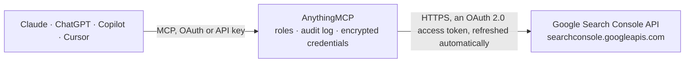

<!-- Generated by scripts/export-github-catalog.mjs in the anythingmcp-website repository. Do not edit by hand. -->

# Google Search Console MCP connector

Google Search Console for AI agents: search performance (queries, pages, countries, devices, clicks, impressions, CTR, position), URL inspection, sitemaps and properties, plus a built-in SEO playbook. 11 tools, OAuth2. The AnythingMCP connector gives Claude, ChatGPT, Microsoft Copilot, Cursor and Gemini 11 MCP tools for Google Search Console: 7 read and 4 can change data.

**Category:** [Analytics](../analytics.md) · **Tools:** 11 · **Setup guide:** [anythingmcp.com](https://anythingmcp.com/guides/google-search-console-to-mcp) · [Deutsch](https://anythingmcp.com/de/guides/google-search-console-to-mcp) · [Italiano](https://anythingmcp.com/it/guides/google-search-console-to-mcp) · [Español](https://anythingmcp.com/es/guides/google-search-console-to-mcp) · [日本語](https://anythingmcp.com/ja/guides/google-search-console-to-mcp) · [Русский](https://anythingmcp.com/ru/guides/google-search-console-to-mcp) · [中文](https://anythingmcp.com/zh/guides/google-search-console-to-mcp)

## Start without code

No installation and no terminal: AnythingMCP Cloud runs the Google Search Console connector for you, operated by helpcode.ai in Frankfurt, Germany.

1. **Click the button above** and create an account or sign in. The Google Search Console connector opens, ready to install.
2. **Sign in with your Google Search Console account** when AnythingMCP asks. The first time, an admin creates a small app in the Google Cloud console. Every click is in the [step-by-step guide](https://anythingmcp.com/guides/google-search-console-to-mcp).
3. **Click Install.** AnythingMCP shows the address of your MCP server.
4. **Add that address to your assistant:** [Claude](https://anythingmcp.com/guides/connect-google-search-console-to-claude) · [ChatGPT](https://anythingmcp.com/guides/connect-google-search-console-to-chatgpt) · [Microsoft Copilot](https://anythingmcp.com/guides/connect-google-search-console-to-copilot) · [Cursor](https://anythingmcp.com/guides/connect-google-search-console-to-cursor) · [Gemini CLI](https://anythingmcp.com/guides/connect-google-search-console-to-gemini) · [Meta Muse](https://anythingmcp.com/guides/connect-google-search-console-to-muse).
5. **Ask your first question**, for example: *Do we have access to the Search Console property https://shop-zenith.io/ and what's our permission level?*

Prefer help with the setup? [Talk to us](https://anythingmcp.com/contact).

## How it works

- **The AI client** speaks MCP (Streamable HTTP) to AnythingMCP and only sees tool names, descriptions and results. It never gets the Google Search Console credentials.
- **AnythingMCP** checks the client's role, builds the call from the tool definition, adds the credentials (an OAuth 2.0 access token, refreshed automatically), calls Google Search Console, logs the call and returns the result.
- **Google Search Console** sees an ordinary API client with the rights of the account the credentials belong to.

## Tools

| Tool | What it does | Access |
|---|---|---|
| [`gsc_seo_playbook`](#gsc_seo_playbook) | START HERE for any SEO analysis: returns, with NO API call, the ordered steps and exact request bodies for an overview, period comparison, traffic-drop… | read |
| [`gsc_list_sites`](#gsc_list_sites) | List every Search Console property the authorised Google account can see, with its permission level (siteOwner, siteFullUser, siteRestrictedUser,… | read |
| [`gsc_get_site`](#gsc_get_site) | Get one Search Console property and the authorised account's permission level on it. | read |
| [`gsc_query_search_analytics`](#gsc_query_search_analytics) | Query Google Search performance data (clicks, impressions, ctr, average position) for a property, grouped by any of query, page, country, device,… | read |
| [`gsc_inspect_url`](#gsc_inspect_url) | Inspect how Google sees one URL: index verdict, coverage state (indexed, crawled or discovered but not indexed, excluded by noindex, canonical issues), last… | read |
| [`gsc_list_sitemaps`](#gsc_list_sitemaps) | List the sitemaps submitted for a property: path, last submitted and last downloaded times, pending state, sitemap-index flag, error and warning counts, and… | read |
| [`gsc_get_sitemap`](#gsc_get_sitemap) | Get the status of one submitted sitemap: last submitted and downloaded, pending, errors, warnings and submitted URL counts per content type. | read |
| [`gsc_submit_sitemap`](#gsc_submit_sitemap) | Submit (or resubmit) a sitemap for a property so Google fetches it. | write |
| [`gsc_delete_sitemap`](#gsc_delete_sitemap) | Remove a sitemap from a property's sitemap report. | write |
| [`gsc_add_site`](#gsc_add_site) | Add a property to the authorised account's Search Console. | write |
| [`gsc_remove_site`](#gsc_remove_site) | Remove a property from the authorised account's Search Console list. | write |

## Tool reference

Every parameter as the AI client sees it in `tools/list`. Source: [`packages/backend/src/adapters/intl/google-search-console.json`](../../../packages/backend/src/adapters/intl/google-search-console.json).

### `gsc_seo_playbook`

START HERE for any SEO analysis: returns, with NO API call, the ordered steps and exact request bodies for an overview, period comparison, traffic-drop diagnosis, striking-distance keywords, CTR opportunities, cannibalisation, brand vs non-brand, segments, trends, indexing checks and sitemap health.

**Access:** read · **Call:** `static /`

No parameters.

### `gsc_list_sites`

List every Search Console property the authorised Google account can see, with its permission level (siteOwner, siteFullUser, siteRestrictedUser, siteUnverifiedUser). Call this first: every other tool needs a siteUrl exactly as returned here.

**Access:** read · **Call:** `GET /webmasters/v3/sites`

No parameters.

### `gsc_get_site`

Get one Search Console property and the authorised account's permission level on it. Useful to confirm access before running reports, or to check whether a property is verified.

**Access:** read · **Call:** `GET /webmasters/v3/sites/{site_url}`

| Parameter | Type | Required | Description |
|---|---|---|---|
| `site_url` | string | yes | The property exactly as gsc_list_sites returns it: a URL-prefix property with protocol and trailing slash ('https://www.example.com/') or a domain property ('sc-domain:example.com'). Pass it raw, not URL-encoded. |

### `gsc_query_search_analytics`

Query Google Search performance data (clicks, impressions, ctr, average position) for a property, grouped by any of query, page, country, device, searchAppearance, date or hour, with filters. Read-only. Rows are sorted by clicks descending; max 25,000 rows per call (page with startRow). See gsc_seo_playbook for ready-made request bodies.

**Access:** read · **Call:** `POST /webmasters/v3/sites/{site_url}/searchAnalytics/query`

| Parameter | Type | Required | Description |
|---|---|---|---|
| `site_url` | string | yes | The property exactly as gsc_list_sites returns it: a URL-prefix property with protocol and trailing slash ('https://www.example.com/') or a domain property ('sc-domain:example.com'). Pass it raw, not URL-encoded. |
| `startDate` | string | yes | First day, YYYY-MM-DD, Pacific Time. Up to 16 months back. |
| `endDate` | string | yes | Last day, YYYY-MM-DD, Pacific Time, inclusive. |
| `dimensions` | `query` \| `page` \| `country` \| `device` \| `searchAppearance` \| `date` \| `hour`[] | no | Group rows by these dimensions, in this order (each row's `keys` follow it). Omit for a single totals row. |
| `type` | `web` \| `image` \| `video` \| `news` \| `discover` \| `googleNews` | no | Search type. Default web. discover and googleNews have no query dimension and no position. |
| `dimensionFilterGroups` | object[] | no | Filters, e.g. [{"groupType":"and","filters":[{"dimension":"country","operator":"equals","expression":"ita"},{"dimension":"page","operator":"contains","expression":"/blog/"}]}]. Operators: equals, notEquals, contains, notContains, includingRegex, excludingRegex (RE2). |
| `aggregationType` | `auto` \| `byPage` \| `byProperty` | no | How impressions are counted: byProperty (once per property per search) or byPage (once per URL). Default auto: byPage when grouping or filtering by page, else byProperty. |
| `rowLimit` | integer | no | Rows to return, 1-25000. Default 1000. |
| `startRow` | integer | no | Zero-based offset for paging past rowLimit. Default 0. |
| `dataState` | `final` \| `all` \| `hourly_all` | no | final = finalised days only (default); all = include the last, still incomplete days (as the Search Console UI does); hourly_all = required with the hour dimension. |

### `gsc_inspect_url`

Inspect how Google sees one URL: index verdict, coverage state (indexed, crawled or discovered but not indexed, excluded by noindex, canonical issues), last crawl, Google-selected vs declared canonical, robots.txt and fetch state, rich results. Read-only; does not request indexing. Quota 2,000/day and 600/min per property.

**Access:** read · **Call:** `POST /v1/urlInspection/index:inspect`

| Parameter | Type | Required | Description |
|---|---|---|---|
| `site_url` | string | yes | The property exactly as gsc_list_sites returns it: a URL-prefix property with protocol and trailing slash ('https://www.example.com/') or a domain property ('sc-domain:example.com'). Pass it raw, not URL-encoded. |
| `inspectionUrl` | string | yes | Full URL to inspect. Must belong to the property, e.g. 'https://www.example.com/blog/post'. |
| `languageCode` | string | no | IETF language tag for the human-readable fields, e.g. 'en-US', 'it-IT', 'de-DE'. Default en-US. coverageState is translated too ('Inviata e indicizzata'), so keep the default when grouping or matching states across URLs. |

### `gsc_list_sitemaps`

List the sitemaps submitted for a property: path, last submitted and last downloaded times, pending state, sitemap-index flag, error and warning counts, and submitted URL counts per content type. Pass sitemapIndex to list the children of a sitemap index.

**Access:** read · **Call:** `GET /webmasters/v3/sites/{site_url}/sitemaps`

| Parameter | Type | Required | Description |
|---|---|---|---|
| `site_url` | string | yes | The property exactly as gsc_list_sites returns it: a URL-prefix property with protocol and trailing slash ('https://www.example.com/') or a domain property ('sc-domain:example.com'). Pass it raw, not URL-encoded. |
| `sitemapIndex` | string | no | Full URL of a sitemap index; returns only the sitemaps it contains. |

### `gsc_get_sitemap`

Get the status of one submitted sitemap: last submitted and downloaded, pending, errors, warnings and submitted URL counts per content type.

**Access:** read · **Call:** `GET /webmasters/v3/sites/{site_url}/sitemaps/{feedpath}`

| Parameter | Type | Required | Description |
|---|---|---|---|
| `site_url` | string | yes | The property exactly as gsc_list_sites returns it: a URL-prefix property with protocol and trailing slash ('https://www.example.com/') or a domain property ('sc-domain:example.com'). Pass it raw, not URL-encoded. |
| `feedpath` | string | yes | Full URL of the sitemap, e.g. 'https://www.example.com/sitemap.xml'. Pass it raw, not URL-encoded. |

### `gsc_submit_sitemap`

Submit (or resubmit) a sitemap for a property so Google fetches it. Requires the read-write webmasters scope and owner or full-user permission. Returns an empty body on success; check with gsc_get_sitemap.

**Access:** write · **Call:** `PUT /webmasters/v3/sites/{site_url}/sitemaps/{feedpath}`

| Parameter | Type | Required | Description |
|---|---|---|---|
| `site_url` | string | yes | The property exactly as gsc_list_sites returns it: a URL-prefix property with protocol and trailing slash ('https://www.example.com/') or a domain property ('sc-domain:example.com'). Pass it raw, not URL-encoded. |
| `feedpath` | string | yes | Full URL of the sitemap, e.g. 'https://www.example.com/sitemap.xml'. It must be on the property. |

### `gsc_delete_sitemap`

Remove a sitemap from a property's sitemap report. Google stops reading it from Search Console, but it does not deindex any URL. Requires the read-write scope. Ask the user before calling.

**Access:** write · **Call:** `DELETE /webmasters/v3/sites/{site_url}/sitemaps/{feedpath}`

| Parameter | Type | Required | Description |
|---|---|---|---|
| `site_url` | string | yes | The property exactly as gsc_list_sites returns it: a URL-prefix property with protocol and trailing slash ('https://www.example.com/') or a domain property ('sc-domain:example.com'). Pass it raw, not URL-encoded. |
| `feedpath` | string | yes | Full URL of the sitemap to remove, as listed by gsc_list_sitemaps. |

### `gsc_add_site`

Add a property to the authorised account's Search Console. It is added unverified (siteUnverifiedUser); ownership must then be verified in the Search Console UI before any data is available. Requires the read-write scope.

**Access:** write · **Call:** `PUT /webmasters/v3/sites/{site_url}`

| Parameter | Type | Required | Description |
|---|---|---|---|
| `site_url` | string | yes | Property to add: 'https://www.example.com/' (URL prefix, trailing slash) or 'sc-domain:example.com' (domain property). |

### `gsc_remove_site`

Remove a property from the authorised account's Search Console list. The account loses access to its reports until it is added and verified again. Requires the read-write scope. Always confirm with the user first.

**Access:** write · **Call:** `DELETE /webmasters/v3/sites/{site_url}`

| Parameter | Type | Required | Description |
|---|---|---|---|
| `site_url` | string | yes | The property exactly as gsc_list_sites returns it: a URL-prefix property with protocol and trailing slash ('https://www.example.com/') or a domain property ('sc-domain:example.com'). Pass it raw, not URL-encoded. |

## Run it yourself

AnythingMCP is open source (AGPL-3.0). [Run it with Docker](../../../README.md#run-it-yourself), open **Connectors → Store**, pick **Google Search Console** and enter `GOOGLE_CLIENT_ID`, `GOOGLE_CLIENT_SECRET`, then add your MCP server URL to the AI client.

[← Analytics connectors](../analytics.md) · [All categories](../README.md)
