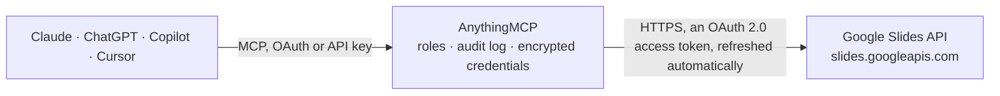

<!-- Generated by scripts/export-github-catalog.mjs in the anythingmcp-website repository. Do not edit by hand. -->

# Google Slides MCP connector

Let your AI work with Google Slides: read a presentation as text slide by slide with speaker notes, see slides as images, create presentations, add, copy and reorder slides, fill templates, insert … The AnythingMCP connector gives Claude, ChatGPT, Microsoft Copilot, Cursor and Gemini 13 MCP tools for Google Slides: 3 read and 10 can change data.

**Category:** [Productivity](../productivity.md) · **Tools:** 13 · **Setup guide:** [anythingmcp.com](https://anythingmcp.com/guides/google-slides-to-mcp) · [Deutsch](https://anythingmcp.com/de/guides/google-slides-to-mcp) · [Italiano](https://anythingmcp.com/it/guides/google-slides-to-mcp) · [Español](https://anythingmcp.com/es/guides/google-slides-to-mcp) · [日本語](https://anythingmcp.com/ja/guides/google-slides-to-mcp) · [Русский](https://anythingmcp.com/ru/guides/google-slides-to-mcp) · [中文](https://anythingmcp.com/zh/guides/google-slides-to-mcp)

## Start without code

No installation and no terminal: AnythingMCP Cloud runs the Google Slides connector for you, operated by helpcode.ai in Frankfurt, Germany.

1. **Click the button above** and create an account or sign in. The Google Slides connector opens, ready to install.
2. **Sign in with your Google Slides account** when AnythingMCP asks. The first time, an admin creates a small app in the Google Cloud console. Every click is in the [step-by-step guide](https://anythingmcp.com/guides/google-slides-to-mcp).
3. **Click Install.** AnythingMCP shows the address of your MCP server.
4. **Add that address to your assistant:** [Claude](https://anythingmcp.com/guides/connect-google-slides-to-claude) · [ChatGPT](https://anythingmcp.com/guides/connect-google-slides-to-chatgpt) · [Microsoft Copilot](https://anythingmcp.com/guides/connect-google-slides-to-copilot) · [Cursor](https://anythingmcp.com/guides/connect-google-slides-to-cursor) · [Gemini CLI](https://anythingmcp.com/guides/connect-google-slides-to-gemini) · [Meta Muse](https://anythingmcp.com/guides/connect-google-slides-to-muse).
5. **Ask your first question**, for example: *Show slides and speaker notes for presentation 'Q3 LuminaWorks Pitch' slides 2 and 3 — presentation id 1aBcD_ProjQ3Pitch*

Prefer help with the setup? [Talk to us](https://anythingmcp.com/contact).

## How it works

- **The AI client** speaks MCP (Streamable HTTP) to AnythingMCP and only sees tool names, descriptions and results. It never gets the Google Slides credentials.
- **AnythingMCP** checks the client's role, builds the call from the tool definition, adds the credentials (an OAuth 2.0 access token, refreshed automatically), calls Google Slides, logs the call and returns the result.
- **Google Slides** sees an ordinary API client with the rights of the account the credentials belong to.

## Tools

| Tool | What it does | Access |
|---|---|---|
| [`google_slides_get_presentation`](#google_slides_get_presentation) | Read a Google Slides presentation as text, slide by slide: for each slide its objectId, layout, every element with objectId, type (TITLE, BODY, SUBTITLE,… | read |
| [`google_slides_get_page`](#google_slides_get_page) | Read one slide (or a layout or master page) in detail: each element's objectId, type, placeholder index, text, size and transform (position, in EMU: 12,700… | read |
| [`google_slides_get_page_thumbnail`](#google_slides_get_page_thumbnail) | Render a slide as a PNG and get a link to it: width, height and contentUrl. | read |
| [`google_slides_create_presentation`](#google_slides_create_presentation) | Create a new presentation with a title, in the root of the user's My Drive. | write |
| [`google_slides_add_slide`](#google_slides_add_slide) | Add a slide with a predefined layout of the deck's theme (TITLE_AND_BODY by default), at a position or at the end. | write |
| [`google_slides_duplicate_object`](#google_slides_duplicate_object) | Duplicate a slide (the copy goes right after it) or an element (the copy lands on the same slide, in the same position). | write |
| [`google_slides_move_slides`](#google_slides_move_slides) | Move one or more slides to a new position, keeping their order. | write |
| [`google_slides_insert_text`](#google_slides_insert_text) | Insert text into a shape: a placeholder (title, body), a text box, or the speaker notes (use the slide's notesObjectId). | write |
| [`google_slides_add_text_box`](#google_slides_add_text_box) | Add a text box with text to a slide, at a position and size in points (a 16:9 slide is 720 x 405 pt, a 4:3 one 720 x 540 pt). | write |
| [`google_slides_replace_all_text`](#google_slides_replace_all_text) | Replace every occurrence of a text in the presentation (or only on the given slides) with another text, keeping the formatting; an empty replace_with… | write |
| [`google_slides_create_image`](#google_slides_create_image) | Place an image from a public URL on a slide. | write |
| [`google_slides_delete_object`](#google_slides_delete_object) | Delete a slide or an element (shape, image, table, group) by its objectId. | write |
| [`google_slides_batch_update`](#google_slides_batch_update) | Run Slides API batchUpdate requests for edits the other tools do not cover: styling text (updateTextStyle, updateParagraphStyle), deleting text… | write |

## Tool reference

Every parameter as the AI client sees it in `tools/list`. Source: [`packages/backend/src/adapters/intl/google-slides.json`](../../../packages/backend/src/adapters/intl/google-slides.json).

### `google_slides_get_presentation`

Read a Google Slides presentation as text, slide by slide: for each slide its objectId, layout, every element with objectId, type (TITLE, BODY, SUBTITLE, TEXT_BOX, TABLE, IMAGE...) and text, and the speaker notes with notesObjectId. Also title, revisionId, page size and the deck's layouts. Formatting is left out; output over 200 KB is cut.

**Access:** read · **Call:** `GET /presentations/{presentation_id}`

| Parameter | Type | Required | Description |
|---|---|---|---|
| `presentation_id` | string | yes | Presentation id, the long string in its link: https://docs.google.com/presentation/d/<id>/edit. |

### `google_slides_get_page`

Read one slide (or a layout or master page) in detail: each element's objectId, type, placeholder index, text, size and transform (position, in EMU: 12,700 EMU = 1 pt), alt text, table size, image source URL, plus the speaker notes. Use it to find the placeholder ids of a new slide or where to place an element.

**Access:** read · **Call:** `GET /presentations/{presentation_id}/pages/{page_id}`

| Parameter | Type | Required | Description |
|---|---|---|---|
| `presentation_id` | string | yes | Presentation id, the long string in its link: https://docs.google.com/presentation/d/<id>/edit. |
| `page_id` | string | yes | The slide's objectId, from google_slides_get_presentation or the reply of google_slides_add_slide. |

### `google_slides_get_page_thumbnail`

Render a slide as a PNG and get a link to it: width, height and contentUrl. The link works without signing in for about 30 minutes, so show or share it right away. Counts as an expensive read (60 per minute per user).

**Access:** read · **Call:** `GET /presentations/{presentation_id}/pages/{page_id}/thumbnail`

| Parameter | Type | Required | Description |
|---|---|---|---|
| `presentation_id` | string | yes | Presentation id, the long string in its link: https://docs.google.com/presentation/d/<id>/edit. |
| `page_id` | string | yes | The slide's objectId. |
| `size` | `SMALL` \| `MEDIUM` \| `LARGE` | no | Image width: SMALL 200 px, MEDIUM 800 px (default), LARGE 1600 px. |

### `google_slides_create_presentation`

Create a new presentation with a title, in the root of the user's My Drive. It starts with one title slide; the reply lists its slide and placeholder objectIds, ready for google_slides_insert_text. The link is https://docs.google.com/presentation/d/<presentationId>/edit. Confirm the change with the user before calling.

**Access:** write · **Call:** `POST /presentations`

| Parameter | Type | Required | Description |
|---|---|---|---|
| `title` | string | yes | Title of the new presentation. |

### `google_slides_add_slide`

Add a slide with a predefined layout of the deck's theme (TITLE_AND_BODY by default), at a position or at the end. Returns replies[0].createSlide.objectId; read it with google_slides_get_page to get the placeholder ids, then fill them with google_slides_insert_text. Confirm the change with the user before calling.

**Access:** write · **Call:** `POST /presentations/{presentation_id}:batchUpdate`

| Parameter | Type | Required | Description |
|---|---|---|---|
| `presentation_id` | string | yes | Presentation id, the long string in its link: https://docs.google.com/presentation/d/<id>/edit. |
| `layout` | `BLANK` \| `CAPTION_ONLY` \| `TITLE` \| `TITLE_AND_BODY` \| `TITLE_AND_TWO_COLUMNS` \| `TITLE_ONLY` \| `SECTION_HEADER` \| `SECTION_TITLE_AND_DESCRIPTION` \| `ONE_COLUMN_TEXT` \| `MAIN_POINT` \| `BIG_NUMBER` | no | Predefined layout. A theme that lacks it answers 400; then try another one or BLANK. |
| `insertion_index` | integer | no | 0-based position of the new slide; omit to add it at the end. |
| `object_id` | string | no | Optional objectId for the new slide (5 to 50 characters, starting with a letter, digit or underscore, then letters, digits, _, - or :; unique in the presentation); generated when omitted. |

### `google_slides_duplicate_object`

Duplicate a slide (the copy goes right after it) or an element (the copy lands on the same slide, in the same position). Returns replies[0].duplicateObject.objectId. Good for building slides from a template slide, then google_slides_replace_all_text with page_ids limited to the copy. Confirm the change with the user before calling.

**Access:** write · **Call:** `POST /presentations/{presentation_id}:batchUpdate`

| Parameter | Type | Required | Description |
|---|---|---|---|
| `presentation_id` | string | yes | Presentation id, the long string in its link: https://docs.google.com/presentation/d/<id>/edit. |
| `object_id` | string | yes | objectId of the slide or element to copy. |

### `google_slides_move_slides`

Move one or more slides to a new position, keeping their order. insertion_index is the 0-based position in the deck as it is before the move. Confirm the change with the user before calling.

**Access:** write · **Call:** `POST /presentations/{presentation_id}:batchUpdate`

| Parameter | Type | Required | Description |
|---|---|---|---|
| `presentation_id` | string | yes | Presentation id, the long string in its link: https://docs.google.com/presentation/d/<id>/edit. |
| `slide_ids` | string[] | yes | objectIds of the slides to move, in the order they should end up. |
| `insertion_index` | integer | yes | Where to put them, 0 for the start. |

### `google_slides_insert_text`

Insert text into a shape: a placeholder (title, body), a text box, or the speaker notes (use the slide's notesObjectId). The text goes at insertion_index, the start by default, which is right for an empty placeholder. To change existing words use google_slides_replace_all_text. Confirm the change with the user before calling.

**Access:** write · **Call:** `POST /presentations/{presentation_id}:batchUpdate`

| Parameter | Type | Required | Description |
|---|---|---|---|
| `presentation_id` | string | yes | Presentation id, the long string in its link: https://docs.google.com/presentation/d/<id>/edit. |
| `object_id` | string | yes | objectId of the shape, from google_slides_get_presentation or google_slides_get_page. |
| `text` | string | yes | Text to insert; \n starts a new paragraph (a new bullet in a body placeholder). |
| `insertion_index` | integer | no | Position in the shape's text, in UTF-16 code units; omit for the start. |

### `google_slides_add_text_box`

Add a text box with text to a slide, at a position and size in points (a 16:9 slide is 720 x 405 pt, a 4:3 one 720 x 540 pt). You choose the new box's objectId, so it can be edited later. Confirm the change with the user before calling.

**Access:** write · **Call:** `POST /presentations/{presentation_id}:batchUpdate`

| Parameter | Type | Required | Description |
|---|---|---|---|
| `presentation_id` | string | yes | Presentation id, the long string in its link: https://docs.google.com/presentation/d/<id>/edit. |
| `slide_id` | string | yes | objectId of the slide. |
| `object_id` | string | yes | objectId for the new text box (5 to 50 characters, starting with a letter, digit or underscore, then letters, digits, _, - or :; unique in the presentation), e.g. textbox_q3_summary. |
| `text` | string | yes | Text of the box; \n starts a new paragraph. |
| `x_pt` | number | no | Distance from the slide's left edge, in points (default 50). |
| `y_pt` | number | no | Distance from the slide's top edge, in points (default 50). |
| `width_pt` | number | no | Width in points (default 400). |
| `height_pt` | number | no | Height in points (default 100). |

### `google_slides_replace_all_text`

Replace every occurrence of a text in the presentation (or only on the given slides) with another text, keeping the formatting; an empty replace_with deletes them. Returns replies[0].replaceAllText.occurrencesChanged. The reliable way to fill templates such as [Customer name]. Confirm the change with the user before calling.

**Access:** write · **Call:** `POST /presentations/{presentation_id}:batchUpdate`

| Parameter | Type | Required | Description |
|---|---|---|---|
| `presentation_id` | string | yes | Presentation id, the long string in its link: https://docs.google.com/presentation/d/<id>/edit. |
| `find` | string | yes | Text to search for (literal, not a pattern). |
| `replace_with` | string | yes | Replacement text; "" deletes every occurrence. |
| `match_case` | boolean | no | true for a case-sensitive match (default false). |
| `page_ids` | string[] | no | Optional slide objectIds to limit the replacement to; all slides when omitted. |

### `google_slides_create_image`

Place an image from a public URL on a slide. Google fetches the image once and keeps a copy: PNG, JPEG or GIF, under 50 MB and 25 megapixels, URL up to 2 KB and reachable without sign-in. The image keeps its aspect ratio inside the given box. Returns replies[0].createImage.objectId. Confirm the change with the user before calling.

**Access:** write · **Call:** `POST /presentations/{presentation_id}:batchUpdate`

| Parameter | Type | Required | Description |
|---|---|---|---|
| `presentation_id` | string | yes | Presentation id, the long string in its link: https://docs.google.com/presentation/d/<id>/edit. |
| `slide_id` | string | yes | objectId of the slide. |
| `url` | string | yes | Public https URL of the image. |
| `x_pt` | number | no | Distance from the slide's left edge, in points (default 50). |
| `y_pt` | number | no | Distance from the slide's top edge, in points (default 50). |
| `width_pt` | number | no | Width of the box in points (default 300). |
| `height_pt` | number | no | Height of the box in points (default 200). |
| `object_id` | string | no | Optional objectId for the image (5 to 50 characters, starting with a letter, digit or underscore, then letters, digits, _, - or :; unique in the presentation). |

### `google_slides_delete_object`

Delete a slide or an element (shape, image, table, group) by its objectId. Cannot be undone through the API; the version history in Google Slides still has it. Always confirm with the user first. Installed switched off.

**Access:** write · **Call:** `POST /presentations/{presentation_id}:batchUpdate`

| Parameter | Type | Required | Description |
|---|---|---|---|
| `presentation_id` | string | yes | Presentation id, the long string in its link: https://docs.google.com/presentation/d/<id>/edit. |
| `object_id` | string | yes | objectId of the slide or element to delete. |

### `google_slides_batch_update`

Run Slides API batchUpdate requests for edits the other tools do not cover: styling text (updateTextStyle, updateParagraphStyle), deleting text (deleteText), tables, shapes, replacing shapes with images (replaceAllShapesWithImage), a custom layout (createSlide with layoutId), speaker notes. Requests run in order and atomically. Always confirm with the user first. Installed switched off.

**Access:** write · **Call:** `POST /presentations/{presentation_id}:batchUpdate`

| Parameter | Type | Required | Description |
|---|---|---|---|
| `presentation_id` | string | yes | Presentation id, the long string in its link: https://docs.google.com/presentation/d/<id>/edit. |
| `requests` | object[] | yes | Slides API Request objects, e.g. [{"updateTextStyle": {"objectId": "g1_0", "textRange": {"type": "ALL"}, "style": {"bold": true}, "fields": "bold"}}]. |
| `write_control` | object | no | Optional {"requiredRevisionId": "<revisionId>"} to fail if the presentation changed since it was read. |

## Run it yourself

AnythingMCP is open source (AGPL-3.0). [Run it with Docker](../../../README.md#run-it-yourself), open **Connectors → Store**, pick **Google Slides** and enter `GOOGLE_CLIENT_ID`, `GOOGLE_CLIENT_SECRET`, then add your MCP server URL to the AI client.

[← Productivity connectors](../productivity.md) · [All categories](../README.md)
