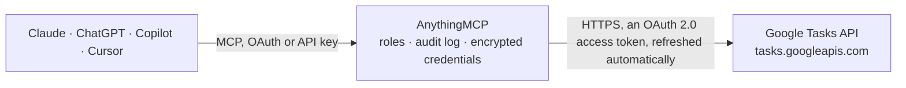

<!-- Generated by scripts/export-github-catalog.mjs in the anythingmcp-website repository. Do not edit by hand. -->

# Google Tasks MCP connector

Let your AI manage Google Tasks: see your task lists and what is open or due, add tasks and subtasks with due dates, update, complete and reorder them or move them to another list. The AnythingMCP connector gives Claude, ChatGPT, Microsoft Copilot, Cursor and Gemini 9 MCP tools for Google Tasks: 3 read and 6 can change data.

**Category:** [Productivity](../productivity.md) · **Tools:** 9 · **Setup guide:** [anythingmcp.com](https://anythingmcp.com/guides/google-tasks-to-mcp) · [Deutsch](https://anythingmcp.com/de/guides/google-tasks-to-mcp) · [Italiano](https://anythingmcp.com/it/guides/google-tasks-to-mcp) · [Español](https://anythingmcp.com/es/guides/google-tasks-to-mcp) · [日本語](https://anythingmcp.com/ja/guides/google-tasks-to-mcp) · [Русский](https://anythingmcp.com/ru/guides/google-tasks-to-mcp) · [中文](https://anythingmcp.com/zh/guides/google-tasks-to-mcp)

## Start without code

No installation and no terminal: AnythingMCP Cloud runs the Google Tasks connector for you, operated by helpcode.ai in Frankfurt, Germany.

1. **Click the button above** and create an account or sign in. The Google Tasks connector opens, ready to install.
2. **Sign in with your Google Tasks account** when AnythingMCP asks. The first time, an admin creates a small app in the Google Cloud console. Every click is in the [step-by-step guide](https://anythingmcp.com/guides/google-tasks-to-mcp).
3. **Click Install.** AnythingMCP shows the address of your MCP server.
4. **Add that address to your assistant:** [Claude](https://anythingmcp.com/guides/connect-google-tasks-to-claude) · [ChatGPT](https://anythingmcp.com/guides/connect-google-tasks-to-chatgpt) · [Microsoft Copilot](https://anythingmcp.com/guides/connect-google-tasks-to-copilot) · [Cursor](https://anythingmcp.com/guides/connect-google-tasks-to-cursor) · [Gemini CLI](https://anythingmcp.com/guides/connect-google-tasks-to-gemini) · [Meta Muse](https://anythingmcp.com/guides/connect-google-tasks-to-muse).
5. **Ask your first question**, for example: *Show task about invoice INV-2026-038 for client Valo Energia in My Tasks list.*

Prefer help with the setup? [Talk to us](https://anythingmcp.com/contact).

## How it works

- **The AI client** speaks MCP (Streamable HTTP) to AnythingMCP and only sees tool names, descriptions and results. It never gets the Google Tasks credentials.
- **AnythingMCP** checks the client's role, builds the call from the tool definition, adds the credentials (an OAuth 2.0 access token, refreshed automatically), calls Google Tasks, logs the call and returns the result.
- **Google Tasks** sees an ordinary API client with the rights of the account the credentials belong to.

## Tools

| Tool | What it does | Access |
|---|---|---|
| [`gtasks_list_tasklists`](#gtasks_list_tasklists) | List the user's task lists with id, title and updated time. | read |
| [`gtasks_create_tasklist`](#gtasks_create_tasklist) | Create a new task list with a title. | write |
| [`gtasks_list_tasks`](#gtasks_list_tasks) | List the tasks of one list with id, title, notes, status (needsAction or completed), due date, completed time, parent (for subtasks) and position. | read |
| [`gtasks_get_task`](#gtasks_get_task) | Get one task with title, notes, status, due date, completed time, parent, position, links and webViewLink. | read |
| [`gtasks_create_task`](#gtasks_create_task) | Create a task in a list, at the top by default; with parent it becomes a subtask, with previous it goes after that sibling. | write |
| [`gtasks_update_task`](#gtasks_update_task) | Change a task: only the fields given are changed. | write |
| [`gtasks_complete_task`](#gtasks_complete_task) | Mark a task as completed (Google sets the completed time). | write |
| [`gtasks_move_task`](#gtasks_move_task) | Move a task: make it a subtask (parent), reorder it after a sibling (previous), move it to the top level (neither), or to another list… | write |
| [`gtasks_delete_task`](#gtasks_delete_task) | Delete a task (its subtasks go with it). | write |

## Tool reference

Every parameter as the AI client sees it in `tools/list`. Source: [`packages/backend/src/adapters/intl/google-tasks.json`](../../../packages/backend/src/adapters/intl/google-tasks.json).

### `gtasks_list_tasklists`

List the user's task lists with id, title and updated time. The first one is usually "My Tasks", also reachable as "@default". Paginate with page_token = nextPageToken.

**Access:** read · **Call:** `GET /users/@me/lists`

| Parameter | Type | Required | Description |
|---|---|---|---|
| `max_results` | integer | no | Task lists per page, 1 to 1000 (default 1000). |
| `page_token` | string | no | nextPageToken from the previous response. |

### `gtasks_create_tasklist`

Create a new task list with a title. Returns its id, which tasks can then be created in. Google allows up to 2,000 lists per user.

**Access:** write · **Call:** `POST /users/@me/lists`

| Parameter | Type | Required | Description |
|---|---|---|---|
| `title` | string | yes | Name of the new list. |

### `gtasks_list_tasks`

List the tasks of one list with id, title, notes, status (needsAction or completed), due date, completed time, parent (for subtasks) and position. Filter by due or completion dates; open and completed tasks are both returned unless show_completed is false. Paginate with page_token = nextPageToken.

**Access:** read · **Call:** `GET /lists/{tasklist_id}/tasks`

| Parameter | Type | Required | Description |
|---|---|---|---|
| `tasklist_id` | string | yes | Task list id from gtasks_list_tasklists; "@default" is the user's default list ("My Tasks"). |
| `show_completed` | boolean | no | false to return only open tasks (default true). |
| `show_hidden` | boolean | no | true to include hidden tasks: tasks completed in the Google apps are hidden, so set this with show_completed to see them. |
| `show_deleted` | boolean | no | true to include deleted tasks. |
| `show_assigned` | boolean | no | true to include tasks assigned to the user from Google Docs or Chat spaces. |
| `due_min` | string | no | Only tasks due on or after this RFC 3339 time, e.g. 2026-10-01T00:00:00Z. |
| `due_max` | string | no | Only tasks due before this RFC 3339 time. |
| `completed_min` | string | no | Only tasks completed on or after this RFC 3339 time (implies completed tasks). |
| `completed_max` | string | no | Only tasks completed before this RFC 3339 time. |
| `updated_min` | string | no | Only tasks changed after this RFC 3339 time. |
| `max_results` | integer | no | Tasks per page, 1 to 100 (default 20). |
| `page_token` | string | no | nextPageToken from the previous response, with the same other arguments. |

### `gtasks_get_task`

Get one task with title, notes, status, due date, completed time, parent, position, links and webViewLink.

**Access:** read · **Call:** `GET /lists/{tasklist_id}/tasks/{task_id}`

| Parameter | Type | Required | Description |
|---|---|---|---|
| `tasklist_id` | string | yes | Task list id from gtasks_list_tasklists; "@default" is the user's default list ("My Tasks"). |
| `task_id` | string | yes | Task id from gtasks_list_tasks. |

### `gtasks_create_task`

Create a task in a list, at the top by default; with parent it becomes a subtask, with previous it goes after that sibling. Returns the task with its id.

**Access:** write · **Call:** `POST /lists/{tasklist_id}/tasks`

| Parameter | Type | Required | Description |
|---|---|---|---|
| `tasklist_id` | string | yes | Task list id from gtasks_list_tasklists; "@default" is the user's default list ("My Tasks"). |
| `title` | string | yes | Title of the task (up to 1,024 characters). |
| `notes` | string | no | Details (up to 8,192 characters). |
| `due` | string | no | Due date as RFC 3339, e.g. "2026-10-15T00:00:00.000Z". Google keeps only the date; a time of day is dropped. |
| `parent` | string | no | Id of the parent task, to create a subtask. |
| `previous` | string | no | Id of the sibling task the new task should follow (default: first position). |

### `gtasks_update_task`

Change a task: only the fields given are changed. status "completed" marks it done, "needsAction" reopens it. Returns the updated task.

**Access:** write · **Call:** `PATCH /lists/{tasklist_id}/tasks/{task_id}`

| Parameter | Type | Required | Description |
|---|---|---|---|
| `tasklist_id` | string | yes | Task list id from gtasks_list_tasklists; "@default" is the user's default list ("My Tasks"). |
| `task_id` | string | yes | Task id from gtasks_list_tasks. |
| `title` | string | no | New title. |
| `notes` | string | no | New details; replaces the current notes. |
| `due` | string | no | Due date as RFC 3339, e.g. "2026-10-15T00:00:00.000Z". Google keeps only the date; a time of day is dropped. |
| `status` | `needsAction` \| `completed` | no | "needsAction" (open) or "completed". |

### `gtasks_complete_task`

Mark a task as completed (Google sets the completed time). Undo with gtasks_update_task and status "needsAction". Returns the updated task.

**Access:** write · **Call:** `PATCH /lists/{tasklist_id}/tasks/{task_id}`

| Parameter | Type | Required | Description |
|---|---|---|---|
| `tasklist_id` | string | yes | Task list id from gtasks_list_tasklists; "@default" is the user's default list ("My Tasks"). |
| `task_id` | string | yes | Task id from gtasks_list_tasks. |

### `gtasks_move_task`

Move a task: make it a subtask (parent), reorder it after a sibling (previous), move it to the top level (neither), or to another list (destination_tasklist_id). Returns the moved task.

**Access:** write · **Call:** `POST /lists/{tasklist_id}/tasks/{task_id}/move`

| Parameter | Type | Required | Description |
|---|---|---|---|
| `tasklist_id` | string | yes | Task list id from gtasks_list_tasklists; "@default" is the user's default list ("My Tasks"). |
| `task_id` | string | yes | Task id from gtasks_list_tasks. |
| `parent` | string | no | New parent task id; omit to move to the top level. |
| `previous` | string | no | Sibling task id to place it after; omit for the first position. |
| `destination_tasklist_id` | string | no | Id of another list to move the task to (subtasks follow; not for recurring tasks). |

### `gtasks_delete_task`

Delete a task (its subtasks go with it). Prefer gtasks_complete_task for finished work. Installed switched off.

**Access:** write · **Call:** `DELETE /lists/{tasklist_id}/tasks/{task_id}`

| Parameter | Type | Required | Description |
|---|---|---|---|
| `tasklist_id` | string | yes | Task list id from gtasks_list_tasklists; "@default" is the user's default list ("My Tasks"). |
| `task_id` | string | yes | Task id from gtasks_list_tasks. |

## Run it yourself

AnythingMCP is open source (AGPL-3.0). [Run it with Docker](../../../README.md#run-it-yourself), open **Connectors → Store**, pick **Google Tasks** and enter `GOOGLE_CLIENT_ID`, `GOOGLE_CLIENT_SECRET`, then add your MCP server URL to the AI client.

[← Productivity connectors](../productivity.md) · [All categories](../README.md)
