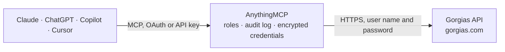

<!-- Generated by scripts/export-github-catalog.mjs in the anythingmcp-website repository. Do not edit by hand. -->

# Gorgias MCP connector

Manage Gorgias (e-commerce helpdesk) tickets, messages, customers, users and macros from any AI agent. The AnythingMCP connector gives Claude, ChatGPT, Microsoft Copilot, Cursor and Gemini 16 MCP tools for Gorgias: 9 read and 7 can change data.

**Category:** [Customer Support](../support.md) · **Tools:** 16 · **Setup guide:** [anythingmcp.com](https://anythingmcp.com/guides/gorgias-to-mcp) · [Deutsch](https://anythingmcp.com/de/guides/gorgias-to-mcp) · [Italiano](https://anythingmcp.com/it/guides/gorgias-to-mcp) · [Español](https://anythingmcp.com/es/guides/gorgias-to-mcp) · [日本語](https://anythingmcp.com/ja/guides/gorgias-to-mcp) · [Русский](https://anythingmcp.com/ru/guides/gorgias-to-mcp) · [中文](https://anythingmcp.com/zh/guides/gorgias-to-mcp)

## Start without code

No installation and no terminal: AnythingMCP Cloud runs the Gorgias connector for you, operated by helpcode.ai in Frankfurt, Germany.

1. **Click the button above** and create an account or sign in. The Gorgias connector opens, ready to install.
2. **Paste the API key or token from your Gorgias account.** Every click is in the [step-by-step guide](https://anythingmcp.com/guides/gorgias-to-mcp).
3. **Click Install.** AnythingMCP shows the address of your MCP server.
4. **Add that address to your assistant:** [Claude](https://anythingmcp.com/guides/connect-gorgias-to-claude) · [ChatGPT](https://anythingmcp.com/guides/connect-gorgias-to-chatgpt) · [Microsoft Copilot](https://anythingmcp.com/guides/connect-gorgias-to-copilot) · [Cursor](https://anythingmcp.com/guides/connect-gorgias-to-cursor) · [Gemini CLI](https://anythingmcp.com/guides/connect-gorgias-to-gemini) · [Meta Muse](https://anythingmcp.com/guides/connect-gorgias-to-muse).
5. **Ask your first question**, for example: *Show me open tickets for customer emily.brooks@lobeflora.co*

Prefer help with the setup? [Talk to us](https://anythingmcp.com/contact).

## How it works

- **The AI client** speaks MCP (Streamable HTTP) to AnythingMCP and only sees tool names, descriptions and results. It never gets the Gorgias credentials.
- **AnythingMCP** checks the client's role, builds the call from the tool definition, adds the credentials (user name and password), calls Gorgias, logs the call and returns the result.
- **Gorgias** sees an ordinary API client with the rights of the account the credentials belong to.

## Tools

| Tool | What it does | Access |
|---|---|---|
| [`gorgias_list_tickets`](#gorgias_list_tickets) | List tickets. | read |
| [`gorgias_get_ticket`](#gorgias_get_ticket) | Get a single ticket by ID with its meta (does NOT include messages — use gorgias_list_ticket_messages). | read |
| [`gorgias_list_ticket_messages`](#gorgias_list_ticket_messages) | List messages on a ticket (the conversation thread). | read |
| [`gorgias_create_ticket`](#gorgias_create_ticket) | Create a new ticket. | write |
| [`gorgias_reply_to_ticket`](#gorgias_reply_to_ticket) | Add a reply message to an existing ticket. | write |
| [`gorgias_update_ticket`](#gorgias_update_ticket) | Update a ticket's status, assignee, tags, priority or subject. | write |
| [`gorgias_list_customers`](#gorgias_list_customers) | List customers. | read |
| [`gorgias_get_customer`](#gorgias_get_customer) | Get a single customer by ID with full profile and integration data (e.g. Shopify orders count). | read |
| [`gorgias_create_customer`](#gorgias_create_customer) | Create a customer record. | write |
| [`gorgias_list_users`](#gorgias_list_users) | List agents in your Gorgias workspace (the people on your team — sender IDs for reply messages). | read |
| [`gorgias_list_all_messages`](#gorgias_list_all_messages) | List messages across all tickets, newest first: body text and HTML, sender and receiver, channel and via, whether it came from an agent, public or internal… | read |
| [`gorgias_find_macros`](#gorgias_find_macros) | List or search macros (saved reply templates with actions such as tags or status changes): name, intent, language, usage count and actions. | read |
| [`gorgias_read_macro`](#gorgias_read_macro) | Get one macro by its id: name, intent, language, usage count and the full list of actions with their arguments (response text, tags, status, assignee). | read |
| [`gorgias_add_macro`](#gorgias_add_macro) | Create a macro (a saved reply template agents apply to tickets) with its name, intent, language and actions such as the response text and tags. | write |
| [`gorgias_edit_macro`](#gorgias_edit_macro) | Change a macro: rename it, change intent or language, or replace its actions. | write |
| [`gorgias_remove_macro`](#gorgias_remove_macro) | Delete a macro so agents can no longer apply it. | write |

## Tool reference

Every parameter as the AI client sees it in `tools/list`. Source: [`packages/backend/src/adapters/intl/gorgias.json`](../../../packages/backend/src/adapters/intl/gorgias.json).

### `gorgias_list_tickets`

List tickets. Filter by status, channel, assigned user, customer, view. Returns each ticket's id, subject, status, channel, customer, assignee_user, last_message_datetime, created/updated timestamps.

**Access:** read · **Call:** `GET /tickets`

| Parameter | Type | Required | Description |
|---|---|---|---|
| `view_id` | integer | no | Filter to a saved view's tickets. |
| `customer_id` | integer | no | Filter to one customer. |
| `assignee_user_id` | integer | no | Filter to one assigned user. |
| `status` | string | no | open, closed, resolved. |
| `channel` | string | no | email, chat, sms, etc. |
| `cursor` | string | no | Pagination cursor. |
| `limit` | integer | no | Per page (max 100). |
| `order_by` | string | no | created_datetime, updated_datetime, last_message_datetime — append :asc or :desc. |

### `gorgias_get_ticket`

Get a single ticket by ID with its meta (does NOT include messages — use gorgias_list_ticket_messages).

**Access:** read · **Call:** `GET /tickets/{ticket_id}`

| Parameter | Type | Required | Description |
|---|---|---|---|
| `ticket_id` | integer | yes | Ticket ID. |

### `gorgias_list_ticket_messages`

List messages on a ticket (the conversation thread). Each message has body_text, body_html, sender, receiver, via (channel), source.

**Access:** read · **Call:** `GET /tickets/{ticket_id}/messages`

| Parameter | Type | Required | Description |
|---|---|---|---|
| `ticket_id` | integer | yes | Ticket ID. |
| `cursor` | string | no | Pagination cursor. |
| `limit` | integer | no | Per page (max 100). |

### `gorgias_create_ticket`

Create a new ticket. Must include at least one message — Gorgias rejects empty tickets. Common pattern: pass `customer.email` + `messages: [{...}]`.

**Access:** write · **Call:** `POST /tickets`

| Parameter | Type | Required | Description |
|---|---|---|---|
| `subject` | string | no | Ticket subject. |
| `status` | string | no | open, closed, resolved. |
| `channel` | string | yes | email, chat, sms, api. |
| `customer` | object | yes | Customer object {email, firstname, lastname} OR {id}. |
| `messages` | any[] | yes | Array of message objects with body_text + sender + receiver + channel + via. |
| `tags` | any[] | no | Array of tag objects {name}. |

### `gorgias_reply_to_ticket`

Add a reply message to an existing ticket. Pass `body_text` + `sender` (your user) + `receiver` (the customer) + `channel`. Use `via: 'help-center'` to send as outbound.

**Access:** write · **Call:** `POST /tickets/{ticket_id}/messages`

| Parameter | Type | Required | Description |
|---|---|---|---|
| `ticket_id` | integer | yes | Ticket ID. |
| `body_text` | string | yes | Plain-text body. |
| `body_html` | string | no | HTML body (preferred for rich content). |
| `sender` | object | yes | {id} of the Gorgias user sending. |
| `receiver` | object | no | {id} of the customer. |
| `channel` | string | yes | email, chat, sms. |
| `from_agent` | boolean | no | true for outbound. |
| `via` | string | no | Source: 'help-center', 'api', etc. |

### `gorgias_update_ticket`

Update a ticket's status, assignee, tags, priority or subject. Send only the fields to change.

**Access:** write · **Call:** `PUT /tickets/{ticket_id}`

| Parameter | Type | Required | Description |
|---|---|---|---|
| `ticket_id` | integer | yes | Ticket ID. |
| `status` | string | no | open, closed, resolved. |
| `assignee_user` | object | no | {id} of the Gorgias user. |
| `tags` | any[] | no | Array of {name} objects. |
| `priority` | string | no | low, normal, high, urgent. |
| `subject` | string | no | New subject. |

### `gorgias_list_customers`

List customers. Filter by email, external_id. Returns id, email, firstname, lastname, channels (linked accounts).

**Access:** read · **Call:** `GET /customers`

| Parameter | Type | Required | Description |
|---|---|---|---|
| `email` | string | no | Exact match on email. |
| `external_id` | string | no | Exact match on external (Shopify etc.) ID. |
| `cursor` | string | no | Pagination cursor. |
| `limit` | integer | no | Per page (max 100). |

### `gorgias_get_customer`

Get a single customer by ID with full profile and integration data (e.g. Shopify orders count).

**Access:** read · **Call:** `GET /customers/{customer_id}`

| Parameter | Type | Required | Description |
|---|---|---|---|
| `customer_id` | integer | yes | Customer ID. |

### `gorgias_create_customer`

Create a customer record. Pass at least email + firstname + lastname.

**Access:** write · **Call:** `POST /customers`

| Parameter | Type | Required | Description |
|---|---|---|---|
| `email` | string | yes | Email. |
| `firstname` | string | no | First name. |
| `lastname` | string | no | Last name. |
| `external_id` | string | no | Optional external system ID (Shopify customer ID etc.). |
| `language` | string | no | ISO 639-1 language code. |
| `timezone` | string | no | TZ database name. |
| `channels` | any[] | no | Additional channel objects: [{type:'email', address:'...'},{type:'phone', address:'+1...'}]. |
| `meta` | object | no | Free-form custom metadata object. |

### `gorgias_list_users`

List agents in your Gorgias workspace (the people on your team — sender IDs for reply messages).

**Access:** read · **Call:** `GET /users`

| Parameter | Type | Required | Description |
|---|---|---|---|
| `cursor` | string | no | Pagination cursor. |
| `limit` | integer | no | Per page. |

### `gorgias_list_all_messages`

List messages across all tickets, newest first: body text and HTML, sender and receiver, channel and via, whether it came from an agent, public or internal note, and the sent, opened or failed timestamps. Use it to review recent customer messages or agent replies account-wide; for one conversation use gorgias_list_ticket_messages. Cursor-paged: pass meta.next_cursor as cursor until it is empty.

**Access:** read · **Call:** `GET /messages`

| Parameter | Type | Required | Description |
|---|---|---|---|
| `ticket_id` | integer | no | Only messages of this ticket. |
| `order_by` | `created_datetime:desc` \| `created_datetime:asc` | no | Sort order; newest first by default. |
| `cursor` | string | no | Pagination cursor from meta.next_cursor. |
| `limit` | integer | no | Per page, 1 to 100 (default 30). |

### `gorgias_find_macros`

List or search macros (saved reply templates with actions such as tags or status changes): name, intent, language, usage count and actions. Search by text, filter by tags or language, or rank the best macros to answer a ticket with order_by=relevance and ticket_id. Cursor-paged.

**Access:** read · **Call:** `GET /macros`

| Parameter | Type | Required | Description |
|---|---|---|---|
| `search` | string | no | Text to search in macros. |
| `tags` | string[] | no | Only macros that carry all of these tags. |
| `languages` | string[] | no | Only macros in one of these languages (ISO 639-1). |
| `ticket_id` | integer | no | With order_by=relevance: rank macros by how well they answer this ticket. |
| `message_id` | integer | no | With order_by=relevance and ticket_id: rank by fit to this message of the ticket. |
| `number_predictions` | integer | no | How many of the most relevant macros to put at the top. |
| `order_by` | `usage:desc` \| `usage:asc` \| `name:asc` \| `name:desc` \| `created_datetime:desc` \| `created_datetime:asc` \| `updated_datetime:desc` \| `updated_datetime:asc` \| `language:asc` \| `language:desc` \| `relevance` | no | Sort order; most used first by default. |
| `archived` | boolean | no | true lists only archived macros. |
| `cursor` | string | no | Pagination cursor from meta.next_cursor. |
| `limit` | integer | no | Per page, 1 to 100 (default 30). |

### `gorgias_read_macro`

Get one macro by its id: name, intent, language, usage count and the full list of actions with their arguments (response text, tags, status, assignee). Read-only.

**Access:** read · **Call:** `GET /macros/{macro_id}`

| Parameter | Type | Required | Description |
|---|---|---|---|
| `macro_id` | integer | yes | Macro id from gorgias_find_macros. |

### `gorgias_add_macro`

Create a macro (a saved reply template agents apply to tickets) with its name, intent, language and actions such as the response text and tags. Returns the new macro. Show the user the text and actions before creating.

**Access:** write · **Call:** `POST /macros`

| Parameter | Type | Required | Description |
|---|---|---|---|
| `name` | string | yes | Macro name, easy to search for agents. |
| `intent` | `discount/request` \| `exchange/request` \| `exchange/status` \| `feedback` \| `order/damaged` \| `order/cancel` \| `order/change` \| `order/wrong` \| `other/no_reply` \| `other/question` \| `other/thanks` \| `product/recommendation` \| `product/question` \| `refund/request` \| `refund/status` \| `return/request` \| `return/status` \| `shipping/change` \| `shipping/delivery-issue` \| `shipping/policy` \| `shipping/status` \| `stock/request` \| `subscription/cancel` \| `subscription/change` | no | What the macro answers, e.g. shipping/status or refund/request. |
| `language` | string | no | ISO 639-1 language code, e.g. en, de, fr. |
| `actions` | object[] | no | What the macro does when applied, e.g. [{"name": "setResponseText", "title": "Response text", "type": "user", "arguments": {"body_text": "Hi {{ticket.customer.firstname}}, ...", "body_html": "
Hi {{ticket.customer.firstname}}, ...
"}}, {"name": "addTags", "title": "Add tags", "type": "user", "arguments": {"tags": "shipping, wismo"}}]. Read an existing macro with gorgias_read_macro to copy the shape of other actions. |
| `external_id` | string | no | Your own id for the macro in another system; Gorgias does not use it. |

### `gorgias_edit_macro`

Change a macro: rename it, change intent or language, or replace its actions. Send the full actions list you want to keep, because the list you send replaces the current one; read it first with gorgias_read_macro. Confirm the change with the user, as every agent uses the macro.

**Access:** write · **Call:** `PUT /macros/{macro_id}`

| Parameter | Type | Required | Description |
|---|---|---|---|
| `macro_id` | integer | yes | Macro id from gorgias_find_macros. |
| `name` | string | no | Macro name, easy to search for agents. |
| `intent` | `discount/request` \| `exchange/request` \| `exchange/status` \| `feedback` \| `order/damaged` \| `order/cancel` \| `order/change` \| `order/wrong` \| `other/no_reply` \| `other/question` \| `other/thanks` \| `product/recommendation` \| `product/question` \| `refund/request` \| `refund/status` \| `return/request` \| `return/status` \| `shipping/change` \| `shipping/delivery-issue` \| `shipping/policy` \| `shipping/status` \| `stock/request` \| `subscription/cancel` \| `subscription/change` | no | What the macro answers, e.g. shipping/status or refund/request. |
| `language` | string | no | ISO 639-1 language code, e.g. en, de, fr. |
| `actions` | object[] | no | What the macro does when applied, e.g. [{"name": "setResponseText", "title": "Response text", "type": "user", "arguments": {"body_text": "Hi {{ticket.customer.firstname}}, ...", "body_html": "
Hi {{ticket.customer.firstname}}, ...
"}}, {"name": "addTags", "title": "Add tags", "type": "user", "arguments": {"tags": "shipping, wismo"}}]. Read an existing macro with gorgias_read_macro to copy the shape of other actions. |
| `external_id` | string | no | Your own id for the macro in another system; Gorgias does not use it. |

### `gorgias_remove_macro`

Delete a macro so agents can no longer apply it. This connector cannot restore it, so name the macro and get a yes first. Installed switched off.

**Access:** write · **Call:** `DELETE /macros/{macro_id}`

| Parameter | Type | Required | Description |
|---|---|---|---|
| `macro_id` | integer | yes | Macro id from gorgias_find_macros. |

## Run it yourself

AnythingMCP is open source (AGPL-3.0). [Run it with Docker](../../../README.md#run-it-yourself), open **Connectors → Store**, pick **Gorgias** and enter `GORGIAS_SUBDOMAIN`, `GORGIAS_EMAIL`, `GORGIAS_API_KEY`, then add your MCP server URL to the AI client.

[← Customer Support connectors](../support.md) · [All categories](../README.md)
