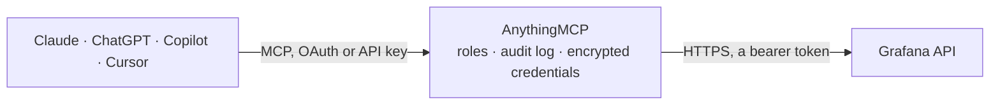

<!-- Generated by scripts/export-github-catalog.mjs in the anythingmcp-website repository. Do not edit by hand. -->

# Grafana MCP connector

Let your AI read your Grafana: search dashboards and see their panels and queries, query Prometheus, Loki and SQL data sources, see which alerts are firing and how the rules are defined, read and add … The AnythingMCP connector gives Claude, ChatGPT, Microsoft Copilot, Cursor and Gemini 16 MCP tools for Grafana: 15 read and 1 can change data.

**Category:** [Monitoring](../monitoring.md) · **Tools:** 16 · **Setup guide:** [anythingmcp.com](https://anythingmcp.com/guides/grafana-to-mcp) · [Deutsch](https://anythingmcp.com/de/guides/grafana-to-mcp) · [Italiano](https://anythingmcp.com/it/guides/grafana-to-mcp) · [Español](https://anythingmcp.com/es/guides/grafana-to-mcp) · [日本語](https://anythingmcp.com/ja/guides/grafana-to-mcp) · [Русский](https://anythingmcp.com/ru/guides/grafana-to-mcp) · [中文](https://anythingmcp.com/zh/guides/grafana-to-mcp)

## Start without code

No installation and no terminal: AnythingMCP Cloud runs the Grafana connector for you, operated by helpcode.ai in Frankfurt, Germany.

1. **Click the button above** and create an account or sign in. The Grafana connector opens, ready to install.
2. **Paste the API key or token from your Grafana account.** Every click is in the [step-by-step guide](https://anythingmcp.com/guides/grafana-to-mcp).
3. **Click Install.** AnythingMCP shows the address of your MCP server.
4. **Add that address to your assistant:** [Claude](https://anythingmcp.com/guides/connect-grafana-to-claude) · [ChatGPT](https://anythingmcp.com/guides/connect-grafana-to-chatgpt) · [Microsoft Copilot](https://anythingmcp.com/guides/connect-grafana-to-copilot) · [Cursor](https://anythingmcp.com/guides/connect-grafana-to-cursor) · [Gemini CLI](https://anythingmcp.com/guides/connect-grafana-to-gemini) · [Meta Muse](https://anythingmcp.com/guides/connect-grafana-to-muse).
5. **Ask your first question**, for example: *Show panels and queries in dashboard 'Billing - Q3 2026' uid BQ3dash*

Prefer help with the setup? [Talk to us](https://anythingmcp.com/contact).

## How it works

- **The AI client** speaks MCP (Streamable HTTP) to AnythingMCP and only sees tool names, descriptions and results. It never gets the Grafana credentials.
- **AnythingMCP** checks the client's role, builds the call from the tool definition, adds the credentials (a bearer token), calls Grafana, logs the call and returns the result.
- **Grafana** sees an ordinary API client with the rights of the account the credentials belong to.

## Tools

| Tool | What it does | Access |
|---|---|---|
| [`grafana_get_health`](#grafana_get_health) | Check that the Grafana instance is up: database state, Grafana version and commit. | read |
| [`grafana_get_current_org`](#grafana_get_current_org) | Read the Grafana organization the service account token belongs to: id and name. | read |
| [`grafana_search`](#grafana_search) | Search dashboards and folders by title, tag or folder: uid, title, type (dash-db for dashboards, dash-folder for folders), tags, folder and URL path. | read |
| [`grafana_list_folders`](#grafana_list_folders) | List folders: uid and title, top level by default or the subfolders of a parent. | read |
| [`grafana_get_dashboard`](#grafana_get_dashboard) | Read a dashboard by uid in a compact form: title, tags, folder, time range, variables (name, type, current value) and panels with id, title, type, data… | read |
| [`grafana_list_datasources`](#grafana_list_datasources) | List the data sources: uid, name, type (prometheus, loki, postgres...), URL, access mode and which one is the default. | read |
| [`grafana_get_datasource`](#grafana_get_datasource) | Read one data source by uid: name, type, URL, access mode, default flag and its non-secret settings (jsonData). | read |
| [`grafana_query_datasource`](#grafana_query_datasource) | Run a query against a data source through Grafana and return the result frames: a PromQL query for Prometheus or Mimir, a LogQL query for Loki, or SQL for a… | read |
| [`grafana_list_alert_rules`](#grafana_list_alert_rules) | List the Grafana-managed alert rules: uid, title, folder, rule group, paused or not, pending period (for), labels, summary, what happens on no data or… | read |
| [`grafana_get_alert_rule`](#grafana_get_alert_rule) | Read one alert rule by uid: title, folder, group, condition, the queries and expressions it evaluates (data source uid, expression, time range), pending… | read |
| [`grafana_list_firing_alerts`](#grafana_list_firing_alerts) | List the alert instances in Grafana's Alertmanager, by default the active ones (firing): alert name and labels, summary and description, state (active,… | read |
| [`grafana_list_annotations`](#grafana_list_annotations) | List annotations (event markers on graphs such as deployments or incidents, and alert state changes): id, time and end time (epoch milliseconds), text,… | read |
| [`grafana_create_annotation`](#grafana_create_annotation) | Add an annotation (an event marker such as a deployment, incident or maintenance window) that shows on graphs for everyone who opens the dashboard. | write |
| [`grafana_list_org_users`](#grafana_list_org_users) | List the users of the organization: user id, login, email, name, role (Viewer, Editor, Admin), last seen and disabled flag. | read |
| [`grafana_search_teams`](#grafana_search_teams) | Search the teams of the organization: id, uid, name, email and member count. | read |
| [`grafana_list_contact_points`](#grafana_list_contact_points) | List the alerting contact points (where notifications go): uid, name, integration type (email, slack, pagerduty, webhook...) and whether resolve messages… | read |

## Tool reference

Every parameter as the AI client sees it in `tools/list`. Source: [`packages/backend/src/adapters/intl/grafana.json`](../../../packages/backend/src/adapters/intl/grafana.json).

### `grafana_get_health`

Check that the Grafana instance is up: database state, Grafana version and commit. Grafana answers this without a token, so it does not prove the token works; grafana_get_current_org does. Read-only.

**Access:** read · **Call:** `GET /health`

No parameters.

### `grafana_get_current_org`

Read the Grafana organization the service account token belongs to: id and name. A quick check that the instance URL and token work. Read-only.

**Access:** read · **Call:** `GET /org`

No parameters.

### `grafana_search`

Search dashboards and folders by title, tag or folder: uid, title, type (dash-db for dashboards, dash-folder for folders), tags, folder and URL path. The uid is what grafana_get_dashboard takes. Read-only.

**Access:** read · **Call:** `GET /search`

| Parameter | Type | Required | Description |
|---|---|---|---|
| `query` | string | no | Text the title should contain. Omit to list everything. |
| `type` | `dash-db` \| `dash-folder` | no | dash-db for dashboards only, dash-folder for folders only. |
| `tag` | string[] | no | Only dashboards with all of these tags. |
| `folder_uids` | string[] | no | Only dashboards in these folders (uids from grafana_list_folders). |
| `starred` | boolean | no | Only dashboards the service account starred. |
| `limit` | integer | no | Results per page (default 50). |
| `page` | integer | no | Page number from 1, with limit as the page size. |

### `grafana_list_folders`

List folders: uid and title, top level by default or the subfolders of a parent. Folder uids narrow grafana_search. Read-only.

**Access:** read · **Call:** `GET /folders`

| Parameter | Type | Required | Description |
|---|---|---|---|
| `parent_uid` | string | no | List the subfolders of this folder uid (nested folders). |
| `limit` | integer | no | Folders per page (default 100). |
| `page` | integer | no | Page number from 1. |

### `grafana_get_dashboard`

Read a dashboard by uid in a compact form: title, tags, folder, time range, variables (name, type, current value) and panels with id, title, type, data source and their queries (PromQL, LogQL, SQL), including the panels inside collapsed rows. Layout and styling are left out. Read-only.

**Access:** read · **Call:** `GET /dashboards/uid/{uid}`

| Parameter | Type | Required | Description |
|---|---|---|---|
| `uid` | string | yes | Dashboard uid from grafana_search (the part after /d/ in a dashboard URL). |

### `grafana_list_datasources`

List the data sources: uid, name, type (prometheus, loki, postgres...), URL, access mode and which one is the default. The uid is what grafana_query_datasource takes. No credentials are returned. Read-only.

**Access:** read · **Call:** `GET /datasources`

No parameters.

### `grafana_get_datasource`

Read one data source by uid: name, type, URL, access mode, default flag and its non-secret settings (jsonData). Passwords and keys are stored encrypted by Grafana and never returned. Read-only.

**Access:** read · **Call:** `GET /datasources/uid/{uid}`

| Parameter | Type | Required | Description |
|---|---|---|---|
| `uid` | string | yes | Data source uid from grafana_list_datasources. |

### `grafana_query_datasource`

Run a query against a data source through Grafana and return the result frames: a PromQL query for Prometheus or Mimir, a LogQL query for Loki, or SQL for a SQL data source. Each frame has the field names and labels (schema.fields) and the values column by column (data.values); times are epoch milliseconds. Large answers are cut at about 60 KB, so use short ranges, aggregations and max_lines. Read-only (the API takes the query in a POST body).

**Access:** read · **Call:** `POST /ds/query`

| Parameter | Type | Required | Description |
|---|---|---|---|
| `datasource_uid` | string | yes | Data source uid from grafana_list_datasources. |
| `expr` | string | no | PromQL (Prometheus, Mimir) or LogQL (Loki) expression, e.g. sum by (job) (rate(http_requests_total[5m])) or {app="api"} \|= "error". |
| `raw_sql` | string | no | SQL for a SQL data source (PostgreSQL, MySQL, Microsoft SQL Server) instead of expr. |
| `format` | `table` \| `time_series` | no | SQL result format (default table). |
| `from` | string | no | Start of the range: relative such as now-1h or now-7d, or epoch milliseconds as a string. Default now-1h. |
| `to` | string | no | End of the range, e.g. now (default) or epoch milliseconds. |
| `instant` | boolean | no | Prometheus: true for one value per series at the end of the range instead of a series over time. |
| `query_type` | `range` \| `instant` | no | Loki: range (default, log lines or values over time) or instant (one value per series). |
| `max_lines` | integer | no | Loki log queries: most log lines to return (default 100). |
| `max_data_points` | integer | no | Most points per series (default 200); fewer points mean a coarser step. |
| `interval_ms` | integer | no | Step between points in milliseconds, e.g. 60000 for one minute. |

### `grafana_list_alert_rules`

List the Grafana-managed alert rules: uid, title, folder, rule group, paused or not, pending period (for), labels, summary, what happens on no data or errors, and last update. Rule definitions only; which alerts fire right now is grafana_list_firing_alerts. Answers over about 60 KB keep the first rules and say how many were left out. Read-only.

**Access:** read · **Call:** `GET /v1/provisioning/alert-rules`

No parameters.

### `grafana_get_alert_rule`

Read one alert rule by uid: title, folder, group, condition, the queries and expressions it evaluates (data source uid, expression, time range), pending period, labels, annotations and notification settings. Read-only.

**Access:** read · **Call:** `GET /v1/provisioning/alert-rules/{uid}`

| Parameter | Type | Required | Description |
|---|---|---|---|
| `uid` | string | yes | Alert rule uid from grafana_list_alert_rules (labels.__alert_rule_uid__ on a firing alert). |

### `grafana_list_firing_alerts`

List the alert instances in Grafana's Alertmanager, by default the active ones (firing): alert name and labels, summary and description, state (active, suppressed, unprocessed), who silenced or inhibited it, when it started, contact points and a link to the rule. Answers over about 60 KB keep the first alerts and say how many were left out; narrow them with filter. Read-only.

**Access:** read · **Call:** `GET /alertmanager/grafana/api/v2/alerts`

| Parameter | Type | Required | Description |
|---|---|---|---|
| `active` | boolean | no | Include active alerts (default true). |
| `silenced` | boolean | no | Include silenced alerts (Grafana default true). |
| `inhibited` | boolean | no | Include inhibited alerts (Grafana default true). |
| `filter` | string[] | no | Label matchers that must all match, e.g. ["severity=critical", "team=~payments.*"]. |
| `receiver` | string | no | Regular expression the contact point name must match. |

### `grafana_list_annotations`

List annotations (event markers on graphs such as deployments or incidents, and alert state changes): id, time and end time (epoch milliseconds), text, tags, dashboard and panel, and for alert annotations the old and new state. Read-only.

**Access:** read · **Call:** `GET /annotations`

| Parameter | Type | Required | Description |
|---|---|---|---|
| `from` | integer | no | Only annotations after this time, epoch milliseconds. |
| `to` | integer | no | Only annotations before this time, epoch milliseconds. |
| `dashboard_uid` | string | no | Only annotations of this dashboard. |
| `panel_id` | integer | no | Only annotations of this panel (with dashboard_uid). |
| `tags` | string[] | no | Only organization annotations with these tags. |
| `match_any` | boolean | no | true: any of the tags is enough; default: all tags must match. |
| `type` | `annotation` \| `alert` | no | annotation for user-created ones, alert for alert state changes. |
| `limit` | integer | no | Most annotations to return (default 100). |

### `grafana_create_annotation`

Add an annotation (an event marker such as a deployment, incident or maintenance window) that shows on graphs for everyone who opens the dashboard. Without dashboard_uid it is an organization annotation, shown on dashboards that query annotations by tag. Needs the Editor role. Before calling, show the user the text, time and tags and wait for their yes. Returns the new annotation id.

**Access:** write · **Call:** `POST /annotations`

| Parameter | Type | Required | Description |
|---|---|---|---|
| `text` | string | yes | Text of the annotation. |
| `time` | integer | no | When it happened, epoch milliseconds. Default: now. |
| `time_end` | integer | no | End time in epoch milliseconds, for a region instead of a point. |
| `tags` | string[] | no | Tags such as ["deploy", "api"]. |
| `dashboard_uid` | string | no | Dashboard to attach it to (optional). |
| `panel_id` | integer | no | Panel of that dashboard to attach it to (optional). |

### `grafana_list_org_users`

List the users of the organization: user id, login, email, name, role (Viewer, Editor, Admin), last seen and disabled flag. Needs the Admin role (org.users:read); a Viewer token gets 403. Read-only.

**Access:** read · **Call:** `GET /org/users`

| Parameter | Type | Required | Description |
|---|---|---|---|
| `query` | string | no | Only users whose login, email or name contains this text. |
| `limit` | integer | no | Most users to return (default 100). |

### `grafana_search_teams`

Search the teams of the organization: id, uid, name, email and member count. Needs the Admin role or the teams:read permission; a Viewer token gets 403. Read-only.

**Access:** read · **Call:** `GET /teams/search`

| Parameter | Type | Required | Description |
|---|---|---|---|
| `query` | string | no | Only teams whose name contains this text. |
| `per_page` | integer | no | Teams per page (default 100). |
| `page` | integer | no | Page number from 1; totalCount says how many teams there are. |

### `grafana_list_contact_points`

List the alerting contact points (where notifications go): uid, name, integration type (email, slack, pagerduty, webhook...) and whether resolve messages are off. Their settings are left out because they hold webhook URLs, keys and passwords. Read-only.

**Access:** read · **Call:** `GET /v1/provisioning/contact-points`

| Parameter | Type | Required | Description |
|---|---|---|---|
| `name` | string | no | Only the contact point with exactly this name. |

## Run it yourself

AnythingMCP is open source (AGPL-3.0). [Run it with Docker](../../../README.md#run-it-yourself), open **Connectors → Store**, pick **Grafana** and enter `GRAFANA_URL`, `GRAFANA_SERVICE_ACCOUNT_TOKEN`, then add your MCP server URL to the AI client.

[← Monitoring connectors](../monitoring.md) · [All categories](../README.md)
