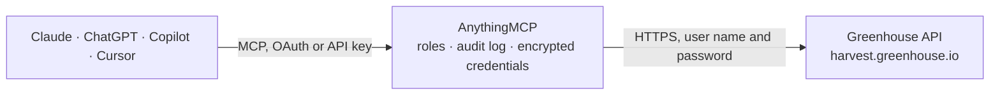

<!-- Generated by scripts/export-github-catalog.mjs in the anythingmcp-website repository. Do not edit by hand. -->

# Greenhouse MCP connector

Manage Greenhouse (ATS recruiting: candidates, applications, jobs, scorecards, offers) from any AI agent. 10 tools, basic-auth. The AnythingMCP connector gives Claude, ChatGPT, Microsoft Copilot, Cursor and Gemini 10 MCP tools for Greenhouse: 7 read and 3 can change data.

**Category:** [HR](../hr.md) · **Tools:** 10 · **Setup guide:** [anythingmcp.com](https://anythingmcp.com/guides/greenhouse-to-mcp) · [Deutsch](https://anythingmcp.com/de/guides/greenhouse-to-mcp) · [Italiano](https://anythingmcp.com/it/guides/greenhouse-to-mcp) · [Español](https://anythingmcp.com/es/guides/greenhouse-to-mcp) · [日本語](https://anythingmcp.com/ja/guides/greenhouse-to-mcp) · [Русский](https://anythingmcp.com/ru/guides/greenhouse-to-mcp) · [中文](https://anythingmcp.com/zh/guides/greenhouse-to-mcp)

## Start without code

No installation and no terminal: AnythingMCP Cloud runs the Greenhouse connector for you, operated by helpcode.ai in Frankfurt, Germany.

1. **Click the button above** and create an account or sign in. The Greenhouse connector opens, ready to install.
2. **Paste the API key or token from your Greenhouse account.** Every click is in the [step-by-step guide](https://anythingmcp.com/guides/greenhouse-to-mcp).
3. **Click Install.** AnythingMCP shows the address of your MCP server.
4. **Add that address to your assistant:** [Claude](https://anythingmcp.com/guides/connect-greenhouse-to-claude) · [ChatGPT](https://anythingmcp.com/guides/connect-greenhouse-to-chatgpt) · [Microsoft Copilot](https://anythingmcp.com/guides/connect-greenhouse-to-copilot) · [Cursor](https://anythingmcp.com/guides/connect-greenhouse-to-cursor) · [Gemini CLI](https://anythingmcp.com/guides/connect-greenhouse-to-gemini) · [Meta Muse](https://anythingmcp.com/guides/connect-greenhouse-to-muse).
5. **Ask your first question**, for example: *Show all applications and current stages for candidate Ana Ruiz (email ana.ruiz@seabridge.io).*

Prefer help with the setup? [Talk to us](https://anythingmcp.com/contact).

## How it works

- **The AI client** speaks MCP (Streamable HTTP) to AnythingMCP and only sees tool names, descriptions and results. It never gets the Greenhouse credentials.
- **AnythingMCP** checks the client's role, builds the call from the tool definition, adds the credentials (user name and password), calls Greenhouse, logs the call and returns the result.
- **Greenhouse** sees an ordinary API client with the rights of the account the credentials belong to.

## Tools

| Tool | What it does | Access |
|---|---|---|
| [`greenhouse_list_candidates`](#greenhouse_list_candidates) | List candidates. | read |
| [`greenhouse_get_candidate`](#greenhouse_get_candidate) | Get one candidate with all applications + custom fields. | read |
| [`greenhouse_create_candidate`](#greenhouse_create_candidate) | Create a candidate (+ optionally an application). | write |
| [`greenhouse_list_applications`](#greenhouse_list_applications) | List applications. | read |
| [`greenhouse_advance_application`](#greenhouse_advance_application) | Move an application to the next pipeline stage. | write |
| [`greenhouse_reject_application`](#greenhouse_reject_application) | Reject an application with a reason. | write |
| [`greenhouse_list_jobs`](#greenhouse_list_jobs) | List jobs. | read |
| [`greenhouse_get_job`](#greenhouse_get_job) | Get one job with full job_post + hiring team + openings. | read |
| [`greenhouse_list_scorecards`](#greenhouse_list_scorecards) | List scorecards for an application. | read |
| [`greenhouse_list_users`](#greenhouse_list_users) | List Greenhouse users (recruiters, interviewers, etc.). | read |

## Tool reference

Every parameter as the AI client sees it in `tools/list`. Source: [`packages/backend/src/adapters/intl/greenhouse.json`](../../../packages/backend/src/adapters/intl/greenhouse.json).

### `greenhouse_list_candidates`

List candidates. Filter by created/updated date, job, status.

**Access:** read · **Call:** `GET /candidates`

| Parameter | Type | Required | Description |
|---|---|---|---|
| `per_page` | integer | no | Max 500. |
| `page` | integer | no | 1-based. |
| `created_after` | string | no | ISO 8601 datetime. |
| `updated_after` | string | no | ISO 8601. |
| `job_id` | integer | no | Filter to candidates with an application on this job. |
| `email` | string | no | Filter by primary email. |

### `greenhouse_get_candidate`

Get one candidate with all applications + custom fields.

**Access:** read · **Call:** `GET /candidates/{candidate_id}`

| Parameter | Type | Required | Description |
|---|---|---|---|
| `candidate_id` | integer | yes | Candidate ID. |

### `greenhouse_create_candidate`

Create a candidate (+ optionally an application).

**Access:** write · **Call:** `POST /candidates`

| Parameter | Type | Required | Description |
|---|---|---|---|
| `first_name` | string | yes | First name. |
| `last_name` | string | yes | Last name. |
| `email_addresses` | any[] | no | Array of {value, type:'personal'\|'work'}. |
| `phone_numbers` | any[] | no | Array of {value, type}. |
| `applications` | any[] | no | Array of {job_id, source_id?, initial_stage_id?}. |
| `on_behalf_of` | integer | yes | Greenhouse user ID to attribute the create to. |

### `greenhouse_list_applications`

List applications. Filter by candidate, job, status (active, hired, rejected).

**Access:** read · **Call:** `GET /applications`

| Parameter | Type | Required | Description |
|---|---|---|---|
| `candidate_id` | integer | no | Filter to one candidate. |
| `job_id` | integer | no | Filter to one job. |
| `status` | string | no | active, rejected, hired, converted. |
| `per_page` | integer | no | Max 500. |
| `page` | integer | no | 1-based. |

### `greenhouse_advance_application`

Move an application to the next pipeline stage. Optionally specify `to_stage_id` to skip stages.

**Access:** write · **Call:** `POST /applications/{application_id}/advance`

| Parameter | Type | Required | Description |
|---|---|---|---|
| `application_id` | integer | yes | Application ID. |
| `on_behalf_of` | integer | yes | Greenhouse user ID. |
| `from_stage_id` | integer | no | Current stage (defensive concurrency check). |
| `to_stage_id` | integer | no | Target stage. Omit to advance one. |

### `greenhouse_reject_application`

Reject an application with a reason.

**Access:** write · **Call:** `POST /applications/{application_id}/reject`

| Parameter | Type | Required | Description |
|---|---|---|---|
| `application_id` | integer | yes | Application ID. |
| `on_behalf_of` | integer | yes | Greenhouse user ID. |
| `rejection_reason_id` | integer | yes | Rejection reason ID. |
| `notes` | string | no | Optional notes visible to recruiters. |

### `greenhouse_list_jobs`

List jobs. Filter by status (open, closed, draft), department.

**Access:** read · **Call:** `GET /jobs`

| Parameter | Type | Required | Description |
|---|---|---|---|
| `status` | string | no | open, closed, draft. |
| `department_id` | integer | no | Filter by department. |
| `per_page` | integer | no | Max 500. |
| `page` | integer | no | 1-based. |

### `greenhouse_get_job`

Get one job with full job_post + hiring team + openings.

**Access:** read · **Call:** `GET /jobs/{job_id}`

| Parameter | Type | Required | Description |
|---|---|---|---|
| `job_id` | integer | yes | Job ID. |

### `greenhouse_list_scorecards`

List scorecards for an application.

**Access:** read · **Call:** `GET /applications/{application_id}/scorecards`

| Parameter | Type | Required | Description |
|---|---|---|---|
| `application_id` | integer | yes | Application ID. |
| `per_page` | integer | no | Max 500. |

### `greenhouse_list_users`

List Greenhouse users (recruiters, interviewers, etc.).

**Access:** read · **Call:** `GET /users`

| Parameter | Type | Required | Description |
|---|---|---|---|
| `per_page` | integer | no | Max 500. |
| `page` | integer | no | 1-based. |
| `email` | string | no | Filter by email. |

## Run it yourself

AnythingMCP is open source (AGPL-3.0). [Run it with Docker](../../../README.md#run-it-yourself), open **Connectors → Store**, pick **Greenhouse** and enter `GREENHOUSE_API_KEY`, then add your MCP server URL to the AI client.

[← HR connectors](../hr.md) · [All categories](../README.md)
